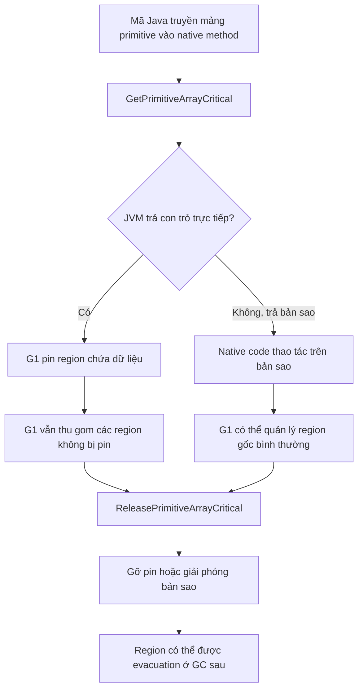

# JEP 423: G1 region pinning và vấn đề khi mã native giữ vùng nhớ heap

JEP 423 được đưa vào JDK 22 để cải thiện cách Garbage-First Garbage Collector (G1) xử lý các vùng nhớ đang được mã native truy cập qua Java Native Interface (JNI). Trước đây, một JNI critical region có thể khiến G1 phải chờ trước khi thực hiện garbage collection (GC). Với region pinning, G1 có thể tiếp tục thu gom các vùng heap khác trong khi vẫn giữ nguyên vị trí của dữ liệu mà mã native đang sử dụng.

Đây là cải tiến của bộ thu gom rác, không phải cú pháp Java mới hay API preview. Cơ chế vẫn được tài liệu GC của các JDK hiện hành mô tả; vì vậy kiến thức này tiếp tục hữu ích khi vận hành ứng dụng dùng G1 và thư viện native.

## 1. Vì sao G1 cần biết một vùng nhớ đang được pin?

G1 chia Java heap thành nhiều region. Trong một lần thu gom, G1 chọn một tập region cần xử lý, thường gọi là *collection set*. G1 di chuyển các đối tượng còn sống từ những region này sang region khác. Sau khi di chuyển thành công, các region nguồn có thể được giải phóng và tái sử dụng. Quá trình di chuyển đối tượng này được gọi là *evacuation*.

Mã Java thông thường làm việc với tham chiếu đối tượng do JVM quản lý. JVM có thể cập nhật các tham chiếu khi GC di chuyển đối tượng. Mã native có thể làm việc trực tiếp với địa chỉ bộ nhớ. Chẳng hạn, JNI cung cấp `GetPrimitiveArrayCritical` để lấy con trỏ đến dữ liệu của một mảng primitive. Con trỏ này chỉ hợp lệ trong khoảng thời gian trước khi gọi hàm `ReleasePrimitiveArrayCritical` tương ứng.

Khi có thể, JVM trả về con trỏ trực tiếp đến dữ liệu trong heap. Trong trường hợp khác, JVM có thể tạo một bản sao và trả về con trỏ đến vùng nhớ của bản sao đó. Nếu mã native đang giữ con trỏ trực tiếp mà GC di chuyển mảng, con trỏ native sẽ không còn trỏ đến vị trí dữ liệu hợp lệ. G1 vì thế phải bảo vệ dữ liệu đang được native truy cập.

Trước JEP 423, cách bảo vệ này có thể buộc G1 chờ critical region kết thúc rồi mới thực hiện GC. Nếu mã native giữ critical region lâu hơn dự kiến, GC bị trì hoãn. Trong thời gian chờ, ứng dụng vẫn có thể tiếp tục cấp phát đối tượng và làm tăng áp lực lên heap.

## 2. JEP 423 giải quyết vấn đề như thế nào?

JEP 423 bổ sung cơ chế *region pinning* cho G1. Khi mã native lấy được con trỏ trực tiếp đến dữ liệu trong heap qua JNI critical API, G1 đánh dấu region chứa dữ liệu đó là đang được pin. G1 giữ đối tượng được native truy cập ở nguyên vị trí để con trỏ vẫn hợp lệ.

Trong lúc đó, G1 vẫn có thể thực hiện GC trên các region không bị pin. Nhờ vậy, một critical region không còn buộc toàn bộ hoạt động GC của G1 phải chờ kết thúc. Sau khi mã native gọi hàm release tương ứng, trạng thái pin được gỡ bỏ; region có thể được xem xét để evacuation trong các chu kỳ GC tiếp theo.

Quy trình khái quát:



Điểm quan trọng là G1 pin ở cấp **region**, không chỉ khóa riêng một đối tượng. Region đang chứa dữ liệu được native truy cập phải được bảo vệ khỏi việc di chuyển hoặc thu hồi theo cách làm mất hiệu lực con trỏ. Vì thế, một region có thể tạm thời không được giải phóng hoàn toàn dù phần lớn dữ liệu trong đó không còn cần thiết. G1 có thể tiếp tục thu gom các vùng khác và thử evacuation lại khi điều kiện pin không còn.

`GetPrimitiveArrayCritical` không đảm bảo lúc nào cũng trả về địa chỉ trực tiếp của mảng. JVM vẫn có thể trả về bản sao, ví dụ khi cách biểu diễn dữ liệu nội bộ không phù hợp để cung cấp con trỏ trực tiếp. Tham số `isCopy`, nếu được truyền vào, cho biết JVM có tạo bản sao hay không. Mã native không nên giả định rằng mọi lần gọi đều dẫn đến pin một region.

## 3. Ví dụ sử dụng JNI critical region

Giả sử ứng dụng cần nhân từng phần tử của một mảng `double` với một hệ số trong native code.

Phần khai báo Java:

```java
package com.example;

public final class NativeScaler {
    private NativeScaler() {}

    public static native void multiply(double[] values, double factor);
}
```

Phần triển khai JNI bằng C:

```c
#include <jni.h>

JNIEXPORT void JNICALL
Java_com_example_NativeScaler_multiply(JNIEnv *env, jclass clazz,
                                       jdoubleArray values, jdouble factor) {
    /* Lấy độ dài trước khi vào critical region. */
    const jsize length = (*env)->GetArrayLength(env, values);

    jdouble *elements =
        (*env)->GetPrimitiveArrayCritical(env, values, NULL);

    if (elements == NULL) {
        /* JVM có thể đã đặt một exception đang chờ xử lý. */
        return;
    }

    /* Chỉ thao tác trên con trỏ; không gọi JNI tùy ý hoặc thực hiện I/O. */
    for (jsize i = 0; i < length; ++i) {
        elements[i] *= factor;
    }

    (*env)->ReleasePrimitiveArrayCritical(env, values, elements, 0);
}
```

Trong ví dụ:

- `GetArrayLength` được gọi trước khi vào critical region.
- Nếu `GetPrimitiveArrayCritical` trả về `NULL`, hàm native kết thúc và để JVM xử lý exception đang chờ nếu có.
- Trong khoảng giữa hàm lấy con trỏ và hàm release, mã native chỉ thao tác trên vùng dữ liệu đã nhận.
- `ReleasePrimitiveArrayCritical` với mode `0` yêu cầu copy dữ liệu trở lại mảng Java nếu JVM đã tạo bản sao, đồng thời giải phóng bản sao đó. Nếu JVM trả về con trỏ trực tiếp, lời gọi này kết thúc việc truy cập critical region và cho phép G1 gỡ pin tương ứng.

Ví dụ này minh họa cách dùng JNI critical API có giới hạn thời gian ngắn. Region pinning không làm thay đổi hợp đồng sử dụng các hàm JNI này.

## 4. Những giới hạn vẫn phải tuân thủ

Region pinning giúp G1 tiếp tục thu gom các region khác, nhưng không biến critical region thành một vùng thực thi native tùy ý. Theo JNI Specification, mã native trong cặp `GetPrimitiveArrayCritical` / `ReleasePrimitiveArrayCritical` cần tuân thủ các nguyên tắc sau:

- Giữ critical region ngắn nhất có thể và gọi hàm release tương ứng ngay khi không còn cần con trỏ.
- Không gọi các hàm JNI tùy ý trong critical region.
- Không thực hiện system call có thể khiến thread hiện tại bị block và phải chờ một Java thread khác.
- Không giữ hoặc tiếp tục sử dụng con trỏ sau khi đã gọi hàm release.
- Kiểm tra con trỏ trả về; không giả định lời gọi luôn thành công hoặc luôn trả về dữ liệu trực tiếp trong heap.

Các giới hạn này giúp JVM quản lý an toàn vùng nhớ và tránh deadlock. JEP 423 thay đổi cách G1 phối hợp với critical region; nó không nới lỏng các quy tắc JNI.

Ngoài ra, region pinning không loại bỏ mọi giới hạn của GC:

- Một đối tượng đang được native truy cập không thể được G1 di chuyển trong khi nó còn bị pin.
- Nếu G1 gặp region có đối tượng pinned mà không thể evacuation hoàn toàn, lần GC đó có thể ghi nhận *evacuation failure* với nguyên nhân `Pinned`.
- Region gặp evacuation failure có thể tạm thời chưa sẵn sàng cho cấp phát. G1 có thể xem xét evacuation lại trong các lần GC tiếp theo.
- Pin quá nhiều region hoặc giữ pin quá lâu vẫn có thể làm tăng áp lực heap và ảnh hưởng đến khả năng thu hồi bộ nhớ.
- JEP 423 là cải tiến dành cho G1. Không nên suy rộng hành vi này sang các garbage collector khác.

## 5. Quan sát khi vận hành

Có thể chọn G1 và bật GC logging khi chạy ứng dụng để quan sát hoạt động của collector:

```bash
java -XX:+UseG1GC -Xlog:gc -jar app.jar
```

Khi G1 không thể evacuation một region do có đối tượng đang pinned, thông tin GC có thể hiển thị nguyên nhân `Pinned` trong phần evacuation failure. Đây là tín hiệu để kiểm tra các đường gọi JNI critical và thời gian native code giữ con trỏ. Bản thân tín hiệu này không chứng minh ứng dụng có lỗi; nó cho biết G1 đã phải giữ lại dữ liệu không thể di chuyển trong lần thu gom đó.

Khi đánh giá tác động của JEP 423, nên đo trên workload thực tế có sử dụng JNI critical API. Theo dõi thời gian pause, tần suất GC, mức sử dụng heap và thời gian native code giữ con trỏ. Ứng dụng Java thuần không sử dụng JNI critical region thường không có thay đổi hiệu năng trực tiếp từ cơ chế này.

## 6. Khi nào kiến thức này hữu ích?

Region pinning đáng quan tâm khi ứng dụng dùng G1 và thư viện native cần truy cập dữ liệu mảng primitive trong Java heap. Một số ví dụ là xử lý ảnh, âm thanh, nén dữ liệu hoặc tính toán số có phần xử lý được triển khai bằng JNI.

Nếu ứng dụng không dùng JNI critical API, hoặc native library chỉ làm việc với vùng nhớ ngoài heap mà không lấy con trỏ đến dữ liệu Java heap theo cách này, JEP 423 có thể không tạo ra khác biệt trực tiếp. Trong mọi trường hợp, cần xác định collector đang chạy và đo trên workload thực tế thay vì mặc định rằng mọi lời gọi native đều được hưởng lợi như nhau.

| Khía cạnh | Trước JEP 423 | Với G1 có region pinning |
|---|---|---|
| Native code giữ con trỏ trực tiếp đến dữ liệu heap | G1 có thể phải chờ critical region kết thúc trước khi GC | G1 giữ region chứa dữ liệu ở nguyên vị trí và có thể thu gom region khác |
| Phạm vi bị ảnh hưởng | GC có thể bị trì hoãn trong thời gian critical region | Region đang pin chịu giới hạn di chuyển; các region khác vẫn có thể được thu gom |
| Sau khi native code release con trỏ | GC có thể tiếp tục sau thời gian chờ | Region được gỡ pin và có thể được evacuation ở các lần GC sau |
| Quy tắc JNI | Critical region phải ngắn, không gọi JNI tùy ý và không block | Các quy tắc này vẫn giữ nguyên |

## 7. Kết luận

JEP 423 cải thiện độ trễ của G1 khi mã native giữ con trỏ đến dữ liệu trong Java heap. G1 pin region chứa dữ liệu đó để bảo toàn con trỏ, đồng thời tiếp tục thu gom các region không bị pin. Cơ chế này hữu ích cho ứng dụng có JNI critical region, nhưng không thay thế việc quản lý con trỏ đúng cách: critical region vẫn cần ngắn, không block và luôn được kết thúc bằng hàm release tương ứng.

## Tài liệu tham khảo

- [JEP 423: Region Pinning for G1](https://openjdk.org/jeps/423)
- [Oracle JDK 22 Release Notes — Region Pinning for G1](https://www.oracle.com/java/technologies/javase/22-relnote-issues.html)
- [Oracle Java 26 Garbage-First (G1) Garbage Collector — Evacuation Failure](https://docs.oracle.com/en/java/javase/26/gctuning/garbage-first-g1-garbage-collector1.html)
- [Java Native Interface Specification — JNI Functions](https://docs.oracle.com/en/java/javase/26/docs/specs/jni/functions.html)
