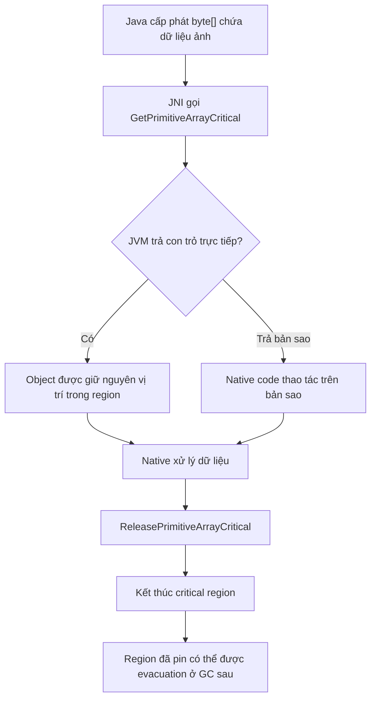

# Ảnh hưởng tới độ trễ, thông lượng và hành vi khi cấp phát bộ nhớ

G1 region pinning thay đổi cách Garbage-First Garbage Collector (G1) xử lý Java object đang được mã native truy cập trong JNI critical region. Trước đây, G1 có thể phải trì hoãn garbage collection (GC) cho đến khi critical region kết thúc để tránh di chuyển object mà native code đang giữ con trỏ. Từ JDK 22, G1 có thể tiếp tục thu gom các vùng heap khác trong khi giữ object được pin ở nguyên vị trí.

Tác động thực tế thể hiện ở ba khía cạnh: GC ít bị trì hoãn bởi native code hơn, khả năng thu hồi bộ nhớ trong một lần GC có thể giảm khi có region bị pin, và các region không evacuation được có thể tạm thời không dùng cho cấp phát. Vì vậy, pinning có thể cải thiện độ trễ trong một số workload nhưng không bảo đảm mọi ứng dụng đều tăng thông lượng hoặc giảm thời gian GC.

JEP 423 được đưa vào JDK 22 và là thay đổi triển khai của G1, không phải API preview hay incubator. Tài liệu G1 của Oracle JDK 27 vẫn mô tả `Evacuation Failure: Pinned` khi G1 không di chuyển được object đang pin qua `GetPrimitiveArrayCritical()` hoặc JNI call tương tự. JDK 27 cũng đặt G1 làm collector mặc định trong mọi môi trường; ứng dụng vẫn có thể chọn collector khác bằng cấu hình JVM. Cơ chế này tiếp tục hữu ích trên JDK hiện đại khi ứng dụng dùng G1 và JNI.

## 1. G1 region pinning thay đổi điều gì?

G1 chia heap thành các region. Trong một lần thu gom, G1 chọn collection set và di chuyển các object còn sống ra khỏi những region cần thu hồi. Sau khi evacuation thành công, các region nguồn có thể được trả lại cho bộ cấp phát.

JNI critical API như `GetPrimitiveArrayCritical()` cho phép native code truy cập dữ liệu của mảng primitive. Nếu JVM cung cấp con trỏ trực tiếp đến dữ liệu trong Java heap, object phải ở nguyên vị trí trong suốt thời gian native code sử dụng con trỏ. Nếu GC di chuyển object, con trỏ native có thể trỏ đến địa chỉ cũ và không còn hợp lệ.

Region pinning cho phép G1 giữ object đang được native code truy cập ở nguyên vị trí, đồng thời tiếp tục GC trên những vùng không bị ảnh hưởng. Nếu G1 không thể di chuyển hết object ra khỏi một region vì có object pinned, region đó có thể chưa được thu hồi trong lần GC hiện tại.

`GetPrimitiveArrayCritical()` không phải lúc nào cũng trả về con trỏ trực tiếp đến mảng trong heap; JVM có thể trả về một bản sao. Vì vậy, không phải mọi lần gọi đều nhất thiết dẫn đến một heap object bị pin. Khi trả về bản sao, native code thao tác trên bản sao và phải gọi hàm release tương ứng theo đúng hợp đồng JNI.

## 2. Ảnh hưởng tới độ trễ (latency)

Trước region pinning, một critical region kéo dài có thể khiến G1 không thể thực hiện GC trong thời gian đó. Nếu ứng dụng vẫn cấp phát object trong lúc GC bị trì hoãn, heap tiếp tục chịu áp lực. Khi GC được phép chạy trở lại, lượng công việc cần thu gom có thể lớn hơn và ứng dụng có thể phải chờ cấp phát nếu không còn đủ vùng nhớ trống.

Với region pinning, G1 có thể bắt đầu hoặc tiếp tục một chu kỳ GC trong khi native code vẫn giữ con trỏ. Những region không bị pin vẫn có thể được evacuation. Nhờ đó, thời điểm GC không còn phụ thuộc hoàn toàn vào lúc critical region kết thúc; điều này giúp tránh một nguồn trì hoãn GC trong ứng dụng dùng JNI.

Tuy nhiên, region pinning không biến G1 thành collector thời gian thực và không loại bỏ stop-the-world pause. G1 vẫn có các pha dừng ứng dụng để xử lý collection set. Nếu region có object pinned không thể evacuation, GC có thể gặp evacuation failure và phải để lại region đó cho lần thu gom tiếp theo.

Tác động đến latency phụ thuộc vào workload:

- Có lợi khi native critical region trước đây thường kéo dài và ứng dụng vẫn tiếp tục cấp phát trong thời gian đó.
- Ít khác biệt nếu critical region vốn rất ngắn, GC hiếm khi cần chạy trong khoảng thời gian này hoặc `GetPrimitiveArrayCritical()` thường trả về bản sao.
- Có thể bất lợi về sau nếu nhiều region bị giữ lại lâu, làm giảm lượng heap có thể thu hồi và gây thêm áp lực cấp phát.

Không nên kết luận rằng pause time chắc chắn giảm chỉ vì đã bật hoặc nâng cấp lên JDK có region pinning. Cần so sánh pause time và thời gian chờ cấp phát trên workload thực tế.

## 3. Ảnh hưởng tới thông lượng (throughput)

Thông lượng là lượng công việc ứng dụng hoàn thành trong một đơn vị thời gian, ví dụ số request mỗi giây hoặc số bản ghi xử lý mỗi giây.

Region pinning có thể cải thiện thông lượng trong workload trước đây bị ảnh hưởng bởi việc GC phải chờ JNI critical region. Khi G1 tiếp tục thu gom các region khác, ứng dụng ít có nguy cơ tích lũy áp lực cấp phát chỉ vì native code đang giữ con trỏ.

Mặt khác, object pinned vẫn chiếm heap và không thể được di chuyển trong thời gian pin. Nếu nhiều object hoặc region bị pin trong thời gian dài:

- G1 có thể thu hồi ít bộ nhớ hơn trong một lần GC.
- Một số region có thể phải chờ lần evacuation tiếp theo mới được tái sử dụng.
- G1 có thể phải thực hiện thêm công việc thu gom để lấy lại vùng nhớ.
- Khi heap gần đầy, ứng dụng có thể phải chờ GC hoặc rơi vào Full GC.

Bản thân G1 cũng cân bằng latency và throughput. G1 dùng tài nguyên bộ xử lý cho công việc GC để giữ pause tương đối ngắn; so với collector ưu tiên thông lượng tối đa, chi phí GC có thể làm giảm một phần CPU dành cho ứng dụng. Region pinning loại bỏ một nguyên nhân trì hoãn GC, nhưng không loại bỏ chi phí GC hoặc giới hạn do pinned region.

| Tình huống | Tác động có thể gặp |
|---|---|
| Critical region ngắn, ít pin | Gần như không có ảnh hưởng rõ rệt; G1 có thể tiếp tục GC nếu cần |
| Critical region dài nhưng số region bị pin ít | Giảm việc GC phải chờ native code, nhưng object vẫn chiếm vùng nhớ |
| Nhiều region bị pin đồng thời | Ít vùng nhớ được thu hồi trong một lần GC; áp lực heap tăng |
| Native code giữ con trỏ trong lúc chờ I/O hoặc chờ thread khác | Pin kéo dài, làm tăng nguy cơ evacuation failure và giảm khả năng cấp phát |

Không có một tỷ lệ tăng thông lượng cố định áp dụng cho mọi ứng dụng. Kết quả phụ thuộc allocation rate, thời gian giữ critical region, số object được pin, kích thước heap, mức độ kết nối giữa object và tải CPU của GC.

## 4. Ảnh hưởng tới hành vi cấp phát bộ nhớ

Điểm cần quan sát là region có object pinned có thể không được trả lại cho bộ cấp phát ngay trong lần GC đó.

Khi G1 không thể di chuyển tất cả object ra khỏi một region, region này tạm thời không sẵn sàng cho cấp phát. G1 đưa region đã evacuation failure vào nhóm collection-set candidate để thử evacuation lại trong những lần GC tiếp theo.

Điều này tạo ra một số hệ quả:

1. **Ít free region hơn trong ngắn hạn:** ứng dụng không thể dùng ngay region chưa evacuation thành công.
2. **Cấp phát vẫn có thể tiếp tục ở region khác:** pinning không khóa toàn bộ heap. G1 vẫn có thể cấp phát từ các region trống còn lại.
3. **Áp lực cấp phát tăng nếu pin kéo dài:** nếu ứng dụng cấp phát nhanh trong khi nhiều region chưa thể tái sử dụng, số region trống giảm.
4. **Có thể dẫn đến Full GC:** trong trường hợp GC không thu hồi được đủ bộ nhớ, G1 có thể phải chạy Full GC để compact heap. Full GC có thể làm pause kéo dài đáng kể.

Cần phân biệt hai nguyên nhân trong log:

- `Pinned`: G1 không di chuyển được object vì object đang bị pin để native code sử dụng an toàn.
- `Allocation`: G1 không tìm được đủ vùng đích để di chuyển object.

Một lần GC có thể ghi nhận một hoặc cả hai nguyên nhân. Không nên xem mọi evacuation failure là lỗi do JNI; hãy đọc đúng reason trong log.

## 5. Ví dụ về workload có thể chịu ảnh hưởng

Giả sử ứng dụng xử lý ảnh nhận mảng `byte[]`, sau đó chuyển dữ liệu cho native library để giải mã hoặc biến đổi ảnh.

Luồng xử lý khái quát:



Nếu native xử lý xong nhanh, thời gian pin ngắn và tác động lên khả năng thu hồi heap có thể nhỏ. Nếu native code giữ con trỏ trong khi chờ I/O, chờ lock hoặc chờ một Java thread khác, region có thể bị giữ lâu. Đây là cách sử dụng cần tránh vì critical region được thiết kế cho truy cập ngắn, có giới hạn.

Ví dụ native code nên có dạng tối giản:

```c
#include <jni.h>
#include <stddef.h>

jsize length = (*env)->GetArrayLength(env, array);
jbyte *data = (*env)->GetPrimitiveArrayCritical(env, array, NULL);
if (data == NULL) {
    return; // JVM có thể đang có exception chờ xử lý.
}

/* Chỉ thực hiện xử lý native ngắn, không block và không gọi JNI tùy ý. */
int status = processImageData(data, (size_t) length);

(*env)->ReleasePrimitiveArrayCritical(env, array, data, 0);
if (status != 0) {
    /* Xử lý lỗi sau khi đã rời critical region. */
}
```

Đây chỉ là đoạn minh họa cho vòng đời critical region. Mã native cần xử lý đầy đủ lỗi và luôn gọi hàm release tương ứng sau khi lấy được con trỏ. Không giữ con trỏ để dùng sau khi release.

## 6. Những quy tắc JNI vẫn phải tuân thủ

Region pinning thay đổi cách G1 phối hợp với native code; nó không nới lỏng hợp đồng của JNI critical API.

Trong khoảng giữa `GetPrimitiveArrayCritical()` và `ReleasePrimitiveArrayCritical()`:

- Giữ critical region ngắn nhất có thể.
- Không gọi các hàm JNI tùy ý.
- Không thực hiện thao tác có thể block, đặc biệt là chờ một Java thread khác.
- Không giữ hoặc sử dụng con trỏ sau khi đã release.
- Luôn gọi hàm release tương ứng khi kết thúc truy cập, kể cả khi native xử lý gặp lỗi.
- Không giả định JVM luôn trả con trỏ trực tiếp; nó có thể trả về bản sao.

Nếu native library cần xử lý dài, chờ I/O hoặc phối hợp nhiều thread, hãy thiết kế để copy dữ liệu ra vùng nhớ native riêng rồi kết thúc critical region sớm. Việc copy có chi phí CPU và bộ nhớ, nhưng có thể giảm thời gian giữ con trỏ đến heap và giúp G1 có nhiều cơ hội thu hồi region hơn.

## 7. Cách quan sát trong GC log

Trên JDK hiện đại, dùng Unified Logging để quan sát GC:

```bash
java -Xlog:gc -jar app.jar
```

Khi G1 không di chuyển được object pinned, log có thể ghi reason `Pinned` trong `Evacuation Failure`. Một lần GC có thể thể hiện cả `Allocation/Pinned` nếu gặp cả hai vấn đề.

Ví dụ dạng thông tin cần tìm:

```text
Pause Young ... (Evacuation Failure: Pinned)
```

Có thể bật log chi tiết hơn khi cần tìm hiểu các pha GC:

```bash
java -Xlog:gc,gc+phases=debug -jar app.jar
```

Khi phân tích, nên đối chiếu các thông tin sau:

| Chỉ số | Câu hỏi cần trả lời |
|---|---|
| Số lần `Evacuation Failure: Pinned` | Pinning xuất hiện thường xuyên hay chỉ thỉnh thoảng? |
| Pause time p50/p95/p99 | Độ trễ GC có thay đổi theo tải không? |
| Heap occupancy sau GC | GC có thu hồi đủ bộ nhớ hay heap tiếp tục tăng? |
| Allocation rate | Ứng dụng cấp phát nhanh đến mức nào trong thời gian native hoạt động? |
| Số lần Full GC | Có tình trạng thiếu không gian thu hồi nghiêm trọng không? |
| Throughput ứng dụng | Request/record hoàn thành mỗi giây thay đổi ra sao? |
| Thời gian giữ JNI critical region | Native code có giữ con trỏ lâu hơn cần thiết không? |

Thông điệp `Pinned` là tín hiệu để điều tra đường gọi JNI, không tự nó chứng minh có lỗi hoặc cho biết chính xác phần trăm hiệu năng bị mất. Hãy xem cùng allocation rate, heap occupancy và thời gian native giữ con trỏ.

## 8. Cách giảm tác động của pinning

Ưu tiên kiểm soát vòng đời critical region ở native code:

1. **Rút ngắn thời gian giữ con trỏ.** Chỉ lấy con trỏ ngay trước đoạn xử lý cần thiết và release ngay sau đó.
2. **Không block trong critical region.** Không chờ I/O, lock hoặc Java thread khác trong khoảng này.
3. **Xem xét copy sang native memory.** Với tác vụ dài, copy có thể tốn thêm bộ nhớ và CPU nhưng giảm thời gian pin Java heap.
4. **Giảm allocation không cần thiết.** Giảm lượng object tạm tạo ra trong khi native workload đang chạy giúp duy trì heap headroom.
5. **Đo heap và GC dưới tải thực tế.** Đánh giá cả pause time, số lần pinned evacuation failure, Full GC và throughput.
6. **Giữ G1 tuning theo mục tiêu ứng dụng.** G1 mặc định hướng đến cân bằng pause tương đối ngắn và throughput; thay đổi pause target hoặc heap size chỉ nên dựa trên số liệu.

Không có một cờ JVM chung để biến mọi critical region thành không pin hoặc bảo đảm G1 luôn thu hồi được region đang pin. Hãy bắt đầu từ thời gian giữ con trỏ và mẫu cấp phát của ứng dụng trước khi điều chỉnh cấu hình GC.

## 9. Khi nào cần quan tâm tới G1 region pinning?

Cơ chế này đáng chú ý nếu ứng dụng:

- Dùng G1 và có JNI native library truy cập primitive arrays qua critical API.
- Xử lý ảnh, âm thanh, nén dữ liệu hoặc tính toán native trên mảng Java.
- Có allocation rate cao trong khi native code giữ con trỏ.
- Ghi nhận `Evacuation Failure: Pinned` trong GC log.
- Có pause hoặc Full GC bất thường trong workload kết hợp Java và native code.

Nếu ứng dụng không dùng JNI critical API hoặc không có object heap bị pin, tác động trực tiếp của cơ chế này thường không đáng kể. G1 vẫn hoạt động theo mô hình evacuation và pause-time goal thông thường.

## Kết luận

G1 region pinning giúp G1 tiếp tục thu gom các region không bị ảnh hưởng trong khi native code đang giữ con trỏ đến Java object. Điều này có thể giảm việc GC bị trì hoãn và cải thiện latency trong workload dùng JNI critical region.

Đổi lại, object pinned không thể di chuyển trong thời gian truy cập. Nếu G1 không evacuation được toàn bộ region, region đó tạm thời không dùng cho cấp phát và được thử thu gom lại ở các GC tiếp theo. Pin kéo dài hoặc xảy ra trên nhiều region có thể làm giảm khả năng thu hồi heap, tăng áp lực cấp phát và cuối cùng ảnh hưởng throughput.

Cách vận hành hiệu quả là giữ JNI critical region ngắn, không block, release con trỏ đúng lúc và theo dõi `Evacuation Failure: Pinned` bằng Unified Logging. JEP 423 là tính năng G1 được phát hành trong JDK 22 và vẫn được tài liệu Oracle JDK 27 mô tả; không cần bật preview hoặc incubator feature.

## Tài liệu tham khảo

- [JEP 423: Region Pinning for G1](https://openjdk.org/jeps/423)
- [Oracle JDK 22 Release Notes — Region Pinning for G1](https://www.oracle.com/java/technologies/javase/22all-relnotes.html)
- [Oracle JDK 27 Release Notes — G1 Default in All Environments](https://www.oracle.com/java/technologies/javase/27all-relnotes.html)
- [Oracle Java 27 — Garbage-First (G1) Garbage Collector, Evacuation Failure](https://docs.oracle.com/en/java/javase/27/gctuning/garbage-first-g1-garbage-collector.html)
- [Oracle Java 27 — Garbage-First Garbage Collector Tuning](https://docs.oracle.com/en/java/javase/27/gctuning/garbage-first-garbage-collector-tuning.html)
- [Java SE 27 — JNI Functions](https://docs.oracle.com/en/java/javase/27/docs/specs/jni/functions.html)
