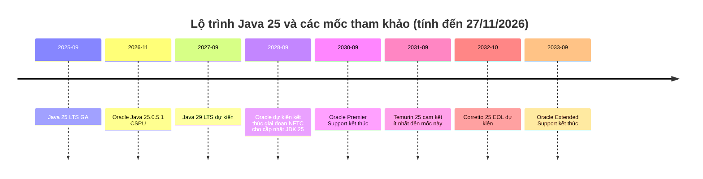
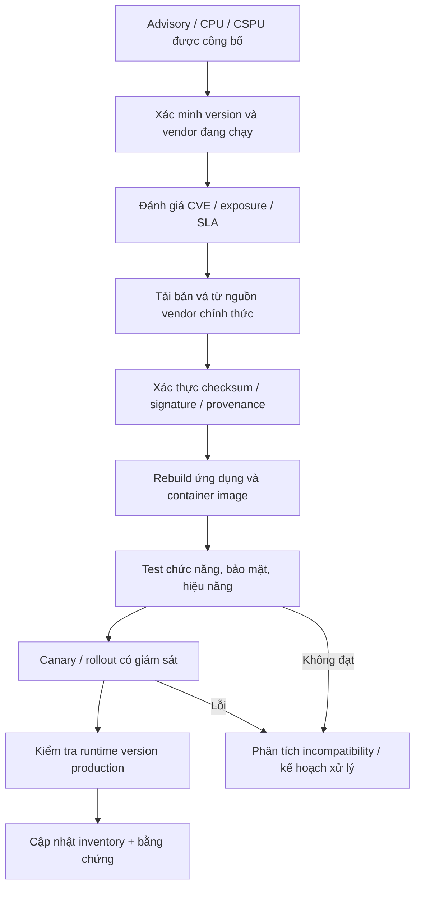

# Lộ trình hỗ trợ dài hạn và cập nhật bảo mật theo nhà phân phối JDK

> **Mốc kiểm chứng thông tin: 27/11/2026.** Các mốc hỗ trợ và lịch phát hành bản vá có thể được nhà phân phối cập nhật; trước quyết định mua hỗ trợ hoặc triển khai production, luôn đối chiếu roadmap, release notes, điều khoản license và gói hỗ trợ áp dụng cho đúng bản JDK đang dùng.

## 1. Java 25 LTS nghĩa là gì đối với một ứng dụng đang vận hành?

**JAVA_VERSION_JAVA25** tập trung vào các khả năng của Java 25 còn hữu ích trong phát triển Java hiện đại, từ chương trình nguồn gọn, module import, flexible constructor bodies, `ScopedValue`, API dẫn xuất khóa, AOT cache đến quan sát JFR và đánh giá khi nâng cấp JDK. Tuy nhiên, trước khi áp dụng những khả năng đó vào hệ thống chạy nhiều năm, đội phát triển phải chọn được **nhà phân phối JDK (JDK distribution/vendor)** có chính sách cập nhật bảo mật và thời hạn hỗ trợ phù hợp.

Java 25 phát hành chính thức ngày **16/09/2025** và thuộc dòng **LTS (Long-Term Support)**. LTS cho biết nhiều nhà phân phối cam kết duy trì dòng này lâu hơn các bản Java phát hành theo chu kỳ sáu tháng; nó **không** có nghĩa tất cả nhà phân phối sẽ:

- Phát hành bản vá đến cùng một ngày.
- Cung cấp cùng mức hỗ trợ kỹ thuật hoặc cùng SLA.
- Áp dụng cùng license, mức phí, quyền thương mại hay quyền truy cập binary.
- Đưa bản vá ra cùng giờ hoặc cùng ngày.
- Hỗ trợ cùng hệ điều hành, CPU architecture và container base image.

Vào cuối tháng 11/2026, Java 27 đã là bản feature release mới hơn, nhưng **Java 25 vẫn là dòng LTS** và vẫn phù hợp khi một tổ chức ưu tiên ổn định, hỗ trợ dài hạn và cập nhật bảo mật đều đặn. Đừng hiểu “JDK mới nhất” đồng nghĩa “dòng hỗ trợ lâu dài nhất”.

### Ba khái niệm cần tách biệt

| Khái niệm | Ý nghĩa | Câu hỏi cần hỏi vendor |
|---|---|---|
| **Java SE / OpenJDK version** | Phiên bản nền tảng/ngôn ngữ, ví dụ `25.0.5.1` | Ứng dụng có tương thích Java 25 và các bản cập nhật `25.0.x` không? |
| **Distribution** | Binary được build, kiểm thử và phát hành bởi Oracle, Eclipse Adoptium, Amazon, Microsoft, Azul, Red Hat... | Ai phát hành và chịu trách nhiệm cung cấp bản vá cho binary đang chạy? |
| **Support contract/lifecycle** | Chính sách cập nhật, thời hạn, SLA, tư vấn, backport và điều kiện thương mại | Gói đang dùng có bản vá bảo mật, hỗ trợ sự cố và quyền sử dụng production đến khi nào? |

**Quy tắc cốt lõi:** “Java 25 LTS” là lựa chọn **dòng sản phẩm**; “Oracle JDK 25”, “Eclipse Temurin 25” hoặc “Amazon Corretto 25” là lựa chọn **kênh phân phối và vận hành**. Một ứng dụng phải ghi nhận cả hai.

## 2. Bức tranh vòng đời Java 25 và các bản phát hành kế tiếp



Các mốc trên thuộc **nhiều chính sách khác nhau**. Ví dụ năm 2028 là cột mốc **license của các cập nhật Oracle JDK 25**, không phải ngày Java 25 hết được vá; năm 2030 là cuối **Premier Support của Oracle**, không phải ngày hết hỗ trợ của Temurin hay Corretto. Mốc Java 29 LTS vào tháng 9/2027 là **dự kiến**, chưa phải điều kiện buộc nâng cấp ngay.

Trong lập kế hoạch, nên có ba chân trời:

1. **Bản vá gần nhất:** binary đã có CPU/CSPU nào? Có lỗ hổng mới cần xử lý trước lịch vá định kỳ không?
2. **Chu kỳ ngân sách năm:** hệ điều hành, container image, thư viện, CI, nhà phân phối và hợp đồng hỗ trợ có còn phù hợp trong 12 tháng tới không?
3. **Kế hoạch chuyển LTS:** trước khi kết thúc giai đoạn support có security fixes, phải có thời gian nâng ứng dụng và đánh giá compatibility với LTS kế tiếp, thay vì đợi sát EOL.

Độ dài đường đời ứng dụng có thể vượt thời gian hỗ trợ một bản JDK. Cần lên lịch **chuyển LTS kế tiếp** ngay cả khi hiện tại Java 25 vẫn hoạt động tốt.

## 3. Đối chiếu roadmap Java 25 theo nhà phân phối

Bảng sau tổng hợp thông tin từ **trang hỗ trợ chính thức của từng nhà phân phối** tại mốc kiểm chứng. “Đến” chỉ là mốc theo roadmap hiện tại; mức quyền lợi thực tế phụ thuộc kênh nhận bản vá, hợp đồng và nền tảng triển khai.

| Nhà phân phối | Kênh/cam kết cho Java 25 | Mốc công bố | Điều kiện cần kiểm tra |
|---|---|---|---|
| **Oracle JDK 25** | **Premier Support** đến **09/2030**; **Extended Support** đến **09/2033**; Sustaining Support sau đó theo chính sách Oracle | Oracle Java SE Support Roadmap | Premier/Extended áp dụng cho khách hàng có entitlement; **Sustaining không tương đương tiếp tục nhận security fixes mới**. License binary/cập nhật xét riêng |
| **Eclipse Temurin 25 (Adoptium)** | Cung cấp build và community support ít nhất đến **09/2031** | Temurin Support Roadmap | Eclipse **không cung cấp SLA thương mại trực tiếp**; cần hợp đồng riêng với bên hỗ trợ nếu workload yêu cầu SLA |
| **Amazon Corretto 25** | **Last Planned Update: 07/2032**; **End of Life: 10/2032** | Corretto FAQ | Đây là lịch dự kiến của dòng Corretto; cần xem kênh distro, patch mới và hỗ trợ sự cố qua AWS Support khi áp dụng |
| **Microsoft Build of OpenJDK 25** | **Earliest end-of-support: 09/2030**; cập nhật miễn phí hàng quý | Microsoft Support Roadmap | Microsoft có thể gia hạn mốc này; **commercial support** giới hạn ở workload Azure/Azure Stack/Azure Arc thuộc phạm vi support |
| **Azul Zulu / Azul Core 25** | **Production Support** đến **09/2033**; thêm **2 năm Extended Support** theo chính sách LTS của Azul | Azul Support Roadmap | Sau Production Support, Extended Support thiên về **tư vấn/hỗ trợ di chuyển**; không mặc định được nhận cùng loại security fixes như Production Support |
| **Red Hat build of OpenJDK 25 trên RHEL** | **Full Support** đến **31/12/2030**; **ELS-1** đến **30/09/2033** | Red Hat OpenJDK Lifecycle | ELS-1 là giai đoạn gia hạn với điều kiện/subscription riêng; còn phụ thuộc lifecycle của RHEL và nền tảng hỗ trợ |

Nguồn đối chiếu: [Oracle Roadmap](https://www.oracle.com/java/technologies/java-se-support-roadmap.html), [Adoptium Support](https://adoptium.net/support), [Corretto FAQ](https://aws.amazon.com/corretto/faqs/), [Microsoft Support](https://learn.microsoft.com/en-us/java/openjdk/support), [Azul Support](https://www.azul.com/products/azul-support-roadmap/), [Red Hat Lifecycle](https://access.redhat.com/articles/1299013).

### 3.1. Oracle: support, license và quyền sử dụng là ba câu chuyện khác nhau

Oracle JDK 25 được phát hành theo **Oracle No-Fee Terms and Conditions (NFTC)**, cho phép các trường hợp sử dụng thuộc điều khoản của license trong giai đoạn được công bố. Theo roadmap Oracle cập nhật ngày 20/10/2026, **các update của Oracle JDK 25 phát hành sau tháng 9/2028 dự kiến chuyển sang Java SE OTN license**. Vì vậy phải kiểm tra lại quyền sử dụng bản vá tương lai trong môi trường sản xuất, thay vì giả định “đã tải Oracle JDK 25 miễn phí một lần” thì các cập nhật sau năm 2028 luôn giữ cùng điều khoản.

Cần phân biệt rõ:

- **NFTC hiện tại**: điều khoản áp dụng cho các bản Oracle JDK 25 được phát hành trong giai đoạn NFTC.
- **OTN cho các cập nhật tương lai**: có các quyền sử dụng miễn phí nhất định nhưng **không phải giấy phép miễn phí phổ quát cho production thương mại**. Đọc đúng điều khoản khi chọn cập nhật.
- **Premier/Extended Support**: thời hạn thương mại của Oracle dành cho người có entitlement phù hợp; đây không phải cam kết rằng mọi binary tải tự do đều có hợp đồng hỗ trợ.
- **Sustaining Support**: không nên đọc là bảo đảm có bản vá CVE mới mãi mãi.

Nếu đội sản phẩm dự định sử dụng Oracle JDK 25 đến sau 09/2028, hãy yêu cầu bộ phận pháp lý/procurement xác nhận **license cho từng bản cập nhật và hình thức triển khai**. Một lựa chọn khác là đánh giá OpenJDK distributions với điều khoản và lộ trình riêng.

### 3.2. Temurin: cộng đồng lâu dài khác với hỗ trợ có SLA

Eclipse Temurin 25 có dự kiến duy trì binary ít nhất đến tháng 9/2031 và công bố bản cập nhật dựa trên upstream OpenJDK. Adoptium có quy trình build/test riêng, vì vậy binary Temurin **không nhất thiết có sẵn cùng ngày** với Oracle CPU/CSPU. Trang roadmap lưu ý có thể có độ trễ từ vài ngày đến một số tuần để kiểm thử trên từng nền tảng.

Adoptium cung cấp **community support** qua issue và cộng đồng, không trực tiếp ký SLA thương mại. Nếu hệ thống yêu cầu thời gian phản hồi sự cố, hỗ trợ 24/7 hoặc backport theo hợp đồng, cần chọn bên cung cấp support thương mại cho Temurin hoặc cân nhắc distro khác.

### 3.3. Corretto, Microsoft, Azul và Red Hat: ngữ cảnh vận hành quan trọng

- **Corretto** phù hợp khi tổ chức sử dụng hệ sinh thái AWS hoặc muốn OpenJDK distribution có lộ trình LTS rõ. Mốc `Last Planned Update` có thể **sớm hơn** `End of Life`, vì vậy cần dùng đúng mốc khi đánh giá khoảng thời gian còn nhận patch.
- **Microsoft Build of OpenJDK** có cập nhật quý miễn phí cho tất cả người dùng, nhưng commercial support của Microsoft chỉ áp dụng trong phạm vi tài nguyên Azure/Azure Stack/Azure Arc theo chính sách và kế hoạch hỗ trợ. Trên máy riêng ngoài Azure vẫn dùng được binary, nhưng điều kiện hỗ trợ khác.
- **Azul** có các sản phẩm/điều khoản hỗ trợ khác nhau; roadmap công bố 8 năm Production Support cho Java 25 và thêm 2 năm Extended Support. Không trộn thời gian hỗ trợ của Azul Core với quyền lợi khác của Azul Prime hoặc Zulu community binary.
- **Red Hat build of OpenJDK** phải được xét cùng release và vòng đời **RHEL**; chính sách công bố Java 25 hỗ trợ RHEL **9.7+ và 10.1+**. Một phiên bản RHEL hết hạn sớm hơn có thể làm mất đường nhận hỗ trợ JDK cho môi trường đó dù roadmap Java 25 còn thời gian.

## 4. LTS không có nghĩa chỉ vá vào tháng 1, 4, 7 và 10

### 4.1. Chu kỳ CPU cơ bản

Cơ chế cập nhật bảo mật Java lâu nay có lịch **CPU (Critical Patch Update)** vào các tháng:

| Tháng | Loại đợt định kỳ | Mục đích |
|---|---|---|
| **01** | CPU | Bản vá bảo mật và sửa lỗi tích lũy theo lịch |
| **04** | CPU | Bản vá bảo mật và sửa lỗi tích lũy theo lịch |
| **07** | CPU | Bản vá bảo mật và sửa lỗi tích lũy theo lịch |
| **10** | CPU | Bản vá bảo mật và sửa lỗi tích lũy theo lịch |

Đa số nhà phân phối Java LTS hiện vẫn cam kết hoặc ưu tiên nhịp cập nhật hàng quý tương ứng, nhưng **ngày phân phối binary có thể chậm hơn ngày upstream công bố**. Sau khi vendor phát hành, application team mới thực hiện bước test, rebuild image và deploy; do đó **ngày upstream ra patch** và **ngày workload đã được vá** là hai mốc khác nhau.

### 4.2. Thay đổi cần biết trong năm 2026: CSPU ngoài lịch quý

Oracle đã bổ sung **Critical Security Patch Update (CSPU)** nhằm xử lý sớm các lỗ hổng ưu tiên cao trong những tháng **không có CPU**. Oracle đã phát hành CSPU vào **18/08/2026** và **17/11/2026**. Theo thông báo cập nhật ngày **24/11/2026**, Oracle dự kiến nhiều đợt CSPU trong năm 2027 bên cạnh các CPU tháng 1, 4, 7, 10.

Một ví dụ cụ thể:

- CPU tháng 10/2026 nằm trong lịch hằng quý.
- **17/11/2026**: Oracle công bố Java 25 **`25.0.5.1`** trong đợt CSPU tháng 11.
- **15/12/2026**: Oracle thông báo lịch CSPU dự kiến; ở mốc viết bài đây vẫn là **ngày trong tương lai**.
- Trong các tháng 2027, cần theo dõi lịch CSPU được công bố từng đợt, thay vì quy tắc cố định “chỉ cần kiểm tra bốn lần mỗi năm”.

Nguồn: [Oracle — Transitioning Java to More Frequent Security Updates](https://blogs.oracle.com/java/transitioning-java-to-more-frequent-security-updates), [CSPU November 2026](https://www.oracle.com/security-alerts/cspunov2026.html), [Oracle Java Management Release Notes, 25.0.5.1](https://docs.oracle.com/en-us/iaas/releasenotes/java-management/jdk-cspu-november-2026.htm).

Đây **không đồng nghĩa mọi vendor sẽ cung cấp CSPU đúng cùng thời điểm**. Adoptium nêu chính sách phát hành khi OpenJDK phát hành CSPU; Microsoft công bố nhịp quý; với Corretto/Azul/Red Hat cần kiểm tra release notes và security advisories của **chính distribution** trước khi kết luận patch nào đã được backport.

### 4.3. CPU, CSPU, release build và CVE là các lớp thông tin khác nhau

| Thuật ngữ | Dùng để làm gì? | Không nên hiểu thành |
|---|---|---|
| **CPU** | Đợt cập nhật bảo mật tích lũy định kỳ của Oracle | Một artifact binary chung cho mọi nhà phân phối |
| **CSPU** | Bản vá bảo mật ưu tiên cao ngoài nhịp CPU thông thường | Chắc chắn mọi vendor đã phát hành cùng build |
| **PSU / bug-fix stream** | Bản cập nhật có thể bổ sung các sửa lỗi khác tùy policy | Luôn là lựa chọn an toàn hơn CPU về mức ổn định |
| **Version/build metadata** | Xác định binary cụ thể như `25.0.5.1+...` | Chứng minh nguồn gốc nếu không kiểm chữ ký/hash |
| **CVE/advisory** | Mô tả rủi ro, phạm vi ảnh hưởng và hướng xử lý | Mọi JVM cùng major version đều chịu ảnh hưởng như nhau |
| **SBOM** | Thống kê runtime, thư viện ứng dụng và OS packages | Tự động chứng minh không có lỗ hổng |

Cần đọc **security advisory của vendor**, mức ảnh hưởng phù hợp workload và nguồn patch. CVE ở JDK, thư viện Maven/Gradle và base OS đều có thể ảnh hưởng ứng dụng, nhưng không nên gộp thành một số “lỗ hổng Java 25” thiếu phân loại.

## 5. Tìm chính xác JDK đang chạy, không chỉ JDK dùng để build

Một ứng dụng có thể compile bằng Java 25 trên CI nhưng chạy trong image chứa JDK 21 hoặc một bản Java 25 cũ. Trong Kubernetes, một số service có thể chạy JRE từ vendor khác với máy build.

Kiểm tra trên **đúng process/container**:

```bash
java -version
java -XshowSettings:properties -version
echo "$JAVA_HOME"

# Nếu dùng Maven / Gradle, kiểm tra JVM mà công cụ build thực sự sử dụng:
mvn -version
./gradlew -version
```

Thông tin cần ghi:

- `java.version`, `java.runtime.version` hoặc version string thực tế.
- `java.vendor` và `java.vm.vendor`.
- `java.home` và vị trí `java` trên `PATH`.
- OS, CPU architecture, container base image, image digest.
- Runtime trong **production** và trong pipeline test; cần kiểm tra tất cả bản sao chạy (pod/VM/task).

Trên Windows PowerShell:

```powershell
java -version
java -XshowSettings:properties -version
where.exe java
$env:JAVA_HOME
```

**Quan trọng:** `java -version` có thể cho biết vendor và build, nhưng trong một số trường hợp cần xem release file `$JAVA_HOME/release`, package metadata hoặc provenance của container để xác nhận chính xác distribution. Không suy vendor chỉ từ việc source code khai báo `JavaLanguageVersion.of(25)`; cấu hình toolchain chọn **ngôn ngữ/toolchain** chứ không thay thế kiểm tra runtime production.

### Ví dụ manifest theo dõi phiên bản

Thay vì ghi duy nhất “Java 25”, tạo một bản ghi vận hành có thể truy vết:

```yaml
service: orders-api
environment: production
javaMajor: 25
distribution: Eclipse Temurin
runtimeVersion: "25.0.5.1"
imageDigest: "sha256:<digest-tu-registry-noi-bo>"
supportPolicyUrl: "https://adoptium.net/support"
owner: platform-runtime
lastVerifiedAt: "2026-11-27"
patchSource: "official-vendor-release"
nextReview: "after-next-security-advisory"
```

Đây là **ví dụ định dạng metadata**, không phải bản kê khai binary có thật. Điền `runtimeVersion` và digest từ bản build thực tế, không dùng những giá trị trên để tạo xác nhận tuân thủ bảo mật. Nếu sản phẩm không hỗ trợ đúng update version nào đó tại ngày kiểm tra, thông tin phải phản ánh release đã tồn tại.

## 6. Chọn distribution bằng tiêu chí vận hành

Không có một lựa chọn tốt nhất cho mọi doanh nghiệp. Nên quyết định theo danh sách tiêu chí có thể kiểm chứng:

| Tiêu chí | Cần đánh giá | Ví dụ bằng chứng |
|---|---|---|
| **Dòng LTS** | Java 25 còn nhận bản vá đến thời điểm dự kiến chuyển LTS khác? | Roadmap chính thức, ngày review |
| **Tốc độ nhận security fixes** | Vendor thường ra bản vá sau upstream bao lâu? Có bản CSPU khẩn? | Release notes 2–3 đợt gần nhất |
| **Hệ điều hành/CPU** | OS và `x64`/`aarch64`/kiến trúc khác có được hỗ trợ chính thức? | Platform matrix, TCK/binary checksum |
| **Bản quyền** | Có được sử dụng, phân phối và cập nhật trong production theo điều khoản hiện hành? | License text của binary và xác nhận procurement |
| **SLA** | Thời gian phản hồi sự cố, backport, 24/7 và escalation như thế nào? | Support contract, RACI, mức phí |
| **Nguồn binary** | Artifact có nguồn chính thức, ký số/checksum, SBOM và provenance? | URL chính thức, digest, signature, build logs |
| **Runtime stack** | Container, Kubernetes, RHEL, Azure hoặc AWS có cơ chế patch riêng không? | Hướng dẫn nhà cung cấp platform |
| **Công cụ giám sát** | Có quản lý version inventory, CVE advisory, health, JFR, runtime metrics? | POC, báo cáo bản vá |
| **Khả năng chuyển đổi** | Thay vendor có làm ứng dụng phụ thuộc API/crypto/provider riêng? | Test matrix, kiểm tra TLS/cert/JNI |
| **Chi phí vòng đời** | Bao gồm binary, SLA, phí license, vận hành và rủi ro hết hạn | TCO, support timeline, migration budget |

Một ma trận quyết định ngắn:

- **Cần Oracle JDK 25 và entitlement thương mại rõ ràng**: theo dõi đồng thời roadmap **Premier/Extended** và điều khoản **NFTC/OTN** khi nhận các update sau 09/2028.
- **Muốn OpenJDK community binaries với hỗ trợ cộng đồng**: Temurin là một phương án phổ biến; nếu yêu cầu SLA, ký hợp đồng với đơn vị hỗ trợ Temurin phù hợp.
- **Ưu tiên AWS hoặc Azure**: Corretto/Microsoft Build of OpenJDK có lợi thế trong hệ sinh thái tương ứng, nhưng vẫn phải kiểm tra trách nhiệm patch theo loại dịch vụ managed hay self-managed.
- **Cần hợp đồng hỗ trợ dài hơn hoặc nền tảng Linux doanh nghiệp**: đánh giá gói Azul hay Red Hat thực sự được mua; quan tâm ELS và vòng đời OS chứ không chỉ major version Java.

Đừng chọn distribution chỉ vì một bảng ngày EOL. Nếu môi trường không có binary chính thức cho kiến trúc CPU đang dùng, hoặc chưa có hỗ trợ cho bộ mật mã/hardware cụ thể, ngày hỗ trợ xa hơn cũng không giải quyết được rủi ro vận hành.

## 7. Quy trình bảo mật khi có CPU/CSPU mới

Có thể triển khai thành chu kỳ bắt đầu từ bản advisory của vendor và kết thúc ở **binary đã chạy trong production**:



### Bước 1 — Nhận tín hiệu đáng tin cậy

Theo dõi các nguồn chính thức của distribution đang dùng: advisory, release notes, security page, thông báo cập nhật và repository phát hành. Tối thiểu có:

- Lịch kiểm tra CPU tháng 1, 4, 7, 10 và các **CSPU** mới khi vendor công bố.
- Theo dõi thông báo khẩn có thể xuất hiện ngoài lịch.
- Theo dõi distro/container image và OS package updates có liên quan.
- Danh sách ứng dụng, version và chủ sở hữu để đối chiếu ảnh hưởng của mỗi bản vá.

Việc nhận thông báo **không tự làm runtime an toàn hơn**; mục tiêu là biến advisory thành ticket/deployment có chủ sở hữu và thời hạn xử lý.

### Bước 2 — Ưu tiên dựa trên rủi ro thật

Với mỗi advisory, ghi:

1. CVE/advisory ID, mức độ nghiêm trọng, phạm vi phiên bản bị ảnh hưởng.
2. Workload có thực sự sử dụng thành phần bị ảnh hưởng không? Có đường khai thác qua network, dữ liệu không tin cậy, client/browser hoặc quyền local không?
3. Bản vá tối thiểu vendor xác nhận là đã sửa và alternative mitigation nếu chưa có binary.
4. Thời gian phơi nhiễm, dữ liệu nhạy cảm, môi trường, internet exposure, tính sẵn sàng.
5. Owner chấp nhận rủi ro nếu chưa thể triển khai ngay và thời điểm rà soát lại.

**Ví dụ chính sách nội bộ minh họa:** CVE critical có khả năng khai thác từ Internet được triage trong 24 giờ, triển khai bản vá theo emergency change khi đủ xác nhận; các bản CPU thông thường được thử nghiệm và rollout trong 7–14 ngày. Đây **không phải SLA bắt buộc của Oracle/OpenJDK**; phải điều chỉnh theo quy định tổ chức và mức độ rủi ro.

### Bước 3 — Chuẩn bị binary có thể truy vết

- Download từ vendor hoặc repository được ủy quyền.
- Xác minh package signature/hash theo hướng dẫn của vendor.
- Ghi image digest, JDK build number, SBOM và artifact hash.
- Dùng image base đã cập nhật, rebuild ứng dụng, quét lại JDK + OS + dependencies.
- Đảm bảo môi trường CI, staging và production được chuyển theo thứ tự, không để patch chỉ tồn tại trên máy developer.

Nếu Dockerfile dùng:

```dockerfile
FROM eclipse-temurin:25-jre
WORKDIR /app
COPY build/libs/app.jar app.jar
ENTRYPOINT ["java", "-jar", "app.jar"]
```

thì tag `25-jre` **không bảo đảm container đang chạy đã tự được vá**: phải pull base mới, rebuild và triển khai image mới. Trong production, dùng image digest/metadata lock theo chính sách supply chain để bảo đảm tái lập và có thao tác **cập nhật digest có kiểm soát** khi bản vá xuất hiện. Không pin digest mãi mãi mà không có cơ chế review cập nhật.

### Bước 4 — Kiểm thử khi nâng patch trên cùng Java 25

Ngay cả update `25.0.x` cũng có thể làm thay đổi hành vi JVM hoặc security defaults. Bộ regression test tối thiểu nên gồm:

| Nhóm | Điều cần kiểm tra |
|---|---|
| **Chức năng** | Unit/integration, serialization, concurrency, module boundaries, batch jobs |
| **Kết nối bảo mật** | TLS, mTLS, truststore, certificate validation, cipher suites, kết nối JDBC/HTTP |
| **Crypto** | JCA provider, KDF, keystore và thuật toán đang dùng; không phụ thuộc thuật toán bị vô hiệu vì yếu |
| **Hiệu năng** | Startup, RSS/heap, GC pause, p95/p99 latency, throughput ở tải đại diện |
| **Công cụ** | Maven/Gradle, annotation processors, bytecode agents, test coverage, profilers, JFR |
| **Triển khai** | Khởi động lại, readiness/liveness, graceful shutdown, canary rollback |
| **Supply chain** | Signature/hash, CVE scan, SBOM, Image digest, JDK vendor và runtime version |

Java 25 có các API và công cụ mới đáng dùng như `ScopedValue` và JFR; tuy nhiên ở bài này **trọng tâm là vòng đời và an toàn của bản JDK**, không phải yêu cầu viết lại ứng dụng theo mọi tính năng mới trước khi vá bảo mật. Nên tách **patch/security upgrade** khỏi **refactor tính năng** để giảm phạm vi rủi ro mỗi lần phát hành.

### Bước 5 — Canary và xác nhận vá xong

Kiểm tra **trên chính container/pod đang chạy** bằng `java -version` hoặc cơ chế inventory được chuẩn hóa; xác nhận đúng vendor/build và tỷ lệ workload đã được cập nhật. Tập trung thêm crash rate, TLS failures, throughput, p99, JFR/JVM telemetry và các dấu hiệu bất thường so với baseline.

Khi cần rollback, cân nhắc rủi ro **quay lại bản JDK có CVE**; lựa chọn rollback phải có phân loại mức độ rủi ro, mitigation và thời hạn sửa. Bằng chứng cuối cùng là production đang chạy bản đã vá, không chỉ ticket đánh dấu done hay pipeline build thành công.

## 8. Ví dụ vận hành: vá Java 25 sau CSPU tháng 11/2026

Giả sử `orders-api` đang chạy một bản Java 25 phát hành trước 17/11/2026. Đội bảo mật thấy Oracle thông báo **Java 25.0.5.1** trong CSPU tháng 11. Quy trình hợp lý:

1. **Xác định distro thật:** nếu production là Oracle JDK 25, so với advisory và release notes Oracle; nếu là Temurin/Corretto/Microsoft, tra **bản tương ứng của vendor đó**. Không tự gán version Oracle sang distro khác khi vendor chưa phát hành.
2. **Đánh giá lỗ hổng:** xem CVE nào áp dụng cho Java 25 và thành phần ứng dụng đang dùng, mức network exposure và các biện pháp giảm thiểu tạm thời.
3. **Lấy bản đã sửa:** dùng kênh vendor chính thức, xác minh checksum và build number; lưu artifact hash.
4. **Kiểm thử:** chạy test API, TLS/JDBC, batch/concurrency, JFR và benchmark mức tải trọng yếu.
5. **Rollout:** canary một phần traffic rồi tăng dần; quan sát chênh lệch CPU, memory, GC, latency và error rate.
6. **Chứng minh trạng thái:** inventory production cho thấy build đã vá ở tất cả instance thuộc phạm vi, có ngày triển khai và owner.

**Điểm khác biệt của năm 2026:** chỉ lịch công việc “mỗi quý vá một lần” là chưa đủ khi vendor đã phát hành CSPU giữa kỳ. Quy trình cần **cửa tiếp nhận advisory bổ sung và đường rollout khẩn**. Nhưng cũng không nên tự động áp dụng mọi bản build chưa được kiểm chứng chỉ vì số version lớn hơn.

## 9. Trách nhiệm cập nhật khi chạy cloud và container

Mô hình phân chia trách nhiệm phụ thuộc nơi runtime được quản lý:

| Môi trường | Ai cập nhật JDK? | Việc đội ứng dụng vẫn phải làm |
|---|---|---|
| VM tự quản | Đội vận hành/ứng dụng | Patch OS/JDK, restart service, kiểm tra version production |
| Container tự build trên Kubernetes | Đội sở hữu image và release pipeline | Rebuild từ patched base, scan, push, deploy, kiểm tra pod |
| Managed Java runtime (một số PaaS) | Nhà cung cấp nền tảng có thể bảo trì JDK nền | Chọn dòng runtime được hỗ trợ, theo dõi ngày ngừng hỗ trợ của **dịch vụ**, kiểm thử application |
| Serverless có Java managed runtime | Provider có thể thay runtime theo chính sách riêng | Xác minh runtime identifier, changelog, compatibility và trách nhiệm với thư viện |
| Ứng dụng nhúng/custom runtime bằng `jlink` | Đội đóng gói ứng dụng | Rebuild runtime image khi có patch; phân phối gói và xác nhận version |
| Workstation developer/CI | Chủ quản máy hoặc CI image | Cập nhật JDK toolchain, đảm bảo test đúng nền sản xuất |

Không suy “AWS/ Azure quản lý hạ tầng” thành “nhà cung cấp tự vá JDK trong Docker image do mình build”. Với managed service, **lịch support của dịch vụ** có thể khác roadmap distro. Tài liệu Microsoft cũng nhấn mạnh phân biệt hỗ trợ của Microsoft Build of OpenJDK với hỗ trợ phiên bản Java trong App Service/Functions.

Một cách hiệu quả là lập bảng **service → deployed image digest → distro → Java build → support deadline → owner** và dùng inventory để tìm service còn dùng build cũ sau mỗi đợt CPU/CSPU.

## 10. Lập lịch nâng từ Java 25 sang LTS kế tiếp

Java 25 có đời hỗ trợ dài, nhưng chọn LTS không có nghĩa trì hoãn nâng cấp vô thời hạn. Java 29 hiện được Oracle **dự kiến** là LTS kế tiếp vào **09/2027**, các mốc có thể thay đổi. Tổ chức có thể dự kiến kế hoạch theo pha:

| Thời điểm tương đối | Công việc |
|---|---|
| **Ngay trong 2026** | Chuẩn hóa inventory, distro, license, lịch CPU/CSPU, CI toolchain và quy trình hotfix |
| **Khi LTS kế tiếp có GA** | Đánh giá compatibility framework/driver/agent, tạo nhánh thử nghiệm, thử lại tính năng runtime quan trọng |
| **Trước hạn support/entitlement 12–18 tháng** | Chốt ngân sách, thứ tự dịch vụ, chuẩn bị rollback và business acceptance tests |
| **Sau khi hoàn tất chuyển LTS** | Đóng phạm vi Java 25, kiểm tra không còn instance cũ, cập nhật hồ sơ support và SBOM |

Đừng dùng bản feature release non-LTS chỉ vì đã ra mới hơn nếu tổ chức cần ổn định và không có năng lực nâng mỗi sáu tháng. Ngược lại, nếu đội cần một tính năng mới chỉ có ở phiên bản cao hơn và chấp nhận cadence ngắn, có thể chọn non-LTS với chính sách cập nhật rõ ràng.

### Câu hỏi bắt buộc khi lập kế hoạch

- Hệ thống sẽ tồn tại bao lâu và khi nào cần major Java upgrade?
- Distro hiện tại có security fixes tới **sau ngày chuyển đổi dự kiến** không?
- Hợp đồng support/ELS có tự động tiếp tục không hay phải ký mới?
- Runtime ở production do ai quản lý? Có managed service EOL riêng không?
- Cần hỗ trợ cho tính năng mã hóa, hardware, agent, native library hoặc profile/container nào?
- Lịch nâng LTS kế tiếp có xung đột với EOL của Spring Boot/framework/database không?

## 11. Những ngộ nhận cần tránh

**“Java 25 là LTS nên tất cả vendor hỗ trợ đến năm 2033.”** Không đúng. Oracle Extended Support tới 09/2033, Temurin công bố ít nhất 09/2031, Corretto EOL 10/2032 và Microsoft công bố earliest 09/2030. Gói commercial support của mỗi nơi cũng khác nhau.

**“Oracle cho phép dùng Java 25 miễn phí, nên update 25 sau này luôn miễn phí cho mọi production.”** Không có cơ sở để khẳng định. Oracle dự kiến các update **sau 09/2028** chuyển sang OTN license, cần đọc quyền sử dụng từng giai đoạn và entitlement.

**“Sustaining Support indefinite nghĩa là được vá mọi CVE vô thời hạn.”** Sustaining Support không đồng nghĩa cung cấp toàn bộ security fixes mới; cần xem chính sách của Oracle và entitlement tương ứng.

**“Bản vá mới luôn có đúng ngày trên mọi distribution.”** Mỗi vendor kiểm thử, build và phát hành theo lịch riêng; một số còn chưa cam kết cùng nhịp CSPU ngoài CPU. Theo dõi release notes của binary thực tế.

**“Cứ đến tháng 1, 4, 7, 10 là đủ.”** Oracle đã có các CSPU ngoài lịch quý, ví dụ 17/11/2026; quy trình hiện tại phải theo dõi thêm advisory và thông báo khẩn.

**“Đổi image tag `25` sẽ tự vá mọi pod đang chạy.”** Tag có thể trỏ tới binary mới khi pull, nhưng container đã deploy không tự cập nhật; phải rebuild/redeploy và xác nhận runtime version.

**“Bản Java 25 mới nhất đã sửa tất cả CVE của ứng dụng.”** Thư viện Maven/Gradle, OS packages, container layer và cài đặt TLS/JCA riêng đều có rủi ro khác; cần quét và kiểm tra từng lớp.

**“Không gặp lỗi sau deploy nên đã an toàn.”** Cần kiểm chứng security advisory, provenance, runtime inventory, kiểm soát quyền sử dụng, test và bằng chứng patch tới từng instance.

## 12. Bài thực hành: ra quyết định phân phối JDK và bản vá

Giả sử một doanh nghiệp có 3 dịch vụ chạy Java 25:

| Dịch vụ | Nền tảng | Yêu cầu |
|---|---|---|
| `payment-service` | Kubernetes tự quản | SLA nghiêm ngặt, mTLS, mã hóa, không chấp nhận patch chậm |
| `report-service` | VM trên Azure | Được phép batch downtime theo lịch, cần support vendor rõ |
| `notification-worker` | AWS | Tải biến động, nhiều event, cần image cập nhật dễ tự động hóa |

**Bước thực hành:**

1. Thu `java -version` từ từng runtime đang chạy, ghi distribution và version cụ thể.
2. Đối chiếu mục Java 25 trên **ít nhất ba roadmap** Oracle/Temurin/Corretto/Microsoft/Azul/Red Hat. Đánh dấu ngày còn security fixes, ngày end-of-support và điều kiện hợp đồng.
3. Lập bảng *binary thực tế → bản vá vendor mới nhất → CVE liên quan → thời hạn triển khai*.
4. Thiết kế pipeline rebuild image/VM patch sau CPU/CSPU; mô tả cách xác minh checksum/signature và lấy bằng chứng rollout.
5. Chọn một distro cho từng dịch vụ có giải thích về SLA, cloud, OS/architecture, license và TCO. Có thể chọn một distro duy nhất cho cả ba nếu có lý do vận hành hợp lệ; không có đáp án vendor duy nhất.
6. Mô phỏng thông báo CSPU 17/11/2026: quyết định service nào cần emergency patch, service nào có thể chạy đợt chuẩn sau triage.
7. Trình bày kế hoạch chuyển LTS kế tiếp trước ngày support/entitlement của distro đã chọn.

### Mẫu bảng kết quả

| Trường | Điền thông tin |
|---|---|
| Service và owner | ... |
| Java major / runtime build / vendor | ... |
| Hệ điều hành và architecture | ... |
| License và support entitlement | ... |
| Support deadline và patch channel | ... |
| Advisory/CVE đã kiểm tra | ... |
| Bản vá được lựa chọn / ngày phát hành | ... |
| SHA-256 / image digest | ... |
| Regression tests và rủi ro còn lại | ... |
| Canary / deploy / runtime version sau rollout | ... |
| Next advisory review / kế hoạch chuyển LTS | ... |

**Tiêu chí đạt:** người học phải chứng minh lựa chọn hỗ trợ dựa trên roadmap của **distro thật**, phân biệt license với technical support, nhận ra CPU và CSPU có lịch khác nhau, và biết cách kiểm tra một bản JDK đã thực sự được vá trên production.

## 13. Checklist dành cho đội phát triển và vận hành

- [ ] Biết Java 25 GA 09/2025 và là dòng LTS; hiểu LTS không phải SLA thống nhất cho mọi vendor.
- [ ] Đã xác định **vendor/distribution + exact build** của JDK trong từng workload production.
- [ ] Đã kiểm tra roadmap cho đúng distro, OS/CPU và loại support contract.
- [ ] Nếu dùng Oracle JDK, đã phân biệt NFTC, các cập nhật sau 09/2028 theo OTN, Premier, Extended và Sustaining.
- [ ] Nếu dùng Temurin, đã phân biệt community support với hợp đồng SLA thương mại.
- [ ] Nếu dùng Corretto/Microsoft/Azul/Red Hat, đã kiểm tra điều kiện support riêng và EOL của nền tảng cloud/OS.
- [ ] Có nguồn nhận CPU hằng quý và CSPU/advisory ngoài lịch, theo dõi **bản thực tế** vendor phát hành.
- [ ] Có quy trình triage CVE theo exposure, severity, exploitability và deadline nội bộ.
- [ ] Binary được tải từ nguồn chính thức, có checksum/signature và provenance đáng tin.
- [ ] Có CI/test cho TLS, crypto, drivers, agent, JFR, compatibility và hiệu năng khi đổi JDK build.
- [ ] Có cơ chế rebuild/redeploy image; không giả định JDK bên trong container tự cập nhật.
- [ ] Có canary, rollback/mitigation có kiểm soát và xác nhận phiên bản thật trên toàn bộ instance.
- [ ] Có kế hoạch trước khi hết hỗ trợ/bản quyền hoặc trước ngày chuyển sang LTS kế tiếp.

### Tài liệu tham khảo chính thức

1. [Oracle — Java SE Support Roadmap (cập nhật 20/10/2026)](https://www.oracle.com/java/technologies/java-se-support-roadmap.html)
2. [Oracle — Transitioning Java to More Frequent Security Updates (cập nhật 24/11/2026)](https://blogs.oracle.com/java/transitioning-java-to-more-frequent-security-updates)
3. [Oracle — Critical Security Patch Update November 2026](https://www.oracle.com/security-alerts/cspunov2026.html)
4. [Oracle Java Management — Java 25.0.5.1 CSPU November 2026](https://docs.oracle.com/en-us/iaas/releasenotes/java-management/jdk-cspu-november-2026.htm)
5. [Eclipse Adoptium — Temurin Support Roadmap](https://adoptium.net/support)
6. [Amazon AWS — Corretto FAQ và lịch hỗ trợ](https://aws.amazon.com/corretto/faqs/)
7. [Microsoft Learn — Microsoft Build of OpenJDK Support Roadmap](https://learn.microsoft.com/en-us/java/openjdk/support)
8. [Azul — Java Support Roadmap và các giai đoạn support](https://www.azul.com/products/azul-support-roadmap/)
9. [Red Hat — OpenJDK Life Cycle and Support Policy](https://access.redhat.com/articles/1299013)
10. [OpenJDK — Trang dự án, bản phát hành và source](https://openjdk.org/projects/jdk/)
