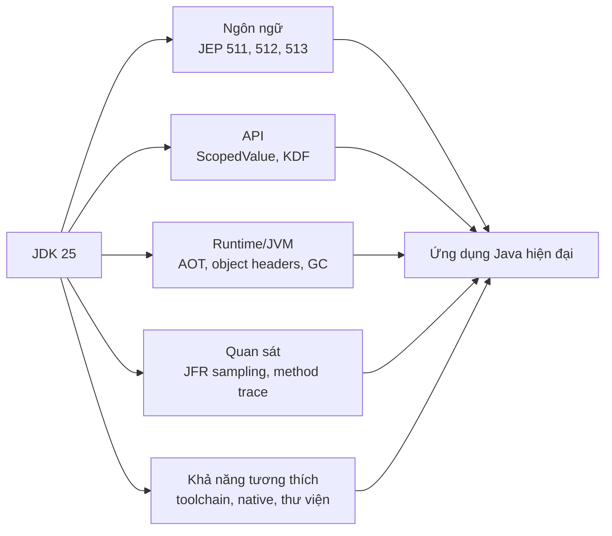
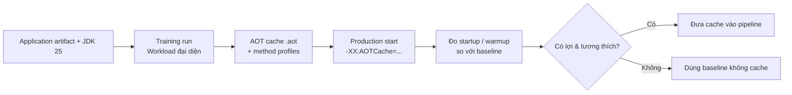
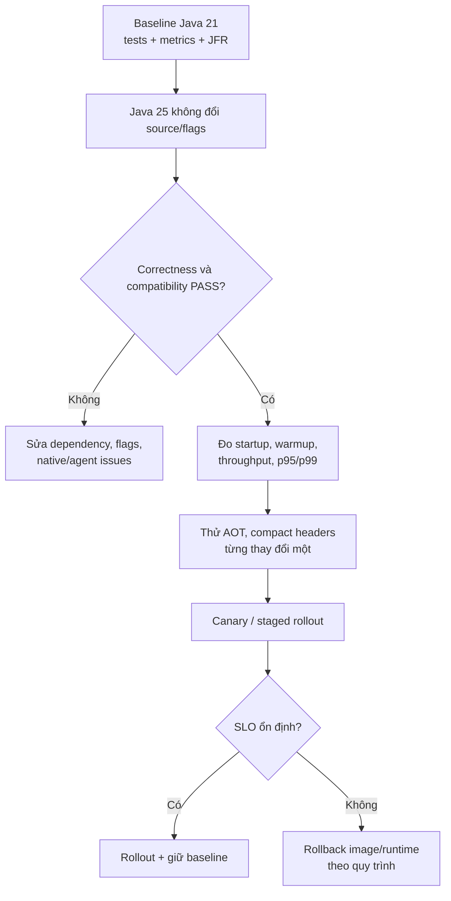

# Bản đồ thay đổi ngôn ngữ, API, JVM, quan sát và hiệu năng của Java 25

**Java 25** là một bản phát hành Java/JDK dài hạn (LTS), được phát hành vào tháng 9 năm 2025. Giá trị của Java 25 không nằm ở một cú pháp riêng lẻ mà ở sự trưởng thành đồng thời của ngôn ngữ, API dùng cho ứng dụng hiện đại, cơ chế tối ưu JVM, công cụ ghi nhận hiệu năng và quy trình xây dựng/triển khai. Ví dụ: lập trình viên có thể viết một chương trình nguồn ngắn gọn, đưa ngữ cảnh yêu cầu qua `ScopedValue`, dẫn xuất khóa bằng KDF API, làm nóng ứng dụng bằng AOT cache và quan sát luồng xử lý bằng Java Flight Recorder (JFR).

Bài thuộc chương **Tổng quan Java 25** của module **JAVA_VERSION_JAVA25**. Nội dung định hướng cho người học khám phá những khả năng **còn hữu ích trong phát triển Java hiện đại**, gồm chương trình nguồn gọn, module import, hàm khởi tạo linh hoạt, ScopedValue, Key Derivation Function API, AOT cache, JFR và đánh giá tác động nâng cấp JDK.

**Nguyên tắc lựa chọn nội dung:** chỉ giới thiệu giải pháp còn phù hợp để sử dụng hoặc đánh giá hiện nay. Các tính năng ở trạng thái **preview, incubator hoặc experimental trong JDK 25** được đánh dấu rõ là hướng thử nghiệm có kiểm soát, **không** được trình bày như API ổn định đã sẵn sàng đưa vào production. Bài không khuyến khích dựa vào cơ chế từng được preview nhưng đã bị rút lại, hay tiếp tục sử dụng API đã lỗi thời chỉ vì chúng từng xuất hiện trong lịch sử Java.

> **Phạm vi phiên bản:** các trạng thái “chính thức”, “preview” và “incubator” trong bảng này nói về **JDK 25**, không phải một cam kết rằng trạng thái đó sẽ giữ nguyên ở mọi phiên bản JDK tương lai. Khi triển khai trên JDK mới hơn, kiểm tra tài liệu của đúng phiên bản đang chạy. Những đoạn lệnh có tác dụng đo đạc/tạo cache là hướng dẫn thực hành, không phải kết quả đã benchmark trên máy của người học.

## 1. Mục tiêu học tập và cách đọc bản đồ

Sau khi học xong, bạn có thể:

1. Phân loại thay đổi Java 25 thành **ngôn ngữ**, **API/thư viện**, **JVM/runtime**, **quan sát/JFR**, **hiệu năng** và **khả năng tương thích**.
2. Phân biệt **tính năng chính thức (final/permanent)** với **preview**, **incubator** và **experimental**; chọn mức sử dụng phù hợp.
3. Viết ví dụ Java 25 cho compact source file, module import, flexible constructor bodies và scoped values.
4. Hiểu mục đích của `javax.crypto.KDF`, cách dùng HKDF đúng ngữ cảnh và vì sao nó không phải hàm băm mật khẩu người dùng.
5. Tạo và sử dụng AOT cache theo một training run đại diện, so startup/warmup với baseline không cache.
6. Sử dụng JFR để điều tra CPU, allocation, GC và method timing; nhận biết giới hạn của quan sát lấy mẫu.
7. Xây dựng một checklist nâng cấp Java 21 → Java 25 có khả năng kiểm chứng và quay lui.

### 1.1. Sơ đồ tổng thể



**Tối ưu thành công không đồng nghĩa chỉ chuyển JDK:** cần xác minh bằng correctness tests, compatibility tests, benchmark startup/warmup/throughput/latency và bằng chứng từ JFR. Đổi JDK có thể cải thiện runtime mà không cần sửa mã nguồn; các cú pháp mới chỉ nên được áp dụng khi tạo giá trị rõ ràng.

## 2. Phân loại trạng thái tính năng trước khi sử dụng

| Trạng thái trong JDK 25 | Nghĩa thực tế | Khuyến nghị |
|---|---|---|
| **Final / Permanent** | Ngôn ngữ/API đã được chuẩn hóa hoặc đưa vào bản phát hành chính thức | Có thể dùng trong mã sản xuất sau khi kiểm compatibility và chính sách thư viện |
| **Product / implementation feature** | Cải tiến JVM/JDK chính thức; có thể cần JVM flag để bật | Dùng có đo kiểm và quan sát; không giả định luôn bật mặc định |
| **Preview** | Thiết kế đang được đánh giá; cần opt-in bằng cờ ở chỗ thích hợp | Thử trong bài lab/PoC, tránh phụ thuộc dài hạn khi chưa có chính sách chấp nhận rủi ro |
| **Incubator** | API nằm ở module thử nghiệm, có thể thay đổi giữa phiên bản | Chỉ thử nghiệm có kiểm soát, không xây public contract ổn định dựa vào API incubator |
| **Experimental** | Tính năng thử nghiệm ở mức công cụ hoặc VM | Chỉ dùng theo điều kiện của nền tảng, đo overhead và xác minh độ tin cậy |
| **Removal / migration change** | Một cổng nền tảng/tùy chọn cũ đã bị loại bỏ | Rà soát phụ thuộc trước nâng cấp; không cố phục hồi cơ chế cũ |

Tính năng preview **không tự động trở thành final chỉ vì đã preview nhiều lần**. Java compiler yêu cầu `--enable-preview` cùng `--release 25` hoặc `-source 25` khi biên dịch mã sử dụng preview language feature, và runtime tương ứng cũng cần `--enable-preview`. Không dùng cú pháp preview của JDK 25 trong build target cũ hơn với kỳ vọng nó vẫn hoạt động.

Ví dụ biên dịch/thực thi một bài thử **chỉ khi thật sự sử dụng preview feature**:

```bash
javac --release 25 --enable-preview PreviewDemo.java
java --enable-preview PreviewDemo
```

Trong khi đó, các tính năng ngôn ngữ **final** của Java 25 không yêu cầu cờ trên.

## 3. Bản đồ các JEP quan trọng của Java 25

### 3.1. Ngôn ngữ

| JEP | Thay đổi | Trạng thái JDK 25 | Ý nghĩa |
|---|---|---|---|
| **511** | Module Import Declarations | Final | Một khai báo import lấy các package được export bởi module |
| **512** | Compact Source Files and Instance Main Methods | Final | Viết chương trình nhỏ mà không cần class boilerplate |
| **513** | Flexible Constructor Bodies | Final | Kiểm tra/chuẩn bị dữ liệu trước `super(…)` hoặc `this(…)` với giới hạn an toàn |
| **507** | Primitive Types in Patterns, `instanceof`, `switch` | **Third Preview** | Khai thác primitive trong pattern matching; không phải cú pháp final trong JDK 25 |

Ba JEP 511/512/513 là phần ngôn ngữ nên ưu tiên học để sử dụng dài hạn. Với JEP 507, chỉ ghi nhận hướng phát triển và thử có cờ preview, không yêu cầu mọi dự án phải bật.

### 3.2. API và thư viện

| JEP | Thay đổi | Trạng thái JDK 25 | Gợi ý chọn |
|---|---|---|---|
| **506** | Scoped Values | Final | Truyền ngữ cảnh chỉ đọc theo phạm vi động, nhất là ứng dụng nhiều luồng |
| **510** | Key Derivation Function API | Final | Dẫn xuất khóa với cơ chế như HKDF qua API chuẩn |
| **505** | Structured Concurrency | **Fifth Preview** | Thử quản lý nhóm tác vụ con theo vòng đời rõ ràng; chưa là API final ở JDK 25 |
| **502** | Stable Values | **Preview** | Thử dữ liệu khởi tạo muộn nhưng ổn định; không dùng như contract final |
| **470** | PEM Encodings of Cryptographic Objects | **Preview** | Thử mã hóa/giải mã khóa và chứng chỉ dạng PEM qua API mới |
| **508** | Vector API | **Tenth Incubator** | Nghiên cứu SIMD/hot loops; chưa coi là API chuẩn sẵn dùng lâu dài |

Nhóm kỹ năng cần đầu tư trước là **ScopedValue** và **KDF API**, rồi mở rộng sang các tính năng thử nghiệm khi có yêu cầu cụ thể.

### 3.3. JVM, hiệu năng, công cụ và nền tảng

| JEP | Thay đổi | Ý nghĩa cần quan tâm |
|---|---|---|
| **514** | Ahead-of-Time Command-Line Ergonomics | Đơn giản hóa việc tạo AOT cache từ training run |
| **515** | Ahead-of-Time Method Profiling | Dữ liệu profile từ training giúp JIT warmup sớm hơn |
| **519** | Compact Object Headers | Tùy chọn JVM chính thức giảm overhead header; trên JDK 25 **chưa bật mặc định** |
| **521** | Generational Shenandoah | Hướng tối ưu garbage collector Shenandoah theo thế hệ |
| **509** | JFR CPU-Time Profiling | **Experimental**, tập trung đo CPU-time chính xác hơn trên Linux |
| **518** | JFR Cooperative Sampling | Cải thiện tính ổn định và giảm sai lệch của stack sampling |
| **520** | JFR Method Timing & Tracing | JFR có thêm công cụ đo/trace method qua instrumentation |
| **503** | Remove the 32-bit x86 Port | Thay đổi tương thích: JDK 25 không còn cổng x86 32-bit |

Nhóm AOT/JFR/compact object headers không bắt buộc ứng dụng phải thay đổi source. Hiệu quả phụ thuộc workload, cấu hình JVM, hệ điều hành, kiến trúc CPU và driver/thư viện. Không đưa ra một tỷ lệ “tăng tốc mặc định” cho mọi ứng dụng.

## 4. Compact Source Files và instance `main` — JEP 512 (Final)

Các chương trình Java nhỏ từng cần khai báo class và method `public static void main(String[] args)`. Từ Java 25, có thể tạo một **compact source file** với instance `main`:

```java
// File: Hello.java
void main() {
    IO.println("Chào Java 25!");
}
```

Chạy trực tiếp:

```bash
java Hello.java
```

Đây là khả năng **final trong JDK 25**, không cần `--enable-preview`. `IO` nằm trong `java.lang` và có các method tiện lợi như `IO.println(…)` và `IO.readln(…)`. Trong Java 25, lời gọi `println(…)` trần **không tự được static-import** như ở một số bản preview trước; cần dùng `IO.println(…)` hoặc khai báo static import rõ ràng.

Các member ở cấp file thuộc về một class được khai báo ngầm:

```java
// File: Report.java
String summarize(int count) {
    return "Đã xử lý " + count + " bản ghi";
}

void main() {
    IO.println(summarize(5));
}
```

**Khi nên dùng:** ví dụ học tập, CLI nhỏ, script kiểm tra dữ liệu, bài thử thuật toán, chương trình một file, prototype. **Khi không nên lạm dụng:** ứng dụng doanh nghiệp cần public API, module boundaries, nhiều class, dependency injection và quy ước build rõ ràng. Compact source file không thay thế class-based design hoặc Java Platform Module System.

### 4.1. Tương thích với source level

Một dự án có thể chạy trên JDK 25 nhưng vẫn compile với `--release 21` để giữ khả năng chạy trên Java 21. Khi đó, code sử dụng cú pháp mới Java 25 **không** biên dịch được theo release 21. Phân biệt:

- **Runtime JDK:** JVM thực thi ứng dụng.
- **Compiler JDK:** JDK dùng để biên dịch.
- **Target release:** tập tính năng/API mà compiler cho phép sử dụng.

Lên JDK 25 không có nghĩa phải đổi toàn bộ source level ngay. Nhóm có thể nâng runtime trước, sau đó chỉ áp dụng syntax mới khi build/deployment đã sẵn sàng.

## 5. Module Import Declarations — JEP 511 (Final)

`import module M;` cho phép nhập các public types từ **những package mà module `M` export**, không yêu cầu file nguồn phải là module riêng.

```java
// File: CollectionsDemo.java
import module java.base;

public class CollectionsDemo {
    public static void main(String[] args) {
        List<String> items = List.of("Java", "JFR", "AOT");
        Map<String, Integer> lengths =
                items.stream().collect(Collectors.toMap(
                        String::toString, String::length));
        System.out.println(lengths);
    }
}
```

`java.base` export các package có `List`, `Map`, `Collectors`. Java compiler giải quyết tên dựa trên tập import đó. Trên compact source files, những public types thuộc `java.base` đã được import on demand tương tự nên thường không cần thêm `import module java.base;`.

**Cần hiểu đúng:**

1. Module import là cơ chế **nhập tên type** vào source, không tự động khai báo `requires` trong `module-info.java` của một named module.
2. Chỉ những package **được export** mới được import qua module; không mở quyền truy cập class nội bộ của JDK hoặc thư viện.
3. Nếu nhiều package có class trùng simple name, có thể cần import cụ thể hoặc dùng tên fully qualified để tránh mơ hồ.
4. Một app trên classpath không trở thành ứng dụng JPMS được module hóa chỉ vì dùng `import module`.

**Khi nên dùng:** bài học, source file ngắn, công cụ có API liên quan đến một module rõ ràng. **Khi nào giữ import truyền thống:** thư viện lớn cần biểu lộ phụ thuộc cụ thể, tránh import bao trùm hoặc nhầm class cùng tên.

## 6. Flexible Constructor Bodies — JEP 513 (Final)

Trước kia, lời gọi tường minh `super(…)` hoặc `this(…)` phải đứng đầu constructor body. Java 25 cho phép đặt một số phép tính/validation **trước** lời gọi này, miễn là không vi phạm quy tắc an toàn khi object chưa khởi tạo xong.

```java
class Account {
    Account(String accountCode) {
        if (accountCode.isBlank()) {
            throw new IllegalArgumentException("Mã rỗng");
        }
    }
}

class PremiumAccount extends Account {
    private final int points;

    PremiumAccount(String code, int initialPoints) {
        if (initialPoints < 0) {
            throw new IllegalArgumentException("Điểm phải không âm");
        }
        String normalized = code.trim();

        super(normalized);

        this.points = initialPoints;
    }

    int points() {
        return points;
    }
}
```

Ví dụ cho phép validate `initialPoints` và chuẩn hóa `code` trước khi gọi superclass constructor, giảm việc tạo object dở dang rồi mới phát hiện dữ liệu không hợp lệ. Trong các trường hợp đặc biệt, Java 25 còn cho phép gán một số instance fields trước `super(…)` theo ràng buộc của ngôn ngữ.

**Giới hạn quan trọng:** phần prologue trước `super(…)` không được tùy ý tham chiếu `this` hoặc gọi instance methods trên object chưa khởi tạo. Không coi đây là giấy phép làm rò rỉ object đang xây dựng, khởi động thread hoặc truy cập trạng thái chưa hoàn chỉnh.

**Khi nên dùng:** kiểm tra tham số, chuẩn hóa dữ liệu hoặc tính toán có thể thực hiện an toàn trước chain constructor. Không cần sửa hàng loạt constructor cũ vẫn đang tốt chỉ để dùng cú pháp mới.

## 7. Primitive patterns trong `instanceof` và `switch` — JEP 507 (Third Preview)

JDK 25 tiếp tục thử nghiệm pattern matching cho primitive types. Đây là **third preview**, khác với ba JEP ngôn ngữ final phía trên.

Điểm cốt lõi là hướng tới một Java đồng nhất hơn khi so khớp giá trị và kiểu, bao gồm các trường hợp kiểm tra primitive conversion, primitive type patterns, `instanceof` và `switch` mở rộng. Nhưng vì đang preview trong JDK 25, **không chọn làm cú pháp mặc định cho codebase cần binary/source compatibility lâu dài**.

Nếu một đội muốn đánh giá, cần:

- Cô lập thử nghiệm ở module/source set riêng.
- Bật `--enable-preview` ở cả compile và runtime cho **đúng JDK 25**.
- Thêm kiểm thử biên cho narrowing conversion, giá trị ngoài phạm vi và hành vi `switch`.
- Ghi rủi ro thay đổi API/cú pháp ở JDK tiếp theo.

Những hệ thống chỉ cần xử lý primitive thông thường vẫn có thể dùng `switch`/`if` hiện có và record patterns đã final ở các phiên bản trước. Không cần bật preview chỉ vì có sự thay đổi mới trong release note.

## 8. ScopedValue — JEP 506 (Final): context theo phạm vi động

`ScopedValue<T>` giúp một method chia sẻ một giá trị với các method được gọi sâu hơn **trong phạm vi thực thi có kiểm soát** mà không phải truyền tham số qua mọi tầng.

```java
// File: ScopedContextDemo.java
public class ScopedContextDemo {

    private static final ScopedValue<String> REQUEST_ID =
            ScopedValue.newInstance();

    static void doWork() {
        System.out.println("requestId=" + REQUEST_ID.get());
    }

    public static void main(String[] args) {
        ScopedValue.where(REQUEST_ID, "req-25").run(() -> {
            doWork();
        });

        // Ngoài phạm vi run(), REQUEST_ID không còn được bind.
        System.out.println(REQUEST_ID.isBound()); // false
    }
}
```

**Khác với ThreadLocal:**

| Khía cạnh | `ScopedValue` | `ThreadLocal` |
|---|---|---|
| Mục đích phù hợp | Context có phạm vi, phần lớn là dữ liệu chỉ đọc | Trạng thái theo thread có thể thay đổi |
| Vòng đời | Bind trong `run(…)`/`call(…)` rồi tự kết thúc | Phải quản lý set/remove phù hợp để tránh rò dữ liệu |
| Rebinding | Có thể bind giá trị mới trong scope lồng nhau rồi khôi phục | Thường phải tự lưu và phục hồi giá trị |
| Thích hợp với virtual threads | Có, nhất là khi phối hợp cấu trúc task có kiểm soát | Có thể dùng nhưng cần xem memory/lifecycle |
| Lan sang thread khác | **Không tự động cho mọi executor** | Không tự động theo mặc định |

**Điểm dễ sai:** ScopedValue binding là theo thread. Nó có thể được chia sẻ với các child threads khi sử dụng **cơ chế structured concurrency hỗ trợ**, nhưng không được tự động truyền sang bất kỳ `new Thread(…)` hay thread pool nào. Không dùng nó thay thế cơ chế context propagation cho messaging, executor tùy biến hoặc tracing mà chưa có test.

Ví dụ tái bind trong phạm vi con:

```java
static final ScopedValue<String> LOCALE =
        ScopedValue.newInstance();

static void render() {
    System.out.println(LOCALE.get());
}

static void demo() {
    ScopedValue.where(LOCALE, "vi-VN").run(() -> {
        render(); // vi-VN

        ScopedValue.where(LOCALE, "en-US").run(
                () -> render()); // en-US

        render(); // vi-VN
    });
}
```

**Khi nên dùng:** request context bất biến, tenant identifier, cấu hình tính toán hoặc ngữ cảnh đọc xuyên nhiều tầng phương thức với phạm vi rõ ràng. **Cần tránh:** nhét mutable shared state vào ScopedValue hoặc dùng nó làm kho trạng thái toàn cục. ScopedValue là một cơ chế chia sẻ *binding*, không phải giải pháp tự động cho authorization hay quản lý secrets.

### 8.1. ScopedValue và Structured Concurrency: khác mức ổn định

Trong JDK 25, **Scoped Values là final**, còn **Structured Concurrency (JEP 505) là Fifth Preview**. Có thể dùng ScopedValue trong production theo semantics final mà **không cần** bật preview. Nếu thử kết hợp structured task scopes, phải kiểm chính sách preview, build flags và khả năng bảo trì phiên bản.

Đừng viết rằng “cần bật `--enable-preview` để dùng ScopedValue” — điều đó không đúng với JDK 25.

## 9. KDF API — JEP 510 (Final): dẫn xuất khóa chuẩn

JDK 25 bổ sung `javax.crypto.KDF` và các lớp liên quan để diễn đạt **Key Derivation Function** một cách trực tiếp qua Java Cryptography Architecture. Một ví dụ điển hình là **HKDF-SHA256**, nhận keying material, salt và context info để dẫn xuất key mới.

```java
// File: KeyDerivationDemo.java
import java.security.spec.AlgorithmParameterSpec;
import javax.crypto.KDF;
import javax.crypto.SecretKey;
import javax.crypto.spec.HKDFParameterSpec;

public class KeyDerivationDemo {

    static SecretKey deriveAesKey(
            byte[] inputKeyMaterial,
            byte[] salt,
            byte[] contextInfo) throws Exception {

        KDF hkdf = KDF.getInstance("HKDF-SHA256");

        AlgorithmParameterSpec params =
                HKDFParameterSpec.ofExtract()
                        .addIKM(inputKeyMaterial)
                        .addSalt(salt)
                        .thenExpand(contextInfo, 32);

        return hkdf.deriveKey("AES", params);
    }
}
```

Đây là cách dùng **API chính thức của Java 25**, không cần thư viện phụ trợ chỉ để gọi HKDF khi provider hỗ trợ. Ví dụ giả định `inputKeyMaterial` là nguồn vật liệu khóa được tạo và quản lý an toàn, không phải chuỗi password người dùng.

**Không đánh đồng KDF với hash mật khẩu:**

- **HKDF** thường dùng để dẫn xuất các khóa liên quan từ vật liệu khóa có entropy phù hợp, với salt và context info được thiết kế đúng.
- **Password hashing** cần một cơ chế chống brute-force phù hợp, như Argon2id/scrypt/PBKDF2 theo chính sách bảo mật và thư viện được đánh giá. Không lấy password thô đưa vào HKDF rồi gọi kết quả là “đã hash password an toàn”.
- **Encryption** là bước khác: dẫn xuất được `SecretKey` không có nghĩa đã mã hóa dữ liệu. Khi dùng AES/GCM, còn cần nonce, authenticated encryption, quản lý key lifecycle và key rotation.

Không log salt có tính nhạy cảm, raw keying material, derived key hoặc các thông số bí mật. Trong hệ thống thật, phối hợp KMS/HSM, vault, provider và chính sách crypto của tổ chức.

### 9.1. PEM encoding — JEP 470 vẫn Preview

Java 25 có API encode/decode cryptographic objects sang định dạng PEM nhưng **chỉ ở preview**. Đây là hướng hữu ích cho quản trị chứng chỉ/khóa, song cần đánh giá tương thích trước khi xây contract phụ thuộc API preview. Với phần mềm production cần ổn định, vẫn có thể dùng các API crypto/certificate hiện hành của JDK và thư viện bảo mật được hỗ trợ mà không nhất thiết chuyển sang PEM preview.

## 10. Stable Values và Vector API: nên biết nhưng chưa lấy làm nền tảng chính

**Stable Values (JEP 502)** có mục tiêu hỗ trợ dữ liệu bất biến được khởi tạo muộn nhưng để JVM tối ưu tương tự field `final`. Trong **JDK 25 đây là preview API**. Dùng để nghiên cứu khi có nhu cầu lazy initialization và đo được lợi ích, không dùng như cách thay thế bắt buộc cho mọi static final field.

**Vector API (JEP 508)** ở **Tenth Incubator**. Nó cho phép diễn đạt phép toán SIMD theo vector species trên phần cứng hỗ trợ. Chỉ nên thử khi đã xác định nút thắt ở vòng lặp tính toán qua profiler và benchmark thực tế. Một đoạn mã biểu diễn vector không bảo đảm luôn nhanh hơn scalar: kết quả còn tùy CPU, dữ liệu, kích thước mảng, độ phù hợp của phép toán và JIT.

**Structured Concurrency (JEP 505)** ở **Fifth Preview**. Nó hữu ích về mặt ý tưởng khi quản lý nhóm tác vụ đồng thời, cancellation và error propagation, nhưng **không trình bày API preview của Java 25 như public API production final**. Phần kiến thức áp dụng ngay là nguyên tắc quản lý vòng đời task, tránh bỏ quên task con và ghi nhận lỗi/cancellation.

## 11. AOT cache: JEP 514 và 515 — tối ưu startup/warmup

Một Java application thường trải qua startup, load/link classes, khởi tạo framework và warmup JIT. **AOT cache** của HotSpot tận dụng một **training run** để ghi lại thông tin có ích cho các lần chạy tiếp theo. Java 25 cải tiến hai phần:

- **JEP 514 — Ahead-of-Time Command-Line Ergonomics:** đơn giản hóa quy trình tạo cache bằng một command thông dụng, bao gồm training và bước assembly.
- **JEP 515 — Ahead-of-Time Method Profiling:** dùng method execution profiles từ training run để hỗ trợ JIT tối ưu sớm hơn trong lần khởi động sau.



Ví dụ với ứng dụng Java có lifecycle kết thúc rõ ràng:

```bash
# Training + tạo cache:
java -XX:AOTCacheOutput=demo.aot -cp app.jar com.example.Main

# Dùng cache ở lần chạy tiếp theo:
java -XX:AOTCache=demo.aot -cp app.jar com.example.Main
```

**Quan trọng:** training run phải được phép kết thúc để quy trình hoàn thiện cache. Với một server chạy liên tục, cần kịch bản startup và stop có kiểm soát, chứ không chỉ chạy lệnh rồi chờ vô hạn. Trong triển khai Spring Boot, còn phải xét cấu trúc executable JAR; không giả định mọi fat JAR hoạt động theo cách giống `-cp app.jar` của ứng dụng Java thông thường.

Với ứng dụng Spring Boot, quy trình hỗ trợ AOT cache thường dùng kỹ thuật **extract executable JAR** và training stop on refresh. Hãy làm theo tài liệu Spring Boot tương ứng với phiên bản đang sử dụng, thay vì copy nguyên lệnh `-cp` của ứng dụng thuần.

### 11.1. Hạn chế tương thích cache

AOT cache gắn với **application artifact**, **JDK release**, **OS** và **CPU architecture**. Khi đổi một trong các điều kiện quan trọng, phải tạo lại cache. Khả năng sử dụng cache còn có thể chịu ảnh hưởng bởi JVM options, agent và instrumentations.

- Không vận chuyển cache tạo trên một bản Java hoặc kiến trúc CPU rồi mặc định dùng được ở môi trường khác.
- Training không nên đưa vào dữ liệu người dùng hay secrets nếu chúng có nguy cơ lưu vào artifact/heap state theo cách không mong muốn.
- Luôn so cách chạy **có cache** và **không cache** bằng cùng workload, heap limits, CPU quota, GC policy và image.
- Nếu cache không tương thích, có thể dùng chế độ `auto` để ứng dụng tiếp tục chạy không cache và dùng `-Xlog:aot` để kiểm chứng; các chế độ nghiêm ngặt dùng để fail-fast khi debug.

Chẩn đoán cache:

```bash
java -Xlog:aot -XX:AOTCache=demo.aot \
  -cp app.jar com.example.Main
```

AOT không thay thế JIT hay native image. JVM vẫn thực thi và tối ưu ứng dụng khi chạy; AOT cache là một kỹ thuật giảm chi phí startup/warmup trong các tình huống phù hợp.

### 11.2. Đo lợi ích đúng cách

| Chỉ số | Ý nghĩa |
|---|---|
| Cold startup | Thời gian từ start process tới ứng dụng sẵn sàng |
| Time to first request | Có thể nhận và xử lý request đầu tiên sau bao lâu |
| Warmup throughput | Throughput ở những phút đầu |
| Steady-state throughput | Năng lực sau khi hệ thống nóng |
| P95/P99 latency | Tác động lên tail latency, nhất là trong warmup |
| RSS/heap/GC | Chi phí bộ nhớ và collector |
| AOT cache size | Dung lượng artifact và tác động tới build/deploy |
| Training time | Chi phí bổ sung trong CI/CD |

Không công bố một “Java 25 nhanh hơn X%” chung cho mọi ứng dụng. Với service dài hạn, lợi ích startup có thể ít giá trị hơn so với tài nguyên và chi phí training; với serverless/job ngắn, nó có thể đáng kể.

## 12. Compact Object Headers — JEP 519: hiệu quả bộ nhớ có điều kiện

Object trong HotSpot chứa header mô tả metadata như class identity và trạng thái khóa. **Compact Object Headers** giảm overhead của header trên một số cấu hình HotSpot 64-bit. Trong Java 25, đây là **product feature**, nhưng **không bật mặc định**; có thể chủ động thử:

```bash
java -XX:+UseCompactObjectHeaders -jar app.jar
```

Đo so sánh:

```bash
# Baseline với giới hạn heap như nhau
java -Xmx2g -Xlog:gc*:file=gc-baseline.log \
  -jar app.jar

# Lần thử với compact object headers
java -Xmx2g -XX:+UseCompactObjectHeaders \
  -Xlog:gc*:file=gc-compact.log \
  -jar app.jar
```

**Có thể có lợi** khi ứng dụng tạo và giữ rất nhiều objects nhỏ (nhiều node, maps, records, model objects), vì chi phí header chiếm tỷ lệ lớn. **Có thể không đáng kể** nếu bộ nhớ chủ yếu là các arrays lớn, off-heap buffers hoặc dữ liệu có payload lớn hơn hẳn object overhead.

Việc thay layout object cần kiểm thư viện native, JNI/Unsafe, agents và các công cụ có giả định về offsets/layout. Không đọc hoặc ghi object header trực tiếp bằng kỹ thuật nội bộ; đó không phải hợp đồng API Java chuẩn. Trước khi áp dụng production, kiểm P95/P99, RSS, live heap, GC pause và throughput theo workload thực tế.

**Phân biệt với AOT:** compact headers nhắm tới footprint/layout; AOT nhắm tới startup/warmup. Hai tối ưu có cơ chế và bộ đo khác nhau, không dùng một kết quả benchmark để kết luận cho cả hai.

## 13. Generational Shenandoah và lựa chọn GC — JEP 521

Java 25 tiếp tục cải thiện **Generational Shenandoah**. Đây là một lựa chọn collector cho các workload cần kiểm soát pause và hành vi thu gom. Tuy nhiên, không có một GC tốt nhất cho mọi ứng dụng.

| Mục tiêu | Cần đo |
|---|---|
| Ưu tiên pause time | Max/percentile GC pause, tail latency |
| Ưu tiên throughput | RPS/operations per second, CPU |
| Heap lớn, nhiều object sống lâu | Old generation occupancy, concurrent cycle, allocation |
| Container giới hạn CPU/memory | RSS, CPU throttling, GC frequency |
| Cần triển khai ổn định | Kết quả kiểm chứng driver, workload và platform |

G1 là baseline phổ biến ở nhiều hệ HotSpot; ZGC và Shenandoah có những tính chất/chi phí riêng. Đừng chọn collector chỉ vì có JEP mới. Cần xác định collector mà JDK distribution đang hỗ trợ, kiểm flags theo build và chạy benchmark A/B.

JEP 503 loại bỏ cổng **x86 32-bit** của JDK 25: nếu còn một binary deployment hoặc native plugin phụ thuộc 32-bit x86, phải giải quyết tương thích nền tảng trước. Không xem đây là lời khuyên tiếp tục duy trì runtime cũ; đây là điều kiện kiểm khi nâng cấp.

## 14. JFR trong Java 25: quan sát mà không đoán

**Java Flight Recorder (JFR)** giúp thu thập dữ liệu vận hành và hiệu năng từ JVM: CPU samples, thread states, allocations, GC pauses, class loading, I/O và nhiều events khác tùy cấu hình.

Trong JDK 25 có ba thay đổi lớn liên quan JFR:

- **JEP 518 — JFR Cooperative Sampling:** cải thiện độ ổn định của lấy mẫu stack theo cách an toàn hơn, giảm sai lệch do safepoint.
- **JEP 520 — JFR Method Timing & Tracing:** hỗ trợ quan sát lời gọi/thời gian method qua bytecode instrumentation, hữu ích khi cần phân tích method cụ thể.
- **JEP 509 — JFR CPU-Time Profiling (Experimental):** thu mẫu theo CPU time chính xác hơn trên **Linux**, có thể bao gồm native code. Đây là thử nghiệm, không phải chế độ mặc định cho mọi hệ điều hành.

### 14.1. Ghi JFR bằng công cụ chuẩn

Từ một JVM đang chạy mà bạn có quyền quan sát:

```bash
# Xác định PID của tiến trình Java
jcmd -l

# Ghi JFR trong 60 giây (thay PID)
jcmd 12345 JFR.start name=baseline settings=profile \
  duration=60s filename=baseline.jfr

# Xem tổng quan file recording đã thu
jfr summary baseline.jfr
```

Hoặc khởi động ứng dụng và ghi flight recording ngay:

```bash
java -XX:StartFlightRecording=filename=app.jfr,\
settings=profile,duration=60s -jar app.jar
```

Các lệnh cần chạy trong môi trường được phép, với đúng PID/path và JDK tools tương thích. Ghi profile có overhead và có thể chứa thông tin nhạy cảm trong stack, tên class/method hoặc event payload; kiểm quyền truy cập, retention và chia sẻ file JFR.

### 14.2. Quan sát method với JEP 520

Khi một method cụ thể là nghi phạm về độ trễ, JFR Method Timing & Tracing cho phép chọn method cần trace/timing qua event configuration. Chỉ bật phạm vi method được quan tâm, không instrument hàng loạt toàn bộ application trên production.

Một cách thử method trace trong môi trường JDK 25 có hỗ trợ event tương ứng:

```bash
java '-XX:StartFlightRecording=jdk.MethodTrace#filter=com.example.Worker::run,filename=method.jfr' \
  -cp app.jar com.example.Main

jfr view jdk.MethodTrace method.jfr
```

Phần cấu hình filter/event có thể có giới hạn hoặc khác biệt chi tiết giữa bản JDK và shell; xác minh cú pháp trên JDK 25 thực tế qua `jfr`/JFR event metadata. Mục đích ở đây là đo một method có chủ đích, không tạo “tracing distributed” tự động như OpenTelemetry.

**JFR method tracing** ghi event bên trong JVM; **distributed tracing** theo HTTP/gRPC/message headers mô tả request qua nhiều process. Hai công cụ có mục đích khác nhau nhưng có thể kết hợp khi điều tra latency.

### 14.3. CPU-time profiling thử nghiệm JEP 509

Trên Linux và JDK 25 hỗ trợ, có thể thử event `jdk.CPUTimeSample` trong phạm vi lab:

```bash
java '-XX:StartFlightRecording=jdk.CPUTimeSample#enabled=true,filename=cpu.jfr' \
  -jar app.jar

jfr view cpu-time-hot-methods cpu.jfr
```

Đây là khả năng **experimental**. Không giả định event có sẵn trên Windows, macOS hoặc mọi JDK distribution; không mặc định sample CPU-time sẽ thay thế tất cả CPU profiler truyền thống. So kết quả với CPU usage và những phép đo độc lập.

### 14.4. Chẩn đoán bằng các loại bằng chứng phù hợp

| Triệu chứng | Ưu tiên quan sát |
|---|---|
| Startup chậm | Class loading, init phases, AOT logs, thời gian readiness |
| Warmup chậm | JIT compilation, CPU, throughput, AOT training coverage |
| P99 tăng | Thread states, locks, GC, I/O, method timing |
| CPU 100% | JFR samples, hot methods, native CPU samples nếu có |
| Heap/RSS tăng | Allocation profiles, live objects, GC, native memory khi phù hợp |
| Virtual threads nhiều | Thread scheduling/blocking, structured lifecycle, số lượng task |
| JFR có dữ liệu nhưng dashboard APM thiếu | Kiểm telemetry exporter/query riêng: JFR không tự động xuất mọi event sang APM |

**Đừng đo overhead bằng cảm tính:** phải dùng cùng cấu hình sampling, thời lượng và mức tải để so JFR có bật/tắt. Những event method trace chi tiết có thể nặng hơn sampling profile thông thường.

## 15. Nâng cấp từ Java 21 lên Java 25: checklist kỹ thuật

Một quy trình nâng cấp an toàn cần tách **khả năng chạy được** khỏi **việc ứng dụng tính năng mới**.

### Giai đoạn A — inventory và baseline

1. Liệt kê JDK distribution/version, OS/architecture, CPU/memory limits, container images và native dependencies.
2. Kiểm các framework và libraries (Spring Boot, Hibernate, JDBC drivers, Gradle/Maven plugins, bytecode agents, APM, mocking/coverage) có hỗ trợ JDK 25.
3. Lưu baseline: thời gian startup, readiness, throughput, P95/P99, heap/RSS, GC logs và một JFR recording representative.
4. Kiểm JNI, `sun.misc.Unsafe`, reflection/internal JDK APIs và native libraries. Rà soát các JVM flags cũ.

### Giai đoạn B — compile và kiểm thử

Các công cụ như `jdeps` và `jdeprscan` giúp tìm những phụ thuộc đáng chú ý:

```bash
java -version
javac -version

# Kiểm các dependency dùng JDK internal APIs
jdeps --jdk-internals app.jar

# Kiểm API deprecated phù hợp mục tiêu
jdeprscan --release 25 app.jar
```

Đọc warning thực tế và kiểm dependency graph; các công cụ không thể tự phát hiện mọi reflection/dynamic class loading. Tiếp tục với unit, integration, contract, testcontainers và smoke test cho các đường nghiệp vụ quan trọng.

### Giai đoạn C — nâng runtime trước, language level sau

Có thể chạy chương trình biên dịch target Java 21 trên runtime Java 25 theo khả năng tương thích Java SE, nhưng vẫn phải kiểm thư viện/agent/runtime. Ban đầu giữ compiler target 21 nếu cần hỗ trợ hai môi trường. Khi tất cả deployment đã được nâng lên 25, mới đánh giá dùng source `--release 25` và các API mới.

Không nên bật preview feature trong production build chỉ để “dùng hết tính năng của Java 25”. Các tính năng final như module import, compact source, flexible constructors, ScopedValue và KDF đủ đem lại nhiều cải tiến mà không đòi preview.

### Giai đoạn D — A/B performance và rollout



Khi thử tối ưu, chỉ thay **một biến độc lập** mỗi lượt: JDK version, AOT cache, compact headers hoặc GC. Nếu đổi tất cả cùng lúc, rất khó giải thích nguyên nhân tăng/giảm hiệu năng.

### Giai đoạn E — quy tắc bảo vệ production

- Đóng gói runtime cố định bằng image digest/JDK build, không dùng tag “latest” không kiểm soát.
- Dùng canary/blue-green và có kế hoạch quay lui runtime hoặc image trước đó.
- Giám sát crash, GC pause, request error, startup/warmup latency, connection pools và RSS.
- Với AOT cache, tự động tạo lại khi app/JDK/OS/CPU thay đổi; kiểm log nạp cache.
- Với compact object headers, kiểm JNI/Unsafe/agent compatibility và latency chứ không chỉ heap giảm.
- Với JFR, kiểm overhead, retention, dữ liệu nhạy cảm và quyền truy cập.
- Ghi quyết định preview/experimental rõ ràng; mặc định tránh nếu không có lý do và test bảo trì.

## 16. Ma trận “dùng ngay – đo trước – chỉ thử nghiệm”

| Chủ đề Java 25 | Mức khuyến nghị | Vì sao |
|---|---|---|
| Compact Source Files / instance main | Dùng ngay cho chương trình ngắn | Final, giảm boilerplate |
| Module Import Declarations | Dùng có chọn lọc | Final, hữu ích nhưng cần cân nhắc import rộng |
| Flexible Constructor Bodies | Dùng khi có validation/chuẩn hóa phù hợp | Final, rõ luồng khởi tạo |
| ScopedValue | Dùng khi có context bất biến theo scope | Final, cần hiểu giới hạn cross-thread |
| KDF/HKDF | Dùng khi có nhu cầu dẫn xuất key thật | Final, cần review crypto policy |
| JFR baseline/cooperative sampling | Dùng để điều tra performance | Công cụ chính thức, vẫn cần kiểm overhead |
| JFR Method Timing & Tracing | Đo trước trên method mục tiêu | Có thể tăng chi phí instrumentation |
| AOT cache | Benchmark trước khi rollout | Hiệu quả phụ thuộc startup/warmup và training |
| Compact Object Headers | Benchmark và kiểm agent/native | Product flag, off by default trong JDK 25 |
| Generational Shenandoah | Benchmark theo SLO GC | Collector workload-specific |
| Primitive patterns | Chỉ PoC/preview | Third Preview trong JDK 25 |
| Structured Concurrency API | Chỉ PoC/preview trong JDK 25 | Fifth Preview |
| Stable Values, PEM API | Chỉ PoC/preview trong JDK 25 | API chưa final ở bản này |
| Vector API | Chỉ lab/đo microbenchmark có kiểm soát | Tenth Incubator |
| JFR CPU-Time Profiling | Chỉ thử nghiệm trên Linux phù hợp | Experimental |
| x86 32-bit port | Kiểm tương thích để loại bỏ phụ thuộc | Đã bị loại, không còn dùng trong JDK 25 |

**Thông điệp:** không phải JEP nào cũng là tính năng cần “bật ngay”. Việc chọn giải pháp tốt bắt đầu từ nhu cầu nghiệp vụ, trạng thái ổn định và benchmark.

## 17. Bài thực hành tổng hợp

### Bài 1 — Chương trình nguồn gọn

Tạo `Hello.java` chỉ có `void main()`, in ba dòng bằng `IO.println`, chạy `java Hello.java` với JDK 25. Giải thích vì sao không cần `--enable-preview` và vì sao `println` trần không được tự nhập static.

### Bài 2 — Module imports

Chuyển một ví dụ đang dùng import riêng cho `List`, `Map`, `Collectors` sang `import module java.base;`. Xác minh chương trình vẫn compile, sau đó trả lời liệu `import module` có thêm `requires java.base` vào `module-info.java` không.

### Bài 3 — Constructor validation

Viết subclass có constructor cần kiểm số tiền không âm trước `super(…)`. Xác định thao tác nào an toàn trước super, thao tác nào bị cấm vì truy cập instance chưa được xây dựng.

### Bài 4 — ScopedValue

Tạo `ScopedValue<String> REQUEST_ID`, bind qua `where().run()`, in ở method được gọi sâu hơn, rồi kiểm `isBound()` sau khi scope kết thúc. Thử với executor riêng, giải thích vì sao không nên kỳ vọng context tự lan sang thread pool.

### Bài 5 — HKDF

Dẫn xuất khóa AES bằng `KDF.getInstance("HKDF-SHA256")` với input key material sinh an toàn trong lab, salt và context info có chủ đích. Không in raw key; giải thích khác biệt với password hashing.

### Bài 6 — AOT và warmup

Chọn một ứng dụng Java có thời gian chạy ngắn, tạo AOT cache, chạy 10 lần có/không cache (cùng máy và workload), ghi median/p95 startup và độ biến động. Nếu không thấy cải thiện, nêu giả thuyết dựa trên workload training hoặc chi phí khởi động ngoài JVM.

### Bài 7 — JFR và compact object headers

Ghi JFR 60 giây với workload tạo nhiều objects nhỏ. Chạy baseline và lần thử có `-XX:+UseCompactObjectHeaders`; so GC/heap/RSS và tail latency. Không kết luận chỉ từ một lần đo.

### Bài 8 — Kịch bản nâng cấp

Viết bảng rủi ro của dự án Java 21 → Java 25: driver, Gradle/Maven plugins, APM agents, JNI/Unsafe, flags, JVM images và test compatibility. Xác định cách rollback và tín hiệu canary cần theo dõi.

## 18. Checklist và tiêu chí bàn giao

- [ ] Có danh sách JEP Java 25 và phân biệt final/preview/incubator/experimental.
- [ ] Không khuyến nghị tính năng preview như một API ổn định bắt buộc cho production.
- [ ] Chạy được compact source với instance main trên JDK 25.
- [ ] Hiểu `import module` không thay thế JPMS dependency declarations.
- [ ] Dùng flexible constructor bodies an toàn, không tham chiếu object trước lúc hợp lệ.
- [ ] Hiểu ScopedValue là binding theo scope/thread; không tự động propagate qua mọi executor.
- [ ] Phân biệt KDF/HKDF với password hashing, encryption và key management.
- [ ] Có baseline startup/warmup và một thử nghiệm AOT cache.
- [ ] Kiểm phiên bản app/JDK/OS/CPU khi tạo và sử dụng AOT cache.
- [ ] Đo compact object headers có/không bật, giữ workload và JVM settings nhất quán.
- [ ] Biết thu JFR và giải thích mục đích CPU sampling, cooperative sampling, method timing.
- [ ] Không dựa vào experimental JFR CPU-time profiling như tính năng mặc định đa nền tảng.
- [ ] Chạy test compatibility với dependencies, build tools, native/agents và container images.
- [ ] Có phương án canary, giám sát, rollback và ghi kết quả benchmark có thể tái hiện.

## Tài liệu tham khảo chính thức

Để duy trì kiến thức còn phù hợp, ưu tiên đối chiếu **tài liệu của bản JDK thực tế**, không dựa vào bài viết về những preview cũ mà chưa được cập nhật:

- [JDK 25 Project / JEP Feature List](https://openjdk.org/projects/jdk/25) — danh sách JEP của release.
- [Java Language Changes in JDK 25](https://docs.oracle.com/en/java/javase/25/language/java-language-changes-release.html) — phân biệt ngôn ngữ final/preview.
- [Compact Source Files and Instance Main Methods](https://docs.oracle.com/en/java/javase/25/language/compact-source-files-instance-main-methods.html) — cú pháp hiện hành của JEP 512.
- [ScopedValue API JDK 25](https://docs.oracle.com/en/java/javase/25/docs/api/java.base/java/lang/ScopedValue.html) — binding, rebinding, inheritance và giới hạn.
- [KDF API JDK 25](https://docs.oracle.com/en/java/javase/25/docs/api/java.base/javax/crypto/KDF.html) — API dẫn xuất khóa chính thức.
- [Java Cryptography Architecture Guide](https://docs.oracle.com/en/java/javase/25/security/java-cryptography-architecture-jca-reference-guide.html) — ví dụ HKDF và provider.
- [Java 25 Launcher Options — AOT Cache](https://docs.oracle.com/en/java/javase/25/docs/specs/man/java.html) — `AOTCacheOutput`, `AOTCache`, chế độ và giới hạn tương thích.
- [Spring Boot AOT Cache](https://docs.spring.io/spring-boot/reference/packaging/aot-cache.html) — ví dụ quy trình cho Spring Boot.
- [JDK 25 Migration Guide](https://docs.oracle.com/en/java/javase/25/migrate/significant-changes-jdk-25.html) — thay đổi trọng yếu khi nâng cấp.
- [JFR / jcmd command reference](https://docs.oracle.com/en/java/javase/25/docs/specs/man/jcmd.html) — tạo và kiểm recording.
- [JDK 25 Consolidated Release Notes](https://www.oracle.com/java/technologies/javase/25all-relnotes.html) — thay đổi trên ngôn ngữ, thư viện, JVM và công cụ.

## Kết luận

**Java 25 là một bước nâng cấp thực dụng khi biết chọn đúng phần ổn định và đo đúng tác động.** Ba thay đổi ngôn ngữ final (module imports, compact source files, flexible constructor bodies) giúp code ngắn gọn và an toàn hơn trong những tình huống thích hợp. ScopedValue và KDF API mở rộng cách viết ứng dụng hiện đại. AOT cache, compact object headers, Shenandoah và JFR mang lại công cụ hiệu năng/quan sát nhưng phải được xác minh bằng workload thật. Các tính năng preview, incubator và experimental là chủ đề đánh giá có giới hạn, không phải lời khuyên đưa vào production mặc định. Khi nâng cấp từ JDK trước lên 25, hãy ưu tiên correctness, compatibility, observability, benchmark và rollback — rồi mới quyết định sử dụng tính năng mới nào.
