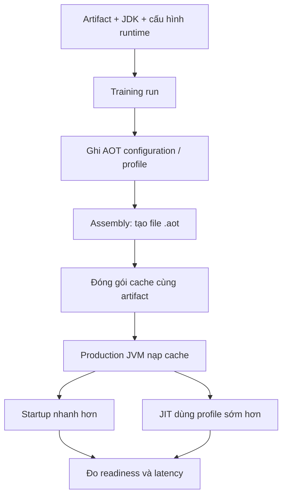
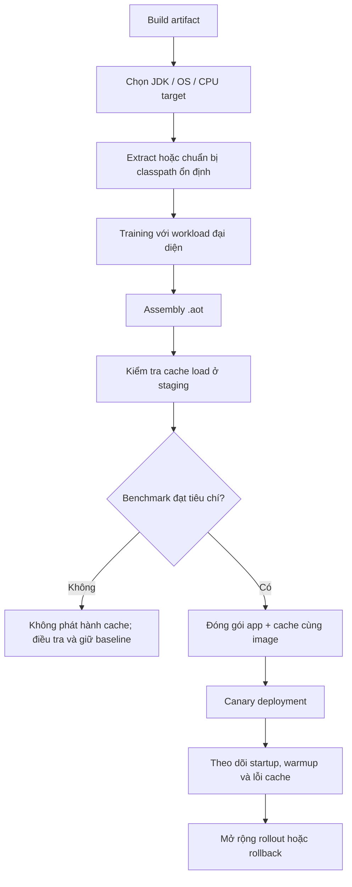

# Mục tiêu của AOT cache đối với thời gian khởi động và quá trình làm nóng ứng dụng

> **Chương:** AOT cache  
> **Học phần:** `JAVA_VERSION_JAVA25` — các khả năng Java 25 còn phù hợp trong phát triển hiện đại, gồm compact source files, module import, flexible constructor bodies, ScopedValue, Key Derivation Function API, AOT cache và JFR.  
> **Trọng tâm:** Hiểu AOT cache giúp giảm công việc nào trong giai đoạn khởi động, vì sao Java 25 còn cải thiện warmup, cách tạo và sử dụng cache, và cách đo xem lợi ích có đáng để đưa vào quy trình build/deploy hay không.

## 1. Bài toán: ứng dụng Java phải làm gì trước khi phục vụ request?

Khi JVM khởi chạy một ứng dụng, nó không thể lập tức phục vụ mọi request ở hiệu năng ổn định. Trước khi request đầu tiên được xử lý, JVM và ứng dụng phải thực hiện nhiều công việc:

- Tìm và đọc class từ classpath hoặc module path.
- Nạp class, xác minh bytecode, liên kết symbolic references và chuẩn bị metadata.
- Khởi tạo một số class, static fields, framework context, dependency injection và connection pool.
- Chạy các luồng xử lý ban đầu để JVM thu thập thông tin về hành vi phương thức.
- JIT compiler nhận diện method thường xuyên được gọi, nhánh thường được chọn và tối ưu mã thành native code.
- Ứng dụng hoàn tất health checks, kết nối dependency và đạt trạng thái readiness.

Hai loại độ trễ cần phân biệt:

**Startup time** là thời gian từ lúc tiến trình bắt đầu đến một mốc được định nghĩa rõ, ví dụ JVM khởi động, Spring ApplicationContext refresh xong hoặc instance chuyển sang Ready. Nếu class loading/linking và khởi tạo framework chiếm phần lớn thời gian, cache phù hợp có thể giúp giảm chi phí này.

**Warmup time** là khoảng thời gian sau khi ứng dụng đã chạy nhưng hiệu năng còn thay đổi vì JIT chưa có đủ profile để tối ưu các method nóng. Request đầu tiên có thể chậm hơn request thứ 1.000 dù ứng dụng đã Ready. Java 25 có thể dùng profile thu thập trong training run để JIT bắt đầu với dữ liệu có sẵn, rút ngắn giai đoạn này.

Một service có startup 2 giây nhưng cần 30 giây mới đạt throughput ổn định có hai bài toán khác nhau. AOT cache của Java 25 hướng tới cả hai, nhưng từng phần của cache đóng góp theo cách khác nhau.

### Tình huống thực tế

Một service Spring Boot chạy trong Kubernetes. Pod mới được tạo khi scale out hoặc sau rollout. Nếu mỗi instance cần nhiều giây để nạp class và khởi tạo Spring context, hệ thống có thể thiếu capacity trong giai đoạn scale. Sau khi Ready, vài request đầu vẫn chậm vì JIT đang thu thập profile.

AOT cache cho phép chuyển một phần công việc có thể tái sử dụng sang **training/build phase**. Khi instance mới khởi động, JVM có thể dùng các dữ liệu đã chuẩn bị, thay vì lặp lại toàn bộ công việc từ đầu.

Mục tiêu không phải loại bỏ JVM startup, loại bỏ JIT hay bảo đảm mọi request đều nhanh như nhau. Mục tiêu là giảm phần công việc lặp lại trước và ngay sau khi ứng dụng bắt đầu phục vụ.

## 2. AOT cache là gì?

**Ahead-of-Time Cache (AOT cache)** là vùng lưu trữ các artifacts mà HotSpot có thể chuẩn bị trước khi chạy ứng dụng. Khái niệm này được đưa vào JDK 24 qua JEP 483 (*Ahead-of-Time Class Loading & Linking*). Java 25 bổ sung hai cải tiến quan trọng:

- **JEP 514 — Ahead-of-Time Command-Line Ergonomics:** đơn giản hóa cách tạo cache, có thể thực hiện training và assembly theo một lệnh `-XX:AOTCacheOutput`.
- **JEP 515 — Ahead-of-Time Method Profiling:** cho phép đưa method execution profiles từ training run vào AOT cache để JIT có dữ liệu sớm hơn, cải thiện warmup.

Trong Java 25, AOT cache có thể mang thông tin class đã được nạp/liên kết, các heap objects được lưu trữ phù hợp và method profiles được ghi nhận trong training. JIT vẫn hoạt động trong production; profile được lưu giúp nó bắt đầu tối ưu sớm hơn, không biến ứng dụng thành native executable.

### Phân biệt AOT cache với những khái niệm gần tên

| Khái niệm | Chuẩn bị trước điều gì? | Kết quả khi chạy |
|---|---|---|
| **Class Data Sharing (CDS)** | Class data đã được xử lý và lưu trong archive | Giảm một phần chi phí nạp class |
| **AOT cache (Java 24+)** | Class loading/linking, một số heap objects và các artifacts AOT; Java 25 bổ sung method profiles | Giảm startup và có thể rút ngắn warmup |
| **JIT compilation** | Không chuẩn bị toàn bộ trước; compiler tối ưu khi chương trình chạy | Tạo native code theo hành vi thực tế |
| **GraalVM Native Image** | Biên dịch ứng dụng thành native executable trong build | Chạy binary native, không khởi động HotSpot theo cách thông thường |
| **Spring AOT processing** | Sinh code/metadata phục vụ khởi tạo Spring context | Tối ưu xử lý framework; có thể kết hợp với JVM AOT cache nhưng là cơ chế khác |

CDS là nền tảng liên quan và có thể tiếp tục dùng trong các môi trường tương thích, nhưng với JDK 25 nên ưu tiên AOT cache khi ứng dụng và cách đóng gói đáp ứng điều kiện. Spring Boot hiện cũng khuyến nghị AOT cache cho Java 25 trở lên khi có thể sử dụng.

**AOT cache không phải native image.** Ứng dụng vẫn chạy trên JVM, vẫn có class loading cần thiết, garbage collector, interpreter và JIT. Cache cũng không đảm bảo mọi class của ứng dụng đã được lưu: class không xuất hiện trong training hoặc không đủ điều kiện có thể vẫn được xử lý khi runtime.

## 3. Hai mục tiêu riêng: startup và warmup

### 3.1. Giảm startup bằng class loading và linking đã chuẩn bị

JEP 483 chuyển một phần công việc class loading/linking sang trước thời điểm production. Trong training, JVM quan sát các class thực sự được sử dụng và tạo dữ liệu có thể tái sử dụng. Ở production, JVM có thể dùng các class đã được chuẩn bị để giảm công việc lặp lại.

Lợi ích thường rõ hơn với ứng dụng:

- Có nhiều dependency và class cần nạp.
- Dùng framework lớn như Spring Boot, nơi startup có thể khởi tạo nhiều bean và thư viện.
- Khởi động instance thường xuyên: container scale out, serverless-like deployment hoặc test integration tạo nhiều process.
- Có classpath ổn định giữa training và production.

AOT cache không thay thế việc tối ưu startup của chính ứng dụng. Nếu ứng dụng mất 20 giây để gọi dịch vụ bên ngoài, chạy migration hoặc đợi database, việc giảm class loading có thể chỉ tác động một phần nhỏ của tổng thời gian.

### 3.2. Giảm warmup bằng method profiles trong Java 25

Trong lần chạy thông thường, HotSpot thu thập profile khi method được thực thi. JIT dùng dữ liệu này để quyết định method nào nóng và tối ưu theo các đặc điểm đã quan sát. Việc thu thập profile rồi mới tối ưu tạo ra giai đoạn warmup.

Với **JEP 515**, training run có thể thu thập method profiles và đưa chúng vào AOT cache. Khi production JVM khởi động với cache đó, JIT có thể bắt đầu từ dữ liệu đã quan sát, thay vì bắt đầu hoàn toàn từ profile rỗng.

Điều này có ích nếu training workload đại diện cho hành vi production. Nếu training chỉ khởi tạo framework rồi thoát, nó chủ yếu giúp class loading/linking và startup; nó không cung cấp đủ dữ liệu về các đường nghiệp vụ mà người dùng sẽ thực hiện.

### 3.3. JIT vẫn tiếp tục thích nghi

Profile từ training không phải lời tiên tri về mọi request tương lai. Production có thể có:

- Tỷ lệ nhánh khác với training.
- Loại dữ liệu, kích thước payload và mức đồng thời khác.
- Tính năng chỉ được gọi theo mùa hoặc khi có traffic đặc biệt.
- Thay đổi cấu hình, dependency hoặc workload sau triển khai.

HotSpot vẫn có thể thu thập profile khi chạy, điều chỉnh tối ưu và biên dịch lại khi cần. AOT method profiling giúp JIT có điểm xuất phát tốt hơn; nó không đóng băng chiến lược tối ưu.

## 4. Chu trình AOT cache: training, assembly và production

AOT cache được tạo qua ba giai đoạn logic:



**Training:** chạy đúng ứng dụng với workload đại diện. JVM ghi nhận class, heap objects và method execution profiles có thể dùng lại. Chất lượng cache phụ thuộc những gì training thực sự thực thi.

**Assembly:** JVM tạo file cache `.aot` từ dữ liệu đã ghi. Với cách dùng đơn giản của JDK 25, `-XX:AOTCacheOutput` có thể điều phối training và tự khởi chạy JVM thứ hai để assembly.

**Production:** khởi động ứng dụng với `-XX:AOTCache=...`. JVM kiểm tra cache có tương thích với ứng dụng và môi trường hiện tại hay không; nếu hợp lệ, cache được sử dụng để tối ưu.

Trong thực tế, có thể đặt training/assembly trong pipeline build hoặc chạy training trong môi trường có workload gần production. File `.aot` phải được phát hành cùng đúng artifact và môi trường tương thích.

## 5. Khi nào AOT cache tạo ra giá trị?

| Bối cảnh | Giá trị tiềm năng | Điều cần xác minh |
|---|---|---|
| Spring Boot service có nhiều bean/dependency | Giảm một phần startup do class loading/linking | Training phải dùng đúng executable JAR layout và classpath |
| Pod thường xuyên scale out | Giảm thời gian đưa instance mới vào capacity | Đo thời gian Ready, không chỉ thời gian JVM process bắt đầu |
| CLI được gọi nhiều lần | Có thể giảm startup mỗi lần chạy | Cache phải tương thích với JDK, classpath và OS/CPU |
| Worker xử lý workload lặp lại | Method profiles có thể giúp warmup | Training cần chạy các đường xử lý thực tế |
| Ứng dụng chạy liên tục nhiều ngày, startup hiếm | Lợi ích startup có thể nhỏ | Đo tỷ lệ thời gian warmup so với tổng lifetime |
| Ứng dụng thay đổi classpath liên tục | Cache dễ mất hiệu lực | Tính chi phí tạo cache lại trong pipeline |
| Workload production rất khác training | Profile có thể không đại diện | Đo warmup thực tế, không chỉ dựa vào cache load thành công |

Một phép tính đơn giản giúp ưu tiên:

\[
\text{Giá trị startup/ngày}
\approx
N_{\text{lần khởi động}}
\times
\Delta T_{\text{startup}}
\]

Ví dụ một service có 80 lần khởi động instance mỗi ngày và AOT cache giảm trung bình 1,5 giây tới Ready, tổng thời gian chờ instance có thể giảm khoảng 120 giây/ngày. Đây chỉ là phép minh họa; giá trị thực tế còn phụ thuộc số replica khởi động song song, traffic, readiness và capacity dự phòng.

Với warmup, nên đo **thời gian đạt SLO/throughput ổn định**, không chỉ tổng thời gian process chạy. Một cache làm JVM startup nhanh hơn nhưng không cải thiện thời điểm đạt latency mục tiêu có thể chưa giải quyết nút thắt chính.

## 6. Tạo AOT cache bằng JDK 25

JEP 514 đơn giản hóa thao tác tạo cache. Trong trường hợp thông thường, chỉ cần cung cấp `-XX:AOTCacheOutput` ở training run. Với `AOTMode=auto` mặc định, JVM chuyển sang record, chạy ứng dụng để thu thập dữ liệu rồi tự khởi chạy JVM thứ hai để assembly cache khi training process kết thúc.

### 6.1. Ứng dụng Java chạy từ classpath

Giả sử ứng dụng được đóng gói thành `app.jar`, main class là `com.example.Main`.

**Training:**

```bash
java -XX:AOTCacheOutput=app.aot \
     -cp app.jar com.example.Main
```

Trong training run, tạo workload gần với production: gọi các API quan trọng, xử lý message đại diện, chạy các nhánh nghiệp vụ thường xuyên và để JVM quan sát method execution. Với ứng dụng server, giữ process hoạt động trong thời gian tạo tải, sau đó dừng graceful để JVM hoàn tất quá trình tạo cache.

**Production:**

```bash
java -XX:AOTCache=app.aot \
     -cp app.jar com.example.Main
```

Đây là hai lệnh tối thiểu cho một ứng dụng đơn giản. Trong môi trường thật, phải giữ cùng cách khai báo classpath, JDK, OS và kiến trúc CPU. Nếu chương trình có nhiều thư viện, classpath cần được cung cấp theo đúng thứ tự dùng lúc training.

### 6.2. Cách tạo cache tường minh qua từng giai đoạn

Khi cần giữ lại file cấu hình training để xem xét hoặc tái sử dụng, có thể tách thành hai lệnh:

```bash
# Giai đoạn training: chạy ứng dụng và ghi thống kê.
java -XX:AOTMode=record \
     -XX:AOTConfiguration=app.aotconfig \
     -cp app.jar com.example.Main

# Giai đoạn assembly: tạo app.aot từ cấu hình đã ghi.
java -XX:AOTMode=create \
     -XX:AOTConfiguration=app.aotconfig \
     -XX:AOTCache=app.aot \
     -cp app.jar com.example.Main
```

Ở giai đoạn `create`, JVM đọc AOT configuration và tạo cache; nó **không chạy ứng dụng**. Giai đoạn production vẫn sử dụng `-XX:AOTCache=app.aot`.

Cách tường minh hữu ích khi pipeline muốn tách workload training khỏi assembly, lưu lại `.aotconfig` để kiểm tra hoặc điều khiển JVM options riêng. Với use case thông thường, cách một lệnh `-XX:AOTCacheOutput` của Java 25 ít bước hơn.

### 6.3. Vai trò các JVM options

| Option | Vai trò | Khi sử dụng |
|---|---|---|
| `-XX:AOTCacheOutput=app.aot` | Ghi cache; với `AOTMode=auto`, kích hoạt record và assembly tiếp theo | Cách đơn giản để tạo cache |
| `-XX:AOTCache=app.aot` | Chỉ định cache để JVM nạp ở production; trong mode `create` cũng chỉ định file đích | Chạy với cache hoặc assembly tường minh |
| `-XX:AOTConfiguration=app.aotconfig` | Chỉ định file thống kê training | Quy trình tách record/create |
| `-XX:AOTMode=auto` | Chế độ mặc định: tự chọn record/on/off theo options và khả năng nạp cache | Thường phù hợp production |
| `-XX:AOTMode=record` | Chạy training và ghi cấu hình | Điều khiển thủ công |
| `-XX:AOTMode=create` | Assembly cache từ cấu hình; không chạy application | Pipeline tách giai đoạn |
| `-XX:AOTMode=on` | Yêu cầu nạp cache; lỗi nếu không thể dùng | Kiểm tra tương thích theo kiểu fail-fast |
| `-XX:AOTMode=off` | Không sử dụng AOT cache | Đối chứng benchmark hoặc tắt tạm |

`-XX:AOTCache` và `-XX:AOTCacheOutput` không được dùng đồng thời trong cùng lệnh. Chúng có vai trò khác nhau: một option chỉ cache để đọc, option còn lại chỉ cache để ghi.

Với chế độ mặc định `auto`:

- Nếu có `-XX:AOTCacheOutput`, JVM thực hiện training.
- Nếu không có output option nhưng cache hợp lệ có thể nạp, JVM dùng cache.
- Nếu không có cache khả dụng, JVM tiếp tục chạy bình thường mà không dùng AOT cache.

Trong production, `auto` giúp ứng dụng vẫn có thể khởi động khi cache không tương thích. Dùng `-XX:AOTMode=on` trong giai đoạn kiểm tra để phát hiện lỗi rõ ràng; không mặc định dùng chế độ fail-fast này ở mọi production deployment, vì một option bổ sung từ agent giám sát hoặc môi trường có thể làm cache không còn tương thích.

### 6.4. Truyền options cho JVM assembly

Khi `-XX:AOTCacheOutput` tự khởi chạy JVM thứ hai để assembly, có thể truyền thêm JVM options cho tiến trình assembly qua biến môi trường `JDK_AOT_VM_OPTIONS`. Chỉ dùng khi có nhu cầu cụ thể và bảo đảm các options đó tương thích với training/production. Không cần thiết lập biến này cho quy trình cơ bản.

## 7. Spring Boot: tạo cache từ executable JAR đã extract

Spring Boot có hỗ trợ AOT cache trên Java 25 trở lên. Với executable JAR, cần dùng **extracted form** để classpath ổn định và phù hợp với yêu cầu cache.

Giả sử artifact là `orders.jar`.

### 7.1. Extract ứng dụng

```bash
java -Djarmode=tools -jar orders.jar \
     extract --destination application

cd application
```

Sau bước này, chạy ứng dụng từ thư mục `application` theo cấu trúc đã extract. Không tạo cache từ một JAR nguyên khối rồi giả định cache sẽ hoạt động khi production dùng extracted layout hoặc ngược lại.

### 7.2. Training chỉ nhằm tối ưu startup

Spring Boot có thể thoát sau khi ApplicationContext refresh:

```bash
java -XX:AOTCacheOutput=orders.aot \
     -Dspring.context.exit=onRefresh \
     -jar orders.jar
```

Cách này khởi tạo ApplicationContext, tạo các singleton không lazy và thực hiện các callback khởi tạo tương ứng rồi thoát. Nó hữu ích khi mục tiêu chính là cache class loading/linking và startup framework.

**Giới hạn:** ứng dụng thoát ngay sau refresh nên chưa chạy một phần workload nghiệp vụ đại diện. Do đó, không nên kỳ vọng nó thu được method profiles phong phú cho các endpoint hoặc luồng xử lý chưa từng được gọi.

### 7.3. Training để cải thiện cả warmup

Nếu muốn tận dụng JEP 515, hãy chạy ứng dụng trong thời gian đủ để tạo tải nghiệp vụ gần production:

```bash
java -XX:AOTCacheOutput=orders.aot \
     -jar orders.jar
```

Trong khi process chạy, dùng test/load generator đã kiểm soát để thực hiện các workflow quan trọng, ví dụ:

- Tạo và đọc đơn hàng.
- Tính giá, kiểm tra tồn kho và xử lý thanh toán giả lập.
- Gọi các endpoint thường xuyên được sử dụng.
- Xử lý message/event với tỷ lệ và kích thước dữ liệu đại diện.
- Đi qua cả nhánh thành công và các nhánh xử lý thường gặp.

Sau khi hoàn tất workload, dừng ứng dụng một cách graceful để JVM kết thúc training và assembly cache. Dùng dữ liệu giả lập hoặc đã khử nhạy cảm; không nạp secrets hay dữ liệu cá nhân thật vào training chỉ để tạo profile.

### 7.4. Production dùng cache

```bash
java -XX:AOTCache=orders.aot \
     -jar orders.jar
```

Cache phải được đặt cùng artifact và dùng với extracted form tương ứng. Nếu cache không được nạp, kiểm tra logs và class loading; đừng chỉ dựa vào việc file `orders.aot` có tồn tại.

**Phiên bản Spring Boot:** các lệnh trên dựa trên tính năng executable JAR tools và AOT cache của Spring Boot. Hãy kiểm tra tài liệu đúng nhánh Spring Boot đang dùng và đảm bảo phiên bản đó hỗ trợ quy trình extract. Không suy ra một ứng dụng Spring Boot cũ có thể dùng tính năng chỉ vì JVM của máy là Java 25.

## 8. Training workload quyết định chất lượng method profiles

JEP 515 giúp JIT bắt đầu từ profile thu thập trong training. Nếu training không phản ánh hành vi thực tế, profile có thể thiếu hoặc lệch.

### 8.1. Workload đại diện cần bao gồm gì?

Một training plan tốt dựa trên số liệu production đã được khử nhạy cảm:

| Thành phần | Ví dụ | Lý do |
|---|---|---|
| Tần suất operation | 60% đọc, 30% tạo/cập nhật, 10% tác vụ nền | Phản ánh tỷ trọng method được gọi |
| Kích thước dữ liệu | Request nhỏ, trung bình và lớn theo phân phối thực tế | Nhánh xử lý có thể khác theo kích thước |
| Dependency | Database, cache, HTTP client hoặc message broker giả lập/kiểm soát | Khởi tạo và code path tích hợp có thể khác |
| Nhánh nghiệp vụ | Thành công, không tìm thấy, validation fail, retry | Không bỏ qua các đường chạy quan trọng |
| Tải đồng thời | Mức concurrency gần mục tiêu vận hành | Thể hiện hành vi khi nhiều request cùng chạy |
| Tác vụ định kỳ | Batch, scheduler hoặc consumer nếu là phần quan trọng | Đưa các method nền vào profile |

Không nhất thiết mô phỏng toàn bộ production. Hãy ưu tiên những operation ảnh hưởng SLO, chiếm phần lớn traffic hoặc cần warmup nhanh sau scale out.

### 8.2. Training quá ít và quá nhiều

| Training | Hệ quả có thể gặp |
|---|---|
| Chỉ start rồi thoát | Cache thiên về startup; method profiles nghiệp vụ ít |
| Chỉ gọi health endpoint | Phần lớn đường xử lý chính chưa được quan sát |
| Chạy workload không đại diện | JIT có thể khởi động với profile không khớp production |
| Chạy rất nhiều test không liên quan | Cache có thể phình và chứa artifacts không mang lại lợi ích production |
| Dùng profile từ phiên bản app khác | Classpath/artifact không còn tương thích hoặc profile không đại diện |
| Training đúng workload nhưng khác runtime flags quan trọng | Cache có thể không nạp được hoặc lợi ích suy giảm |

Mục tiêu là **đủ đại diện**, không phải chạy mọi test trong hệ thống. Chọn workload và thời lượng dựa trên coverage của các operation quan trọng, quan sát kích thước cache và đo hiệu năng.

## 9. Điều kiện tương thích: cache không phải file dùng chung vô điều kiện

AOT cache gắn với môi trường tạo ra nó. Theo tài liệu JDK, cache phụ thuộc vào:

- **Ứng dụng:** classpath, JAR hoặc module path dùng để chạy.
- **JDK release:** thay JDK release thì phải tạo lại cache.
- **Hệ điều hành và kiến trúc CPU:** cache cho Linux x64 không được mặc định dùng cho Windows hoặc Linux ARM64.

Với Spring Boot extracted JAR, cần chú ý thêm:

- Dùng cùng JVM/JDK phù hợp khi tạo và sử dụng cache.
- Classpath nên là danh sách JAR ổn định; tránh directory và wildcard `*` trong classpath.
- Giữ nguyên timestamps của JAR trong quá trình đóng gói/copy.
- Classpath khi production phải giống classpath training và giữ nguyên thứ tự; JAR hoặc directory bổ sung ở cuối có thể chạy nhưng không được cache.
- Không thay nội dung JAR sau khi tạo cache.
- Nếu artifact, JDK hoặc nền tảng thay đổi, tạo cache mới.

Một file cache tồn tại nhưng không nạp được **không** chứng minh JVM có lỗi. Thường cần kiểm tra sự khác biệt giữa training và production trước.

### 9.1. Lưu cache cùng artifact

Một pipeline release nên coi cache là artifact được tạo từ đúng:

```text
application artifact
+ JDK release/build
+ OS image
+ CPU architecture
+ classpath/module path
+ runtime options quan trọng
+ training workload version
```

Không lấy một cache của build cũ rồi ghép vào image mới chỉ vì tên file giống nhau. Có thể lưu checksum/metadata build cạnh cache để deployment kiểm tra đúng cặp artifact–cache.

### 9.2. Agent và JVM options có thể làm cache không tương thích

Một số options hoặc công cụ can thiệp vào class loading/bytecode (ví dụ một số JVMTI agents hoặc class-file load hooks) có thể ngăn cache được nạp. Các công cụ APM, profiler, coverage agent và instrumentation cần được kiểm thử cùng cấu hình production thật.

Không tắt agent giám sát chỉ để làm cache load thành công mà chưa đánh giá tác động quan sát và vận hành. Nếu cache không tương thích, chạy ứng dụng ở chế độ `auto` để JVM có thể fallback, sau đó điều tra bằng logs.

## 10. Những gì AOT cache không bảo đảm

| Kỳ vọng sai | Thực tế |
|---|---|
| Tạo cache một lần rồi dùng cho mọi release | Cache phải được tái tạo khi ứng dụng/JDK/nền tảng thay đổi |
| AOT cache biến ứng dụng thành native binary | Ứng dụng vẫn chạy trên HotSpot JVM |
| Cache loại bỏ JIT | JIT tiếp tục hoạt động và thích nghi theo runtime |
| Training chỉ cần khởi động app là đủ cho warmup | Method profiles cần workload thực tế |
| Có file `.aot` là chắc chắn JVM đã dùng cache | Phải xem logs và nguồn class loading |
| Cache luôn làm mọi request nhanh hơn | Lợi ích phụ thuộc code path, workload và môi trường |
| Cache thay thế Spring AOT processing | Đây là hai cơ chế khác nhau, có thể bổ trợ nhau |
| Cache hợp lệ nghĩa là app đã được tối ưu mọi mặt | I/O, database, network, lock contention và GC vẫn có thể là bottleneck |
| AOT cache là một hệ thống build-time compiler đầy đủ | Nó lưu artifacts AOT phù hợp; JIT và runtime vẫn đóng vai trò quan trọng |

Không dùng AOT cache để che một startup chậm do thiết kế ứng dụng, ví dụ khởi tạo đồng bộ quá nhiều kết nối hoặc thực hiện network call không cần thiết trong constructor. Hãy tối ưu nguyên nhân gốc song song với việc đo lợi ích cache.

## 11. Xác minh cache đã được sử dụng và đo hiệu quả

Không thể kết luận AOT cache có tác dụng chỉ vì file `.aot` tồn tại hoặc process khởi động thành công. Cần xác minh cả hai việc: **JVM có nạp cache không** và **ứng dụng có cải thiện theo chỉ số cần tối ưu không**.

### 11.1. Xem log AOT

Trong môi trường thử nghiệm, thêm:

```bash
java -XX:AOTCache=app.aot \
     -XX:AOTMode=auto \
     -Xlog:aot \
     -cp app.jar com.example.Main
```

`-Xlog:aot` giúp xem các thông tin liên quan đến việc nạp và sử dụng AOT cache. Nếu muốn kiểm tra nghiêm ngặt rằng cache phải được nạp, có thể dùng chế độ fail-fast:

```bash
java -XX:AOTCache=app.aot \
     -XX:AOTMode=on \
     -cp app.jar com.example.Main
```

Nếu cache không thể sử dụng, `AOTMode=on` báo lỗi và dừng. Chỉ dùng kiểu kiểm tra này trong test/staging hoặc khi chủ động muốn fail-fast; production thường nên cân nhắc `auto` để ứng dụng vẫn chạy khi cache không tương thích.

### 11.2. Theo dõi nguồn class loading

Có thể bật unified logging cho class loading:

```bash
java -XX:AOTCache=app.aot \
     -Xlog:class+load:file=class-load.log \
     -cp app.jar com.example.Main
```

Trong log, class được nạp từ cache có thể hiện nguồn là `shared objects file`. Dùng log này để xác định cache có thực sự được tận dụng và class nào vẫn phải nạp theo cách thông thường.

Không bật log chi tiết liên tục trên production nếu chưa đánh giá dung lượng log và overhead. Đây là công cụ chẩn đoán có mục tiêu.

### 11.3. So sánh ba cấu hình

Để tách riêng lợi ích, benchmark tối thiểu ba cấu hình:

| Biến thể | Cache | Training workload | Mục đích |
|---|---|---|---|
| A — Baseline | Không | Không | Mốc JVM mặc định |
| B — Startup cache | Có | Chỉ khởi tạo ứng dụng | Đo lợi ích class loading/linking/startup |
| C — Startup + profile cache | Có | Workload production-like | Đo thêm lợi ích warmup từ JEP 515 |

Dùng cùng artifact, JDK, OS/CPU, GC, runtime flags và dữ liệu thử. Chạy lặp nhiều lần, luân phiên thứ tự biến thể để giảm ảnh hưởng của nhiệt độ CPU, cache hệ điều hành và tải máy.

### 11.4. Chọn chỉ số đúng

| Chỉ số | Cách đo | Câu hỏi |
|---|---|---|
| Process startup | Thời gian từ process start đến mốc log startup | JVM và framework khởi tạo nhanh hơn bao nhiêu? |
| Readiness time | Thời gian từ start đến health/readiness thành công | Instance sẵn sàng nhận traffic sớm hơn không? |
| First-request latency | p50/p95/p99 của request đầu | Request đầu còn bị cold-start ảnh hưởng không? |
| Warmup curve | Throughput/latency theo thời gian hoặc số request | Bao lâu mới đạt SLO/hiệu năng ổn định? |
| CPU trong startup | CPU time/utilization khi khởi động | Công việc có chuyển từ runtime sang training/assembly không? |
| Cache size | Kích thước `.aot` | Lợi ích có xứng với dung lượng artifact không? |
| Training/assembly time | Thời gian tạo cache | Chi phí build/release tăng bao nhiêu? |
| Failure/fallback rate | Log cache load failure | Cache có ổn định giữa các lần deploy không? |

Không so sánh startup bằng thời gian in dòng `Started` nếu một biến thể chưa thực sự sẵn sàng nhận traffic. Với ứng dụng web, readiness probe hoặc một health check có tiêu chí phù hợp thường phản ánh mục tiêu vận hành tốt hơn.

### 11.5. Ví dụ cách ghi kết quả benchmark

Giả sử chạy 30 lần trên cùng runner, lấy median:

| Chỉ số | Không cache | Cache startup | Cache có workload |
|---|---:|---:|---:|
| Thời gian tới Ready | 4,8 s | 3,6 s | 3,5 s |
| Thời gian đạt p95 mục tiêu | 22 s | 21 s | 12 s |
| Kích thước cache | — | 38 MB | 45 MB |
| Thời gian training + assembly | — | 18 s | 95 s |

Đây là **số liệu giả định để minh họa cách đọc**, không phải cam kết hiệu năng của Java 25. Trong ví dụ, startup cache cải thiện Ready, còn workload training đem lại lợi ích rõ hơn cho warmup. Nếu service chỉ sống 5 giây thì training 95 giây có thể không hợp lý; nếu service được triển khai hàng trăm lần/ngày thì chi phí build có thể chấp nhận được.

## 12. Giới hạn riêng của Java 25 và các phiên bản sau

### 12.1. Garbage collector và AOT object caching

Trong JDK 25, một số tối ưu AOT dựa trên archived heap objects còn có giới hạn tương thích với garbage collector. Đặc biệt, không nên giả định mọi tối ưu object caching đều hoạt động đầy đủ khi dùng **ZGC**.

**JEP 516 — Ahead-of-Time Object Caching with Any GC**, được đưa vào JDK 26, thay đổi cách nạp các object đã cache sang định dạng trung lập với GC, giúp các tối ưu AOT cache hoạt động với mọi garbage collector, bao gồm ZGC.

Khi ứng dụng bắt buộc dùng ZGC trên Java 25:

- Kiểm tra tài liệu và release notes của đúng JDK vendor/build.
- Đo xem phần cache nào thực sự được sử dụng.
- Không suy ra toàn bộ AOT cache bị vô hiệu hóa chỉ từ giới hạn object caching.
- Nếu cần đầy đủ tối ưu archived-object với ZGC, đánh giá nâng cấp JDK có JEP 516 thay vì giả định Java 25 đã có tính năng đó.

### 12.2. JDK release và vendor

Cache phụ thuộc JDK release và có thể phụ thuộc các chi tiết runtime của distribution. Hãy tạo cache bằng cùng bản JDK (vendor/build/patch) được dùng ở production, hoặc xác minh rõ khả năng tương thích trước khi phát hành. Đừng lấy cache từ máy developer chạy một bản JDK 25 khác rồi mặc định mọi production image đều nạp được.

### 12.3. Phân biệt với các hướng dẫn CDS cũ

CDS là tiền thân và vẫn có tài liệu/option riêng. Tuy nhiên, với Java 25 trở lên, Spring Boot khuyến nghị dùng AOT cache khi có thể. Không lấy một hướng dẫn cũ chỉ dùng `-XX:ArchiveClassesAtExit` và `-XX:SharedArchiveFile` rồi gọi đó là quy trình AOT cache Java 25.

Tương tự, không nhầm các tùy chọn JDK 24 phải tách nhiều bước với workflow đơn giản hóa của JDK 25. Nếu cần kiểm soát riêng, quy trình `record`/`create` vẫn hữu ích; nếu không, `-XX:AOTCacheOutput` là lựa chọn ngắn gọn hiện hành.

## 13. Lỗi thường gặp và cách xử lý

| Dấu hiệu | Nguyên nhân có thể | Hướng kiểm tra |
|---|---|---|
| JVM chạy nhưng không thấy cache được dùng | Chế độ `auto` fallback hoặc cache không tương thích | Thử `-XX:AOTMode=on` ở staging và đọc `-Xlog:aot` |
| `AOT cache is not compatible` hoặc thông báo tương tự | Khác app/classpath/JDK/OS/CPU hoặc JVM options | So sánh metadata training và production; tạo lại cache |
| Cache có nhưng Spring Boot không có tác dụng | Dùng executable JAR chưa extract theo yêu cầu | Extract application và tạo/dùng cache trên cùng layout |
| Class loading log ít class từ `shared objects file` | Training chưa tải class cần thiết hoặc classpath không giống | Mở rộng workload, kiểm tra classpath và thứ tự JAR |
| Startup cải thiện nhưng warmup không đổi | Training chỉ khởi tạo context, chưa chạy workflow nghiệp vụ | Training lại với workload đại diện |
| Warmup thay đổi không ổn định | Workload training không giống production hoặc profile không đại diện | So sánh tỷ lệ operation, dữ liệu và concurrency |
| Cache không nạp khi thêm agent giám sát | Agent/JVMTI class transformation không tương thích | Kiểm thử từng agent và options; đọc log AOT |
| Cache tăng kích thước mạnh | Training chạy nhiều class/test không dùng production | Thu hẹp workload vào code path thực sự quan trọng |
| Tạo cache lâu hơn dự kiến | Training quá dài hoặc assembly nặng | Đo riêng training/assembly, giới hạn workload hợp lý |
| Build mới dùng cache cũ | Pipeline không gắn cache với artifact version | Tạo cache theo release và phát hành đúng cặp artifact/cache |

### Quy trình chẩn đoán nhanh

1. Ghi lại JDK version, vendor, OS, architecture, GC, JVM options và classpath.
2. Xác minh cache được tạo từ đúng artifact, classpath và JDK.
3. Dùng `-Xlog:aot`; ở staging thử `-XX:AOTMode=on` để phát hiện mismatch.
4. Với Spring Boot, xác nhận training và production đều dùng extracted application layout.
5. Dùng class loading log để xem class nào thực sự được nạp từ cache.
6. Nếu cache nạp thành công nhưng warmup không cải thiện, kiểm tra training workload và JEP 515 method profiles.
7. Đo lại trên workload đại diện trước khi quyết định rollout.

## 14. Đưa AOT cache vào CI/CD và production

Một quy trình phát hành có thể chia thành:



### 14.1. Cache là artifact gắn với release

Trong CI, lưu cùng metadata:

- Version ứng dụng và checksum của JAR.
- JDK vendor, release và patch/build.
- OS image, architecture và GC.
- Training workload/version của test harness.
- JVM options dùng trong training và production.
- Kích thước cache, thời gian training/assembly và kết quả kiểm tra nạp cache.

Nếu build cho nhiều nền tảng, tạo cache riêng theo từng tổ hợp OS/CPU/JDK cần triển khai. Không phát hành một cache duy nhất cho mọi image khác nền tảng.

### 14.2. Canary và fallback

Bắt đầu bằng một nhóm instance nhỏ có AOT cache. So sánh với nhóm baseline:

- Thời gian tới Ready và số instance thiếu capacity khi scale.
- p95/p99 của request đầu và các phút đầu sau deploy.
- Throughput, CPU, memory và GC.
- Tỷ lệ cache load failure/fallback.
- Tính ổn định của workload sau khi JIT tiếp tục tối ưu.

Duy trì khả năng khởi động không cache khi cần rollback. Chỉ mở rộng khi hiệu quả lặp lại được và không phát sinh rủi ro về startup, memory, classpath hoặc agent.

### 14.3. Tiêu chí quyết định áp dụng

Nên áp dụng khi:

- Startup hoặc warmup là thành phần đáng kể của SLO.
- Ứng dụng được khởi động thường xuyên hoặc cần scale nhanh.
- Classpath, JDK và nền tảng triển khai ổn định.
- Có thể tạo workload training an toàn, đại diện.
- Benchmark cho thấy lợi ích rõ hơn chi phí build và vận hành.

Chưa nên ưu tiên khi startup vốn rất ngắn, ứng dụng ít khởi động lại, artifact thay đổi liên tục, workload quá khó đại diện hoặc chi phí tạo cache vượt lợi ích đo được.

## 15. Bài tập thực hành và tiêu chí hoàn thành

### Bài tập 1 — Tách startup và warmup

Một Spring Boot service có thời gian tới Ready 5 giây và mất thêm 25 giây để p95 ổn định. Hãy đề xuất hai training run: một run dùng `spring.context.exit=onRefresh`, một run dùng workload production-like. Nêu mục tiêu mỗi run và chỉ số dùng để so sánh.

### Bài tập 2 — Chọn command line

Với `catalog.jar` có main class `com.example.CatalogApp`, hãy viết:

1. Lệnh training tạo `catalog.aot`.
2. Lệnh production nạp cache.
3. Lệnh staging buộc fail-fast khi cache không tương thích.
4. Lệnh bật log AOT để điều tra.

Giải thích khi nào nên dùng `AOTMode=auto` và vì sao `on` không nên mặc định bật ở production.

### Bài tập 3 — Cache không được nạp

Một image mới có `orders.aot`, nhưng `-Xlog:aot` báo cache không tương thích. Liệt kê các yếu tố cần so sánh: JDK release, classpath, thứ tự JAR, timestamp, OS/CPU, JVM options và agent.

### Bài tập 4 — Training thiếu nghiệp vụ

Nhóm tạo cache bằng `-Dspring.context.exit=onRefresh` và thấy startup giảm 20%, nhưng warmup không cải thiện. Hãy giải thích vì sao kết quả phù hợp với workload training và thiết kế một training workload khác.

### Bài tập 5 — Java 25 với ZGC

Ứng dụng dùng ZGC trên JDK 25. Hãy trình bày giới hạn AOT object caching cần lưu ý, cách kiểm chứng trên vendor/build đang triển khai và thay đổi của JEP 516 trong JDK 26.

### Bài tập 6 — Có nên dùng AOT cache?

Một worker chạy liên tục 14 ngày, khởi động lại một lần mỗi tháng; một API autoscaling có thể tạo hàng trăm pod mới mỗi ngày. Hãy đánh giá mức ưu tiên AOT cache cho hai hệ thống dựa trên startup, warmup, chi phí tạo cache và rủi ro triển khai.

### Tiêu chí hoàn thành

Bạn đạt mục tiêu bài học khi có thể:

1. Phân biệt AOT cache, CDS, JIT và native image.
2. Giải thích JEP 483, JEP 514 và JEP 515 theo vai trò riêng.
3. Phân biệt startup improvement từ class loading/linking với warmup improvement từ method profiles.
4. Tạo và sử dụng `.aot` bằng các options hiện hành của JDK 25.
5. Thiết kế training workload đại diện thay vì chỉ khởi động ứng dụng khi cần cải thiện warmup.
6. Nêu đúng các ràng buộc về ứng dụng, JDK release, OS/CPU, classpath, extracted layout và JVM options.
7. Dùng logs để xác minh cache thực sự được nạp và benchmark bằng readiness/warmup metrics.
8. Thiết kế CI/CD tạo cache theo artifact và rollout có fallback.
9. Nhận diện giới hạn AOT object caching với ZGC ở Java 25 và phân biệt cải tiến JEP 516 của Java 26.

### Tài liệu tham khảo

1. [JEP 483 — Ahead-of-Time Class Loading & Linking](https://openjdk.org/jeps/483): AOT cache, training/assembly/production và điều kiện tương thích.
2. [JEP 514 — Ahead-of-Time Command-Line Ergonomics](https://openjdk.org/jeps/514): workflow đơn giản hóa bằng `-XX:AOTCacheOutput`.
3. [JEP 515 — Ahead-of-Time Method Profiling](https://openjdk.org/jeps/515): ghi method execution profiles trong training và cải thiện warmup.
4. [Oracle JDK 25 — The `java` Command, Ahead-of-Time Cache](https://docs.oracle.com/en/java/javase/25/docs/specs/man/java.html): `AOTCache`, `AOTCacheOutput`, `AOTConfiguration`, `AOTMode`, logging và fallback.
5. [Oracle — Significant Changes in JDK 25](https://docs.oracle.com/en/java/javase/25/migrate/significant-changes-jdk-25.html): tổng quan JEP 514 và JEP 515 trong Java 25.
6. [Spring Boot — AOT Cache](https://docs.spring.io/spring-boot/reference/packaging/aot-cache.html): extract executable JAR, training run và cách dùng cache với Spring Boot.
7. [Spring Framework — JVM AOT Cache](https://docs.spring.io/spring-framework/reference/integration/aot-cache.html): training, method profiling trên Java 25+ và điều kiện classpath.
8. [JEP 516 — Ahead-of-Time Object Caching with Any GC](https://openjdk.org/jeps/516): cải tiến hỗ trợ AOT object caching với mọi GC trong JDK 26.

> **Ghi chú phiên bản:** Bài tập trung vào Java 25 chính thức. JEP 483 tạo nền tảng AOT cache, JEP 514 đơn giản hóa thao tác tạo cache, JEP 515 bổ sung method profiling. JDK 25 vẫn có giới hạn AOT object caching với một số GC; JEP 516 thuộc JDK 26. Khi triển khai, hãy kiểm tra tài liệu của đúng JDK vendor/build và framework version thay vì dùng lẫn lệnh từ các bản cũ.
