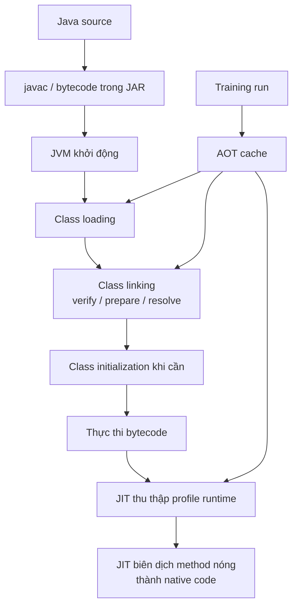
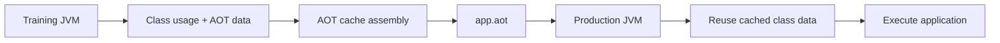
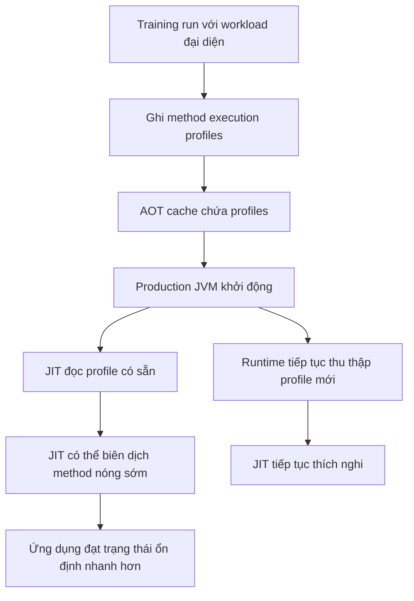
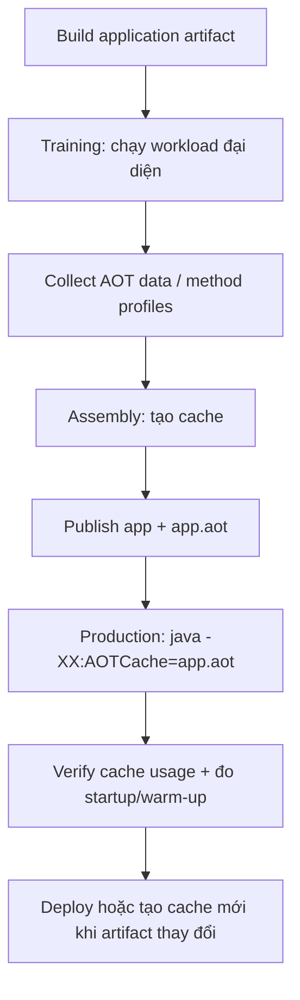

# Mối liên hệ giữa AOT cache, tải lớp, liên kết lớp, JIT và CDS

## 1. Mục tiêu: hiểu AOT cache trong toàn bộ vòng đời JVM

Trong **JAVA_VERSION_JAVA25**, AOT cache là một khả năng tối ưu thời gian khởi động và warm-up của ứng dụng Java. Để dùng đúng, cần hiểu nó tác động vào những giai đoạn nào của JVM và quan hệ ra sao với **class loading**, **class linking**, **JIT compilation** và **Class Data Sharing (CDS)**.

Bài học tập trung vào Java 25 và các cơ chế còn được hỗ trợ:

- **JEP 483 — Ahead-of-Time Class Loading and Linking:** nền tảng AOT cache được giới thiệu trong JDK 24, lưu các dữ liệu lớp và đối tượng có thể tái sử dụng giữa các lần chạy.
- **JEP 514 — Ahead-of-Time Command-Line Ergonomics:** hoàn thiện trong Java 25, đơn giản hóa việc tạo cache bằng một lệnh thông dụng.
- **JEP 515 — Ahead-of-Time Method Profiling:** hoàn thiện trong Java 25, đưa profile thực thi method từ lần training vào AOT cache để JIT có thông tin tối ưu sớm hơn.
- **CDS:** cơ chế chia sẻ dữ liệu lớp vẫn tồn tại; AOT cache phát triển dựa trên nền tảng này và mở rộng phạm vi tối ưu.
- **JIT:** vẫn là trình biên dịch động trong JVM. AOT cache hỗ trợ JIT khởi động tối ưu sớm hơn, không thay thế toàn bộ quá trình biên dịch động.

Sau bài này, bạn cần trả lời được:

1. Class loading, linking và initialization diễn ra ở đâu trong vòng đời một class?
2. AOT cache lưu dữ liệu gì và giúp bỏ bớt công việc nào khi JVM khởi động?
3. JEP 515 giúp JIT như thế nào khi có method profiles từ lần training?
4. AOT cache khác CDS ở đâu, và khi nào nên ưu tiên AOT cache trên Java 25?
5. Cache cần được tạo lại khi ứng dụng, JDK, hệ điều hành hoặc kiến trúc CPU thay đổi như thế nào?
6. Làm sao kiểm chứng cache thực sự được sử dụng và mang lại lợi ích cho workload?

**Phạm vi phiên bản:** các ví dụ dùng cú pháp AOT cache của Java 25, không yêu cầu preview. Không nhầm AOT cache với GraalVM Native Image, Spring AOT processing hay việc biên dịch toàn bộ ứng dụng thành executable native.

## 2. Nhìn tổng thể: từ bytecode đến mã máy

Một chương trình Java thông thường được biên dịch thành bytecode. Khi chạy, JVM tải class, liên kết class, khởi tạo class khi cần, rồi thực thi bytecode. JIT quan sát hành vi và biên dịch những method phù hợp thành mã máy trong lúc chạy.

AOT cache bổ sung dữ liệu đã thu thập ở lần training trước để giảm một phần công việc lặp lại ở lần khởi động sau.



Trong lần chạy có cache, JVM có thể tái sử dụng dữ liệu lớp đã được xử lý và profile method đã được ghi nhận. JIT vẫn hoạt động để tạo mã máy và tiếp tục thích nghi với hành vi thật của ứng dụng.

Một cách diễn đạt chính xác là:

- AOT cache **đẩy một phần công việc chuẩn bị lớp và thu thập profile về trước**, sang giai đoạn training/assembly.
- JIT **vẫn biên dịch động trong production**, nhưng có thể nhận profile sớm để bắt đầu tối ưu method nóng nhanh hơn.
- JVM vẫn thực thi ứng dụng trên runtime Java; AOT cache không loại bỏ bytecode, không đảm bảo mọi method đã có native code và không biến JAR thành native executable.

## 3. Class loading, linking và initialization là ba giai đoạn khác nhau

Để hiểu cache, cần phân biệt ba bước trong vòng đời class.

### 3.1. Class loading — tải định nghĩa lớp

Class loader tìm và nạp định nghĩa class từ nguồn thích hợp, ví dụ:

- JAR trên classpath hoặc module path.
- Runtime image của JDK.
- Class loader tùy biến.
- Bytecode được tạo động hoặc được cung cấp bởi framework/agent.

Kết quả của loading là JVM có cấu trúc nội bộ đại diện cho class để các bước tiếp theo xử lý. Việc một class đã có trong JAR không đồng nghĩa class đã được tải vào JVM.

### 3.2. Class linking — liên kết lớp

Theo Java Virtual Machine Specification, linking gồm ba công việc chính:

| Công đoạn | Vai trò | Ví dụ |
|---|---|---|
| **Verification** | Kiểm tra bytecode hợp lệ và an toàn theo quy tắc JVM | Kiểm tra kiểu operand stack, luồng điều khiển và truy cập hợp lệ |
| **Preparation** | Tạo cấu trúc lưu trữ cho static fields và gán giá trị mặc định | Field static kiểu int ban đầu là 0 |
| **Resolution** | Chuyển symbolic references thành tham chiếu trực tiếp phù hợp trong runtime | Phân giải tên class, field hoặc method được bytecode tham chiếu |

Resolution có thể được thực hiện eager hoặc lazy tùy trường hợp và cách JVM vận hành. Vì vậy, không nên hiểu rằng tất cả symbolic references trong toàn bộ ứng dụng đều được resolve ngay tại một thời điểm duy nhất trước khi chạy.

Java HotSpot còn có các tối ưu hóa liên kết nâng cao, chẳng hạn resolve một số lệnh `invokedynamic` trước khi ứng dụng bắt đầu chạy, khi cache được tạo với cấu hình phù hợp.

### 3.3. Class initialization — khởi tạo class

Initialization chạy các static field initializers và static initializer blocks theo quy tắc của JVM khi class cần được khởi tạo. Đây là bước riêng với loading/linking.

Ví dụ:

```java
class PricingRules {
    static final int DEFAULT_RATE = loadDefaultRate();

    static {
        System.out.println("PricingRules initialized");
    }

    private static int loadDefaultRate() {
        return 10;
    }
}
```

Class có thể được tải hoặc liên kết trước thời điểm static initializer chạy. Đừng suy luận rằng AOT cache khiến mọi static initializer của ứng dụng được chạy trước production hoặc cho phép bỏ qua side effects của initialization.

**Điểm cần nhớ:** AOT cache giúp JVM tái sử dụng dữ liệu đã chuẩn bị trong những điều kiện tương thích; nó không thay đổi hợp đồng ngôn ngữ về thời điểm khởi tạo class và không đảm bảo mọi class của ứng dụng đều được tải sẵn.

## 4. CDS là nền tảng, AOT cache mở rộng phạm vi tối ưu

**Class Data Sharing (CDS)** cho phép lưu dữ liệu class đã được xử lý trong archive để nhiều lần khởi chạy JVM có thể chia sẻ/tái sử dụng dữ liệu đó. CDS giúp giảm thời gian tải lớp và footprint trong các trường hợp phù hợp.

AOT cache được giới thiệu trong JDK 24 theo JEP 483, phát triển trên nền tảng CDS và mở rộng theo hướng application-specific:

| Khía cạnh | CDS | AOT cache trên Java 25 |
|---|---|---|
| Mục tiêu | Chia sẻ dữ liệu lớp giữa các lần chạy JVM | Tăng tốc startup và warm-up bằng nhiều loại dữ liệu AOT |
| Dữ liệu chính | Class metadata đã được xử lý và lưu trong archive | Dữ liệu lớp, heap objects và method execution profiles được bổ sung trong Java 25 |
| Phạm vi | Có thể dùng archive mặc định của JDK hoặc archive ứng dụng | Gắn với ứng dụng, JDK release, OS và CPU architecture |
| Liên kết lớp | Tái sử dụng dữ liệu lớp đã được chuẩn bị theo khả năng archive | Có thể bổ sung tối ưu AOT class loading/linking, gồm class linking nâng cao khi phù hợp |
| Method profile | Không phải mục tiêu chính của CDS truyền thống | JEP 515 đưa profile method từ training vào cache |
| Java 25 | Vẫn được hỗ trợ | Là lựa chọn nên đánh giá trước khi tự tạo CDS archive thủ công |

CDS **không bị xóa** và không phải API legacy. Tuy nhiên, với Java 25 trở lên, tài liệu Spring Boot hiện khuyến nghị ưu tiên AOT cache khi có thể sử dụng. CDS vẫn có giá trị khi cần tương thích hoặc khi workload/nền tảng chưa đáp ứng điều kiện dùng AOT cache.

Một AOT cache không đơn giản là một file CDS được đổi phần mở rộng. Nó là một cache phục vụ nhiều tối ưu AOT và có quy trình training, assembly, production riêng.

## 5. AOT class loading và linking: cache giúp JVM làm gì?

JEP 483 giới thiệu quy trình chuẩn bị trước một phần dữ liệu mà JVM thường phải xử lý khi ứng dụng khởi động.

Trong lần training:

1. Chạy ứng dụng với JDK và cấu hình tương ứng.
2. JVM ghi nhận các class và dữ liệu liên quan được sử dụng.
3. JVM thu thập thông tin cần thiết để tạo cache.
4. Giai đoạn assembly tạo file AOT cache có thể sử dụng ở lần chạy tiếp theo.

Trong lần production:

1. JVM kiểm tra cache có tương thích với ứng dụng, JDK và môi trường hay không.
2. Nếu tương thích, JVM nạp dữ liệu AOT cache.
3. Một phần công việc tải/liên kết lớp được tái sử dụng thay vì phải lặp lại toàn bộ.
4. JVM tiếp tục thực thi bytecode, khởi tạo class khi cần và sử dụng JIT.



### AOT class linking nâng cao

HotSpot có tùy chọn `-XX:+AOTClassLinking` để thực hiện các tối ưu liên kết nâng cao khi tạo cache, ví dụ resolve một số `invokedynamic` trước. Điều này có thể cải thiện thêm startup/warm-up, nhưng làm tăng yêu cầu tương thích giữa training và production.

Trong Java 25:

- Khi dùng `-XX:AOTMode`, `AOTClassLinking` được bật tự động; có thể tắt tường minh bằng `-XX:-AOTClassLinking`.
- Khi không chỉ định `-XX:AOTMode`, `AOTClassLinking` mặc định tắt để giữ khả năng tương thích với các cách dùng CDS truyền thống.
- Cache tạo với tối ưu liên kết nâng cao có thể không dùng được nếu production thêm một số tham số JVM không tương thích.

Không bật thêm tùy chọn nâng cao chỉ vì tên gọi nghe có vẻ nhanh hơn. Trước tiên hãy tạo cache theo cách đơn giản, đo hiệu quả, sau đó mới thử tối ưu bổ sung trong môi trường có kiểm soát.

## 6. JEP 515: method profile giúp JIT bắt đầu sớm hơn

JIT compiler thường cần quan sát ứng dụng chạy để biết method nào nóng, nhánh nào thường được chọn, kiểu đối tượng nào xuất hiện tại các điểm gọi đa hình và thông tin thực thi liên quan. Sau khi có profile, JIT có thể đưa ra quyết định biên dịch/tối ưu phù hợp.

Nếu phải thu thập profile từ đầu mỗi lần khởi động, ứng dụng cần một khoảng thời gian để đạt trạng thái tối ưu. Đây là một phần của **warm-up**.

JEP 515 trong Java 25 cho phép method execution profiles từ training run được lưu vào AOT cache. Khi production JVM khởi động, HotSpot có thể sử dụng những profile này sớm hơn, từ đó giúp JIT bắt đầu tối ưu method nóng mà không cần chờ toàn bộ dữ liệu được thu thập lại.



**JIT vẫn là JIT:** method profile không phải native code được tạo sẵn cho mọi method. JIT vẫn quyết định biên dịch và tạo native code khi chạy; dữ liệu training chỉ giúp JVM có thông tin ban đầu tốt hơn.

### Ví dụ về warm-up

Giả sử API xử lý đơn hàng thường gọi:

- `OrderService.calculateTotal()`
- `PricingService.findDiscount()`
- `InventoryService.reserve()`

Trong training run, workload đại diện gọi các method này với dữ liệu và tỷ lệ sử dụng gần production. AOT cache có thể mang method profiles sang production. JIT có thể nhận diện sớm các đường chạy nóng và bắt đầu tối ưu sớm hơn.

Nếu training chỉ mở health endpoint rồi dừng, profile có thể chủ yếu phản ánh startup và health check. Các method xử lý đơn hàng không được thực thi đủ để tạo profile hữu ích. Cache vẫn có thể hỗ trợ class loading/linking, nhưng lợi ích method profiling có thể thấp.

## 7. AOT cache không phải native compilation

Thuật ngữ “ahead-of-time” dễ gây nhầm rằng Java đã biên dịch toàn bộ ứng dụng thành mã máy trước khi triển khai. Với AOT cache của HotSpot trong Java 25, đó không phải mô hình cần hiểu.

| Cơ chế | Điều được chuẩn bị trước | Runtime còn làm gì? |
|---|---|---|
| **AOT cache / JEP 483** | Dữ liệu class loading/linking và một số heap objects | JVM vẫn tải phần chưa cache, khởi tạo class và thực thi |
| **AOT method profiling / JEP 515** | Method profiles từ training run | JIT sử dụng profile và tiếp tục tối ưu theo runtime |
| **JIT compilation** | Không phải công đoạn build artifact trước production; nó biên dịch động khi JVM chạy | Tạo native code cho method được chọn và điều chỉnh khi cần |
| **CDS** | Class data trong archive | JVM vẫn chạy bytecode/JIT theo runtime |
| **GraalVM Native Image** | Native executable được tạo ở build time bằng native-image toolchain | Chạy native executable, không theo mô hình HotSpot JIT thông thường |

AOT cache của Java 25 vẫn giữ ứng dụng trong mô hình JVM. Nó không loại bỏ JIT, không biến mọi bytecode thành native code và không tương đương với GraalVM Native Image.

Các tùy chọn `-XX:AOTCache`, `-XX:AOTCacheOutput` và `-XX:AOTMode` là tùy chọn của HotSpot VM, không phải API Java SE bảo đảm cho mọi implementation JVM. Khi dùng một distribution khác Oracle HotSpot, hãy xác nhận nhà phân phối hỗ trợ các tùy chọn AOT tương ứng và kiểm tra release notes của chính binary đó.

## 8. Quy trình ba pha: training, assembly và production

JDK mô tả vòng đời triển khai AOT cache thành ba pha:

| Pha | Mục tiêu | Artifact |
|---|---|---|
| **Training** | Chạy ứng dụng với workload đại diện để ghi nhận dữ liệu AOT | AOT configuration hoặc dữ liệu training nội bộ |
| **Assembly** | Dùng dữ liệu training để tạo cache có thể tái sử dụng | File `.aot` |
| **Production** | Khởi chạy ứng dụng với cache tương thích | JVM process sử dụng AOT cache |



Điểm quan trọng là training và production phải đủ tương đồng để cache có ích và tương thích. Training không phải chạy một lần bất kỳ rồi dùng file cache cho mọi phiên bản ứng dụng.

## 9. Tạo và dùng AOT cache với Java 25

JEP 514 đơn giản hóa lệnh tạo cache cho trường hợp thông dụng.

Giả sử ứng dụng được đóng gói thành `app.jar`, có class khởi chạy `com.example.Main`.

### 9.1. Training và tạo cache bằng một lệnh

```bash
java -XX:AOTCacheOutput=app.aot \
     -cp app.jar com.example.Main
```

Với cấu hình mặc định `AOTMode=auto`, việc chỉ định `-XX:AOTCacheOutput` khiến JVM thực hiện training và sau đó chạy assembly để tạo cache. Ứng dụng thực sự được chạy trong pha training, vì vậy cần đưa workload đại diện vào lần chạy này và kết thúc tiến trình theo quy trình của ứng dụng.

### 9.2. Khởi chạy production với cache

```bash
java -XX:AOTCache=app.aot \
     -cp app.jar com.example.Main
```

Nếu chạy bằng executable JAR:

```bash
java -XX:AOTCacheOutput=app.aot -jar app.jar
java -XX:AOTCache=app.aot -jar app.jar
```

Hai lệnh trên minh họa tạo cache và sử dụng cache. Trong production, đặt cache cạnh artifact theo cấu trúc triển khai đã quản lý và truyền đúng đường dẫn.

### 9.3. Các mode cần biết

| Mode | Ý nghĩa | Dùng khi nào |
|---|---|---|
| `auto` | Mode mặc định; tự chọn record/create hoặc dùng cache nếu có thể | Thường phù hợp production và cách tạo cache đơn giản |
| `record` | Chạy ứng dụng training và ghi AOT configuration | Khi muốn tách training khỏi assembly |
| `create` | Đọc configuration và tạo AOT cache; không chạy ứng dụng | Khi pipeline tách riêng bước assembly |
| `on` | Yêu cầu JVM dùng cache; nếu không tải được thì báo lỗi và thoát | Debug/fail-fast để xác nhận cache tương thích |
| `off` | Không sử dụng AOT cache | Đối chứng benchmark hoặc tắt tạm thời |

Trong production, `auto` thường an toàn hơn khi cache có thể không tương thích: JVM tiếp tục chạy mà không dùng cache. `on` hữu ích để phát hiện vấn đề trong kiểm thử vì nó fail-fast; không bật một cách vô thức trong môi trường production nếu việc không tải được cache sẽ làm ứng dụng ngừng khởi động.

### 9.4. Kiểm tra việc sử dụng cache

Có thể thêm log:

```bash
java -XX:AOTMode=auto \
     -XX:AOTCache=app.aot \
     -Xlog:aot \
     -cp app.jar com.example.Main
```

`-Xlog:aot` giúp xem thông tin liên quan đến việc nạp và sử dụng AOT cache. Nếu cần chẩn đoán class loading, có thể bổ sung `-Xlog:class+load` để xem nguồn tải class. Không chỉ dựa vào việc file `app.aot` tồn tại; phải xác minh JVM thực sự nạp cache và đo kết quả.

## 10. AOT cache với Spring Boot executable JAR

Spring Boot hỗ trợ AOT cache cho Java 25 trở lên. Với executable JAR chứa nested dependencies, tài liệu Spring Boot hướng dẫn **extract application** trước khi training và chạy cache trên dạng đã giải nén.

Ví dụ:

```bash
java -Djarmode=tools -jar my-app.jar \
     extract --destination application

cd application

java -XX:AOTCacheOutput=app.aot -jar my-app.jar
```

Ở lần training này, hãy chạy một luồng workload đại diện cho production, chẳng hạn gọi API đọc đơn, tạo đơn, tính giá và truy vấn tồn kho. Sau đó dừng ứng dụng một cách có kiểm soát để hoàn tất việc ghi cache.

Production:

```bash
cd application

java -XX:AOTCache=app.aot -jar my-app.jar
```

**Vì sao phải dùng extracted form?** AOT cache phụ thuộc cách classpath được trình bày cho JVM. Chạy với nested JAR nguyên gốc có thể không đáp ứng yêu cầu class loading của cache. Spring Boot cung cấp công cụ extract để tạo cấu trúc phù hợp.

### Training chỉ startup hay training theo nghiệp vụ?

Một số ví dụ Spring Boot dùng `-Dspring.context.exit=onRefresh` để thoát ngay sau khi ApplicationContext refresh. Cách này có thể hữu ích khi mục tiêu chỉ là tối ưu startup/context initialization.

Tuy nhiên, với **Java 25 và JEP 515**, nếu muốn có method profiles hữu ích, cần chạy các đường xử lý nghiệp vụ đại diện trong training. Nếu chỉ refresh context rồi thoát, profile có thể không bao phủ các method nóng của workload thực tế.

Vì vậy, hãy lựa chọn training theo mục tiêu:

- Chỉ cần tối ưu class loading/linking và khởi tạo Spring context: startup training có thể đủ cho phần mục tiêu đó.
- Muốn hưởng lợi từ AOT method profiling: cần replay một workload đại diện sau khi ứng dụng đã khởi động.
- Muốn đánh giá production readiness: dùng dữ liệu giả hoặc dữ liệu đã được làm sạch, kiểm tra side effects và không để training gây giao dịch thật ngoài ý muốn.

## 11. Điều kiện tương thích và khi nào phải tạo lại cache

AOT cache gắn với một tổ hợp ứng dụng và môi trường cụ thể. Theo tài liệu JDK, các yếu tố chính gồm:

- **Ứng dụng:** classpath, JAR hoặc module path được dùng để chạy.
- **JDK release:** cache được tạo cho một JDK release cụ thể.
- **OS và CPU architecture:** ví dụ Linux x86-64 khác Linux AArch64 hoặc Windows x64.

Nếu một yếu tố thay đổi, hãy tạo lại cache.

| Thay đổi | Có cần tạo cache mới? | Giải thích |
|---|---|---|
| Thay bytecode hoặc resource trong JAR ứng dụng | **Có** | Cache gắn với application artifact |
| Thay dependency hoặc thứ tự classpath | **Có** | Môi trường class loading đã thay đổi |
| Nâng JDK release/update | **Có** | Cache dành cho JDK release cụ thể; không tái sử dụng cache cũ theo giả định |
| Đổi OS hoặc CPU architecture | **Có** | Cache phụ thuộc môi trường nền |
| Đổi JVM options ảnh hưởng class loading/linking | **Kiểm tra và thường tạo lại** | Một số cấu hình có thể khiến cache không tương thích |
| Thay cấu hình workload nhưng giữ nguyên binary | **Cân nhắc training lại** | Cache vẫn có thể hợp lệ nhưng profile có thể không còn đại diện |
| Chỉ đổi cấu hình không ảnh hưởng classpath hoặc hành vi | **Không nhất thiết** | Cần đánh giá tác động thay vì tạo lại máy móc |

Với Spring Boot, cần chú ý thêm:

- Dùng cùng JDK/distribution và phiên bản tương ứng trong training và production.
- Giữ nguyên timestamp của JAR khi quy trình cache yêu cầu.
- Không rebuild hoặc repack JAR sau training rồi dùng cache cũ; nếu artifact thay đổi, hãy tạo cache mới.
- Dùng classpath là danh sách JAR theo thứ tự ổn định; tránh directory, wildcard hoặc nested JAR trong cách đóng gói không tương thích.
- Production classpath cần phù hợp với classpath training; tài liệu Spring Framework cho phép production classpath là cùng classpath hoặc phần mở rộng ở cuối trong điều kiện được mô tả.
- Tạo cache mới khi thay application artifact; không dùng cache của build trước chỉ vì tên file giống nhau.

Không nên đưa một file `.aot` duy nhất vào image dùng cho mọi kiến trúc CPU. Hãy tạo artifact cache riêng theo JDK release, OS, architecture và application build tương ứng.

## 12. Mối quan hệ giữa training profile và hành vi production

JEP 515 giúp JIT có profile sớm, nhưng **chất lượng profile phụ thuộc training workload**.

Ví dụ, một ứng dụng thanh toán có ba nhóm request:

| Nhóm request | Tỷ lệ production giả định | Method quan trọng |
|---|---:|---|
| Tra cứu giao dịch | 60% | `TransactionService.find()` |
| Tạo thanh toán | 30% | `PaymentService.authorize()` |
| Hoàn tiền | 10% | `RefundService.process()` |

Nếu training chỉ replay tra cứu giao dịch, profile sẽ thiên về method của đường tra cứu. Khi production có nhiều thanh toán hoặc hoàn tiền, profile có thể không phản ánh đầy đủ hành vi thực tế.

Khuyến nghị:

1. Thu thập tỷ lệ workload đã ẩn dữ liệu nhạy cảm từ production hoặc staging.
2. Chọn các luồng có giá trị đại diện, không chỉ luồng dễ chạy nhất.
3. Bao phủ cả đường thành công, validation, lỗi có thể phục hồi và các nhánh nghiệp vụ quan trọng.
4. Tránh dùng dữ liệu training chứa token, credential hoặc dữ liệu khách hàng thật.
5. Tạo cache từ artifact và workload tương ứng với release sắp triển khai.
6. Đánh giá lại khi traffic pattern thay đổi đáng kể.

Không cần tái tạo mọi tình huống production. Mục tiêu là training đủ đại diện để cache có ích, trong khi giữ quy trình an toàn, có thể lặp lại và không tạo side effects ngoài dự kiến.

## 13. Đo hiệu quả: startup, warm-up và tài nguyên

AOT cache hướng đến startup và warm-up. Không nên kết luận thành công chỉ vì thời gian khởi động giảm trong một lần chạy.

### 13.1. Các phép đo cần thực hiện

| Chỉ số | Ý nghĩa | Cách đo |
|---|---|---|
| **Process startup time** | Thời gian từ khi khởi chạy JVM đến mốc ứng dụng sẵn sàng | Đo bằng orchestrator/readiness hoặc timestamp ứng dụng |
| **Warm-up time** | Thời gian để throughput/latency đạt vùng ổn định | Chạy workload lặp và theo dõi latency/throughput |
| **Time to first request** | Thời gian đến request hợp lệ đầu tiên | Load generator hoặc test harness |
| **CPU startup cost** | CPU tiêu thụ trong giai đoạn khởi động | OS/container metrics hoặc JFR |
| **RSS/heap** | Footprint bộ nhớ trong startup và steady state | JVM/container metrics |
| **Error rate** | Tác động của cache lên hành vi ứng dụng | Integration test và production canary |

### 13.2. Thiết kế benchmark có đối chứng

Chạy tối thiểu ba biến thể:

- **A — baseline:** chạy cùng ứng dụng không dùng AOT cache.
- **B — AOT class data:** chạy với cache đã tạo từ workload phù hợp.
- **C — AOT cache với method profiles:** training có chạy các đường nghiệp vụ đại diện để profile method được đưa vào cache.

Giữ nguyên JDK, OS, CPU, container limits, classpath, application artifact, cấu hình GC và workload. Chạy warm-up và nhiều lần lặp; đo cold start riêng với steady state.

Công thức so sánh:

\[
\text{Startup improvement (\%)} =
\frac{T_{\text{baseline}}-T_{\text{AOT}}}
{T_{\text{baseline}}}\times 100
\]

\[
\text{Warm-up improvement (\%)} =
\frac{W_{\text{baseline}}-W_{\text{AOT}}}
{W_{\text{baseline}}}\times 100
\]

Ví dụ giả định:

| Chỉ số | Baseline | Có AOT cache | Thay đổi |
|---|---:|---:|---:|
| Startup to ready | 4,0 s | 3,2 s | Giảm 20% |
| Warm-up đến 90% throughput mục tiêu | 30 s | 20 s | Giảm 33,3% |
| RSS sau 60 s | 420 MiB | 405 MiB | Giảm khoảng 3,6% |

Đây là **số minh họa cách tính**, không phải cam kết hiệu năng của Java 25. Tác động phụ thuộc ứng dụng, workload, classpath, môi trường và cấu hình JVM. Một số ứng dụng có thể ít cải thiện hoặc không có lợi ích đủ lớn để biện minh cho quy trình tạo cache.

### 13.3. Đừng bỏ qua JIT sau startup

AOT method profiling có thể giúp warm-up nhanh hơn, nhưng runtime JIT vẫn phải thích nghi với dữ liệu thật. Hãy đo:

- Latency ở các cửa sổ thời gian sau startup.
- Throughput khi traffic đạt mức bình thường và đỉnh.
- Tỷ lệ CPU trong startup và steady state.
- JFR compilation events nếu cần phân tích thời điểm JIT biên dịch method.
- Hành vi khi workload production khác training.

Nếu startup nhanh nhưng steady-state throughput giảm hoặc p99 tăng, cache chưa chắc là tối ưu cho hệ thống.

## 14. Chẩn đoán khi AOT cache không được sử dụng

Khi JVM khởi động mà không dùng cache, hãy kiểm tra theo thứ tự:

| Triệu chứng | Nguyên nhân thường gặp | Hướng xử lý |
|---|---|---|
| Cache không tồn tại hoặc không đọc được | Sai path, quyền file, artifact chưa được copy | Kiểm tra đường dẫn, quyền và bước publish artifact |
| Cache không tương thích ứng dụng | JAR, classpath hoặc module path khác training | Tạo cache từ đúng artifact và classpath |
| Khác JDK release | Training và production dùng JDK khác | Rebuild cache với JDK production |
| Khác OS/CPU | Cache được tạo trên architecture khác | Tạo cache riêng theo platform |
| JVM options không tương thích | Agent hoặc option thay đổi class loading | Xem `-Xlog:aot` và so sánh options |
| Spring Boot dùng nested JAR | Chưa extract application theo hướng dẫn | Dùng extracted form trước khi training |
| Cache được dùng nhưng ít cải thiện | Training thiếu workload đại diện hoặc app không bị startup/warm-up bound | Đo lại bottleneck và thiết kế training phù hợp |

Để chẩn đoán:

```bash
java -XX:AOTMode=auto \
     -XX:AOTCache=app.aot \
     -Xlog:aot \
     -Xlog:class+load \
     -cp app.jar com.example.Main
```

Nếu cần fail-fast để xác minh cache, có thể chạy trong môi trường kiểm thử với `-XX:AOTMode=on`. Khi cache không tải được, mode này báo lỗi và thoát; mode `auto` sẽ tiếp tục mà không dùng cache trong những trường hợp không tương thích.

Không bật `-XX:AOTMode=on` trong production chỉ để “chắc chắn cache được dùng” nếu một cache không tương thích có thể làm toàn bộ instance không khởi động. Production thường cần tính sẵn sàng; dùng log, health check và canary để xác minh cache.

## 15. Bảo đảm an toàn trong pipeline tạo cache

AOT cache là một artifact build/deployment. Nên quản lý nó như một phần của release:

- Gắn cache với application version, commit, JDK vendor/build, OS, architecture và digest của JAR.
- Không tái sử dụng cache từ một nhánh hoặc artifact không xác định.
- Tạo cache trong môi trường có dữ liệu giả hoặc dữ liệu đã được làm sạch.
- Giới hạn quyền ghi/đọc artifact cache; không công khai cache nếu chính sách tổ chức coi dữ liệu runtime trong cache là nhạy cảm.
- Không đưa secret, token hoặc credential vào training workload.
- Giữ quy trình tạo cache có thể lặp lại và ghi lại lệnh JVM/options.
- Tạo lại cache khi nâng JDK, đổi image base hoặc thay application artifact.
- Có fallback chạy không cache và kiểm thử đường fallback.
- Đo startup/warm-up sau mỗi lần tạo cache, không mặc định cache mới luôn tốt hơn cache cũ.

Đối với container, build cache riêng cho từng platform và lưu cùng image digest hoặc release manifest. Tránh tạo cache trên máy developer rồi copy vào Linux production hoặc sang kiến trúc CPU khác.

## 16. Bài thực hành: quan sát class loading, JIT và AOT cache

### Bước 1 — Chuẩn bị ứng dụng mẫu

Tạo ứng dụng có một số method được gọi lặp, ví dụ:

```java
package com.example;

public class Main {

    static long calculate(int limit) {
        long total = 0;
        for (int i = 1; i <= limit; i++) {
            total += (long) i * i;
        }
        return total;
    }

    public static void main(String[] args) {
        int iterations = args.length == 0
                ? 100_000
                : Integer.parseInt(args[0]);

        long result = 0;
        for (int i = 0; i < iterations; i++) {
            result += calculate(100);
        }

        System.out.println(result);
    }
}
```

Biên dịch và đóng gói vào JAR với manifest/classpath phù hợp. Dùng cùng JDK 25 và cùng binary cho tất cả biến thể benchmark.

### Bước 2 — Chạy baseline

```bash
java -cp app.jar com.example.Main
```

Ghi startup time, thời gian hoàn thành, CPU và kết quả chương trình.

### Bước 3 — Tạo cache

```bash
java -XX:AOTCacheOutput=app.aot \
     -cp app.jar com.example.Main
```

Lần chạy này là training và đồng thời tạo cache. Trong ứng dụng mẫu, vòng lặp gọi `calculate` là workload dùng để ghi nhận profile.

### Bước 4 — Chạy với cache

```bash
java -XX:AOTCache=app.aot \
     -Xlog:aot \
     -cp app.jar com.example.Main
```

Kiểm tra log cho biết cache có được sử dụng hay không và so sánh kết quả nghiệp vụ với baseline.

### Bước 5 — Thay đổi artifact để kiểm tra tính đặc thù

Thay đổi bytecode trong JAR, tạo lại JAR rồi thử cache cũ. Quan sát cache có thể không tương thích. Sau đó tạo cache mới từ artifact mới và xác nhận lại.

Không dùng một kết quả cache không tương thích làm benchmark hiệu năng; trước tiên phải bảo đảm JVM thực sự sử dụng cache.

### Bước 6 — Thử training thiếu workload

Tạo một ứng dụng server hoặc ứng dụng có nhiều đường nghiệp vụ. Training chỉ bằng startup/health check, sau đó training lại với workload đại diện. So sánh warm-up để hiểu vì sao method profile cần phản ánh đường chạy thực tế.

### Bảng kết quả cần ghi

| Lần chạy | Cache | Workload training | Startup | Warm-up | Cache loaded? |
|---|---|---|---:|---:|---|
| A | Không | Không | ... | ... | Không áp dụng |
| B | Có | Startup | ... | ... | ... |
| C | Có | Nghiệp vụ đại diện | ... | ... | ... |
| D | Cache cũ sau khi đổi JAR | Không tương thích | ... | ... | ... |

**Tiêu chí hoàn thành:** phân biệt được dữ liệu class loading/linking với method profile; giải thích được JIT vẫn hoạt động trong production; tạo được cache Java 25 và xác minh việc nạp cache; biết khi nào phải tạo lại cache và cách đo lợi ích thật.

## 17. Checklist khi đưa AOT cache vào production

- [ ] Dùng JDK 25 và xác nhận distribution/build thực tế của môi trường.
- [ ] Hiểu AOT cache được giới thiệu từ JDK 24 qua JEP 483; Java 25 bổ sung JEP 514 và JEP 515.
- [ ] Phân biệt class loading, linking, initialization và JIT compilation.
- [ ] Hiểu CDS vẫn được hỗ trợ; AOT cache là cơ chế mở rộng, không phải lý do coi CDS đã bị xóa.
- [ ] Không nhầm AOT cache với GraalVM Native Image hoặc Spring AOT processing.
- [ ] Training workload đại diện với production; nếu muốn method profiles hữu ích, cần chạy các method nghiệp vụ thực.
- [ ] Cache được tạo từ đúng application artifact, JDK release, OS và CPU architecture.
- [ ] Với Spring Boot, sử dụng extracted executable JAR theo hướng dẫn và không dựa vào nested JAR không tương thích.
- [ ] Đã kiểm tra classpath, module path, JAR timestamp và JVM options.
- [ ] Có log `-Xlog:aot` để xác minh cache thực sự được nạp.
- [ ] Production dùng mode fallback phù hợp; `AOTMode=on` chỉ dùng fail-fast khi có chủ đích.
- [ ] Benchmark baseline, cache class data và cache có method profiles trên cùng điều kiện.
- [ ] Đo cả startup, warm-up, throughput, p95/p99, CPU, RSS và JIT behavior.
- [ ] Có quy trình tạo lại cache khi đổi artifact, JDK, OS hoặc CPU.
- [ ] Cache được quản lý như artifact release, có digest, provenance, quyền truy cập và fallback.
- [ ] Training không tạo side effects hoặc sử dụng dữ liệu nhạy cảm ngoài phạm vi cho phép.

### Tài liệu tham khảo chính thức

1. [JEP 483 — Ahead-of-Time Class Loading and Linking](https://openjdk.org/jeps/483)
2. [JEP 514 — Ahead-of-Time Command-Line Ergonomics](https://openjdk.org/jeps/514)
3. [JEP 515 — Ahead-of-Time Method Profiling](https://openjdk.org/jeps/515)
4. [Oracle Java 25 — The java Command, Ahead-of-Time Cache](https://docs.oracle.com/en/java/javase/25/docs/specs/man/java.html)
5. [Oracle — Significant Changes in JDK 25 Release](https://docs.oracle.com/en/java/javase/25/migrate/significant-changes-jdk-25.html)
6. [Oracle — Consolidated JDK 25 Release Notes](https://www.oracle.com/java/technologies/javase/25all-relnotes.html)
7. [Spring Boot — AOT Cache](https://docs.spring.io/spring-boot/reference/packaging/aot-cache.html)
8. [Spring Framework — JVM AOT Cache](https://docs.spring.io/spring-framework/reference/integration/aot-cache.html)
9. [Java Virtual Machine Specification — Loading, Linking, and Initialization](https://docs.oracle.com/javase/specs/jvms/se25/html/jvms-5.html)
10. [Inside.java — Performance Improvements in JDK 25](https://inside.java/2025/10/20/jdk-25-performance-improvements/)
