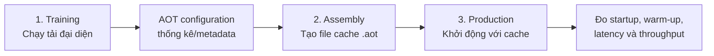
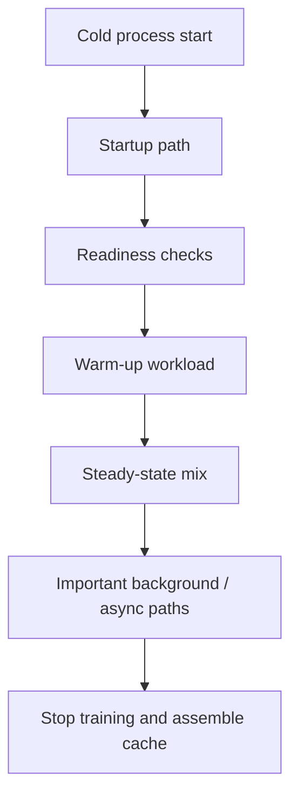

# Chọn tải huấn luyện đại diện cho các đường chạy quan trọng

**AOT cache** của HotSpot trong Java 25 có thể giảm thời gian khởi động và warm-up bằng cách chuẩn bị trước một số dữ liệu tối ưu hóa từ lần chạy huấn luyện. Chất lượng cache phụ thuộc đáng kể vào **những đường chạy mà ứng dụng thực sự đi qua trong giai đoạn training**. Nếu chỉ gọi endpoint health một lần, cache có thể không phản ánh đường tạo đơn hàng, truy vấn dữ liệu, xử lý message hoặc các nhánh được dùng nhiều khi ứng dụng phục vụ người dùng.

Bài học thuộc chương **AOT cache** của lộ trình **Java 25** (`JAVA_VERSION_JAVA25`), với đề bài **“Chọn tải huấn luyện đại diện cho các đường chạy quan trọng”**. Nội dung tập trung vào cách chọn kịch bản, tỷ trọng tải, dữ liệu, thứ tự chạy và tiêu chí xác nhận training đủ đại diện trước khi tạo cache. Ví dụ dùng quy trình AOT hiện hành của JDK 25, ưu tiên cú pháp được đơn giản hóa bởi **JEP 514** và phân biệt với những cơ chế AOT/CDS cũ hoặc những tính năng preview/experimental không cần thiết.

## 1. AOT cache giải quyết phần nào của startup?

JVM thông thường cần tải class, phân tích bytecode, liên kết kiểu, khởi tạo một số cấu trúc runtime và thu thập profile khi ứng dụng bắt đầu chạy. Một số công việc có thể được chuẩn bị trước. **AOT cache** là container chứa artifacts do các tối ưu hóa ahead-of-time tạo ra; trong JDK 25, tài liệu launcher mô tả cache hiện chứa **Java classes và heap objects**. Cache giúp giảm công việc lúc startup/warm-up, nhưng **không phải native image, không phải snapshot toàn bộ heap ứng dụng đang chạy và không bảo đảm loại bỏ JIT**.

Quy trình triển khai có ba pha:



| Pha | Điều xảy ra | Câu hỏi cần trả lời |
| --- | --- | --- |
| **Training** | JVM chạy ứng dụng với workload đã chọn và thu thập thông tin phục vụ tối ưu hóa | Đã kích hoạt các đường chạy cần tối ưu chưa? |
| **Assembly** | JVM dùng dữ liệu training để tạo AOT cache | Cache có được tạo thành công cho đúng build/runtime không? |
| **Production** | JVM khởi động và thử nạp cache | Cache có tương thích, được dùng và cải thiện SLO không? |

**Tải huấn luyện** không phải bài load test tìm giới hạn cực đại. Mục tiêu là làm cho JVM quan sát được **đúng class, object và đường xử lý quan trọng** trong một lần chạy có kiểm soát. Tăng request/s vô hạn không đồng nghĩa cache tốt hơn.

## 2. Tách AOT cache, CDS và AOT method profiling

Các thuật ngữ này liên quan nhưng không nên gộp thành một:

| Cơ chế | Vai trò | Cần nhớ |
| --- | --- | --- |
| **CDS (Class Data Sharing)** | Chia sẻ dữ liệu class đã chuẩn bị trước, giảm một phần công việc nạp class | Là nền tảng/ý tưởng có trước AOT cache; các archive CDS truyền thống có quy trình và giới hạn riêng |
| **AOT cache** (JEP 483, JEP 514) | Container cho artifacts AOT; Java 25 có CLI thuận tiện hơn để training, assembly và dùng cache | Cache gắn với ứng dụng, JDK release, OS và CPU architecture |
| **AOT method profiling** (JEP 515) | Làm method-execution profiles từ lần chạy trước có sẵn ngay khi JVM khởi động để JIT có thông tin sớm hơn | Đây là cải tiến profiling liên quan AOT; không được hiểu là ứng dụng đã được biên dịch thành native executable |

JEP 514 giúp đơn giản hóa lệnh tạo cache cho use case thông thường. JEP 515 cải thiện việc sử dụng method profiles sẵn có lúc khởi động. Khi lập kế hoạch training, vẫn cần kiểm tra tài liệu JDK 25 và log thực tế để biết artifacts nào được tạo/nạp trong cấu hình đang dùng. Không tự suy ra rằng một file cache chứa mọi loại profile hoặc mã máy đã biên dịch.

## 3. Bắt đầu từ câu hỏi sản phẩm và dữ liệu vận hành

Đừng chọn training workload chỉ từ tên controller hoặc danh sách endpoint. Trước tiên, hãy xác định **đường chạy nào ảnh hưởng tới startup readiness, time-to-first-useful-request và trải nghiệm của người dùng**.

Ví dụ một ứng dụng bán hàng:

```text
Application startup
  -> load configuration
  -> initialize repositories / clients
  -> readiness

Critical request paths
  -> GET /catalog
  -> POST /orders
       -> validate cart
       -> check inventory
       -> persist order
       -> publish OrderCreated

Async/background paths
  -> consume OrderCreated
  -> generate invoice
  -> send notification
  -> scheduled reconciliation
```

Thu thập bằng chứng từ môi trường staging/production đã được phép quan sát:

- **Tần suất:** request rate theo route, message rate theo loại event, tần suất scheduled jobs.
- **Độ quan trọng:** SLO, luồng doanh thu, thao tác quản trị quan trọng, luồng phục hồi.
- **Độ trễ:** p50/p95/p99 và thời gian đến readiness/first useful request.
- **Lỗi và nhánh thay thế:** validation failure, cache miss, dependency timeout, retry và fallback.
- **Tải lúc khởi động:** cấu hình, schema metadata, repository mapping, serializer, client initialization.
- **Thành phần được nạp theo điều kiện:** feature flag, tenant configuration, plugin/module tùy chọn.

JFR, application metrics, traces và log có cấu trúc có thể giúp nhận diện các đường chạy. Dữ liệu quan sát dùng để **lập danh sách và tỷ trọng**, không phải sao chép payload thật hoặc thông tin bí mật vào môi trường training.

## 4. Lập danh mục critical paths

Một **critical path** là một chuỗi xử lý có ý nghĩa về nghiệp vụ hoặc vận hành. Nó có thể đi qua nhiều class, module, dependency và nhánh điều kiện. Nên lập danh mục trước khi viết script training:

| Mã | Đường chạy | Tần suất/ưu tiên | Vì sao quan trọng? | Bằng chứng cần thấy |
| --- | --- | --- | --- | --- |
| P01 | Startup → readiness | Mọi lần khởi động | Ảnh hưởng thời gian scale/rollout | Ứng dụng ready, các thành phần nền đã khởi tạo |
| P02 | Đọc catalog phổ biến | Cao | Đường request có lưu lượng lớn | Controller/service/repository/serializer đã được kích hoạt |
| P03 | Tạo đơn hàng thành công | Cao, tác động nghiệp vụ cao | Critical path chính | Validation, inventory, persistence, event publish |
| P04 | Tạo đơn hàng bị từ chối | Trung bình, quan trọng cho độ tin cậy | Nhánh lỗi phổ biến | Exception mapping, error response |
| P05 | Consumer xử lý OrderCreated | Theo message rate | Đường async sau request | Deserializer, listener, transaction, handler |
| P06 | Dependency chậm hoặc timeout | Thấp hơn nhưng ảnh hưởng SLO | Cần kiểm tra fallback/retry | Timeout, error branch, retry policy |
| P07 | Reconciliation định kỳ | Theo lịch | Có thể không xuất hiện trong HTTP traffic | Scheduler và batch logic |
| P08 | Admin/report export | Thấp hoặc theo đợt | Có thể dùng code path khác | Query, mapping, streaming/export |

Không phải mọi đường chạy đều phải có cùng trọng số. Một đường rất hiếm nhưng có rủi ro lớn (ví dụ khởi tạo tenant mới hoặc phục hồi message) có thể cần một lượt training riêng để class và branch liên quan được kích hoạt.

### Phân hạng thực dụng

| Nhóm | Tiêu chí | Cách đưa vào training |
| --- | --- | --- |
| **Must-cover** | Ảnh hưởng trực tiếp startup/readiness hoặc luồng nghiệp vụ cốt lõi | Bắt buộc xuất hiện trong mỗi training run |
| **High-value** | Tần suất cao hoặc ảnh hưởng p95/p99 đáng kể | Lặp theo tỷ trọng tải dự kiến |
| **Risk path** | Ít gặp nhưng quan trọng với recovery/failure/security | Kích hoạt có kiểm soát ít nhất một lần nếu có thể |
| **Optional/cold** | Tác vụ hiếm, module tùy chọn, admin | Chỉ thêm nếu ứng dụng thực tế cần tối ưu hoặc có ngân sách |

**Code coverage không đồng nghĩa AOT training coverage.** Một test suite có thể chạy qua nhiều dòng lệnh nhưng chưa tạo workload, object graph hoặc phân bố thực thi tương tự production. Ngược lại, training run không thay thế unit/integration/security tests và không chứng minh nghiệp vụ đúng.

## 5. Chọn tỷ trọng tải thay vì chỉ gọi mỗi endpoint một lần

Một workload đại diện phải gần với **phân bố sử dụng thật** ở mức cần thiết. Nếu production có 70% đọc catalog, 20% tạo đơn và 10% tra cứu trạng thái, training không nên chạy mỗi luồng đúng một lần rồi coi ba luồng có trọng số ngang nhau.

Ví dụ workload mix cho một lần training:

| Kịch bản | Tỷ trọng mục tiêu minh họa | Lượt trong 1.000 thao tác |
| --- | ---: | ---: |
| Đọc catalog | 70% | 700 |
| Tạo đơn thành công | 20% | 200 |
| Tra cứu trạng thái | 8% | 80 |
| Tạo đơn bị từ chối có kiểm soát | 1% | 10 |
| Dependency timeout/fallback | 1% | 10 |

Đây là **số giả định để minh họa cách chia tải**, không phải tỷ lệ khuyến nghị cho mọi ứng dụng. Thay bằng số đo thực tế, đồng thời giữ các đường bắt buộc/risk path có ít nhất một số lần chạy đủ để kích hoạt code liên quan.

Nếu muốn biểu diễn tỷ trọng bằng một điểm ưu tiên, có thể dùng:

\[
\text{priority(path)} =
\text{frequency} \times
\text{business impact} \times
\text{startup relevance}
\]

Các hệ số là đánh giá nội bộ, không phải công thức của JVM. Dùng chúng để **xếp thứ tự thiết kế workload**, không biến thành mục tiêu tối ưu toán học thiếu bằng chứng.

### Vì sao không lặp một request duy nhất hàng triệu lần?

- Nó có thể làm profile lệch mạnh về một đường duy nhất.
- Cache có thể thiếu class/object của các module hoặc nhánh khác.
- Training kéo dài và tốn tài nguyên mà không cải thiện tính đại diện.
- Nếu request có side effect, có thể tạo dữ liệu rác hoặc gửi tác vụ lặp.
- Tải nhân tạo có thể làm nóng cache nghiệp vụ hoặc dependency theo cách không giống lần khởi động production.

Nên chọn **tập kịch bản nhỏ nhưng có trọng số hợp lý**, lặp đủ để ổn định các thống kê cần thiết và có giới hạn thời gian/tải rõ ràng.

## 6. Bao phủ cả startup, warm-up và đường chạy sau readiness

Đừng chỉ chọn request xảy ra sau khi ứng dụng đã warm. Một workload tốt thường có ba lớp:



| Giai đoạn | Cần kích hoạt | Mục đích |
| --- | --- | --- |
| Cold start | Application bootstrap, configuration, DI, ORM/serializer metadata, client setup | Quan sát các lớp và object cần lúc khởi động |
| Readiness | Health/readiness logic, kết nối dependency bắt buộc | Phản ánh thời điểm instance sẵn sàng nhận traffic |
| Warm-up | Những request đầu tiên của các critical paths | Kích hoạt class/object chưa xuất hiện lúc startup |
| Steady-state | Mix request/message gần phân bố thực tế | Bao phủ luồng xử lý quan trọng khi có tải |
| Background | Scheduled job, consumer, async worker quan trọng | Tránh bỏ sót code chỉ chạy ngoài HTTP request |

**Không dùng một vòng lặp warm-up giả làm đại diện cho toàn bộ traffic.** Nếu một module chỉ được khởi tạo khi nhận message, training phải phát message thử và cho consumer xử lý. Nếu một tính năng chỉ bật ở một nhóm tenant, dùng fixture đại diện cho cấu hình đó.

### Lưu ý về cache lạnh và cache nghiệp vụ

Training thường nên tái hiện điều kiện khởi động cần tối ưu. Nếu ứng dụng có Redis, local cache hoặc database buffer cache, hãy ghi rõ trạng thái của chúng. Một training run bắt đầu với cache nghiệp vụ đã được làm nóng có thể bỏ qua đường cache miss quan trọng; ngược lại, xóa cache trong khi chạy có thể gây tải không thực tế. Không cần ép mọi cache luôn cold: hãy chọn trạng thái tương ứng với mục tiêu và vận hành thật.

## 7. Bao phủ biến thể dữ liệu và nhánh xử lý

Một endpoint có thể dẫn đến nhiều đường code tùy dữ liệu. Training chỉ dùng một fixture duy nhất có thể bỏ sót serializer, validator, mapper hoặc nhánh nghiệp vụ quan trọng.

Ví dụ cho `POST /orders`:

| Biến thể | Vì sao cần cân nhắc? | Cách đưa vào training |
| --- | --- | --- |
| Đơn một mặt hàng | Đường phổ biến, payload nhỏ | Dùng thường xuyên theo traffic mix |
| Đơn nhiều mặt hàng | Collection/mapping và tính tổng | Có một số lần chạy đại diện |
| Có mã giảm giá | Nhánh pricing/tax khác | Dùng coupon test hợp lệ |
| Hàng hết tồn | Nhánh từ chối/compensation | Kích hoạt một số lần có kiểm soát |
| Khách hàng mới | Có thể kích hoạt khởi tạo profile | Fixture mới, không dùng PII thật |
| Khách hàng hiện hữu | Đường truy vấn/cache khác | Dùng dữ liệu seed đã xác định |
| Payload thiếu/sai | Validation và error mapping | Gửi request lỗi có chủ đích |
| Dependency timeout | Retry/fallback/exception path | Stub dependency để tránh chờ lâu hoặc làm hỏng hệ thống |

Không cần tạo mọi tổ hợp dữ liệu. Chọn các biến thể kích hoạt **những nhánh code có ý nghĩa**, dựa trên production telemetry, test coverage và thay đổi trong phiên bản ứng dụng.

### Dữ liệu training phải an toàn và tái lập

- Dùng dữ liệu tổng hợp hoặc đã khử định danh; không lấy nguyên payload chứa PII/credential từ production.
- Giữ seed và version fixture để các lần training có thể tái tạo.
- Tách tenant, order ID, event ID theo namespace test để không va chạm dữ liệu.
- Đặt giới hạn số bản ghi và thời gian lưu; dọn fixture theo quy trình của môi trường thử.
- Không đưa access token, private key, password, session cookie hoặc secret vào file cấu hình training.

Mục tiêu là **phân bố và cấu trúc dữ liệu giống thực tế**, không cần mang dữ liệu nhạy cảm thật vào training.

## 8. Thiết kế workload cho async, message và scheduled jobs

Một ứng dụng server thường không chỉ có HTTP. Nếu training chỉ chạy endpoint, các lớp consumer, serializer, retry handler và scheduled jobs có thể không được kích hoạt.

| Loại workload | Ví dụ | Cách huấn luyện |
| --- | --- | --- |
| Message consumer | `OrderCreated`, `PaymentAuthorized` | Publish message test vào broker sandbox và đợi handler hoàn tất |
| Async executor | Gửi email, tạo invoice, cập nhật search index | Chờ task hoàn tất với timeout, xác minh worker thực sự chạy |
| Scheduled job | Reconciliation, cleanup, daily report | Gọi entry point được hỗ trợ hoặc cấu hình lịch ngắn trong profile training |
| Retry/recovery | Dependency tạm lỗi, message redelivery | Dùng stub có kịch bản thất bại hữu hạn, không tạo vòng retry vô hạn |
| Batch processing | Import/export dữ liệu | Dùng batch fixture có kích thước và phân bố đại diện |

**Không chỉ publish message rồi kết thúc training ngay.** Cần xác nhận consumer đã nhận và chạy đến các đoạn code dự định. Dùng correlation ID/test marker để theo dõi; đợi queue drain hoặc completion signal có timeout.

Với message broker bên ngoài, training cần:

1. Broker/namespace riêng cho môi trường huấn luyện.
2. Consumer group hoặc subscription riêng, tránh ảnh hưởng consumer thật.
3. Message ID và partition/key test ổn định để tái lập.
4. Xác minh retry/dead-letter behavior không tạo vô hạn.
5. Chỉ kết thúc training sau khi những luồng bắt buộc đã được xử lý.

Không tạo training workload bằng cách phát message vào topic production. Không để listener gửi email, thanh toán hoặc tạo giao dịch bên ngoài trong một training run nếu không có sandbox/stub và cơ chế chống lặp.

## 9. Bảo vệ side effects và tính idempotent của training

Training chạy **ứng dụng thật**, nên mọi side effect trong code có thể xảy ra. Các thao tác như thanh toán, gửi email/SMS, tạo shipment, ghi audit, phát message hoặc xóa dữ liệu cần được kiểm soát.

| Side effect | Biện pháp cho môi trường training |
| --- | --- |
| Thanh toán/hoàn tiền | Payment sandbox hoặc mock provider; dùng test merchant |
| Email/SMS/push | Mail sink, fake gateway hoặc chặn outbound có chủ đích |
| Tạo đơn/giao dịch | Database test riêng, namespace dữ liệu riêng, cleanup |
| Publish event | Broker sandbox, topic test, consumer test |
| Gọi API đối tác | Stub server hoặc sandbox endpoint được cấp quyền |
| Gửi webhook | Endpoint giả lập, không dùng URL khách hàng thật |
| Xóa/đồng bộ dữ liệu | Fixture cô lập, dry-run hoặc test database |
| Ghi log/audit | Redaction và retention ngắn, không chứa secret/PII |

Training workload nên có **tính idempotent** hoặc có thể reset. Nếu một lệnh được gửi lại khi script retry, nó không được tạo thêm khoản thanh toán, gửi thông báo thật hoặc xóa dữ liệu thật. Đây là điều kiện an toàn của workload, không phải tính năng mà AOT cache cung cấp.

### Phân biệt profile training với môi trường production

Có thể dùng cùng artifact và cùng loại cấu hình ứng dụng, nhưng dependency endpoint, credentials và dữ liệu phải là **bản sandbox tương ứng**. Hãy giữ các khác biệt cần thiết được ghi lại để biết cache đã được huấn luyện với thành phần nào. Không vô tình tạo cache từ một classpath hoặc feature flag khác với bản production dự định chạy.

## 10. Lập kịch bản training có trọng số

Một kịch bản nên có cấu trúc dễ review:

```yaml
training:
  application: "shop-service"
  build: "build-id-or-commit"
  jdk: "25.0.x+vendor-build"
  platform: "linux-x86_64"
  dataSet: "shop-training-fixtures-v3"
  phases:
    startup:
      enabled: true
    warmup:
      - path: "catalog.list"
        weight: 70
      - path: "orders.create.success"
        weight: 20
      - path: "orders.status.read"
        weight: 8
      - path: "orders.create.validation-failure"
        weight: 1
      - path: "orders.create.dependency-timeout"
        weight: 1
    asynchronous:
      - path: "notifications.consume-order-created"
        required: true
      - path: "invoice.generate"
        required: true
  safety:
    externalPayments: "sandbox"
    email: "sink"
    brokerNamespace: "aot-training"
    dataIsSynthetic: true
```

Đây là **mẫu kế hoạch**, không phải file cấu hình được JVM đọc trực tiếp. Trường `weight` là tỷ trọng do script/load generator diễn giải; JVM không tự đọc YAML này. Tách kế hoạch workload khỏi các option AOT để người review hiểu **đường nào chạy, tại sao chạy và có side effect gì**.

Mỗi kịch bản nên khai báo:

- **Precondition:** trạng thái dữ liệu, tenant, feature flag, dependency.
- **Action:** request/message/job sẽ được kích hoạt.
- **Expected completion:** response, handler completion hoặc trạng thái test.
- **Weight/repetition:** tỷ trọng hoặc số lượt dự kiến.
- **Timeout:** giới hạn chờ cho đường sync/async.
- **Side effects:** nơi ghi dữ liệu, gửi message hoặc gọi dịch vụ ngoài.
- **Evidence:** log marker, trace, counter hoặc test result xác nhận đã chạy.

## 11. Đo lường độ đại diện: đủ đường chạy và đúng tỷ trọng

Sau một training run, hãy xác minh **kịch bản nào thực sự hoàn tất** thay vì chỉ nhìn vào script đã chạy.

### Ma trận coverage của workload

| Nhóm | Có trong kế hoạch? | Đã chạy? | Hoàn tất? | Ghi chú |
| --- | --- | --- | --- | --- |
| Startup/readiness | Chưa đánh giá | Chưa đo | Chưa đo | Chưa có bằng chứng |
| Read catalog | Chưa đánh giá | Chưa đo | Chưa đo | Chưa có bằng chứng |
| Create order success | Chưa đánh giá | Chưa đo | Chưa đo | Chưa có bằng chứng |
| Validation failure | Chưa đánh giá | Chưa đo | Chưa đo | Chưa có bằng chứng |
| Dependency fallback | Chưa đánh giá | Chưa đo | Chưa đo | Chưa có bằng chứng |
| Message consumer | Chưa đánh giá | Chưa đo | Chưa đo | Chưa có bằng chứng |
| Background/scheduled | Chưa đánh giá | Chưa đo | Chưa đo | Chưa có bằng chứng |

Không đánh dấu **PASS** chỉ vì HTTP client nhận status 200. Với async flow, phải có bằng chứng listener đã chạy; với batch, phải có kết quả batch hoàn tất; với retry, phải xác nhận đã đi vào nhánh mong muốn.

### Các chỉ số nên lưu

- Số lượt chạy theo path và tỷ trọng thực tế so với mục tiêu.
- Tỷ lệ kịch bản hoàn tất, timeout và lỗi ngoài dự kiến.
- Số loại class/module/serializer/client được kích hoạt (dựa trên công cụ quan sát phù hợp).
- Thời gian training, CPU, heap và lượng dữ liệu test phát sinh.
- Build ID, JDK vendor/build, OS/CPU, classpath/module path và feature flags.

Coverage là **bằng chứng hỗ trợ**, không có một ngưỡng phần trăm class chung bảo đảm cache tối ưu. Hãy ưu tiên coverage của critical paths và tính nhất quán giữa các lần training.

## 12. Quy trình AOT cache đúng với JDK 25

### Cách gọn cho use case thông thường (JEP 514)

Với một ứng dụng chạy từ JAR, có thể bắt đầu training bằng:

```bash
java -XX:AOTCacheOutput=shop.aot -jar shop.jar
```

Khi option `-XX:AOTCacheOutput` được chỉ định và `AOTMode` không bị đặt khác, mode mặc định `auto` chuyển sang **record**. JVM chạy ứng dụng để thu thập dữ liệu training. Với cache output, JVM sẽ khởi chạy tiến trình JVM thứ hai cho pha **assembly** sau khi recording kết thúc.

Để kết thúc training có kiểm soát khi ứng dụng vẫn chạy:

```bash
jcmd -l
jcmd <pid> AOT.end_recording
```

Thay `<pid>` bằng PID của JVM training. Lệnh `AOT.end_recording` dừng việc ghi và lưu kết quả vào file được chỉ định bởi `-XX:AOTCacheOutput` (và/hoặc `-XX:AOTConfiguration`). Chạy `jcmd` trên cùng máy, bằng user/group đủ quyền điều khiển tiến trình. Kiểm tra log của tiến trình assembly và file cache được tạo.

Sau đó chạy production với cache:

```bash
java -XX:AOTMode=auto -XX:AOTCache=shop.aot -jar shop.jar
```

Ở `auto`, JVM sẽ thử nạp cache; nếu không tương thích, nó có thể tiếp tục chạy không dùng cache. Đây là chế độ phù hợp cho production khi cần ứng dụng tiếp tục hoạt động ngay cả khi cache không dùng được.

### Quy trình tách config và assembly khi cần kiểm soát riêng

Nếu muốn lưu file cấu hình training riêng rồi tạo cache ở một bước độc lập:

```bash
# 1. Training: chạy workload, giữ PID để điều khiển kết thúc.
java -XX:AOTMode=record \
     -XX:AOTConfiguration=shop.aotconfig \
     -jar shop.jar

# 2. Kết thúc training, ghi file cấu hình.
jcmd <pid> AOT.end_recording

# 3. Assembly: JVM tạo cache từ config, không chạy ứng dụng.
java -XX:AOTMode=create \
     -XX:AOTConfiguration=shop.aotconfig \
     -XX:AOTCache=shop.aot \
     -jar shop.jar

# 4. Production: sử dụng cache.
java -XX:AOTMode=auto \
     -XX:AOTCache=shop.aot \
     -jar shop.jar
```

Ở pha `create`, ứng dụng **không được thực thi**; JVM đọc file configuration và ghi artifacts vào cache. Chỉ dùng cách tách pha khi có lý do kiểm soát quy trình/build pipeline; với use case thông thường, `-XX:AOTCacheOutput` giúp giảm số bước.

### Khi nào dùng `AOTMode=on`?

`on` là chế độ **fail-fast**: nếu cache không thể nạp, JVM báo lỗi và dừng. Hữu ích trong CI/staging để phát hiện mismatch; không phải lựa chọn mặc định tốt nhất khi production cần tiếp tục phục vụ request. Có thể dùng `-XX:AOTMode=auto -Xlog:aot` để kiểm tra lý do cache có được dùng hay không.

## 13. Điều kiện tương thích và tái tạo cache

Oracle JDK 25 mô tả AOT cache phụ thuộc vào tổ hợp:

1. **Ứng dụng**: classpath, JAR hoặc module path.
2. **JDK release**: cache tạo bởi một release không mặc định dùng được ở release khác.
3. **OS và CPU architecture**.

Nếu bất kỳ thành phần nào thay đổi, cần **tạo lại cache**. Ngoài ra, một số JVM options/agent có thể khiến cache không tương thích.

| Thay đổi | Hành động |
| --- | --- |
| Thay JDK 25 build/security update hoặc chuyển JDK 25 sang JDK khác | Tạo lại và kiểm thử cache với JDK đích |
| Thay JAR, dependency version hoặc classpath | Tạo lại cache |
| Thay module path/module graph | Tạo lại và kiểm tra resolution |
| Đổi OS hoặc CPU architecture | Tạo cache riêng cho nền tảng đó |
| Thay JVM flags/agent có tác động tới class loading/instrumentation | Xác minh compatibility; tạo lại nếu có mismatch |
| Chỉ thay config runtime không ảnh hưởng artifact/classpath | Đánh giá theo mức ảnh hưởng; không mặc định cache vẫn phù hợp |

**Không dùng một file `shop.aot` chung cho mọi container, mọi kiến trúc và mọi phiên bản build.** Nên gắn cache với build ID/JDK/platform, đặt tên có version và lưu cùng artifact provenance.

Cache là tối ưu hóa tùy chọn. Nếu không nạp được, chương trình vẫn phải đúng chức năng khi chạy không cache. Tránh cấu trúc triển khai phụ thuộc vào việc AOT cache luôn tồn tại để khởi động thành công.

## 14. Đánh giá cache có thực sự cải thiện critical paths không

Training tốt không đồng nghĩa production chắc chắn nhanh hơn. Cần so sánh **cùng artifact, cùng môi trường và cùng workload** giữa:

- **Baseline:** chạy JDK 25 không chỉ định cache.
- **Candidate:** chạy cùng JDK/app với cache được tạo từ workload đã chọn.

Đo ít nhất:

| Chỉ số | Cách đo | Vì sao cần |
| --- | --- | --- |
| Process start → readiness | Timestamp từ start tới readiness | Phản ánh khả năng scale/rollout |
| Time-to-first-useful-request | Thời gian tới request nghiệp vụ đầu tiên đạt SLO | Phân biệt readiness với khả năng phục vụ thật |
| Latency request đầu | p50/p95 và số lần thử | AOT có thể ảnh hưởng warm-up |
| Warm-up duration | Thời gian đến khi latency/throughput ổn định | Đánh giá lợi ích sau startup |
| Throughput và p95/p99 | Cùng concurrency, dataset, request mix | Đảm bảo cải thiện startup không làm giảm steady-state |
| CPU/heap/GC | Đo trong cùng cửa sổ thời gian | Phát hiện chi phí phụ |
| Cache load result | Log `-Xlog:aot` | Xác minh JVM thực sự dùng cache |

Quy trình:

1. Chạy warm-up/measurement theo kịch bản lặp lại, tách lần chạy cold-start và lần chạy đã warm OS/page cache nếu cần.
2. Giữ nguyên container limits, CPU quota, heap, environment variables, dependency versions và database/broker state.
3. Thực hiện nhiều lượt baseline/candidate, đảo thứ tự hoặc xen kẽ để giảm sai lệch do môi trường.
4. Ghi p50/p95/p99, trung vị giữa các lượt và độ phân tán; không kết luận từ một lần chạy.
5. Xác minh cache được nạp thành công. Một phép đo “candidate” mà log báo không dùng cache không phải phép đo AOT.
6. Đặt ngưỡng lợi ích tối thiểu theo chi phí tạo/lưu/cache distribution; nếu không cải thiện SLO, cân nhắc bỏ quy trình.

Không chỉ nhìn vào tổng thời gian khởi động. Nếu ứng dụng sẵn sàng sớm hơn nhưng request đầu vẫn chậm, có thể cần training mix bổ sung đường request đó. Nếu cache làm startup nhanh hơn nhưng p99 steady-state xấu đi, phải tìm nguyên nhân trước khi rollout.

## 15. Các lỗi thiết kế training thường gặp

### Chỉ chạy health check

Health endpoint có thể không đi qua repository, serializer, nghiệp vụ, consumer hoặc dependency chính. Hãy thêm các critical paths có ý nghĩa thay vì xem readiness là workload đầy đủ.

### Chỉ chạy một đường thành công

Validation, fallback, timeout, retry và dữ liệu nhiều biến thể có thể kích hoạt class/branch khác. Chọn các nhánh quan trọng theo tần suất và rủi ro, không cần mọi tổ hợp.

### Chạy synthetic load không giống production

Một vòng lặp cực nhanh trên cùng một record có thể tạo profile lệch. Dùng mix dữ liệu và concurrency hợp lý, ghi rõ khác biệt với traffic thực và kiểm tra lại bằng workload độc lập.

### Training không đợi async completion

Script kết thúc ngay sau khi publish message có thể bỏ sót handler. Chờ completion/queue drain có timeout và kiểm tra bằng test marker.

### Training gây side effect thật

Gọi payment/email/webhook thật trong training có thể tạo giao dịch trùng hoặc gửi dữ liệu sai. Dùng sandbox, sink, stub và fixture idempotent.

### Cache được tạo từ build khác

Chạy training trên một commit nhưng deploy artifact mới có thể làm cache không tương thích hoặc không đại diện. Tạo cache từ đúng artifact sẽ deploy và ghi provenance.

### Không xác minh cache có được nạp

Nếu production mode `auto` fallback về không cache, ứng dụng vẫn chạy. Nếu không đọc `-Xlog:aot`, đội triển khai có thể tưởng cache đang được dùng dù không phải vậy.

### Coi AOT training là test hoặc benchmark

Training chỉ thu thập dữ liệu cho tối ưu hóa. Vẫn cần unit/integration/contract/security tests, load tests và đo hiệu năng độc lập.

## 16. Bài thực hành: xây training mix cho ứng dụng bán hàng

### Bối cảnh

Một ứng dụng `shop-service` chạy Java 25, có các chức năng:

- `GET /catalog` đọc dữ liệu sản phẩm.
- `POST /orders` tạo đơn, kiểm tra tồn kho và publish event.
- Consumer `OrderCreated` tạo invoice và gửi thông báo.
- Job `reconcilePayments` chạy định kỳ.

Mục tiêu là tạo AOT cache cho đúng image/build sẽ triển khai, giảm startup và warm-up mà không làm phát sinh thanh toán hoặc gửi thông báo thật.

### Nhiệm vụ

1. **Thu thập bằng chứng:** lấy tỷ trọng route/message, latency, lỗi và SLO từ dữ liệu telemetry đã được phép dùng.
2. **Lập critical-path inventory:** phân hạng startup, catalog, create-order success, validation failure, consumer, reconciliation và dependency fallback.
3. **Thiết kế workload mix:** đặt trọng số theo traffic; bổ sung lượt tối thiểu cho risk paths quan trọng.
4. **Chuẩn bị fixture:** sản phẩm, tồn kho, tenant và order tổng hợp; giữ seed để tái lập.
5. **Cô lập side effects:** payment sandbox, email sink, broker namespace riêng và database test.
6. **Viết kịch bản training:** precondition, action, expected completion, weight, timeout và evidence cho từng path.
7. **Chạy training:** dùng JDK 25 và `-XX:AOTCacheOutput`, kích hoạt startup/warm-up/steady-state/async workloads; kết thúc bằng `jcmd <pid> AOT.end_recording` khi cần.
8. **Kiểm tra assembly:** xác minh cache file, log và build/JDK/platform metadata.
9. **Chạy candidate:** bật `-XX:AOTCache` ở `AOTMode=auto`, xác minh `-Xlog:aot` cho biết cache có được nạp.
10. **Đo A/B:** so startup, readiness, first request, warm-up, throughput, p95/p99, CPU và memory dưới cùng điều kiện.
11. **Đánh giá thiếu coverage:** nếu critical path chưa xuất hiện hoặc kết quả không ổn định, bổ sung workload rồi tạo lại cache.
12. **Bàn giao:** lưu manifest, workload plan, build provenance, cache artifact và báo cáo so sánh.

### Mẫu báo cáo

| Hạng mục | Giá trị thực tế | Trạng thái |
| --- | --- | --- |
| JDK vendor/build | Chưa đo | Chưa kiểm tra |
| App build/classpath | Chưa ghi | Chưa kiểm tra |
| OS/CPU/container | Chưa ghi | Chưa kiểm tra |
| Critical paths bắt buộc | Chưa lập | Chưa kiểm tra |
| Workload mix và seed dữ liệu | Chưa lập | Chưa kiểm tra |
| Side effects được cô lập | Chưa xác minh | Chưa kiểm tra |
| Tỷ lệ path hoàn tất | Chưa đo | Chưa kiểm tra |
| AOT cache artifact | Chưa tạo | Chưa kiểm tra |
| Cache được nạp ở candidate | Chưa xác minh | Chưa kiểm tra |
| Startup/readiness/first-request | Chưa đo | Chưa kiểm tra |
| Warm-up/throughput/p95/p99 | Chưa đo | Chưa kiểm tra |
| CPU/heap/GC | Chưa đo | Chưa kiểm tra |

Không điền số giả định vào báo cáo. Kết quả training chỉ được coi là đủ khi có bằng chứng các critical paths bắt buộc đã chạy, async tasks đã hoàn tất, side effects được cô lập và cache được tạo từ đúng artifact/runtime target.

### Tiêu chí hoàn thành

Người học hoàn thành khi:

- Giải thích được tại sao một training workload phải đại diện cho **tỷ trọng và nhánh quan trọng**, không chỉ một endpoint.
- Có danh mục critical paths, workload mix, dữ liệu tổng hợp và điều kiện completion có thể tái lập.
- Training không gửi giao dịch thật, không làm bẩn dữ liệu production và không tạo side effect trùng.
- Tạo và sử dụng cache bằng quy trình JDK 25, xác minh cache compatibility/load.
- Đo baseline/candidate cùng workload và đưa ra quyết định dựa trên số liệu startup, warm-up và SLO.

## Tài liệu tham khảo

- [JEP 483 — Ahead-of-Time Class Loading and Linking](https://openjdk.org/jeps/483): nền tảng AOT cache, training và consistency giữa các lần chạy.
- [JEP 514 — Ahead-of-Time Command-Line Ergonomics](https://openjdk.org/jeps/514): cú pháp đơn giản hóa cho quy trình AOT cache trong Java 25.
- [JEP 515 — Ahead-of-Time Method Profiling](https://openjdk.org/jeps/515): method-execution profiles có sẵn khi JVM khởi động.
- [Oracle JDK 25 — The java Command, Ahead-of-Time Cache](https://docs.oracle.com/en/java/javase/25/docs/specs/man/java.html): các pha training/assembly/production, `AOTMode`, `AOTCacheOutput`, `AOTConfiguration` và compatibility.
- [Oracle JDK 25 — The jcmd Command](https://docs.oracle.com/en/java/javase/25/docs/specs/man/jcmd.html): `AOT.end_recording` để kết thúc training.
- [Oracle JDK 25 Migration Guide](https://docs.oracle.com/en/java/javase/25/migrate/significant-changes-jdk-25.html): tóm tắt thay đổi JDK 25, JEP 514 và JEP 515.

**Kết luận:** AOT cache chỉ có giá trị khi training đã kích hoạt **những đường chạy thực sự quan trọng**. Hãy chọn workload từ telemetry và SLO, cân tỷ trọng request/message, bao phủ startup/warm-up/async và các nhánh rủi ro, dùng dữ liệu tổng hợp, cô lập side effects và xác nhận completion. Sau đó tạo cache từ đúng build/JDK/platform, xác minh JVM nạp cache và đo A/B dưới cùng điều kiện. Một training plan có thể tái lập và có bằng chứng sẽ giúp tối ưu startup/warm-up mà không đánh đổi tính đúng đắn hoặc an toàn vận hành.
