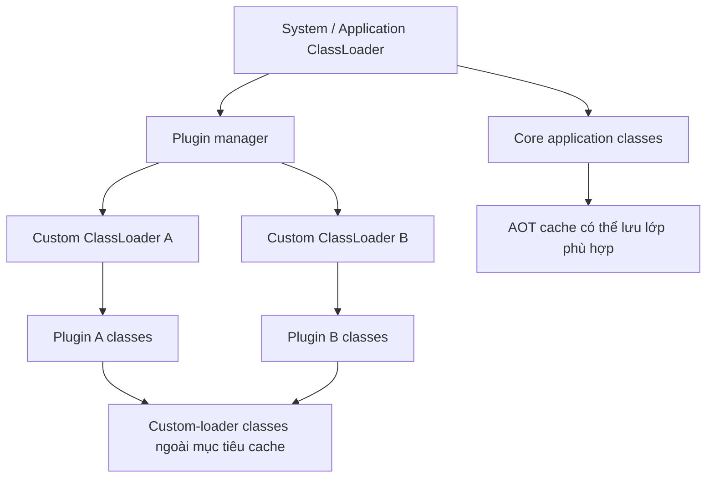

# Ảnh hưởng của classpath, module path, class loader và lớp sinh động

> **Chương:** AOT cache  
> **Phạm vi module:** `JAVA_VERSION_JAVA25` — tìm hiểu những khả năng Java 25 còn có giá trị trong phát triển Java hiện đại, gồm chương trình nguồn gọn, module import, `ScopedValue`, API dẫn xuất khóa, AOT cache, JFR và đánh giá nâng cấp JDK.  
> **Mục tiêu:** Hiểu vì sao AOT cache phụ thuộc vào **cách ứng dụng được khởi chạy**, **classpath/module path**, **class loader** và **các lớp được sinh trong lúc chạy**; biết tổ chức training, tạo cache, triển khai và kiểm tra mức độ tái sử dụng.
>
> **Mốc phiên bản:** Bài dùng quy trình AOT cache đã hoàn tất trong JDK 25 qua JEP 514 và JEP 515. Những API/cờ được ghi rõ theo JDK 25; phần cuối nêu khác biệt đã xuất hiện trong JDK 27 để tránh sao chép tùy chọn cũ sang runtime mới. Chỉ tập trung vào AOT cache hiện hành, không lấy quy trình AppCDS thủ công cũ làm hướng dẫn chính.

AOT cache của HotSpot giúp giảm công việc lặp lại ở startup và warmup bằng cách ghi nhận các lớp được nạp/liên kết, một số đối tượng heap có thể chia sẻ và thông tin profile phương thức từ lần training. Khi khởi chạy lần sau với cache phù hợp, JVM có thể sử dụng dữ liệu đã chuẩn bị thay vì thực hiện lại toàn bộ các bước từ đầu.

Nhưng cache **không phải một bản sao hoàn chỉnh của ứng dụng**. Nó gắn với một cách đóng gói/chạy cụ thể và chỉ bao phủ những thành phần phù hợp với các giới hạn của JVM. Thay đổi JAR, module graph, JDK, hệ điều hành, CPU hoặc class loader có thể làm cache không được dùng. Các class sinh động trong lúc chạy cũng cần được xem xét riêng.

## 1. AOT cache lưu điều gì và không lưu điều gì?

Ba JEP tạo nên quy trình AOT hiện đại:

| JEP | Phiên bản | Vai trò |
|---|---:|---|
| **483 — Ahead-of-Time Class Loading and Linking** | JDK 24 | Đặt nền tảng cache các lớp đã được nạp và liên kết, cùng dữ liệu có thể chia sẻ của ứng dụng |
| **514 — Ahead-of-Time Command-Line Ergonomics** | JDK 25 | Đơn giản hóa thao tác tạo cache, hỗ trợ luồng phổ biến bằng một lệnh `-XX:AOTCacheOutput` |
| **515 — Ahead-of-Time Method Profiling** | JDK 25 | Ghi nhận method execution profiles trong quá trình training để JIT có dữ liệu sớm hơn khi ứng dụng khởi động |

Trong JDK 25, AOT cache kết hợp hai nhóm lợi ích:

- **Class loading/linking:** những lớp phù hợp đã được chuẩn bị trước, giảm phần công việc nạp, xác minh/liên kết lại khi JVM khởi động.
- **Method profiling:** dữ liệu thực thi từ training giúp JIT biết sớm phương thức nào nóng và có thể bắt đầu tối ưu sớm hơn, thay vì phải chờ thu thập đủ profile trong lần chạy production.

`JEP 515` **không biến ứng dụng thành native executable** và không có nghĩa toàn bộ mã máy JIT được lưu để dùng nguyên trạng ở lần chạy sau. JVM vẫn thực hiện JIT compilation ở runtime; điểm cải thiện là profile được cung cấp sớm hơn.

### Ba giai đoạn triển khai


| Giai đoạn | Hoạt động | Điều cần kiểm soát |
|---|---|---|
| **Training** | Chạy ứng dụng với workload đại diện, thu thập lớp đã dùng và profile thực thi | Đúng artifact, classpath/module path, cấu hình JVM và luồng nghiệp vụ |
| **Assembly** | Dùng cấu hình training để tạo file cache | Cùng release JDK, OS/CPU và các tham số tương thích |
| **Production** | Chạy ứng dụng với AOT cache | Giữ cách khởi chạy phù hợp; theo dõi log xác nhận cache được nạp |

**Training không phải chỉ khởi động ứng dụng rồi thoát ngay.** Nếu production thường gọi API báo cáo, kết nối database, nạp plugin hoặc xử lý request quan trọng nhưng training không đi qua các nhánh đó, cache sẽ thiếu nhiều dữ liệu hữu ích. Ứng dụng vẫn có thể chạy bình thường và nạp lớp theo cách thông thường khi cần, nhưng lợi ích AOT sẽ thấp hơn.

### AOT cache khác native image và JIT như thế nào?

| Cơ chế | Thời điểm chuẩn bị | Kết quả | JVM/JIT lúc chạy |
|---|---|---|---|
| **AOT cache (Project Leyden)** | Training/assembly trước lần production | Cache lớp, dữ liệu heap có thể chia sẻ và method profile | Vẫn là JVM; JIT tiếp tục tối ưu |
| **JIT thông thường** | Trong lúc ứng dụng chạy | Native code cho method nóng dựa trên profile runtime | Tự thu thập profile và biên dịch |
| **Native Image** | Build time | Executable native theo mô hình GraalVM Native Image | Không chạy HotSpot JIT như ứng dụng JVM thông thường |

AOT cache phù hợp khi muốn cải thiện startup/warmup mà vẫn giữ mô hình chạy JVM. Nó không tự chuyển dự án sang native image và không loại bỏ yêu cầu kiểm thử runtime.

## 2. Cache gắn với cách ứng dụng được khởi chạy

Theo tài liệu `java` của JDK 25, AOT cache phụ thuộc vào tổ hợp:

1. **Ứng dụng**, được biểu diễn qua `-classpath`, `-jar` hoặc `--module-path`.
2. **JDK release** dùng để tạo cache.
3. **Hệ điều hành và kiến trúc CPU**.

Nếu một trong những yếu tố nền tảng này thay đổi, cần tạo lại cache. Vì thế, file `app.aot` không phải artifact dùng chung cho mọi bản build, mọi JDK và mọi môi trường triển khai.

### Ba cách launch tương ứng

| Cách chạy | Ví dụ | Điều tạo nên identity của ứng dụng |
|---|---|---|
| **Classpath** | `java -cp "app.jar:lib/a.jar:lib/b.jar" com.acme.Main` | Danh sách classpath và thứ tự resolve class |
| **Executable JAR** | `java -jar app.jar` | JAR được chỉ định; manifest xác định entry point và classpath settings khác bị bỏ qua theo quy tắc `-jar` |
| **Named module** | `java --module-path mods -m com.acme.app/com.acme.Main` | Module path, module graph và cách chọn module/main class |

Training và production cần sử dụng cùng mô hình launch. Nếu training chạy bằng `-cp` nhưng production chuyển sang `-jar` hoặc `--module-path`, không coi cache cũ còn hợp lệ chỉ vì mã nguồn giống nhau.

## 3. Classpath: thứ tự JAR và nội dung dependency ảnh hưởng ra sao?

Classpath không chỉ là danh sách thư viện. Nó quyết định class nào được tìm thấy trước khi có nhiều JAR cùng chứa một binary name, do đó thay đổi classpath có thể thay đổi class thực tế mà JVM nạp và liên kết.

### 3.1. Giữ danh sách và thứ tự JAR ổn định

Giả sử ứng dụng có cấu trúc:

```text
deployment/
  app.jar
  lib/
    core.jar
    json.jar
    jdbc.jar
```

Training trên Linux/macOS:

```bash
java -XX:AOTCacheOutput=app.aot \
  -cp "app.jar:lib/core.jar:lib/json.jar:lib/jdbc.jar" \
  com.acme.Main
```

Production dùng cùng thứ tự classpath:

```bash
java -XX:AOTCache=app.aot \
  -cp "app.jar:lib/core.jar:lib/json.jar:lib/jdbc.jar" \
  com.acme.Main
```

Trên Windows, ký tự phân tách classpath là `;` thay cho `:`. Các lệnh trên là ví dụ classpath thường, không phải cú pháp đóng gói bắt buộc của mọi framework.

**Vì sao thứ tự quan trọng?**

- Nếu hai JAR có cùng class name, classpath order có thể quyết định bản nào được nạp.
- Đổi version dependency có thể đổi bytecode, method signature, constant pool hoặc liên kết.
- Thêm/bớt JAR có thể thay đổi class resolution và những lớp được load trong training.
- Wildcard như `lib/*` làm thứ tự mở rộng JAR không được đảm bảo; với cache cần reproducibility, nên dùng danh sách dependency được build tool tạo ra ổn định.

Tài liệu JDK xác định cache theo ứng dụng/đường dẫn khởi chạy. Hướng dẫn AOT cache của Spring Framework khuyến nghị giữ classpath giống training, ưu tiên danh sách JAR và tránh thư mục rỗng/đầy class hoặc wildcard trong các kịch bản Spring cần cache ổn định. Khi triển khai framework, hãy kiểm tra thêm hướng dẫn đóng gói của framework đó.

### 3.2. Thay đổi nhỏ nhưng có thể làm cache mất hiệu lực

| Thay đổi | Tác động tiềm tàng | Cách xử lý |
|---|---|---|
| Nâng `json.jar` lên version khác | Class bytes và dependency graph thay đổi | Tạo cache mới theo dependency lock/build |
| Đổi thứ tự `core.jar` và `json.jar` | Có thể đổi class được resolve khi trùng tên | Giữ thứ tự như training; rebuild nếu đổi |
| Thêm thư viện monitoring vào classpath | Có thể đổi class loading và agent behavior | Tạo lại cache và kiểm tra tương thích agent |
| Chuyển `-cp app.jar:lib/*` sang `-jar app.jar` | Launch model và class loading có thể thay đổi | Training lại với đúng lệnh production |
| Dùng class directory trong môi trường dev nhưng JAR trong production | Artifact layout không còn giống nhau | Training trên artifact được phát hành |
| Build lại JAR tại cùng đường dẫn nhưng nội dung khác | Đường dẫn giống nhưng class bytes đã thay đổi | Tạo cache mới; không dựa vào tên file |

**Thực hành an toàn:** gắn AOT cache với một build artifact cụ thể. Nếu dùng CI/CD, tạo cache sau khi JAR đã đóng gói và có checksum/version cố định; khi dependency hoặc artifact thay đổi, cache phải được tạo lại.

## 4. Module path: module graph cũng là một phần của môi trường cache

Ứng dụng JPMS có thể được khởi chạy qua `--module-path`:

```text
modular-app/
  mods/
    com.acme.app.jar
    com.acme.persistence.jar
    com.acme.reporting.jar
```

Training:

```bash
java -XX:AOTCacheOutput=modular-app.aot \
  --module-path mods \
  --module com.acme.app/com.acme.Main
```

Production:

```bash
java -XX:AOTCache=modular-app.aot \
  --module-path mods \
  --module com.acme.app/com.acme.Main
```

Trong ví dụ, `com.acme.app` đọc các module dependency được khai báo trong `module-info.java`. Cache cần được tạo với module path và cấu hình module phù hợp với production.

### 4.1. Những thay đổi module cần đánh giá lại

- Thêm/bỏ một modular JAR trên module path.
- Thay version hoặc nội dung module JAR.
- Đổi `module-info.java`, chẳng hạn `requires`, `requires transitive`, `exports` hoặc `opens`.
- Thay đổi root modules bằng `--add-modules`.
- Thay đổi cách chọn main module/class.
- Thay đổi tùy chọn nâng cấp/patch module.

Module resolution ảnh hưởng các kiểu nào có thể được tìm thấy và liên kết. Với CDS/AOT class linking, tài liệu JDK cũng cảnh báo các tùy chọn module như `--add-modules` cần nhất quán giữa lúc tạo và dùng archive; một số tùy chọn như `--patch-module`, `--upgrade-module-path` hoặc `--limit-modules` có thể làm CDS không được sử dụng. Vì AOT cache dựa trên các cơ chế CDS/AOT linking, cần kiểm tra log thay vì suy đoán rằng cache vẫn được dùng.

### 4.2. Không nhầm module path với classpath

| Thuộc tính | Classpath | Module path |
|---|---|---|
| Đơn vị tìm kiếm | Thư mục, JAR, ZIP | Named module (modular JAR hoặc thư mục module phù hợp) |
| Cấu trúc dependency | Chủ yếu do classpath order và class loader | Module readability, exports và module resolution |
| Entry point | Main class hoặc `-jar` | `-m/--module` và main class |
| Ảnh hưởng AOT | Xác định các lớp và thứ tự resolve | Xác định module graph và các lớp/module được đọc |

Đừng chuyển dự án từ classpath sang module path sau training mà vẫn giữ nguyên cache. Cần training lại với cách chạy module thực tế.

## 5. Class loader quyết định lớp nào có thể được cache

Một lớp Java không được nhận diện chỉ bằng tên nhị phân. Runtime identity của một class gắn với **binary name và defining class loader**. Hai class cùng tên nhưng được định nghĩa bởi hai loader khác nhau có thể là hai kiểu khác nhau trong JVM.

Ví dụ khái niệm:

```java
Class<?> first = loaderA.loadClass("com.acme.Plugin");
Class<?> second = loaderB.loadClass("com.acme.Plugin");

System.out.println(first.getName().equals(second.getName()));
System.out.println(first == second);
```

Nếu hai loader thực sự định nghĩa hai class độc lập, kết quả có thể là:

```text
true
false
```

Điều này quan trọng với AOT cache vì JEP 483 tập trung vào các lớp được nạp từ classpath/module path/JDK bởi **các class loader tích hợp của JDK**. Mục tiêu của JEP không bao gồm cache mọi class do **user-defined class loader** định nghĩa.

### 5.1. Những kiến trúc chịu ảnh hưởng rõ nhất

| Kiến trúc | Cách nạp lớp | Tác động dự kiến |
|---|---|---|
| Ứng dụng classpath/JAR thông thường | System/application class loader | Phù hợp hơn với phạm vi AOT cache |
| Ứng dụng JPMS trên module path | Built-in loaders theo module resolution | Có thể hưởng lợi nếu module path và graph ổn định |
| Plugin framework tự tạo class loader cho từng plugin | User-defined class loader | Lớp plugin không thuộc mục tiêu cache của JEP 483 |
| Application server cô lập deployment bằng loader riêng | Loader riêng theo ứng dụng | Cache có thể chỉ giúp phần JDK/parent-loader, không cache phần được loader riêng định nghĩa |
| Script engine/compiler nạp lớp từ bytecode động | Loader tùy biến hoặc cơ chế define class | Không giả định lớp sinh ra sẽ được cache |
| IDE/build tool tạo class loader cho project/compiler | Nhiều loader và classpath thay đổi theo project | Lợi ích có thể giới hạn ở phần core dùng built-in loader |

Ví dụ với plugin architecture:



Nếu ứng dụng chủ yếu dành thời gian khởi động cho core classes, AOT cache vẫn có thể giúp phần đó. Nhưng nếu phần nặng nhất là nạp hàng trăm plugin bằng loader riêng, không kỳ vọng AOT cache loại bỏ chi phí này.

### 5.2. Tại sao không thể chỉ so tên class?

Class loader có thể:

- Tìm class từ nguồn khác nhau (JAR, directory, network hoặc bytecode được sinh).
- Áp dụng delegation policy riêng.
- Định nghĩa cùng một binary name trong các namespace runtime khác nhau.
- Biến đổi bytecode trước khi gọi `defineClass`.
- Quản lý lifetime và unloading của nhóm class riêng.

AOT cache cần bảo đảm class được sử dụng lúc production tương thích với class đã được ghi nhận trong training. Một class có cùng tên nhưng defining loader hoặc bytecode khác không thể được coi là cùng một class identity.

## 6. Lớp sinh động: proxy, lambda, hidden class và bytecode runtime

Nhiều framework tạo class khi ứng dụng đang chạy:

- JDK dynamic proxy cho interface.
- CGLIB/Byte Buddy proxy cho class hoặc method.
- ORM tạo proxy/lazy-loading type.
- Dependency injection/AOP tạo subclass hoặc interceptor.
- Script engine/compiler tạo class từ mã người dùng.
- Plugin framework sinh class hoặc nạp bytecode từ nguồn bên ngoài.
- Lambda/metafactory tạo implementation class theo cơ chế runtime.

Không nên gom tất cả vào một kết luận “AOT cache không cache được lớp sinh động”. Cần phân biệt **class loader định nghĩa lớp**, **thời điểm lớp được tạo** và **đường chạy có được thực hiện khi training hay không**.

### 6.1. Ba câu hỏi để phân loại

| Câu hỏi | Nếu câu trả lời là… | Hệ quả |
|---|---|---|
| Class được định nghĩa bởi built-in loader hay custom loader? | Custom loader | Nằm ngoài mục tiêu cache class của JEP 483 |
| Class có tồn tại/được tạo trong training không? | Chỉ tạo ở production | Không có dữ liệu class cụ thể để training đưa vào cache |
| Cùng một class/proxy có thể được tạo lại ổn định với cùng loader, interface và cấu hình không? | Không ổn định | Không nên dựa vào cache cho lớp đó; cần kiểm tra tương thích |

### 6.2. Ví dụ với proxy

Giả sử một framework tạo proxy cho `PaymentService` khi khởi động:

```java
interface PaymentService {
    Receipt pay(long amount);
}

// Framework tạo proxy/interceptor khi application context khởi động.
PaymentService service = proxyFactory.create(PaymentService.class);
```

Nếu proxy được tạo và định nghĩa bởi custom class loader, lớp proxy không nằm trong mục tiêu cache của JEP 483. Core interface và các class thư viện được built-in loader nạp vẫn có thể hưởng lợi; proxy được tạo lại ở runtime.

Nếu framework tạo một proxy theo cơ chế được JDK hỗ trợ với built-in loader và nó được tạo trong training, một số đường proxy có thể được chuẩn bị trước theo khả năng cụ thể của JDK. Tuy vậy, không suy rộng thành bảo đảm cho mọi proxy, mọi generated class hoặc mọi framework. Cần xác minh bằng log và benchmark của ứng dụng thực.

### 6.3. Lambda và invokedynamic

Lambda thường được triển khai thông qua `invokedynamic` và `LambdaMetafactory`. AOT class linking có thể giải quyết trước một số liên kết `invokedynamic` khi tạo cache. Điều này có thể giảm công việc liên kết khi chạy, nhưng không có nghĩa mọi lambda/hidden class được lưu như một class thông thường.

Với lambda hoặc proxy chỉ được tạo trong một nhánh chưa chạy ở training, dữ liệu liên kết tương ứng có thể không được chuẩn bị. JIT/JVM vẫn xử lý theo đường runtime bình thường.

### 6.4. Bytecode instrumentation và agent

Một số Java agent dùng JVMTI hoặc instrumentation để sửa class bytes khi class được load. Nếu bytecode production khác bytecode training, cache có thể không tương thích. Tài liệu JDK nêu rõ một số JVM options/agent can thiệp class loading có thể làm cache không được nạp.

Không loại bỏ agent giám sát/bảo mật chỉ để ép cache hoạt động. Hãy thử nghiệm cấu hình thật; nếu agent làm cache không tương thích, chọn chạy production ở chế độ `auto` để ứng dụng tiếp tục hoạt động mà không dùng cache.

## 7. Training phải phản ánh đường chạy production

JEP 515 bổ sung method profiling, vì vậy chất lượng training ảnh hưởng cả khả năng cache class lẫn lợi ích warmup.

Một lần training tốt cần đại diện cho:

- Startup path thực tế: dependency injection, configuration, serializer, logging và kết nối hạ tầng.
- Các luồng thường dùng sau startup: API phổ biến, batch/job, truy vấn và xử lý dữ liệu.
- Các phương thức nóng có giá trị trong giai đoạn warmup.
- Các module và thư viện thực sự được deploy.

Tránh training với test workload không giống production. Nếu training vô tình nạp JUnit, devtools, mock framework hoặc diagnostic agent, cache có thể phình to nhưng không giúp đường chạy thực tế.

### Ví dụ hai lần training khác nhau

| Training A | Training B |
|---|---|
| Chỉ chạy health check rồi thoát | Startup, health check, gọi API đặt hàng, thanh toán giả lập, truy vấn báo cáo |
| Nhiều class production chưa được nạp | Các class thường dùng được nạp trong training |
| Ít method profile có giá trị | Có profile gần với workload thực |
| Cache nhỏ hơn nhưng coverage thấp | Cache có thể lớn hơn, nhưng sát hành vi production hơn |

Không cần cố gọi mọi class trong ứng dụng. Mục tiêu là workload đại diện, không phải làm cache chứa toàn bộ classpath.

## 8. Tạo và sử dụng AOT cache bằng cú pháp JDK 25

JEP 514 đơn giản hóa quy trình thông dụng. Với JDK 25, một lệnh `-XX:AOTCacheOutput` có thể thực hiện training và kích hoạt assembly sau khi training process kết thúc.

### 8.1. Training với classpath

Ví dụ ứng dụng đã được đóng gói thành JAR:

```bash
java -XX:AOTCacheOutput=app.aot \
  -cp "app.jar:lib/core.jar:lib/json.jar" \
  com.acme.Main
```

Trong lần chạy này:

1. JVM chạy ứng dụng và thu thập dữ liệu training.
2. Hãy kích hoạt những luồng đại diện trước khi process kết thúc.
3. Khi training hoàn tất, JVM khởi chạy một process JVM thứ hai để assembly cache.
4. Kiểm tra file `app.aot` đã được tạo.

`AOTCacheOutput` là tùy chọn ghi cache, không phải tên file config. Nếu muốn chỉ định file cấu hình riêng, dùng `-XX:AOTConfiguration` theo quy trình hai giai đoạn.

### 8.2. Production với cùng classpath

```bash
java -XX:AOTCache=app.aot \
  -cp "app.jar:lib/core.jar:lib/json.jar" \
  com.acme.Main
```

Giữ JDK, OS/CPU và danh sách classpath nhất quán với training. Mặc định `AOTMode=auto` có thể dùng cache nếu tương thích; nếu không, JVM tiếp tục chạy mà không dùng cache.

### 8.3. Training với named module

```bash
java -XX:AOTCacheOutput=app-module.aot \
  --module-path mods \
  --module com.acme.app/com.acme.Main
```

Production:

```bash
java -XX:AOTCache=app-module.aot \
  --module-path mods \
  --module com.acme.app/com.acme.Main
```

Giữ cùng module artifacts, module path và module-resolution options. Nếu đổi descriptor, module version, root modules hoặc cách launch, hãy training lại và kiểm tra module graph.

### 8.4. Dùng executable JAR

Có thể tạo cache theo cách launch `-jar`:

```bash
java -XX:AOTCacheOutput=app.aot -jar app.jar
```

Production:

```bash
java -XX:AOTCache=app.aot -jar app.jar
```

Khi dùng `-jar`, JAR được chỉ định là nguồn class của ứng dụng; các classpath settings khác bị bỏ qua theo quy tắc launcher. Nếu framework dùng nested JAR và class loader riêng, cần đọc hướng dẫn đóng gói AOT của framework. Với Spring Boot, tài liệu Spring Framework khuyến nghị sử dụng executable JAR unpacking support để đáp ứng yêu cầu class loading của AOT cache/CDS trong các kịch bản phù hợp.

### 8.5. Training cho server chạy lâu dài

Với ứng dụng server không tự kết thúc sau workload, có thể dùng quy trình tường minh:

1. Khởi động training bằng `-XX:AOTMode=record` và `-XX:AOTConfiguration`.
2. Gửi traffic/workload đại diện.
3. Kết thúc recording theo công cụ JDK phù hợp, chẳng hạn `jcmd` với lệnh `AOT.end_recording` trên runtime hỗ trợ.
4. Chạy assembly bằng `-XX:AOTMode=create` với file cấu hình đã ghi và đường dẫn cache output.
5. Khởi động production với `-XX:AOTCache`.

Ví dụ minh họa dạng hai giai đoạn (tên process, port và lệnh stop phụ thuộc cách triển khai server):

```bash
java -XX:AOTMode=record \
  -XX:AOTConfiguration=app.aotconfig \
  -cp "app.jar:lib/core.jar" \
  com.acme.Server
```

Sau khi training workload hoàn tất và recording đã được kết thúc, tạo cache:

```bash
java -XX:AOTMode=create \
  -XX:AOTConfiguration=app.aotconfig \
  -XX:AOTCache=app.aot \
  -cp "app.jar:lib/core.jar"
```

Ở mode `create`, ứng dụng không được chạy lại; JVM đọc file cấu hình và assembly cache. Đây là cách hữu ích khi training server phải chạy đủ lâu để nhận traffic trước khi tạo cache.

## 9. Xác minh cache có được sử dụng

Một file `.aot` tồn tại không chứng minh production đã dùng nó. Kiểm tra log của JVM và hiệu năng đo được.

### 9.1. Bật AOT log

```bash
java -XX:AOTCache=app.aot \
  -Xlog:aot \
  -cp "app.jar:lib/core.jar:lib/json.jar" \
  com.acme.Main
```

`-Xlog:aot` giúp nhận biết cache load thành công hay bị bỏ qua, cùng nguyên nhân tương thích. Đây là bước chẩn đoán ưu tiên khi startup vẫn giống trước khi bật cache.

### 9.2. Fail-fast khi đang kiểm thử

Trong JDK 25, có thể dùng `-XX:AOTMode=on` để yêu cầu JVM nạp cache và thoát nếu cache không tương thích:

```bash
java -XX:AOTMode=on \
  -XX:AOTCache=app.aot \
  -Xlog:aot \
  -cp "app.jar:lib/core.jar:lib/json.jar" \
  com.acme.Main
```

Chế độ fail-fast phù hợp cho CI hoặc kiểm thử deployment để phát hiện cache stale. Với production, `auto` thường an toàn hơn: cache không dùng được thì JVM vẫn chạy theo đường bình thường.

**Cập nhật JDK 27:** tùy chọn `-XX:AOTMode=required` được bổ sung như alias cho `on`; release notes JDK 27 khuyến nghị dùng `required` và cho biết `on` sẽ bị deprecate/remove trong tương lai. Khi nâng lên JDK 27, cập nhật script fail-fast theo release notes. Không sao chép flag giữa các JDK mà không kiểm tra `java -XX:+PrintFlagsFinal`/`java -XX:+UnlockDiagnosticVMOptions -XX:+PrintFlagsFinal` hoặc tài liệu launcher đúng phiên bản.

### 9.3. Kiểm tra class loader

Nếu nghi ngờ ứng dụng tạo quá nhiều loader hoặc class được nạp ngoài cache, có thể dùng công cụ chẩn đoán:

```bash
jcmd <pid> VM.classloaders
jcmd <pid> VM.classloader_stats
```

Các lệnh này giúp xem cây class loader và thống kê lớp. Đối chiếu với kiến trúc plugin/framework để xác định phần nào do built-in loader quản lý, phần nào do custom loader định nghĩa.

Không nên chỉ dùng số class được load để kết luận cache có hiệu quả. Kết hợp `-Xlog:aot`, startup time, warmup latency, CPU profile và các request thực.

## 10. Những thay đổi cần tạo cache mới

| Thay đổi | Vì sao ảnh hưởng | Hành động |
|---|---|---|
| Nâng JDK 25 lên JDK 27 | AOT cache gắn với JDK release | Tạo lại cache bằng JDK đích |
| Chuyển Linux x64 sang Linux ARM64 | Khác CPU architecture | Tạo cache riêng theo nền tảng |
| Chuyển Linux sang Windows | Khác OS | Tạo cache riêng |
| Thay JAR hoặc module artifact | Class bytes/module graph có thể thay đổi | Training và assembly lại |
| Đổi classpath/module path hoặc launch mode | Thay application identity và class resolution | Dùng đúng lệnh production khi training |
| Thêm agent biến đổi class bytes | Cache và runtime class có thể không còn khớp | Kiểm tra tương thích agent; thường cần training lại hoặc chạy không cache |
| Đổi class loader topology | Class identity và khả năng cache thay đổi | Kiểm tra custom loader; không kỳ vọng lớp do custom loader được cache |
| Thêm plugin chỉ nạp sau khi server khởi động | Lớp có thể không xuất hiện trong training | Chấp nhận load runtime hoặc thiết kế lại training/loader nếu phù hợp |

Cache nên được coi là artifact phụ thuộc build/runtime. Không nên đưa một file `app.aot` dùng chung cho mọi môi trường mà không phân loại theo JDK, OS và CPU.

## 11. Tối ưu đóng gói khi ứng dụng có class loader riêng

Một số framework ưu tiên custom class loader để hỗ trợ nested JAR, plugin, hot reload hoặc cách ly module. Đây là chức năng kiến trúc hợp lệ, nhưng có thể giới hạn phạm vi AOT cache.

### Hướng xử lý

1. **Giữ built-in class loader cho phần core nếu phù hợp:** đưa các lớp thường dùng vào JAR/module path theo cách launch chuẩn.
2. **Tách plugin boundary rõ ràng:** phần plugin do custom loader nạp có thể tiếp tục load runtime; đừng ép toàn bộ plugin vào AOT cache.
3. **Training đúng deployment layout:** không training với một classpath dev khác rồi deploy với layout production.
4. **Tránh bytecode transformation không cần thiết:** agent/transformer có thể làm cache không tương thích; đánh giá tác động của profiler, APM agent và instrumentation.
5. **Đo từng lớp:** core classes, framework classes, plugin classes, generated proxies; xác định startup cost nằm ở đâu.
6. **Dùng package format có hỗ trợ:** nếu framework có chế độ unpacking hoặc AOT-specific packaging, theo hướng dẫn chính thức của framework.

### Ví dụ với Spring Framework

Spring Framework hỗ trợ AOT cache của JVM từ Java 24+. Với Java 25+, cache có thể chứa thêm method profiling information; vì vậy tài liệu Spring khuyến nghị training qua một phần workflow gần production, thay vì chỉ khởi tạo context rồi thoát bằng `-Dspring.context.exit=onRefresh`. Spring Boot executable JAR unpacking support được khuyến nghị trong các trường hợp cần đáp ứng yêu cầu class loading của AOT cache/CDS.

Đây là khuyến nghị của Spring cho cách đóng gói ứng dụng Spring. Với framework khác, hãy kiểm tra class loader và packaging model riêng, không áp dụng máy móc cấu hình Spring.

## 12. Các lỗi thường gặp và cách chẩn đoán

| Triệu chứng | Nguyên nhân có thể | Hành động |
|---|---|---|
| Production chạy bình thường nhưng không có lợi ích AOT | Mode `auto` đã fallback vì cache không tương thích | Bật `-Xlog:aot` để xem lý do |
| Training tạo file cache quá nhỏ | Workload chưa nạp đủ lớp cần thiết | Bổ sung luồng production thường dùng |
| Cache lớn bất thường | Training nạp test/dev/tooling hoặc nhiều class không cần thiết | Tách training workload khỏi test và công cụ phát triển |
| Thay JAR nhưng cache vẫn được dùng/không dùng như dự kiến | Cache identity/artifact không còn đồng nhất | Tạo lại cache và xác nhận bằng log |
| Plugin classes vẫn nạp chậm | Chúng do custom class loader định nghĩa | Chấp nhận giới hạn hoặc xem lại packaging/loader architecture |
| Proxy runtime vẫn được tạo mỗi lần startup | Proxy được sinh sau training hoặc qua custom loader | Kiểm tra defining loader và thời điểm tạo proxy |
| Module graph khác training | Module path/descriptor/options thay đổi | Training lại theo module graph production |
| Cache bị từ chối khi có Java agent | Agent dùng JVMTI/class-file transformation không tương thích | Kiểm tra log, agent vendor và chế độ auto fallback |
| Dùng cache JDK 25 trên JDK 27 | Khác JDK release | Rebuild cache bằng JDK 27 |
| Fail-fast trên JDK 27 báo option `on` không nên dùng | JDK 27 đã thêm `required` alias và khuyến nghị thay thế | Dùng `-XX:AOTMode=required` trên JDK 27 |
| Thời gian startup tốt hơn nhưng warmup không đổi | Training chưa thu profile method đại diện hoặc workload đo chưa đúng | Training các luồng nóng và đo lại |
| Startup nhanh hơn nhưng request đầu vẫn chậm | Cache class/profile không thay thế mọi lazy init, I/O, network, DB và JIT work | Profile request path, không chỉ startup |

## 13. Đo hiệu quả đúng cách

Không kết luận AOT cache thành công chỉ vì JVM in một dòng “cache loaded”. Hãy so sánh với một baseline không dùng cache.

| Chỉ số | Cách đo | Ý nghĩa |
|---|---|---|
| Startup to ready | Từ khi tiến trình bắt đầu đến khi health/readiness sẵn sàng | Đo chi phí khởi động |
| First-request latency | p50/p95 của request đầu sau readiness | Đo công việc còn lại trên đường request đầu |
| Warmup time | Thời gian đạt throughput/latency ổn định | Đo tác động của method profile và JIT |
| CPU trong startup | CPU time của tiến trình giai đoạn startup | Xác định cache giảm bao nhiêu công việc |
| AOT cache size | Kích thước file `.aot` | Theo dõi chi phí lưu trữ và thay đổi coverage |
| Cache load/fallback | `-Xlog:aot` | Xác nhận cache thực sự được dùng |
| Plugin/custom loader cost | JFR/class loader statistics | Xác định phần không thuộc cache |

**Thiết kế benchmark:**

- Dùng cùng một JDK build, máy/CPU, OS, cấu hình heap và JVM options.
- So sánh run không cache và run có cache trên cùng artifact.
- Tách cold start và các lần chạy lặp; không trộn tải nền của máy.
- Dùng workload production-like; đo nhiều lần và báo median/p95.
- Đo cả thời gian training/assembly và chi phí phát hành cache.
- Không suy ra hiệu quả từ benchmark toy rồi dự đoán tỷ lệ cải thiện của hệ thống lớn.

AOT cache thường hữu ích hơn với ứng dụng có nhiều class/framework initialization ở startup hoặc khởi động tiến trình thường xuyên. Với service chạy nhiều ngày, chi phí startup có thể nhỏ so với thời gian hoạt động; cần cân nhắc effort tạo cache, vận hành và rebuild.

## 14. Quy trình nâng cấp JDK và tái tạo cache

Khi nâng từ JDK 25 lên JDK 27:

1. **Giữ artifact ứng dụng ổn định:** chốt classpath/module path và các JAR được phát hành.
2. **Cài JDK đích:** training phải chạy bằng đúng JDK release và nền tảng production.
3. **Xem lại launch flags:** kiểm tra AOTMode, AOTClassLinking, module options, agents và các tùy chọn JVM.
4. **Training lại:** không dùng cache JDK 25 như artifact production của JDK 27.
5. **Chạy assembly:** tạo file cache mới và lưu cùng metadata build/runtime.
6. **Kiểm tra cache load:** bật `-Xlog:aot`, dùng fail-fast trong CI.
7. **Benchmark:** so sánh startup, first request và warmup trước/sau.
8. **Phát hành đồng bộ:** artifact ứng dụng và AOT cache phải cùng phiên bản; rollback cần có cache phù hợp với artifact/JDK rollback.

### Ma trận tương thích cần lưu

| Trường thông tin | Giá trị ví dụ | Dùng để |
|---|---|---|
| JDK vendor/build | Oracle JDK 25 build cụ thể | Xác định runtime training |
| JDK release | 25 | Tránh dùng cache khác release |
| OS | Linux | Phân loại nền tảng |
| CPU architecture | x86_64 | Phân loại kiến trúc |
| Launch mode | `-cp` hoặc `-jar` hoặc `--module-path` | Xác định application identity |
| Classpath/module path | Danh sách artifact có thứ tự | Kiểm tra dependency |
| Module options | `--add-modules`, `--module`, v.v. | Kiểm tra module resolution |
| Agent/JVM options | Các agent và flags production | Kiểm tra khả năng tương thích |
| Training workload version | Commit/test scenario | Đánh giá coverage profile |

## 15. Bài tập thực hành

### Bài A — So sánh classpath và module path

1. Tạo một ứng dụng nhỏ có hai module hoặc một JAR classpath với hai dependency.
2. Training theo classpath và tạo `classpath.aot`.
3. Chuyển project sang named module và training thành `module.aot`.
4. Chạy mỗi cache với đúng launch command.
5. Đổi một dependency JAR hoặc module descriptor, bật `-Xlog:aot` và quan sát cache có còn được dùng không.
6. Giải thích vì sao cùng source code không đồng nghĩa cùng AOT cache identity.

### Bài B — Thay đổi thứ tự JAR

1. Tạo hai JAR chứa cùng binary name ở package thử nghiệm.
2. Training với thứ tự JAR A rồi B.
3. Chạy lại với B rồi A.
4. Kiểm tra class được resolve và log AOT.
5. Giải thích vì sao classpath order là một phần của tính tái lập.

### Bài C — Custom class loader

1. Tạo một loader con của `ClassLoader` để nạp một plugin class từ JAR.
2. Chạy workload trong training.
3. Kiểm tra `jcmd VM.classloaders` và `VM.classloader_stats`.
4. So sánh startup với core class được nạp bằng built-in loader.
5. Giải thích vì sao lớp do user-defined loader định nghĩa nằm ngoài mục tiêu cache của JEP 483.

### Bài D — Generated classes

1. Dùng một framework tạo JDK dynamic proxy hoặc subclass proxy trong startup.
2. Training với luồng tạo proxy đó.
3. Quan sát log AOT và class loader định nghĩa proxy.
4. Lặp lại với một proxy được tạo sau startup hoặc bằng custom class loader.
5. Phân biệt kết quả cache class với chi phí tạo proxy ở runtime.

### Bài E — Method profile và JEP 515

1. Tạo một workload gọi nhiều lần một số method nóng.
2. Training bằng workload đại diện và tạo AOT cache.
3. Production với cache và đo warmup.
4. Thay workload production sang một nhánh hoàn toàn khác.
5. Giải thích vì sao profile từ training có thể không giúp nhánh mới và JIT vẫn cần thu thập thông tin runtime.

**Tiêu chí hoàn thành:** giải thích được cache identity theo launch path/JDK/OS/CPU; phân biệt class do built-in loader và custom loader định nghĩa; nêu được vì sao lớp sinh sau training không tự động có trong cache; biết dùng `-Xlog:aot` để xác minh.

## 16. Checklist review trước khi phát hành AOT cache

- [ ] Cache được tạo bằng cùng JDK release và cùng nền tảng CPU/OS production.
- [ ] Training dùng đúng launch mode: classpath, executable JAR hoặc module path.
- [ ] Danh sách JAR/module và module options nhất quán với production.
- [ ] Training đã đi qua các startup path và workflow đại diện.
- [ ] Không đưa test/dev tooling vào workload production nếu không cần.
- [ ] Đã nhận diện các custom class loader và giới hạn cache của chúng.
- [ ] Đã kiểm tra proxy/generated classes thay vì giả định tất cả được cache.
- [ ] Đã rà soát Java agents và bytecode transformation.
- [ ] Có `-Xlog:aot` trong bước xác minh.
- [ ] CI có chế độ fail-fast theo JDK đích.
- [ ] Cache được version hóa cùng application artifact.
- [ ] Có benchmark baseline cho startup, first request và warmup.
- [ ] Có kế hoạch tạo lại cache khi nâng JDK, dependency hoặc nền tảng.
- [ ] Production có fallback hợp lý nếu cache không tương thích.

## 17. Nguồn tham khảo chính thức

1. [JEP 483 — Ahead-of-Time Class Loading and Linking](https://openjdk.org/jeps/483): phạm vi cache, training consistency, built-in class loaders và giới hạn với user-defined class loaders.
2. [JEP 514 — Ahead-of-Time Command-Line Ergonomics](https://openjdk.org/jeps/514): quy trình tạo cache đơn giản bằng `-XX:AOTCacheOutput`.
3. [JEP 515 — Ahead-of-Time Method Profiling](https://openjdk.org/jeps/515): thu thập method execution profiles để cải thiện warmup.
4. [Java SE 25 — The `java` Command, Ahead-of-Time Cache](https://docs.oracle.com/en/java/javase/25/docs/specs/man/java.html): `AOTCacheOutput`, `AOTCache`, `AOTConfiguration`, `AOTMode`, `AOTClassLinking` và `-Xlog:aot`.
5. [Java SE 25 — The `jcmd` Command](https://docs.oracle.com/en/java/javase/25/docs/specs/man/jcmd.html): lệnh `AOT.end_recording` và chẩn đoán class loader.
6. [Java SE 25 — `ClassLoader` API](https://docs.oracle.com/en/java/javase/25/docs/api/java.base/java/lang/ClassLoader.html): trách nhiệm và mô hình nạp lớp.
7. [Java SE 25 — JLS, Loading of Classes and Interfaces](https://docs.oracle.com/javase/specs/jls/se25/html/jls-12.html): class loader consistency và class identity.
8. [Java SE 27 — The `java` Command](https://docs.oracle.com/en/java/javase/27/docs/specs/man/java.html): cập nhật AOTMode, `required` và tương thích khi nâng JDK.
9. [JDK 27 Release Notes](https://www.oracle.com/java/technologies/javase/27-relnote-issues.html): `-XX:AOTMode=required` được thêm làm alias cho `on` và được khuyến nghị cho fail-fast.
10. [Spring Framework — JVM AOT Cache](https://docs.spring.io/spring-framework/reference/integration/aot-cache.html): hướng dẫn classpath, workload training và đóng gói cho Spring.

**Điểm mấu chốt:** AOT cache chỉ có ích khi training và production dùng cùng cách tổ chức/khởi chạy ứng dụng. Classpath, module path và module options quyết định tập lớp có thể resolve; defining class loader quyết định class có thuộc phạm vi cache của JEP 483 hay không; lớp sinh động chỉ được hưởng lợi khi thỏa điều kiện loader và đã xuất hiện trong training. Hãy tạo cache theo từng build/runtime cụ thể, xác minh bằng `-Xlog:aot` và đo startup/warmup trên workload thực tế.
