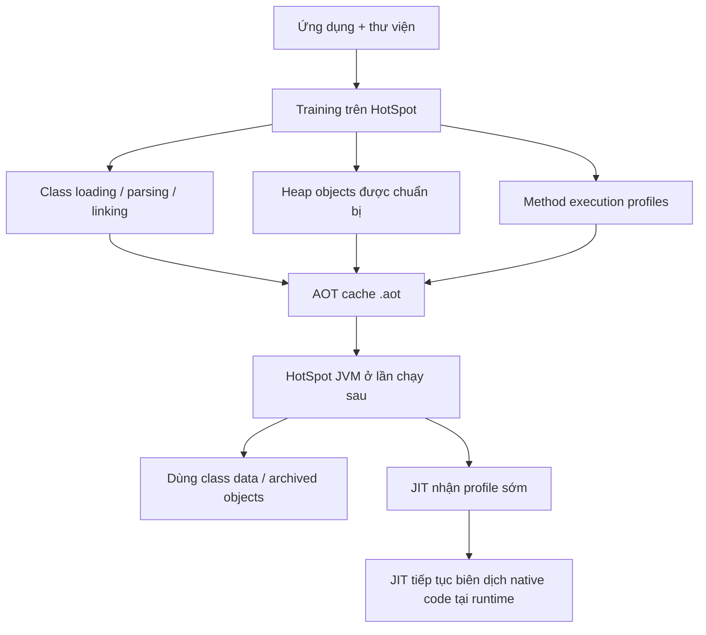
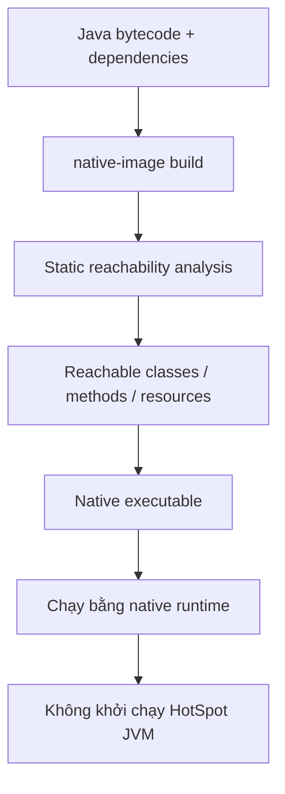
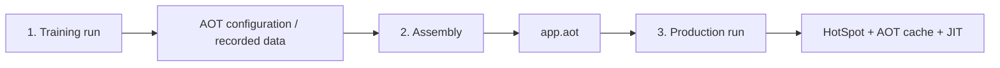
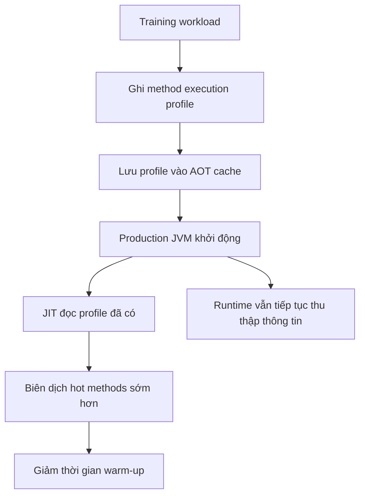
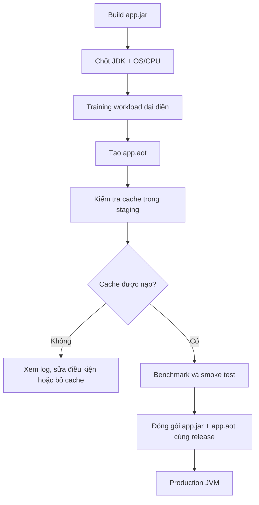

# Phân biệt AOT cache của HotSpot với biên dịch ứng dụng thành native image

Từ Java 24, HotSpot có **Ahead-of-Time (AOT) Cache** để tái sử dụng công việc nạp, phân tích, liên kết lớp và trạng thái đã được chuẩn bị trong lần chạy huấn luyện. Java 25 tiếp tục mở rộng cơ chế này: **JEP 514** rút gọn thao tác tạo cache, còn **JEP 515** đưa method-execution profiles vào cache để JIT có thể bắt đầu tối ưu sớm hơn. Ứng dụng vẫn chạy trên **HotSpot JVM** và vẫn có thể dùng JIT ở runtime.

Đây là điểm khác biệt cốt lõi với **GraalVM Native Image**: Native Image phân tích ứng dụng khi build và tạo một executable native riêng cho hệ điều hành/kiến trúc mục tiêu. Executable đó không cần khởi chạy HotSpot JVM. Hai công nghệ cùng dùng khái niệm ahead-of-time, nhưng tạo ra **artifact, mô hình chạy, giới hạn tương thích và quy trình triển khai khác nhau**.

Bài thuộc chương **AOT cache** của module `JAVA_VERSION_JAVA25`. Bạn sẽ học cách chọn đúng công nghệ, tạo cache trong JDK 25, huấn luyện bằng workload đại diện, xác minh cache được nạp, đo tác động startup/warm-up và xử lý các giới hạn theo phiên bản. Nội dung chỉ dùng khả năng ổn định của Java 25; các cải tiến chỉ có từ JDK 26 trở lên được ghi rõ là khác phiên bản.

> **Phiên bản cần nhớ:** JEP 483 đặt nền tảng AOT cache trong JDK 24; JEP 514 và JEP 515 được đưa vào JDK 25. JDK 25 vẫn chạy ứng dụng bằng HotSpot. **Không** xem file `.aot` là native executable và **không** nhầm AOT cache với `native-image`.

## 1. Mục tiêu học tập

Sau bài này, bạn có thể:

1. Giải thích AOT cache của HotSpot lưu những loại dữ liệu nào và vì sao nó giúp startup/warm-up.
2. Phân biệt vai trò của JEP 483, JEP 514 và JEP 515 trong Java 25.
3. Tạo AOT cache bằng quy trình một lệnh hoặc quy trình ba pha training–assembly–production.
4. Thiết kế workload training gần với hành vi production và biết khi nào cần tách pha để tiết kiệm RAM.
5. Kiểm tra tính tương thích theo ứng dụng, JDK, OS/CPU, classpath và JVM options.
6. Dùng log AOT, `jcmd` và JFR để điều tra cache có được nạp hay không.
7. So sánh AOT cache với GraalVM Native Image về runtime, artifact, reflection, dynamic loading và vận hành.
8. Thiết lập CI/CD để tái tạo cache khi ứng dụng hoặc JDK thay đổi.
9. Đo hiệu quả bằng startup, time-to-first-request, warm-up, throughput, CPU và memory thay vì chỉ dựa vào cảm giác.

## 2. AOT cache của HotSpot là gì?

AOT cache là một **artifact tối ưu hóa dành cho HotSpot JVM**. JVM thực hiện trước một số công việc thường phải làm khi khởi động ứng dụng, rồi ghi lại kết quả vào cache để các lần chạy sau có thể tái sử dụng.

Trong Java 25, AOT cache kết hợp các nhóm thông tin chính:

- **Class data đã chuẩn bị:** lớp đã được đọc, phân tích, nạp và liên kết để JVM không phải lặp lại toàn bộ công việc đó trong mỗi lần khởi chạy.
- **Heap objects được lưu trữ trong cache:** một số đối tượng đã được chuẩn bị trong quá trình training có thể được tái sử dụng.
- **Method-execution profiles:** từ JEP 515, thông tin về phương thức được thực thi thường xuyên trong training được đưa vào cache. JIT có thể dùng profile này sớm khi ứng dụng bắt đầu chạy, thay vì phải chờ thu thập lại toàn bộ profile từ trạng thái lạnh.



AOT cache **không phải** một bản sao hoàn chỉnh của ứng dụng đã được biên dịch thành mã máy độc lập. JVM vẫn phải khởi động, quản lý heap, garbage collection, thread, class loading và thực thi ứng dụng. JIT vẫn hoạt động; method profiles chỉ giúp JIT có thông tin sớm hơn để chọn phương thức cần tối ưu.

### 2.1. AOT cache cải thiện giai đoạn nào?

| Giai đoạn | Không có AOT cache | Có AOT cache Java 25 |
|---|---|---|
| JVM khởi động | HotSpot phải thực hiện các bước chuẩn bị cần thiết cho ứng dụng | Có thể tái sử dụng class data và heap objects đã lưu |
| Nạp/liên kết lớp | Một phần công việc diễn ra lại trong lần chạy mới | Các lớp tương thích có thể được lấy từ cache |
| Thu thập profile | JVM bắt đầu quan sát method execution trong lần chạy hiện tại | Profile từ training có thể sẵn sàng ngay khi JVM bắt đầu |
| JIT compilation | Cần đợi profile runtime tích lũy trước khi tối ưu một số hot methods | JIT có thể bắt đầu biên dịch sớm dựa trên profile đã lưu |
| Runtime lâu dài | JIT tiếp tục tối ưu theo hành vi thực tế | JIT vẫn tiếp tục tối ưu và thích nghi với hành vi thực tế |

Hiệu quả phụ thuộc workload và mức độ giống nhau giữa training với production. Ứng dụng chạy lâu, startup ít quan trọng có thể thu được lợi ích nhỏ hơn CLI, worker ngắn hạn hoặc dịch vụ thường xuyên scale-out.

### 2.2. Ba JEP liên quan trực tiếp đến Java 25

| JEP | Phiên bản | Vai trò |
|---|---:|---|
| **JEP 483 — Ahead-of-Time Class Loading and Linking** | JDK 24 | Đặt nền tảng training, assembly và sử dụng AOT cache cho class loading/linking và dữ liệu đã chuẩn bị. |
| **JEP 514 — Ahead-of-Time Command-Line Ergonomics** | JDK 25 | Cho phép tạo cache trong quy trình đơn giản hơn bằng `-XX:AOTCacheOutput`. |
| **JEP 515 — Ahead-of-Time Method Profiling** | JDK 25 | Đưa method-execution profiles vào AOT cache để JIT có thông tin sớm hơn, giảm thời gian warm-up. |

Không cần thay đổi mã nguồn ứng dụng chỉ để dùng JEP 514/515. Phần cần thiết là chạy training với workload phù hợp và phân phối cache tương thích cùng ứng dụng.

## 3. Native Image là một mô hình biên dịch khác

**GraalVM Native Image** dùng công cụ `native-image` để phân tích các lớp, phương thức và tài nguyên có thể được truy cập từ entry point. Công cụ thực hiện static analysis theo **closed-world assumption**, sau đó biên dịch phần reachable thành một executable native cho OS/CPU đích.



Native Image có thể phù hợp khi cần executable gọn, startup rất nhanh hoặc giảm footprint runtime. Đổi lại, các tính năng động như reflection, dynamic proxy, JNI, resource loading và dynamic class loading cần được phân tích và cung cấp reachability metadata khi công cụ không thể tự suy ra đầy đủ.

### 3.1. So sánh trực tiếp

| Tiêu chí | HotSpot AOT cache (Java 25) | GraalVM Native Image |
|---|---|---|
| Artifact | File cache `.aot` | Native executable hoặc native shared library |
| Runtime | Vẫn chạy bằng HotSpot JVM | Chạy bằng native runtime của Native Image |
| JVM/JIT | Có HotSpot, có JIT ở runtime | Không khởi chạy HotSpot JIT để chạy ứng dụng |
| Cách tối ưu | Tái sử dụng class data, heap objects và method profiles từ training | Phân tích reachable code khi build và biên dịch thành binary |
| Dynamic class loading | Vẫn thuộc mô hình JVM; cache có điều kiện tương thích | Bị giới hạn bởi closed-world assumption và metadata đã khai báo |
| Reflection/proxy/JNI | Hoạt động theo khả năng JVM và thư viện đang dùng | Có thể cần reachability metadata hoặc cấu hình build |
| Tính di động | Cache gắn với app, JDK, OS và CPU cụ thể | Binary gắn với OS/CPU/ABI mục tiêu |
| Công cụ chẩn đoán | Tiếp tục dùng công cụ JVM như JFR, `jcmd`, heap/GC tooling | Có công cụ chẩn đoán Native Image riêng; không có đầy đủ mô hình HotSpot |
| Quy trình | Training → cache → chạy JVM | Native build → triển khai executable |
| Mục tiêu chính | Giảm startup và warm-up nhưng giữ mô hình JVM | Tạo executable native, tối ưu startup và footprint runtime |

**Không có lựa chọn tốt nhất cho mọi ứng dụng.** Hãy chọn theo yêu cầu vận hành, mức độ dùng tính năng động, môi trường triển khai và số liệu đo thực tế.

### 3.2. Ví dụ Native Image để nhận diện đúng artifact

Giả sử `app.jar` là JAR có manifest `Main-Class` phù hợp và môi trường đã cài GraalVM có Native Image:

```bash
native-image -jar app.jar app-native
./app-native
```

Lệnh trên yêu cầu công cụ build native và toolchain nền tảng phù hợp. Kết quả là executable `app-native` (tên/đuôi thực tế tùy OS), không phải file `.aot` để truyền vào `java -XX:AOTCache=...`.

Với Native Image, cần kiểm tra reachability metadata cho thư viện dùng reflection, proxy, JNI hoặc tài nguyên được nạp động. Đây là một phần quan trọng của quá trình chuyển ứng dụng sang closed-world compilation.

## 4. Khi nào chọn AOT cache và khi nào chọn Native Image?

| Tình huống | Hướng nên thử trước | Lý do |
|---|---|---|
| Ứng dụng cần giữ đầy đủ mô hình HotSpot/JVM và công cụ vận hành hiện có | AOT cache | Cache tối ưu startup/warm-up mà không chuyển runtime sang native executable |
| Dịch vụ scale-to-zero hoặc worker khởi chạy thường xuyên | Benchmark AOT cache; sau đó so với Native Image | Startup và time-to-first-work có thể ảnh hưởng trực tiếp chi phí/độ trễ |
| Ứng dụng dùng reflection, class loading hoặc plugin động rộng rãi | AOT cache | Mô hình JVM linh hoạt hơn closed-world Native Image |
| Container cần footprint nhỏ và binary độc lập JVM | Native Image | Có thể tạo executable native và giảm nhu cầu JVM runtime |
| Ứng dụng cần JFR/JMX/agent và công cụ JVM quen thuộc | AOT cache | Giữ HotSpot và hệ sinh thái quan sát JVM |
| Thư viện chưa có reachability metadata hoặc chưa tương thích Native Image | AOT cache trước | Tránh phải xử lý nhiều giới hạn dynamic features ngay |
| Cần hiệu quả startup nhưng chưa muốn đổi cách đóng gói | AOT cache | Thay đổi chủ yếu ở quy trình build/deploy và cache artifact |

Quyết định cuối cùng phải dựa trên benchmark của ứng dụng thật. Native Image có thể startup rất nhanh nhưng chi phí build, metadata, tương thích thư viện và giới hạn dynamic loading có thể đáng kể. AOT cache giữ tính linh hoạt của JVM nhưng không loại bỏ hoàn toàn startup/warm-up và không tạo executable độc lập.

## 5. Quy trình AOT cache: training, assembly, production

Quy trình cơ bản có ba pha:

1. **Training:** chạy ứng dụng bằng HotSpot với workload đại diện. JVM quan sát lớp được nạp, trạng thái được chuẩn bị và method execution profiles.
2. **Assembly:** dùng dữ liệu training để tạo file cache `.aot`.
3. **Production:** khởi chạy cùng ứng dụng với `-XX:AOTCache=...` để sử dụng cache.



Training không phải benchmark hiệu năng production. Mục tiêu là **quan sát đường chạy đại diện** để cache chuẩn bị đúng những lớp và profile mà ứng dụng sẽ cần ở lần chạy sau.

## 6. Cách đơn giản nhất trong Java 25: một lệnh tạo cache

JEP 514 cho phép kết hợp training và assembly trong một lệnh bằng `-XX:AOTCacheOutput`. Ví dụ giả định:

- `app.jar` là danh sách JAR/classpath phù hợp với quy tắc AOT cache.
- `com.example.App` là main class.
- `--training-scenario=representative` là đối số do ứng dụng tự định nghĩa để chạy các luồng thường gặp.

### 6.1. Training và tạo cache

```bash
java -XX:AOTCacheOutput=app.aot \
     -cp app.jar \
     com.example.App \
     --training-scenario=representative
```

JVM chạy ứng dụng trong pha training. Khi tiến trình kết thúc, quy trình assembly được thực hiện để ghi cache `app.aot`. Với cách này, `AOTMode` mặc định `auto` nhận biết `AOTCacheOutput` và chuyển sang record/training, sau đó thực hiện assembly.

**Điều kiện quan trọng:** tiến trình training phải kết thúc để hoàn tất việc tạo cache. Với một server chạy liên tục, hãy lập kế hoạch dừng training hoặc dùng quy trình record/assembly tách pha ở mục 7.

### 6.2. Chạy production với cache

```bash
java -XX:AOTCache=app.aot \
     -cp app.jar \
     com.example.App
```

JVM cố gắng nạp cache tương thích. Ứng dụng vẫn chạy trên HotSpot; JIT tiếp tục hoạt động trong runtime.

### 6.3. Kiểm tra cache có được sử dụng

Trong staging, có thể yêu cầu JVM thất bại nhanh nếu cache không nạp được:

```bash
java -XX:AOTCache=app.aot \
     -XX:AOTMode=on \
     -Xlog:aot \
     -cp app.jar \
     com.example.App
```

`-XX:AOTMode=on` phù hợp để **xác minh/fail-fast** khi kiểm tra cấu hình. Nếu cache không tồn tại hoặc không tương thích, JVM báo lỗi và thoát. Khi đã kiểm tra xong, production thường nên dùng `auto` (mặc định) để ứng dụng có thể chạy bình thường khi cache không nạp được:

```bash
java -XX:AOTCache=app.aot \
     -XX:AOTMode=auto \
     -Xlog:aot \
     -cp app.jar \
     com.example.App
```

Ở chế độ `auto`, nếu cache không dùng được, JVM tiếp tục chạy không có cache. Điều đó bảo vệ tính sẵn sàng nhưng có thể khiến startup/warm-up chậm hơn. Giữ `-Xlog:aot` trong giai đoạn kiểm chứng để phát hiện cache bị bỏ qua.

## 7. Quy trình ba pha khi cần kiểm soát chi tiết

Khi cần tách training và assembly, dùng file cấu hình `.aotconfig`.

### 7.1. Pha training

```bash
java -XX:AOTMode=record \
     -XX:AOTConfiguration=app.aotconfig \
     -cp app.jar \
     com.example.App \
     --training-scenario=representative
```

JVM ghi thông tin training vào `app.aotconfig`. Hãy chạy các luồng nghiệp vụ thường gặp, bao gồm đường khởi động, request phổ biến và những tính năng cần warm-up.

### 7.2. Pha assembly

```bash
java -XX:AOTMode=create \
     -XX:AOTConfiguration=app.aotconfig \
     -XX:AOTCache=app.aot \
     -cp app.jar
```

JVM đọc file cấu hình và tạo `app.aot`. **Ứng dụng không được chạy trong pha create**; đây là bước tạo cache từ dữ liệu training.

### 7.3. Pha production

```bash
java -XX:AOTCache=app.aot \
     -cp app.jar \
     com.example.App
```

Ưu điểm của cách tách pha:

- Có thể training trên môi trường gần production nhưng assembly trên máy/runner có nhiều CPU và RAM hơn.
- Dễ lưu riêng file `.aotconfig` để điều tra hoặc tái tạo cache.
- Tránh yêu cầu bộ nhớ của training và assembly chồng lấp trong cùng quy trình một lệnh.
- Dễ kiểm soát các JVM options khác nhau nếu đã xác định chúng tương thích với cache.

### 7.4. Dừng training của ứng dụng chạy lâu

Nếu training server không tự kết thúc, có thể dùng `jcmd` để kết thúc ghi nhận AOT:

```bash
jcmd <pid> AOT.end_recording
```

Lệnh cần PID của JVM đang ở chế độ training. JVM kết thúc ghi nhận và ghi các artifact theo cấu hình `AOTConfiguration`/`AOTCacheOutput`. Trong vận hành, nên dùng một quy trình dừng có kiểm soát để không cắt ngang dữ liệu nghiệp vụ hoặc để lại tài nguyên bên ngoài.

## 8. JEP 515: method profiles giúp JIT warm-up sớm hơn

Trước Java 25, AOT cache đã giúp tái sử dụng công việc chuẩn bị lớp. JEP 515 bổ sung **method-execution profiles** từ training run. Khi JVM production khởi động, profile của các phương thức thường được gọi có thể sẵn sàng ngay; JIT có thể bắt đầu biên dịch mã native sớm hơn.



Điều này **không có nghĩa** ứng dụng đã được biên dịch hoàn toàn thành native code trước khi deploy. JIT vẫn thực hiện compilation và có thể điều chỉnh tối ưu khi hành vi runtime khác training.

### 8.1. Workload training ảnh hưởng đến profile

Nếu training chỉ gọi endpoint health check, profile thu được có thể không phản ánh luồng xử lý đơn hàng hoặc truy vấn dữ liệu thật. JVM sẽ thiếu thông tin hữu ích cho các đường chạy chưa được thực hiện trong training.

| Training workload | Profile/cache có thể thu được | Rủi ro |
|---|---|---|
| Chỉ gọi health check | Lớp khởi động và một phần đường health | Thiếu các service method chính |
| Chạy smoke test có đại diện request | Các lớp và method thường dùng trong smoke test | Có thể bỏ sót tính năng hiếm nhưng quan trọng |
| Chạy test suite đầy đủ có nhiều framework | Rất nhiều lớp và method, kể cả công cụ test | Cache phình to, chứa lớp không có ở production |
| Replay traffic đã ẩn dữ liệu nhạy cảm | Gần với hành vi production hơn | Cần kiểm soát tính an toàn và khả năng tái lập dữ liệu |

Không cần chạy mọi test tích hợp trong training. Hãy chọn kịch bản nhỏ nhưng bao phủ các luồng cần tối ưu, và xác minh production classpath có các thành phần tương thích.

## 9. Dùng JFR để hiểu training workload

JFR là công cụ quan sát JVM; nó **không phải** file đầu vào thay thế cho AOT configuration. AOT training tự ghi thông tin phục vụ cache. JFR giúp bạn tìm hiểu lớp nào được nạp và phương thức nào được thực thi nhiều, để điều chỉnh workload training.

### 9.1. Ghi JFR khi chạy training

Ví dụ chạy một recording ngắn:

```bash
java -XX:StartFlightRecording=filename=training.jfr,settings=profile,duration=60s \
     -XX:AOTCacheOutput=app.aot \
     -cp app.jar \
     com.example.App \
     --training-scenario=representative
```

Đây là một ví dụ cho ứng dụng có thể hoàn tất training trong khoảng thời gian đã chọn. Với server chạy lâu hơn, điều chỉnh `duration` hoặc điều khiển recording theo kế hoạch vận hành. JFR recording và AOT cache là hai artifact riêng.

### 9.2. Xem lớp được nạp và hot methods

```bash
jfr view hot-methods training.jfr
jfr print --events jdk.ClassLoad training.jfr
```

Có thể bật event `jdk.ClassLoad` trong JFC tùy chỉnh để quan sát chi tiết class loading. Một cách đơn giản khác là dùng `-verbose:class` trong lần chạy chẩn đoán, nhưng output có thể rất lớn.

Dùng kết quả để trả lời:

- Training đã chạm vào các package/service quan trọng chưa?
- Những method hot có thuộc luồng production không?
- Có framework test hoặc công cụ phụ trợ làm cache chứa nhiều lớp không cần thiết?
- Có đường chạy phổ biến nào chỉ xuất hiện sau startup nhưng chưa được training không?

Không dùng recording chứa dữ liệu nhạy cảm làm artifact công khai. JFR có thể chứa thông tin về class, stack, thread và hoạt động ứng dụng; áp dụng chính sách truy cập và lưu giữ phù hợp.

## 10. Các giới hạn tương thích của AOT cache Java 25

AOT cache gắn với **một trạng thái ứng dụng và môi trường cụ thể**. Không thể tạo cache một lần rồi chia sẻ vô hạn giữa các phiên bản.

### 10.1. Những yếu tố phải khớp

| Yếu tố | Yêu cầu khi dùng cache |
|---|---|
| Ứng dụng | Cùng trạng thái JAR/class và dependencies đã được training |
| JDK | Cùng JDK release/build tương thích; nâng JDK thì tạo lại cache |
| OS | Cùng hệ điều hành mục tiêu |
| CPU architecture | Cùng kiến trúc CPU (ví dụ x86_64 với x86_64, AArch64 với AArch64) |
| Classpath/module path | Phải tuân thủ các điều kiện về JAR, thứ tự và tập classpath của training/production |
| JAR timestamps | Giữ timestamp của JAR ổn định giữa training và production |
| JVM options | Tránh tùy chọn làm thay đổi class loading hoặc instrumentation theo cách không tương thích |
| JVMTI agents | Một số agent có class-file load hook có thể khiến cache không nạp được |

**Nếu code hoặc dependency thay đổi, hãy tạo cache mới cho build mới.** Nếu chỉ đổi tên tag image mà vẫn giữ cùng binary/digest, cache có thể vẫn hợp lệ; nếu JAR, thư viện hoặc JDK thay đổi, phải tái tạo và kiểm tra lại.

### 10.2. Quy tắc classpath quan trọng

Để training và production nhất quán:

- Cung cấp classpath dưới dạng **danh sách JAR cụ thể**.
- Tránh thư mục rỗng/đã bung, wildcard hoặc nested JAR trong classpath training.
- Classpath production phải là **superset** của classpath training theo hướng dẫn AOT.
- Giữ timestamp của JAR không thay đổi giữa training và production.
- Dùng cùng JDK release, OS và CPU architecture.
- Kiểm tra lại với cách đóng gói thực tế của framework, đặc biệt nếu dùng executable/fat JAR chứa nested libraries.

Ví dụ đơn giản `-cp app.jar` dễ kiểm soát hơn classpath động. Với Spring Boot executable JAR hoặc packaging đặc thù, hãy kiểm thử chính xác lệnh launcher mà production sử dụng; không mặc định nested JAR luôn đáp ứng điều kiện AOT cache.

### 10.3. Garbage collector trong Java 25

**AOT cache của JDK 24/25 không hỗ trợ ZGC.** Nếu ứng dụng Java 25 chạy với ZGC, không thiết kế pipeline dựa trên kỳ vọng cache này sẽ được nạp. JEP 516 — Ahead-of-Time Object Caching with Any GC — được đưa vào JDK 26 để mở rộng khả năng dùng cache với các GC khác. Không áp dụng khả năng của JDK 26 ngược lại cho runtime Java 25.

Nếu dùng G1 hoặc collector khác, vẫn cần xác minh theo đúng JDK build, platform và tài liệu của nhà cung cấp. Không tự kết luận chỉ từ việc JVM khởi động thành công.

### 10.4. Một số JVM options có thể làm cache không tương thích

- Một số JVMTI agent can thiệp vào class loading.
- `--patch-module`, `--upgrade-module-path` hoặc tùy chọn làm thay đổi module/class loading có thể ảnh hưởng đến khả năng sử dụng dữ liệu cache.
- Khi bật AOT mode rõ ràng, `AOTClassLinking` được bật tự động; việc tắt/bật thủ công hoặc thay đổi module options có thể tạo khác biệt giữa training và production.

Không cố gắng giữ cache bằng cách ép mọi JVM options khác nhau phải dùng chung. Hãy thống nhất command line, xác minh trong staging và tái tạo cache khi môi trường cần thay đổi.

## 11. Bộ nhớ và chi phí tạo cache

Quy trình một lệnh `-XX:AOTCacheOutput` rất tiện, nhưng pha assembly sử dụng một JVM thứ hai. Trong môi trường hạn chế tài nguyên, JVM training và JVM assembly có thể làm nhu cầu bộ nhớ tăng đáng kể.

Ví dụ: nếu training chạy với `-Xmx2g`, quá trình một lệnh có thể cần khoảng **4 GB heap budget** để chạy training và assembly JVM, chưa tính native memory, metaspace, thread stack và overhead của container.

### 11.1. Khi nào tách pha?

| Điều kiện | Cách xử lý |
|---|---|
| Runner CI có RAM đủ và ứng dụng thoát nhanh | Dùng `-XX:AOTCacheOutput=app.aot` |
| Container có memory limit nhỏ | Tách `record` và `create` thành hai job/process |
| Training cần chạy lâu trên môi trường gần production | Dùng `AOTMode=record`, điều khiển kết thúc training, assembly ở runner khác |
| Cần giữ file training để điều tra | Dùng `-XX:AOTConfiguration=app.aotconfig` |
| Cần nhiều CPU/RAM để assembly | Training trên môi trường giống production, assembly trên máy build mạnh hơn |

Có thể truyền JVM options cho tiến trình assembly thông qua biến môi trường `JDK_AOT_VM_OPTIONS` theo cơ chế được JDK mô tả. Chỉ cấu hình khi cần và giữ các thông số tương thích với training/production.

## 12. Triển khai AOT cache trong CI/CD và container

AOT cache nên được xem là **artifact được tạo cho một build cụ thể**, không phải tệp cấu hình có thể tái sử dụng giữa mọi release.

Một pipeline đơn giản:



### 12.1. Lưu artifact cùng định danh build

Nên ghi metadata trong pipeline (ví dụ trong manifest của hệ thống build artifact):

```text
application-artifact: app.jar
application-digest: <sha256-cua-app.jar>
jdk-vendor: <vendor-da-duyet>
jdk-version: <jdk-25-build-da-duyet>
os: <linux-distro-va-version>
architecture: <amd64-hoac-arm64>
aot-cache: app.aot
training-scenario: representative-smoke-v1
created-at: <timestamp>
```

Đây là metadata mô tả release, không phải định dạng file bắt buộc của HotSpot. Hãy lưu cache và JAR cùng release manifest để tránh ghép nhầm cache của build trước với JAR mới.

### 12.2. Dockerfile minh họa

Ví dụ dưới đây giả định một build stage đã tạo `app.jar` và một training stage có đủ workload/biến cấu hình để chạy ứng dụng. Hãy điều chỉnh lệnh theo cách ứng dụng nhận training scenario và dừng có kiểm soát.

```dockerfile
FROM eclipse-temurin:25-jdk AS aot-training
WORKDIR /work
COPY app.jar /work/app.jar
RUN java -XX:AOTCacheOutput=/work/app.aot \
    -cp /work/app.jar com.example.App \
    --training-scenario=representative

FROM eclipse-temurin:25-jre
WORKDIR /app
COPY app.jar /app/app.jar
COPY --from=aot-training /work/app.aot /app/app.aot
USER 10001:10001
ENTRYPOINT ["java", "-XX:AOTCache=/app/app.aot", "-cp", "/app/app.jar", "com.example.App"]
```

Dockerfile trên chỉ là cấu trúc minh họa. Training command cần chạy đúng classpath/OS/CPU/JDK và workload production; nếu ứng dụng là server không tự thoát, phải điều khiển pha training. Cache tạo ở `linux/amd64` không được đem dùng mặc định trên `linux/arm64`. Với build đa kiến trúc, tạo cache riêng cho từng target platform.

### 12.3. Bảo vệ AOT cache như build artifact

AOT cache có thể chứa class data, heap objects đã được chuẩn bị và method profiles. Vì vậy:

- Không chạy training bằng dữ liệu/secret thật nếu ứng dụng có thể nạp chúng vào heap objects được archive.
- Giữ file cache trong artifact registry có quyền đọc/ghi phù hợp.
- Kiểm tra digest và gắn cache với đúng app build.
- Không đưa cache vào source repository như một file dùng chung lâu dài.
- Hủy/đổi cache khi ứng dụng, dependency hoặc JDK thay đổi.
- Áp dụng chính sách scan và lưu giữ tương tự artifact triển khai khác.

## 13. Đo hiệu quả: không chỉ nhìn thời gian JVM khởi động

AOT cache hướng tới startup và warm-up. Để quyết định có triển khai không, hãy đo các mốc có ý nghĩa với người dùng và hệ thống.

| Chỉ số | Cách đo | Điều cần so sánh |
|---|---|---|
| Process startup | Từ lúc gọi launcher đến khi process sẵn sàng | Có cache và không cache |
| Time to first useful work | Từ start đến request/job đầu tiên hoàn thành | Cache có giảm độ trễ tác vụ đầu không |
| Warm-up time | Thời gian đến khi throughput/latency ổn định | Method profiles có giúp JIT tối ưu sớm hơn không |
| First-request latency | Latency của request đầu và nhóm request đầu | Tránh chỉ đo health endpoint |
| Steady-state throughput | Benchmark sau khi đã warm-up | Cache có ảnh hưởng đến hiệu năng dài hạn không |
| RSS/native memory/heap | Theo dõi trong cùng giới hạn container | Cache có tăng bộ nhớ lúc startup hoặc assembly không |
| CPU trong training/assembly | Đo riêng pha tạo cache | Chi phí build có xứng đáng lợi ích runtime không |

### 13.1. Quy trình benchmark có kiểm soát

1. Dùng cùng JDK 25 build, OS image, CPU architecture, JVM flags và giới hạn container.
2. Dùng cùng JAR/dependencies và dữ liệu thử nghiệm.
3. Chạy baseline **không cache** nhiều lần để đo phân bố startup/warm-up.
4. Chạy **có cache** nhiều lần với cùng workload.
5. Đo cả cold start và warm-up; không so một lần chạy may mắn với một lần chạy bất lợi.
6. Ghi median và percentile phù hợp, ví dụ p50/p95/p99 cho request latency.
7. Kiểm tra cache thực sự được nạp bằng `-Xlog:aot`, tránh tính một lần chạy không dùng cache là kết quả AOT.
8. Chạy smoke/integration test để bảo đảm hành vi không đổi.
9. Cân nhắc thời gian và tài nguyên tạo cache vào tổng chi phí CI/CD.

Không đưa một phần trăm cải thiện cố định vào cam kết. Kết quả phụ thuộc ứng dụng, training coverage, nền tảng và loại workload.

## 14. Chẩn đoán khi AOT cache không được sử dụng

### 14.1. Bật log

```bash
java -XX:AOTCache=app.aot \
     -XX:AOTMode=auto \
     -Xlog:aot \
     -cp app.jar \
     com.example.App
```

Đọc thông báo để biết cache được nạp, bị bỏ qua hay không tương thích. Nếu muốn kiểm tra nghiêm ngặt trong staging, thay `auto` bằng `on` để JVM fail-fast.

### 14.2. Bảng troubleshooting

| Hiện tượng | Nguyên nhân có thể | Hướng xử lý |
|---|---|---|
| Cache không tồn tại sau training | Process chưa kết thúc, training bị kill hoặc assembly thất bại | Kiểm tra exit status, log AOT và pha assembly |
| AOT cache không được nạp | Sai app/JDK/OS/CPU hoặc file không truy cập được | Kiểm tra artifact digest, version, quyền file và kiến trúc |
| Cache bị bỏ qua khi launch | JVM options/agent không tương thích | Chạy với `-Xlog:aot`, giảm khác biệt giữa training và production |
| Cache tạo được nhưng không cải thiện startup | Workload training không đại diện hoặc app đã khởi động nhanh | Kiểm tra class loading, hot methods, đo baseline |
| Cache không dùng được sau deploy mới | JAR hoặc dependency đã đổi | Tạo cache mới cùng binary release |
| Cache fail với ZGC trên Java 25 | AOT cache của JDK 25 chưa hỗ trợ ZGC | Chọn collector được hỗ trợ hoặc nâng sang JDK có JEP 516 sau khi đánh giá |
| Một kiến trúc dùng được, kiến trúc khác không | Cache được tạo cho OS/CPU khác | Build cache riêng cho từng target |
| Training không bao phủ method quan trọng | Kịch bản training chỉ chạy startup/health | Thêm workload đại diện, tạo lại cache |
| Tạo cache một lệnh bị OOM | Training và assembly JVM cùng cần heap | Tách `record` và `create`, hoặc tăng memory budget |
| Framework fat JAR không tương thích như mong đợi | Classpath chứa nested JAR hoặc khác launcher | Kiểm tra layout, classpath thực và hướng dẫn framework |

### 14.3. Không ép JVM dùng cache bằng mọi giá

AOT cache là tối ưu hóa. Nếu không tương thích, ưu tiên để ứng dụng chạy đúng bằng HotSpot và xử lý cache như một artifact cần tái tạo. `AOTMode=auto` cho phép JVM tiếp tục khi cache không nạp được; `AOTMode=on` chỉ nên dùng để phát hiện cấu hình lỗi trong quá trình kiểm chứng.

## 15. Ma trận nghiệm thu

| Mã | Kịch bản | Kết quả kỳ vọng |
|---|---|---|
| AOT-01 | Xác nhận `java --version` là JDK 25 | Đúng JDK release đã phê duyệt |
| AOT-02 | Tạo cache bằng `-XX:AOTCacheOutput=app.aot` | Training/assembly tạo file `.aot` |
| AOT-03 | Chạy lại bằng `-XX:AOTCache=app.aot` | Ứng dụng chạy trên HotSpot với cache |
| AOT-04 | Chạy với `AOTMode=on -Xlog:aot` | Cache tương thích được nạp hoặc JVM báo lỗi rõ |
| AOT-05 | Chạy với `AOTMode=auto` khi cache không có | JVM vẫn chạy không cache |
| AOT-06 | So training/production JDK và OS/CPU | Cùng môi trường mục tiêu |
| AOT-07 | Thay JAR/dependency sau training | Pipeline tạo cache mới |
| AOT-08 | So classpath training và production | Production đáp ứng quy tắc superset/tương thích |
| AOT-09 | Thực hiện workload đại diện | Các luồng quan trọng được training |
| AOT-10 | Kiểm tra method profiles trong JDK 25 | JIT có thể dùng profile đã cache để warm-up sớm |
| AOT-11 | Chạy JFR trong training | Xem được class loading/hot methods để cải thiện workload |
| AOT-12 | Chạy trong container giới hạn RAM | Tạo cache thành công hoặc tách pha để tránh OOM |
| AOT-13 | Kiểm tra ứng dụng chạy ZGC trên Java 25 | Không giả định AOT cache hỗ trợ; ghi nhận giới hạn |
| AOT-14 | Benchmark có cache/không cache | Có số liệu startup, first work, warm-up và resource |
| AOT-15 | Kiểm tra cache artifact và quyền truy cập | Cache gắn đúng build, không chứa dữ liệu training nhạy cảm |
| AOT-16 | So sánh với Native Image | Phân biệt `.aot` HotSpot cache và executable native |

## 16. Bài tập thực hành

### Bài A — Tạo cache bằng một lệnh

Dùng một ứng dụng CLI hoặc service nhỏ có thể chạy workload đại diện:

1. Ghi lại `java --version`, JAR digest, OS và architecture.
2. Chạy training bằng `-XX:AOTCacheOutput=app.aot`.
3. Đợi pha assembly hoàn tất và kiểm tra file `.aot`.
4. Chạy lại bằng `-XX:AOTCache=app.aot`.
5. Bật `-Xlog:aot` để xác nhận cache có được nạp.
6. So sánh startup và time-to-first-work với baseline.

### Bài B — Tách training và assembly

1. Chạy `AOTMode=record` với `AOTConfiguration=app.aotconfig`.
2. Xem log và lưu cấu hình training.
3. Chạy `AOTMode=create` để tạo `app.aot`.
4. Chạy production với cache.
5. So sánh tài nguyên tiêu thụ của cách một lệnh và cách ba pha.

### Bài C — Cải thiện training coverage

Bắt đầu bằng training chỉ có health check. Sau đó thêm một số request nghiệp vụ đại diện, tạo cache mới và dùng JFR để xem class loading/hot methods. Đo lại startup và warm-up. Giải thích vì sao test suite quá rộng cũng có thể làm cache chứa nhiều lớp không cần thiết.

### Bài D — Kiểm tra invalidation

Tạo cache từ `app.jar` phiên bản A. Thay một dependency hoặc rebuild JAR thành phiên bản B, giữ cache cũ và thử staging với `AOTMode=on`. Ghi nhận lỗi/tình trạng không tương thích; sau đó tạo cache mới từ phiên bản B và xác minh lại.

### Bài E — So sánh Native Image

Dùng cùng ứng dụng nếu thư viện hỗ trợ:

- Build và chạy HotSpot bình thường.
- Tạo và chạy HotSpot AOT cache.
- Tạo Native Image bằng GraalVM.
- So sánh startup, warm-up, peak throughput, RSS, build time và yêu cầu metadata.

Ghi rõ tính năng reflection/dynamic loading nào phải cấu hình thêm cho Native Image. Không so sánh chỉ bằng một con số startup mà bỏ qua chi phí build và tương thích.

## 17. Câu hỏi tự đánh giá

1. AOT cache của HotSpot là file gì và vì sao nó không phải native executable?
2. JEP 483, JEP 514 và JEP 515 đóng góp gì cho Java 25?
3. Method profiles trong cache giúp JIT cải thiện warm-up như thế nào?
4. Vì sao ứng dụng vẫn cần HotSpot JVM dù đã có `.aot`?
5. Quy trình một lệnh `-XX:AOTCacheOutput` khác quy trình `record/create` ở điểm nào?
6. Vì sao cache cần workload training đại diện với production?
7. Những yếu tố nào khiến AOT cache không còn tương thích?
8. Vì sao phải giữ JAR timestamps và kiểm tra classpath?
9. Khi nào nên dùng `AOTMode=on` và khi nào nên dùng `auto`?
10. Tại sao quy trình một lệnh có thể cần nhiều RAM hơn?
11. JFR giúp cải thiện training workload ra sao và vì sao file JFR không phải AOT configuration?
12. Giới hạn ZGC của AOT cache trong JDK 25 là gì?
13. Native Image dùng closed-world analysis có ý nghĩa gì với reflection và dynamic loading?
14. Nếu ứng dụng cần JVM tooling/JMX/agent hiện có, lựa chọn nào ít thay đổi runtime hơn?
15. Vì sao cần benchmark cả startup, warm-up, steady-state và tài nguyên?
16. Khi nào phải tái tạo cache sau khi cập nhật ứng dụng hoặc JDK?

**Sản phẩm cần nộp:** lệnh training/assembly/production, `app.aot` cùng metadata build, log xác minh cache, JFR recording (nếu dùng), bảng benchmark và bảng so sánh với Native Image. Không nộp secret, key hoặc dữ liệu production trong cache/recording mẫu.

**Tiêu chí hoàn thành:** Bạn phân biệt chính xác **AOT cache của HotSpot** với **Native Image**, tạo được cache Java 25 bằng quy trình phù hợp, xác minh cache được dùng, giải thích được vai trò của class data, heap objects và method profiles, và có benchmark chứng minh lợi ích trên workload thực. Bạn cũng nhận biết được giới hạn tương thích của JDK 25 và biết khi nào nên chọn native compilation.

## 18. Nguồn tham khảo chính thức

- [OpenJDK JEP 483 — Ahead-of-Time Class Loading and Linking](https://openjdk.org/jeps/483)
- [OpenJDK JEP 514 — Ahead-of-Time Command-Line Ergonomics](https://openjdk.org/jeps/514)
- [OpenJDK JEP 515 — Ahead-of-Time Method Profiling](https://openjdk.org/jeps/515)
- [Oracle — The java Command, Java SE 25: Ahead-of-Time Cache](https://docs.oracle.com/en/java/javase/25/docs/specs/man/java.html)
- [Oracle — Significant Changes in JDK 25](https://docs.oracle.com/en/java/javase/25/migrate/significant-changes-jdk-25.html)
- [Inside.java — Run Into the New Year with Java’s Ahead-of-Time Cache Optimizations](https://inside.java/2026/01/09/run-aot-cache/)
- [GraalVM — Native Image](https://www.graalvm.org/reference-manual/native-image/)
- [OpenJDK JEP 516 — Ahead-of-Time Object Caching with Any GC (JDK 26)](https://openjdk.org/jeps/516)

**Điểm cần nhớ:** AOT cache Java 25 là tối ưu hóa cho **HotSpot JVM**: tái sử dụng dữ liệu lớp/heap đã chuẩn bị và method profiles để rút ngắn startup/warm-up. Native Image là **quá trình build executable native** theo mô hình closed-world. Hãy chọn đúng mô hình chạy, huấn luyện bằng workload đại diện, tạo cache theo đúng build/platform và đo hiệu quả trước khi triển khai rộng.
