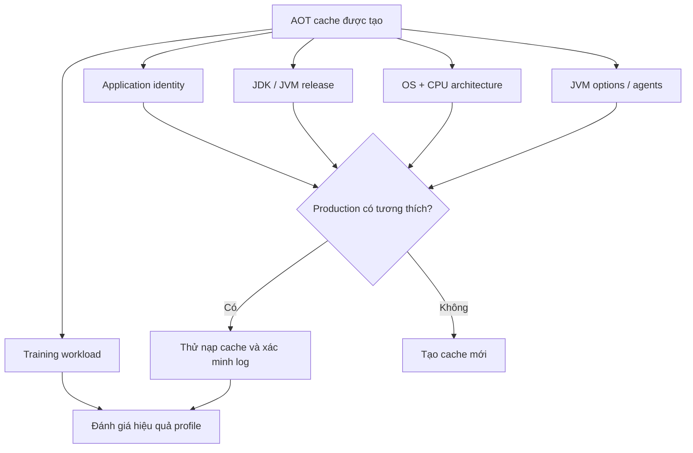

# Xác định điều kiện tương thích của cache với JDK, mã ứng dụng và cấu hình chạy

## 1. Mục tiêu và phạm vi hiện hành

Trong **JAVA_VERSION_JAVA25**, AOT cache giúp JVM tái sử dụng dữ liệu đã chuẩn bị trước để giảm thời gian khởi động và warm-up. Tuy nhiên, cache chỉ hữu ích khi **môi trường tạo cache (training/assembly)** tương thích với **môi trường sử dụng cache (production)**. Một file `.aot` được tạo thành công chưa có nghĩa có thể dùng an toàn cho mọi bản build, JDK, hệ điều hành hay cấu hình chạy.

Bài này hướng dẫn xác định và kiểm chứng các điều kiện tương thích theo bốn nhóm:

1. **JDK và nền tảng:** JDK release, JVM distribution, hệ điều hành và kiến trúc CPU.
2. **Mã ứng dụng:** artifact, classpath/module path, dependency, thứ tự và timestamp của JAR.
3. **Cấu hình chạy:** JVM options, agent, module options, class loading và garbage collector.
4. **Dữ liệu training:** workload có đại diện cho production hay không, để cache không chỉ hợp lệ mà còn có hiệu quả.

**Cập nhật theo tài liệu đến ngày 27/11/2026:**

- AOT cache được giới thiệu trong JDK 24 qua JEP 483.
- Java 25 có JEP 514 giúp tạo cache bằng một lệnh và JEP 515 bổ sung method profiles vào cache.
- JDK 25 chưa hỗ trợ đầy đủ AOT object caching với ZGC.
- **JDK 26 đã có JEP 516 — Ahead-of-Time Object Caching with Any GC**, mở rộng hỗ trợ AOT object cache cho mọi garbage collector, gồm ZGC. Cache vẫn phụ thuộc JDK release, vì vậy khi nâng từ JDK 25 lên 26 phải tạo lại cache.

Các ví dụ chính trong bài dùng HotSpot của JDK 25. Khi triển khai với JDK mới hơn hoặc một JVM distribution khác, hãy xác minh tài liệu và tùy chọn được nhà phân phối hỗ trợ.

## 2. Mô hình tương thích: cache gắn với một tổ hợp cụ thể

Theo tài liệu lệnh `java` của Oracle, AOT cache được tạo cho một tổ hợp gồm:

- **Một ứng dụng cụ thể**, được xác định thông qua `-classpath`, `-jar` hoặc `--module-path`.
- **Một JDK release cụ thể.**
- **Một hệ điều hành và kiến trúc CPU cụ thể.**

Nếu một trong các yếu tố trên thay đổi, phải tạo lại cache. Ngoài ba yếu tố nhận diện chính, JVM options không tương thích cũng có thể làm cache không được nạp. Spring Framework còn nêu các yêu cầu thực tế về JVM, classpath, thứ tự JAR và timestamp.



Cần phân biệt hai câu hỏi:

- **Cache có nạp được không?** Đây là câu hỏi về tính tương thích.
- **Cache có giúp ứng dụng nhanh hơn không?** Đây là câu hỏi về độ phù hợp của training và hiệu quả tối ưu.

Một cache có thể nạp được nhưng chứa ít class hoặc method profile không đại diện, nên mức cải thiện rất thấp. Ngược lại, workload training tốt không thể cứu một cache được tạo từ JDK hoặc artifact không tương thích.

## 3. Điều kiện 1 — JDK release và JVM distribution phải phù hợp

### 3.1. Dùng cùng JDK release trong training và production

Cache gắn với **JDK release**. Ví dụ:

| Cache được tạo bằng | Runtime sử dụng | Quyết định |
|---|---|---|
| JDK 25 | JDK 25 cùng môi trường tương thích | Có thể sử dụng sau khi kiểm tra các điều kiện còn lại |
| JDK 25 | JDK 26 | **Tạo lại cache** |
| JDK 26 | JDK 25 | **Tạo lại cache** |
| JDK 25.0.x | Một update khác của JDK 25 | Kiểm tra theo release/vendor; quy trình an toàn là tạo lại cache sau khi cập nhật JDK |
| Một vendor build | Vendor/JVM build khác | Không giả định cache có thể dùng chéo; kiểm tra và nên tạo lại bằng đúng runtime production |

Tài liệu Oracle mô tả cache theo một JDK release cụ thể. Spring Framework khuyến nghị dùng **chính JVM đã tạo cache** khi chạy lại. Vì vậy, trong CI/CD nên pin JDK distribution và build để training/assembly/production nhất quán.

Không chỉ kiểm tra chuỗi `java.version`. Hãy ghi lại vendor, runtime version, VM name, build number và đường dẫn `java` thực tế. Các máy có nhiều JDK cài đặt có thể build bằng một JDK nhưng khởi chạy bằng JDK khác.

### 3.2. Kiểm tra JDK thực tế

Chạy trên cả máy training và môi trường production:

```bash
java -version
java -XshowSettings:properties -version
javac -version
```

Ghi lại tối thiểu:

- `java.version` và `java.runtime.version`.
- `java.vendor`, `java.vm.vendor`, `java.vm.name`.
- `java.home`.
- Phiên bản JDK của container/VM thực sự chạy process.

Trên Linux có thể kiểm tra thêm:

```bash
which java
readlink -f "$(which java)"
```

Trên Windows PowerShell:

```powershell
where.exe java
$env:JAVA_HOME
java -version
```

**Lưu ý:** `javac -version` chỉ cho biết compiler mà shell đang gọi. Nó không chứng minh process production dùng cùng runtime. Hãy kiểm tra trong chính container/pod hoặc service process.

### 3.3. Khi nâng JDK, phải tạo lại cache

Khi nâng từ JDK 25.0.x sang update mới, từ JDK 25 sang JDK 26 hoặc thay distribution, hãy:

1. Build/retrieve đúng application artifact.
2. Chạy training với JDK mục tiêu.
3. Tạo cache mới bằng cùng JDK đó.
4. Kiểm thử nạp cache trên đúng runtime production.
5. Publish cache gắn với release mới cùng manifest của ứng dụng.

Không tái sử dụng cache của JDK trước chỉ vì major version của ứng dụng không đổi. JDK update có thể thay đổi runtime, định dạng hoặc các giả định nội bộ liên quan đến cache.

## 4. Điều kiện 2 — Hệ điều hành và kiến trúc CPU phải khớp

AOT cache không phải artifact portable như JAR. Tài liệu JDK xác định cache theo **OS và CPU architecture**.

| Training | Production | Có thể dùng lại cache? |
|---|---|---|
| Linux x86-64 | Linux x86-64 | Có thể, nếu các điều kiện khác khớp |
| Linux AArch64 | Linux x86-64 | Không; tạo cache riêng |
| Windows x64 | Linux x64 | Không; tạo cache riêng |
| macOS AArch64 | Linux AArch64 | Không; tạo cache riêng |
| Linux x86-64 trên VM | Linux x86-64 trong container | Có thể nếu nền tảng/JDK và điều kiện khác tương thích; phải xác minh thực tế |

Với container multi-architecture, không tạo một cache duy nhất rồi đưa vào image manifest cho cả `linux/amd64` và `linux/arm64`. Tạo artifact cache riêng cho từng target platform.

Trong pipeline, nên ghi rõ OS, phiên bản base image, CPU architecture (`amd64`, `arm64`/`aarch64`), JDK distribution/build, digest của container image và cache artifact tương ứng.

Tài liệu JDK nêu OS và CPU architecture là các yếu tố tương thích chính. Pin cùng base image giúp tái lập môi trường và giảm sai khác phụ, nhưng không nên tuyên bố mọi khác biệt nhỏ của Linux distribution đều tự động làm cache mất hiệu lực nếu tài liệu vendor không nói như vậy.

## 5. Điều kiện 3 — Application artifact và classpath phải nhất quán

Đây là nhóm nguyên nhân rất thường gặp khiến cache không được dùng.

### 5.1. Cache gắn với cách ứng dụng được khởi chạy

JVM xác định application identity theo cách khởi chạy, chẳng hạn:

```bash
# Classpath
java -cp app.jar com.example.Main

# Executable JAR
java -jar app.jar

# Named module
java --module-path mods -m com.example.app/com.example.Main
```

Không tạo cache theo một cách khởi chạy rồi tự giả định có thể sử dụng với cách khác. Ví dụ training bằng `-cp app.jar` nhưng production dùng `-jar app.jar` có thể làm thay đổi cách JVM xác định classpath.

Với ứng dụng dùng module path, ghi lại module path và module options trong manifest; đừng chỉ lưu tên file `.aot`.

### 5.2. Danh sách JAR phải ổn định

Spring Framework đưa ra các yêu cầu cụ thể:

- Classpath nên được cung cấp dưới dạng **một JAR hoặc danh sách JAR**.
- Tránh directory, wildcard `*` và nested JAR trong classpath dùng để tạo cache.
- Khi dùng cache, classpath phải **giống classpath training và giữ nguyên thứ tự**.
- Có thể thêm JAR hoặc directory ở cuối classpath production trong điều kiện Spring mô tả; phần thêm vào không nằm trong cache.
- Giữ nguyên timestamp của các JAR giữa training và production.

Ví dụ classpath training:

```bash
java -XX:AOTCacheOutput=app.aot \
  -cp "app.jar:lib/core.jar:lib/db.jar" \
  com.example.Main
```

Production cần giữ nguyên thứ tự các JAR đã training:

```bash
java -XX:AOTCache=app.aot \
  -cp "app.jar:lib/core.jar:lib/db.jar" \
  com.example.Main
```

Nếu cần bổ sung một JAR không nằm trong cache, Spring Framework cho phép phần bổ sung ở cuối classpath theo hướng dẫn của họ:

```bash
java -XX:AOTCache=app.aot \
  -cp "app.jar:lib/core.jar:lib/db.jar:lib/optional-extension.jar" \
  com.example.Main
```

JAR bổ sung không được hưởng dữ liệu đã cache. Nếu dependency mới thay đổi hành vi, class loading hoặc cấu trúc ứng dụng, hãy tạo lại cache thay vì tận dụng ngoại lệ classpath mở rộng.

Trên Windows, dấu phân cách classpath là `;` thay cho `:`.

### 5.3. Không dùng wildcard hoặc directory trong classpath training

Ví dụ cần tránh:

```bash
# Không dùng làm classpath training cho AOT cache.
java -XX:AOTCacheOutput=app.aot \
  -cp "app.jar:lib/*:classes/" \
  com.example.Main
```

Wildcard khiến tập JAR có thể thay đổi theo nội dung thư mục và thứ tự phân giải. Directory có thể chứa class thay đổi mà không được kiểm soát bằng digest JAR.

Thay vào đó, tạo danh sách JAR tường minh, có thứ tự ổn định và được sinh từ build manifest.

### 5.4. Timestamp của JAR phải được giữ nguyên

Spring Framework yêu cầu bảo toàn timestamp của JAR. Nếu training tạo cache từ một tập JAR, sau đó pipeline đóng gói lại cùng bytecode nhưng thay timestamp, cache có thể không còn đáp ứng điều kiện sử dụng.

Vì vậy:

- Không repack JAR sau training.
- Không chạy bước copy/zip làm thay timestamp trước production.
- Dùng cùng artifact bất biến giữa training, assembly và production.
- Ghi SHA-256 cùng timestamp của từng JAR trong manifest.
- Nếu build lại, thay dependency hoặc thay nội dung JAR, tạo cache mới.

**Quy tắc vận hành đơn giản:** mỗi application build có một cache tương ứng; không dùng cache của build trước chỉ vì tên JAR không đổi.

## 6. Điều kiện 4 — Mã nguồn và dependency phải đúng với cache

Cache được tạo từ trạng thái ứng dụng cụ thể. Những thay đổi sau cần tạo cache mới:

| Thay đổi | Hành động |
|---|---|
| Sửa source và build ra bytecode mới | Tạo cache mới |
| Thêm hoặc xóa dependency | Tạo cache mới |
| Nâng version thư viện | Tạo cache mới |
| Thay JAR nhưng giữ nguyên tên file | Tạo cache mới |
| Thay module descriptor hoặc module path | Tạo cache mới và kiểm tra lại module options |
| Thay thứ tự classpath | Khôi phục thứ tự training hoặc tạo cache mới |
| Chỉ đổi endpoint dịch vụ bên ngoài | Có thể không làm cache mất tương thích; vẫn đánh giá ảnh hưởng đến training profile |
| Đổi profile Spring làm tập bean/class được tải thay đổi | Kiểm tra và nên training lại theo profile production |
| Đổi workload nhưng giữ nguyên artifact | Cache có thể vẫn nạp được; training lại nếu profile không còn đại diện |

Không chỉ nhìn `pom.xml` hoặc `build.gradle`. Cần so sánh **runtime classpath cuối cùng**, bởi plugin, packaging, shading, dependency resolution và container layer có thể làm tập JAR thực tế khác nhau.

### 6.1. Kiểm tra artifact bằng hash

Ví dụ tạo SHA-256 trên Linux:

```bash
sha256sum app.jar lib/core.jar lib/db.jar
```

Trên PowerShell:

```powershell
Get-FileHash .\app.jar -Algorithm SHA256
Get-FileHash .\lib\core.jar -Algorithm SHA256
Get-FileHash .\lib\db.jar -Algorithm SHA256
```

Hash giúp chứng minh JAR trong training và production giống nhau. Cần kết hợp hash với thứ tự classpath và timestamp; hash của từng file riêng không thể chứng minh thứ tự runtime classpath.

## 7. Điều kiện 5 — JVM options và Java agents phải tương thích

Một cache có thể đúng JDK, đúng JAR và đúng OS/CPU nhưng vẫn không được nạp do cấu hình JVM.

Các nhóm cần rà soát:

| Nhóm | Ví dụ | Rủi ro |
|---|---|---|
| **JVMTI agent can thiệp bytecode** | Agent dùng `ClassFileLoadHook` để thay class | Class production có thể khác class training |
| **Agent thay đổi class loader search** | Gọi `AddToBootstrapClassLoaderSearch` hoặc `AddToSystemClassLoaderSearch` | Thay đổi tập class có thể được tải |
| **Instrumentation/redefinition** | Agent biến đổi hoặc redefine class | Class đã liên kết có thể không còn tương ứng cache |
| **Module options** | `--patch-module`, `--upgrade-module-path`, `--limit-modules` | Thay module graph hoặc khả năng nhìn thấy class |
| **Class path/module path** | Thêm, bỏ, đổi thứ tự JAR | Application identity không còn tương thích |
| **AOT class linking** | `-XX:+AOTClassLinking` hoặc mode AOT tự bật tùy chọn này | Một số tùy chọn production không tương thích với linked classes |

Không phải mọi `-javaagent` đều chắc chắn làm cache hỏng. Vấn đề là agent có thể sửa class, thêm class vào loader search hoặc thay đổi module/class loading. Phải kiểm tra chức năng cụ thể của agent và log của JVM.

### 7.1. Giữ cấu hình JVM nhất quán

Ghi lại đầy đủ:

- `JAVA_TOOL_OPTIONS`, `JDK_JAVA_OPTIONS` và các biến môi trường launcher liên quan.
- `-javaagent`, `-agentlib`, `-agentpath`.
- `--module-path`, `--add-modules`, `--patch-module`, `--upgrade-module-path`, `--limit-modules`.
- `-Xbootclasspath/a` và các tùy chọn class loading.
- `-XX:+AOTClassLinking` hoặc tùy chọn AOT có liên quan.
- Các tùy chọn chẩn đoán/monitoring do platform hoặc cloud provider tự thêm.

Không chỉ diff file launch script. Một số môi trường thêm JVM options từ biến môi trường, sidecar, service wrapper hoặc agent giám sát.

### 7.2. AOTClassLinking và module graph

Khi `-XX:AOTMode` được chỉ định, HotSpot Java 25 tự bật `AOTClassLinking`; có thể tắt bằng `-XX:-AOTClassLinking`. AOT class linking có thể tạo thêm tối ưu như resolve trước một số `invokedynamic`, nhưng cache tạo theo cách này bị giới hạn hơn khi production thay đổi module/class loading.

Các tùy chọn như `--patch-module`, `--upgrade-module-path` hoặc agent có class-file load hook cần được kiểm thử kỹ. Một số quy tắc được tài liệu CDS mô tả không nên tự động áp dụng nguyên xi cho mọi trường hợp AOT cache; hãy xem thông báo `-Xlog:aot` của đúng JVM đang chạy.

**Nguyên tắc:** không thêm agent hoặc module patch vào production sau khi đã tạo cache mà không kiểm thử lại cache với đúng command line production.

## 8. Điều kiện 6 — Garbage collector và thay đổi giữa JDK 25, JDK 26

Đây là điểm phiên bản cần lưu ý khi triển khai hiện nay.

### 8.1. Giới hạn của AOT object caching trên Java 25

AOT cache của JDK 24/25 lưu được class data và heap objects. Tuy nhiên định dạng object cache trước JEP 516 phụ thuộc cách garbage collector biểu diễn object/reference. Vì vậy, các tối ưu AOT liên quan đến cached heap objects **không hỗ trợ ZGC trên JDK 25**.

Nếu hệ thống dùng JDK 25 và ZGC:

- Không giả định AOT cache cung cấp đầy đủ lợi ích object caching.
- Kiểm tra log và tài liệu của đúng JDK distribution.
- Đo thực tế; không đánh đồng khả năng nạp một phần dữ liệu class với việc toàn bộ AOT object cache được sử dụng.
- Nếu ZGC là yêu cầu bắt buộc, đánh giá nâng lên JDK 26 hoặc bản được nhà phân phối hỗ trợ.

### 8.2. JDK 26 với JEP 516

JEP 516 trong JDK 26 thay đổi cách lưu/nạp cached objects để hỗ trợ mọi garbage collector, bao gồm ZGC. JVM có thể sử dụng định dạng object trung lập với GC thay vì chỉ dựa vào layout gắn với một collector.

Điều này **không** có nghĩa cache Java 25 dùng được với JDK 26. Cache vẫn gắn với JDK release, vì vậy:

1. Nâng JDK lên 26.
2. Build/kiểm tra application artifact với JDK 26.
3. Chạy training và tạo cache mới bằng JDK 26.
4. Kiểm thử cache với GC và JVM options production.
5. Chỉ publish cache mới khi xác minh được log và kết quả startup/warm-up.

### 8.3. Có nên đổi GC giữa training và production?

Với JDK 25, tránh đổi GC hoặc các tùy chọn ảnh hưởng layout/heap giữa hai pha nếu chưa xác minh. Với JDK 26 và JEP 516, AOT object caching hỗ trợ mọi GC, nhưng vẫn cần kiểm thử đúng JDK release, command line và workload production. Không lấy thay đổi hỗ trợ GC làm lý do bỏ qua các điều kiện tương thích khác.

## 9. Workload training: tương thích không đồng nghĩa hiệu quả

JDK 25 có JEP 515, cho phép method execution profiles từ training run được đưa vào AOT cache. Do đó, chất lượng workload training ảnh hưởng đến khả năng warm-up.

### 9.1. Training cần đại diện cho production

Ví dụ một ứng dụng đặt hàng có ba nhóm xử lý:

| Luồng | Tỷ trọng production giả định | Method cần được thực thi |
|---|---:|---|
| Tra cứu đơn | 60% | `OrderService.find()` |
| Tạo đơn | 30% | `OrderService.create()` |
| Hoàn tiền | 10% | `RefundService.process()` |

Nếu training chỉ gọi health endpoint, cache có thể chứa class phục vụ startup nhưng thiếu profile của các method nghiệp vụ nóng. Khi production chạy tạo đơn hoặc hoàn tiền, JIT vẫn phải quan sát và tối ưu các đường chạy đó.

### 9.2. Tách điều kiện tương thích và điều kiện hiệu quả

| Thay đổi/tình huống | Ảnh hưởng |
|---|---|
| Đổi JDK release | Cache không tương thích; phải tạo lại |
| Đổi OS/CPU architecture | Cache không tương thích; phải tạo lại |
| Đổi application JAR/dependency | Cache không tương thích; phải tạo lại |
| Training thiếu đường nghiệp vụ nóng | Cache có thể nạp được nhưng warm-up benefit thấp |
| Training tải quá nhiều test framework/class không cần thiết | Cache phình to và chứa dữ liệu không hữu ích |
| Production có tỷ lệ request khác training | Cache có thể nạp nhưng method profile ít đại diện |
| Thêm một feature không đổi classpath nhưng thay luồng gọi | Cân nhắc training lại để cập nhật profile |

Với JDK 25, nếu muốn hưởng lợi từ method profiling, hãy chạy một phần workflow giống production thay vì chỉ khởi tạo ApplicationContext rồi thoát.

### 9.3. Dùng dữ liệu an toàn

Training có thể tạo kết nối DB, gửi message, ghi file hoặc gọi dịch vụ ngoài. Hãy dùng dữ liệu giả, database sandbox, mock hoặc môi trường có kiểm soát. Không replay giao dịch thật chỉ để tạo profile. Cần đảm bảo training không tạo side effects mà production sau đó phải xử lý.

## 10. Cấu hình riêng cho Spring Boot executable JAR

Spring Boot khuyến nghị dùng **extracted application form** để đáp ứng yêu cầu class loading của AOT cache.

### 10.1. Extract ứng dụng

```bash
java -Djarmode=tools -jar my-app.jar \
  extract --destination application

cd application
```

### 10.2. Tạo cache bằng training

```bash
java -XX:AOTCacheOutput=app.aot \
  -jar my-app.jar
```

Với Java 25, nếu muốn method profile phản ánh nghiệp vụ, hãy thực thi các workflow đại diện trước khi process kết thúc và tạo cache. Cách chỉ dùng `-Dspring.context.exit=onRefresh` có thể phù hợp khi mục tiêu là startup/context initialization, nhưng không tạo profile đầy đủ cho các method nghiệp vụ chưa chạy.

### 10.3. Chạy production với cache

```bash
java -XX:AOTCache=app.aot \
  -jar my-app.jar
```

Cache chỉ có tác dụng với **extracted form** theo hướng dẫn Spring Boot. Nếu quay lại chạy nested executable JAR nguyên bản, cache có thể không được sử dụng.

### 10.4. Khi nâng Spring Boot hoặc dependency

Nếu build lại executable JAR, thay dependency, plugin packaging hoặc cấu trúc extracted classpath, phải tạo lại cache. Không copy cache từ image cũ sang image mới chỉ vì file `app.aot` có cùng tên.

## 11. Kiểm tra cache có thực sự tương thích hay không

Không nên chỉ kiểm tra file `.aot` có tồn tại. Cần xác nhận JVM nạp cache.

### 11.1. Dùng log AOT

```bash
java -XX:AOTCache=app.aot \
  -XX:AOTMode=auto \
  -Xlog:aot \
  -cp "app.jar:lib/core.jar:lib/db.jar" \
  com.example.Main
```

`-Xlog:aot` cung cấp thông tin về quá trình nạp cache và lý do cache không được dùng.

### 11.2. Dùng class loading log

```bash
java -XX:AOTCache=app.aot \
  -Xlog:aot,class+load=info \
  -cp "app.jar:lib/core.jar:lib/db.jar" \
  com.example.Main
```

Log class loading giúp xác định class nào được nạp từ shared objects file và class nào vẫn phải được tải theo đường thông thường.

### 11.3. Dùng `AOTMode=on` trong kiểm thử

Java 25 hỗ trợ các mode `auto`, `off`, `record`, `create` và `on`.

- `auto`: mặc định; nếu cache không tương thích, JVM tiếp tục chạy mà không dùng cache. Đây là lựa chọn phù hợp hơn cho production.
- `on`: yêu cầu cache phải nạp được; nếu không, JVM báo lỗi và thoát. Dùng trong CI/staging để phát hiện sai khác.
- `off`: tắt AOT cache.
- `record`: pha training.
- `create`: pha assembly.

Ví dụ fail-fast trong CI:

```bash
java -XX:AOTCache=app.aot \
  -XX:AOTMode=on \
  -Xlog:aot \
  -cp "app.jar:lib/core.jar:lib/db.jar" \
  com.example.Main
```

Nếu lệnh trên thất bại, kiểm tra JDK, application identity, OS/CPU, classpath, timestamp, JVM options và agent. Không đổi sang `auto` rồi kết luận cache đã tương thích; `auto` có thể chỉ đang chạy ứng dụng mà không dùng cache.

**Lưu ý phiên bản:** Java 25 dùng mode `on` để fail-fast; không sao chép tùy chọn `required` từ tài liệu hoặc ví dụ của một phiên bản JDK khác nếu không được JDK đang dùng hỗ trợ.

## 12. Ma trận tương thích trước khi phát hành

Dùng ma trận sau trong pipeline release:

| Hạng mục | Training | Production | Kết quả |
|---|---|---|---|
| JDK vendor/build | Ghi cụ thể | Ghi cụ thể | Cùng JDK release; ưu tiên cùng distribution/build |
| OS | Linux/Windows/macOS | ... | Phải cùng OS tương thích |
| CPU architecture | x86-64/ARM64 | ... | Phải cùng kiến trúc |
| Application artifact | SHA-256 | SHA-256 | Phải khớp |
| JAR timestamps | Danh sách timestamp | Danh sách timestamp | Bảo toàn |
| Classpath | Danh sách có thứ tự | Danh sách có thứ tự | Cùng thứ tự; production có thể append phần bổ sung theo Spring |
| Module path | Giá trị thực tế | Giá trị thực tế | Kiểm tra cùng module graph/options |
| JVM options | Full command line | Full command line | Không có option không tương thích |
| Java agents | Agent + version + capabilities | Agent + version + capabilities | Không làm thay đổi class/loading ngoài giả định cache |
| Garbage collector | Collector + options | Collector + options | Đặc biệt kiểm tra giới hạn JDK 25 và ZGC |
| Training workload | Luồng đã chạy | Workload thực tế | Cần đủ đại diện cho method nóng |
| Cache artifact | Hash + path | Hash + path | Đúng cache của build/platform/release |

### Quyết định

- **PASS:** mọi điều kiện cứng phù hợp, `AOTMode=on` nạp cache thành công trong CI/staging và log xác nhận sử dụng.
- **REBUILD:** application artifact, JDK release, OS hoặc CPU architecture thay đổi; hoặc classpath/JAR không còn khớp.
- **INVESTIGATE:** JVM options/agent/module settings khác, cache chỉ được dùng một phần hoặc log không rõ nguyên nhân.
- **RETRAIN:** cache vẫn tương thích nhưng workload/profile không đại diện cho production hoặc application behavior đã thay đổi đáng kể.

## 13. Manifest để truy vết cache

Mỗi cache nên đi kèm manifest ghi nhận các điều kiện đã dùng để tạo nó. Ví dụ:

```yaml
application:
  name: orders-api
  version: "2.8.0"
  artifactSha256: "<sha256-of-application-artifact>"
  classpath:
    - "app.jar"
    - "lib/core.jar"
    - "lib/db.jar"
  jarTimestamps:
    app.jar: "<timestamp>"
    lib/core.jar: "<timestamp>"
    lib/db.jar: "<timestamp>"

runtime:
  vendor: "<jdk-vendor>"
  runtimeVersion: "<exact-runtime-version>"
  javaRelease: "25"
  os: "linux"
  architecture: "amd64"
  garbageCollector: "G1"
  vmOptions:
    - "-XX:AOTMode=auto"

training:
  profile: "production-like-smoke"
  workflows:
    - "health-check"
    - "create-order"
    - "find-order"
  generatedAt: "<UTC-timestamp>"

cache:
  file: "app.aot"
  sha256: "<sha256-of-cache>"
```

Đây là **mẫu metadata**, không phải cấu hình mặc định của JVM. Điền dữ liệu lấy từ pipeline/runtime thật. Không ghi secret, access token hoặc dữ liệu khách hàng vào manifest.

Manifest giúp trả lời: cache được tạo từ build nào, JDK release/vendor nào, classpath có thứ tự gì, cache dành cho OS/CPU nào, training đã thực hiện workflow nào và production đang dùng đúng artifact cache hay không.

## 14. Chẩn đoán lỗi tương thích thường gặp

| Triệu chứng | Nguyên nhân có thể | Cách xử lý |
|---|---|---|
| JVM bỏ qua cache nhưng ứng dụng vẫn chạy | `AOTMode=auto` fallback, sai JDK, OS/CPU hoặc classpath | Bật `-Xlog:aot`, thử `AOTMode=on` trong staging |
| `AOTMode=on` báo không thể nạp cache | Cache không tồn tại, quyền file sai hoặc điều kiện không tương thích | Kiểm tra path, permission, JDK, platform và command line |
| Một số class không được nạp từ cache | Training không tải class đó hoặc classpath khác | Dùng class loading log và training lại |
| Cache không hiệu quả sau khi build lại | JAR/dependency/timestamp đã đổi | Tạo cache mới từ đúng build |
| Chạy Spring Boot nhưng cache không có tác dụng | Chưa dùng extracted application form | Extract executable JAR theo hướng dẫn |
| Cache hoạt động trên amd64 nhưng không trên arm64 | Khác CPU architecture | Tạo cache riêng cho từng platform |
| Cache không hoạt động khi thêm monitoring agent | Agent có thể sửa class hoặc thay đổi loader search | Kiểm tra capabilities và chạy thử không agent để cô lập |
| Cache được nạp nhưng warm-up vẫn chậm | Training chưa bao phủ method nóng | Bổ sung workflow production-like và tạo cache mới |
| JDK 25 với ZGC không có đầy đủ object-cache benefit | Giới hạn trước JEP 516 | Đánh giá G1/Parallel hoặc nâng JDK 26 và tạo cache mới |
| Sau nâng JDK 26, cache JDK 25 không dùng được | Cache phụ thuộc JDK release | Tạo lại cache bằng JDK 26 |

Không coi mọi thông báo “cache ignored” là lỗi ứng dụng. AOT cache là tối ưu hiệu năng; ứng dụng có thể chạy bình thường khi JVM fallback. Nhưng pipeline phải phát hiện fallback nếu mục tiêu release yêu cầu cache được sử dụng.

## 15. Bài thực hành: tạo ma trận tương thích cho một ứng dụng

Giả sử ứng dụng `orders-api` có `app.jar`, `core.jar`, `db.jar` và chạy trong container Linux x86-64 bằng JDK 25.

### Bước 1 — Ghi nhận môi trường training

Thu thập JDK vendor, runtime version, Java release, OS và CPU architecture, garbage collector, full JVM options và Java agents, SHA-256/timestamp của từng JAR và classpath theo đúng thứ tự.

### Bước 2 — Tạo cache từ classpath cố định

```bash
java -XX:AOTCacheOutput=app.aot \
  -cp "app.jar:lib/core.jar:lib/db.jar" \
  com.example.Main
```

Training phải chạy đúng workload cần thiết. Không dùng wildcard hoặc directory trong classpath.

### Bước 3 — Kiểm tra với môi trường tương thích

Dùng cùng JDK release, OS/CPU và application artifact:

```bash
java -XX:AOTCache=app.aot \
  -XX:AOTMode=on \
  -Xlog:aot \
  -cp "app.jar:lib/core.jar:lib/db.jar" \
  com.example.Main
```

Ghi nhận cache có được nạp và các class có được tái sử dụng không.

### Bước 4 — Thử thay đổi có kiểm soát

Lần lượt thử thay `app.jar` bằng build mới, đổi thứ tự `core.jar` và `db.jar`, thêm JAR ở giữa classpath, thêm JAR ở cuối classpath, đổi JDK 25 sang 26, đổi OS/CPU architecture, thêm agent có khả năng biến đổi class và đổi training workload nhưng giữ nguyên artifact.

Với mỗi trường hợp, ghi rõ đó là **hard incompatibility**, **cần điều tra** hay chỉ là **thay đổi hiệu quả training**. Không chỉ dựa vào việc process có khởi động hay không; cần log xác nhận cache thực sự được dùng.

### Bước 5 — Kiểm tra khác biệt Java 25 và Java 26

Nếu môi trường Java 25 sử dụng ZGC, ghi nhận giới hạn AOT object caching của release này. Sau đó tạo cache mới với JDK 26 và kiểm tra lại theo JEP 516. Không dùng lại file cache Java 25 trong lần kiểm thử Java 26.

### Tiêu chí hoàn thành

- Có manifest chứa đủ application/JDK/platform/classpath/JVM options.
- Xác định được các thay đổi bắt buộc tạo cache mới.
- Phân biệt được cache không tương thích với cache nạp được nhưng training kém.
- Có bằng chứng log khi cache được sử dụng.
- Có quy trình tạo lại cache sau khi đổi JDK hoặc application build.

## 16. Checklist trước khi đưa cache vào production

- [ ] Cache được tạo bằng đúng JDK release của runtime production.
- [ ] Ghi nhận JDK vendor/build; ưu tiên cùng distribution và build trong training/production.
- [ ] OS và CPU architecture khớp; cache được tách theo target platform.
- [ ] Application identity (`-cp`, `-jar`, `--module-path`) được giữ nhất quán.
- [ ] Classpath là danh sách JAR rõ ràng, không có wildcard hoặc directory trong training.
- [ ] Classpath production giữ nguyên thứ tự training; phần mở rộng chỉ được append theo điều kiện Spring.
- [ ] Timestamp và hash của JAR được bảo toàn.
- [ ] Mọi dependency hoặc application build mới đều tạo cache mới.
- [ ] JVM options và Java agents được rà soát; không có class transformation/loader modification ngoài dự kiến.
- [ ] Module options và AOTClassLinking đã được kiểm tra trên đúng command line.
- [ ] Garbage collector phù hợp với JDK; đã lưu ý giới hạn ZGC của JDK 25 và thay đổi JEP 516 trong JDK 26.
- [ ] Training workload đại diện cho đường chạy production và method nóng.
- [ ] Spring Boot executable JAR được extract theo hướng dẫn trước khi tạo cache.
- [ ] `-Xlog:aot` xác nhận cache được nạp; CI/staging dùng `AOTMode=on` để fail-fast.
- [ ] Production dùng fallback mode phù hợp, tránh dừng toàn bộ service chỉ vì cache không tương thích ngoài dự kiến.
- [ ] Manifest và cache artifact được gắn với application version, JDK, OS/CPU và digest.
- [ ] Có benchmark startup/warm-up sau mỗi lần tạo cache mới.

### Tài liệu tham khảo chính thức

1. [Oracle Java 25 — The java Command, Ahead-of-Time Cache](https://docs.oracle.com/en/java/javase/25/docs/specs/man/java.html)
2. [JEP 483 — Ahead-of-Time Class Loading and Linking](https://openjdk.org/jeps/483)
3. [JEP 514 — Ahead-of-Time Command-Line Ergonomics](https://openjdk.org/jeps/514)
4. [JEP 515 — Ahead-of-Time Method Profiling](https://openjdk.org/jeps/515)
5. [Spring Boot — AOT Cache](https://docs.spring.io/spring-boot/reference/packaging/aot-cache.html)
6. [Spring Framework — JVM AOT Cache](https://docs.spring.io/spring-framework/reference/integration/aot-cache.html)
7. [Inside.java — Run Into the New Year with Java’s Ahead-of-Time Cache Optimizations (09/01/2026)](https://inside.java/2026/01/09/run-aot-cache/)
8. [JEP 516 — Ahead-of-Time Object Caching with Any GC](https://openjdk.org/jeps/516)
9. [Oracle — JDK 26 Release Notes: Ahead-of-Time Object Caching with Any GC](https://www.oracle.com/java/technologies/javase/26-relnote-issues.html)
10. [Oracle Java Virtual Machine Specification — Loading, Linking, and Initialization](https://docs.oracle.com/javase/specs/jvms/se25/html/jvms-5.html)
