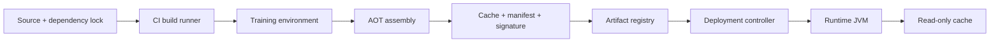
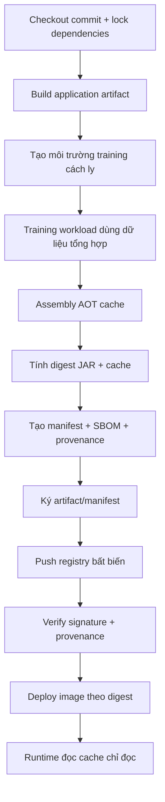

# Quản lý nguồn gốc, quyền truy cập và dữ liệu nhạy cảm của artifact cache

> **Chương:** Vận hành AOT  
> **Học phần:** `JAVA_VERSION_JAVA25` — các tính năng Java 25 còn áp dụng trong phát triển hiện đại, gồm chương trình nguồn gọn, module import, flexible constructor bodies, ScopedValue, Key Derivation Function API, AOT cache và quan sát bằng JFR.  
> **Trọng tâm:** Xây dựng, lưu trữ, xác minh và phát hành file AOT cache như một artifact của phần mềm; kiểm soát ai tạo/đọc/thay thế cache, dữ liệu nào có thể đi vào cache và cách xử lý khi cache bị lộ hoặc bị thay đổi.

## 1. Vì sao AOT cache cần được quản trị như một artifact phát hành?

AOT cache thường được tạo trong CI hoặc lúc đóng gói ứng dụng, sau đó được JVM nạp ở môi trường triển khai. Nó không phải file tạm vô hại chỉ vì mục tiêu chính là tăng tốc khởi động.

Trong Java 25, AOT cache có thể chứa class metadata, heap objects được lưu trữ phù hợp và thông tin profiling phương thức phục vụ tối ưu hóa. Các đối tượng được lưu trữ có thể bắt nguồn từ những gì ứng dụng đã khởi tạo trong training run. Vì vậy, cache có thể tiết lộ cấu trúc nội bộ, tên lớp, thông tin thư viện và trong một số thiết kế ứng dụng, dữ liệu được giữ trong các object có thể được archive. **Không được giả định toàn bộ heap hoặc mọi object trong training đều được lưu**, nhưng cũng không được giả định file cache chắc chắn không chứa dữ liệu nhạy cảm. [Oracle JDK 25 `java` command](https://docs.oracle.com/en/java/javase/25/docs/specs/man/java.html)

Một cache được phát hành mà không kiểm soát có thể tạo ra các vấn đề:

- Cache được tạo từ commit hoặc thư viện khác với ứng dụng đang chạy.
- File `.aot` bị thay thế trong artifact registry hoặc image layer mà không phát hiện.
- Người dùng không có quyền triển khai vẫn có thể ghi đè file cache trên máy chạy.
- Training vô tình nạp token, mật khẩu, dữ liệu khách hàng hoặc cấu hình bí mật vào các object có khả năng được lưu.
- Cache được chia sẻ giữa môi trường dev, staging và production dù có classpath, JDK hoặc nền tảng khác nhau.
- Một cache cũ vẫn được triển khai sau khi ứng dụng hoặc thư viện đã thay đổi.
- File `.aotconfig`, log training hoặc cache cũ còn nằm trong CI workspace sau khi pipeline kết thúc.

**Mục tiêu quản trị** là bảo đảm mỗi cache có nguồn gốc kiểm chứng được, được bảo vệ trong toàn bộ vòng đời, chỉ được dùng cùng ứng dụng tương thích và không mang theo dữ liệu mà người nhận artifact không được phép đọc.

## 2. AOT cache chứa gì và vì sao cần xem xét dữ liệu nhạy cảm?

AOT cache được giới thiệu trong JDK 24 qua JEP 483. Java 25 tiếp tục hỗ trợ quy trình này và bổ sung method profiling qua JEP 515. JVM có thể dùng cache để giảm công việc khởi động và giúp JIT bắt đầu với dữ liệu profiling đã thu thập trong training.

Một cache có thể chứa các nhóm dữ liệu sau:

| Nhóm dữ liệu | Mục đích | Góc nhìn bảo mật |
|---|---|---|
| Class và metadata liên quan | Hỗ trợ class loading/linking | Có thể tiết lộ tên package, class, cấu trúc ứng dụng và dependency |
| Archived heap objects đủ điều kiện | Tái sử dụng một số object đã chuẩn bị | Cần xem xét object có giữ chuỗi, cấu hình hoặc dữ liệu nhạy cảm không |
| Method execution profiles | Giúp JIT có thông tin về các method đã chạy | Có thể tiết lộ đường xử lý, mức sử dụng và đặc điểm workload |
| Các tối ưu AOT khác theo JDK | Hỗ trợ runtime phù hợp | Thành phần cụ thể phụ thuộc JDK release và implementation |

AOT cache **không phải heap dump** và không phải snapshot toàn bộ tiến trình. JVM chỉ lưu những artifacts đủ điều kiện theo cơ chế AOT. Tuy nhiên, nếu ứng dụng nạp secret vào static field hoặc object sống đủ lâu trong training, đội phát triển phải đánh giá khả năng giá trị đó xuất hiện trong archived objects thay vì mặc định rằng cache chỉ chứa bytecode vô hại.

### 2.1. Những dữ liệu không nên xuất hiện trong training

Không dùng dữ liệu production thật để tạo cache nếu không có lý do được phê duyệt. Đặc biệt tránh:

- Password, API key, access token, refresh token, private key và credential database.
- Cookie phiên đăng nhập, session ID hoặc thông tin xác thực của người dùng.
- Dữ liệu cá nhân, thông tin thanh toán, hồ sơ khách hàng hoặc payload nghiệp vụ có tính bảo mật.
- Chuỗi kết nối chứa username/password hoặc URL nội bộ có embedded credential.
- Secret được nạp từ biến môi trường rồi giữ trong static singleton hoặc cache nội bộ.
- Dữ liệu test sao chép nguyên trạng từ production mà chưa khử định danh.

Hãy dùng dữ liệu tổng hợp, tài khoản dịch vụ dùng riêng cho training với quyền tối thiểu, endpoint giả lập hoặc test double. Nếu training cần kết nối tới database/cache/message broker để khởi tạo code path, cấp credential ngắn hạn và giới hạn network egress; không dùng credential production có quyền ghi/xóa dữ liệu.

### 2.2. Training run có thể kích hoạt kết nối ngoài ý muốn

Với Spring Boot, `-Dspring.context.exit=onRefresh` giúp ứng dụng thoát sau khi `ApplicationContext` refresh. Tuy nhiên, việc tạo bean và callback khởi tạo có thể kích hoạt truy cập database hoặc dịch vụ ngoài trước khi ứng dụng bắt đầu lifecycle bình thường. Spring Boot khuyến nghị điều chỉnh cấu hình training để tránh tương tác remote không cần thiết. [Spring Boot — Preventing Remote Services Interaction During the Training Run](https://docs.spring.io/spring-boot/how-to/aot-cache.html)

Tách cấu hình training riêng, ví dụ:

```text
application.yml
application-aot-training.yml
```

Trong profile training:

- Dùng endpoint mock hoặc local container thay cho hệ thống production.
- Không bật job gửi email, thanh toán, phát message hoặc đồng bộ dữ liệu thật.
- Không dùng secret production trong `JAVA_TOOL_OPTIONS`, `JDK_AOT_VM_OPTIONS` hoặc file cấu hình.
- Giới hạn quyền truy cập mạng của runner.
- Ghi lại những dịch vụ ngoài mà training thực sự cần gọi.
- Dọn dữ liệu tạm và credential sau khi cache được tạo.

## 3. Mô hình đe dọa cho artifact `.aot`

Quản trị cache bắt đầu bằng việc xác định tài sản cần bảo vệ, đối tượng có thể tác động và hậu quả nếu kiểm soát thất bại.

| Tài sản | Nguy cơ | Tác động |
|---|---|---|
| File `.aot` | Bị đọc trái phép | Lộ thông tin nội bộ hoặc dữ liệu có thể được archive |
| File `.aot` | Bị sửa/thay thế | Runtime nhận artifact không đúng nguồn, không tương thích hoặc bị can thiệp |
| File `.aotconfig` | Bị truy cập hoặc lưu quá lâu | Lộ metadata về training, classpath và cấu hình build |
| Training environment | Runner có quyền quá rộng hoặc kết nối production | Dữ liệu thật/secret bị đưa vào training, side effect ngoài ý muốn |
| Artifact registry | Quyền push/pull không giới hạn | Người không được phép thay cache hoặc tải artifact |
| Release manifest | Hash/provenance không được xác minh | Không chứng minh được cache đi cùng đúng ứng dụng |
| Container image | Cache nằm trong layer cũ hoặc image không được ký | Cache cũ vẫn có thể được tải lại dù file mới đã được thay |
| Runtime filesystem | User ứng dụng có quyền ghi cache | Cache có thể bị thay đổi sau khi image được phê duyệt |

### 3.1. Ranh giới tin cậy

Một luồng phát hành có thể chia thành các ranh giới:



Mỗi ranh giới cần câu trả lời rõ:

- Ai được phép khởi chạy training?
- Ai được phép thay đổi dependency hoặc JVM options?
- Ai ký artifact và ai xác minh chữ ký?
- Runner có thể truy cập secret nào?
- Runtime identity có thể đọc và ghi những đường dẫn nào?
- Ai có quyền thay image hoặc cache trong registry?
- Làm thế nào thu hồi một cache đã phát hành?

### 3.2. Phân biệt tính tương thích và tính xác thực

JVM kiểm tra khả năng tương thích của AOT cache với ứng dụng, JDK release, hệ điều hành/CPU và một số JVM options. Nếu cache không tồn tại, không truy cập được hoặc không tương thích, việc nạp có thể thất bại. Chế độ `auto` cho phép JVM tiếp tục chạy mà không dùng cache; chế độ `on` dừng ngay khi không thể nạp cache. [Oracle JDK 25 — AOT Cache options](https://docs.oracle.com/en/java/javase/25/docs/specs/man/java.html)

Những kiểm tra đó **không thay thế xác minh nguồn gốc**:

- Cache load thành công không chứng minh file do CI tin cậy tạo.
- Cache tương thích không chứng minh nó thuộc release đã được phê duyệt.
- File có checksum không chứng minh checksum được lấy từ nguồn đáng tin.
- Chữ ký hợp lệ chỉ chứng minh artifact được ký bởi danh tính tương ứng; policy vẫn phải kiểm tra danh tính đó có được phép phát hành hay không.

Do đó, cần kết hợp compatibility checks của JVM với provenance, hash, chữ ký, quyền truy cập và quy trình phê duyệt release.

## 4. Nguồn gốc cache: ghi lại đúng ứng dụng, JDK và training run

AOT cache gắn với ứng dụng (classpath, JAR hoặc module path), JDK release, hệ điều hành và kiến trúc CPU. Thay đổi một trong các yếu tố này thì phải tạo lại cache. Với Spring Boot extracted JAR, thứ tự classpath và timestamp của JAR cũng cần được bảo toàn để cache hoạt động đúng. [Oracle JDK 25](https://docs.oracle.com/en/java/javase/25/docs/specs/man/java.html) · [Spring Framework — JVM AOT Cache](https://docs.spring.io/spring-framework/reference/integration/aot-cache.html)

Một manifest đi kèm cache nên ghi ít nhất:

| Trường | Ví dụ | Mục đích |
|---|---|---|
| Application name/version | `orders-service`, `2.8.1` | Nhận diện release |
| Source revision | Git commit SHA | Truy về source |
| Application artifact digest | SHA-256 của JAR/image | Chứng minh cache đi cùng artifact nào |
| AOT cache digest | SHA-256 của `.aot` | Xác minh đúng file cache |
| JDK vendor/build | Vendor, `25.0.x+build` | Nhận diện runtime tạo cache |
| OS/CPU architecture | Linux x86_64 | Kiểm tra platform |
| Classpath/module path | Danh sách JAR và thứ tự | Tái tạo điều kiện training |
| Training profile | `aot-training` | Nhận diện cấu hình chạy |
| Training workload revision | Version của test/load harness | Giải thích method profiles |
| Builder identity | CI workflow/runner identity | Xác định ai đã tạo |
| Build timestamp | UTC timestamp | Hỗ trợ audit và incident response |

Ví dụ manifest minh họa:

```json
{
  "schemaVersion": 1,
  "application": {
    "name": "orders-service",
    "version": "2.8.1",
    "sourceRevision": "4f6c1b8...",
    "artifactSha256": "..."
  },
  "aotCache": {
    "file": "orders.aot",
    "sha256": "..."
  },
  "runtime": {
    "vendor": "Example OpenJDK distribution",
    "version": "25.0.x+build",
    "os": "linux",
    "architecture": "x86_64"
  },
  "training": {
    "profile": "aot-training",
    "workloadRevision": "training-suite-12",
    "dataset": "synthetic-orders-v4"
  },
  "builder": {
    "workflow": "release/orders-service",
    "runId": "..."
  },
  "createdAt": "2026-11-27T00:00:00Z"
}
```

Đây là schema nội bộ minh họa, không phải định dạng manifest do JVM quy định. Có thể lưu thêm SBOM và build provenance theo chuẩn của tổ chức. Manifest không nên chứa secret, token, nội dung request hoặc dữ liệu khách hàng.

### 4.1. Hash phải được tạo sau assembly

Quy trình đúng là:

1. Build application artifact.
2. Training và assembly AOT cache từ đúng artifact.
3. Tính digest của application artifact và cache đã tạo.
4. Tạo manifest liên kết hai digest cùng metadata môi trường.
5. Ký cache/manifest hoặc container image theo chính sách supply chain.
6. Đưa đúng bộ artifact đã xác minh lên registry.

Không tạo manifest từ file cache cũ rồi ghi đè cache mới. Không tái sử dụng checksum của build trước chỉ vì tên file không đổi.

## 5. Cô lập training run và giảm dữ liệu được phép đi vào cache

Training run nên chạy trong một môi trường có quyền hạn thấp hơn production. Mục tiêu là nạp đủ class và thực hiện workflow đại diện, không phải sao chép toàn bộ cấu hình vận hành hoặc dữ liệu thật.

### 5.1. Tách profile training

Ví dụ Spring Boot đã extract executable JAR:

```bash
java -Djarmode=tools -jar orders.jar extract --destination application
cd application

umask 077
java -XX:AOTCacheOutput=orders.aot \
     -Dspring.profiles.active=aot-training \
     -jar orders.jar
```

Đây là ví dụ training tổng quát. Nếu chỉ muốn tạo cache cho startup, có thể dùng `-Dspring.context.exit=onRefresh`; nếu muốn method profiles đại diện hơn trong Java 25, hãy chạy workload nghiệp vụ an toàn trong khi process training còn hoạt động rồi dừng graceful. Spring Boot yêu cầu dùng extracted form khi sử dụng AOT cache với executable JAR. [Spring Boot — AOT Cache](https://docs.spring.io/spring-boot/reference/packaging/aot-cache.html)

Profile `aot-training` nên:

- Thay database, message broker, email, payment và HTTP dependency bằng test instance hoặc stub phù hợp.
- Tắt scheduler, job gửi dữ liệu và tác vụ có side effect thật.
- Dùng dữ liệu tổng hợp đã cố định phiên bản để có thể tái lập.
- Dùng credential riêng, thời hạn ngắn, quyền chỉ đọc hoặc chỉ ghi vào vùng test.
- Không lấy toàn bộ environment variables của production đưa vào training.
- Không ghi secret, token, payload hoặc PII vào console log hay test report.
- Đặt timeout và quota CPU/RAM/network cho runner.

### 5.2. Kiểm soát kết nối dịch vụ ngoài

Với CI runner, ưu tiên mặc định chặn outbound network rồi chỉ mở các endpoint cần thiết. Nếu training không cần database thật, không cấp route hoặc credential tới production database. Nếu cần kiểm tra tích hợp, dùng database staging riêng với dữ liệu giả lập và quyền giới hạn.

Một cấu hình training có thể tạo context Spring và khởi tạo singleton, nhưng vẫn gọi remote service qua constructor hoặc `@PostConstruct`. Vì vậy, cần kiểm tra side effect của các bean trong giai đoạn startup. Việc chỉ thêm `spring.context.exit=onRefresh` không tự ngăn kết nối ngoài.

### 5.3. Quản lý file tạm và AOT configuration

Khi tách training và assembly, `.aotconfig` là dữ liệu trung gian được ghi ở bước record và đọc ở bước create. Bảo vệ file này trong thời gian pipeline chạy, không đưa vào public artifact nếu không cần, và xóa khỏi workspace sau assembly khi không còn mục đích chẩn đoán.

```bash
java -XX:AOTMode=record \
     -XX:AOTConfiguration=orders.aotconfig \
     -Dspring.profiles.active=aot-training \
     -jar orders.jar

java -XX:AOTMode=create \
     -XX:AOTConfiguration=orders.aotconfig \
     -XX:AOTCache=orders.aot \
     -jar orders.jar

rm -f orders.aotconfig
```

Hai giai đoạn record/create phải dùng cùng classpath và runtime tương thích. Với workflow đơn giản Java 25, có thể dùng `-XX:AOTCacheOutput=orders.aot`; không cần duy trì file `.aotconfig` riêng nếu pipeline không cần tách hai bước. [Oracle JDK 25 — AOT modes](https://docs.oracle.com/en/java/javase/25/docs/specs/man/java.html)

## 6. Phân quyền đọc/ghi theo nguyên tắc tối thiểu

Tách quyền của ba nhóm danh tính:

| Danh tính | Quyền cần có | Không nên có |
|---|---|---|
| CI training/assembly | Đọc source/dependencies, ghi cache vào workspace, upload artifact đã ký | Quyền đăng nhập production, đọc secret production, sửa release đã phát hành |
| Release publisher | Đọc artifact đã tạo, ký và publish phiên bản mới | Quyền sửa file trong runtime filesystem |
| Runtime service account | Đọc application và cache, thực thi JVM | Quyền ghi đè cache, push registry, ký artifact hoặc sửa image |

### 6.1. Quyền file trên Linux/container

Ví dụ sau đặt thư mục cache thuộc `root`, group `app`, chỉ cho group đọc file:

```bash
install -d -o root -g app -m 0750 /opt/orders/cache
install -o root -g app -m 0440 orders.aot /opt/orders/cache/orders.aot
```

- `0750` cho phép owner đọc/ghi/traverse, group đọc/traverse, user khác không có quyền.
- `0440` cho phép owner/group đọc, không cho runtime user ghi file.
- Runtime process phải thuộc group `app` để đọc được cache.
- Không cấp `0777`, không để cache nằm trong thư mục tạm dùng chung có quyền ghi từ user khác.

Đây là ví dụ POSIX; cần điều chỉnh owner/group theo image và nền tảng triển khai thực tế. Trên Windows, áp dụng ACL tương đương: service identity chỉ có quyền Read, còn Administrators hoặc release identity mới có quyền thay thế file.

### 6.2. Đóng gói cache trong container image bất biến

Ví dụ Dockerfile minh họa:

```dockerfile
RUN install -d -o root -g 10001 -m 0750 /opt/orders/cache

COPY --chown=0:10001 --chmod=0440 orders.aot \
    /opt/orders/cache/orders.aot

USER 10001:10001

ENTRYPOINT ["java", \
  "-XX:AOTCache=/opt/orders/cache/orders.aot", \
  "-jar", "/opt/orders/orders.jar"]
```

Image được chạy bằng user không phải root; cache được mount/đóng gói chỉ đọc theo quyền filesystem. Trong Kubernetes, có thể dùng read-only root filesystem và không mount một writable volume lên thư mục cache. Nếu cache được mount từ volume riêng, volume cần chế độ read-only và nguồn volume phải được kiểm soát.

**Không sửa cache bên trong container đang chạy.** Khi cần cache mới, tạo image/release mới và triển khai theo digest; cách này giúp mỗi instance dùng đúng cặp application–cache.

### 6.3. Phân quyền ở artifact registry

- Chỉ CI release identity được push vào repository cache/release.
- Runtime/deployment identity chỉ được pull.
- Tách quyền read/write theo môi trường; developer không mặc định có quyền ghi vào production repository.
- Dùng tag bất biến hoặc deploy theo image digest, không dựa vào tag `latest`.
- Bật audit log cho pull, push, delete và thay đổi policy.
- Giới hạn thời gian lưu artifact tạm và xóa workspace CI sau job.

Nếu `.aot` được phát hành riêng thay vì nằm trong image, registry phải lưu cache theo version/digest của application và platform. Không sử dụng một đường dẫn mutable như `orders/current.aot` cho nhiều release đồng thời.

## 7. Xác minh tính toàn vẹn và chữ ký trước khi sử dụng

### 7.1. Checksum giúp phát hiện thay đổi, nhưng không tự xác thực nguồn

Ví dụ tạo manifest checksum sau khi cache hoàn tất:

```bash
sha256sum orders.jar orders.aot > SHA256SUMS
```

Khi nhận artifact:

```bash
sha256sum -c SHA256SUMS
```

Nếu một byte của JAR hoặc cache bị thay đổi, phép kiểm tra sẽ thất bại. Tuy nhiên, nếu kẻ tấn công có thể thay cả file và `SHA256SUMS`, checksum không còn chứng minh nguồn gốc. Vì vậy, manifest cần được ký hoặc gắn vào một build provenance/attestation được xác minh theo danh tính builder đáng tin cậy.

### 7.2. Ký manifest bằng Sigstore Cosign

Một cách triển khai là ký file checksum chứa digest của cả ứng dụng và cache:

```bash
cosign sign-blob SHA256SUMS \
    --bundle SHA256SUMS.sigstore.json
```

Ở bước xác minh, dùng danh tính CI release được cho phép:

```bash
cosign verify-blob SHA256SUMS \
    --bundle SHA256SUMS.sigstore.json \
    --certificate-identity="https://ci.example.com/workflows/release.yml@refs/heads/main" \
    --certificate-oidc-issuer="https://issuer.example.com"

sha256sum -c SHA256SUMS
```

Các giá trị identity/issuer trên là placeholder; thay bằng danh tính OIDC thực tế của hệ thống build. Chỉ chấp nhận signer identity đã được policy phê duyệt. [Sigstore — Verifying Signatures](https://docs.sigstore.dev/cosign/verifying/verify/)

Nếu cache nằm trong container image, có thể ký image theo digest và xác minh chữ ký trước khi triển khai. Nếu cache là file riêng, ký manifest hoặc chính file `.aot`, đồng thời kiểm tra manifest ràng buộc cache với đúng JAR và platform.

### 7.3. Kết hợp build provenance và SBOM

Provenance mô tả artifact được tạo từ source nào, khi nào, bởi builder nào và với những dependency nào. SLSA Build Provenance cung cấp một mô hình để ghi lại thông tin đó dưới dạng attestation. [SLSA — Build Provenance](https://slsa.dev/spec/v1.1/build-provenance)

Với AOT cache, provenance nên liên kết:

- Source revision và dependency lock.
- Digest của JAR/image.
- Digest của `.aot`.
- JDK vendor/release/build, OS và CPU architecture.
- Classpath/module path cùng thứ tự.
- Training profile, workload revision và builder identity.
- Các JVM options quan trọng ảnh hưởng tới khả năng tương thích.

SBOM mô tả thư viện và dependency của ứng dụng; provenance mô tả quá trình tạo artifact. Hai tài liệu bổ sung cho nhau, không thay thế chữ ký hoặc quyền truy cập.

**Lưu ý:** chữ ký xác thực nguồn và tính toàn vẹn; nó không mã hóa file. Nếu cache được coi là dữ liệu mật, vẫn phải bảo vệ storage/registry và kênh truyền bằng cơ chế mã hóa của nền tảng.

## 8. Đưa provenance và chữ ký vào CI/CD

Quy trình nên tạo cache cùng release của ứng dụng, thay vì tạo cache bằng một máy developer rồi tải lên production. Build pipeline là nơi có thể ghi nhận chính xác source, dependency, JDK, platform và training workload.

### 8.1. Pipeline tham khảo



Một pipeline có thể chia trách nhiệm:

1. Build identity chỉ có quyền đọc source/dependencies và ghi vào workspace build.
2. Training identity chạy profile cách ly, không có quyền truy cập production secrets.
3. Release identity tạo manifest, ký và publish artifacts.
4. Deployment controller xác minh signer, digest và policy trước khi triển khai.
5. Runtime identity chỉ pull image hoặc đọc cache đã được mount read-only.

Không cấp một credential có quyền build, ký, push và triển khai production cho tất cả bước. Tách quyền giúp giảm hậu quả nếu một runner hoặc một job bị xâm nhập.

### 8.2. Dùng Spring Boot Buildpacks

Spring Boot hỗ trợ tạo image có AOT cache qua Cloud Native Buildpacks. Với Java 25 trở lên, có thể bật:

```bash
BP_JVM_AOTCACHE_ENABLED=true
```

Buildpack thực hiện training, lưu cache vào image và dùng cache khi khởi chạy. Có thể truyền options riêng cho training qua `TRAINING_RUN_JAVA_TOOL_OPTIONS`; hãy xem đây là cấu hình có ảnh hưởng tới cache và không đặt secret hoặc token vào biến này. [Spring Boot — AOT Cache with Buildpacks](https://docs.spring.io/spring-boot/how-to/aot-cache.html)

Nếu dùng Buildpacks:

- Xác minh builder/buildpack version và JDK vendor/build được chọn.
- Lưu digest của image cuối cùng; không deploy bằng mutable tag.
- Xem log training để xác nhận profile đúng và không gọi dịch vụ production.
- Bảo đảm cache và application nằm trong cùng image release.
- Ký image sau khi build hoàn tất, rồi xác minh chữ ký trước deploy.

### 8.3. Dùng Dockerfile riêng

Nếu tự viết Dockerfile, tạo cache trong cùng pipeline và cùng layout extracted mà runtime sẽ sử dụng. Không lấy `.aot` từ một image builder khác OS/CPU rồi copy vào runtime image hiện tại mà không kiểm tra tương thích.

Một pattern tốt là build cache trong builder stage, copy đúng file sang runtime stage, đặt owner/group và mode read-only, sau đó ký **image cuối cùng**. Giữ lại metadata training trong provenance, không nhất thiết đưa `.aotconfig` vào image.

## 9. Quy trình kiểm tra trước khi deploy

Trước khi một cache được đưa vào production, kiểm tra theo thứ tự:

| Cổng | Câu hỏi | Bằng chứng |
|---|---|---|
| Source | Cache có thuộc đúng commit được phát hành? | Source revision trong provenance |
| Application | Digest JAR/image có khớp manifest? | `sha256sum -c` hoặc verifier tương ứng |
| Cache | Digest `.aot` có khớp manifest? | SHA-256 và chữ ký |
| Builder | Cache do CI identity được phê duyệt tạo? | Chữ ký, OIDC identity, SLSA provenance |
| Runtime | JDK release, OS và CPU có tương thích? | Image/runtime metadata |
| Classpath | Layout, thứ tự JAR và timestamps có đúng? | Build manifest và extracted layout |
| Training | Profile và workload có được phê duyệt? | Training run ID, dataset revision |
| Secret | Training có dùng credential/dữ liệu thật không? | Policy check, log và review config |
| Permissions | Runtime chỉ có quyền đọc cache? | Image filesystem/ACL scan |
| Deployment | App và cache có được triển khai theo cùng digest? | Image digest và release record |

### 9.1. Xác minh chữ ký trước khi JVM nạp cache

Ví dụ trong bước release verification:

```bash
cosign verify-blob SHA256SUMS \
    --bundle SHA256SUMS.sigstore.json \
    --certificate-identity="$EXPECTED_RELEASE_IDENTITY" \
    --certificate-oidc-issuer="$EXPECTED_OIDC_ISSUER"

sha256sum -c SHA256SUMS
```

Không để `EXPECTED_RELEASE_IDENTITY` hoặc issuer được chọn tùy ý từ chính artifact chưa xác minh. Chúng phải đến từ deployment policy đáng tin cậy. Nếu dùng image signature, xác minh image digest và signer identity trước khi controller cho phép triển khai.

### 9.2. JVM compatibility là cổng bổ sung

Sau khi xác minh nguồn gốc, thử nạp cache trong staging:

```bash
java -XX:AOTCache=orders.aot \
     -XX:AOTMode=on \
     -Xlog:aot \
     -jar orders.jar
```

`AOTMode=on` yêu cầu JVM phải nạp cache; nếu không tương thích, JVM báo lỗi và dừng. Dùng cách này để phát hiện mismatch trong kiểm thử. Trong production, `auto` thường phù hợp hơn vì JVM có thể tiếp tục chạy không cache nếu không nạp được. [Oracle JDK 25 — AOT cache loading](https://docs.oracle.com/en/java/javase/25/docs/specs/man/java.html)

Lưu ý: `AOTMode=on` chỉ kiểm tra khả năng nạp cache, không xác minh chữ ký, provenance hoặc quyền sở hữu artifact. Cần hoàn tất các bước supply-chain verification trước đó.

## 10. Vòng đời, thay thế và thu hồi cache

Cache phải được xem là một phần của release, có vòng đời cùng ứng dụng.

### 10.1. Khi nào phải tạo lại?

Tạo lại cache khi có một trong các thay đổi:

- Source code hoặc application artifact thay đổi.
- Thêm, xóa, nâng cấp hoặc thay thế dependency.
- JDK release thay đổi; chính sách an toàn nên tái tạo khi đổi vendor/build/patch.
- OS hoặc CPU architecture thay đổi.
- Classpath/module path, thứ tự JAR hoặc layout extracted thay đổi.
- JVM options quan trọng ảnh hưởng tới khả năng tương thích thay đổi.
- Training workload hoặc profile thay đổi đáng kể.
- Có nghi ngờ cache chứa dữ liệu nhạy cảm hoặc đã bị can thiệp.

Không giữ cache vô thời hạn chỉ vì JVM vẫn khởi động được. Cache là optimization artifact gắn với đúng ứng dụng và môi trường tạo ra nó.

### 10.2. Secret rotation và cache rotation

Nếu secret chỉ được cấp tại runtime sau khi cache đã được tạo và không được đưa vào archived objects, việc rotate secret không nhất thiết đòi tạo lại cache. Nhưng nếu training từng nạp secret vào object có thể được archive, cần:

1. Rotate/revoke secret trong hệ thống nguồn.
2. Tạo cache mới từ training profile không chứa secret.
3. Xác minh digest/chữ ký của cache mới.
4. Phát hành image mới và rollout theo digest.
5. Thu hồi quyền truy cập và xóa cache cũ theo retention policy.
6. Kiểm tra image layer, CI artifact store, build cache và registry để xác định bản cũ còn được lưu ở đâu.

Đừng giả định xóa file `.aot` trong một Docker layer mới sẽ xóa nội dung file khỏi các layer cũ. Nếu cache nhạy cảm đã được đưa vào image layer, cần tạo image sạch và thực hiện retention/garbage collection ở registry theo chính sách của nền tảng.

### 10.3. Không cập nhật cache tại chỗ

Không ghi đè `orders.aot` đang được nhiều instance sử dụng. Hãy tạo artifact mới có version/digest riêng, kiểm tra và phát hành cùng application tương ứng. Rollback phải quay lại **cả application và cache** của cùng release, không ghép application cũ với cache mới.

## 11. Xử lý sự cố lộ dữ liệu hoặc cache bị thay đổi

### 11.1. Nghi ngờ cache chứa secret

- Tạm dừng phát hành hoặc phân phối cache bị nghi ngờ.
- Xác định training run, runner, profile và artifact nào đã tạo cache.
- Rotate/revoke secret có khả năng được nạp trong training; ưu tiên credential có quyền cao hoặc thời hạn dài.
- Xác định cache đã được tải tới registry, image, node, CI artifact store hoặc người dùng nào.
- Tạo lại cache bằng dữ liệu tổng hợp và cấu hình training đã sửa.
- Phát hành image mới, xóa/thu hồi artifact cũ theo retention policy và kiểm tra các layer còn tồn tại.
- Ghi nhận incident, thời gian, phạm vi và quyết định xử lý.

Không gửi `.aot` lên dịch vụ phân tích công khai hoặc paste nội dung nhị phân vào ticket. Nếu cần điều tra sâu, dùng môi trường forensic nội bộ với quyền truy cập giới hạn.

### 11.2. Chữ ký hoặc checksum không hợp lệ

Không deploy cache khi chữ ký không hợp lệ, digest không khớp hoặc signer identity không nằm trong policy. Cách xử lý:

1. Cách ly artifact và giữ bản sao phục vụ điều tra.
2. Kiểm tra audit log của registry, CI run và identity ký.
3. So sánh manifest/provenance với source revision và release đã phê duyệt.
4. Tạo lại cache từ pipeline tin cậy nếu không xác minh được nguồn gốc.
5. Thu hồi credential hoặc signing identity nếu có dấu hiệu bị lộ.
6. Chỉ cho phép triển khai khi có artifact mới đã xác minh.

Không “sửa nhanh” bằng cách tạo checksum mới cho file không rõ nguồn gốc. Điều đó chỉ tạo một hash mới, không khôi phục niềm tin vào nguồn phát hành.

### 11.3. Tắt cache để khôi phục dịch vụ

Nếu cần bỏ qua cache trong lúc điều tra, có thể chạy JVM không dùng AOT cache:

```bash
java -XX:AOTMode=off -jar orders.jar
```

Hoặc loại bỏ `-XX:AOTCache=...` khỏi command line. Vì AOT cache là tối ưu hiệu năng, ứng dụng phù hợp vẫn có thể chạy bình thường khi không có cache. Hãy kiểm tra startup/latency sau khi tắt cache và tiếp tục điều tra nguyên nhân.

`AOTMode=auto` có thể tự fallback khi cache không tương thích, nhưng fallback không thay thế quy trình thu hồi artifact bị nghi ngờ. Nếu cache bị lộ hoặc không đáng tin, cần ngăn việc tiếp tục phân phối và sử dụng nó.

## 12. Các lỗi quản trị thường gặp

| Dấu hiệu | Nguyên nhân | Cách sửa |
|---|---|---|
| Cache đúng tên nhưng sai release | Registry dùng tag mutable hoặc ghi đè file | Phát hành theo version/digest, liên kết JAR và cache trong manifest |
| Runtime không đọc được cache | File owner/mode hoặc volume ACL sai | Cấp quyền Read cho runtime identity, giữ quyền Write ở release pipeline |
| Cache bị thay sau khi deploy | Runtime user có quyền ghi hoặc volume writable | Dùng file read-only, rootless runtime và immutable image |
| Chữ ký hợp lệ nhưng artifact không đúng app | Chỉ xác minh signer, không kiểm tra manifest/digest | Verify signer identity, claims và SHA-256 của cả JAR/cache |
| Training vô tình gọi production API | Dùng config/profile production | Tạo profile training, fake dependency và network egress policy |
| Secret bị lộ qua cache artifact | Training dùng credential/data thật | Rotate secret, regenerate cache và purge bản cũ |
| Cache cũ vẫn tồn tại trong image registry | Xóa file ở layer mới nhưng layer cũ vẫn lưu | Build image sạch và áp dụng registry retention/garbage collection |
| Cache bị từ chối khi JVM khởi chạy | JDK, OS/CPU, classpath hoặc JVM options không khớp | Tạo cache mới từ đúng runtime/platform |
| Rollback khởi động không ổn định | Ghép application và cache khác release | Rollback nguyên cặp image/artifact đã được kiểm chứng |
| `AOTMode=on` làm production không khởi động | Chế độ fail-fast gặp option/agent không tương thích | Kiểm tra trong staging; dùng `auto` khi production cần fallback |

## 13. Bài tập thực hành và tiêu chí hoàn thành

### Bài tập 1 — Xây provenance manifest

Một service `inventory-api` có `inventory.jar` và `inventory.aot`. Hãy thiết kế manifest chứa source revision, digest của JAR/cache, JDK vendor/build, OS/CPU, classpath, training profile và builder identity. Giải thích vì sao hash không ký không đủ để xác minh nguồn gốc.

### Bài tập 2 — Training có nguy cơ chứa secret

Trong `@PostConstruct`, một bean đọc `PAYMENT_API_TOKEN` từ environment rồi lưu vào static field để tái sử dụng. Training run dùng cùng biến môi trường với production. Hãy đánh giá nguy cơ đối với archived heap objects, thiết kế profile training an toàn và mô tả các bước cần làm nếu cache đã được publish.

### Bài tập 3 — Quyền file

Runtime chạy bằng user `10001`, cache được tạo bởi root trong image. Đề xuất owner/group/mode để runtime đọc nhưng không ghi được cache. Giải thích vì sao `chmod 777` hoặc mount writable volume không phù hợp.

### Bài tập 4 — Verify chữ ký

Một cache có checksum khớp nhưng chữ ký manifest do danh tính không nằm trong danh sách release signer tạo ra. Deployment controller nên làm gì? Vì sao không được chấp nhận chỉ vì JVM có thể nạp cache?

### Bài tập 5 — Rollback và cache rotation

Release `2.8.1` dùng JDK 25 trên Linux x86_64; release `2.8.2` cập nhật dependency và đổi sang Linux ARM64. Hãy xác định cache nào có thể dùng cho từng release, những gì phải tạo lại và cách triển khai rollback đúng cặp.

### Bài tập 6 — Incident response

Một image cũ chứa `.aot` có khả năng lưu dữ liệu nhạy cảm. Nhóm đã xóa file trong image mới nhưng image cũ vẫn còn trong registry. Hãy lập kế hoạch xử lý layer cũ, rotate credential, audit pull access và phát hành image sạch.

### Tiêu chí đạt

Bạn hoàn thành bài học khi có thể:

1. Giải thích vì sao `.aot` là artifact cần bảo vệ về confidentiality, integrity và provenance.
2. Nhận diện nguy cơ dữ liệu nhạy cảm từ archived heap objects và thiết kế training không dùng secrets/dữ liệu production.
3. Ghi manifest liên kết application digest, cache digest, JDK/platform/classpath/training workload và builder identity.
4. Phân quyền tách biệt training, release publisher và runtime; runtime chỉ đọc cache.
5. Xác minh chữ ký, signer identity, provenance và digest trước deploy.
6. Đóng gói cache trong image bất biến, triển khai theo digest và rollback nguyên cặp application–cache.
7. Xác định thời điểm phải tái tạo, thu hồi và xóa cache cũ.
8. Có quy trình ứng phó khi cache bị lộ, bị thay đổi hoặc không còn xác minh được nguồn gốc.

### Tài liệu tham khảo

1. [Oracle JDK 25 — The `java` Command, Ahead-of-Time Cache](https://docs.oracle.com/en/java/javase/25/docs/specs/man/java.html): nội dung cache, điều kiện tương thích, các mode `auto`, `record`, `create`, `on`, `off` và hành vi fallback.
2. [JEP 483 — Ahead-of-Time Class Loading & Linking](https://openjdk.org/jeps/483): kiến trúc cache, training/assembly/production và tính nhất quán giữa các lần chạy.
3. [JEP 514 — Ahead-of-Time Command-Line Ergonomics](https://openjdk.org/jeps/514): cách tạo cache đơn giản hơn trong Java 25.
4. [JEP 515 — Ahead-of-Time Method Profiling](https://openjdk.org/jeps/515): method profiles và vai trò của training workload.
5. [Spring Boot — AOT Cache](https://docs.spring.io/spring-boot/reference/packaging/aot-cache.html): extracted executable JAR và cache trên Java 25+.
6. [Spring Boot — AOT Cache How-to](https://docs.spring.io/spring-boot/how-to/aot-cache.html): Buildpacks và tránh tương tác dịch vụ ngoài trong training.
7. [Spring Framework — JVM AOT Cache](https://docs.spring.io/spring-framework/reference/integration/aot-cache.html): classpath, timestamps, training và kiểm tra cache.
8. [SLSA — Build Provenance](https://slsa.dev/spec/v1.1/build-provenance): mô tả nguồn và quy trình tạo artifact.
9. [Sigstore — Verifying Signatures](https://docs.sigstore.dev/cosign/verifying/verify/): xác minh chữ ký blob/container và danh tính signer.

> **Ghi chú hiện hành:** Bài tập trung vào AOT cache của JDK 25 và quy trình supply-chain đang được sử dụng. Không dùng hướng dẫn CDS cũ làm quy trình chính cho Java 25; Spring Boot khuyến nghị AOT cache khi runtime hỗ trợ. Hash, chữ ký, provenance, quyền file và mã hóa giải quyết các rủi ro khác nhau; cần kết hợp chúng theo threat model của hệ thống.

