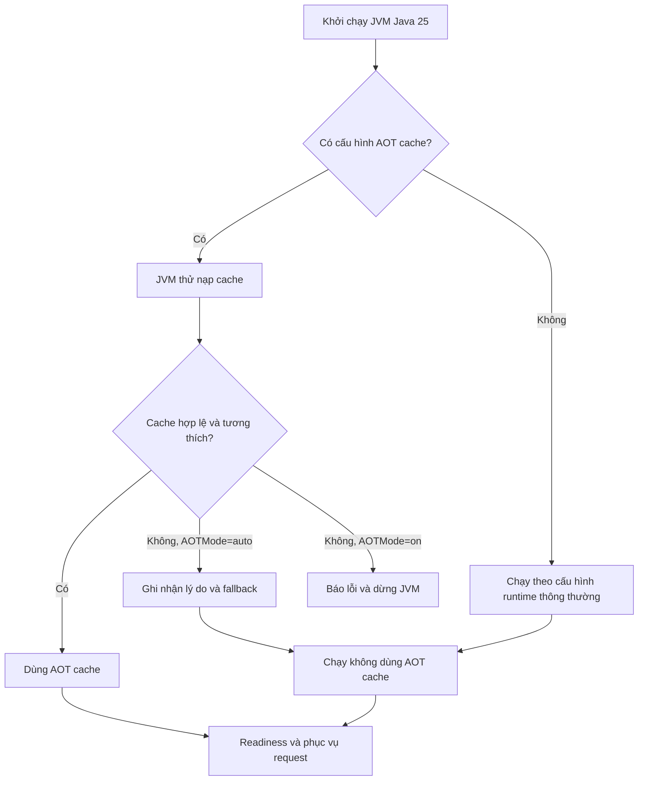
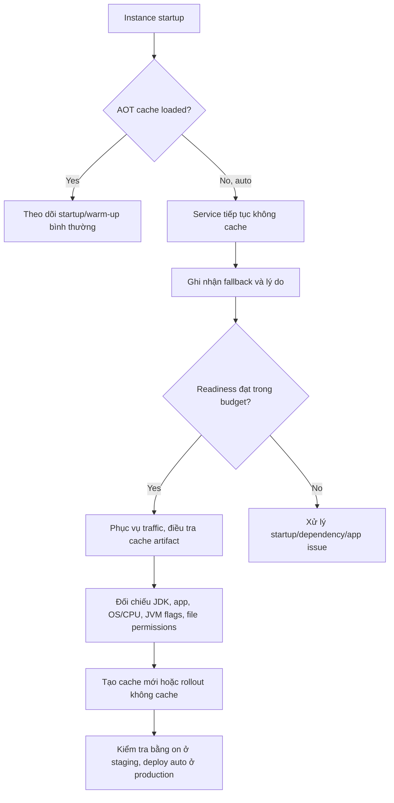

# Chọn cách chạy dự phòng khi cache không sử dụng được

**AOT cache** của HotSpot giúp giảm thời gian khởi động và warm-up, nhưng đây là **tối ưu hóa tùy chọn**. Ứng dụng Java 25 cần tiếp tục hoạt động đúng khi cache không tồn tại, không đọc được hoặc không tương thích với ứng dụng/JDK/nền tảng hiện tại. Quyết định quan trọng khi triển khai là chọn chế độ **tự động fallback** hay **fail-fast để phát hiện lỗi cấu hình**, đồng thời có log và chỉ số đủ rõ để biết JVM đã dùng cache hay đang chạy theo đường thông thường.

Bài học thuộc chương **Vận hành AOT** của module **Java 25** (JAVA_VERSION_JAVA25), theo đề bài **“Chọn cách chạy dự phòng khi cache không sử dụng được”**. Nội dung sử dụng các option AOT hiện hành của JDK 25, phân biệt `auto`, `on`, `off`, `record` và `create`, cùng cách chẩn đoán, triển khai, kiểm thử và rollback. Phạm vi ưu tiên kiến thức còn áp dụng trong Java hiện đại; không dùng quy trình legacy làm lựa chọn mặc định.

## 1. Nguyên tắc vận hành: cache không quyết định tính đúng của ứng dụng

Khi không nạp được AOT cache, JVM vẫn có thể khởi chạy ứng dụng bằng cơ chế runtime thông thường: tải class, liên kết, thực thi bytecode và JIT compile theo điều kiện chạy. Ứng dụng có thể mất một phần lợi ích startup/warm-up, nhưng **không được mất chức năng nghiệp vụ** chỉ vì cache không có mặt.



Mục tiêu của thiết kế fallback:

- **Availability:** cache hỏng hoặc thiếu không làm ứng dụng production dừng nếu chính sách đã chọn là fallback.
- **Observability:** phát hiện được cache không được dùng, nguyên nhân và tác động tới startup/warm-up.
- **Predictability:** không thay đổi chức năng nghiệp vụ, cấu hình bảo mật hay transaction chỉ vì cache bị bỏ qua.
- **Recoverability:** có thể sửa artifact cache hoặc quay về image/config đã biết tốt mà không phải thay đổi code ứng dụng.

Cache là tối ưu hóa. Nó không phải nguồn dữ liệu nghiệp vụ, không phải bản sao database và không phải điều kiện để xác thực hoặc phân quyền hoạt động.

## 2. Hiểu chính xác các chế độ AOT trong JDK 25

JDK 25 có năm giá trị cho option `-XX:AOTMode`:

| Mode | Ý nghĩa | Khi cache không dùng được | Vai trò phù hợp |
| --- | --- | --- | --- |
| `auto` | Chế độ mặc định; JVM tự chọn record/on/off theo option và cache khả dụng | **Tiếp tục chạy không dùng cache** nếu cache load thất bại | Production cần resilience |
| `on` | Production mode yêu cầu thử nạp AOT cache | JVM in lỗi và **thoát ngay** nếu không nạp được | CI/staging hoặc chẩn đoán fail-fast |
| `off` | Không sử dụng AOT cache | Chạy không cache; các AOT command-line options khác bị bỏ qua | Baseline, rollback có chủ đích, kiểm thử |
| `record` | Training phase, chạy ứng dụng để ghi dữ liệu AOT configuration | Không phải mode fallback production | Tạo dữ liệu training |
| `create` | Assembly phase, đọc AOT configuration để tạo cache | Không chạy ứng dụng trong pha này | Tạo file cache trước production |

**Phân biệt quan trọng:**

- `auto` là lựa chọn được Oracle khuyến nghị cho production, đặc biệt khi command line có thể bị thay đổi bởi launch script hoặc môi trường triển khai.
- `on` không phải “bật AOT an toàn hơn”. Đây là chế độ fail-fast để kiểm tra cache và option có tương thích hay không.
- `off` là cách tắt AOT có chủ đích; nó không thử cache rồi fallback mà bỏ qua cache ngay từ đầu.
- `record` và `create` thuộc pipeline tạo cache, không phải lựa chọn để một instance production phục vụ request khi cache thiếu.

### Hành vi của `auto` phụ thuộc option

Theo tài liệu launcher Java 25, khi không đặt `-XX:AOTMode`, mặc định là `auto`:

1. Nếu có `-XX:AOTCacheOutput=...`, JVM chuyển sang `record` để training và thực hiện assembly theo quy trình tương ứng.
2. Nếu không có `AOTCacheOutput` và có AOT cache có thể nạp, JVM chuyển sang `on` cho production run.
3. Nếu không có cache có thể nạp, JVM chuyển sang `off` và chạy không cache.

Với một file cache được deploy rõ ràng, nên chỉ định `-XX:AOTCache=...` để xác định artifact mà instance cần thử nạp. Không trộn `AOTCache` với `AOTCacheOutput` trong cùng invocation; hai option này loại trừ nhau.

## 3. Chọn policy production: ưu tiên `auto`

Ví dụ lệnh production:

```bash
java \
  -XX:AOTMode=auto \
  -XX:AOTCache=/opt/shop/cache/shop.aot \
  -Xlog:aot \
  -jar /opt/shop/app/shop-service.jar
```

Nếu cache được nạp thành công, JVM sử dụng AOT artifacts. Nếu file bị thiếu, không truy cập được hoặc không tương thích, JVM ghi thông tin chẩn đoán và tiếp tục chạy không dùng AOT cache. Khi đó startup/warm-up có thể chậm hơn, nhưng ứng dụng vẫn phải đạt readiness và phục vụ request đúng.

Đây là policy phù hợp khi:

- Cache là artifact có thể tái tạo từ build.
- Ứng dụng có thể phục vụ bằng runtime thông thường.
- Tính sẵn sàng của service quan trọng hơn việc bắt buộc mọi instance phải dùng cache.
- Launch command có thể chịu ảnh hưởng từ môi trường, container entrypoint hoặc platform operator.

**Không được bỏ qua cảnh báo cache miss một cách âm thầm.** Fallback giúp availability, còn log/metrics và cảnh báo vận hành phải cho biết tối ưu hóa đang không hoạt động. Nếu mọi lần rollout đều fallback, lợi ích AOT đã mất dù service vẫn xanh.

### Khi nào cần `on`?

Ví dụ kiểm tra nghiêm ngặt trong CI hoặc staging:

```bash
java \
  -XX:AOTMode=on \
  -XX:AOTCache=build/aot/shop.aot \
  -Xlog:aot \
  -jar build/libs/shop-service.jar
```

Nếu cache không nạp được, JVM in lỗi và dừng ngay. Điều này hữu ích để phát hiện:

- Cache không được đóng gói hoặc đường dẫn sai.
- Cache được tạo từ JDK release hoặc ứng dụng khác.
- Cache không tương thích với OS/CPU hoặc JVM options.
- Pipeline tạo cache không khớp pipeline tạo image.

Không dùng `on` làm production default chỉ vì muốn “chắc chắn dùng AOT”. Một lỗi artifact cache có thể biến rollout thành outage dù ứng dụng hoàn toàn có thể chạy bình thường không cache.

## 4. Chọn `off` làm phương án fallback có chủ đích

Khi cần vô hiệu hóa AOT trong một rollout hoặc incident, dùng:

```bash
java \
  -XX:AOTMode=off \
  -jar /opt/shop/app/shop-service.jar
```

`off` không cố nạp file cache. Nó hữu ích khi:

- Đang điều tra liệu một lỗi có liên quan đến AOT cache hay không.
- Cần quay về đường runtime đã biết hoạt động để khôi phục service.
- Benchmark baseline không AOT với cùng JDK và artifact.
- Tạm ngừng AOT sau khi pipeline tạo cache bị lỗi.

Đây là **fallback vận hành có chủ đích**, không nhất thiết là chế độ cuối cùng lâu dài. Sau khi sự cố được giải quyết, có thể bật lại `auto` với cache mới đã được xác minh.

Nếu launch script có các option AOT khác đi kèm, nhớ rằng ở mode `off` những AOT options còn lại bị bỏ qua. Vì vậy, khi chuyển mode, cần xem lại cả command line và log để chắc chắn không còn hiểu nhầm rằng cache vẫn đang được dùng.

## 5. Những nguyên nhân phổ biến khiến cache không nạp được

Oracle JDK 25 nêu các nhóm nguyên nhân chính:

| Nhóm | Ví dụ | Bước xác minh |
| --- | --- | --- |
| Ứng dụng không tương thích | Khác `-jar`, classpath, module path hoặc artifact build | So build ID, checksum và dependency graph |
| Khác JDK release | Training bằng một JDK release, production bằng release khác | So `java -version`, vendor/build và pipeline |
| Khác nền tảng | Training Linux x86_64 nhưng production ARM64 hoặc OS khác | So OS image, architecture và runtime platform |
| Cache không tồn tại | Sai path, volume chưa mount, file không được đóng gói | Kiểm tra file, mount, working directory |
| Không có quyền truy cập | User chạy JVM không đọc được file hoặc parent directory | Kiểm tra owner, permission, read-only mount |
| JVM options không tương thích | Một số tùy chọn/agent thay đổi class loading hoặc runtime assumptions | Đối chiếu options ở training và production; đọc log AOT |
| Artifact bị hỏng hoặc không đầy đủ | Cache upload/download bị gián đoạn, sai artifact | Kiểm tra size/checksum và tái tạo từ pipeline tin cậy |

**Không suy luận mọi cache miss là do cache bị corrupt.** Một cache hoàn toàn hợp lệ có thể không tương thích vì JDK, app artifact, OS/CPU hoặc JVM options khác nhau. Hãy bắt đầu từ thông báo `-Xlog:aot` rồi đối chiếu provenance trước khi tạo lại cache.

### Cache không tương thích khác với ứng dụng lỗi

Nếu `AOTMode=auto` fallback và ứng dụng khởi chạy thành công, điều đó chứng minh **runtime không cache có thể chạy**. Nó không chứng minh cache đã được nạp, cũng không chứng minh mọi chức năng nghiệp vụ hoạt động. Cần kiểm tra readiness, smoke tests và metrics nghiệp vụ sau khi startup.

Nếu ứng dụng vẫn lỗi khi chạy `AOTMode=off`, nguyên nhân có thể nằm ở code, cấu hình, dependency, database hoặc runtime nói chung; không nên tiếp tục đổ lỗi cho AOT cache.

## 6. Chẩn đoán bằng `-Xlog:aot`

Đây là bước đầu tiên khi muốn biết JVM đã nạp cache hay fallback:

```bash
java \
  -XX:AOTMode=auto \
  -XX:AOTCache=/opt/shop/cache/shop.aot \
  -Xlog:aot \
  -jar /opt/shop/app/shop-service.jar
```

Đọc log để xác định:

- JVM có tìm thấy cache ở đường dẫn dự kiến không.
- Có bắt đầu quá trình load cache hay không.
- Cache bị từ chối vì lý do tương thích nào.
- JVM tiếp tục ở chế độ không cache hay đã nạp thành công.

Thông điệp cụ thể có thể thay đổi theo JDK build. Không viết automation phụ thuộc vào một câu log duy nhất nếu chưa xác minh nó ổn định trong phiên bản đang chạy.

### So sánh ba lần chạy có chủ đích

| Lần chạy | Option | Mục tiêu |
| --- | --- | --- |
| A | `-XX:AOTMode=auto -XX:AOTCache=shop.aot -Xlog:aot` | Xác định cache được nạp hay fallback |
| B | `-XX:AOTMode=on -XX:AOTCache=shop.aot -Xlog:aot` | Bắt lỗi tương thích thành lỗi khởi chạy trong staging |
| C | `-XX:AOTMode=off` | Chạy baseline không cache để so sánh |

Không chạy ba cấu hình đồng thời trên cùng port/database hoặc cùng dữ liệu nếu chúng tạo side effects. Dùng môi trường cô lập, data fixture riêng và cùng build để so sánh.

## 7. Thiết kế launch script có fallback rõ ràng

Launch script nên:

1. Xác định artifact ứng dụng và cache tương ứng cùng release.
2. Kiểm tra các thông tin triển khai cơ bản (file, quyền đọc, build metadata).
3. Chạy JVM ở `auto` cho production.
4. Bật log AOT ở mức phù hợp để xác định cache hit/miss.
5. Không tự động lặp restart vô hạn chỉ vì cache miss.
6. Cho phép operator chuyển sang `off` trong incident mà không phải sửa code.

Ví dụ shell:

```bash
#!/usr/bin/env bash
set -eo pipefail

APP_JAR="/opt/shop/app/shop-service.jar"
AOT_CACHE="/opt/shop/cache/shop.aot"

if [[ ! -r "$APP_JAR" ]]; then
  echo "Application artifact is missing or unreadable" >&2
  exit 1
fi

if [[ "$AOT_DISABLED" == "true" ]]; then
  exec java -XX:AOTMode=off -jar "$APP_JAR"
fi

# auto cho phép JVM tiếp tục nếu cache không nạp được.
exec java \
  -XX:AOTMode=auto \
  -XX:AOTCache="$AOT_CACHE" \
  -Xlog:aot \
  -jar "$APP_JAR"
```

Script này cố ý **không kiểm tra cache bằng điều kiện file tồn tại rồi mới bật auto**. Nếu file vắng, JVM ở `auto` vẫn có thể fallback theo đúng policy và log lý do. Nếu muốn phân biệt cache thiếu với cache load failure, cần thêm kiểm tra/telemetry riêng, nhưng không được biến cache missing thành vòng restart.

`AOT_DISABLED` là cờ vận hành minh họa. Trong môi trường production, quản lý nó bằng deployment config/feature flag có audit, quyền thay đổi và rollback rõ ràng; tránh cho người dùng cuối tùy ý chèn JVM options.

## 8. Cache artifact: đường dẫn, quyền và provenance

Cache nên được quản lý như **artifact build gắn với một release cụ thể**, không phải file tạm do mỗi instance tùy ý ghi đè.

| Thuộc tính | Chính sách gợi ý |
| --- | --- |
| Tên artifact | Bao gồm app/build/JDK/platform, ví dụ `shop-2026.11-jdk25-linux-x64.aot` |
| Nguồn tạo | Pipeline tin cậy, cùng commit/dependency với app deploy |
| Quyền file | JVM production chỉ cần quyền đọc; pipeline tạo cache có quyền ghi riêng |
| Lưu trữ | Registry/artifact store có checksum và retention |
| Deploy | Đưa cache cùng release hoặc mount read-only vào đúng path |
| Rollback | Giữ cache tương ứng với release trước; không tái dùng cache của release khác |
| Kiểm soát truy cập | Không cho user không tin cậy thay thế cache trên đường dẫn production |

Cache không phải secret store, nhưng vẫn là một phần của chuỗi cung ứng phần mềm. Chỉ triển khai cache được tạo từ build đã kiểm soát; kiểm tra checksum và provenance. Nếu file bị thay thế bởi artifact không đáng tin cậy, không nên “thử chạy cho biết” trong production.

### Không ghi cache trực tiếp vào image dùng chung cho mọi nền tảng

Cache gắn với **ứng dụng, JDK release, OS và CPU architecture**. Nếu cùng một ứng dụng có image Linux x86_64, Linux ARM64 và Windows, pipeline cần tạo cache phù hợp cho từng target. Không đặt một file cache duy nhất vào manifest chung rồi kỳ vọng mọi instance dùng được.

## 9. Kiểm tra khác biệt JVM options giữa training và production

Một cache được tạo thành công chưa chắc nạp được trong production. Những option thay đổi class loading, instrumentation hoặc module graph có thể làm cache không tương thích.

Hãy lưu và so sánh:

- JDK vendor/build và các JVM flags.
- `-javaagent`, JVMTI agents và bytecode instrumentation.
- `--module-path`, `--add-modules`, `--patch-module`, `--upgrade-module-path` và các module options.
- `-classpath`/`-jar`/artifact dependencies.
- Các option AOT/CDS có liên quan, bao gồm `-XX:+AOTClassLinking` nếu pipeline sử dụng.

Không kết luận mọi agent đều làm cache thất bại; cần xem log và tài liệu JEP 483/JDK 25 cho tình huống cụ thể. Nếu một agent chỉ có ở production, tạo training run với cấu hình tương ứng hoặc đánh giá lại việc có cần cache cho instance đó không.

### Dùng `-XX:AOTMode=on` trong CI để phát hiện drift

Một bước kiểm tra hữu ích:

```bash
java \
  -XX:AOTMode=on \
  -XX:AOTCache=artifacts/shop.aot \
  -Xlog:aot \
  -jar artifacts/shop-service.jar \
  --smoke-test
```

`--smoke-test` ở đây là argument minh họa của ứng dụng, không phải option Java. CI cần có entry point kiểm tra thật hoặc dùng test harness riêng. Nếu cache không nạp, `on` làm bước kiểm tra fail để pipeline không phát hành artifact đã biết là không tương thích.

Không nên chạy một bài smoke test làm thay đổi production database hoặc gửi email/thanh toán thật chỉ để xác minh cache.

## 10. Fallback không thay thế readiness và health checks

Khi JVM fallback sang runtime không cache, service có thể cần thời gian warm-up lâu hơn. Readiness phải phản ánh **khả năng phục vụ nghiệp vụ**, không chỉ việc process tồn tại.

| Tín hiệu | Cần quan sát | Phân biệt |
| --- | --- | --- |
| JVM startup | Thời gian từ process start tới app initialization | Cache load/fallback có thể ảnh hưởng |
| Readiness | Khi nào service nhận traffic | Không đánh dấu ready quá sớm nếu dependency chưa sẵn sàng |
| First useful request | Latency của request nghiệp vụ đầu tiên | Health endpoint nhanh không bảo đảm đường nghiệp vụ đã warm |
| Warm-up | Latency/throughput theo thời gian sau startup | Phân biệt startup benefit với JIT warm-up |
| Cache status | Log AOT hoặc thông tin quản lý có hỗ trợ | Biết instance dùng cache hay fallback |
| Error rate | HTTP 5xx, timeout, message failure | Đảm bảo cache miss không che lỗi ứng dụng |

Nếu cache miss khiến readiness chậm, hãy điều chỉnh startup budget/probe theo số đo thực tế. **Không tăng timeout vô hạn** và không bỏ health checks chỉ để rollout qua được.

## 11. Metrics và cảnh báo cho fallback

Không phải mọi ứng dụng đều có metric AOT cache sẵn ở cùng tên hoặc cùng cách xuất. Hãy dựa trên thông tin JDK 25 thực có và telemetry của nền tảng. Nếu không có metric trực tiếp, có thể phân loại từ startup log đã được chuẩn hóa ở deployment layer.

Một dashboard vận hành nên trả lời:

| Câu hỏi | Tín hiệu |
| --- | --- |
| Bao nhiêu instance dùng cache thành công? | Cache-load outcome theo instance/build |
| Bao nhiêu instance fallback? | AOT mode/outcome từ startup logs |
| Vì sao cache miss? | Nhóm nguyên nhân: missing, permission, app mismatch, JDK mismatch, platform, JVM options |
| Fallback ảnh hưởng startup ra sao? | Startup-to-ready và first-useful-request latency |
| Ứng dụng có lỗi nghiệp vụ không? | HTTP error rate, consumer failure, dependency timeout |
| Cache artifact có được triển khai đúng không? | Cache checksum/build ID/platform trong deployment metadata |

Ví dụ schema log đã chuẩn hóa:

```json
{
  "event": "aot_cache_load",
  "service": "shop-service",
  "buildId": "build-2026-11-27",
  "jdkRelease": "25",
  "platform": "linux-x86_64",
  "outcome": "fallback",
  "reason": "cache_not_readable"
}
```

Đây là **schema minh họa**, không phải log thực của JVM. Tránh parser phụ thuộc vào toàn bộ câu thông báo nội bộ. Hãy chuẩn hóa các nhóm lỗi trong startup observer hoặc log processing, đồng thời giữ raw diagnostic có giới hạn để điều tra sâu.

**Không gắn build ID, instance ID hoặc cache path có giá trị vô hạn làm metric tags nếu chúng tạo cardinality cao.** Dùng deployment inventory/logs để drill down, còn metric tổng hợp theo service, environment, outcome và nhóm lý do có tập giá trị hữu hạn.

## 12. Quy trình xử lý incident khi cache không nạp được



### Runbook theo thứ tự

1. **Xác nhận instance đang fallback:** xem `-Xlog:aot`, build ID và cache path.
2. **Đánh giá availability:** service đã đạt readiness chưa? Error rate và dependency có bình thường không?
3. **Kiểm tra cache file:** tồn tại, đúng path, đúng checksum, đọc được bởi user của JVM.
4. **Đối chiếu provenance:** app artifact, JDK release/vendor, OS/CPU architecture và JVM options.
5. **Chạy lại bằng `AOTMode=on` ở staging:** xác nhận fail-fast có tái hiện và đọc diagnostic.
6. **So baseline `AOTMode=off`:** xác định lỗi có còn khi bỏ AOT không.
7. **Khôi phục:** dùng `auto` hoặc `off` theo policy; không buộc production dùng cache đang lỗi.
8. **Tạo lại cache:** training và assembly từ đúng build/platform; kiểm tra cache trước khi rollout.
9. **Canary:** deploy một nhóm nhỏ, xác nhận cache hit, startup và request latency.
10. **Đóng incident:** ghi nguyên nhân, phạm vi instance, ảnh hưởng SLO và thay đổi pipeline ngăn tái diễn.

Nếu `AOTMode=off` cũng thất bại, dừng điều tra cache và chuyển sang startup/application/dependency diagnostics. Việc tiếp tục xóa/tạo cache sẽ không xử lý nguyên nhân đó.

## 13. Chiến lược rollout và rollback

Một release có cache nên được triển khai như một **artifact pair**: application artifact + AOT cache cùng provenance. Có thể rollout theo các bước:

| Giai đoạn | Cấu hình | Tiêu chí chuyển tiếp |
| --- | --- | --- |
| CI | `on` với cache vừa tạo | Cache load thành công, smoke test đạt |
| Staging | `on` và `auto` ở hai lượt kiểm tra | Hiểu rõ fail-fast và fallback behavior |
| Canary | `auto` | Cache hit đúng, startup/latency trong ngưỡng |
| Production rollout | `auto` | Tỷ lệ fallback thấp hoặc được giải thích; SLO đạt |
| Incident rollback | `off` hoặc artifact release trước với `auto` | Service phục hồi; cache provenance đúng |

### Các lựa chọn rollback

- **Tắt cache bằng `off`:** hữu ích nếu nghi ngờ cache gây ra khác biệt và muốn khôi phục đường chạy không AOT trên cùng JDK/app.
- **Quay về release trước:** dùng application artifact và cache được tạo cho release đó, không ghép cache mới với app cũ.
- **Deploy lại với `auto` và bỏ cache path lỗi:** JVM chạy không cache nếu không có artifact phù hợp; ghi nhận lý do trong deployment metadata.

Không nên tự động retry startup nhiều lần để “đợi cache xuất hiện”. Cache thiếu thường là vấn đề đóng gói/mount/deploy, không phải lỗi transient mà restart liên tục sẽ giải quyết.

## 14. Kiểm thử các trường hợp fallback

| ID | Tình huống | Cấu hình/thao tác | Kết quả mong đợi |
| --- | --- | --- | --- |
| F01 | Cache hợp lệ | `auto` + cache đúng build | JVM dùng cache và ứng dụng startup |
| F02 | Cache thiếu | `auto` + path không tồn tại | JVM fallback, ứng dụng vẫn có thể startup |
| F03 | Cache không đọc được | `auto` + permission bị giới hạn | Fallback, log nêu lỗi truy cập |
| F04 | JDK release không khớp | Cache từ release khác | Cache không được dùng; auto tiếp tục nếu load fail |
| F05 | OS/CPU khác | Cache tạo ở platform khác | Không dùng cache; xác minh platform mismatch |
| F06 | App/classpath khác | Đổi dependency hoặc JAR | Cache bị từ chối hoặc không phù hợp |
| F07 | JVM option không tương thích | Thêm option/agent đã biết ảnh hưởng | Diagnostic chỉ ra cache không dùng được |
| F08 | Mode `on` với cache lỗi | Fail-fast staging | JVM thoát với lỗi load |
| F09 | Mode `off` | Bỏ cache | Ứng dụng chạy không AOT cache |
| F10 | Cache hit nhưng ứng dụng lỗi nghiệp vụ | Chạy smoke/integration tests | Không nhầm cache hit với ứng dụng đúng |
| F11 | Fallback làm readiness chậm | Đo startup và readiness | Probe budget phản ánh thời gian thực, không tạo restart loop |
| F12 | Rollback | Deploy artifact pair trước đó hoặc `off` | Service khôi phục, cache provenance đúng |

Các test mismatch phải được chạy trong môi trường cô lập. **Không làm hỏng cache production hoặc thay permission trên instance thật** để tạo tình huống lỗi.

## 15. Bài thực hành: xây policy fallback cho shop-service

### Bối cảnh

Ứng dụng `shop-service` chạy Java 25 và có AOT cache được tạo từ pipeline. Sau một lần deploy, một số instance khởi động chậm hơn bình thường. Log cho thấy cache không được nạp trên một nhóm node ARM64, trong khi cache pipeline chỉ tạo cho Linux x86_64.

Mục tiêu: giữ service khả dụng, xác định nguyên nhân và điều chỉnh pipeline để mỗi nền tảng có cache phù hợp.

### Nhiệm vụ

1. **Kiểm tra policy:** xác minh production đang dùng `AOTMode=auto` hay `AOTMode=on`; nếu đang dùng `on`, giải thích rủi ro rollout.
2. **Thu thập provenance:** ghi build ID, JDK release/vendor, OS/CPU, classpath/module path, cache path và JVM options.
3. **Xác nhận fallback:** bật `-Xlog:aot`, kiểm tra instance tiếp tục chạy không cache hay dừng.
4. **Đánh giá readiness:** so startup-to-ready, first useful request, p95/p99 và error rate giữa x86_64 và ARM64.
5. **Tái hiện ở staging:** chạy cache x86_64 trên target ARM64 bằng mode `on` để xác nhận mismatch có kiểm soát.
6. **So baseline:** chạy cùng application artifact trên ARM64 với `AOTMode=off` để xác nhận ứng dụng không cache hoạt động.
7. **Sửa pipeline:** tạo cache riêng theo OS/CPU/JDK/build, gắn metadata và checksum.
8. **Kiểm tra artifact:** dùng `on` trong CI/staging để fail-fast khi cache sai target.
9. **Canary production:** dùng `auto`, xác nhận cache hit trên đúng target và service đạt SLO.
10. **Viết runbook:** quy định khi cache miss thì giữ service chạy, ghi cảnh báo, điều tra provenance và tạo lại cache.

### Mẫu báo cáo

| Hạng mục | Linux x86_64 | Linux ARM64 |
| --- | --- | --- |
| JDK vendor/build | Chưa đo | Chưa đo |
| Application build ID | Chưa ghi | Chưa ghi |
| Cache artifact/platform | Chưa xác minh | Chưa xác minh |
| Cache load outcome | Chưa đo | Chưa đo |
| Startup-to-ready | Chưa đo | Chưa đo |
| First useful request | Chưa đo | Chưa đo |
| Error rate/p95/p99 | Chưa đo | Chưa đo |
| Fallback policy | Chưa xác minh | Chưa xác minh |

Không điền số liệu giả định. Ghi lại lệnh, build ID, log đã làm sạch và điều kiện workload để người khác tái lập.

### Tiêu chí hoàn thành

- Giải thích đúng khác biệt `auto`, `on`, `off`, `record` và `create`.
- Chứng minh ứng dụng vẫn chạy không cache khi production fallback được kích hoạt.
- Xác định được lý do cache miss bằng `-Xlog:aot` và provenance.
- Không dùng cache sai OS/CPU/JDK/build.
- Có CI fail-fast, production fallback và rollback có thể thực hiện.
- Đo startup/readiness/first-request và xác nhận service đạt SLO khi cache hit lẫn cache miss.

## Tài liệu tham khảo

- [Oracle JDK 25 — The java Command, Ahead-of-Time Cache](https://docs.oracle.com/en/java/javase/25/docs/specs/man/java.html): các mode `auto`, `on`, `off`, `record`, `create`, nguyên nhân cache load failure và hành vi fallback.
- [JEP 483 — Ahead-of-Time Class Loading and Linking](https://openjdk.org/jeps/483): consistency giữa training và production, giới hạn tương thích cache.
- [JEP 514 — Ahead-of-Time Command-Line Ergonomics](https://openjdk.org/jeps/514): cách đơn giản hóa các lệnh AOT cache trong Java 25.
- [Oracle JDK 25 — The jcmd Command](https://docs.oracle.com/en/java/javase/25/docs/specs/man/jcmd.html): công cụ chẩn đoán và điều khiển JVM trong quy trình training.
- [Oracle Java 25 Migration Guide](https://docs.oracle.com/en/java/javase/25/migrate/significant-changes-jdk-25.html): thay đổi AOT của JDK 25.

**Kết luận:** Khi AOT cache không sử dụng được, production thường nên chọn **`AOTMode=auto`** để JVM ghi nhận cache miss rồi tiếp tục chạy không cache. Dùng **`on`** ở CI/staging để phát hiện mismatch sớm, và **`off`** khi cần baseline hoặc rollback có chủ đích. Chẩn đoán bằng `-Xlog:aot`, đối chiếu app/JDK/OS/CPU/JVM options và cache provenance, sau đó kiểm tra readiness cùng SLO. Một hệ thống vận hành tốt phải giữ được tính đúng đắn và khả năng phục vụ khi tối ưu hóa AOT tạm thời không khả dụng.
