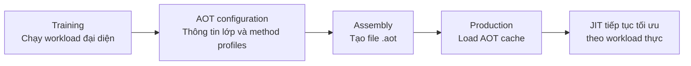
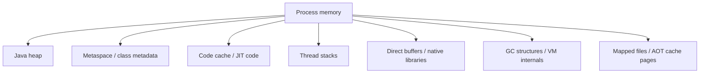
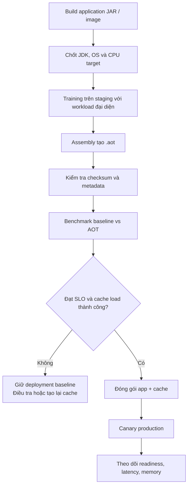

# Đo thời gian khởi động, mức dùng bộ nhớ, độ trễ ban đầu và hiệu năng ổn định

## 1. Đo đúng điều AOT cache có thể cải thiện

Một ứng dụng Java server thường có bốn giai đoạn hiệu năng dễ bị gộp nhầm:

1. **Khởi động JVM và ứng dụng:** tạo process, khởi tạo VM, nạp/liên kết class, tạo Spring context hoặc framework container, mở connection pool và chuyển sang trạng thái sẵn sàng.
2. **Độ trễ request đầu tiên:** request đầu có thể kích hoạt lazy initialization, tải metadata, tạo serializer, biên dịch template, nạp driver hoặc JIT compile những method vừa được gọi.
3. **Warm-up:** JVM tiếp tục thu thập profile, biên dịch code bằng JIT, tối ưu đường gọi nóng và ổn định các cache của ứng dụng.
4. **Hiệu năng ổn định (steady state):** sau khi workload và JVM đạt trạng thái tương đối ổn định, đo throughput, p95/p99 latency, CPU, allocation và GC.

**AOT cache của HotSpot trong Java 25** giúp chuyển một phần công việc chuẩn bị từ thời điểm chạy ứng dụng sang giai đoạn training/assembly trước đó. Cache có thể giúp giảm công việc nạp/liên kết class và chuẩn bị dữ liệu; JEP 515 còn bổ sung method execution profiles từ training để JIT có dữ liệu sớm hơn khi JVM khởi động.

Điều này không đồng nghĩa ứng dụng đã được biên dịch thành native executable, không xóa bỏ JIT và cũng không đảm bảo throughput steady-state cao hơn. Mục tiêu đo lường phải tách biệt:

| Chỉ số | Câu hỏi cần trả lời | AOT có thể tác động thế nào? |
| --- | --- | --- |
| Process startup | JVM đến lúc process bắt đầu chạy được mất bao lâu? | Có thể giảm công việc khởi tạo VM/class |
| Time to readiness | Từ lúc start đến khi endpoint readiness sẵn sàng mất bao lâu? | Có thể giảm startup; còn phụ thuộc framework, I/O và dependency |
| First-request latency | Request đầu tiên sau readiness mất bao lâu? | Có thể giảm class loading/JIT/lazy setup, nhưng không loại bỏ lazy initialization |
| Warm-up duration | Mất bao lâu để latency/throughput ổn định? | Method profiles có thể giúp JIT tối ưu sớm hơn |
| Steady-state throughput | Khi đã nóng, hệ thống xử lý được bao nhiêu request/giây? | Thường ít thay đổi; cần đo thực tế |
| p95/p99 latency | Đuôi phân phối độ trễ có cải thiện không? | Có thể cải thiện giai đoạn đầu; GC, lock, DB và network vẫn chi phối |
| Heap / RSS / PSS | Ứng dụng dùng bao nhiêu bộ nhớ? | Có thể thay đổi footprint; không được mặc định là giảm |
| CPU và GC | Có bớt công việc khởi động/biên dịch/GC không? | Có thể thay đổi trong startup/warm-up; phải đo theo workload |

### 1.1. AOT cache không phải Native Image

AOT cache là một **tối ưu hóa cho JVM HotSpot**. Ứng dụng vẫn chạy trên JVM, vẫn có runtime, garbage collector và JIT compiler. Cache có thể lưu artifacts chuẩn bị trước như class data, heap objects đã được chuẩn bị và method profiles; JIT vẫn có thể tiếp tục biên dịch/tối ưu trong production.

`Native Image` là một công nghệ khác, tạo executable native bằng quy trình build riêng. Không dùng kết quả benchmark Native Image để kết luận hiệu quả của AOT cache HotSpot.

### 1.2. Những gì không được giả định

- Cache không tự sửa một endpoint chậm do SQL, network, lock contention hoặc thuật toán kém.
- Cache không bảo đảm request đầu tiên không còn lazy initialization.
- Method profile trong cache không thay thế việc JIT quan sát workload production; JVM vẫn có thể tiếp tục profiling/optimization.
- Cache không mặc định làm giảm heap, RSS hay container memory limit.
- Cache được tạo từ workload training thiếu đại diện có thể không giúp đường xử lý production.
- Một lần chạy nhanh hơn không đủ chứng minh hiệu quả; cần nhiều lần lặp và so sánh phân phối.

## 2. Các mốc Java 24–25 và trạng thái hiện hành

AOT cache được giới thiệu trong **JDK 24 qua JEP 483 — Ahead-of-Time Class Loading and Linking**. Java 25 bổ sung hai cải tiến quan trọng:

| JEP | Có trong | Ý nghĩa |
| --- | --- | --- |
| **JEP 483 — Ahead-of-Time Class Loading and Linking** | JDK 24 | AOT cache và quy trình training → assembly → production để tái sử dụng dữ liệu class loading/linking |
| **JEP 514 — Ahead-of-Time Command-Line Ergonomics** | JDK 25 | Đơn giản hóa lệnh tạo cache cho trường hợp phổ biến; không cần tự quản lý mọi bước thủ công |
| **JEP 515 — Ahead-of-Time Method Profiling** | JDK 25 | Đưa method execution profiles từ training vào AOT cache để JIT có thông tin sớm hơn khi khởi động |

**Java 25 là mốc chính của bài học.** Những ví dụ bên dưới dùng lệnh AOT cache hiện hành của JDK 25. Không lấy các workflow preview hoặc lệnh thử nghiệm của Leyden trước khi JEP 483/514/515 được tích hợp làm quy trình production.

### 2.1. Ba giai đoạn vẫn cần hiểu



- **Training:** chạy ứng dụng với workload đủ đại diện để JVM thu thập những thông tin có ích.
- **Assembly:** dùng dữ liệu training để tạo file cache có thể được JVM sử dụng ở lần chạy sau.
- **Production:** khởi chạy ứng dụng với cache tương thích để tận dụng dữ liệu đã chuẩn bị.

Với Java 25, quy trình phổ biến được đơn giản hóa bằng `-XX:AOTCacheOutput`; JVM tự xử lý phần recording và assembly tiếp theo. Vẫn cần hiểu ba giai đoạn để thiết kế training đúng và chẩn đoán cache không được sử dụng.

### 2.2. Những yếu tố gắn với một cache

Oracle JDK 25 mô tả cache gắn với tổ hợp:

- Ứng dụng cụ thể, thể hiện qua `-classpath`, `-jar` hoặc `--module-path`.
- JDK release được dùng để tạo cache.
- Hệ điều hành và kiến trúc CPU.

Khi một yếu tố thay đổi, hãy tạo lại cache. Trong pipeline production, nên dùng cùng JDK vendor/build, phiên bản ứng dụng, dependency artifacts, launch options và môi trường kiến trúc giữa training/assembly và production. Các tùy chọn JVM không tương thích cũng có thể khiến cache không được nạp.

### 2.3. Phân biệt AOT cache với profile benchmark

File `.aot` là artifact dành cho JVM; nó không phải kết quả benchmark, file JFR hay profile dữ liệu người dùng. File `.aotconfig` là dữ liệu cấu hình/training trong workflow tường minh. Kết quả đo startup, memory và latency cần được lưu riêng dưới dạng số liệu benchmark, dashboard hoặc báo cáo.

## 3. Chuẩn bị môi trường đo có thể lặp lại

Trước khi tạo cache hoặc so sánh hiệu năng, hãy khóa những biến có thể làm sai kết quả.

### 3.1. Cố định ứng dụng và runtime

Ghi lại cho mỗi lượt đo:

| Thuộc tính | Ví dụ cần ghi |
| --- | --- |
| JDK | Vendor, version đầy đủ, build number, đường dẫn `JAVA_HOME` |
| Ứng dụng | Commit/build ID, checksum JAR hoặc image digest |
| Dependency | Danh sách dependency lock và checksum artifact |
| OS/CPU | OS release, architecture, CPU model, số core được cấp |
| Container | CPU quota, memory limit, cgroup version, base image |
| JVM options | Heap, GC, module/class path, system properties, agents |
| AOT | Cache file, checksum, ngày training, command line |
| Workload | Route, payload, concurrency, request rate, dataset |
| Dependency ngoài | DB/cache/queue version, vị trí mạng, connection pool |

Không đổi `-Xms`, `-Xmx`, collector, số CPU, thread pool, heap limit hoặc cấu hình database giữa hai nhóm thử nghiệm nếu mục tiêu là cô lập ảnh hưởng AOT. Nếu thay đổi cùng lúc nhiều yếu tố, bạn sẽ không biết cải thiện đến từ đâu.

### 3.2. Tách cold process khỏi cold operating-system page cache

**Cold JVM start** nghĩa là khởi tạo process JVM mới. Điều này không nhất thiết là **cold OS page cache**: hệ điều hành có thể đã giữ JAR, class data hoặc file AOT trong RAM từ lượt chạy trước.

Khi đo cold start:

- Dùng process mới cho mỗi lần chạy.
- Luân phiên baseline và AOT để giảm thiên lệch do tải hệ thống theo thời gian.
- Ghi rõ page cache là warm hay cold theo điều kiện thử nghiệm.
- Không tùy tiện flush OS page cache trên production host; thao tác đó ảnh hưởng các process khác và không phản ánh tình huống thông thường.
- Đo riêng cold start và warm page-cache start nếu cả hai đều quan trọng.

### 3.3. Chọn workload training đại diện

Training nên bao gồm những luồng production quan trọng, ví dụ:

- Khởi tạo framework và các component chính.
- Route đọc/ghi thường gặp, xác thực và phân quyền.
- Serialization/deserialization, validation, mapping và truy vấn dữ liệu.
- Các nhánh điều kiện, error handling, retry và tích hợp client thường dùng.
- Các đường code có thể bị bỏ qua nếu chỉ gọi health endpoint.

Không chỉ gọi `/actuator/health` rồi kết luận cache đã được training tốt. Health check có thể không tải serializer, repository, business service hoặc method nóng.

Dùng dữ liệu synthetic hoặc dữ liệu đã được làm sạch. Training không nên tạo thanh toán, gửi email, phát sự kiện production hay ghi dữ liệu nghiệp vụ thật. Mọi side effect phải được vô hiệu hóa hoặc chuyển sang môi trường cách ly.

## 4. Tạo và vận hành AOT cache trên Java 25

### 4.1. Workflow ngắn với JEP 514

Với JDK 25, trường hợp phổ biến có thể tạo cache bằng một lệnh:

```bash
# Chạy training trên đúng JDK 25 và ứng dụng cần deploy.
# AOTMode mặc định là auto; AOTCacheOutput kích hoạt recording.
java -XX:AOTCacheOutput=build/aot/app.aot -jar app.jar
```

Trong lần chạy này, ứng dụng thực thi workload training. Khi recording kết thúc, JVM thực hiện bước assembly tiếp theo để tạo `app.aot`. Nếu ứng dụng là server chạy lâu, bạn có thể kết thúc recording chủ động bằng diagnostic command `jcmd` sau khi đã hoàn thành workload training.

```bash
# Tìm PID của JVM
jcmd -l

# Kết thúc AOT recording sau khi đã chạy đủ workload đại diện
jcmd <pid> AOT.end_recording
```

Khi ứng dụng training kết thúc bình thường, recording cũng kết thúc theo lifecycle của JVM. Đối với service luôn chạy, `AOT.end_recording` giúp kết thúc training mà không cần nhúng logic training vào mã ứng dụng.

Dùng đúng đường dẫn cache ở artifact output; đảm bảo thư mục tồn tại và process có quyền ghi. Không chạy nhiều training process cùng lúc ghi vào cùng một file `.aot`.

### 4.2. Workflow tường minh với AOT configuration

Nếu cần tách training và assembly thành hai bước độc lập trong CI, có thể chỉ định file `.aotconfig`:

```bash
# 1. Training: chạy ứng dụng với workload đại diện
java -XX:AOTMode=record \
     -XX:AOTConfiguration=build/aot/app.aotconfig \
     -jar app.jar

# 2. Assembly: tạo AOT cache từ cấu hình training
# Ứng dụng không thực thi main trong giai đoạn create.
java -XX:AOTMode=create \
     -XX:AOTConfiguration=build/aot/app.aotconfig \
     -XX:AOTCache=build/aot/app.aot \
     -jar app.jar
```

Workflow tường minh hữu ích khi muốn lưu cấu hình training làm artifact riêng, kiểm tra nó trước khi assembly hoặc chạy assembly trong một stage khác. Với trường hợp thông thường, JEP 514 cho phép dùng `-XX:AOTCacheOutput` và để JVM tự xử lý các bước.

### 4.3. Chạy production với cache

Trong production, dùng `AOTMode=auto` để ứng dụng tiếp tục chạy bình thường nếu cache không thể nạp:

```bash
java -XX:AOTMode=auto \
     -XX:AOTCache=build/aot/app.aot \
     -jar app.jar
```

`auto` là lựa chọn an toàn hơn cho deployment thông thường: nếu cache hợp lệ, JVM sử dụng nó; nếu cache thiếu hoặc không tương thích, JVM tiếp tục chạy mà không có cache. Đây là hành vi hữu ích khi command line có thể bị thay đổi bởi môi trường container, agent hoặc nền tảng triển khai.

Có thể dùng `-XX:AOTMode=on` để **fail fast** khi cần xác minh cache bắt buộc phải nạp được, nhưng mode này có thể làm ứng dụng không khởi động nếu cache không tương thích. Chỉ dùng trong kiểm tra/canary có chủ đích, không mặc định áp dụng cho mọi production deployment.

### 4.4. Chẩn đoán cache không được nạp

Bật unified logging:

```bash
java -XX:AOTMode=auto \
     -XX:AOTCache=build/aot/app.aot \
     -Xlog:aot \
     -jar app.jar
```

Log giúp nhận biết cache có được sử dụng hay bị bỏ qua vì mismatch. Khi so sánh production và training, kiểm tra:

- JDK release và build.
- JAR/application checksum, classpath/module path.
- OS và CPU architecture.
- JVM options, module options và các agent đang được bật.
- Đường dẫn, quyền đọc và checksum của file cache.

Không suy luận “đã dùng AOT” chỉ vì file `app.aot` tồn tại. Hãy đọc log và xác minh cache được load trong đúng process.

### 4.5. Những lựa chọn mode cần nhớ

| Mode | Mục đích | Hành vi |
| --- | --- | --- |
| `auto` | Mode mặc định, phù hợp production | Tự chọn record/on/off theo cache options và khả năng load |
| `record` | Training | Chạy ứng dụng để thu thập thông tin training |
| `create` | Assembly | Đọc `AOTConfiguration` và ghi AOT cache; không chạy workload ứng dụng |
| `on` | Production fail-fast | Yêu cầu cache phải load; lỗi tương thích khiến JVM thoát |
| `off` | Baseline không dùng AOT cache | Tắt AOT cache cho lần chạy đó |

`-XX:AOTCache` và `-XX:AOTCacheOutput` không được dùng cùng lúc trong một command line. `-XX:AOTConfiguration` dùng khi cần điều khiển workflow tường minh; workflow ngắn của Java 25 không cần tự quản lý file này.

## 5. Đo thời gian khởi động và time-to-readiness

### 5.1. Chốt điểm bắt đầu và điểm kết thúc

Với một service HTTP, định nghĩa:

```text
process_start       = thời điểm launcher tạo process JVM
readiness_success   = thời điểm probe readiness đầu tiên trả trạng thái sẵn sàng
startup_to_ready    = readiness_success - process_start
```

Đừng lấy thời điểm log `Started Application` làm mặc định nếu service còn phải đăng ký endpoint, khởi tạo connection hoặc chờ dependency. Tốt nhất đo từ bên ngoài process bằng readiness endpoint hoặc tín hiệu readiness của nền tảng orchestration.

Với một chương trình CLI ngắn, có thể đo thời gian process từ lúc gọi launcher đến khi exit. Nhưng với server chạy liên tục, `time java -jar app.jar` sẽ không trả về cho đến khi process dừng; cần một harness đo riêng từ process start tới readiness.

### 5.2. Ví dụ polling readiness trên Linux với GNU coreutils

Ví dụ minh họa cho một ứng dụng có endpoint readiness tại `/actuator/health/readiness` và port `8080`:

```bash
#!/usr/bin/env bash
set -euo pipefail

START_NS=$(date +%s%N)
java -XX:AOTMode=auto -XX:AOTCache=build/aot/app.aot \
     -jar app.jar &
APP_PID=$!

cleanup() {
  kill "$APP_PID" 2>/dev/null || true
  wait "$APP_PID" 2>/dev/null || true
}
trap cleanup EXIT

until curl --fail --silent \
    http://127.0.0.1:8080/actuator/health/readiness >/dev/null; do
  if ! kill -0 "$APP_PID" 2>/dev/null; then
    echo "Application exited before readiness" >&2
    exit 1
  fi
  sleep 0.05
done

END_NS=$(date +%s%N)
awk -v start="$START_NS" -v end="$END_NS" \
  'BEGIN { printf "time-to-ready: %.3f s\n", (end-start)/1000000000 }'

# Tại đây harness có thể chạy first-request / load test trước khi cleanup.
sleep 2
```

Đây là harness đơn giản cho một process cục bộ, không phải công cụ benchmark hoàn chỉnh. Lệnh `date +%s%N` trong ví dụ dùng GNU coreutils trên Linux và lấy wall-clock time; với benchmark chính xác, hãy dùng một harness có monotonic clock như `System.nanoTime()` trong Java. Trong CI, hãy ghi process start và readiness success bằng cùng nguồn thời gian; chạy nhiều lần và lưu từng sample. Nếu readiness probe cần authentication, TLS hoặc routing qua proxy, đo đúng đường đi mà người dùng production thực sự sử dụng.

### 5.3. Ví dụ polling readiness trên Windows PowerShell

```powershell
$clock = [System.Diagnostics.Stopwatch]::StartNew()
$process = Start-Process -FilePath "java" -ArgumentList @(
    "-XX:AOTMode=auto",
    "-XX:AOTCache=build/aot/app.aot",
    "-jar",
    "app.jar"
) -PassThru -NoNewWindow

$ready = $false
while (-not $ready -and -not $process.HasExited) {
    try {
        $response = Invoke-WebRequest -UseBasicParsing `
            -Uri "http://127.0.0.1:8080/actuator/health/readiness" `
            -TimeoutSec 1
        $ready = ($response.StatusCode -eq 200)
    } catch {
        Start-Sleep -Milliseconds 50
    }
}

$clock.Stop()
if (-not $ready) {
    throw "Application exited before readiness"
}
"Time-to-ready: {0:N3} s" -f $clock.Elapsed.TotalSeconds
```

Đây cũng là harness đo local. Chạy first-request và load test sau khi readiness thành công, rồi dừng ứng dụng bằng cơ chế shutdown bình thường của service. Không so một script Windows đo bằng polling với một script Linux có timeout/interval khác nhau nếu chưa chuẩn hóa tần suất probe.

### 5.4. Đo process startup khác time-to-readiness

Có thể thu thập thêm mốc nội bộ như thời gian JVM startup, thời gian framework context refresh, thời gian connection pool sẵn sàng và thời điểm ứng dụng phát readiness event. Các mốc này giúp xác định phần nào được cải thiện:

| Mốc | Cách đo | Ý nghĩa |
| --- | --- | --- |
| JVM startup | JFR/application startup events và process timestamp | Công việc của JVM |
| Framework initialization | Log/metric từ framework | Component scanning, DI, auto-configuration |
| Dependency ready | Metric/log từ pool/client | DB, cache, queue |
| Service readiness | Probe từ bên ngoài | Thời điểm nhận request hợp lệ |
| First request complete | Client-side latency | Chi phí request đầu tiên |

Nếu AOT làm giảm thời gian JVM nhưng framework vẫn mất nhiều thời gian khởi tạo, time-to-readiness có thể chỉ cải thiện một phần. Đây là lý do phải đo mốc bên ngoài và các mốc nội bộ cùng lúc.

## 6. Đo độ trễ request đầu tiên và đường cong warm-up

### 6.1. First request là một phép đo riêng

Sau khi readiness thành công, gửi đúng một request đại diện và đo từ phía client:

```bash
curl --silent --show-error \
     --output /dev/null \
     --write-out 'first_request_seconds=%{time_total}\n' \
     http://127.0.0.1:8080/api/orders/ORD-100
```

Thực hiện phép đo này trên **một process mới cho mỗi lần lặp** nếu mục tiêu là first request sau startup. Ghi rõ kết nối HTTP là mới hay keep-alive; TLS handshake, DNS và load balancer có thể làm thay đổi số đo. Nếu muốn đo chi phí xử lý server thuần, chạy thêm benchmark từ client ở cùng host/network và dùng cùng cách quản lý connection cho cả baseline lẫn AOT.

Không lấy thời gian health check làm first-request latency. Endpoint health thường không đi qua cùng code path với use case nghiệp vụ. Chọn một request đại diện, payload ổn định và dependency test được kiểm soát.

### 6.2. Đo request thứ 1, 2, 10, 100 và sau warm-up

Một lần request đầu không mô tả được tốc độ hội tụ. Hãy ghi latency theo số request hoặc theo thời gian:

| Mốc | Điều cần quan sát |
| --- | --- |
| Request 1 | Lazy initialization, class loading, JIT đầu tiên, connection setup |
| Request 2–10 | Các initializer/cache được tạo ở lần đầu có được tái sử dụng không |
| Request 100 | JVM đã có thêm profile và compiled code chưa |
| Sau 30–60 giây | Đường cong latency/throughput có đang ổn định không |
| Sau tải kéo dài | Có GC, code cache pressure hoặc thay đổi phân phối latency không |

Các con số 1, 10, 100 hay 30–60 giây là **mốc quan sát gợi ý**, không phải ngưỡng tối ưu cho mọi ứng dụng. Với hệ thống có request volume lớn hoặc route hiếm, hãy điều chỉnh theo lưu lượng và SLO thực tế.

### 6.3. Tạo workload warm-up có chủ đích

Training workload và warm-up workload của benchmark nên được mô tả bằng một kịch bản có thể chạy lại:

- Tỷ lệ route đọc/ghi gần với production.
- Payload, kích thước dữ liệu và trạng thái cache có tính đại diện.
- Các route ít phổ biến nhưng quan trọng về CPU/latency.
- Các nhánh lỗi, validation và serialization có thể ảnh hưởng startup.
- Concurrency và request rate tương tự môi trường đích.
- Số lần gọi đủ để kích hoạt những method thường trở thành hot.

Nếu training chỉ gọi một route đơn giản, method profiles có thể phản ánh đường đó mà không đại diện cho các luồng nghiệp vụ khác. JIT vẫn tiếp tục thích nghi trong production, nhưng lợi ích warm-up sớm có thể giảm hoặc không ổn định.

### 6.4. Dùng cùng workload nhưng tách kết quả training và benchmark

Không đo hiệu năng bằng chính process đang training rồi so trực tiếp với production process có cache. Training run có thể chịu chi phí recording, tạo cache và workload riêng. Hãy:

1. Tạo cache từ một training environment.
2. Khởi chạy process mới với cache.
3. Khởi chạy process baseline mới không dùng AOT cache.
4. Phát cùng kịch bản first-request/warm-up/load test.
5. Ghi lại kết quả độc lập; không cộng thời gian training/assembly vào startup production.

## 7. Đo hiệu năng ổn định (steady state)

### 7.1. Định nghĩa trạng thái ổn định trước khi đo

Steady state là giai đoạn mà latency, throughput, CPU, allocation và GC đã đạt phân phối tương đối ổn định dưới workload cố định. Không chỉ đợi một khoảng thời gian tùy ý rồi bắt đầu đo. Hãy theo dõi đường cong và chọn điểm bắt đầu sau khi:

- Throughput không còn tăng nhanh do JIT warm-up.
- p95/p99 latency không còn giảm đáng kể qua các cửa sổ liên tiếp.
- CPU và allocation rate không có xu hướng thay đổi lớn do khởi tạo ban đầu.
- Connection pool, cache ứng dụng và dataset ở trạng thái đã xác định.

Với hệ thống có tải thay đổi liên tục, steady state có thể là một dải phân phối thay vì một điểm cố định. Ghi rõ cửa sổ đo và tiêu chí xác định.

### 7.2. Chạy tải có kiểm soát

Có thể dùng công cụ load test như k6, wrk, Gatling hoặc hey. Ví dụ với `wrk`:

```bash
wrk -t4 -c40 -d3m --latency \
    http://127.0.0.1:8080/api/orders/ORD-100
```

Các tham số trên chỉ là ví dụ. Chọn số thread/concurrency theo năng lực máy thử và mức tải mục tiêu. Nếu client load generator hết CPU hoặc ở xa server qua mạng không ổn định, kết quả không phản ánh riêng hiệu năng JVM.

Mỗi lần chạy nên giữ nguyên:

- Offered load hoặc concurrency.
- Tỷ lệ route và payload.
- Số lượng dữ liệu, cache state và DB connection pool.
- JVM heap, GC, CPU quota và memory limit.
- Thời gian warm-up và thời gian thu thập kết quả.

### 7.3. Các số liệu cần so sánh

| Nhóm | Số liệu | Cách đọc |
| --- | --- | --- |
| Throughput | Requests/second | Khả năng xử lý dưới tải cố định |
| Latency | p50, p95, p99 | Độ trễ trung vị và tail latency |
| Errors | HTTP error rate, timeout, retry | Đổi hiệu năng lấy lỗi không phải cải thiện |
| CPU | CPU utilization, CPU time/request | Xác định giảm công việc startup có ảnh hưởng sustained CPU không |
| Allocation | Bytes allocated/request, allocation rate | Phân biệt giảm startup allocation với steady allocation |
| GC | Số lần GC, pause time, concurrent cycle | Kiểm tra tail latency do GC |
| JIT | Compilation count/time, code cache | Hiểu warm-up và compile pressure |

**AOT cache không phải một bộ tăng tốc throughput chung.** Nếu steady-state throughput không đổi nhưng time-to-ready và first-request latency tốt hơn, đó vẫn có thể là kết quả thành công cho workload serverless, autoscaling hoặc ứng dụng có thời gian sống ngắn. Ngược lại, một service chạy liên tục nhiều ngày có thể ít được lợi từ startup nhanh hơn; cần cân nhắc chi phí training, build artifact và vận hành cache.

### 7.4. Không so sánh steady state với warm-up

Không đưa các request đầu vào phép tính steady-state percentile nếu mục tiêu là đo trạng thái ổn định. Báo cáo riêng:

- First request và các request đầu.
- Warm-up window.
- Steady-state window.

Nếu gộp tất cả vào một histogram, một bên có warm-up dài hơn sẽ bị phạt nhiều hơn dù steady-state giống nhau; hoặc một bên có first request chậm có thể bị che bởi hàng triệu request nhanh sau đó.

## 8. Đo mức dùng bộ nhớ: heap, native memory và process footprint

### 8.1. Heap không phải toàn bộ bộ nhớ của JVM

Một process Java sử dụng nhiều vùng bộ nhớ:



`-Xmx` chỉ giới hạn maximum Java heap. Nó không bao gồm mọi native allocation, thread stack, code cache, direct buffer, shared mapping hoặc page residency. Vì vậy, không kết luận container memory giảm chỉ vì `GC.heap_info` báo heap used thấp hơn.

### 8.2. Phân biệt các đại lượng bộ nhớ

| Đại lượng | Ý nghĩa | Công cụ / nguồn |
| --- | --- | --- |
| Heap used | Dung lượng object đang sử dụng | JMX, JFR, `jcmd GC.heap_info` |
| Heap committed | Heap đã được JVM commit từ OS | JMX / `jcmd` |
| RSS | Các trang đang resident trong RAM của process | OS process metrics |
| PSS | RSS chia sẻ theo tỷ lệ giữa các process cùng map trang | Linux `/proc/<pid>/smaps_rollup` |
| Private bytes | Bộ nhớ riêng process đã commit trên Windows | `Get-Process` |
| Native memory categories | Metaspace, thread, code, GC và VM native allocations được NMT theo dõi | Native Memory Tracking |
| AOT cache file size | Kích thước file cache trên đĩa | Filesystem metadata |

Khi nhiều JVM cùng dùng các trang cache chia sẻ, **RSS có thể tính toàn bộ trang chia sẻ cho từng process**, khiến tổng RSS bị đếm trùng. PSS hữu ích hơn khi đánh giá chi phí RAM thực tế trên Linux. Trên Windows, Working Set cũng có thể bao gồm trang dùng chung; hãy ghi rõ metric và cách diễn giải.

### 8.3. Đọc heap bằng jcmd

Lấy PID và thông tin heap:

```bash
jcmd -l
jcmd <pid> GC.heap_info
```

Lệnh `GC.heap_info` có impact mức trung bình theo tài liệu jcmd; dùng để lấy snapshot chứ không gọi liên tục trong benchmark latency nhạy cảm. Nếu cần theo dõi theo thời gian, dùng JMX/metrics đã được cấu hình hoặc JFR phù hợp.

### 8.4. Đọc native memory bằng NMT

Để dùng Native Memory Tracking, bật nó khi JVM khởi động:

```bash
java -XX:NativeMemoryTracking=summary \
     -XX:AOTMode=auto \
     -XX:AOTCache=build/aot/app.aot \
     -jar app.jar
```

Sau đó truy vấn:

```bash
jcmd <pid> VM.native_memory summary
```

NMT có overhead và không theo dõi mọi byte mà thư viện native bên ngoài có thể cấp phát. Hãy chạy NMT trong một lượt chẩn đoán riêng; không trộn kết quả NMT-on với benchmark hiệu năng chính nếu muốn so sánh overhead thấp.

### 8.5. Đọc RSS/PSS theo hệ điều hành

Trên Linux, xem process và file `smaps_rollup`:

```bash
ps -o pid,rss,vsz,comm -p <pid>
cat /proc/<pid>/smaps_rollup
```

Trường `Pss` trong `smaps_rollup` hữu ích khi đánh giá shared AOT/CDS mapped pages. Để đo toàn container, theo dõi thêm cgroup memory current/peak; RSS của một JVM không đại diện cho tổng memory mà container bị tính quota.

Trên Windows PowerShell:

```powershell
Get-Process -Id <pid> |
  Select-Object Id, WorkingSet64, PrivateMemorySize64
```

`WorkingSet64` là working set của process; `PrivateMemorySize64` là private committed memory. Ghi lại metric này cùng giới hạn RAM của container/VM và đừng coi nó tương đương PSS.

### 8.6. AOT cache có làm giảm memory không?

Không có bảo đảm tổng process memory sẽ giảm. AOT có thể thay đổi cách class data và object được nạp/map; một số trang có thể chia sẻ, một số cấu trúc vẫn chiếm resident memory. Kết quả phụ thuộc vào:

- Số class/object được cache và cách ứng dụng sử dụng.
- Có bao nhiêu process dùng cùng cache trên cùng host.
- Heap sizing và collector.
- Metaspace, code cache, thread count và native buffers.
- OS page cache, memory mapping và container accounting.

Báo cáo tối thiểu cần có **heap used/committed, RSS hoặc PSS, private/native memory và cache file size**. Nếu chỉ có heap used, bài đo memory chưa đủ.

## 9. Dùng JFR để hiểu vì sao startup và warm-up thay đổi

### 9.1. JFR bổ sung bằng chứng cho số đo

Đồng hồ benchmark cho biết **bao lâu**; JDK Flight Recorder (JFR) giúp tìm **công việc nào chiếm thời gian**. Với bài đo AOT, các nhóm sự kiện hữu ích gồm:

- JVM/application startup và class loading.
- JIT compilation, compiler activity và code cache.
- Garbage collection, allocation và heap summary.
- Thread start, monitor contention, socket/file I/O nếu các hoạt động đó nằm trên đường startup.
- Sự kiện ứng dụng tự định nghĩa cho framework lifecycle hoặc request boundary.

JFR có hai cấu hình dựng sẵn: `default` có overhead thấp hơn, phù hợp recording liên tục; `profile` thu thập nhiều dữ liệu hơn nhưng có thể ảnh hưởng hiệu năng. Dùng `default` cho quan sát dài hạn; dùng `profile` trong thời gian ngắn để điều tra.

### 9.2. Ghi JFR ngay từ lúc khởi động

Có thể bật recording ngay trên command line:

```bash
java -XX:StartFlightRecording:filename=baseline-startup.jfr,settings=profile,dumponexit=true \
     -XX:AOTMode=off \
     -jar app.jar
```

Lặp lại với cache:

```bash
java -XX:StartFlightRecording:filename=aot-startup.jfr,settings=profile,dumponexit=true \
     -XX:AOTMode=auto \
     -XX:AOTCache=build/aot/app.aot \
     -jar app.jar
```

Ví dụ dùng `profile` để điều tra startup; nếu cần so sánh số đo chính xác, hãy chạy thêm benchmark **không bật JFR** vì instrumentation và event recording có overhead. Bảo đảm cả hai lượt có cùng JFR settings khi phân tích tương đối.

### 9.3. Bắt đầu recording trên process đang chạy

Nếu ứng dụng đã khởi động, dùng `jcmd`:

```bash
jcmd <pid> JFR.start name=Warmup settings=profile \
     duration=3m filename=warmup.jfr
jcmd <pid> JFR.check
```

Sau khi recording hoàn tất, xem tóm tắt và sự kiện:

```bash
jfr summary warmup.jfr
jfr view all-views warmup.jfr
jfr print --categories GC warmup.jfr
```

`jfr summary` cho biết số lượng event và dung lượng recording; `jfr view` tổng hợp event theo view; `jfr print` xuất event phù hợp bộ lọc. Có thể mở file `.jfr` bằng Java Mission Control để phân tích timeline, thread, allocation và compilation.

### 9.4. Đọc dấu hiệu trong recording

| Dấu hiệu | Câu hỏi tiếp theo |
| --- | --- |
| Class loading/linking giảm | AOT cache có giúp JVM giảm công việc chuẩn bị class không? |
| Framework startup vẫn dài | Có component scan, reflection, bean initialization hoặc network call nào chi phối không? |
| JIT compilation xuất hiện dày ở warm-up | Method profiles có giúp các method nóng được tối ưu sớm hơn không? |
| GC pause gần first request | Có startup allocation spike hoặc heap sizing không phù hợp không? |
| Thread bị block khi readiness | Có DB connection, DNS, file I/O hoặc lock nào chặn startup không? |
| Allocation lớn trong request đầu | Lazy initialization hoặc serializer/cache có đang tạo object lần đầu không? |

Không kết luận từ một event riêng lẻ. Ghép JFR timeline với client-side latency, readiness timestamps và load-generator metrics. Nếu một event xuất hiện cùng thời điểm request chậm, hãy kiểm tra stack trace và thread state trước khi xác định nguyên nhân.

### 9.5. Phân biệt JFR profiling với AOT training

JFR recording phục vụ **quan sát và chẩn đoán**. AOT training phục vụ **thu thập dữ liệu để tạo cache**. Hai việc có thể diễn ra trong cùng một lượt chạy, nhưng không phải một file hay một cơ chế.

- `.jfr` là recording để phân tích sự kiện.
- `.aotconfig` là dữ liệu training cho assembly trong workflow tường minh.
- `.aot` là AOT cache được JVM nạp khi production.

Không lấy JFR file làm input của `AOTCache` và không dùng AOT cache thay cho JFR khi cần điều tra một request chậm.

## 10. Thiết kế ma trận benchmark A/B

### 10.1. Hai cấu hình cần so sánh

Với cùng JDK 25 và cùng binary ứng dụng, so sánh ít nhất:

| Variant | JVM options chính | Mục đích |
| --- | --- | --- |
| Baseline | `-XX:AOTMode=off` | Không sử dụng AOT cache tùy chỉnh |
| AOT | `-XX:AOTMode=auto -XX:AOTCache=app.aot` | Load cache nếu hợp lệ; fallback nếu không load được |

Giữ các tùy chọn khác giống nhau, ví dụ `-Xms`, `-Xmx`, collector, CPU/memory quota, classpath/module path, system properties và agents. Nếu muốn kiểm tra ảnh hưởng của AOT method profiles, nhớ rằng Java 25 đưa profiles vào cache trong training; đừng vô tình so cache được training với một workload khác.

### 10.2. Ma trận theo giai đoạn

| Giai đoạn | Baseline | AOT | Chỉ số chính |
| --- | --- | --- | --- |
| Process start → readiness | JVM không dùng AOT cache | JVM load cache | Time-to-ready |
| Request đầu tiên | Process mới, request đầu | Process mới, request đầu | First-request latency |
| Warm-up | Cùng route mix và duration | Cùng route mix và duration | Latency curve, JIT compilation, CPU |
| Steady state | Cùng offered load | Cùng offered load | Throughput, p95/p99, error rate |
| Memory | Cùng điểm thời gian và workload | Cùng điểm thời gian và workload | Heap, RSS/PSS, native memory |
| Artifact | Không có custom AOT cache | Có file cache | Build time, cache size, deployment cost |

### 10.3. Lặp lại, luân phiên và báo cáo phân phối

Một quy trình thực tế:

1. Tạo AOT cache từ một workload training được version hóa.
2. Chạy nhiều process mới cho baseline và AOT.
3. Luân phiên thứ tự, ví dụ baseline → AOT → AOT → baseline, để giảm thiên lệch nhiệt độ/tải host.
4. Đo readiness, first request và steady state trong các cửa sổ riêng.
5. Lưu từng sample, không chỉ lưu trung bình.
6. Báo median và spread; với request latency, báo p50/p95/p99 cùng error rate.
7. Lặp lại trên máy/container đại diện cho production.

Không chọn một lần chạy nhanh nhất làm kết quả. Startup time có thể dao động do OS page cache, CPU scheduling, background processes, storage và dependency readiness.

### 10.4. Bảng báo cáo mẫu

Dùng bảng sau cho từng build. Các ô để trống cần được điền bằng số đo thật; **không dùng số minh họa làm cam kết hiệu năng**.

| Chỉ số | Baseline | AOT | Chênh lệch |
| --- | ---: | ---: | ---: |
| Time-to-ready median (ms) | — | — | — |
| First request p50 (ms) | — | — | — |
| First request p95 (ms) | — | — | — |
| Warm-up đến plateau (s) | — | — | — |
| Steady-state throughput (req/s) | — | — | — |
| Steady-state p95 (ms) | — | — | — |
| Steady-state p99 (ms) | — | — | — |
| Error rate (%) | — | — | — |
| Heap used tại mốc cố định (MB) | — | — | — |
| RSS/PSS tại mốc cố định (MB) | — | — | — |
| Native memory (MB) | — | — | — |
| AOT cache size (MB) | Không áp dụng | — | — |
| Training + assembly time (s) | Không áp dụng | — | — |

Chỉ tính phần trăm chênh lệch khi hai phía dùng cùng đơn vị và cùng phương pháp đo. Ví dụ với startup time, có thể tính `(baseline - aot) / baseline × 100`; ghi rõ số dương là giảm thời gian. Với throughput, chiều tốt hơn là ngược lại. Đừng dùng một cột “overall performance” để trộn các chỉ số có ý nghĩa khác nhau.


## 11. Đưa AOT cache vào pipeline build và release

### 11.1. Tạo cache từ đúng artifact sẽ triển khai

Một pipeline gợi ý:



Cache nên được tạo từ **chính artifact ứng dụng** sẽ chạy trong production. Không training trên build debug rồi dùng cache cho JAR đã shrink, relocate, weave hoặc thay dependency. Khi artifact thay đổi, tạo cache mới.

### 11.2. Version hóa cache theo identity của deployment

Ví dụ tên cache có thể chứa application version, JDK build và platform:

```text
app-2.4.1-jdk25.0.1-linux-x86_64.aot
app-2.4.1-jdk25.0.1-linux-aarch64.aot
```

Đây là convention quản trị do nhóm tự chọn, không phải tên file bắt buộc của JVM. Có thể lưu cùng release manifest:

| Metadata | Ví dụ |
| --- | --- |
| Application version | `2.4.1` |
| JAR/image digest | SHA-256 |
| JDK vendor/build | Vendor + full version |
| OS/architecture | Linux x86_64 |
| Training workload version | `orders-smoke-v3` |
| AOT cache checksum | SHA-256 |
| Creation timestamp | UTC |
| Benchmark report | Link/artifact ID |

Khi nâng JDK, đổi architecture, thay JAR/dependencies hoặc thay các JVM/module options có thể ảnh hưởng tính tương thích, hãy tạo lại cache và benchmark lại. Đừng cố copy một file cache giữa Linux x86_64 và Windows ARM64 rồi hy vọng nó hoạt động.

### 11.3. Canary và fallback

Triển khai theo từng bước:

1. Deploy một canary instance với cache, mode `auto`.
2. Xác nhận log cho thấy cache được load.
3. So sánh time-to-ready, first-request latency, memory và error rate với instance baseline.
4. Kiểm tra steady-state latency/throughput dưới cùng traffic mix.
5. Mở rộng rollout nếu kết quả đáp ứng SLO và không có lỗi tương thích.
6. Nếu cache không load được, `auto` cho phép JVM chạy không cache; ghi nhận cảnh báo và điều tra artifact mismatch.

Cache là một optimization artifact. Ứng dụng phải đúng chức năng khi chạy không cache; không xây logic nghiệp vụ phụ thuộc vào việc AOT cache chắc chắn tồn tại.

### 11.4. Không training bằng dữ liệu production tùy tiện

Training workload nên tái tạo **hình dạng thực thi** của production nhưng tránh side effects thật. Dùng staging, synthetic data hoặc bản sao dữ liệu đã làm sạch; tắt email/payment/webhook thật; cô lập queue và database. Method profiles chỉ có ích khi workload training đủ đại diện, nhưng không có lý do để đưa secrets hoặc dữ liệu cá nhân vào pipeline training.

## 12. Chẩn đoán sự cố khi vận hành AOT cache

| Triệu chứng | Nguyên nhân có thể | Cách xử lý |
| --- | --- | --- |
| JVM chạy nhưng không có lợi ích AOT | Mode auto fallback vì cache không tương thích hoặc không đọc được | Bật `-Xlog:aot`, kiểm tra log load/fallback |
| JVM thoát ngay khi start | `AOTMode=on` yêu cầu cache phải load nhưng cache lỗi | Kiểm tra cache identity; dùng `auto` cho deployment có fallback |
| Cache file không tồn tại | Training/assembly chưa hoàn tất, sai output path hoặc quyền ghi | Kiểm tra log training, `AOT.end_recording`, file output và permission |
| Training hoàn tất nhưng assembly thất bại | JDK/runtime options không phù hợp hoặc lỗi khi tạo artifact | Lưu stdout/stderr, JDK build và command line; tạo lại trong môi trường sạch |
| Cache được load nhưng startup không nhanh hơn | Workload startup bị chi phối bởi DB/network/framework hoặc cache không chứa class path quan trọng | Dùng JFR phân rã startup; mở rộng workload training |
| First request vẫn chậm | Lazy initialization, connection pool, serializer hoặc JIT ở đường code chưa được training | Đo route đầu tiên; training route đó; cân nhắc eager initialization nếu hợp lý |
| Warm-up vẫn kéo dài | Method profile không đại diện, hot path xuất hiện muộn hoặc tải production khác training | Cải thiện training mix; quan sát JIT/compilation và latency curve |
| Steady-state throughput thấp hơn | Khác workload, CPU throttling, GC, profile không phù hợp hoặc nhiễu benchmark | Lặp lại benchmark có kiểm soát; so JFR, GC, CPU và allocation |
| RSS tăng dù heap used tương đương | Shared mapped pages, metaspace, code cache hoặc native memory thay đổi | Đo PSS, NMT và container memory; không chỉ xem heap |
| Cache dùng được trên máy build nhưng không trên container | Khác JDK, OS/CPU, application artifact hoặc JVM options | Tạo cache trong cùng image/architecture; xác nhận checksum và `-Xlog:aot` |
| Cache cũ sau deploy | Pipeline không tạo cache mới khi JAR/JDK đổi | Gắn cache với build ID/JDK/platform; invalidation theo release |
| AOT cache làm training stage quá lâu | Workload training quá dài hoặc quá nhiều scenario | Chọn workload đại diện, giới hạn thời gian và đo chi phí build so với lợi ích startup |

### 12.1. Dùng log để phân biệt cache absent và cache rejected

Khi chạy production thử nghiệm:

```bash
java -XX:AOTMode=auto \
     -XX:AOTCache=build/aot/app.aot \
     -Xlog:aot \
     -jar app.jar
```

Nếu JVM vẫn chạy nhưng log chỉ ra cache không được dùng, đó không phải bằng chứng AOT đã có tác dụng. Lưu log của đúng PID/container, vì một deployment có thể chạy nhiều process hoặc sidecar khác nhau.

### 12.2. Khi nào nên tạo lại cache?

Tạo cache mới khi có một trong các thay đổi:

- JDK release/build hoặc vendor runtime.
- Application JAR, classpath, module path hoặc dependency graph.
- OS hoặc CPU architecture.
- JVM/module options làm thay đổi điều kiện tương thích.
- Training workload không còn phản ánh traffic production.
- Cache bị thiếu, hỏng, không load hoặc log cho thấy mismatch.

Nếu chỉ thay cấu hình ứng dụng mà không đổi binary, vẫn phải đánh giá xem cấu hình có làm thay đổi class loading, code path hoặc JVM options hay không. Không cần tạo cache mới chỉ vì một biến môi trường business không liên quan, nhưng phải xác minh bằng kiểm thử thay vì suy đoán.

## 13. Tình huống thực hành: service đơn hàng trên Java 25

### 13.1. Bối cảnh và mục tiêu

Một service Spring Boot có:

- Endpoint readiness `/actuator/health/readiness`.
- API đọc đơn hàng `/api/orders/{id}`.
- PostgreSQL và Redis.
- Một số serializer, validation rule và repository được khởi tạo lazy.
- Deployment chạy trong container Linux x86_64 với JDK 25.

Nhóm muốn rút ngắn thời gian scale-out khi cần tạo thêm instance. Hãy đo baseline và AOT cache theo cùng binary, cấu hình và workload.

### 13.2. Các bước thực hiện

1. **Chốt baseline:** build JAR, ghi JDK full version, image digest, CPU/memory quota, JVM flags và dependency versions.
2. **Đo baseline startup:** chạy process mới không dùng custom AOT cache, đo process start đến readiness success qua endpoint thực.
3. **Đo first request:** sau readiness, gọi một API đọc đơn hàng với dữ liệu cố định; ghi latency và kết quả.
4. **Đo warm-up:** chạy route mix gồm đọc đơn hàng, tìm kiếm, serialization và lỗi validation; ghi latency theo cửa sổ.
5. **Tạo cache:** chạy `java -XX:AOTCacheOutput=build/aot/orders.aot -jar app.jar` trên staging; thực thi workload training đại diện rồi kết thúc recording.
6. **Xác nhận artifact:** lưu checksum JAR/cache, JDK, architecture, training workload version và log assembly.
7. **Đo AOT:** khởi chạy process mới với cache và mode `auto`; bật `-Xlog:aot` trong lượt xác minh.
8. **Đo memory:** lấy heap snapshot, RSS/PSS, container memory và cache file size tại các mốc readiness, first request và steady state.
9. **Đo steady state:** chạy cùng load test và route mix cho baseline/AOT; báo throughput, p95/p99 và error rate.
10. **Đánh giá rollout:** nếu startup/first request cải thiện nhưng steady state không đổi và memory nằm trong giới hạn, thử canary; nếu cache không load hoặc kết quả không ổn định, giữ baseline và điều tra.

### 13.3. Cách diễn giải kết quả

- Nếu time-to-ready giảm nhưng first request không giảm, phần startup class loading có thể được cải thiện trong khi lazy initialization vẫn xảy ra ở request đầu.
- Nếu first request giảm và warm-up ngắn hơn, AOT class data và method profiles có thể đang giúp các code path đã được training.
- Nếu steady-state throughput tương đương, điều đó không phủ nhận lợi ích startup; workload scale-out vẫn có thể hưởng lợi.
- Nếu RSS tăng nhưng PSS/heap không tăng tương ứng, hãy kiểm tra shared mappings và cách OS accounting.
- Nếu cache không load nhưng ứng dụng vẫn chạy ở mode auto, không đưa kết quả đó vào nhóm AOT; ghi nhận đó là fallback baseline.
- Nếu training workload quá hẹp, tạo lại cache sau khi bổ sung các route production quan trọng.

### Bài tập tự thực hành

1. Tạo hai cache từ hai workload training khác nhau: chỉ health endpoint và workload API thực tế. So sánh file size, time-to-ready và first-request latency.
2. Đo process start → readiness bằng một script bên ngoài JVM; lặp tối thiểu nhiều lần và tính median/spread.
3. Ghi một JFR recording cho startup/warm-up, tìm class loading, compilation, GC và allocation events có liên quan.
4. So sánh heap used, RSS/PSS và container memory; giải thích vì sao chúng không thể thay thế lẫn nhau.
5. Thử chạy cache với JDK/architecture hoặc application artifact khác trong môi trường kiểm thử; quan sát log AOT và hành vi fallback.
6. Thiết kế một canary rollout trong đó cache là optimization tùy chọn và ứng dụng vẫn hoạt động khi cache không load.

## 14. Checklist vận hành và tài liệu chuẩn

### 14.1. Checklist trước khi tạo cache

- [ ] Dùng JDK 25 và xác nhận full version/vendor.
- [ ] Chốt application artifact, dependency, classpath/module path và launch options.
- [ ] Chọn OS/CPU architecture đích và tạo cache tương ứng.
- [ ] Workload training đại diện cho startup và các route production quan trọng.
- [ ] Dữ liệu training được làm sạch; side effects thật đã được vô hiệu hóa.
- [ ] Training/assembly có log, checksum và metadata version.
- [ ] Cache được tạo thành công và có thể được load trong process mới.

### 14.2. Checklist đo hiệu năng

- [ ] Đo process start → readiness từ bên ngoài JVM.
- [ ] Đo first request trên process mới, route và payload cố định.
- [ ] Tách warm-up window khỏi steady-state window.
- [ ] Cố định concurrency, request rate, route mix, data set và dependency state.
- [ ] Báo p50/p95/p99, throughput, error rate và CPU.
- [ ] Báo heap used/committed, RSS/PSS hoặc private memory, native memory và cache file size.
- [ ] Dùng JFR để giải thích kết quả; ghi rõ settings `default` hay `profile`.
- [ ] Chạy nhiều lần, luân phiên thứ tự baseline/AOT và báo phân phối thay vì chỉ lấy best run.
- [ ] Không đưa số liệu training/assembly vào startup production.

### 14.3. Checklist production

- [ ] Cache được version hóa theo app/JDK/platform.
- [ ] Production dùng `-XX:AOTMode=auto` khi cần fallback an toàn.
- [ ] Log `-Xlog:aot` đã xác nhận cache thực sự được load trong canary.
- [ ] Ứng dụng vẫn đúng chức năng khi cache thiếu hoặc không tương thích.
- [ ] Có kế hoạch tạo lại cache khi JDK, artifact hoặc platform thay đổi.
- [ ] Theo dõi readiness, first-request latency, p95/p99, memory và error rate sau rollout.
- [ ] Có thể rollback về launch command baseline mà không cần sửa business code.

### 14.4. Nguồn tham khảo Java 25

- [JEP 483 — Ahead-of-Time Class Loading and Linking](https://openjdk.org/jeps/483): cơ chế AOT cache, training/assembly/production và điều kiện tương thích.
- [JEP 514 — Ahead-of-Time Command-Line Ergonomics](https://openjdk.org/jeps/514): workflow AOT cache đơn giản hóa trong Java 25.
- [JEP 515 — Ahead-of-Time Method Profiling](https://openjdk.org/jeps/515): method profiles được ghi trong training và dùng khi JVM khởi động.
- [Oracle Java SE 25 — The java Command, Ahead-of-Time Cache](https://docs.oracle.com/en/java/javase/25/docs/specs/man/java.html): `AOTCacheOutput`, `AOTCache`, `AOTConfiguration`, `AOTMode`, fallback và `-Xlog:aot`.
- [Oracle Java SE 25 — Significant Changes in JDK 25](https://docs.oracle.com/en/java/javase/25/migrate/significant-changes-jdk-25.html): tóm tắt JEP 514 và JEP 515.
- [Oracle Java SE 25 — The jcmd Command](https://docs.oracle.com/en/java/javase/25/docs/specs/man/jcmd.html): `AOT.end_recording`, JFR và các diagnostic commands.
- [Oracle Java SE 25 — The jfr Command](https://docs.oracle.com/en/java/javase/25/docs/specs/man/jfr.html): `jfr summary`, `jfr view`, `jfr print` và quản lý recording.
- [Oracle Java SE 25 — Diagnostic Tools](https://docs.oracle.com/en/java/javase/25/troubleshoot/diagnostic-tools.html): JFR, jcmd và chẩn đoán JVM.

**Kết luận:** Vận hành AOT cache có giá trị khi đo được tác động trên đúng workload. Java 25 đơn giản hóa việc tạo cache qua JEP 514 và bổ sung method profiles qua JEP 515, giúp JVM chuẩn bị class data và tối ưu warm-up sớm hơn. Để đánh giá đúng, hãy tách time-to-readiness, first-request latency, warm-up, steady-state và các lớp bộ nhớ; dùng JFR giải thích nguyên nhân; version hóa cache theo JDK, application và platform; cuối cùng rollout bằng mode `auto` có fallback. Không có một tỷ lệ cải thiện chung cho mọi ứng dụng — chỉ benchmark có kiểm soát mới cho biết AOT có đáng vận hành trong hệ thống cụ thể hay không.


