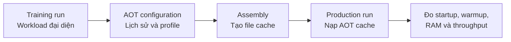
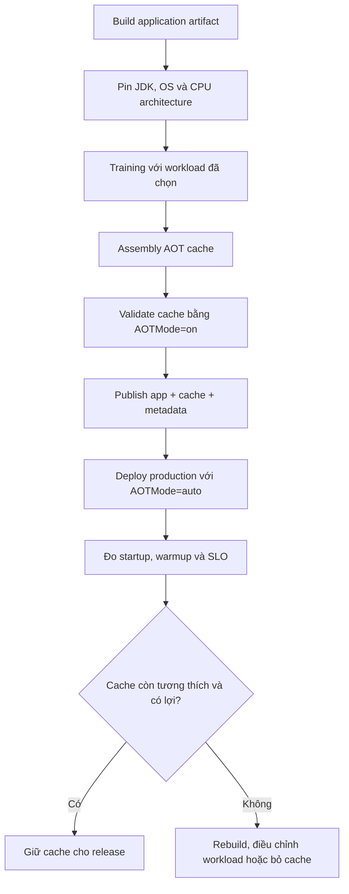

# Cân đối chi phí huấn luyện, dung lượng cache và lợi ích vận hành

## 1. AOT cache giải quyết phần chi phí nào của JVM?

Một ứng dụng Java có thể mất đáng kể thời gian khi khởi động vì JVM phải tìm class, đọc bytecode, nạp class, kiểm tra và liên kết các tham chiếu. Sau khi ứng dụng chạy, JVM tiếp tục thu thập thông tin thực thi để JIT compiler quyết định phương thức nào đáng biên dịch thành mã máy tối ưu. Hai giai đoạn này tạo ra hai loại chi phí khác nhau:

- **Startup:** đưa ứng dụng từ lúc tạo tiến trình đến khi sẵn sàng phục vụ.
- **Warmup:** khoảng thời gian sau startup mà hiệu năng còn thay đổi khi JVM tiếp tục thu thập profile và biên dịch mã nóng.

**Ahead-of-Time cache (AOT cache)** cho phép JVM chuẩn bị trước một số dữ liệu tối ưu hóa trong một lần chạy huấn luyện, lưu chúng thành file cache, rồi sử dụng lại ở những lần chạy sau. Trong Java 25, AOT cache kết hợp khả năng nạp/liên kết class và các object đã chuẩn bị với **method execution profiles** từ lần huấn luyện. Nhờ JEP 515, JIT có thể sử dụng profile đã có ngay khi JVM khởi động, thay vì phải chờ thu thập lại toàn bộ profile trong lần chạy hiện tại.

AOT cache là tính năng của HotSpot/JVM, được giới thiệu qua JEP 483 ở JDK 24. Java 25 bổ sung hai cải tiến vận hành quan trọng:

- **JEP 514 — Ahead-of-Time Command-Line Ergonomics:** đơn giản hóa quy trình tạo cache bằng `-XX:AOTCacheOutput`.
- **JEP 515 — Ahead-of-Time Method Profiling:** lưu profile thực thi phương thức từ training run để hỗ trợ warmup và JIT compilation sớm hơn.

Bài **Cân đối chi phí huấn luyện, dung lượng cache và lợi ích vận hành** thuộc chương **Vận hành AOT** của học phần **JAVA_VERSION_JAVA25**. Học phần tập trung vào những khả năng Java 25 còn áp dụng trong phát triển hiện đại, gồm compact source files, module imports, flexible constructor bodies, `ScopedValue`, KDF API, AOT cache, JFR và đánh giá nâng cấp JDK. Bài này tập trung vào quyết định vận hành: **khi nào nên tạo cache, huấn luyện bao lâu, cần dự trù tài nguyên nào và lợi ích có đủ bù chi phí hay không**.

### Kết quả cần đạt

Sau bài học, bạn có thể:

1. Phân biệt lợi ích AOT cache đối với startup và warmup.
2. Tạo cache Java 25 bằng quy trình một lệnh `-XX:AOTCacheOutput`.
3. Chọn workload huấn luyện đại diện cho ứng dụng thực tế.
4. Ước lượng chi phí CPU, RAM, thời gian training, assembly, dung lượng file và phân phối cache.
5. Hiểu cache phụ thuộc vào ứng dụng, JDK release, hệ điều hành và kiến trúc CPU.
6. Đo baseline và phiên bản có cache bằng workload, heap, JVM flags và môi trường tương đương.
7. Tính điểm hòa vốn và quyết định tạo mới, phân phối hoặc loại bỏ cache.
8. Chẩn đoán cache bị từ chối và triển khai production với chế độ fallback phù hợp.

> **Phạm vi hiện hành:** dùng AOT cache của HotSpot trong JDK 25, JEP 514 và JEP 515. Ví dụ chính không dựa vào workflow CDS cũ hoặc cờ preview. AOT cache vẫn chạy cùng JVM và JIT; nó không biến ứng dụng thành native executable như một quy trình native-image.

## 2. AOT cache chứa gì và không thay thế điều gì?

### 2.1. Các loại thông tin được chuẩn bị trước

Trong Java 25, AOT cache có thể lưu các artifact như:

- **Class metadata và trạng thái class đã nạp/liên kết:** giảm công việc lặp lại khi JVM khởi động.
- **Heap objects đã được chuẩn bị:** các object phù hợp có thể được khôi phục từ cache.
- **Method execution profiles (JEP 515):** thông tin về hành vi thực thi thu thập từ training run, giúp JVM đưa ra quyết định tối ưu hóa sớm hơn.

Method profile là dữ liệu quan sát về hành vi thực thi, không phải toàn bộ mã máy đã biên dịch trước. Khi production chạy, JVM vẫn có JIT compiler và có thể tiếp tục profiling, biên dịch, tối ưu hoặc deoptimize theo hành vi thực tế.

### 2.2. AOT cache khác với các cách tối ưu khác

| Cơ chế | Công việc chính | Phù hợp khi |
|---|---|---|
| AOT cache của HotSpot | Tái sử dụng class/linking artifacts, heap objects và method profiles đã huấn luyện | Muốn cải thiện startup/warmup mà vẫn chạy trên JVM |
| JIT compilation | Biên dịch phương thức khi ứng dụng chạy và JVM có dữ liệu thực thi | Tối ưu hiệu năng theo workload thực tế trong thời gian chạy |
| Native image | Biên dịch ứng dụng và runtime thành executable native theo quy trình riêng | Có yêu cầu về mô hình triển khai và giới hạn runtime phù hợp |
| Spring AOT processing | Sinh metadata/source ở build time cho framework | Giảm công việc khởi tạo framework; có thể kết hợp với AOT cache JVM |

AOT cache **không loại bỏ JIT**, không bảo đảm tất cả phương thức sẽ có mã máy tối ưu ngay ở startup và không sửa được bottleneck do database, network, lock contention hoặc thuật toán ứng dụng.

### 2.3. Startup và warmup là hai mục tiêu cần đo riêng

Một cache có thể rút ngắn thời gian từ lúc JVM khởi động đến lúc ứng dụng sẵn sàng, đồng thời cải thiện những request đầu tiên nhờ method profiles. Tuy nhiên, các con số này không đồng nghĩa throughput tối đa sau nhiều phút chạy sẽ tăng tương ứng.

Ví dụ, một dịch vụ có thể đạt:

- Startup giảm vì phần class loading/linking được tái sử dụng.
- Những request đầu tiên ổn định nhanh hơn vì JIT có profile từ training run.
- Throughput steady-state gần như không đổi vì sau warmup, baseline và cached JVM đều đã tối ưu cùng các đường chạy nóng.

Do đó, không dùng duy nhất “thời gian startup” để kết luận AOT cache có lợi cho toàn bộ hệ thống.

## 3. Mô hình chi phí — training, assembly, cache và production

Quy trình AOT cache có ba giai đoạn khái niệm:



| Giai đoạn | Tài nguyên tiêu thụ | Đầu ra hoặc lợi ích |
|---|---|---|
| Training | CPU và RAM để chạy ứng dụng, nạp class, thực hiện workload và thu thập profile | Dữ liệu huấn luyện, thống kê và profile |
| Assembly | CPU, RAM và I/O để đọc configuration và tạo cache | File cache |
| Distribution | Storage, network, image/artifact registry và thời gian rollout | Cache đến được từng môi trường triển khai |
| Production | Dung lượng lưu cache, công việc nạp cache và JVM runtime | Startup/warmup có thể nhanh hơn |

### 3.1. Chi phí huấn luyện

Training run phải chạy ứng dụng với workload đủ đại diện. Nếu ứng dụng cần đăng nhập, truy vấn database, serialize JSON, gọi service hoặc xử lý message, training nên đi qua các đường chạy quan trọng đó trong môi trường an toàn.

Chi phí training tăng theo thời lượng chạy, số luồng hoạt động và độ rộng của workload. Chạy quá ngắn có thể chỉ thu được profile của startup; chạy quá lâu có thể tăng chi phí CI mà không bổ sung nhiều thông tin có ích.

### 3.2. Chi phí assembly

Trong quy trình một lệnh của Java 25, khi chỉ định `-XX:AOTCacheOutput`, JVM chạy training và sau đó khởi chạy một JVM khác để assembly cache. Điều này tiện lợi, nhưng pipeline phải dành tài nguyên cho **cả tiến trình training và tiến trình assembly**.

Với container có giới hạn RAM chặt, hãy đo peak memory trong lúc tạo cache. Không mặc định máy có đủ RAM chỉ vì bản thân ứng dụng chạy ổn định với `-Xmx` hiện tại. Nếu cần tách tải tài nguyên, dùng quy trình `record` và `create` riêng để chạy assembly trên máy build có nhiều tài nguyên hơn.

### 3.3. Dung lượng cache và phân phối

File cache là một artifact cần được lưu, version hóa và đưa đến runtime. Kích thước phụ thuộc vào ứng dụng, classpath, object được cache và profile được ghi nhận; không có một con số cố định cho mọi dự án.

Khi lập ngân sách, tính cả:

- Kích thước cache cho mỗi ứng dụng.
- Số phiên bản đang được giữ để rollback.
- Số JDK release, hệ điều hành và kiến trúc CPU cần hỗ trợ.
- Dung lượng registry/image và băng thông khi triển khai.
- Thời gian rebuild cache sau mỗi lần cập nhật ứng dụng hoặc runtime.

Một dịch vụ có cache vài chục MB có thể chấp nhận được nếu giúp hàng trăm instance khởi động nhanh hơn. Cũng có trường hợp cache lớn, lợi ích nhỏ và tần suất release cao khiến chi phí phân phối không đáng.

### 3.4. Chi phí vận hành sau khi bật cache

Production vẫn cần JVM heap, metaspace, code cache, GC và các tài nguyên ứng dụng như trước. AOT cache có thể giảm một phần công việc startup và warmup, nhưng không được giả định rằng nó luôn giảm RSS hoặc heap theo một tỷ lệ cố định.

Đo ít nhất:

- Startup đến khi ứng dụng thực sự ready.
- Latency của request đầu tiên và các request trong giai đoạn warmup.
- CPU trong startup, warmup và steady-state.
- RSS/peak memory, heap, metaspace và GC.
- Throughput và p95/p99 latency dưới tải tương đương.
- Dung lượng cache và thời gian nạp/triển khai.

## 4. Quy trình Java 25 một lệnh: tạo và sử dụng cache

### 4.1. Chuẩn bị đúng runtime và artifact

Trước khi tạo cache:

1. Cài JDK 25 có bản vá được hỗ trợ và dùng đúng JDK đó cho training, assembly và production.
2. Build ứng dụng và dependency thành artifact cuối cùng.
3. Ghi nhận JDK vendor/version, OS, CPU architecture, classpath/module path và JVM arguments.
4. Chọn nơi lưu file cache trong thư mục build artifact hoặc workspace CI.
5. Chuẩn bị workload huấn luyện và dữ liệu thử nghiệm an toàn.

Ví dụ ứng dụng dạng JAR/classpath:

```bash
java --version
java -XX:AOTCacheOutput=app-cache \
     -cp app.jar \
     com.example.App --training
```

`-XX:AOTCacheOutput=app-cache` yêu cầu JVM ghi cache vào file `app-cache`. Với AOT mode mặc định `auto`, sự hiện diện của tùy chọn này đưa JVM vào chế độ record; khi training kết thúc, JVM khởi chạy assembly để tạo cache.

JDK dùng phần mở rộng chuẩn `.aot` cho cache và `.aotconfig` cho AOT configuration. Tên file trong ví dụ được rút gọn để dễ đọc; trong pipeline thực tế, nên đặt tên có version hoặc build ID.

Trong ví dụ, `--training` là tham số minh họa do ứng dụng tự định nghĩa, không phải tùy chọn của JVM. Thay bằng command hoặc workload phù hợp với ứng dụng của bạn.

### 4.2. Chạy production với cache

Sau khi file cache được tạo thành công:

```bash
java -XX:AOTCache=app-cache \
     -cp app.jar \
     com.example.App
```

Với production, `AOTMode=auto` là lựa chọn mặc định được tài liệu JDK khuyến nghị: nếu cache tương thích, JVM nạp và sử dụng; nếu cache không thể nạp, ứng dụng vẫn chạy mà không dùng cache. Đây là hành vi fallback hữu ích khi môi trường có thể thêm JVM option hoặc agent ngoài dự kiến.

Để kiểm tra cache có được chấp nhận hay không:

```bash
java -Xlog:aot \
     -XX:AOTCache=app-cache \
     -cp app.jar \
     com.example.App
```

Đọc log AOT để xác nhận cache được nạp hoặc tìm lý do cache bị bỏ qua. Không kết luận chỉ dựa trên việc file cache tồn tại.

### 4.3. Huấn luyện ứng dụng chạy liên tục

Với ứng dụng server không tự thoát sau khi xử lý workload, có thể kết thúc quá trình ghi nhận bằng diagnostic command `AOT.end_recording`:

```bash
jcmd -l
jcmd <pid> AOT.end_recording
```

Thay `<pid>` bằng process ID của JVM đang training. Lệnh kết thúc AOT recording và ghi kết quả ra file đã chỉ định bằng `-XX:AOTConfiguration` và/hoặc `-XX:AOTCacheOutput`.

`jcmd` phải chạy trên cùng máy, cùng user hiệu lực với JVM mục tiêu. Với container riêng, cần xác định PID trong đúng process namespace. Không gửi command này nhầm tới JVM production đang phục vụ request.

### 4.4. Không dùng `AOTCacheOutput` và `AOTCache` cùng một lệnh

Hai tùy chọn có vai trò đối lập:

| Tùy chọn | Mục đích |
|---|---|
| `-XX:AOTCacheOutput=app-cache` | Ghi/tạo cache sau training |
| `-XX:AOTCache=app-cache` | Đọc và sử dụng cache ở production |

JDK 25 không cho phép dùng cả hai tùy chọn trong cùng command line. Nếu cần cache cũ làm đầu vào cho training mở rộng hoặc cần kiểm soát nhiều bước, hãy dùng các AOT mode và configuration file theo mục 5.


## 5. Tách training và assembly khi cần kiểm soát tài nguyên

Quy trình một lệnh phù hợp với nhiều ứng dụng, nhưng không phải lúc nào cũng phù hợp với build runner ít RAM hoặc môi trường cần lưu riêng dữ liệu huấn luyện. Java 25 vẫn hỗ trợ quy trình tách bước bằng `AOTMode`, `AOTConfiguration` và `AOTCache`.

### 5.1. Giai đoạn record: chỉ chạy training

```bash
java -XX:AOTMode=record \
     -XX:AOTConfiguration=app.aotconfig \
     -cp app.jar \
     com.example.App --training
```

Ở giai đoạn này:

- JVM chạy ứng dụng với workload huấn luyện.
- Dữ liệu lịch sử và profile được ghi vào file configuration.
- Ứng dụng thực sự được chạy; đây là nơi bạn đưa workload đại diện vào.
- File configuration có thể được lưu như artifact tạm để assembly ở bước sau.

Nếu ứng dụng chạy liên tục, dùng `jcmd <pid> AOT.end_recording` để kết thúc training. Lệnh này yêu cầu JVM hoàn tất ghi dữ liệu vào file đã cấu hình.

### 5.2. Giai đoạn create: tạo cache từ configuration

```bash
java -XX:AOTMode=create \
     -XX:AOTConfiguration=app.aotconfig \
     -XX:AOTCache=app-cache
```

Giai đoạn `create` đọc configuration và ghi file cache. Ứng dụng **không chạy workload lần nữa** trong bước này. Đây là lợi ích khi muốn huấn luyện trên một máy giống production, sau đó tạo cache trên build runner có nhiều CPU/RAM hơn.

### 5.3. Giai đoạn production

```bash
java -XX:AOTCache=app-cache \
     -cp app.jar \
     com.example.App
```

Có thể dùng cùng một cache ở nhiều instance nếu chúng thỏa điều kiện tương thích. Không tạo một cache duy nhất rồi phân phối vô điều kiện cho mọi JDK, OS hoặc CPU architecture.

### 5.4. Các AOT mode trong Java 25

| Mode | Vai trò | Khi nên dùng |
|---|---|---|
| `auto` | Mặc định; tự chọn record, on hoặc off dựa trên tùy chọn và cache có thể nạp | Production và workflow phổ biến |
| `off` | Không sử dụng AOT cache | Đo baseline hoặc cô lập sự cố |
| `record` | Chạy ứng dụng để thu thập dữ liệu huấn luyện | Training tách riêng |
| `create` | Đọc AOT configuration và tạo cache | Assembly tách riêng |
| `on` | Cố nạp cache; nếu không nạp được thì JVM báo lỗi và dừng | Kiểm tra fail-fast trong CI/staging |

Trong production, ưu tiên `auto` nếu cần ứng dụng tiếp tục hoạt động khi cache không tương thích. `on` hữu ích trong pipeline xác minh hoặc staging vì nó làm lộ lỗi cache sớm; không nên bật mặc định cho mọi production instance nếu một JVM option được thêm ngoài dự kiến có thể khiến ứng dụng không khởi động.

`-XX:AOTCache` và `-XX:AOTCacheOutput` không được dùng cùng một command line. Khi `AOTMode=create`, `-XX:AOTCache` là vị trí file cache được ghi; ở production, cùng tùy chọn đó là file cache được đọc.

## 6. Huấn luyện method profile có đại diện hay không?

### 6.1. JEP 515 làm cho chất lượng workload quan trọng hơn

AOT cache không chỉ lưu những class xuất hiện khi khởi động. Java 25 còn có thể lưu method execution profiles từ training run. JIT sử dụng các quan sát đó để đưa ra quyết định biên dịch và tối ưu hóa sớm trong production.

Vì vậy, một training run chỉ khởi tạo Spring context hoặc nạp class có thể hữu ích cho startup, nhưng chưa chắc đã tạo profile tốt cho các đường xử lý nghiệp vụ. Nếu ứng dụng có nhiều luồng chức năng, hãy huấn luyện trên một phần workload đại diện cho cách ứng dụng được sử dụng thực tế.

Ví dụ dịch vụ thương mại điện tử có thể cần đi qua:

- Đăng nhập và xác thực request.
- Đọc danh mục và chi tiết sản phẩm.
- Tạo giỏ hàng và tính giá.
- Tạo đơn hàng và ghi dữ liệu.
- Serialize/deserialize payload.
- Gọi các service hoặc message broker cần thiết.
- Các nhánh lỗi phổ biến như dữ liệu không hợp lệ hoặc hết hàng.

Không nhất thiết phải thực hiện mọi tổ hợp input. Hãy chọn các luồng có tần suất cao, luồng ảnh hưởng lớn tới latency và những đoạn mã cần khởi tạo nhiều thành phần.

### 6.2. Training quá ngắn, quá dài và sai phân bố

| Kiểu training | Hệ quả có thể gặp | Hướng xử lý |
|---|---|---|
| Chỉ chạy startup | Class artifacts có thể được thu thập, nhưng profile cho luồng nghiệp vụ ít | Thêm workload sau startup |
| Chỉ chạy một endpoint | Profile nghiêng về một luồng, các luồng khác ít được quan sát | Bao phủ nhiều route quan trọng |
| Chạy với dữ liệu khác production | Nhánh code, kiểu object hoặc tần suất method không đại diện | Dùng dữ liệu tổng hợp/sanitized có phân bố gần thực tế |
| Training quá ngắn | Chưa đi qua các luồng quan trọng hoặc method đủ số lần thực thi | Kéo dài có mục tiêu, đo mức độ bổ sung profile |
| Training quá dài | Tốn CPU, thời gian và chi phí build mà lợi ích tăng thêm nhỏ | So sánh các mức training duration |
| Training trên phiên bản cũ | Profile và cache không khớp artifact mới | Tạo lại sau khi build release mới |

Không có một thời lượng training đúng cho mọi ứng dụng. Một CLI chạy vài giây và một dịch vụ Spring Boot xử lý hàng trăm route có nhu cầu khác nhau. Hãy đo lợi ích biên: tăng thêm 5 phút training có cải thiện startup/warmup đủ đáng giá không?

### 6.3. Dùng dữ liệu huấn luyện an toàn

Training nên tái hiện hành vi ứng dụng nhưng không cần dùng dữ liệu khách hàng thật. Ưu tiên:

- Dataset tổng hợp có phân bố tương tự production.
- Dữ liệu đã ẩn danh hoặc được phê duyệt.
- Service dependency test/staging có cấu hình gần production.
- Credential và secret riêng cho môi trường huấn luyện.

Không ghi thông tin nhạy cảm vào log hoặc artifact chỉ để tạo cache. AOT cache là artifact triển khai, cần được bảo vệ, kiểm soát quyền truy cập và lưu giữ theo chính sách giống các artifact build khác.

### 6.4. Ví dụ với Spring Boot

Spring Boot hỗ trợ AOT cache trên Java 25 trở lên. Với executable JAR có dependency lồng bên trong, hướng dẫn Spring Boot yêu cầu giải nén ứng dụng để JVM nhìn thấy layout classpath phù hợp:

```bash
java -Djarmode=tools -jar my-app.jar extract --destination application
cd application
```

Sau đó chạy training trên ứng dụng đã extract. Nếu mục tiêu chỉ là startup/class loading, có thể dùng `-Dspring.context.exit=onRefresh`. Nhưng với Java 25 và JEP 515, muốn thu thập method profiles hữu ích thì nên chạy một phần workflow gần production, gửi traffic thử nghiệm vào ứng dụng rồi kết thúc training bằng `jcmd <pid> AOT.end_recording`.

Ví dụ lệnh khởi động training:

```bash
java -XX:AOTCacheOutput=app-cache \
     -jar my-app.jar
```

Trong một terminal khác, dùng load generator đã chuẩn bị để gọi các endpoint cần huấn luyện. Khi đã chạy đủ kịch bản, xác định PID và kết thúc AOT recording. Sau đó kiểm tra file cache đã được tạo.

Khi chạy production, phải dùng **cùng dạng extracted application** và cùng classpath đã dùng khi tạo cache:

```bash
java -XX:AOTCache=app-cache \
     -jar my-app.jar
```

Không dùng cache được huấn luyện trên extracted layout rồi quay lại chạy JAR lồng dependency theo cách khác mà không kiểm tra tương thích. Với Spring Boot, giữ nguyên thứ tự classpath, file JAR và timestamp của dependency trong pipeline tạo và sử dụng cache.

### 6.5. Tránh training chỉ để có file cache

Có file cache không đồng nghĩa cache có chất lượng. Một cache tạo thành công nhưng không bao phủ luồng quan trọng có thể mang lại lợi ích startup nhỏ và không cải thiện warmup như kỳ vọng.

Hãy lưu cùng cache một bản mô tả training: phiên bản ứng dụng, JDK, danh sách workload, thời lượng, số request theo nhóm, dữ liệu test và các JVM option. Điều này giúp so sánh cache giữa các release và giải thích khi hiệu năng thay đổi.


## 7. Tính tương thích và thời điểm phải tạo lại cache

AOT cache không phải file dùng chung cho mọi bản build. JDK ràng buộc cache với ứng dụng, JDK release và nền tảng chạy.

### 7.1. Các điều kiện phải kiểm soát

| Thành phần | Yêu cầu vận hành |
|---|---|
| Ứng dụng | Dùng đúng artifact và classpath/module path đã huấn luyện |
| Dependency | Giữ cùng phiên bản, thứ tự classpath và file JAR |
| JDK | Dùng cùng JDK release; chính sách triển khai nên pin vendor/build và tạo lại cache khi nâng JDK |
| Hệ điều hành | Tạo cache riêng cho từng OS cần triển khai |
| CPU architecture | Không dùng cache x86-64 cho AArch64 hoặc ngược lại |
| JVM options | Giữ các option tương thích giữa training và production |
| Java agents | Kiểm tra các agent có instrument class hoặc dùng JVMTI; chúng có thể khiến cache không nạp được |

Để dễ tái lập, đặt cache cạnh đúng bản build mà nó thuộc về và ghi metadata: commit/build ID, checksum của JAR, JDK version, OS, CPU architecture, classpath, JVM flags và thời điểm training.

### 7.2. Khi nào cần tạo lại?

Hãy tạo cache mới sau các thay đổi có thể làm thay đổi ứng dụng hoặc điều kiện tương thích:

- Build lại ứng dụng hoặc thay dependency.
- Thay đổi classpath, module path, thứ tự JAR hoặc layout đóng gói.
- Nâng JDK release hoặc thay đổi bản phân phối/runtime theo chính sách triển khai.
- Chuyển OS hoặc CPU architecture.
- Thay đổi JVM options hoặc Java agent khiến cache không tương thích.
- Thay đổi lớn về workload khiến method profiles cũ không còn đại diện.

Không sao chép cache từ release trước rồi hy vọng JVM sẽ tự cập nhật phần khác biệt. Cache là artifact được tạo cho một tổ hợp cụ thể; nếu thay đổi tổ hợp đó, hãy tạo cache mới.

### 7.3. Các option có thể ảnh hưởng đến việc nạp cache

Tài liệu JDK nêu rằng cache có thể không nạp được khi ứng dụng, JDK release, OS/CPU hoặc một số JVM options không tương thích. Những công cụ chẩn đoán dùng JVMTI hoặc class-file load hook có thể tác động đến cache.

`-XX:+AOTClassLinking` cho phép thêm tối ưu hóa class linking. Khi dùng AOT mode tường minh, option này được bật tự động; có thể tắt bằng `-XX:-AOTClassLinking` nếu cần kiểm tra tính tương thích với môi trường có option khác. Đây là lựa chọn nâng cao, chỉ nên thay đổi sau khi đo và kiểm thử.

Không thêm hàng loạt option JVM để ép cache được nạp. Trước tiên hãy chạy với option production thực tế và xem `-Xlog:aot` để biết lý do.

### 7.4. Quy tắc riêng với Spring Boot

Với Spring Boot executable JAR, cache nên được tạo và sử dụng trên **extracted application layout** theo hướng dẫn của Spring Boot. Hãy giữ:

- Cùng extracted directory structure.
- Cùng tập JAR và thứ tự classpath.
- Timestamp của dependency JAR theo đúng layout huấn luyện.
- Cùng JDK và nền tảng runtime.

Cache được tạo từ một layout classpath khác có thể không có tác dụng hoặc bị từ chối. Không thay đổi cách chạy JAR sau khi tạo cache mà không đo lại.

## 8. Cân đối RAM, dung lượng file và chi phí triển khai

### 8.1. Phân biệt ba con số

Đừng gộp tất cả thành một khái niệm “cache size”:

1. **Dung lượng file cache:** số byte cần lưu trong workspace, artifact registry hoặc container image.
2. **Peak memory khi tạo cache:** gồm training JVM và assembly JVM; quy trình một lệnh có thể cần thêm RAM khi JVM assembly được khởi chạy.
3. **Memory footprint khi chạy production:** RSS, working set, heap và phần bộ nhớ dùng cho JVM/application trong môi trường thật.

File cache 100 MB không có nghĩa production RSS tăng đúng 100 MB. Tương tự, cache file nhỏ cũng không bảo đảm ứng dụng dùng ít RAM hơn. Hãy đo từng chỉ số riêng.

### 8.2. Dự trù tài nguyên cho quy trình một lệnh

`-XX:AOTCacheOutput` tự động hóa record và assembly, nhưng assembly dùng một JVM process khác. Trong pipeline có heap lớn, cần dành headroom cho giai đoạn này thay vì chỉ cấp RAM vừa đủ cho training JVM.

Nếu build runner có giới hạn tài nguyên:

- Giảm số training job chạy song song.
- Theo dõi peak RSS và container memory limit trong toàn bộ quá trình.
- Tránh đặt `-Xms` lớn nếu ứng dụng không cần heap khởi đầu lớn như vậy.
- Chuyển sang workflow tách `record` và `create` nếu cần dùng máy build khác có nhiều RAM/CPU hơn.
- Bảo đảm máy assembly vẫn dùng đúng JDK release, OS và CPU architecture tương thích với cache đích.

Có thể truyền JVM options cho tiến trình assembly qua biến môi trường `JDK_AOT_VM_OPTIONS`. Chỉ dùng khi cần kiểm soát riêng assembly; ghi lại option đã dùng để có thể tái tạo cache.

### 8.3. Ước lượng dung lượng lưu giữ

Nếu có nhiều ứng dụng và nhiều nền tảng, số file cache tăng theo số tổ hợp cần hỗ trợ:

```text
Số cache cần giữ
  = số ứng dụng
  × số phiên bản ứng dụng đang hỗ trợ
  × số JDK release/runtime cần hỗ trợ
  × số tổ hợp OS/CPU architecture
```

Đây là cách ước lượng số artifact, không phải công thức kích thước byte. Để dự toán storage, lấy kích thước cache thực tế của từng ứng dụng rồi nhân theo số phiên bản và nền tảng cần giữ.

Ví dụ một dịch vụ có ba release cần rollback, hai nền tảng CPU và hai JDK release được hỗ trợ có thể cần tối đa 12 cache artifact nếu mọi tổ hợp đều được tạo riêng. Có thể giảm số lượng bằng cách chuẩn hóa runtime/platform mà tổ chức triển khai, nhưng không tái sử dụng cache ngoài phạm vi tương thích.

### 8.4. Đặt cache ở đâu?

| Vị trí | Ưu điểm | Điều cần cân nhắc |
|---|---|---|
| Artifact registry | Version hóa, checksum và rollback rõ | Tăng dung lượng registry và thời gian tải |
| Container image layer | Cache đi cùng release, triển khai đơn giản | Image lớn hơn; mỗi platform cần artifact tương ứng |
| Volume hoặc mounted file | Có thể cập nhật cache độc lập với image | Phải đồng bộ version cache với ứng dụng |
| Local ephemeral disk | Dễ thử nghiệm, không cần registry riêng | Cache có thể mất khi instance thay thế |

Trong production, ưu tiên cơ chế phân phối có thể xác định chính xác cache nào thuộc build nào. Tránh đặt một file tên chung như `app-cache` ở vị trí dùng chung cho nhiều release mà không có version hoặc checksum.

## 9. Đo lợi ích: baseline, startup, warmup và steady-state

### 9.1. Chuẩn bị phép đo công bằng

Tạo hai cấu hình:

- **Baseline:** chạy cùng ứng dụng trên JDK 25 nhưng không sử dụng AOT cache.
- **Cached:** chạy cùng artifact và runtime với file cache đã tạo.

Ví dụ baseline:

```bash
java -XX:AOTMode=off \
     -cp app.jar \
     com.example.App
```

Ví dụ cached:

```bash
java -XX:AOTCache=app-cache \
     -cp app.jar \
     com.example.App
```

Giữ giống nhau giữa hai lần chạy:

- JDK vendor/version, heap, GC và JVM options khác.
- Artifact ứng dụng, dependency và dữ liệu đầu vào.
- CPU, RAM, container limit và host load.
- Cách xác định thời điểm startup hoàn tất.
- Kịch bản tải và thời lượng đo.

Nếu thay đổi heap, GC, agent hoặc CPU limit giữa hai cấu hình, bạn không còn biết chênh lệch đến từ AOT cache hay từ thay đổi khác.

### 9.2. Đo startup đến trạng thái ready

Không chỉ đo thời gian từ lúc gõ lệnh `java` đến khi main method bắt đầu. Với web service, đo từ lúc process được tạo đến khi readiness endpoint thành công hoặc ứng dụng thực sự nhận request.

Ghi lại:

- Thời gian JVM khởi động.
- Thời gian framework/container sẵn sàng.
- Thời gian đến readiness.
- Thời gian đến request thành công đầu tiên.

Đo nhiều lần và dùng median, p95 hoặc phân bố phù hợp. Tách cold-start và warm-start nếu môi trường có page cache/OS cache ảnh hưởng kết quả.

### 9.3. Đo warmup

Dùng một load test có tốc độ và dữ liệu ổn định. Chia kết quả thành các cửa sổ thời gian, ví dụ 0–30 giây, 30–60 giây, 1–3 phút và giai đoạn steady-state.

Theo dõi:

- Request throughput.
- p50, p95 và p99 latency.
- CPU usage và compilation activity.
- GC pause/allocation.
- Thời gian đạt ngưỡng SLO hoặc throughput mục tiêu.

AOT method profiles có thể giúp các phương thức nóng được tối ưu sớm hơn. Nếu workload training khác production, lợi ích có thể giảm hoặc không xuất hiện trên các đường chạy thực tế.

### 9.4. Đo steady-state và memory

Sau khi warmup, tiếp tục chạy tải đủ lâu để biết AOT cache có ảnh hưởng đến hiệu năng ổn định hay không. Một cache chỉ rút ngắn startup nhưng không đổi throughput vẫn có thể rất có giá trị với ứng dụng scale-to-zero; ngược lại, dịch vụ chạy dài ngày và ít restart có thể không thu hồi được chi phí training.

Ghi thêm:

- RSS và peak RSS.
- Heap used/committed.
- Metaspace và code cache.
- GC frequency và pause.
- Dung lượng file cache.
- Thời gian tải cache và thời gian rollout.

Không kết luận AOT cache làm giảm memory chỉ từ heap graph. So sánh RSS và container working set trong cùng điều kiện.

### 9.5. Xác nhận cache thực sự được sử dụng

Dùng `-Xlog:aot` để xem JVM chấp nhận hoặc từ chối cache. Nếu cache bị từ chối nhưng JVM vẫn chạy theo chế độ `auto`, phép đo startup có thể thực chất là baseline.

Trong một lần kiểm tra có kiểm soát, dùng:

```bash
java -XX:AOTMode=on \
     -XX:AOTCache=app-cache \
     -Xlog:aot \
     -cp app.jar \
     com.example.App
```

Mode `on` làm JVM dừng nếu không thể nạp cache, hữu ích để CI/staging xác minh. Sau khi kiểm chứng, production thường nên dùng mode mặc định `auto` để có fallback.

## 10. Tính điểm hòa vốn và quyết định đầu tư

### 10.1. Ước lượng thời gian tiết kiệm mỗi lần khởi động

Ký hiệu:

- `T0`: thời gian startup baseline.
- `T1`: thời gian startup khi dùng AOT cache.
- `ΔT = T0 - T1`: thời gian tiết kiệm trên mỗi lần khởi động.
- `N`: số lần khởi động trong khoảng thời gian đánh giá.

Tổng thời gian startup tiết kiệm ước lượng:

```text
Startup time saved = N × ΔT
```

Ví dụ giả định:

| Chỉ số | Baseline | Có cache |
|---|---:|---:|
| Startup đến ready | 4,0 giây | 2,5 giây |
| Tiết kiệm mỗi lần | — | 1,5 giây |
| Số lần khởi động/tháng | 10.000 | 10.000 |
| Thời gian startup tiết kiệm/tháng | — | 15.000 giây |

Các con số trên chỉ minh họa cách tính, không phải benchmark chung cho Java 25.

### 10.2. Tính chi phí tạo và phân phối

Ghi lại:

- Thời gian training.
- Thời gian assembly.
- CPU time và peak RAM của hai giai đoạn.
- Thời gian upload/download cache.
- Storage tăng thêm và số phiên bản cần giữ.
- Chi phí tạo lại cache sau mỗi release.

Một công thức hòa vốn đơn giản theo thời gian:

```text
N_break_even
  ≈ (T_training + T_assembly + T_distribution)
     / ΔT_startup
```

Công thức này chỉ là ước lượng khi các đại lượng đang được quy đổi về cùng đơn vị thời gian. Nó chưa tính chi phí storage, tiền CPU/RAM theo giá cloud hoặc giá trị của việc đáp ứng SLO. Khi ra quyết định production, quy đổi tài nguyên sang chi phí tiền tệ và tính cả lợi ích giảm latency trong giai đoạn warmup.

### 10.3. Khi nào lợi ích thường đáng giá?

| Đặc điểm hệ thống | Mức độ nên thử AOT cache |
|---|---|
| Serverless hoặc scale-to-zero, thường xuyên tạo process mới | Cao, vì startup ảnh hưởng trực tiếp tới thời gian đáp ứng |
| Kubernetes autoscaling với nhiều pod khởi động khi tải tăng | Cao, nếu startup là nút thắt rollout/scale-out |
| CLI hoặc job chạy ngắn, mỗi lần khởi chạy có overhead đáng kể | Nên benchmark |
| Dịch vụ chạy dài ngày, ít restart và warmup không ảnh hưởng SLO | Cần tính ROI kỹ |
| Ứng dụng thay đổi liên tục, dependency biến động lớn | Cân nhắc chi phí tạo lại/phân phối cache |
| Ứng dụng đã có startup nhanh và ít đường chạy nóng | Có thể lợi ích nhỏ |

Không quyết định chỉ theo một lần benchmark local. Hãy so sánh lợi ích trong mô hình triển khai thật: số instance, số lần rollout, scale-out frequency và yêu cầu latency.


## 11. Tích hợp AOT cache vào CI/CD và rollout

### 11.1. Quy trình build đề xuất

Một pipeline có thể tổ chức theo các bước:



Pipeline nên tạo cache **sau khi artifact cuối cùng đã được đóng gói**. Nếu tạo cache trước khi thay JAR hoặc dependency, cache có thể không còn tương thích với artifact được publish.

### 11.2. Ví dụ script CI đơn giản

Ví dụ Bash dưới đây giả định:

- `app.jar` đã được build.
- Runner dùng JDK 25 trên đúng OS/CPU architecture của production.
- Ứng dụng có tham số `--training` để chạy workload huấn luyện rồi kết thúc.
- Ứng dụng có thể khởi động ở chế độ smoke test bằng tham số `--smoke`.

```bash
set -euo pipefail

java --version
java -XX:AOTCacheOutput=app-cache \
     -cp app.jar \
     com.example.App --training

test -s app-cache

# Fail-fast trong CI: cache phải nạp được.
java -XX:AOTMode=on \
     -XX:AOTCache=app-cache \
     -Xlog:aot \
     -cp app.jar \
     com.example.App --smoke

sha256sum app.jar app-cache
ls -lh app.jar app-cache
```

Tham số `--training` và `--smoke` là giao kèo do ứng dụng định nghĩa, không phải JVM options. Nếu ứng dụng server chạy liên tục, hãy chạy load generator trong lúc training và kết thúc bằng `jcmd <pid> AOT.end_recording`.

Sau khi validation pass, publish **cặp artifact** gồm JAR và cache cùng metadata build. Nếu CI tạo cache nhưng không xác minh cache được nạp, pipeline có thể publish một file tồn tại nhưng không có giá trị vận hành.

### 11.3. Production launch

Production có thể chạy với chế độ mặc định `auto`:

```bash
java -XX:AOTCache=app-cache \
     -cp app.jar \
     com.example.App
```

Nếu cache không tương thích, JVM tiếp tục chạy mà không sử dụng cache. Hãy thu thập log AOT ở staging hoặc trong một đợt kiểm tra để biết cache có thực sự được sử dụng.

Không dùng `AOTMode=on` làm mặc định cho mọi production instance nếu ứng dụng cần khả năng tự khởi động khi cache bị thiếu hoặc bị từ chối. Dùng `on` cho validation/fail-fast; dùng `auto` cho khả năng fallback.

### 11.4. Cache theo release và rollback

Đặt tên artifact có định danh, ví dụ:

```text
orders-service/
  2026.11.27-build-184/
    app.jar
    app-cache
    aot-metadata.json
```

Metadata nên có:

- Application version/commit và checksum artifact.
- JDK vendor, version và build.
- OS, CPU architecture.
- Training workload version và thời lượng.
- JVM arguments dùng khi training/assembly.
- Dung lượng cache và checksum.
- Kết quả kiểm tra cache load và benchmark.

Khi rollback, triển khai đúng cặp JAR/cache của release trước. Không ghép JAR của release mới với cache cũ chỉ vì tên main class không đổi.

## 12. Chẩn đoán lỗi và tình huống cache không có lợi

| Triệu chứng | Nguyên nhân có thể | Cách kiểm tra hoặc xử lý |
|---|---|---|
| Không tạo được file cache | Training chưa kết thúc, JVM không ghi được file hoặc assembly thất bại | Kiểm tra exit code, quyền ghi, dung lượng đĩa và log AOT |
| File cache có nhưng JVM bỏ qua | App/JDK/OS/CPU hoặc JVM option không tương thích | Chạy `-Xlog:aot`, so sánh metadata training và production |
| CI pass nhưng production không dùng cache | CI và production khác JDK build, classpath hoặc agent | Pin runtime, giữ dependency order và kiểm tra Java agent |
| Startup gần như không đổi | Startup chủ yếu chờ network/database hoặc cache không được nạp | Kiểm tra log, đo class loading và thời gian readiness |
| Startup cải thiện nhưng warmup không đổi | Training chưa đi qua đường chạy nghiệp vụ | Huấn luyện bằng workload production-like và đo lại |
| Warmup không ổn định | Profile training không đại diện cho traffic thực tế | Mở rộng workload hoặc tạo cache mới |
| Assembly bị OOM | Runner thiếu RAM khi JVM thứ hai được khởi chạy | Giảm concurrency, dành headroom hoặc tách record/create |
| Container image tăng quá lớn | Cache được đóng vào image cho nhiều platform/release | Đo kích thước, giữ số phiên bản cần thiết và cân nhắc phân phối riêng |
| Cache thường xuyên phải tạo lại | App/dependency/JDK thay đổi liên tục | Tính chi phí mỗi release; chuẩn hóa runtime hoặc bỏ cache nếu ROI thấp |
| Spring Boot cache không có tác dụng | Training và production dùng layout JAR khác nhau | Dùng extracted application cho cả hai giai đoạn |
| Cache fail khi bật monitoring agent | Agent/JVMTI class-file hook không tương thích | Kiểm tra option và agent; thử cấu hình đúng production trong staging |
| Kết quả benchmark thay đổi mạnh | Host load, cold/warm filesystem cache hoặc workload không ổn định | Lặp nhiều lần, cố định môi trường và báo cáo median/phân vị |

### 12.1. Phân biệt lỗi cache với lỗi ứng dụng

AOT cache là tối ưu hóa. Khi chạy production với `AOTMode=auto`, cache bị từ chối thường khiến JVM tiếp tục khởi động mà không có lợi ích AOT. Nếu ứng dụng vẫn lỗi sau đó, hãy điều tra lỗi ứng dụng, dependency hoặc cấu hình runtime riêng.

Khi cần kiểm tra nghiêm ngặt, chạy `AOTMode=on` ở CI/staging để biến tình huống cache không nạp được thành lỗi rõ ràng. Đừng thay đổi đồng thời classpath, heap, GC và Java agent trong lúc chẩn đoán; mỗi thay đổi làm khó xác định nguyên nhân.

### 12.2. Khi nào nên bỏ cache?

Bỏ AOT cache nếu sau benchmark có kiểm soát:

- Startup/warmup cải thiện không đáng kể.
- Cache bị từ chối thường xuyên do môi trường triển khai thay đổi.
- Training và assembly tiêu tốn nhiều CPU/RAM hơn giá trị thu được.
- Dung lượng cache làm image hoặc rollout vượt ngân sách.
- Tần suất cập nhật ứng dụng khiến cache luôn lỗi thời.
- Bottleneck chính nằm ở database, network hoặc logic nghiệp vụ, không nằm ở JVM startup/warmup.

AOT cache là một lựa chọn tối ưu hóa, không phải điều kiện để ứng dụng Java 25 hoạt động đúng.

## 13. Bài thực hành: xây cache, đo và quyết định

### 13.1. Mục tiêu

Tạo một ứng dụng JAR nhỏ, huấn luyện cache trên JDK 25, chạy baseline và cached, sau đó ghi nhận chi phí tạo cache và lợi ích vận hành.

### 13.2. Chuẩn bị ứng dụng

Tạo `src/com/example/App.java`:

```java
package com.example;

public final class App {

    private static long calculate(int rounds) {
        long result = 1;
        for (int i = 1; i <= rounds; i++) {
            result = 31 * result + (i % 97);
        }
        return result;
    }

    private static void trainingWorkload() {
        for (int i = 0; i < 20_000; i++) {
            calculate(200);
        }
    }

    public static void main(String[] args) {
        if (args.length > 0 && args[0].equals("--training")) {
            trainingWorkload();
            System.out.println("training workload completed");
            return;
        }

        if (args.length > 0 && args[0].equals("--smoke")) {
            System.out.println("smoke result: " + calculate(1_000));
            return;
        }

        System.out.println("normal result: " + calculate(1_000));
    }
}
```

Đây là workload minh họa để thấy một method được gọi lặp lại. Nó không đại diện cho ứng dụng production và không phải benchmark hiệu năng tổng quát. Khi thực hành với dịch vụ thật, thay bằng kịch bản request thực tế và dữ liệu thử nghiệm phù hợp.

### 13.3. Build JAR

Từ thư mục dự án:

```bash
javac --release 25 -d out src/com/example/App.java
jar --create --file app.jar \
    --main-class com.example.App \
    -C out .
```

Class nằm trong JAR để classpath có cấu trúc ổn định, phù hợp với yêu cầu cache. Ghi lại JDK và checksum của JAR trước khi training.

### 13.4. Tạo cache và xác minh

```bash
java -XX:AOTCacheOutput=app-cache \
     -cp app.jar \
     com.example.App --training

test -s app-cache

java -XX:AOTMode=on \
     -XX:AOTCache=app-cache \
     -Xlog:aot \
     -cp app.jar \
     com.example.App --smoke
```

Nếu lệnh fail-fast chạy thành công, cache được chấp nhận trong cấu hình thử nghiệm đó. Lưu log và kích thước file cache.

### 13.5. So sánh baseline và cached

Chạy nhiều lần trong cùng môi trường:

```bash
java -XX:AOTMode=off \
     -cp app.jar \
     com.example.App

java -XX:AOTCache=app-cache \
     -cp app.jar \
     com.example.App
```

Đo wall-clock startup và thời gian đến output/ready. Lặp lại đủ số lần để giảm ảnh hưởng của host load. Với ứng dụng server, bổ sung readiness probe và load test để đo warmup/latency, vì ví dụ CLI trên chỉ minh họa quy trình.

### 13.6. Ghi nhận kết quả

| Chỉ số | Baseline | AOT cache | Chênh lệch |
|---|---:|---:|---:|
| Training time | Không có | Ghi số đo | — |
| Assembly time | Không có | Ghi số đo | — |
| Cache file size | Không có | Ghi số đo | — |
| Startup median | Ghi số đo | Ghi số đo | `T0 - T1` |
| Startup p95 | Ghi số đo | Ghi số đo | `p95 baseline - p95 cached` |
| Warmup đến SLO | Ghi số đo | Ghi số đo | Ghi chênh lệch |
| Peak RSS | Ghi số đo | Ghi số đo | Ghi chênh lệch |
| Throughput steady-state | Ghi số đo | Ghi số đo | Ghi chênh lệch |

Không điền số giả định vào báo cáo benchmark. Dùng kết quả thực thi trên máy thử nghiệm và ghi rõ JDK, CPU, OS, heap, GC, số lần chạy và phương pháp đo.

## 14. Checklist nghiệm thu và quyết định vận hành

### Trước khi tạo cache

- [ ] Đã pin JDK 25, vendor/build, OS và CPU architecture.
- [ ] Artifact ứng dụng và dependency đã hoàn tất.
- [ ] Classpath/module path ổn định và được ghi nhận.
- [ ] Workload huấn luyện đại diện cho startup và các đường chạy quan trọng.
- [ ] Dữ liệu training không chứa thông tin nhạy cảm không cần thiết.
- [ ] Runner có đủ CPU, RAM, storage và headroom cho assembly.

### Trước khi publish

- [ ] File cache được tạo hoàn chỉnh.
- [ ] Cache load thành công trong validation với `AOTMode=on`.
- [ ] Đã ghi checksum và metadata của JAR/cache.
- [ ] Đã đo dung lượng cache và chi phí tạo.
- [ ] Đã đo baseline/cached trên cùng môi trường.
- [ ] Đã kiểm tra startup, warmup, memory và throughput.
- [ ] Đã quyết định lợi ích có bù chi phí hay không.

### Khi deploy production

- [ ] JAR và cache thuộc cùng release/build.
- [ ] Runtime JDK, OS và CPU tương thích.
- [ ] Classpath và JVM options phù hợp với training.
- [ ] Production dùng `AOTMode=auto` nếu cần fallback.
- [ ] Log AOT có thể được bật để chẩn đoán.
- [ ] Có kế hoạch tạo cache mới khi app/JDK/platform thay đổi.
- [ ] Rollback dùng đúng cặp artifact của release cũ.

### Quyết định giữ hay bỏ cache

Giữ cache khi nó tạo ra lợi ích đo được cho startup/warmup hoặc SLO, và chi phí training, assembly, storage, phân phối vẫn nằm trong ngân sách. Bỏ cache khi lợi ích nhỏ, môi trường không ổn định hoặc chi phí duy trì vượt giá trị vận hành.

## 15. Tài liệu chính thức và phạm vi phiên bản

- [JEP 483 — Ahead-of-Time Class Loading & Linking](https://openjdk.org/jeps/483): nền tảng AOT cache, training/assembly/production và điều kiện tương thích.
- [JEP 514 — Ahead-of-Time Command-Line Ergonomics](https://openjdk.org/jeps/514): tùy chọn `-XX:AOTCacheOutput` và quy trình tạo cache gọn hơn trong Java 25.
- [JEP 515 — Ahead-of-Time Method Profiling](https://openjdk.org/jeps/515): method execution profiles trong AOT cache để hỗ trợ JIT và warmup.
- [Oracle Java 25 — The `java` Command, Ahead-of-Time Cache](https://docs.oracle.com/en/java/javase/25/docs/specs/man/java.html): `AOTCache`, `AOTCacheOutput`, `AOTConfiguration`, `AOTMode`, fallback và log.
- [Oracle Java 25 — The `jcmd` Command](https://docs.oracle.com/en/java/javase/25/docs/specs/man/jcmd.html): diagnostic command `AOT.end_recording`.
- [Oracle — Significant Changes in JDK 25](https://docs.oracle.com/en/java/javase/25/migrate/significant-changes-jdk-25.html): xác nhận JEP 514 và JEP 515 trong JDK 25.
- [Spring Boot — AOT Cache](https://docs.spring.io/spring-boot/reference/packaging/aot-cache.html): extracted application và cách huấn luyện/nạp cache trong Spring Boot.
- [Spring Framework — JVM AOT Cache](https://docs.spring.io/spring-framework/reference/integration/aot-cache.html): classpath, extracted layout và khuyến nghị dùng workload gần production để thu thập method profiles.

*Phạm vi đối chiếu: 27/11/2026.* Bài dùng AOT cache HotSpot, JEP 514 và JEP 515 của Java 25. Các ví dụ chính không dựa vào workflow CDS cũ hoặc cờ preview. Hiệu quả thực tế phụ thuộc ứng dụng, workload, JDK vendor/build, OS, CPU architecture và cách triển khai; cần benchmark trên môi trường đích trước khi áp dụng rộng.
