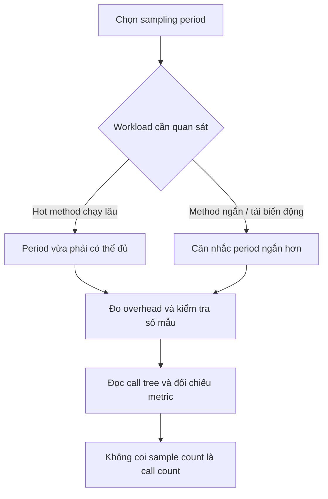

# Ảnh hưởng của cơ chế lấy mẫu đến stack trace và việc nhận diện điểm nóng

> **Chương:** Lấy mẫu JFR  
> **Phạm vi module:** `JAVA_VERSION_JAVA25` — thực hành các khả năng Java hiện đại còn áp dụng, trong đó JDK Flight Recorder (JFR) hỗ trợ quan sát hiệu năng, CPU, thread, GC và hành vi runtime để đánh giá ứng dụng Java 25.  
> **Mục tiêu:** Hiểu cơ chế lấy mẫu stack trace, tác động của sampling period và stack depth, cách đọc call tree/hot methods, giới hạn khi suy luận điểm nóng, và khi nào cần dùng CPU-time profiling hoặc method tracing có instrumentation.  
> **Mốc cập nhật:** Java 25 (JEP 518, 509, 520) và các thay đổi liên quan đến JFR trong JDK 27. Bài chỉ dùng công cụ JFR hiện hành; không dùng hướng dẫn JFR cũ yêu cầu mở commercial features hay cờ chẩn đoán không còn cần thiết.

Khi một ứng dụng Java chậm, câu hỏi thường gặp là: **thời gian đang tiêu tốn ở method nào, qua đường gọi nào và trên thread nào?** JFR trả lời câu hỏi đó bằng nhiều loại dữ liệu. Một trong những nguồn quan trọng là **execution sampling**: JVM định kỳ ghi lại stack trace của các thread đang chạy Java code. Khi tổng hợp nhiều mẫu, ta có thể thấy method nào xuất hiện thường xuyên trong các stack và có khả năng đang tiêu thụ phần lớn thời gian CPU.

Sampling có ưu điểm là không phải chèn bộ đếm vào từng method call. Tuy nhiên, nó là phép đo thống kê: mỗi sample chỉ là một lát cắt tại một thời điểm. Vì vậy, số mẫu không phải số lần gọi method, stack trace không phải bản ghi mọi lời gọi, và một method chạy rất ngắn có thể không xuất hiện trong recording.

Java 25 còn cải thiện cách JFR lấy stack bằng **JEP 518 — JFR Cooperative Sampling**, bổ sung **JEP 509 — JFR CPU-Time Profiling** (experimental, Linux) và **JEP 520 — JFR Method Timing & Tracing**. Hiểu đúng vai trò của từng cơ chế giúp chọn dữ liệu phù hợp thay vì diễn giải một flame graph như kết quả đo tuyệt đối.

## 1. Sampling ghi nhận điều gì?

Trong một lần execution sample, JFR ghi lại snapshot stack của một thread đang thực thi Java code. Stack cho biết method hiện tại và các caller đang dẫn tới vị trí đó.

Ví dụ một mẫu có thể biểu diễn đường gọi:

```text
com.acme.order.OrderService.calculateTotal()
  com.acme.order.OrderController.create()
    org.springframework.web.servlet.FrameworkServlet.doPost()
      ...
```

Nếu method `calculateTotal` xuất hiện trong nhiều mẫu của nhiều request, đó là tín hiệu đáng điều tra. Tuy nhiên, sample chỉ ghi nhận **method đang hoạt động tại thời điểm lấy mẫu**, không ghi mọi method đã được gọi trước hoặc sau thời điểm đó.

JFR có các event quan trọng:

| Event | Dữ liệu | Dùng để |
|---|---|---|
| `jdk.ExecutionSample` | Snapshot stack của thread đang chạy Java code | Nhận diện hot methods, call tree và flame graph |
| `jdk.NativeMethodSample` | Snapshot của thread đang ở native code | Bổ sung góc nhìn về native execution trong cấu hình/runtime hỗ trợ |
| `jdk.CPUTimeSample` | CPU-time sample, có thể bao gồm Java và native code | Phân tích CPU-time chính xác hơn trên Linux; experimental từ JDK 25 |
| `jdk.ThreadCPULoad` | Ước lượng tải CPU theo thread | Xác định thread tiêu thụ CPU; kết hợp với method samples |
| `jdk.CPULoad` | CPU load của JVM và máy | Phân biệt JVM đang bận CPU hay máy đang bận bởi process khác |

Trong bài, `jdk.ExecutionSample` là nền tảng để học sampling và stack trace. `jdk.CPUTimeSample` và method tracing được dùng để giải thích những trường hợp mà execution sampling chưa đủ.

### Sampling khác event duration như thế nào?

- **Sampling:** chụp stack tại các thời điểm rời rạc; phù hợp tìm phần code nóng trong workload dài.
- **Duration event:** ghi nhận một sự kiện có thời gian bắt đầu/kết thúc, ví dụ socket read, monitor wait, file I/O; phù hợp tìm thời gian chờ.
- **Method tracing:** dùng instrumentation để ghi nhận các lần thực thi method được chọn; phù hợp điều tra sâu một số method, đổi lại có overhead lớn hơn sampling.

Không dùng execution sample để kết luận một thread bị block lâu. Thread đang chờ I/O, ngủ hoặc đợi lock thường không nằm trong nhóm thread được `jdk.ExecutionSample` lấy mẫu.

## 2. JEP 518: cooperative sampling cải thiện stack trace ra sao?

Trước đây, lấy stack của một thread đang chạy bất đồng bộ đặt ra hai yêu cầu khó cân bằng:

1. Stack phải ở trạng thái an toàn để JVM có thể đi qua các frame và đọc metadata.
2. Mẫu phải đại diện cho vị trí thực sự đang chạy, tránh chỉ phản ánh những vị trí gần safepoint.

Một **safepoint** là vị trí/trạng thái mà JVM có thể dừng thread an toàn để thực hiện công việc runtime. Nếu chỉ lấy stack ở safepoint, mẫu có thể bị **safepoint bias**: các điểm code có safepoint dễ được ghi nhận hơn các điểm khác. Nếu cố đi stack tại vị trí bất kỳ, stack walker có thể gặp frame hoặc metadata chưa an toàn.

**JEP 518 — JFR Cooperative Sampling** cải thiện cách này bằng việc cho sampler và thread được lấy mẫu phối hợp. JFR thực hiện stack walking tại safepoint, đồng thời giảm safepoint bias để mẫu phản ánh execution tốt hơn. Kết quả là sampling ổn định hơn và giảm rủi ro khi đọc stack bất đồng bộ.

Điều đó không có nghĩa mọi vị trí code đều được lấy mẫu với xác suất hoàn toàn bằng nhau. Sampling vẫn là thống kê; cooperative sampling **giảm bias**, không biến recording thành trace đầy đủ mọi instruction hoặc method call.

### Tác động thực tế đến stack trace

| Khía cạnh | Ý nghĩa của cooperative sampling |
|---|---|
| An toàn khi đọc stack | Stack walking được giới hạn vào trạng thái an toàn của JVM |
| Tính ổn định | Giảm nguy cơ lỗi do đi stack ở vị trí không có metadata phù hợp |
| Safepoint bias | Giảm xu hướng mẫu tập trung vào các điểm gần safepoint |
| Độ chính xác | Mẫu đại diện tốt hơn cho vị trí thực thi, nhưng vẫn là ước lượng |
| Nhận diện hot method | Call tree/flame graph có cơ sở tốt hơn khi cộng dồn nhiều mẫu |

JEP 518 được tích hợp trong JDK 25. Đây là cải tiến của cơ chế JFR, không phải API preview mà ứng dụng phải bật bằng `--enable-preview`.

## 3. Sampling period ảnh hưởng đến độ chi tiết và khả năng nhận diện điểm nóng

**Sampling period** là khoảng thời gian cấu hình giữa các lần lấy mẫu. Với event `jdk.ExecutionSample`, JDK 25 có cấu hình thường gặp:

| JFR configuration | Period của `jdk.ExecutionSample` | Mục tiêu |
|---|---:|---|
| `default.jfc` | 20 ms | Recording liên tục, ít dữ liệu hơn |
| `profile.jfc` | 10 ms | Profiling ngắn hạn, chi tiết hơn |

Giá trị cụ thể có thể thay đổi theo JDK distribution hoặc file cấu hình tùy chỉnh. Kiểm tra `JAVA_HOME/lib/jfr/default.jfc` và `profile.jfc` của runtime đang chạy nếu cần xác nhận chính xác.

### Period ngắn

Ví dụ 5 ms thay cho 20 ms:

- Có nhiều cơ hội ghi nhận method ngắn hoặc nhánh chỉ chạy trong một khoảng thời gian nhỏ.
- Call tree có thể chi tiết hơn do thu được nhiều sample hơn.
- File recording và số event tăng.
- Chi phí sampling, stack walking và xử lý dữ liệu có thể tăng; phải benchmark trên workload thực.

### Period dài

Ví dụ 50 ms:

- Ít event hơn, file nhỏ hơn và overhead thường thấp hơn.
- Một method chạy trong thời gian ngắn có thể không xuất hiện trong mẫu.
- Hotspot vẫn có thể nhận diện nếu workload ổn định và method chiếm thời gian đáng kể.
- Khó phân tích các đoạn tải ngắn hoặc biến động nhanh.

### Minh họa về xác suất bỏ lỡ method ngắn

Giả sử một method chỉ chạy trong 2 ms, nhưng sample được lấy mỗi 20 ms. Nếu method đó không xuất hiện đúng lúc lấy mẫu, recording có thể không ghi nhận nó. Nếu method chạy hàng nghìn lần và tổng thời gian cộng dồn lớn, xác suất xuất hiện trong sample tăng lên.



**Không đặt period ngắn nhất chỉ để có nhiều dữ liệu.** Mục tiêu là đủ mẫu để nhận diện xu hướng với overhead chấp nhận được. Hãy bắt đầu bằng `profile.jfc` trong khoảng thời gian ngắn, sau đó mới điều chỉnh period khi có câu hỏi cụ thể.

## 4. Sample count không phải số lần gọi method

Đây là lỗi diễn giải phổ biến nhất khi xem hot methods.

Giả sử recording có 10.000 execution samples. Một method xuất hiện ở frame đầu của 4.000 mẫu. Ta có thể nói method này chiếm khoảng 40% số mẫu trong tập dữ liệu đã thu, nhưng **không thể nói method được gọi đúng 4.000 lần**.

Một method có thể:

- Được gọi 10 lần, mỗi lần mất 1 giây, và xuất hiện rất nhiều sample.
- Được gọi 1 triệu lần, mỗi lần mất 1 microsecond, nhưng hầu như không xuất hiện.
- Chạy trên nhiều thread, mỗi thread có stack sample riêng.
- Bị inline bởi JIT, khiến cách biểu diễn frame khác với call graph ở source code.

Sample count hữu ích để ước lượng tỷ trọng thời gian thực thi trong nhóm thread đang được lấy mẫu, không phải số invocation chính xác.

### Ví dụ cách diễn giải

| Method | Số mẫu | Tỷ lệ trong 10.000 mẫu | Diễn giải hợp lý |
|---|---:|---:|---|
| `calculateHash` | 4.000 | 40% | Có thể là điểm nóng CPU đáng điều tra |
| `parsePayload` | 2.500 | 25% | Đóng góp đáng kể vào thời gian thực thi được lấy mẫu |
| `validateRequest` | 1.000 | 10% | Có thể tối ưu, nhưng cần xem call path và yêu cầu nghiệp vụ |
| Các method khác | 2.500 | 25% | Phần còn lại của workload |

Không kết luận `calculateHash` được gọi 4.000 lần. Muốn biết số lần gọi thực tế, cần instrumentation/counter phù hợp hoặc event method timing được cấu hình theo mục tiêu.

## 5. Stack trace sâu đến đâu? Vai trò của stack depth và frame metadata

JFR ghi stack trace thành các frame. Mỗi frame có thể cung cấp:

- Method và declaring type.
- Line number nếu metadata cho phép.
- Bytecode index (BCI).
- Loại frame, ví dụ interpreted, JIT compiled hoặc inlined.

JFR có **stack depth mặc định 64 method calls**. Nếu stack dài hơn, phần sâu hơn có thể bị cắt. Có thể thay đổi khi khởi động JVM:

```bash
java -XX:FlightRecorderOptions:stackdepth=96 \
  -XX:StartFlightRecording:settings=profile,duration=60s,filename=profile.jfr \
  -cp app.jar com.acme.Main
```

Chỉ tăng stack depth khi recording cho thấy stack bị cắt và phần sâu hơn thực sự cần cho chẩn đoán. Giá trị lớn hơn 64 có thể tăng overhead và giảm hiệu năng; không tăng tùy tiện trên production.

### Inline và frame trong JIT

JIT có thể inline một method vào caller để tối ưu. Khi phân tích, một số frame có thể được biểu diễn là inlined frame. Vì vậy:

- Stack trace không nhất thiết giống hệt call stack quan sát bằng debugger ở mọi thời điểm.
- Một method không hiện thành frame riêng không chứng minh nó chưa được gọi.
- Cần xem loại frame, BCI và line number khi đọc sample.
- Nếu nghi ngờ thiếu frame do stack depth, kiểm tra giới hạn stack depth trước khi kết luận sampling sai.

### Bật stack trace cho event

Các event có setting `stackTrace`. Cấu hình JFR chuẩn cho profiling bật stack trace cho các event cần thiết; file `.jfc` tùy chỉnh có thể tắt để giảm lượng dữ liệu. Nếu event có mặt nhưng thiếu stack, kiểm tra setting của event đó thay vì chỉ tăng stack depth.

## 6. Đọc hot methods, call tree và flame graph

Một sample thường chứa chuỗi method từ điểm đang thực thi lên các caller. Khi tổng hợp nhiều mẫu:

- **Hot methods:** nhóm các mẫu theo method để thấy method xuất hiện nhiều.
- **Call tree:** nhóm theo quan hệ caller/callee, giúp tìm đường gọi đưa execution vào điểm nóng.
- **Flame graph:** biểu diễn stack sample theo chiều rộng tỷ lệ với số mẫu; bề rộng lớn biểu thị nhiều sample hơn.

Ví dụ một call tree giả định:

```text
OrderController.createOrder                         100%
  OrderService.create                               100%
    PricingService.calculate                         65%
      TaxCalculator.calculate                        45%
      DiscountEngine.apply                           20%
    InventoryService.reserve                         25%
    AuditService.write                               10%
```

Cách đọc:

- `PricingService.calculate` xuất hiện trong 65% mẫu của nhánh này.
- `TaxCalculator.calculate` là một phần của đường tính giá và chiếm 45% tổng mẫu theo cây.
- `InventoryService.reserve` chiếm 25% và có thể là một nhánh khác.
- Không cộng tỷ lệ ở các tầng khác nhau như thể chúng là các phần độc lập: frame con là một phần thời gian nằm trong caller.

### Vì sao phải đọc cả call tree thay vì chỉ hot method?

Một method có thể xuất hiện nhiều vì nhiều caller khác nhau. Nếu chỉ nhìn hot methods, ta biết method nóng nhưng chưa biết đường gọi nào gây tải. Call tree giúp trả lời:

- Request path nào gọi method này?
- Method có nóng trong mọi luồng hay chỉ một nhánh?
- Có một caller lặp lại hoặc một vòng lặp gây ra nhiều execution?
- Điểm nóng là business logic, serialization, framework hay thư viện?

Hãy bắt đầu từ method có tỷ lệ cao, lần ngược lên caller, rồi đối chiếu với workload/endpoint cụ thể. Không tối ưu một method chỉ vì nó đứng đầu danh sách; phải xác nhận nó nằm trên luồng quan trọng và có thể cải thiện mà không làm thay đổi tính đúng đắn.

## 7. Thực hành: ghi JFR profile và đọc stack sample

Tạo workload CPU-bound đơn giản để có một method nóng dễ nhận diện.

File `CpuWorkload.java`:

```java
public class CpuWorkload {

    private static volatile long sink;

    static long calculateHashLikeWork(long seed) {
        long value = seed;

        for (int i = 0; i < 20_000_000; i++) {
            value = Long.rotateLeft(value ^ i, 7);
        }

        return value;
    }

    static void processBatch() {
        long result = calculateHashLikeWork(sink + 1);
        sink = result;
    }

    public static void main(String[] args) {
        long deadline = System.nanoTime() + 90_000_000_000L;

        while (System.nanoTime() < deadline) {
            processBatch();
        }

        System.out.println("sink=" + sink);
    }
}
```

Biên dịch:

```bash
javac --release 25 CpuWorkload.java
```

Chạy recording 30 giây với cấu hình profiling:

```bash
java -XX:StartFlightRecording:settings=profile,duration=30s,filename=cpu-profile.jfr \
  CpuWorkload
```

Ứng dụng chạy trong khoảng 90 giây; JFR ghi trong 30 giây đầu. Trong khoảng recording, `calculateHashLikeWork` được gọi lặp lại và nên xuất hiện trong execution samples.

Xem tóm tắt:

```bash
jfr summary cpu-profile.jfr
```

In event samples:

```bash
jfr print --events jdk.ExecutionSample cpu-profile.jfr
```

Có thể dùng JDK Mission Control để mở `cpu-profile.jfr`, xem tab Code, Hot Methods, Call Tree hoặc Flame Graph. Nếu dùng CLI có hỗ trợ view tương ứng, xem danh sách bằng:

```bash
jfr help view
```

### Thử thay đổi period

Chạy lại với period ngắn hơn:

```bash
java -XX:StartFlightRecording:settings=profile,jdk.ExecutionSample#period=5ms,duration=30s,filename=cpu-profile-5ms.jfr \
  CpuWorkload
```

So sánh:

- Số event `jdk.ExecutionSample`.
- Kích thước recording.
- Thời gian chạy và CPU overhead của workload.
- Hot method/call tree có ổn định qua hai lần đo hay không.

Nếu profile 5 ms có nhiều sample hơn, đó là điều dự kiến. Nhưng không nhất thiết method ranking phải thay đổi; workload ổn định có thể vẫn cho cùng điểm nóng. Nếu ranking thay đổi mạnh, kiểm tra thời gian recording, warmup, tải nền, thread scheduling và tính đại diện của workload.

## 8. Cơ chế lấy mẫu có bỏ sót thread hoặc loại công việc nào không?

Có. `jdk.ExecutionSample` tập trung vào thread đang thực thi Java code. Các thread đang:

- Chờ socket/network I/O.
- Ngủ hoặc parked.
- Chờ monitor/lock.
- Chờ một task khác.
- Thực thi trong native code.

không được đại diện đầy đủ bởi event này. Vì thế, một recording có ít execution samples không có nghĩa ứng dụng nhàn rỗi; có thể các thread đang chờ I/O hoặc đồng bộ.

Để phân tích nguyên nhân khác, kết hợp event phù hợp:

| Hiện tượng | Event nên xem |
|---|---|
| Chờ socket đọc/ghi | `jdk.SocketRead`, `jdk.SocketWrite` |
| Chờ file I/O | `jdk.FileRead`, `jdk.FileWrite` |
| Chờ monitor/lock | `jdk.JavaMonitorEnter`, `jdk.JavaMonitorWait` |
| Thread ngủ/park | `jdk.ThreadSleep`, `jdk.ThreadPark` |
| CPU load theo JVM/máy | `jdk.CPULoad` |
| CPU load theo thread | `jdk.ThreadCPULoad` |
| CPU-time có cả native code trên Linux | `jdk.CPUTimeSample` (experimental) |

Oracle hướng dẫn dùng các event chờ để tìm thread-stalling. Nếu thread chính dành nhiều thời gian chờ socket, tối ưu CPU method có thể không làm request nhanh hơn; bottleneck nằm ở network hoặc dịch vụ phụ thuộc.

## 9. JEP 509: CPU-Time Profiling khi Java gọi native code

Trong JDK 25, **JEP 509 — JFR CPU-Time Profiling** bổ sung event `jdk.CPUTimeSample` để thu thập CPU-time samples chính xác hơn trên **Linux**. Event có thể ghi nhận cả thread đang chạy Java code và native code, chẳng hạn phần công việc bên trong một native method được gọi qua Foreign Function & Memory API.

Đây là tính năng **experimental**, tắt mặc định và chỉ dành cho Linux trong JDK 25. Nó không phải API preview, không cần `--enable-preview`, nhưng phải bật event rõ ràng.

Ví dụ:

```bash
java -XX:StartFlightRecording:settings=profile,jdk.CPUTimeSample#enabled=true,duration=60s,filename=cpu-time.jfr \
  -cp app.jar com.acme.Main
```

Sau recording:

```bash
jfr print --events jdk.CPUTimeSample cpu-time.jfr
```

JDK 25 có thể cung cấp view tương ứng để xem hot methods từ CPU-time samples:

```bash
jfr view cpu-time-hot-methods cpu-time.jfr
```

### Khi nào cần CPU-Time Profiling?

- Ứng dụng chạy trên Linux và CPU time bị tiêu thụ đáng kể trong native code.
- Ứng dụng sử dụng FFM/JNI hoặc thư viện native mà execution samples thông thường chưa giải thích được.
- Cần đối chiếu method samples với CPU time theo thread.
- Đã xác nhận runtime/OS/provider hỗ trợ event experimental.

Không thay toàn bộ execution sampling bằng CPU-time sampling. `jdk.ExecutionSample` vẫn phù hợp với profiling Java code trên nhiều nền tảng; `jdk.CPUTimeSample` là lựa chọn bổ sung, có giới hạn nền tảng và trạng thái experimental.

## 10. JEP 520: Method Timing & Tracing khác sampling như thế nào?

**JEP 520 — JFR Method Timing & Tracing** bổ sung cơ chế timing/tracing method thông qua bytecode instrumentation. JFR có hai event chính:

- `jdk.MethodTiming`: tổng hợp số lần gọi và thời gian method (ước lượng min/average/max theo cấu hình).
- `jdk.MethodTrace`: ghi dấu các invocation được cấu hình để tracing, có thể giúp theo dõi một method cụ thể.

Khác biệt quan trọng:

| Tiêu chí | Execution sampling | Method timing/tracing |
|---|---|---|
| Cơ chế | Lấy stack snapshot theo period | Instrument bytecode của method được chọn |
| Mục tiêu | Tìm vùng code nóng trên workload | Đo/tracing method cụ thể |
| Số invocation chính xác | Không | Có dữ liệu invocation theo semantics của event được cấu hình |
| Độ chi tiết | Thống kê theo sample | Chi tiết hơn ở method được instrument |
| Overhead | Thường thấp với cấu hình chuẩn | Có thể cao hơn đáng kể nếu instrument rộng |
| Cách dùng | Profiling tổng quan trước | Điều tra có mục tiêu sau khi đã khoanh vùng |

`jdk.MethodTiming` đo thời gian thực thi gần đúng, bao gồm cả delay trong thời gian method hoạt động, không chỉ CPU processing time. Vì vậy không diễn giải giá trị này là CPU time thuần. `jdk.MethodTrace` hữu ích khi cần biết invocation cụ thể và stack trace liên quan, nhưng nên giới hạn method/package được instrument để tránh overhead và lượng dữ liệu quá lớn.

**Quy trình hợp lý:** bắt đầu bằng execution sampling để tìm điểm nóng; sau đó nếu cần, dùng method timing/tracing cho một số method đã xác định. Không bật tracing mọi method ngay từ đầu.

## 11. Overhead và lựa chọn cấu hình recording

JFR cung cấp hai cấu hình phổ biến:

| Cấu hình | Mục tiêu | Đặc điểm |
|---|---|---|
| `default.jfc` | Continuous recording | Thu thập tập event ít hơn, tác động thấp, phù hợp theo dõi dài hạn |
| `profile.jfc` | Profiling trong khoảng thời gian ngắn | Thu thập nhiều dữ liệu hơn, gồm method sampling chi tiết hơn, overhead có thể cao hơn |

Oracle ghi nhận recording profiling tiêu chuẩn với thiết lập mặc định thường có overhead dưới 2% ở nhiều ứng dụng, nhưng con số thực tế phụ thuộc workload, event bật thêm, sampling period, số thread và runtime. Không coi đây là cam kết overhead cho mọi hệ thống.

### Những yếu tố làm tăng overhead

- Sampling period ngắn hơn.
- Ghi stack trace sâu hơn.
- Bật thêm nhiều event hoặc event duration với threshold thấp.
- Instrument nhiều method bằng JEP 520.
- Recording dài và giới hạn buffer/disk không phù hợp.
- Workload có nhiều thread hoạt động đồng thời.

### Cách chọn cấu hình

1. Bắt đầu bằng `profile.jfc` trong thời gian ngắn để nhận diện hotspot.
2. Nếu lượng sample thấp hoặc method ngắn bị bỏ lỡ, cân nhắc giảm period có kiểm soát.
3. Nếu stack bị cắt, kiểm tra stack depth và chỉ tăng khi có bằng chứng.
4. Nếu cần theo dõi liên tục, dùng `default.jfc` và bật thêm event cần thiết.
5. Đo overhead trên môi trường staging hoặc canary trước khi áp dụng recording chuyên sâu cho production.

## 12. Những sai lầm khi diễn giải stack trace và hotspot

| Kết luận sai | Vì sao không chính xác | Cách diễn giải đúng |
|---|---|---|
| Method có nhiều samples nghĩa là được gọi nhiều lần | Sample count phản ánh thời điểm quan sát, không phải invocation count | Method xuất hiện thường xuyên trong execution stack |
| Method không xuất hiện nghĩa là không chạy | Method ngắn hoặc hiếm có thể bị bỏ lỡ giữa các lần lấy mẫu | Tăng thời gian/độ chi tiết recording hoặc dùng instrumentation có mục tiêu |
| Thread không có samples nghĩa là không làm gì | Thread có thể đang chờ I/O, lock, sleep hoặc chạy native | Kiểm tra duration events, thread state và CPU-time profile |
| Stack trace là call trace đầy đủ | JFR chỉ chụp snapshot tại thời điểm lấy mẫu | Đọc như các lát cắt thống kê của call path |
| Period càng nhỏ càng tốt | Sample/event volume và overhead tăng | Chọn period theo câu hỏi và đo overhead |
| JEP 518 loại bỏ mọi bias | JEP 518 giảm safepoint bias, không loại bỏ mọi sai lệch thống kê | Đánh giá số mẫu, workload và nhiều lần chạy |
| Stack sâu hơn luôn hữu ích | Stack depth lớn tăng chi phí recording | Chỉ tăng khi stack hiện tại bị truncate |
| Hot method chắc chắn là bottleneck người dùng cảm nhận | Method có thể nóng nhưng không nằm trên request quan trọng | Đối chiếu latency, endpoint, throughput và call path |
| ExecutionSample đo native CPU đầy đủ | Event tập trung vào Java code đang chạy | Cân nhắc `jdk.CPUTimeSample` trên Linux hoặc event native phù hợp |
| MethodTiming là CPU time | Event ghi thời gian method gần đúng, gồm delay | Phân biệt wall-clock method duration và CPU time |

## 13. JFR recording và dữ liệu nhạy cảm

File `.jfr` có thể chứa tên class/method, stack trace, đường dẫn, thông tin runtime và một số dữ liệu ứng dụng được ghi qua event. Cần kiểm soát quyền đọc file, thời gian lưu, nơi tải lên và cách chia sẻ recording ra ngoài nhóm vận hành.

Từ JDK 27, JFR có **in-process data redaction** cho command-line arguments và giá trị ban đầu của environment variables/system properties trước khi dữ liệu rời process. Đây là cải thiện bảo vệ dữ liệu khi recording. Tuy vậy, không suy luận rằng mọi custom event, log message, stack frame hoặc payload ứng dụng đều đã được làm sạch.

- Không đưa password, token hoặc secret vào command-line arguments nếu có thể tránh.
- Không ghi payload nhạy cảm vào custom JFR event.
- Chỉ chia sẻ recording theo chính sách dữ liệu của tổ chức.
- Kiểm tra release JDK và redaction behavior thực tế của runtime; tính năng JDK 27 không mặc nhiên có ở JDK 25.

## 14. Thực hành tổng hợp: tìm điểm nóng và kiểm chứng giả thuyết

Giả sử endpoint tạo báo cáo bị chậm khi có nhiều dữ liệu. Bạn nghi ngờ ba vị trí:

- `ReportService.aggregate` tính tổng.
- `JsonMapper.serialize` chuyển đổi dữ liệu.
- `DatabaseClient.fetch` chờ database.

### Bước 1: Ghi profile đại diện

Dùng `profile.jfc` trong thời gian có tải đại diện:

```bash
java -XX:StartFlightRecording:settings=profile,duration=120s,filename=report-profile.jfr \
  -jar report-service.jar
```

Trong 120 giây, tạo tải có kiểm soát: gọi endpoint với nhiều kích thước dữ liệu, đồng thời giữ tỷ lệ request gần với production.

### Bước 2: Xem hot methods và call tree

Mở `report-profile.jfr` bằng JDK Mission Control. Tìm method có tỷ lệ sample cao, sau đó xem caller tree:

- Nếu `ReportService.aggregate` nóng, kiểm tra vòng lặp, cấu trúc dữ liệu và độ phức tạp thuật toán.
- Nếu `JsonMapper.serialize` nóng, kiểm tra allocation, reflection, schema và kích thước payload.
- Nếu `DatabaseClient.fetch` không có execution samples nhưng request vẫn chậm, kiểm tra `jdk.SocketRead` và các wait events; thời gian chậm có thể nằm ở I/O chứ không phải CPU.

### Bước 3: Kiểm tra CPU load theo thread

Đối chiếu `jdk.CPULoad` và `jdk.ThreadCPULoad`:

- CPU JVM cao và thread request có nhiều samples: có khả năng bottleneck CPU.
- CPU JVM thấp nhưng latency cao: kiểm tra network/database/lock/wait.
- CPU máy cao nhưng CPU JVM thấp: có thể process khác chiếm CPU.

### Bước 4: Điều tra sâu method đã khoanh vùng

Nếu `ReportService.aggregate` thực sự là điểm nóng nhưng cần số invocation và timing theo method, cấu hình `jdk.MethodTiming`/`jdk.MethodTrace` có filter hẹp cho method/package liên quan. So sánh kết quả với execution samples và đo overhead.

### Bước 5: Đo lại sau tối ưu

Sau khi thay đổi thuật toán hoặc cấu trúc dữ liệu, ghi lại cùng workload, cùng thời lượng và cùng JDK. So sánh:

- p50/p95/p99 latency của endpoint.
- CPU load và throughput.
- Tỷ lệ sample của các hot methods.
- Số lượng sample và recording size.
- GC/allocation/lock/I/O events.

Nếu tỷ lệ sample của method giảm nhưng endpoint latency không giảm, có thể bottleneck đã chuyển sang I/O hoặc method khác. Kết quả tối ưu cần được đánh giá theo mục tiêu người dùng, không chỉ một flame graph.

## 15. Checklist khi review một JFR profile

- [ ] Recording dùng đúng JDK version và workload đại diện.
- [ ] Chọn `default.jfc` hay `profile.jfc` phù hợp mục tiêu.
- [ ] Ghi rõ sampling period và stack depth.
- [ ] Xác nhận event `jdk.ExecutionSample` có được bật và có stack trace.
- [ ] Thu đủ thời gian để có sample count có ý nghĩa.
- [ ] Đọc hot methods cùng call tree/flame graph.
- [ ] Không diễn giải sample count thành invocation count.
- [ ] Kiểm tra các thread chờ I/O/lock thay vì chỉ nhìn CPU samples.
- [ ] Xem xét JEP 509 khi cần CPU-time và native stack trên Linux.
- [ ] Dùng JEP 520 có mục tiêu nếu cần method timing/tracing sâu.
- [ ] Đánh giá overhead và recording size.
- [ ] Bảo vệ file JFR và kiểm tra dữ liệu nhạy cảm trước khi chia sẻ.
- [ ] Benchmark trước/sau tối ưu trên cùng workload.

## 16. Nguồn tham khảo chính thức

1. [JDK 25 Release Notes — Monitoring](https://www.oracle.com/java/technologies/javase/25-relnote-issues.html): trạng thái JEP 509, JEP 518 và JEP 520 trong JDK 25.
2. [JDK 25 Significant Changes — JFR](https://docs.oracle.com/en/java/javase/25/migrate/significant-changes-jdk-25.html): mô tả cooperative sampling, CPU-time profiling và method timing/tracing.
3. [JEP 518 — JFR Cooperative Sampling](https://openjdk.org/jeps/518): thay đổi stack walking tại safepoint và giảm safepoint bias.
4. [JEP 509 — JFR CPU-Time Profiling (Experimental)](https://openjdk.org/jeps/509): event CPU-time sampling trên Linux.
5. [JEP 520 — JFR Method Timing & Tracing](https://openjdk.org/jeps/520): method instrumentation và các event timing/tracing.
6. [Oracle — Troubleshoot Performance Issues Using Flight Recorder](https://docs.oracle.com/en/java/javase/25/troubleshoot/troubleshoot-performance-issues-using-jfr.html): hot methods, call tree, CPU load và thread-stalling events.
7. [Oracle — JFR Configuration](https://docs.oracle.com/en/java/javase/25/jfapi/configuration.html): cấu hình event, period, threshold và stack trace.
8. [Oracle — Printing Event Stack Trace](https://docs.oracle.com/en/java/javase/25/jfapi/printing-event-stack-trace.html): frame, method, line number, BCI và stack depth mặc định.
9. [Oracle — The java Command](https://docs.oracle.com/en/java/javase/25/docs/specs/man/java.html): `-XX:StartFlightRecording` và event settings trên command line.
10. [JDK 27 Release Notes — JFR In-Process Data Redaction](https://www.oracle.com/java/technologies/javase/27-relnote-issues.html): redaction command-line arguments, environment variables và system properties.
11. [Java SE 25 — jdk.jfr.consumer](https://docs.oracle.com/en/java/javase/25/docs/api/jdk.jfr/jdk/jfr/consumer/package-summary.html): đọc event recording bằng Java API.

**Điểm mấu chốt:** JFR sampling cung cấp các snapshot stack để nhận diện phần code nóng theo thống kê. JEP 518 làm stack sampling ổn định hơn và giảm safepoint bias; sampling period và stack depth quyết định độ chi tiết cùng chi phí; sample count không phải số lần gọi method. Khi cần CPU-time gồm native code trên Linux, xem xét JEP 509 (experimental); khi cần timing/tracing method cụ thể, dùng JEP 520 có chọn lọc. Luôn đối chiếu stack samples với latency, thread state và I/O events trước khi kết luận bottleneck.
