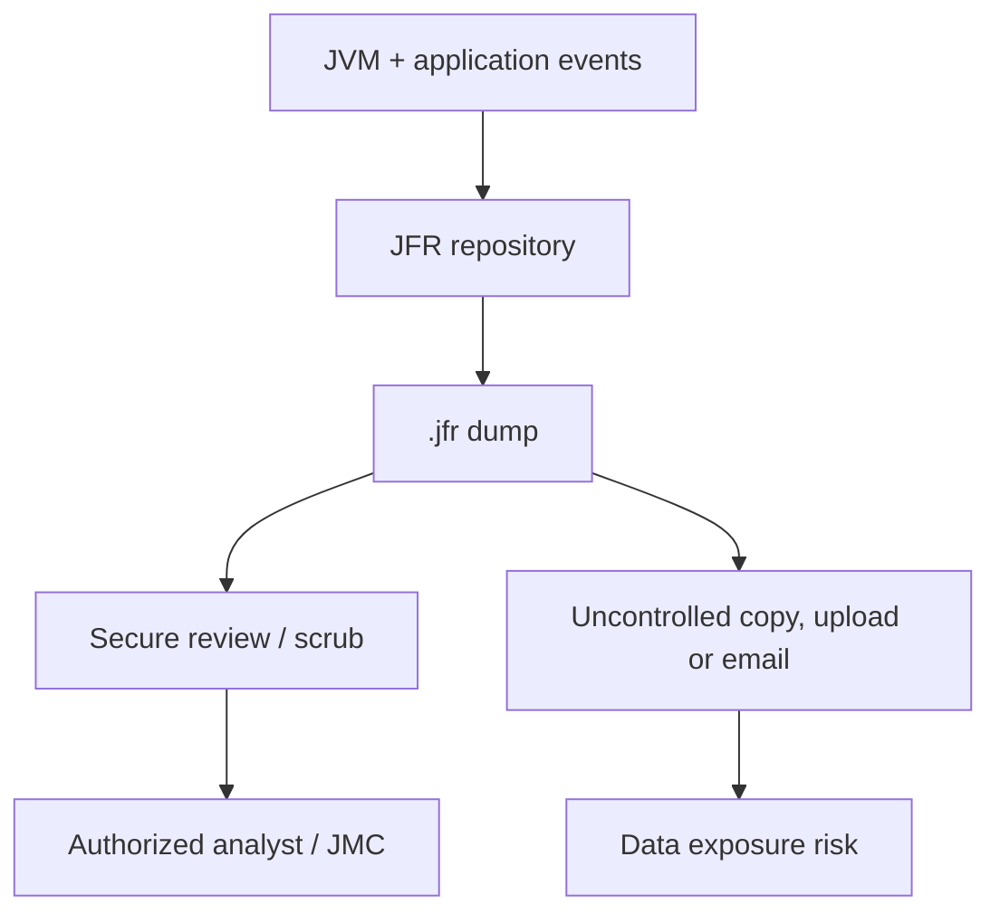

# Bảo vệ dữ liệu trong bản ghi và thiết lập giới hạn lưu trữ khi vận hành

**Java Flight Recorder (JFR)** thu thập sự kiện từ JVM và ứng dụng để điều tra hiệu năng, bộ nhớ, luồng, I/O và hành vi runtime. Một bản ghi `.jfr` có thể chứa nhiều chi tiết hơn một biểu đồ CPU: event fields, stack traces, thread names, tên class/method, đường dẫn file, thông tin socket, exception và dữ liệu do ứng dụng tự ghi qua custom events. Vì vậy, bản ghi JFR cần được xử lý như **tài liệu chẩn đoán có thể chứa thông tin nội bộ hoặc dữ liệu nhạy cảm**.

Bài học thuộc chương **Lấy mẫu JFR** của module **Java 25** (`JAVA_VERSION_JAVA25`), theo đề bài **“Bảo vệ dữ liệu trong bản ghi và thiết lập giới hạn lưu trữ khi vận hành”**. Trọng tâm là giảm dữ liệu thu thập từ đầu, giới hạn thời gian/dung lượng recording, bảo vệ repository và file dump, kiểm soát quyền truy cập, làm sạch bản ghi trước khi chia sẻ và áp dụng retention có thể kiểm toán. Các ví dụ sử dụng công cụ JFR/JDK 25 hiện hành; không dựa vào `SecurityManager` hoặc `FlightRecorderPermission` như cơ chế bảo vệ mới.

## 1. Vì sao bản ghi JFR cần được bảo vệ?

JFR là công cụ chẩn đoán runtime, không phải một kho log đã được làm sạch dữ liệu. Tùy event settings và custom events của ứng dụng, bản ghi có thể chứa:

| Nhóm thông tin | Ví dụ | Rủi ro |
| --- | --- | --- |
| Dấu vết thực thi | Class, method, stack trace, thread name | Làm lộ cấu trúc nội bộ, tên module hoặc thông tin trong tên thread |
| Tài nguyên và hệ thống | File path, socket endpoint, hostname, process/runtime options | Tiết lộ topology, vị trí file, địa chỉ dịch vụ và cấu hình vận hành |
| Dữ liệu event của ứng dụng | URL, SQL text, exception message, custom event fields | Có thể chứa query parameters, tenant/user ID, payload hoặc dữ liệu nghiệp vụ |
| Thông tin runtime | System properties, command line hoặc metadata được cấu hình thu thập | Có thể lộ giá trị cấu hình nếu ứng dụng đặt secret sai chỗ |
| Dữ liệu phục vụ phân tích sâu | Allocation samples, object samples, GC-root paths | Tăng độ chi tiết và khả năng suy ra cấu trúc dữ liệu/object graph |

Không phải mọi recording đều chứa tất cả các nhóm trên. Nội dung thực tế phụ thuộc JDK, event settings, thời gian ghi và các custom events. Nhưng trước khi mở quyền đọc hoặc chuyển file ra khỏi máy chạy ứng dụng, hãy **giả định recording có thể chứa thông tin mật** cho tới khi đã kiểm tra.



Nguyên tắc:

- Chỉ thu thập những event cần để trả lời câu hỏi vận hành.
- Không ghi credential, token, private key hoặc payload nhạy cảm vào custom event.
- Giới hạn thời gian và dung lượng ngay khi bắt đầu recording.
- Giữ repository và file dump trong vùng lưu trữ có quyền truy cập rõ ràng.
- Làm sạch, kiểm tra và phê duyệt trước khi gửi recording cho bên khác.
- Xóa cả bản gốc, bản sao tạm và bản export theo retention đã được phê duyệt.

## 2. Phân loại dữ liệu trước khi chọn event settings

Hãy xác định mục đích của recording trước khi chọn `default` hay `profile`. Mỗi event cần có lý do thu thập và thời hạn lưu phù hợp.

| Mức phân loại | Ví dụ | Chính sách gợi ý |
| --- | --- | --- |
| **Thông tin kỹ thuật ít nhạy cảm** | GC pause duration, CPU load, thread state, class loading count | Có thể phù hợp cho continuous recording nếu đã giới hạn dung lượng và thời gian |
| **Thông tin nội bộ** | Class/method names, stack traces, module names, thread names | Chỉ cấp cho nhóm vận hành/phát triển cần thiết; kiểm tra trước khi chia sẻ |
| **Thông tin hạ tầng nhạy cảm** | File paths, hostnames, socket endpoints, JVM arguments | Hạn chế event/field, lưu trong vùng riêng, redaction trước khi chuyển giao |
| **Dữ liệu cá nhân/nghiệp vụ** | Customer ID, email, SQL parameters, request payload, order reference | Không ghi nếu không thực sự cần; nếu cần phải có cơ sở xử lý, giảm định danh và retention ngắn |
| **Bí mật xác thực/mật mã** | Password, bearer token, refresh token, private key, secret key | Không đưa vào JFR event hoặc recording; dùng secret-management channel riêng |

**Pseudonymization không đồng nghĩa ẩn danh.** Một user ID đã băm hoặc một tenant ID vẫn có thể liên kết lại với cá nhân/hệ thống nếu tồn tại bảng ánh xạ hoặc có thể đối chiếu dữ liệu khác. Chỉ ghi identifier khi có nhu cầu được phê duyệt và có kiểm soát truy cập.

### Đặt câu hỏi trước khi bật một event

1. Sự kiện này trả lời câu hỏi chẩn đoán nào?
2. Có thể trả lời bằng metric tổng hợp hoặc event ít chi tiết hơn không?
3. Event có ghi địa chỉ, tên file, query, exception message hoặc custom payload không?
4. Stack trace có cần thiết hay chỉ cần duration/count?
5. Recording có thể chạy liên tục hay chỉ cần một khoảng ngắn?
6. Ai sẽ đọc file, file sẽ lưu ở đâu và bao lâu?

Nếu không xác định được người đọc, mục đích và thời hạn lưu, không nên tạo một recording rộng rồi để file tồn tại vô thời hạn.

## 3. Chọn cấu hình JFR theo mục đích, không bật mọi event

JDK 25 cung cấp các cấu hình chuẩn:

| Cấu hình | Đặc điểm | Cách dùng |
| --- | --- | --- |
| `default.jfc` | Thu thập tập thông tin định nghĩa sẵn với overhead thấp | Phù hợp hơn cho continuous recording và quan sát nền |
| `profile.jfc` | Thu thập nhiều dữ liệu hơn, có thể có overhead cao hơn | Dùng ngắn hạn khi cần điều tra sâu |
| `none` | Bắt đầu từ cấu hình rỗng | Dùng khi muốn chủ động định nghĩa chính xác event cần ghi |
| Custom `.jfc` | Bản cấu hình được điều chỉnh từ template | Dùng cho workload cụ thể, sau khi review và version-control cấu hình |

Ví dụ tạo cấu hình riêng từ `default.jfc`:

```bash
jfr configure \
  --input "$JAVA_HOME/lib/jfr/default.jfc" \
  --output ops-safe.jfc \
  jdk.SocketRead#enabled=false \
  jdk.SocketWrite#enabled=false
```

Đây là ví dụ **giảm bề mặt dữ liệu** bằng cách tắt hai event I/O có thể chứa thông tin endpoint. Chỉ áp dụng khi mục tiêu điều tra không cần socket read/write events. Nếu đang điều tra network latency, hãy giữ event cần thiết nhưng giới hạn thời lượng, quyền truy cập và quy trình làm sạch.

Các setting thường dùng:

- `enabled`: có thu event hay không.
- `stackTrace`: có gắn stack trace hay không.
- `threshold`: ngưỡng thời lượng với duration events.
- `period`: chu kỳ với event dạng requestable/sampling khi event hỗ trợ.

Không áp dụng cùng một setting cho mọi event. Trước khi thay đổi, xem metadata và cấu hình của JDK đang chạy:

```bash
jfr metadata
jfr configure --interactive
jfr help configure
```

Tên event và setting cần được xác nhận trên đúng JDK 25 distribution. Một cấu hình tự tạo phải được review cả về **giá trị chẩn đoán** lẫn **dữ liệu có thể lộ**.

### Cân bằng độ chi tiết và tác động

Tắt quá nhiều event có thể làm mất bằng chứng cần thiết; bật mọi event với stack trace sâu có thể tăng overhead và dung lượng. Một chiến lược thực tế:

- Continuous recording: bắt đầu bằng `default.jfc`, thời gian và dung lượng hữu hạn.
- Điều tra có mục tiêu: tạo recording ngắn với `profile.jfc` hoặc custom JFC đã review.
- Sự cố có dữ liệu nhạy cảm: chỉ bật event cụ thể trong khoảng ngắn, dump phần thời gian liên quan và scrub trước khi chia sẻ.
- Sau điều tra: dừng recording tạm thời và xóa artifacts theo retention.

## 4. Không đưa secret hoặc payload nhạy cảm vào custom JFR events

Ứng dụng có thể tự tạo event bằng API `jdk.jfr`. Đây là cách hữu ích để nối thông tin nghiệp vụ với JVM events, nhưng cũng là nơi dễ vô tình ghi dữ liệu nhạy cảm.

Ví dụ event an toàn hơn: chỉ ghi loại thao tác, kết quả và thời gian, không ghi request body hay credential.

```java
import jdk.jfr.Category;
import jdk.jfr.Event;
import jdk.jfr.Label;
import jdk.jfr.Name;
import jdk.jfr.StackTrace;

@Name("com.acme.OrderOperation")
@Label("Order operation")
@Category({"Application", "Orders"})
@StackTrace(false)
final class OrderOperationEvent extends Event {
    @Label("Operation")
    public String operation;

    @Label("Outcome")
    public String outcome;

    @Label("Item count")
    public int itemCount;
}
```

Sử dụng:

```java
void recordOrderOperation(String operation, String outcome, int itemCount) {
    var event = new OrderOperationEvent();
    event.operation = operation; // Ví dụ: "create"
    event.outcome = outcome;     // Ví dụ: "accepted" hoặc "rejected"
    event.itemCount = itemCount;
    event.commit();
}
```

Đây là ví dụ minh họa API; trong ứng dụng thật cần xác định event có được bật hay không và cân nhắc `shouldCommit()` trước khi tính dữ liệu tốn kém. Các trường nên có tập giá trị hữu hạn, không lấy trực tiếp từ input không tin cậy.

**Không làm như sau:**

```java
// Không ghi các giá trị này vào custom JFR event:
event.userEmail = request.email();
event.authorizationHeader = request.header("Authorization");
event.sql = sqlWithBoundParameters;
event.requestBody = serializedRequestBody;
event.privateKey = keyMaterial;
```

Thay vào đó:

- Dùng operation name và outcome có tập giá trị hữu hạn.
- Dùng số lượng, duration, byte count hoặc trạng thái kỹ thuật khi đủ cho mục tiêu.
- Không đưa raw URL query string, SQL parameters, email, token, session ID hoặc payload vào event.
- Nếu cần correlation, dùng ID đã được policy phê duyệt; không coi hash đơn giản là ẩn danh.
- Không lưu secret trong exception message hoặc thread name vì những trường đó cũng có thể xuất hiện trong chẩn đoán.

### Stack trace cũng là dữ liệu cần bảo vệ

Stack trace giúp xác định call path nhưng có thể tiết lộ package nội bộ, tên class, method, thư viện, kiến trúc triển khai hoặc vị trí mã. Chỉ bật stack trace cho event cần thiết; không tăng stack depth chỉ để thu được “càng nhiều càng tốt”. JDK 25 mặc định giới hạn stack depth của JFR và cảnh báo tăng vượt mức mặc định có thể làm giảm hiệu năng.

## 5. Dùng giới hạn thời gian và dung lượng ngay khi bắt đầu recording

Với continuous recording, hai giới hạn quan trọng là:

- `maxage`: thời gian tối đa giữ dữ liệu trên disk repository.
- `maxsize`: dung lượng tối đa giữ dữ liệu trên disk repository.

Ví dụ bắt đầu recording với cấu hình mặc định, lưu dữ liệu tối đa sáu giờ hoặc 512 MB:

```bash
jcmd <pid> JFR.start \
  name=ops-continuous \
  settings=default \
  disk=true \
  maxage=6h \
  maxsize=512m
```

Khi giới hạn dung lượng hoặc tuổi dữ liệu bị chạm, JVM loại bỏ các chunk cũ để giữ dữ liệu gần hiện tại. Điều này phù hợp cho recording dạng vòng lặp, nơi đội vận hành cần dump “phần vừa xảy ra” khi có cảnh báo.

Các điểm phải nhớ:

- `maxage` và `maxsize` chỉ áp dụng khi `disk=true`.
- Giá trị `0` nghĩa là không giới hạn tương ứng; không dùng mặc định không giới hạn cho recording dài hạn nếu chưa có quota bên ngoài.
- `maxsize` không được nhỏ hơn `maxchunksize` đã cấu hình. JDK 25 mặc định chunk tối đa là 12 MB.
- Đây là giới hạn cho dữ liệu của recording trong repository, không phải quota tổng filesystem của toàn máy.
- Nếu chạy nhiều recordings đồng thời, dung lượng tổng có thể gần bằng tổng budget của từng recording cộng các file dump/export.

### Dùng giới hạn cả thời gian lẫn dung lượng

```bash
jcmd <pid> JFR.start \
  name=production-ring \
  settings=default \
  disk=true \
  maxage=4h \
  maxsize=384m
```

Ví dụ trên giới hạn dữ liệu trong repository theo **cả** tuổi và kích thước. Giá trị 4 giờ/384 MB chỉ là ví dụ; cần chọn theo event rate, số JVM instance, disk budget và thời gian đội phản ứng. Khi event rate cao, giới hạn dung lượng có thể bị chạm trước giới hạn tuổi.

Kiểm tra recording:

```bash
jcmd <pid> JFR.check verbose=true
```

Lưu lại tên recording trả về để dump hoặc stop đúng recording.

## 6. Phân biệt repository tạm với file dump đã xuất

JFR dùng **disk repository** để lưu các chunk trong lúc recording đang chạy. Khi dump, dữ liệu được ghi ra file `.jfr` tại đường dẫn đích. Đây là hai vòng đời khác nhau:

| Khu vực | Mục đích | Giới hạn/xóa dữ liệu |
| --- | --- | --- |
| JFR disk repository | Chunk tạm của recording đang hoạt động | `maxage`/`maxsize` trên từng recording |
| File dump `.jfr` | Artifact để phân tích/chuyển giao | Filesystem quota, retention job, access policy và quy trình xóa |
| Bản scrubbed | Bản đã lọc event/category/thread | Retention riêng; bản gốc vẫn còn cho đến khi xóa |
| Bản sao trong object storage/support ticket | Chia sẻ với nhóm khác hoặc nhà cung cấp | Retention và quyền truy cập của hệ thống đích |

**Giới hạn `maxage`/`maxsize` không tự xóa file dump đã xuất.** Một recording liên tục có thể giữ repository chỉ vài giờ nhưng các file dump được tạo trước đó vẫn tồn tại hàng tuần nếu không có retention riêng.

### Chọn repository riêng

JFR mặc định dùng thư mục temporary của hệ điều hành cho disk repository. Với service production, có thể chỉ định vị trí riêng:

```bash
java \
  -XX:FlightRecorderOptions=repository=/var/lib/shop/jfr-repository \
  -XX:StartFlightRecording:settings=default,disk=true,maxage=4h,maxsize=384m,name=shop-ops \
  -jar shop-service.jar
```

Thư mục repository nên:

- Nằm trên volume có quota và cảnh báo dung lượng.
- Có quyền truy cập giới hạn cho user chạy JVM và nhóm vận hành được cấp quyền.
- Không đặt dưới web root, shared public volume hoặc thư mục người dùng không tin cậy.
- Được bảo vệ bằng encryption at rest theo chuẩn hạ tầng.
- Có kế hoạch dọn dữ liệu khi JVM dừng hoặc khi node bị thay thế.

`preserve-repository` mặc định tắt; khi cần giữ repository sau khi JVM thoát để điều tra sự cố, phải chủ động đánh giá việc bật tùy chọn này, bảo vệ quyền truy cập và thiết lập xóa có thời hạn. Không bật preserve như một cách backup không kiểm soát.

## 7. Dump đúng khoảng thời gian và dừng recording an toàn

Khi có cảnh báo, dump phần dữ liệu cần thiết thay vì luôn xuất toàn bộ recording:

```bash
jcmd <pid> JFR.dump \
  name=production-ring \
  filename=/secure/jfr/shop-%p-%t.jfr \
  maxage=30m
```

`maxage=30m` giới hạn dữ liệu được dump theo khoảng thời gian gần nhất. Có thể dùng `begin`/`end` nếu cần khoảng thời gian cụ thể:

```bash
jcmd <pid> JFR.dump \
  name=production-ring \
  filename=/secure/jfr/shop-incident.jfr \
  begin=-20m
```

Thời gian `begin`/`end` cần theo định dạng mà JDK 25 hỗ trợ; dạng tương đối như `-20m` là cách thuận tiện để lấy dữ liệu gần hiện tại. Khi bỏ `end`, dump lấy đến thời điểm thực hiện lệnh. Xác minh command trên JDK đích và không đưa dữ liệu ra đường dẫn có quyền truy cập rộng.

Dump không dừng recording. Sau khi đã lấy đủ bằng chứng, dừng recording có chủ đích:

```bash
jcmd <pid> JFR.stop name=production-ring
```

Nếu `JFR.stop` không chỉ định `filename`, dữ liệu recording bị loại bỏ thay vì xuất thành file. Chỉ stop theo cách đó khi chủ đích là discard. Nếu cần lưu dữ liệu cuối cùng, chỉ định đường dẫn dump:

```bash
jcmd <pid> JFR.stop \
  name=incident-profile \
  filename=/secure/jfr/incident-profile.jfr
```

Trước khi dump, hãy kiểm tra dung lượng trống và quyền thư mục. File đích có thể lớn, và thao tác export tạo thêm một bản dữ liệu ngoài repository.

## 8. Bảo vệ file dump, repository và đường truyền

File `.jfr` cần được quản lý như diagnostic artifact nhạy cảm:

| Lớp bảo vệ | Yêu cầu |
| --- | --- |
| Filesystem | Thư mục riêng, ACL tối thiểu, không world-readable, không public web path |
| Encryption at rest | Mã hóa volume/object storage theo chuẩn tổ chức; bảo vệ key quản lý riêng |
| In transit | Truyền qua kênh mã hóa và endpoint được xác thực; không gửi qua chat/email cá nhân |
| Authorization | Chỉ incident responder/engineer được chỉ định có quyền đọc |
| Audit | Ghi nhận ai tạo, dump, tải xuống, scrub, chia sẻ và xóa recording |
| Naming | Không đưa email, customer name, token hoặc thông tin cá nhân vào filename |
| Temporary copies | Có thư mục tạm riêng, quota và cleanup sau khi xử lý |
| Backup | Không tự động sao lưu file JFR vào mọi backup chung nếu không có lý do và retention phù hợp |

Quyền chạy `jcmd` cũng cần được giới hạn: tài liệu JDK 25 yêu cầu chạy trên cùng máy và với effective user/group tương ứng của JVM. Đây là một biện pháp kiểm soát ở cấp hệ điều hành; nó không thay thế ACL của file dump, JMX security hoặc quyền truy cập vào máy.

Nếu dùng JDK Mission Control qua JMX, bảo vệ kênh quản trị bằng authentication, TLS và network restriction phù hợp. Không mở cổng JMX quản trị ra Internet hoặc mạng người dùng chung.

## 9. Làm sạch recording bằng `jfr scrub`

JDK 25 có subcommand `jfr scrub` để tạo recording mới bằng cách **giữ hoặc loại bỏ event, category và thread** theo filter. Ví dụ loại một số event I/O trước khi chuyển bản ghi:

```bash
jfr scrub \
  --exclude-events 'jdk.SocketRead,jdk.SocketWrite' \
  shop-incident.jfr \
  shop-incident-scrubbed.jfr
```

Hoặc chỉ giữ nhóm event cần cho điều tra GC:

```bash
jfr scrub \
  --include-categories GC \
  shop-incident.jfr \
  shop-gc-only.jfr
```

Có thể lọc theo event name, category hoặc thread name:

- `--include-events` / `--exclude-events`
- `--include-categories` / `--exclude-categories`
- `--include-threads` / `--exclude-threads`

**Giới hạn quan trọng:** `jfr scrub` lọc toàn bộ event theo tên/category/thread. Nó không phải công cụ tổng quát để thay thế một giá trị nhạy cảm bên trong một field rồi giữ nguyên event. Nếu một custom event chứa token trong field, hãy sửa nguồn tạo event và tạo recording sạch; chỉ exclude event đó khỏi bản chia sẻ nếu không thể loại field an toàn.

Sau khi scrub:

```bash
jfr summary shop-incident-scrubbed.jfr
jfr print --events jdk.GarbageCollection shop-incident-scrubbed.jfr
```

Kiểm tra nội dung trước khi chia sẻ. Việc scrub tạo file mới; **file gốc vẫn tồn tại** và phải được giữ trong vùng quarantine hoặc xóa theo chính sách. Không coi hậu tố `-scrubbed` là bằng chứng đã loại bỏ mọi dữ liệu nhạy cảm.

## 10. Review recording trước khi chia sẻ

Quy trình review tối thiểu:

1. Xác định mục đích điều tra và người nhận.
2. Kiểm tra `jfr summary` để biết recording chứa những event nào và dung lượng ra sao.
3. Xác định event/category/thread không cần thiết.
4. Dùng `jfr scrub` để tạo bản lọc khi phù hợp.
5. Kiểm tra bản lọc bằng `jfr print` hoặc JMC trong môi trường được phép.
6. Tìm các trường có thể chứa token, URL query, SQL, file path, hostname, user/tenant ID hoặc custom payload.
7. Nếu vẫn có dữ liệu nhạy cảm, không chia sẻ; quay lại event settings hoặc code tạo event để giảm dữ liệu.
8. Ghi nhận người phê duyệt, checksum, người nhận, mục đích và thời hạn giữ file.

Ví dụ:

```bash
jfr summary shop-incident.jfr
jfr metadata --events 'com.acme.*' shop-incident.jfr
jfr print --events 'com.acme.OrderOperation' shop-incident.jfr
```

Các lệnh trên có thể in dữ liệu event ra terminal/stdout. Chạy trong phiên quản trị an toàn; không redirect sang log CI công khai hoặc dán output vào ticket/chat nếu chưa review.

### Khi nào không thể scrub an toàn?

- Custom event trộn identifier nhạy cảm và dữ liệu hiệu năng trong cùng field.
- URL hoặc SQL string có cả thông tin cần phân tích lẫn credential.
- Exception message đã chứa payload.
- Stack trace/event metadata tiết lộ thông tin nội bộ mà người nhận không được phép biết.

Khi đó, lựa chọn an toàn là **không chia sẻ recording gốc**. Có thể tạo recording mới với cấu hình ít dữ liệu hơn, hoặc tạo báo cáo tổng hợp đã làm sạch bằng công cụ nội bộ.

## 11. Đặt giới hạn retention cho từng lớp dữ liệu

Không có một thời hạn lưu JFR phù hợp với mọi tổ chức. Thời gian cần dựa vào mục đích vận hành, yêu cầu bảo mật, hợp đồng, quy định pháp lý và thời gian xử lý incident.

Một policy cần quy định riêng:

| Lớp dữ liệu | Câu hỏi policy phải trả lời |
| --- | --- |
| Disk repository đang chạy | Giữ tối đa bao lâu/dung lượng bao nhiêu? Có cần giữ sau khi JVM thoát không? |
| Dump gốc chưa review | Ai được truy cập? Bao lâu phải scrub hoặc xóa? |
| Bản scrubbed được phê duyệt | Lưu ở đâu, người nhận nào, retention bao lâu? |
| Bản gửi support/vendor | Ticket nào cho phép lưu? Khi nào nhà cung cấp xác nhận xóa? |
| Bản sao local/CI/temp | Có tự động cleanup không? Có lọt vào backup/log artifact không? |
| Backup/object versioning | Bản xóa có còn trong version history hoặc backup không? |

Ví dụ **policy minh họa**, không phải thời hạn mặc định:

- Repository rolling: tối đa 4 giờ hoặc 384 MB cho mỗi recording.
- Dump incident gốc: lưu trong vùng quarantine cho tới khi hoàn tất review, tối đa theo thời hạn nội bộ đã phê duyệt.
- Bản scrubbed: chỉ lưu trong thời gian điều tra/ticket còn mở và theo yêu cầu của bên nhận.
- Temporary exports: cleanup tự động sau khi tạo báo cáo.
- Backup: áp dụng cùng quy tắc retention và quy trình xóa theo vòng đời backup.

Đặt retention thành cấu hình có thể kiểm tra và gắn owner. Không để file JFR tồn tại “cho tới khi đầy ổ đĩa”.

### Tính ngân sách dung lượng

Nếu một service có nhiều JVM instance, hãy tính tổng budget:

\[
\text{disk budget} \ge
\sum(\text{maxsize của các recording đang chạy})
+ \text{dump exports}
+ \text{temporary copies}
+ \text{operating headroom}
\]

Ví dụ 20 instance, mỗi instance có một recording giới hạn 384 MB, riêng repository có thể cần khoảng 7.5 GiB trong tình huống tất cả recording đạt giới hạn; chưa tính file dump và bản sao. Đây là phép tính ngân sách đơn giản, không phải cam kết rằng filesystem sẽ dùng chính xác lượng đó.

Đặt cảnh báo disk usage trước khi chạm quota. Nếu volume đầy, thao tác dump có thể thất bại hoặc ảnh hưởng ứng dụng và các dịch vụ khác cùng volume.

## 12. Tự động hóa kiểm soát lưu trữ và cleanup

Một quy trình vận hành nên có:

- Tạo recording với `maxage` và `maxsize` hữu hạn.
- Đặt repository vào volume riêng.
- Dump vào thư mục riêng có ACL tối thiểu.
- Ghi manifest cho mỗi dump: service/build/JDK/instance/time range/purpose/owner/classification.
- Chuyển file sang quarantine trước khi scrub.
- Tạo bản scrubbed mới, review và phê duyệt trước khi chia sẻ.
- Xóa file tạm, bản gốc và bản sao theo retention được duyệt.
- Kiểm tra backup/versioned object store có giữ bản cũ hay không.

Không tự động xóa ngay file khi có incident đang điều tra. Cleanup cần nhận biết trạng thái hold/legal hold/ticket đang mở, nhưng cũng không để trạng thái hold không có owner hoặc ngày hết hạn.

### Kiểm tra định kỳ

| Kiểm tra | Tần suất gợi ý | Bằng chứng |
| --- | --- | --- |
| Repository maxage/maxsize | Khi deploy và khi thay cấu hình JFR | `JFR.check`, startup config |
| Dung lượng volume | Liên tục bằng monitoring | Disk usage và alert |
| File dump quá hạn | Theo retention job | Cleanup report |
| Quyền truy cập | Định kỳ và sau thay đổi nhân sự/role | ACL review |
| Custom JFR event fields | Khi thêm/sửa event | Code review và data classification |
| Scrub workflow | Trước mỗi lần chia sẻ ngoài nhóm | Review record và checksum |
| Backup retention | Theo chu kỳ backup/security review | Báo cáo version/retention |

## 13. Runbook xử lý sự cố có chứa recording

Khi cần thu thập JFR để điều tra production:

1. **Mở incident/ticket** và ghi rõ câu hỏi kỹ thuật cần trả lời.
2. **Chọn event settings tối thiểu**, thời gian ghi ngắn và giới hạn disk.
3. **Kiểm tra quyền và dung lượng** trước khi start/dump.
4. **Dump đúng time range**, không xuất toàn bộ recording nếu không cần.
5. **Đưa file gốc vào quarantine** có ACL riêng, mã hóa và audit.
6. **Review event fields** và tạo bản scrubbed nếu phù hợp.
7. **Xác nhận người nhận và kênh truyền** trước khi chia sẻ.
8. **Ghi nhận checksum và manifest** để tránh nhầm file hoặc bị thay thế.
9. **Xóa bản gốc/bản tạm/bản sao** khi retention cho phép; giữ bằng chứng xóa.
10. **Đóng ticket và gỡ hold** nếu không còn lý do lưu tiếp.

Nếu phát hiện recording đã được gửi nhầm:

- Thu hồi link/quyền truy cập nếu hệ thống hỗ trợ.
- Xác định file gốc, các bản sao và người nhận.
- Đánh giá trường dữ liệu có thể bị lộ.
- Thực hiện quy trình incident dữ liệu của tổ chức.
- Yêu cầu xóa ở hệ thống đích và ghi nhận xác nhận.
- Sửa event settings hoặc custom event để ngăn lặp lại.

Không chỉ xóa file trên máy tạo recording rồi kết luận sự cố đã được xử lý; cần rà soát cả object storage, backup, ticket attachment và bản tải xuống.

## 14. Những hiểu nhầm thường gặp

**“JFR có overhead thấp nên file không nhạy cảm.”** Sai. Overhead thấp là đặc điểm hiệu năng, không phải bảo đảm dữ liệu an toàn.

**“Dùng `default.jfc` là không thể lộ dữ liệu.”** Sai. Template mặc định giảm overhead nhưng vẫn có event fields; hãy xem cấu hình và nội dung thực tế.

**“`maxage=6h` nghĩa là file dump tự xóa sau sáu giờ.”** Sai. `maxage` giới hạn dữ liệu trong disk repository của recording; file dump đã xuất cần retention riêng.

**“`maxsize=512m` giới hạn tổng dung lượng JFR của toàn host.”** Sai. Đây là giới hạn cho dữ liệu của recording tương ứng; nhiều recordings và exports cộng lại vẫn có thể vượt budget filesystem.

**“`jfr scrub` xóa token khỏi mọi field nhưng giữ nguyên event.”** Sai. Công cụ lọc event/category/thread; không phải field-level redaction tổng quát.

**“File `.jfr` chỉ chứa số liệu JVM.”** Sai. Custom events và một số event runtime có thể chứa text, endpoint, path hoặc dữ liệu ứng dụng.

**“Kết thúc recording sẽ xóa dữ liệu khỏi bộ nhớ và mọi bản sao.”** Sai. Scope recording dừng không có nghĩa object/file/bản dump đã bị zeroize hoặc xóa khỏi backup.

**“Dùng `FlightRecorderPermission` hoặc `SecurityManager` để kiểm soát truy cập hiện nay.”** Không phù hợp. `FlightRecorderPermission` đã deprecated for removal trong Java 25 vì Security Manager không còn được hỗ trợ; hãy dùng quyền hệ điều hành, ACL, bảo vệ JMX và kiểm soát storage/network.

## 15. Bài thực hành: thiết kế policy JFR an toàn cho shop-service

### Bối cảnh

Một service Java 25 có continuous JFR recording để theo dõi CPU, GC, lock contention và I/O. Nhóm hỗ trợ muốn dump recording khi p99 tăng và gửi cho đội phát triển. Custom event hiện tại đang ghi URL đầy đủ và customer ID; repository mặc định nằm trong temporary directory; file dump được lưu trong thư mục chia sẻ chung.

### Nhiệm vụ

1. **Phân loại dữ liệu:** xác định event nào có thể chứa URL, endpoint, stack trace, customer ID hoặc dữ liệu custom.
2. **Sửa custom event:** bỏ raw URL/customer ID, chỉ giữ operation, outcome, duration và số lượng có tập giá trị hữu hạn.
3. **Tạo cấu hình:** dùng `default.jfc` làm baseline, tắt event không cần; giữ event I/O chỉ khi có mục tiêu chẩn đoán cụ thể.
4. **Đặt giới hạn:** cấu hình `disk=true`, `maxage` và `maxsize` hữu hạn.
5. **Đặt repository:** chuyển sang volume riêng, ACL tối thiểu và quota/alert.
6. **Dump sự cố:** dùng `JFR.dump` với time range gần thời điểm p99 tăng.
7. **Scrub:** loại event/category/thread không cần thiết và tạo file đầu ra riêng.
8. **Review:** kiểm tra `jfr summary`, metadata và nội dung event trong môi trường được phép.
9. **Chia sẻ:** tạo manifest/checksum, chỉ gửi bản đã phê duyệt qua kênh mã hóa.
10. **Retention:** quy định ngày xóa cho bản gốc, bản scrubbed, file tạm, ticket và backup.
11. **Test quyền:** thử bằng tài khoản không có quyền để xác nhận không thể đọc repository/dump hoặc điều khiển JVM.
12. **Diễn tập:** mô phỏng file quá hạn, disk gần đầy và recording chứa dữ liệu không được phép; chứng minh alert/cleanup hoạt động.

### Mẫu policy bàn giao

| Hạng mục | Giá trị cần xác định | Trạng thái |
| --- | --- | --- |
| Mục đích recording | CPU/GC/locks/I/O hoặc mục tiêu cụ thể | Chưa xác định |
| JFC settings | default/profile/custom và lý do | Chưa xác định |
| Event nhạy cảm | Event fields, custom events, stack traces | Chưa rà soát |
| Secret policy | Danh sách dữ liệu tuyệt đối không ghi | Chưa xác định |
| Repository path | Volume riêng, quota và ACL | Chưa xác định |
| maxage/maxsize | Giới hạn mỗi recording | Chưa xác định |
| Dump destination | Quarantine directory và quyền | Chưa xác định |
| Scrub/review owner | Người chịu trách nhiệm phê duyệt | Chưa xác định |
| Share channel | Kênh truyền và người nhận | Chưa xác định |
| Retention | Bản gốc, bản scrubbed, temp, backup | Chưa xác định |
| Cleanup evidence | Báo cáo xóa và kiểm tra backup | Chưa xác định |

### Tiêu chí hoàn thành

- Giải thích được recording có thể chứa dữ liệu nhạy cảm và vì sao cần phân loại.
- Có cấu hình JFR thu thập tối thiểu và custom event không ghi secret/payload.
- Có giới hạn thời gian/dung lượng cho disk repository.
- Phân biệt retention repository với retention file dump/export.
- Biết dùng `JFR.dump`, `JFR.stop`, `jfr summary` và `jfr scrub` đúng mục đích.
- Chứng minh quyền truy cập file, repository và kênh truyền được giới hạn.
- Có quy trình review, chia sẻ, cleanup và audit.

## Tài liệu tham khảo

- [Oracle JDK 25 — The jcmd Command](https://docs.oracle.com/en/java/javase/25/docs/specs/man/jcmd.html): `JFR.start`, `JFR.dump`, `JFR.stop`, `maxage`, `maxsize` và event settings.
- [Oracle JDK 25 — The jfr Command](https://docs.oracle.com/en/java/javase/25/docs/specs/man/jfr.html): `jfr configure`, `jfr summary`, `jfr print` và `jfr scrub`.
- [Oracle JDK 25 — The java Command](https://docs.oracle.com/en/java/javase/25/docs/specs/man/java.html): `-XX:StartFlightRecording`, `-XX:FlightRecorderOptions`, repository, chunk size và disk retention.
- [Java SE 25 API — Recording](https://docs.oracle.com/en/java/javase/25/docs/api/jdk.jfr/jdk/jfr/Recording.html): API điều khiển recording, `setMaxAge`, `setMaxSize`, dump và lifecycle.
- [Java SE 25 API — FlightRecorderPermission](https://docs.oracle.com/en/java/javase/25/docs/api/jdk.jfr/jdk/jfr/FlightRecorderPermission.html): trạng thái deprecated for removal và lý do Security Manager không còn là cơ chế bảo vệ.
- [Oracle JDK 25 — Diagnostic Tools](https://docs.oracle.com/en/java/javase/25/troubleshoot/diagnostic-tools.html): vai trò JFR/JMC, default/profile templates và cách phân tích recording.

**Kết luận:** Bảo vệ JFR bắt đầu từ **không thu thập dữ liệu không cần thiết**. Hãy chọn event settings theo mục tiêu, giữ custom events không chứa credential/payload, giới hạn repository bằng `maxage`/`maxsize`, bảo vệ file dump và áp dụng retention riêng cho mọi bản sao. Dùng `jfr scrub` để lọc event khi phù hợp nhưng vẫn review nội dung, vì nó không thay thế field-level redaction. Khi quản lý quyền bằng ACL, user/process, JMX security và storage policy thay vì các cơ chế legacy, JFR có thể hỗ trợ điều tra production mà vẫn giữ được kiểm soát dữ liệu và dung lượng.
