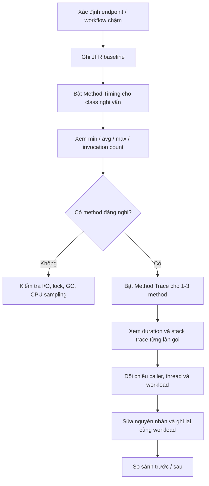

# Mục tiêu của JFR Method Timing & Tracing trong JDK 25

> **Chương:** Đo và truy vết JFR  
> **Học phần:** `JAVA_VERSION_JAVA25` — các khả năng Java 25 còn phù hợp trong phát triển Java hiện đại, gồm chương trình nguồn gọn, module import, flexible constructor bodies, ScopedValue, KDF API, AOT cache và quan sát runtime bằng JFR.  
> **Trọng tâm bài:** Hiểu JEP 520, phân biệt `jdk.MethodTiming` với `jdk.MethodTrace`, biết khi nào cần thống kê thời gian theo method và khi nào cần xem từng lần gọi cùng call stack; lựa chọn cấu hình có phạm vi hẹp để tìm bottleneck mà vẫn kiểm soát chi phí ghi.

## 1. Từ câu hỏi “ứng dụng chậm” đến câu hỏi “method nào chậm?”

Một service Java có thể có latency tăng dù CPU không luôn ở mức cao. Một request đi qua controller, service, repository, JDBC driver, connection pool và các thư viện dùng chung. Nếu chỉ nhìn tổng thời gian HTTP, ta biết request chậm nhưng chưa biết đoạn code nào tiêu tốn thời gian.

Các câu hỏi thường gặp:

- Method nào được gọi nhiều và có tổng thời gian thực thi lớn?
- Một method cụ thể mất bao lâu trong từng lần gọi?
- Có phải cùng một method lúc nhanh, lúc chậm tùy caller hoặc thread?
- Thời gian bị tiêu tốn trong method hay ở những lời gọi con?
- Constructor hoặc static initializer nào kéo dài startup?
- Một method có nhiều lần gọi ngắn hay một số lần gọi bất thường rất dài?
- Method nào chỉ chậm khi được gọi từ một đường xử lý cụ thể?

JDK 25 bổ sung **JFR Method Timing & Tracing (JEP 520)** để trả lời các câu hỏi ở cấp method bằng hai event mới:

- `jdk.MethodTiming`: thống kê thời gian thực thi theo method.
- `jdk.MethodTrace`: ghi nhận từng invocation của method được chọn, gồm duration và stack trace.

Cả hai được tích hợp vào Java Flight Recorder (JFR), dùng bytecode instrumentation và có thể cấu hình theo filter. Bạn không phải sửa source code của method cần đo hoặc cài một Java agent bên ngoài chỉ để bật tính năng này.

## 2. JEP 520 trong Java 25: tính năng chính thức và phạm vi sử dụng

**JEP 520 — JFR Method Timing & Tracing** là một phần của JDK 25, phát hành chính thức cùng Java 25. Hai event thuộc JFR, không phải API preview và không cần `--enable-preview`.

JFR là framework thu thập event tích hợp trong JDK. Mỗi event có timestamp và payload; event dạng duration còn có thời điểm bắt đầu/kết thúc. JFR có thể được khởi động cùng JVM hoặc bật trong lúc JVM đang chạy, lưu recording ra file `.jfr` để phân tích sau. [Oracle — What's New in JDK 25](https://inside.java/2025/10/17/new-in-jdk-25-2-mins/) · [Oracle — JDK 25 Diagnostic Tools](https://docs.oracle.com/en/java/javase/25/troubleshoot/diagnostic-tools.html)

JEP 520 tập trung vào **đo và truy vết invocation của các method đã chọn**. Nó bổ sung một công cụ chẩn đoán giữa hai cấp độ:

- JFR sampling thông thường cho bức tranh rộng về hoạt động JVM và stack thường xuất hiện.
- Method Timing/Tracing cho phép tập trung vào một class hoặc một số method cụ thể, ghi thời gian theo method và chi tiết invocation.

Phạm vi này phù hợp khi đã có giả thuyết tương đối rõ, ví dụ nghi ngờ `OrderRepository.findByTenant` hoặc `PricingService.calculate`, và muốn đo trực tiếp method đó trong một recording ngắn.

### Những gì tính năng này không tự cung cấp

`jdk.MethodTrace` là **truy vết method trong một JVM**. Nó không tự tạo distributed trace xuyên qua nhiều service, không thay thế OpenTelemetry spans, trace context propagation hay service map. Nó cũng không tự ghi mọi tham số, giá trị trả về hoặc local variable của method. Nếu cần dữ liệu nghiệp vụ, correlation ID hoặc span qua ranh giới HTTP/message, cần kết hợp với instrumentation và observability phù hợp của ứng dụng.

## 3. Phân biệt Method Timing, Method Trace và sampling

| Cơ chế | Đơn vị quan sát | Dữ liệu chính | Câu hỏi phù hợp |
|---|---|---|---|
| **`jdk.MethodTiming`** | Method được filter, tổng hợp theo chu kỳ | Số invocation, minimum, average, maximum time | Method nào có thời gian đáng chú ý? Thời gian phân bố ra sao? |
| **`jdk.MethodTrace`** | Từng invocation của method được filter | Thời điểm, duration, thread, stack trace | Lần gọi cụ thể nào chậm và được gọi từ đâu? |
| **JFR execution sampling** | Stack được lấy mẫu định kỳ | Những method/stack xuất hiện trong các mẫu | CPU đang dành nhiều thời gian ở vùng code nào? |
| **Custom JFR event** | Ranh giới nghiệp vụ do ứng dụng định nghĩa | Field do ứng dụng chọn, timestamp/duration | Một nghiệp vụ hoặc transaction cụ thể có thuộc tính và thời gian thế nào? |

Hai event mới bổ sung cho nhau:

**Method Timing — tổng hợp:** đếm invocation và tổng hợp thời gian theo method trong các khoảng ghi, với minimum, average và maximum.

**Method Trace — từng lần gọi:** xem invocation cụ thể, thread thực thi và stack trace dẫn đến method.

Một quy trình hiệu quả thường bắt đầu với `MethodTiming` để tìm method đáng nghi, rồi bật `MethodTrace` cho một vài method đó trong recording có thời lượng ngắn. Bật trace cho quá nhiều method ngay từ đầu có thể tạo rất nhiều event và làm tăng overhead.

### 3.1. `jdk.MethodTiming` — trả lời “method nào tốn thời gian?”

`MethodTiming` cung cấp thống kê theo method, gồm:

- `invocations`: số lần gọi được ghi nhận trong khoảng thống kê.
- `minimum`: thời gian nhỏ nhất.
- `average`: thời gian trung bình.
- `maximum`: thời gian lớn nhất.

Event được phát theo chu kỳ cấu hình (`period`), vì vậy recording có thể chứa nhiều snapshot của cùng một method ở các khoảng khác nhau. Đây là dữ liệu tổng hợp; bạn không thể suy ra chính xác request ID hoặc tham số của từng invocation từ event này.

Ví dụ bảng kết quả minh họa:

| Method | Invocations | Minimum | Average | Maximum |
|---|---:|---:|---:|---:|
| `OrderService.create` | 42 | 2 ms | 18 ms | 95 ms |
| `PriceCalculator.calculate` | 42 | 0,3 ms | 4 ms | 27 ms |
| `OrderRepository.insert` | 42 | 1 ms | 12 ms | 80 ms |

Đây là số liệu giả định để minh họa cách đọc. Nó cho thấy `OrderRepository.insert` có maximum cao, nhưng chưa chứng minh database là nguyên nhân; cần xem trace, I/O events, lock waits và bối cảnh request.

### 3.2. `jdk.MethodTrace` — trả lời “lần gọi nào chậm và được gọi từ đâu?”

`MethodTrace` ghi từng invocation phù hợp filter. Một event có thể cung cấp:

- Method được instrument.
- Start time và duration.
- Thread thực thi.
- Stack trace tại đường gọi method.

Ví dụ minh họa:

```text
Method Trace
Start Time   Duration   Event Thread           Method
10:21:05     82 ms      http-worker-3           OrderRepository.insert
10:21:05     12 ms      http-worker-5           OrderRepository.insert
10:21:06     91 ms      http-worker-2           OrderRepository.insert
```

Có thể so sánh các lần gọi và xem stack trace để biết invocation chậm xuất phát từ `OrderService.create`, job nền hay một caller khác. Stack trace cho biết đường gọi, nhưng không tự giải thích dữ liệu đầu vào hoặc trạng thái database.

### 3.3. Không nhầm elapsed time với CPU time

Thời gian `MethodTiming`/`MethodTrace` đo là thời gian thực thi gần với **elapsed/wall-clock time**, bao gồm các khoảng chờ trong thời gian method đang chạy, không chỉ số CPU cycles mà method sử dụng. Một method chờ database 70 ms có thể có duration 70 ms dù CPU chỉ làm việc một phần nhỏ thời gian đó.

Nếu câu hỏi là “method chờ bao lâu?” thì method timing hữu ích. Nếu câu hỏi là “CPU thực sự tiêu tốn bao nhiêu thời gian?” thì cần xem CPU profiling/sampling và các công cụ phù hợp. JFR CPU-Time Profiling trong JDK 25 là tính năng **experimental**, chỉ hỗ trợ Linux ở bản này; không coi nó là API ổn định thay cho Method Timing.

## 4. Chọn mục tiêu đo: từ triệu chứng đến filter method

Đo method hữu ích nhất khi có giả thuyết cụ thể. Trước khi tạo recording, hãy ghi lại:

1. **Triệu chứng:** p95 tăng, startup chậm, một endpoint có latency cao hay throughput giảm?
2. **Phạm vi:** một class, một method, một nhóm method hay một workflow?
3. **Mốc đo:** thời gian trong request, trong một transaction, trong startup hay trong batch?
4. **Workload:** loại request, kích thước dữ liệu và concurrency nào cần đại diện?
5. **Thời lượng recording:** đủ để quan sát các lần gọi thật nhưng không kéo dài không cần thiết.
6. **Điều kiện đối chứng:** cùng artifact, cấu hình, dữ liệu và mức tải khi so sánh trước/sau.

Ví dụ: p95 của `POST /orders` tăng từ 120 ms lên 450 ms. Trace toàn bộ ứng dụng có thể quá rộng. Bắt đầu với `OrderService.create`, `PricingService.calculate` và `OrderRepository.insert`; sau khi `MethodTiming` chỉ ra method có maximum/average bất thường, chỉ bật `MethodTrace` cho method đó.

### 4.1. Chọn method theo mục tiêu

| Mục tiêu | Filter nên cân nhắc |
|---|---|
| Đo một service method | `com.example.order.OrderService::create` |
| Theo dõi mọi method trong class | `com.example.order.OrderService` |
| Điều tra constructor | `com.example.order.OrderService::<init>` |
| Điều tra static initializer | `com.example.order.OrderService::<clinit>` |
| Theo dõi method cùng annotation | `@com.example.TraceTarget` |
| Chọn nhiều điểm trong call chain | Các target phân tách bằng `;` |

Filter method được áp dụng lên class/method đã chọn. Với overload, filter theo tên method không chỉ định signature tham số; cần xem tất cả overload cùng tên có thể được khớp. Hãy xác minh event metadata và kết quả recording để biết đúng tập method đã được instrument.

## 5. Bộ lọc method và các setting cần hiểu

JDK 25 cho phép cấu hình filter cho `jdk.MethodTrace` và `jdk.MethodTiming`. Filter có thể gồm một hoặc nhiều target:

- Tên class đầy đủ, ví dụ `com.example.OrderService`.
- Class và tên method, ví dụ `com.example.OrderService::create`.
- Tên method không gắn class, ví dụ `::close`.
- Annotation, ví dụ `@com.example.TraceTarget`.

Nhiều target được phân tách bằng dấu chấm phẩy (`;`). Ví dụ:

```text
com.example.OrderService::create;com.example.PaymentService::authorize
```

Các setting quan trọng:

| Setting | Ý nghĩa | Cách dùng |
|---|---|---|
| `enabled` | Bật/tắt event | Chỉ bật event cần thiết |
| `filter` | Chọn class/method/annotation | Giới hạn instrumentation vào code path cần đo |
| `threshold` | Bỏ qua event ngắn hơn ngưỡng | Giảm event noise khi chỉ quan tâm outlier |
| `period` | Chu kỳ phát event tổng hợp | Chủ yếu dùng với `jdk.MethodTiming` |
| `stackTrace` | Có ghi stack trace hay không | Bật cho trace khi cần biết caller |
| `throttle` | Giới hạn tốc độ event | Hạn chế lượng event từ method có tần suất rất cao |

Đơn vị duration có thể dùng `ns`, `us`, `ms`, `s` và các đơn vị thời gian khác được JFR hỗ trợ. Ví dụ `threshold=5 ms` chỉ ghi các invocation có duration đạt ngưỡng. Giá trị `0` nghĩa là không đặt ngưỡng duration.

**Đừng đặt threshold quá cao ngay từ đầu.** Nếu ngưỡng là 50 ms, mọi invocation 20 ms đều bị loại khỏi recording; bạn có thể bỏ lỡ một bottleneck có tần suất cao nhưng mỗi lần chỉ chậm vừa phải. Bắt đầu với ngưỡng thấp trong một recording ngắn, quan sát lượng event và điều chỉnh theo mục tiêu.

Tài liệu API JDK 25 định nghĩa filter grammar, threshold, period, stack trace và throttle trong package `jdk.jfr`. [Java SE 25 — Package `jdk.jfr`](https://docs.oracle.com/en/java/javase/25/docs/api/jdk.jfr/jdk/jfr/package-summary.html)

## 6. Bật Method Timing và Method Trace từ command line

Có thể bật các event ngay khi JVM khởi động bằng `-XX:StartFlightRecording`. Cách này phù hợp khi tái hiện một lỗi từ lúc start, hoặc khi muốn đo startup method/constructor/static initializer.

### 6.1. Chỉ đo thời gian method

Ví dụ theo dõi một method cụ thể:

```bash
java -XX:StartFlightRecording=method-timing='com.example.OrderService::create',filename=method-timing.jfr,dumponexit=true \
     -jar orders-service.jar
```

`method-timing` nhận filter target. JFR ghi thống kê thời gian cho method được chọn; file `method-timing.jfr` được ghi khi JVM thoát.

Nếu cần theo dõi cả class, thay filter bằng `com.example.OrderService`. Nếu cần nhiều method, dùng cú pháp filter được JFR hỗ trợ.

### 6.2. Trace từng invocation

```bash
java -XX:StartFlightRecording=jdk.MethodTrace#filter=com.example.OrderService::create,filename=method-trace.jfr,dumponexit=true \
     -jar orders-service.jar
```

JFR ghi event `jdk.MethodTrace` cho method khớp filter. Để trace nhiều điểm trong call chain:

```bash
java -XX:StartFlightRecording=jdk.MethodTrace#filter='com.example.OrderService::create;com.example.PaymentService::authorize',filename=method-trace.jfr,dumponexit=true \
     -jar orders-service.jar
```

Khi dùng filter nhiều target, đặt toàn bộ filter trong dấu nháy phù hợp với shell để dấu `;` không bị hiểu là ký tự phân tách lệnh.

### 6.3. Kết hợp hai event trong một recording

```bash
java -XX:StartFlightRecording=jdk.MethodTrace#filter=com.example.OrderService::create,method-timing='com.example.OrderService::create',filename=methods.jfr,dumponexit=true \
     -jar orders-service.jar
```

Cách này cho phép xem thống kê tổng hợp và các invocation chi tiết trong cùng một khoảng thời gian. Nếu chỉ cần tìm method đáng nghi, có thể bắt đầu bằng Method Timing rồi chạy một recording Method Trace riêng ngắn hơn để giảm dữ liệu.

**Lưu ý:** cú pháp `-XX:StartFlightRecording` có nhiều giá trị phân tách bằng dấu phẩy. Nếu tên filter hoặc giá trị có dấu phẩy, khoảng trắng hay dấu phân cách shell, hãy quote đúng theo shell đang dùng. Trên Windows PowerShell, kiểm tra cách quote đối số JVM thay vì sao chép nguyên xi cú pháp shell Linux.

## 7. Bật JFR trên JVM đang chạy bằng `jcmd`

Khi ứng dụng đã chạy, không cần restart chỉ để bắt đầu một recording. `jcmd` gửi diagnostic command tới JVM local. Lệnh cần chạy trên cùng máy và thường bằng cùng effective user/group đã khởi chạy process.

### 7.1. Tìm PID và bắt đầu recording

```bash
jcmd -l
```

Giả sử PID ứng dụng là `12345`:

```bash
jcmd 12345 JFR.start name=method-trace settings=profile filename=methods.jfr duration=60s \
  jdk.MethodTrace#enabled=true \
  jdk.MethodTrace#filter=com.example.OrderService::create \
  jdk.MethodTrace#threshold=2ms \
  jdk.MethodTrace#stackTrace=true \
  jdk.MethodTrace#throttle=100/s \
  jdk.MethodTiming#enabled=true \
  jdk.MethodTiming#filter=com.example.OrderService \
  jdk.MethodTiming#period=1s
```

Trong `JFR.start`, các event settings được truyền theo dạng `event-name#setting=value`. `settings=profile` cung cấp bộ event nền; các setting bổ sung cấu hình hai event method. Recording kết thúc sau 60 giây theo `duration`.

Để kiểm tra trạng thái:

```bash
jcmd 12345 JFR.check name=method-trace
```

Nếu không dùng `duration`, có thể dừng thủ công:

```bash
jcmd 12345 JFR.stop name=method-trace filename=methods.jfr
```

### 7.2. Khi nào dùng `jcmd`, khi nào dùng JMC?

- **`jcmd`:** thao tác nhanh bằng CLI, phù hợp với runbook hoặc môi trường server không có giao diện đồ họa.
- **JDK Mission Control (JMC):** chọn recording template, chỉnh event settings qua giao diện, xem timeline, stack trace và các bảng phân tích.
- **Startup flags:** phù hợp khi cần bắt đầu ghi từ trước khi application code chạy, ví dụ điều tra startup hoặc static initializer.

`jcmd` phải truy cập được JVM mục tiêu và có quyền hệ điều hành phù hợp. Trong container, PID và namespace có thể khác host; chạy công cụ trong đúng container hoặc dùng cách quản trị được nền tảng cho phép.

## 8. Điều khiển recording bằng JFR API

Khi muốn recording chỉ bao quanh một workflow test hoặc một đoạn code cụ thể, dùng `jdk.jfr.Recording`. API này phù hợp cho test harness, benchmark harness hoặc công cụ nội bộ.

```java
import java.nio.file.Path;
import java.util.Map;

import jdk.jfr.Configuration;
import jdk.jfr.Recording;

public final class MethodRecordingExample {

    public static void recordOrderCreation() throws Exception {
        try (Recording recording =
                     new Recording(Configuration.getConfiguration("profile"))) {

            recording.setName("order-method-timing");
            recording.setSettings(Map.of(
                    "jdk.MethodTiming#enabled", "true",
                    "jdk.MethodTiming#filter",
                    "com.example.OrderService",
                    "jdk.MethodTiming#period", "1 s",
                    "jdk.MethodTiming#threshold", "0 ns",

                    "jdk.MethodTrace#enabled", "true",
                    "jdk.MethodTrace#filter",
                    "com.example.OrderService::create",
                    "jdk.MethodTrace#threshold", "2 ms",
                    "jdk.MethodTrace#stackTrace", "true",
                    "jdk.MethodTrace#throttle", "100/s"
            ));

            recording.setDestination(Path.of("methods.jfr"));
            recording.start();

            runRepresentativeOrderWorkload();

            recording.stop();
        }
    }

    private static void runRepresentativeOrderWorkload() {
        // Gọi workflow ứng dụng cần đo.
    }
}
```

Ví dụ trên bật Method Timing cho cả `OrderService` và Method Trace cho riêng `OrderService.create`. Bạn có thể điều chỉnh filter và threshold theo mục tiêu. `Recording` tự đóng khi thoát khối `try`; `stop()` hoàn tất recording và ghi file destination.

Nếu ứng dụng dùng named module và gọi trực tiếp JFR API, khai báo dependency module:

```java
module com.example.orders {
    requires jdk.jfr;
}
```

### 8.1. Kiểm tra event có thực sự được bật

Trước khi thực hiện workload dài, hãy kiểm tra:

- `jdk.MethodTiming#enabled` và `jdk.MethodTrace#enabled` là `true`.
- Filter khớp đúng tên package/class/method.
- Recording đã ở trạng thái running trước khi gọi workload.
- File destination có thể ghi được.
- Thời gian recording bao phủ được các invocation cần đo.

Nếu filter sai tên class hoặc method không được gọi trong recording, file vẫn có thể hợp lệ nhưng không có event method như mong đợi. Đừng kết luận tính năng không hoạt động chỉ từ một file `.jfr` có kích thước nhỏ.

## 9. Đọc kết quả bằng `jfr` và JDK Mission Control

JDK 25 cung cấp lệnh `jfr` để xem, lọc, tổng hợp và kiểm tra recording.

### 9.1. Xem tổng quan recording

```bash
jfr summary methods.jfr
```

Lệnh này cho biết số lượng event và dung lượng dữ liệu. Hãy kiểm tra `jdk.MethodTiming` và `jdk.MethodTrace` có được ghi hay không trước khi đi sâu.

### 9.2. Xem bảng Method Timing

```bash
jfr view method-timing methods.jfr
```

View `method-timing` hiển thị bảng tổng hợp theo method, thường gồm invocation count, minimum, average và maximum. Dùng nó để tìm method có maximum lớn hoặc average cao trong workload đã đo.

### 9.3. Xem từng invocation Method Trace

```bash
jfr view jdk.MethodTrace methods.jfr
```

View này cho phép xem thời điểm, duration, thread, stack trace và method. Khi cần kiểm tra raw event hoặc lọc chi tiết hơn:

```bash
jfr print --events jdk.MethodTiming,jdk.MethodTrace --stack-depth 20 methods.jfr
```

`jfr print` in nội dung event; `--stack-depth` điều chỉnh số frame stack trace được hiển thị. Có thể xuất JSON để xử lý tự động:

```bash
jfr print --json --events jdk.MethodTrace methods.jfr
```

### 9.4. Phân tích bằng JDK Mission Control

Mở file `.jfr` trong JMC để xem recording dưới dạng bảng, timeline và stack trace. Với Method Trace, bắt đầu từ method có duration lớn, rồi lần theo caller stack để tìm nơi gọi. Với Method Timing, so sánh count/min/avg/max và khoảng thời gian của các snapshot.

JMC là công cụ phân tích recording; không cần cài JMC trên production server nếu chỉ cần thu file `.jfr` bằng JVM/JFR và chuyển file sang máy phân tích được kiểm soát.

## 10. Quy trình điều tra từ tổng hợp đến invocation cụ thể

Một quy trình có kiểm soát có thể thực hiện như sau:



Ví dụ: `OrderRepository.insert` có maximum 90 ms trong khi average chỉ 8 ms. Đây là dấu hiệu có outlier, nhưng chưa đủ kết luận method có lỗi. Bật Method Trace cho method đó trong một cửa sổ ngắn, sau đó kiểm tra:

- Các invocation chậm có xảy ra trên cùng thread hay không?
- Stack trace có đi qua transaction interceptor, retry hoặc proxy nào không?
- Invocation chậm có trùng với socket read, monitor wait hoặc thread park không?
- Workload, kích thước payload hoặc mức đồng thời có khác nhau không?
- Có nhiều invocation đồng thời chờ cùng một tài nguyên không?

Sau khi thay đổi code hoặc cấu hình, chạy lại cùng workload và so sánh recording. Chỉ coi thay đổi là cải thiện khi latency, throughput và các chỉ số liên quan tốt lên mà không làm tăng lỗi hoặc tài nguyên quá mức.

## 11. Chi phí đo và cách giới hạn overhead

Method Timing/Tracing dùng bytecode instrumentation cho method được chọn. Vì vậy, overhead phụ thuộc vào số method, tần suất gọi, threshold, stack trace và thời gian recording. JFR nói chung có thể chạy với overhead thấp, nhưng không nên lấy số liệu overhead của recording mặc định rồi áp dụng cho recording instrument nhiều method.

Các yếu tố làm recording nặng hơn:

- Filter quá rộng, ví dụ bật trace cho toàn bộ package có nhiều method nóng.
- Method được gọi hàng chục nghìn hoặc hàng triệu lần mỗi giây.
- `threshold=0 ns`, khiến cả những invocation rất ngắn cũng có thể được ghi.
- Bật stack trace cho lượng lớn invocation.
- Không giới hạn thời gian, dung lượng hoặc tốc độ event.
- Chạy trace cùng nhiều agent/profiler khác làm thay đổi bytecode hoặc cách đo.

### 11.1. Cách giảm chi phí

1. Bắt đầu với một class hoặc 1–3 method cụ thể.
2. Dùng `MethodTiming` để tìm method đáng nghi trước.
3. Bật `MethodTrace` trong recording ngắn, tập trung vào method đó.
4. Đặt threshold vừa đủ để lọc event không cần thiết.
5. Dùng `throttle` khi method có tần suất rất cao và mục tiêu là xem một lượng invocation giới hạn.
6. Chỉ bật stack trace khi cần tìm caller.
7. Ghi lại baseline không bật method tracing và so sánh với recording có tracing trên cùng workload.
8. Theo dõi throughput, p95/p99, CPU, allocation và dung lượng file trong lúc đo.

Ví dụ cấu hình giới hạn:

```text
jdk.MethodTrace#enabled=true
jdk.MethodTrace#filter=com.example.OrderService::create
jdk.MethodTrace#threshold=5ms
jdk.MethodTrace#stackTrace=true
jdk.MethodTrace#throttle=100/s

jdk.MethodTiming#enabled=true
jdk.MethodTiming#filter=com.example.OrderService
jdk.MethodTiming#period=1s
```

Threshold và throttle có mục tiêu khác nhau: threshold loại event theo duration; throttle giới hạn số event được phát theo đơn vị thời gian. Chúng không thay thế filter hẹp.

### 11.2. Không mặc định dùng Method Trace liên tục trên mọi method

Với recording liên tục cần chi phí thấp, ưu tiên cấu hình JFR nền phù hợp. Method Trace thường nên được bật có chủ đích khi cần điều tra một method hoặc workflow. Nếu muốn giữ recording dài hạn, cần thử overhead trên workload thật và có giới hạn dung lượng/retention.

## 12. Cách diễn giải kết quả mà không kết luận sai

### 12.1. Duration không đồng nghĩa CPU time

Nếu `OrderRepository.insert` mất 80 ms, thời gian đó có thể bao gồm:

- Chờ lấy connection từ pool.
- Chờ database phản hồi.
- Chờ lock hoặc thread scheduling.
- Chạy code Java và xử lý dữ liệu.
- Các method con được gọi bên trong.

JFR Method Timing/Trace giúp biết elapsed duration. Để biết thời gian bị chặn ở đâu, đối chiếu thêm các event như `jdk.SocketRead`, `jdk.SocketWrite`, `jdk.JavaMonitorWait`, `jdk.ThreadPark`, `jdk.ThreadSleep`, GC events và execution samples. Oracle khuyến nghị dùng các event I/O, monitor và thread-stalling để phân biệt bottleneck do chờ với bottleneck do code/CPU. [Oracle — Troubleshoot Performance Issues Using JFR](https://docs.oracle.com/en/java/javase/25/troubleshoot/troubleshoot-performance-issues-using-jfr.html)

### 12.2. Không cộng thời gian method cha và method con như các phần độc lập

Giả sử:

```text
OrderService.create()       100 ms
  PricingService.calculate() 30 ms
  OrderRepository.insert()   60 ms
```

Thời gian `OrderService.create()` thường bao gồm thời gian chạy các method con. Nếu cộng `100 + 30 + 60`, bạn sẽ đếm trùng phần thời gian con. Hãy xem quan hệ caller/callee và phân biệt **inclusive time** (bao gồm method con) với **exclusive/self time** (phần thời gian còn lại của method cha).

Method Trace cho stack và duration của invocation; khi phân tích, xem các invocation lồng nhau như một cây gọi, không xem mỗi dòng là một khoản thời gian độc lập để cộng tổng.

### 12.3. Method Timing không phải percentile theo request

`minimum`, `average` và `maximum` của Method Timing là thống kê theo method trong các khoảng recording. Chúng không tự động cho biết p95/p99 latency của endpoint, cũng không gắn từng invocation với một request ID.

Nếu cần phân vị latency theo request, dùng metrics/tracing ở tầng request hoặc custom event được thiết kế cho ranh giới nghiệp vụ. Method Timing dùng để tìm method có thời gian bất thường; Method Trace dùng để xem invocation cụ thể và stack.

### 12.4. Threshold làm thay đổi tập dữ liệu

Nếu đặt `threshold=20ms`, các invocation dưới 20 ms bị loại khỏi event. Khi đó average/min/max trong recording phản ánh **những invocation vượt ngưỡng**, không phải toàn bộ lần gọi. Không dùng thống kê đã threshold như thể đó là phân phối đầy đủ.

### 12.5. Stack trace không chứa toàn bộ dữ liệu của method

Stack trace cho biết đường gọi method tại thời điểm event. Nó không tự ghi method arguments, return value, SQL parameter hoặc local variables. Nếu cần context nghiệp vụ, hãy thêm custom JFR event hoặc correlation với tracing/metrics của ứng dụng; tránh nhồi payload nhạy cảm vào event.

## 13. Kết hợp method events với custom JFR event

Method Timing/Trace phù hợp để xác định method nào chậm. Nếu muốn gắn thời gian với một thao tác nghiệp vụ như `order.checkout`, có thể tạo custom JFR event ở ranh giới use case và đưa metadata đã được phép vào event.

Ví dụ:

```java
import jdk.jfr.Category;
import jdk.jfr.Event;
import jdk.jfr.Label;
import jdk.jfr.Name;

@Name("com.example.OrderCheckout")
@Label("Order Checkout")
@Category({"Application", "Orders"})
class OrderCheckoutEvent extends Event {
    @Label("Channel")
    String channel;
}
```

Dùng event trong code:

```java
void checkout(String channel) {
    OrderCheckoutEvent event = new OrderCheckoutEvent();

    if (!event.isEnabled()) {
        performCheckout(channel);
        return;
    }

    event.channel = channel;
    event.begin();
    try {
        performCheckout(channel);
    } finally {
        event.end();
        if (event.shouldCommit()) {
            event.commit();
        }
    }
}
```

Custom event cung cấp ranh giới nghiệp vụ và field do ứng dụng chọn. Method Trace có thể chỉ ra `PaymentService.authorize` mất thời gian trong thao tác đó; custom event giúp đặt invocation vào ngữ cảnh `OrderCheckout`.

Không đưa password, access token, card number, session cookie hoặc payload cá nhân vào JFR event. Dùng ID giả danh hoặc correlation ID được phép, và kiểm soát quyền đọc file recording.

## 14. Bảo vệ file `.jfr` và dữ liệu quan sát

Recording có thể chứa tên class/package nội bộ, method, thread name, stack trace, đường dẫn file, thông tin I/O và custom fields do ứng dụng ghi. Dữ liệu này có thể tiết lộ kiến trúc hoặc thông tin vận hành.

Khi thu recording trên môi trường staging/production:

- Lưu file vào thư mục chỉ nhóm vận hành được phép đọc.
- Truyền file qua kênh bảo mật và giới hạn thời gian lưu.
- Không commit file `.jfr` vào repository hoặc đính kèm công khai.
- Rà soát custom event fields để loại secret/PII.
- Khi chia sẻ bản recording đã xử lý, cân nhắc dùng `jfr scrub` để loại event/thread/category nhạy cảm.
- Giữ metadata về JDK vendor/build, runtime options, artifact version và workload để người phân tích hiểu điều kiện đo.

Ví dụ loại bỏ một nhóm event không cần chia sẻ:

```bash
jfr scrub --exclude-events jdk.InitialSystemProperty input.jfr output-scrubbed.jfr
```

`jfr scrub` hỗ trợ lọc event, category và thread; việc scrub không thay thế chính sách phân loại dữ liệu. Kiểm tra recording đầu ra trước khi chia sẻ để bảo đảm không còn field nhạy cảm.

## 15. Sự cố thường gặp và cách xử lý

| Hiện tượng | Nguyên nhân có thể | Hướng kiểm tra |
|---|---|---|
| Recording không có `jdk.MethodTiming` | Event chưa bật, filter sai hoặc method không được gọi | Kiểm tra event settings, filter và workload |
| Recording không có `jdk.MethodTrace` | Filter sai, threshold quá cao hoặc event chưa enabled | Bật `jdk.MethodTrace#enabled`, kiểm tra class/method chính xác |
| Có Method Timing nhưng không có trace | Chỉ bật timing hoặc trace bị threshold/throttle lọc | Kiểm tra riêng settings của hai event |
| File `.jfr` tăng rất nhanh | Filter quá rộng, method rất nóng, threshold thấp | Giới hạn method, thời lượng, threshold và throttle |
| Ứng dụng chậm hơn đáng kể khi đo | Instrumentation/stack trace tạo overhead | Thu hẹp filter, giảm thời gian, đo baseline và kiểm tra cấu hình |
| Method có maximum lớn nhưng không rõ lý do | Duration gồm cả thời gian chờ hoặc method con | Đối chiếu I/O, lock, thread events và Method Trace |
| Method Timing average thấp nhưng endpoint p99 cao | Method aggregate không đại diện latency theo request | Dùng request metrics/traces, xem outlier bằng Method Trace |
| Stack trace không đủ sâu | Stack depth khi in bị giới hạn | Dùng `jfr print --stack-depth` lớn hơn; tránh tăng không cần thiết |
| `jcmd` không kết nối được JVM | Khác user, PID/container namespace hoặc JVM không ở cùng máy | Chạy trong đúng host/container với quyền phù hợp |
| Không đọc được view `method-timing` | Dùng `jfr` từ JDK cũ hoặc view/event không có trong recording | Dùng JDK 25 `jfr`, kiểm tra `jfr view types` và `jfr summary` |
| Recording file không mở được | File chưa được stop/dump hoặc ghi dở | Kiểm tra trạng thái recording, dùng `JFR.stop`/`JFR.dump` đúng cách |

### Trình tự chẩn đoán nhanh

1. Xác nhận JVM và `jfr`/`jcmd` thuộc JDK 25 phù hợp.
2. Xác nhận recording đang chạy và đúng event được enable.
3. Kiểm tra filter khớp class/method thực tế.
4. Kiểm tra threshold, period và throttle.
5. Chạy workload có gọi method được chọn.
6. Dùng `jfr summary`, `jfr view` và `jfr print` để kiểm tra event.
7. Nếu có dữ liệu nhưng chưa giải thích được latency, đối chiếu I/O, locks, GC, thread states và request-level metrics.

## 16. Bài tập thực hành và tiêu chí hoàn thành

### Bài tập 1 — Chọn đúng event

Một endpoint có p95 cao nhưng chưa rõ method nào chịu trách nhiệm. Hãy giải thích vì sao nên bắt đầu với `jdk.MethodTiming`, sau đó chọn một method để bật `jdk.MethodTrace`. Nêu dữ liệu bạn mong đợi từ mỗi event.

### Bài tập 2 — Filter method

Viết filter để:

- Đo toàn bộ `com.example.order.OrderService`.
- Trace riêng `com.example.order.OrderService.create`.
- Trace `create` và `com.example.payment.PaymentService.authorize`.
- Theo dõi constructor của `OrderService`.

Giải thích cách phân tách nhiều target và ý nghĩa của `<init>`.

### Bài tập 3 — Đọc kết quả

Một recording có `OrderService.create` average 20 ms, maximum 140 ms; `OrderRepository.insert` average 12 ms, maximum 130 ms. Đề xuất bước tiếp theo để xác định thời gian tăng nằm ở database, lock hay code Java. Giải thích vì sao không cộng hai maximum để tính tổng latency.

### Bài tập 4 — Đo process đang chạy

Một JVM production đã chạy từ sáng. Hãy viết lệnh `jcmd` để bắt đầu recording 60 giây với `jdk.MethodTrace` cho `PaymentService.authorize`, threshold 5 ms và stack trace bật; sau đó mô tả cách kiểm tra và dừng recording.

### Bài tập 5 — Kiểm soát overhead

Một method được gọi 50.000 lần/giây. Nhóm bật Method Trace với threshold 0 và stack trace cho toàn class, khiến file recording lớn và latency tăng. Đề xuất cách giảm overhead nhưng vẫn giữ được khả năng tìm invocation chậm.

### Bài tập 6 — Kết hợp custom event

Một workflow `checkout` gọi nhiều service và cần biết tổng duration theo loại kênh bán hàng. Thiết kế custom JFR event có field `channel`, dùng Method Trace để tìm method con chậm, và nêu dữ liệu nào không nên đưa vào event.

### Tiêu chí đạt

Bạn hoàn thành bài học khi có thể:

1. Giải thích JEP 520 và hai event `jdk.MethodTiming`, `jdk.MethodTrace` trong JDK 25.
2. Phân biệt thống kê tổng hợp theo method với trace từng invocation.
3. Phân biệt elapsed duration với CPU time và nhận biết vai trò của sampling.
4. Viết filter class/method/annotation và cấu hình threshold, period, stack trace, throttle.
5. Tạo recording từ command line, `jcmd` và JFR `Recording` API.
6. Đọc recording bằng `jfr summary`, `jfr view`, `jfr print` và JMC.
7. Tránh cộng trùng thời gian method cha/con, không suy p95/p99 từ Method Timing aggregate.
8. Giới hạn overhead bằng filter hẹp, recording ngắn và cấu hình có chủ đích.
9. Bảo vệ file `.jfr` và không ghi secrets/PII vào custom event.

### Tài liệu tham khảo

1. [JEP 520 — JFR Method Timing & Tracing](https://openjdk.org/jeps/520): mục tiêu và hai event mới trong JDK 25.
2. [Inside Java — What's New in Java 25](https://inside.java/2025/10/17/new-in-jdk-25-2-mins/): ví dụ command line Method Trace, Method Timing và `jfr view`.
3. [Java SE 25 — Package `jdk.jfr`](https://docs.oracle.com/en/java/javase/25/docs/api/jdk.jfr/jdk/jfr/package-summary.html): event settings, filter grammar, threshold, period, stackTrace và throttle.
4. [Java SE 25 — `Event`](https://docs.oracle.com/en/java/javase/25/docs/api/jdk.jfr/jdk/jfr/Event.html): `begin`, `end`, `commit`, `isEnabled` và `shouldCommit`.
5. [Oracle JDK 25 — The `jfr` Command](https://docs.oracle.com/en/java/javase/25/docs/specs/man/jfr.html): `print`, `view`, `configure`, `metadata`, `summary` và `scrub`.
6. [Oracle JDK 25 — The `jcmd` Command](https://docs.oracle.com/en/java/javase/25/docs/specs/man/jcmd.html): `JFR.start`, `JFR.check`, `JFR.dump`, `JFR.stop` và event settings.
7. [Oracle JDK 25 — Troubleshoot Performance Issues Using JFR](https://docs.oracle.com/en/java/javase/25/troubleshoot/troubleshoot-performance-issues-using-jfr.html): overhead, I/O, monitor waits, thread stalls và phân tích bottleneck.
8. [Oracle JDK 25 — Diagnostic Tools](https://docs.oracle.com/en/java/javase/25/troubleshoot/diagnostic-tools.html): JFR, JDK Mission Control và recording templates.

> **Ghi chú hiện hành:** Method Timing & Tracing là tính năng JDK 25 qua JEP 520, không cần preview flag. JFR CPU-Time Profiling (JEP 509) vẫn là experimental trong JDK 25 và chỉ hỗ trợ Linux; không dùng nó làm cơ chế mặc định để thay thế Method Timing. JMC là công cụ phân tích recording, còn JFR/JDK tools đảm nhiệm thu thập dữ liệu.
