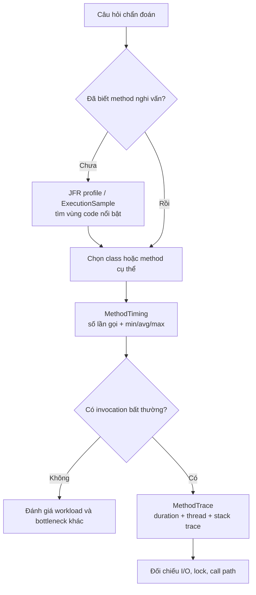

# Lựa chọn phương thức cần đo hoặc truy vết theo câu hỏi chẩn đoán cụ thể

## 1. Mục tiêu: bắt đầu từ câu hỏi, không bắt đầu từ một danh sách method

Trong **JAVA_VERSION_JAVA25**, Java Flight Recorder (JFR) là công cụ quan sát JVM và ứng dụng thông qua các event có dấu thời gian. Java 25 bổ sung **JEP 520 — JFR Method Timing & Tracing**, cho phép chọn method cụ thể để đo thời gian hoặc ghi nhận từng lần gọi bằng hai event mới:

- `jdk.MethodTiming`: tổng hợp số lần gọi và thời gian tối thiểu, trung bình, tối đa của từng method được chọn.
- `jdk.MethodTrace`: ghi từng lần gọi, gồm thời điểm, thời lượng, thread và stack trace.

Bài này hướng dẫn chọn đúng method hoặc nhóm method theo câu hỏi chẩn đoán. Một bản ghi JFR có thể chứa rất nhiều dữ liệu; nếu bật instrumentation trên cả ứng dụng mà chưa có giả thuyết, recording dễ lớn, overhead tăng và kết quả khó diễn giải.

**Phạm vi phiên bản:** JEP 520 là tính năng chính thức trong JDK 25. Các ví dụ sử dụng HotSpot JDK 25 và không yêu cầu preview. Khi dùng một JVM distribution khác hoặc GraalVM Native Image, hãy xác minh tính năng JFR method instrumentation có được hỗ trợ trên đúng runtime đó.

Sau bài học, bạn có thể:

1. Chuyển câu hỏi hiệu năng thành phạm vi method có thể đo.
2. Phân biệt method timing, method tracing và CPU sampling.
3. Chọn class, method, constructor, class initializer hoặc annotation làm filter.
4. Tạo recording ngắn với `jdk.MethodTiming` hoặc `jdk.MethodTrace`.
5. Đọc số invocation, min/average/max, duration và stack trace đúng cách.
6. Kiểm soát event volume, overhead và dữ liệu nhạy cảm khi điều tra trên staging hoặc production.

## 2. Viết câu hỏi chẩn đoán trước khi chọn method

Một câu hỏi tốt mô tả **triệu chứng**, **đối tượng cần kiểm tra** và **loại bằng chứng cần có**.

| Câu hỏi thực tế | Điều cần biết | Cách bắt đầu |
|---|---|---|
| Endpoint tạo đơn thường chậm hơn endpoint tra cứu | Thời gian của method xử lý tạo đơn và số lần được gọi | `jdk.MethodTiming` trên method service nghi vấn |
| Cùng một method có lúc chạy 5 ms, có lúc 2 s | Những invocation chậm và call path của chúng | `jdk.MethodTrace` với filter hẹp và threshold phù hợp |
| Startup mất nhiều thời gian trước khi nhận request | Class initializer nào tốn thời gian | `jdk.MethodTiming` với `::<clinit>` |
| Constructor của một loại object bị gọi quá nhiều | Số invocation và thời gian của constructor | `jdk.MethodTiming` với `::<init>` |
| Không biết method nào đang dùng CPU | Phân bố stack sample trên các thread đang chạy Java code | Bắt đầu bằng `jdk.ExecutionSample` và JFR profile |
| Method có thời gian dài nhưng CPU thấp | Thời gian chờ I/O, lock hoặc thread park | Kết hợp MethodTiming với event socket/monitor/park |
| Cần biết endpoint nào trong nhiều endpoint được gọi | Các method gắn annotation endpoint | Filter theo annotation, ví dụ `@jakarta.ws.rs.GET` |
| Request đi qua nhiều service hoặc nhiều JVM | Quan hệ trace xuyên dịch vụ | Dùng distributed tracing; JFR method trace chỉ quan sát trong một JVM |

Trước khi chạy recording, viết một câu như:

> Trong 60 giây tải đại diện, cần biết `OrderService.createOrder` được gọi bao nhiêu lần, thời gian trung bình/tối đa là bao nhiêu và những invocation trên 100 ms đi qua call path nào.

Câu này đã xác định được method, loại phép đo, khoảng ghi và điều kiện cần truy vết. Không cần bật method tracing cho toàn bộ package để trả lời một câu hỏi hẹp như vậy.

## 3. Hai event mới của JEP 520 làm hai việc khác nhau

### 3.1. `jdk.MethodTiming` — thống kê thời gian theo method

`jdk.MethodTiming` gom dữ liệu của các lần gọi method được chọn. Kết quả có:

- **Method:** method đã được filter chọn.
- **Invocations:** số lần method được gọi trong khoảng thống kê.
- **Minimum Time:** thời gian nhỏ nhất ước lượng.
- **Average Time:** thời gian trung bình ước lượng.
- **Maximum Time:** thời gian lớn nhất ước lượng.

Event được phát định kỳ theo chunk JFR. Nó giúp trả lời câu hỏi tổng hợp như “method này được gọi bao nhiêu lần và thường mất bao lâu?”.

Đây là số liệu **ước lượng thời gian thực thi theo wall-clock**, bao gồm cả thời gian method bị chậm do chờ. Nó không phải CPU time. Ví dụ một method gọi database mất 300 ms vì chờ socket vẫn có thể có wall-clock duration lớn dù CPU chỉ làm việc một phần nhỏ.

### 3.2. `jdk.MethodTrace` — ghi từng invocation

`jdk.MethodTrace` ghi nhận từng lần gọi method được chọn. Event có thể cung cấp:

- **Start Time:** thời điểm bắt đầu invocation.
- **Duration:** thời lượng của invocation.
- **Event Thread:** thread thực hiện method.
- **Method:** method được gọi.
- **Stack Trace:** đường gọi tại thời điểm invocation.

Event này giúp tìm những lần gọi bất thường. Ví dụ, `createOrder` có 1.000 invocation, đa số nhanh nhưng một số lần mất hơn một giây; MethodTrace giúp xem từng invocation chậm và call path đi kèm.

### 3.3. So sánh nhanh

| Tiêu chí | `jdk.MethodTiming` | `jdk.MethodTrace` |
|---|---|---|
| Mức dữ liệu | Tổng hợp theo method | Từng lần gọi |
| Số invocation | Có | Có thể đếm số event |
| Min/average/max | Có | Có duration từng event để tự phân tích |
| Stack trace từng invocation | Không | Có |
| Thread của từng invocation | Không | Có |
| Phù hợp | Tìm method có thời gian trung bình/tối đa cao, kiểm tra số lần gọi | Tìm invocation chậm, phân biệt call path, xác định thread |
| Dung lượng recording | Thường ít hơn do tổng hợp | Có thể tăng nhanh nếu method được gọi nhiều |
| Câu hỏi điển hình | “Method nào mất nhiều thời gian tổng thể?” | “Lần gọi chậm này xảy ra theo đường nào?” |

`MethodTiming` không lưu một event riêng cho mọi invocation; `MethodTrace` lưu event theo từng invocation phù hợp với filter. Có thể dùng timing trước để tìm method đáng nghi, rồi trace method đó trong một recording ngắn.



## 4. Phân biệt method instrumentation với sampling

Không phải mọi câu hỏi về method đều cần JEP 520.

### 4.1. Sampling: tìm nơi CPU đang chạy

`jdk.ExecutionSample` ghi nhận mẫu stack của thread đang thực thi Java code theo chu kỳ. Đây là cách phù hợp khi chưa biết bottleneck nằm ở đâu:

- Có thể xem Hot Methods và Call Tree trong JDK Mission Control.
- Các method xuất hiện thường xuyên trong mẫu thường là vùng code tiêu thụ nhiều thời gian chạy.
- Sampling là phương pháp thống kê; một method ít được gọi nhưng mỗi lần rất chậm có thể không xuất hiện đủ nhiều trong mẫu.
- Thread đang chờ I/O, ngủ hoặc đợi lock không được tính là đang thực thi Java code trong `ExecutionSample`.

### 4.2. Method timing/tracing: đo method đã chọn

JEP 520 dùng instrumentation để đo hoặc trace method theo filter. Nó có thể quan sát các invocation hiếm hoặc có độ biến thiên lớn mà sampling dễ bỏ qua, nhưng phải chọn đúng method vì instrumentation thêm công việc vào đường thực thi.

| Tình huống | Nên chọn |
|---|---|
| Chưa biết vùng code nào gây CPU cao | Sampling bằng JFR |
| Đã biết method và muốn thống kê thời gian | MethodTiming |
| Đã biết method và muốn xem từng lần gọi | MethodTrace |
| Muốn biết thread bị block ở đâu | JFR socket, monitor, park và thread events |
| Muốn đo một thuật toán nhỏ trong điều kiện kiểm soát | JMH benchmark |
| Muốn theo dõi request xuyên nhiều service | Distributed tracing như OpenTelemetry |

**Không dùng MethodTiming để kết luận CPU hotspot.** Method có thể có wall-clock time cao vì đợi database, network hoặc lock. Khi đó cần xem thêm event như `jdk.SocketRead`, `jdk.SocketWrite`, `jdk.JavaMonitorEnter`, `jdk.JavaMonitorWait` và `jdk.ThreadPark`.

## 5. Chọn method bằng filter của JEP 520

Cả `jdk.MethodTiming` và `jdk.MethodTrace` hỗ trợ filter cùng một ngữ pháp. Một filter gồm một hoặc nhiều target; nhiều target được phân cách bằng dấu chấm phẩy `;`.

| Loại target | Cú pháp | Ý nghĩa |
|---|---|---|
| Class | `com.example.OrderService` | Chọn các method thuộc class đó |
| Method trong class | `com.example.OrderService::createOrder` | Chọn method có tên `createOrder` trong class đó |
| Tên method không giới hạn class | `::close` | Chọn method tên `close` ở các class phù hợp |
| Constructor | `com.example.OrderService::<init>` | Chọn constructor của class |
| Static initializer | `com.example.OrderService::<clinit>` | Chọn static initializer của class |
| Annotation | `@jakarta.ws.rs.GET` | Chọn method mang annotation đó |

### 5.1. Chọn class khi chưa biết method nào trong class

Ví dụ:

```text
com.example.checkout.OrderService
```

Filter class phù hợp khi đã xác định class nghi vấn nhưng chưa biết method nào trong class gây chậm. Tuy nhiên, class có nhiều method hoặc method tần suất cao có thể làm recording lớn; chỉ dùng trong khoảng ngắn và theo dõi số event.

### 5.2. Chọn một method cụ thể

Ví dụ:

```text
com.example.checkout.OrderService::createOrder
```

Đây là lựa chọn tốt khi câu hỏi đã xác định được điểm nghi vấn. Filter theo tên method không biểu diễn chữ ký tham số; nếu class có nhiều overload cùng tên, hãy kiểm tra các overload xuất hiện trong kết quả.

Ngữ pháp filter của JEP 520 không có phần chọn overload theo kiểu tham số. Nếu class có nhiều method `createOrder(...)`, target `com.example.OrderService::createOrder` có thể khớp nhiều overload; hãy đọc trường Method trong kết quả để phân biệt. Nếu cần tách riêng theo tham số, dùng tên method khác, annotation chuyên biệt hoặc bổ sung event nghiệp vụ có metadata phù hợp.

### 5.3. Chọn constructor và static initializer

Dùng `::<init>` để điều tra chi phí khởi tạo object; dùng `::<clinit>` để tìm static initializer làm chậm startup.

```text
com.example.cache.CacheEntry::<init>
com.example.cache.CacheRegistry::<clinit>
```

Một class initializer chỉ chạy khi class được khởi tạo theo quy tắc JVM, vì vậy hãy chạy recording trong đúng giai đoạn startup cần điều tra.

### 5.4. Chọn theo annotation

Ví dụ một ứng dụng JAX-RS muốn xem các handler GET:

```text
@jakarta.ws.rs.GET
```

Filter annotation giúp áp dụng cùng một câu hỏi cho nhóm method được đánh dấu bởi framework. Cần dùng đúng tên annotation đầy đủ theo dependency thực tế của ứng dụng.

### 5.5. Kết hợp nhiều target

Ví dụ:

```text
com.example.checkout.OrderService::createOrder;com.example.payment.PaymentService::authorize
```

Dấu chấm phẩy biểu thị phép hợp: method khớp một trong các target được ghi. Khi đặt filter trong shell hoặc command line, hãy đặt toàn bộ đối số trong dấu nháy để dấu chấm phẩy không bị shell hiểu là dấu kết thúc lệnh.

**Không mở rộng filter theo cảm tính.** Bắt đầu bằng một class hoặc method. Chỉ thêm target khi có giả thuyết cụ thể rằng một đường xử lý liên quan cũng cần được so sánh.

## 6. Dùng MethodTiming để đo thời gian tổng hợp

Giả sử đã nghi ngờ `com.example.checkout.OrderService::createOrder`. Tạo recording 60 giây với Java 25:

```bash
java '-XX:StartFlightRecording=method-timing=com.example.checkout.OrderService::createOrder,filename=method-timing.jfr,duration=60s,dumponexit=true' -jar app.jar
```

Sau khi recording kết thúc, xem báo cáo:

```bash
jfr view method-timing method-timing.jfr
```

Báo cáo Method Timing hiển thị các cột tương tự:

```text
Timed Method                         Invocations  Minimum Time  Average Time  Maximum Time
------------------------------------------------------------------------------------------
OrderService.createOrder(...)        120          2.1 ms        18.4 ms       240.0 ms
```

Số liệu trên chỉ minh họa cách đọc kết quả, không phải benchmark của một ứng dụng thực tế.

Cách diễn giải:

- **Invocations cao:** method được gọi thường xuyên. Xem lại call frequency, batching và việc gọi lặp không cần thiết.
- **Average Time cao:** phần lớn invocation có chi phí đáng kể; kiểm tra logic bên trong và dependency.
- **Maximum Time cao hơn nhiều Average:** có một số invocation chậm; dùng MethodTrace để tìm outlier.
- **Minimum thấp nhưng Maximum cao:** thời gian biến thiên theo dữ liệu đầu vào, cache hit/miss, contention hoặc phụ thuộc ngoài.
- **Average thấp nhưng số lần gọi rất cao:** tổng tải của method vẫn có thể đáng kể; cần xem tần suất và chi phí tích lũy.

MethodTiming cung cấp min/average/max và số invocation theo method. Nếu clock resolution không đủ, một số giá trị thời gian có thể không được xác định; đừng diễn giải giá trị thiếu như thời gian bằng 0.

## 7. Dùng MethodTrace để xem từng lần gọi

Khi MethodTiming cho thấy `createOrder` có maximum cao, hãy trace đúng method đó:

```bash
java '-XX:StartFlightRecording:jdk.MethodTrace#filter=com.example.checkout.OrderService::createOrder,filename=method-trace.jfr,duration=60s' -jar app.jar
```

Xem event:

```bash
jfr view --cell-height 30 --width 200 jdk.MethodTrace method-trace.jfr
```

Hoặc in event chi tiết với stack trace dài hơn:

```bash
jfr print --events jdk.MethodTrace --stack-depth 20 method-trace.jfr
```

Một event minh họa:

```text
jdk.MethodTrace {
  startTime = 10:42:18.120
  duration = 240.0 ms
  eventThread = "http-nio-8080-exec-7"
  method = com.example.checkout.OrderService.createOrder(...)
  stackTrace = [
    com.example.checkout.OrderService.createOrder(...)
    com.example.checkout.CheckoutController.submit(...)
    ...
  ]
}
```

Hãy so sánh nhiều invocation:

- Invocation nhanh thường có stack path nào?
- Invocation chậm xuất hiện trên thread nào?
- Có method tích hợp, fallback hoặc transaction interceptor chỉ xuất hiện ở các lần chậm không?
- Duration có tương quan với socket read, monitor wait hoặc thread park không?

Stack trace của MethodTrace cho biết call path tại thời điểm invocation. Nó không tự ghi tham số method, giá trị trả về, object state hoặc toàn bộ dữ liệu request. Nếu cần các dữ liệu nghiệp vụ, hãy bổ sung event ứng dụng phù hợp và kiểm soát thông tin nhạy cảm.

## 8. Giới hạn event volume bằng threshold và filter hẹp

`jdk.MethodTrace` có thể tạo một event cho mỗi invocation khớp filter. Nếu method được gọi hàng chục nghìn lần mỗi giây, recording sẽ tăng nhanh.

Có thể chỉ ghi những invocation có duration từ 10 ms trở lên:

```bash
java '-XX:StartFlightRecording:jdk.MethodTrace#filter=com.example.checkout.OrderService::createOrder,jdk.MethodTrace#threshold=10ms,filename=slow-create-order.jfr,duration=60s' -jar app.jar
```

Threshold là ngưỡng thời lượng tối thiểu để event được ghi. Ví dụ 10 ms giúp tập trung vào invocation dài hơn ngưỡng, nhưng không có nghĩa instrumentation chỉ chạy trên những invocation chậm; hãy vẫn giới hạn method và thời gian recording.

### Tạo cấu hình JFC có thể tái sử dụng

Khi cần dùng lại filter trong nhiều lần điều tra, tạo cấu hình riêng:

```bash
jfr configure --input profile.jfc --output order-trace.jfc "jdk.MethodTrace#filter=com.example.checkout.OrderService::createOrder" "jdk.MethodTrace#threshold=10ms"
```

Sau đó chạy:

```bash
java '-XX:StartFlightRecording=settings=order-trace.jfc,filename=order-trace.jfr,duration=60s' -jar app.jar
```

JFR cho phép cấu hình event qua file `.jfc` hoặc qua command line. Tham số truyền ở command line có thể ghi đè setting trong file. Giữ file cấu hình cùng tài liệu điều tra để người khác tái lập kết quả.

## 9. Khi cần xem method khởi tạo lúc startup

Một câu hỏi cụ thể thường gặp là: “Vì sao ứng dụng mất nhiều thời gian trước khi sẵn sàng nhận request?”

Static initializer có thể nạp metadata, khởi tạo registry hoặc tạo cache. Để tổng hợp thời gian static initializer:

```bash
java '-XX:StartFlightRecording=method-timing=::<clinit>,filename=startup-methods.jfr,dumponexit=true' -jar app.jar
```

Xem báo cáo:

```bash
jfr view method-timing startup-methods.jfr
```

Nếu một initializer có thời gian cao, dùng filter class cụ thể để kiểm tra lại hoặc xem thêm event class loading. Không nên trace tất cả method của JDK trong thời gian dài chỉ để tìm một initializer; bắt đầu bằng báo cáo tổng hợp, sau đó giới hạn phạm vi.

Với constructor, dùng filter như `com.example.cache.CacheEntry::<init>`. Nếu constructor được gọi rất nhiều, hãy xem cả số invocation lẫn thời gian trung bình; chi phí tổng thể có thể đến từ số lượng object thay vì một lần khởi tạo quá chậm.

## 10. Phân tích một tình huống: endpoint tạo đơn đôi khi chậm

Giả sử dashboard cho thấy `POST /orders` có p95 cao, nhưng phần lớn request nhanh.

### Bước 1 — Chọn method ở tầng nghiệp vụ

Bắt đầu với `OrderService.createOrder`. Dùng MethodTiming trong một khoảng tải đại diện để lấy invocation count, average và maximum.

### Bước 2 — Đối chiếu số liệu tổng hợp

Nếu average ở mức 15 ms nhưng maximum lên đến 900 ms, vấn đề có thể chỉ xảy ra với một số request. Không kết luận ngay rằng toàn bộ logic tạo đơn chậm.

### Bước 3 — Trace invocation

Dùng MethodTrace với threshold 100 ms trong recording ngắn. Xem stack trace của các invocation vượt ngưỡng.

### Bước 4 — So sánh call path

Giả sử các invocation chậm đi qua `InventoryClient.reserve`, còn invocation nhanh đi qua cache. Đây là một giả thuyết cần kiểm tra thêm, chưa phải bằng chứng rằng inventory service chắc chắn là nguyên nhân.

### Bước 5 — Tương quan với event chờ

Xem các event `jdk.SocketRead`, `jdk.SocketWrite`, `jdk.JavaMonitorWait` hoặc `jdk.ThreadPark` trên cùng thread và khoảng thời gian. Nếu có socket wait dài trùng với invocation chậm, hướng điều tra chuyển sang network hoặc dịch vụ phụ thuộc.

### Bước 6 — Kiểm tra sau thay đổi

Sau khi tối ưu, chạy lại cùng workload và cùng phạm vi recording. So sánh:

- Invocation count.
- Average và maximum.
- Tỷ lệ invocation vượt threshold.
- Call path của các invocation chậm.
- p95/p99 ở cấp request và throughput tổng thể.

Đừng chỉ so sánh một giá trị maximum duy nhất; workload khác nhau có thể tạo ra maximum rất khác nhau.

## 11. Hiểu đúng wall-clock time, CPU time và thời gian chờ

`MethodTiming` đo thời gian method thực thi theo wall-clock, bao gồm cả khoảng thời gian method bị chờ. Vì vậy:

| Quan sát | Có thể chỉ ra | Cần kiểm tra thêm |
|---|---|---|
| Method duration cao, CPU cao | Tính toán hoặc vòng lặp tốn CPU | ExecutionSample, CPU profile, thuật toán |
| Method duration cao, CPU thấp | Chờ network, database, lock hoặc scheduler | SocketRead/Write, MonitorWait, ThreadPark |
| Average thấp, maximum rất cao | Một số request đặc biệt hoặc contention | MethodTrace và dữ liệu đầu vào đã ẩn danh |
| Nhiều invocation, duration mỗi lần thấp | Chi phí gọi lặp hoặc chatty dependency | Invocation count, batching, call frequency |
| Method trace cho thấy stack path khác nhau | Nhiều nhánh nghiệp vụ hoặc fallback | Điều kiện nhánh, event nghiệp vụ, request correlation |

`jdk.ExecutionSample` lấy mẫu stack khi thread đang chạy Java code; nó không phải đồng hồ đo wall-clock cho một method. Nếu method chờ socket 500 ms, CPU sampling có thể không cho thấy 500 ms đó. MethodTiming sẽ phản ánh thời gian elapsed dài hơn, sau đó các event chờ giúp giải thích nguyên nhân.

Nếu câu hỏi là “CPU time của method này là bao nhiêu?”, hãy dùng CPU profiling phù hợp với runtime và nền tảng. Đừng lấy wall-clock duration của MethodTiming làm CPU time.

## 12. Phạm vi của JFR method tracing và distributed tracing

JEP 520 quan sát invocation trong **một JVM**. Event có thread và stack trace, nhưng không tự tạo span xuyên qua nhiều service hoặc nhiều process.

| Nhu cầu | Công cụ phù hợp |
|---|---|
| Đo thời gian một method trong JVM | `jdk.MethodTiming` |
| Xem từng invocation và call stack trong JVM | `jdk.MethodTrace` |
| Tìm CPU hotspot trên nhiều thread | JFR sampling |
| Theo dõi một request qua API gateway, service, queue và database | Distributed tracing như OpenTelemetry |
| Gắn dữ liệu nghiệp vụ vào event JFR | Custom JFR Event với các field được kiểm soát |

Nếu cần tương quan với request ID, trace ID hoặc order ID, hãy dùng cơ chế tracing ở tầng ứng dụng. JFR có thể bổ sung bằng custom event để ghi metadata đã được phép chia sẻ; không mặc định MethodTrace biết request ID hoặc tenant của invocation.

Đừng ghi token, mật khẩu, payload thanh toán hoặc dữ liệu cá nhân vào custom event. Recording có thể chứa tên class, method, stack trace và dữ liệu vận hành nhạy cảm; áp dụng quyền truy cập, thời hạn lưu và quy trình scrub phù hợp.

## 13. Overhead và các giới hạn cần biết

JEP 520 dùng bytecode instrumentation để đo thời gian và trace method. Instrumentation thêm công việc vào đường chạy được chọn, vì vậy kết quả có thể chịu ảnh hưởng bởi hoạt động quan sát.

Các nguyên tắc:

- Chỉ filter class hoặc method liên quan đến giả thuyết.
- Ưu tiên MethodTiming để xem thống kê tổng hợp trước.
- Chỉ bật MethodTrace khi cần điều tra từng invocation.
- Đặt threshold nếu chỉ quan tâm các invocation vượt một ngưỡng thời gian.
- Ghi trong một khoảng đủ để có workload đại diện, rồi dừng.
- So sánh recording với baseline để hiểu observer effect.
- Không dùng JEP 520 thay cho JMH khi đo microbenchmark hoặc so sánh thuật toán ở độ phân giải rất nhỏ.

MethodTrace có thể tạo nhiều event hơn MethodTiming. Bật trace cho một method cực kỳ nóng với threshold bằng 0 có thể làm file recording tăng nhanh và ảnh hưởng hiệu năng. JFR nói chung có overhead thấp ở cấu hình mặc định, nhưng không nên suy ra mọi cấu hình method instrumentation đều có cùng overhead.

Ngoài ra, JEP 520 không ghi:

- Giá trị tham số đầu vào.
- Giá trị trả về.
- Trạng thái object/field trong method.
- Span phân tán qua nhiều process.
- Nguyên nhân nghiệp vụ của một nhánh xử lý.

Nếu cần các thông tin đó, hãy thêm custom JFR event hoặc công cụ tracing phù hợp, đồng thời bảo vệ dữ liệu nhạy cảm.

## 14. Bài thực hành: chọn method theo ba câu hỏi khác nhau

Tạo ứng dụng mẫu có các method:

```java
package com.example;

public class CheckoutService {

    public String createOrder(String customerId) {
        validate(customerId);
        reserveInventory(customerId);
        return "created:" + customerId;
    }

    private void validate(String customerId) {
        if (customerId == null || customerId.isBlank()) {
            throw new IllegalArgumentException("customerId is required");
        }
    }

    private void reserveInventory(String customerId) {
        // Giả lập một dependency call.
    }

    static {
        // Giả lập khởi tạo metadata.
    }
}
```

Không cần sửa source để JEP 520 đo các method này. Biên dịch và đóng gói ứng dụng bằng JDK 25; chạy các lệnh dưới đây trong môi trường thử nghiệm.

### Câu hỏi A — `createOrder` được gọi bao nhiêu lần và mất bao lâu?

```bash
java '-XX:StartFlightRecording=method-timing=com.example.CheckoutService::createOrder,filename=create-order-timing.jfr,duration=60s' -jar app.jar

jfr view method-timing create-order-timing.jfr
```

Ghi lại invocation count, minimum, average và maximum.

### Câu hỏi B — Invocation nào chậm hơn 100 ms?

```bash
java '-XX:StartFlightRecording:jdk.MethodTrace#filter=com.example.CheckoutService::createOrder,jdk.MethodTrace#threshold=100ms,filename=create-order-trace.jfr,duration=60s' -jar app.jar

jfr print --events jdk.MethodTrace --stack-depth 20 create-order-trace.jfr
```

So sánh thread, duration và stack trace giữa các invocation.

### Câu hỏi C — Static initializer nào làm chậm startup?

```bash
java '-XX:StartFlightRecording=method-timing=::<clinit>,filename=class-initializers.jfr,dumponexit=true' -jar app.jar

jfr view method-timing class-initializers.jfr
```

Từ kết quả, chọn class initializer cụ thể để điều tra tiếp.

### Phiếu kết quả

| Câu hỏi | Filter | Event | Bằng chứng cần ghi |
|---|---|---|---|
| Thời gian tổng hợp của method | `com.example.CheckoutService::createOrder` | `jdk.MethodTiming` | Invocations, min, average, max |
| Invocation vượt 100 ms | `com.example.CheckoutService::createOrder` | `jdk.MethodTrace` | Duration, event thread, stack trace |
| Static initializer chậm | `::<clinit>` | `jdk.MethodTiming` | Class initializer có thời gian cao |

**Tiêu chí đạt:** giải thích được vì sao ba câu hỏi cần ba cách filter/đọc kết quả khác nhau; không nhầm wall-clock duration với CPU time; và biết lúc nào cần sampling hoặc distributed tracing.

## 15. Checklist trước khi chạy recording

- [ ] Câu hỏi chẩn đoán được viết rõ, có method hoặc class nghi vấn.
- [ ] Đã quyết định cần thống kê tổng hợp hay xem từng invocation.
- [ ] Dùng `jdk.MethodTiming` cho invocation count/min/average/max.
- [ ] Dùng `jdk.MethodTrace` khi cần duration, thread và stack trace từng invocation.
- [ ] Filter có tên class đầy đủ, method, constructor, class initializer hoặc annotation phù hợp.
- [ ] Không bật instrumentation cho toàn bộ ứng dụng khi chưa có lý do.
- [ ] Có threshold khi chỉ quan tâm invocation chậm.
- [ ] Recording chạy trong khoảng thời gian và workload đại diện.
- [ ] Đã kiểm tra event bằng `jfr view`, `jfr print` hoặc JDK Mission Control.
- [ ] Đã phân biệt wall-clock time với CPU time.
- [ ] Nếu method chờ I/O/lock, đã đối chiếu socket, monitor và thread events.
- [ ] Nếu cần request correlation xuyên service, đã dùng distributed tracing phù hợp.
- [ ] Recording được bảo vệ và scrub dữ liệu nhạy cảm trước khi chia sẻ.
- [ ] Đã đo observer effect trước khi kết luận hiệu năng production.

### Tài liệu tham khảo chính thức

1. [JEP 520 — JFR Method Timing & Tracing (JDK 25)](https://openjdk.org/jeps/520)
2. [Oracle Inside.java — What's New in Java 25 in 2 Minutes: JEP 520 examples](https://inside.java/2025/10/17/new-in-jdk-25-2-mins/)
3. [Oracle Java SE 25 API — jdk.jfr package: event settings and method filter grammar](https://docs.oracle.com/en/java/javase/25/docs/api/jdk.jfr/jdk/jfr/package-summary.html)
4. [Oracle Java SE 25 — The java Command: StartFlightRecording](https://docs.oracle.com/en/java/javase/25/docs/specs/man/java.html)
5. [Oracle Java SE 25 — The jfr Command: configure, view, print](https://docs.oracle.com/en/java/javase/25/docs/specs/man/jfr.html)
6. [Oracle Java SE 25 — Troubleshoot Performance Issues Using Flight Recorder](https://docs.oracle.com/en/java/javase/25/troubleshoot/troubleshoot-performance-issues-using-jfr.html)
7. [Oracle Java SE 25 API — jdk.jfr.Event](https://docs.oracle.com/en/java/javase/25/docs/api/jdk.jfr/jdk/jfr/Event.html)
8. [Oracle — What's New for JFR in JDK 25, by JFR engineer Erik Gahlin](https://egahlin.github.io/2025/05/31/whats-new-in-jdk-25.html)
