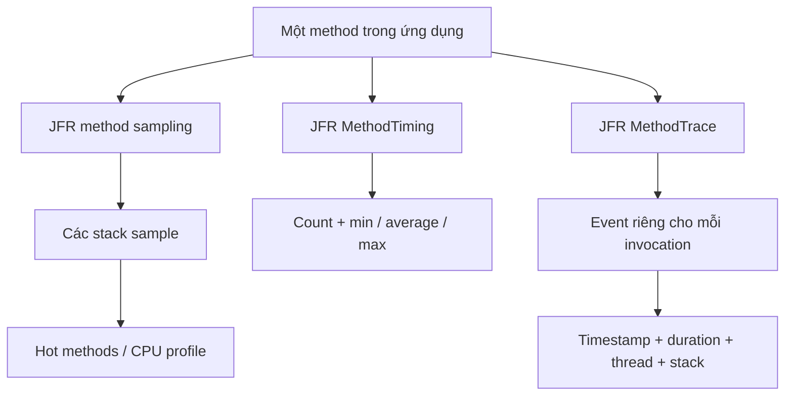

# Phân biệt thống kê thời gian phương thức với sự kiện truy vết từng lần gọi

Khi một phương thức Java chạy chậm, có hai câu hỏi khác nhau cần trả lời:

- **Phương thức này nhìn chung mất bao lâu?** Có bao nhiêu lần gọi, thời gian tối thiểu, trung bình và tối đa là bao nhiêu?
- **Một lần gọi cụ thể đã diễn ra như thế nào?** Nó bắt đầu lúc nào, chạy trên thread nào, mất bao lâu và được gọi từ đường stack nào?

Java 25 đưa hai khả năng này vào **JDK Flight Recorder (JFR)** qua **JEP 520 — JFR Method Timing & Tracing**. Sự khác biệt được thể hiện bằng hai event:

- **jdk.MethodTiming:** tổng hợp thời gian thực thi theo phương thức, gồm số lần gọi và min/average/max.
- **jdk.MethodTrace:** ghi một event cho từng lần gọi phương thức được chọn, kèm timestamp, duration, thread và stack trace.

Cả hai dùng bytecode instrumentation ở runtime và được cấu hình bằng filter. Bạn không cần tự thêm log vào từng method hoặc viết Java agent chỉ để đo những phương thức được JFR hỗ trợ. Bài này thuộc chương **Đo và truy vết JFR** của module **JAVA_VERSION_JAVA25**, tập trung chọn đúng chế độ đo, đọc dữ liệu và kiểm soát chi phí khi chạy trong ứng dụng thực tế.

> **Phạm vi Java 25:** JEP 520 là tính năng JDK 25 đã phát hành ổn định, không phải preview và không cần cờ --enable-preview. Bài cũng đối chiếu với method sampling của JFR để tránh nhầm số lượng mẫu CPU với số lần gọi thật. Các ví dụ dùng java, jcmd và jfr đi kèm JDK 25.

## 1. Mục tiêu học tập

Sau bài này, bạn có thể:

1. Phân biệt sampling profiler, thống kê thời gian phương thức và trace từng lần gọi.
2. Giải thích jdk.MethodTiming tổng hợp dữ liệu gì và vì sao thời gian được báo là xấp xỉ wall-clock time.
3. Dùng jdk.MethodTrace để xem từng invocation cùng stack trace.
4. Cấu hình filter theo class, method hoặc annotation trong JDK 25.
5. Chọn threshold và throttle để kiểm soát số event và overhead.
6. Bắt đầu, kiểm tra, dump và dừng JFR recording bằng công cụ JDK.
7. Đọc jfr view method-timing, jfr view jdk.MethodTrace, jfr view hot-methods và jfr summary.
8. Kết hợp timing, trace, CPU samples và các event chờ để tìm nguyên nhân của một method chậm.
9. Biết giới hạn của method tracing và cách bảo vệ file .jfr trong môi trường production.

## 2. Ba cách quan sát phương thức trong JFR

Không phải mọi dữ liệu được nhóm theo method đều có cùng ý nghĩa. Cần phân biệt ba loại sau.

| Cách quan sát | Cơ chế | Dữ liệu nhận được | Có đếm chính xác từng invocation? |
|---|---|---|---|
| **Method sampling** (jdk.ExecutionSample) | JVM lấy mẫu stack của thread đang chạy theo chu kỳ | Phân bố mẫu theo method/stack, giúp tìm code tiêu thụ CPU | Không |
| **Method timing** (jdk.MethodTiming) | Bytecode instrumentation đo từng lần thực thi rồi tổng hợp theo method | Invocation count, minimum, average, maximum duration | Có bộ đếm invocation cho method đã instrument; thời gian là xấp xỉ |
| **Method tracing** (jdk.MethodTrace) | Bytecode instrumentation ghi event cho từng lần gọi phù hợp filter | Timestamp, duration, thread, method và stack trace của từng lần gọi | Có, đối với invocation được filter và không bị threshold/throttle loại bỏ |



### 2.1. Method sampling trả lời câu hỏi về CPU

JFR có event **jdk.ExecutionSample**. JVM lấy mẫu stack của những thread đang thực thi code. Những method xuất hiện trong nhiều mẫu thường là nơi ứng dụng tiêu thụ nhiều thời gian CPU tương đối trong khoảng recording.

Sampling không ghi một event cho mỗi lần method được gọi. Nếu một method được gọi 100.000 lần nhưng mỗi lần rất ngắn, sample count không nhất thiết bằng 100.000. Ngược lại, một method chạy lâu có thể xuất hiện trong nhiều mẫu dù chỉ được gọi một vài lần.

Sampling cũng tập trung vào thread đang chạy. Thread đang ngủ, chờ I/O hoặc chờ lock thường không được lấy mẫu như thread đang thực thi code. Vì vậy, sampling phù hợp để tìm CPU hotspot; nó không phải phép đo đầy đủ wall-clock latency của request.

### 2.2. Method timing trả lời câu hỏi về phân bố thời gian theo method

**jdk.MethodTiming** gom thời gian của các lần gọi theo method được chọn. Một hàng kết quả có thể cho biết:

- **Invocations:** số lần method được gọi trong khoảng recording.
- **Minimum Time:** thời gian nhỏ nhất ước lượng.
- **Average Time:** thời gian trung bình ước lượng.
- **Maximum Time:** thời gian lớn nhất ước lượng.

Dữ liệu này giúp phát hiện method có số lần gọi lớn, average cao hoặc maximum bất thường. Tuy nhiên, bảng tổng hợp không chỉ ra chính xác invocation nào là lần chậm nhất, xảy ra lúc nào hoặc request nào gọi nó.

### 2.3. Method trace trả lời câu hỏi về từng invocation

**jdk.MethodTrace** ghi event riêng cho từng lần gọi method đã chọn và vượt qua điều kiện ghi. Mỗi event có thể cung cấp:

- Thời điểm bắt đầu và thời lượng.
- Method được instrument.
- Thread thực hiện invocation.
- Stack trace để xem đường gọi.
- Thứ tự các invocation trong khoảng recording.

Method trace giúp điều tra một lần gọi cụ thể hoặc tái dựng đường gọi của một thao tác. Đổi lại, số event có thể tăng rất nhanh nếu method được gọi với tần suất cao.

## 3. JEP 520 trong Java 25

**JEP 520 — JFR Method Timing & Tracing** mở rộng JFR bằng bytecode instrumentation để đo và truy vết method invocation. Hai event chính:

| Event | Dạng dữ liệu | Dùng khi |
|---|---|---|
| **jdk.MethodTiming** | Thống kê tổng hợp theo method | Muốn biết method nào được gọi nhiều, min/average/max ra sao |
| **jdk.MethodTrace** | Event theo từng invocation | Muốn biết một lần gọi diễn ra lúc nào, trên thread nào và từ stack nào |

Các điểm quan trọng:

- Chỉ các method khớp filter mới được instrument theo cấu hình tương ứng.
- Filter có thể chọn class, method cụ thể, tên method hoặc annotation.
- jdk.MethodTiming phù hợp để tổng hợp dữ liệu trong khoảng recording.
- jdk.MethodTrace tạo dữ liệu chi tiết theo từng lần gọi; threshold và throttle giúp giới hạn lượng event.
- Thời gian method bao gồm cả thời gian chờ trong method, không chỉ CPU time.
- JFR vẫn ghi dữ liệu trong file .jfr cùng các event JVM khác, nên có thể đối chiếu method với GC, lock, I/O và thread events.

JEP 520 không thay thế JFR sampling. Ba cơ chế trả lời các câu hỏi khác nhau và có thể được sử dụng kết hợp trong một lần điều tra.

## 4. Hiểu đúng thời gian được đo

Một điểm quan trọng là **wall-clock duration khác CPU time**.

Giả sử một method xử lý đơn hàng mất 120 ms:

- 8 ms thực thi CPU.
- 70 ms chờ database.
- 25 ms chờ lock.
- 17 ms chịu ảnh hưởng của scheduling và các khoảng chờ khác.

MethodTiming và MethodTrace đo thời gian trôi qua trong phạm vi method được instrument. Giá trị có thể bao gồm cả thời gian chờ, không chỉ thời gian thread thực sự chạy trên CPU.

| Dữ liệu | Phản ánh điều gì? | Không thể kết luận trực tiếp |
|---|---|---|
| MethodTiming average/max | Thời gian trôi qua trong method theo thống kê | Method dùng CPU tương ứng từng ấy thời gian |
| MethodTrace duration | Thời gian của một invocation cụ thể | Tất cả duration đều do code trong method gây ra |
| jdk.ExecutionSample | Stack của thread được lấy mẫu khi đang chạy | Tổng thời gian wall-clock của method hoặc số lần gọi |
| jdk.JavaMonitorEnter | Thời gian chờ vào monitor được ghi nhận | Toàn bộ thời gian chờ database/network |
| jdk.SocketRead / jdk.SocketWrite | Thời gian thao tác socket được ghi nhận | Mọi loại latency trong ứng dụng |

Nếu method timing cao nhưng method sampling không cho thấy CPU hotspot tương ứng, hãy điều tra I/O, lock, thread park, GC hoặc dependency bên ngoài. Nếu timing cao và sampling cũng tập trung vào method đó, có thể method vừa tiêu thụ CPU vừa có latency lớn.

## 5. Bật Method Timing bằng JDK 25

Cách trực tiếp nhất là dùng tùy chọn **method-timing** của **-XX:StartFlightRecording**. Ví dụ, đo method submit của OrderService:

```bash
java -XX:StartFlightRecording=method-timing='com.example.orders.OrderService::submit',dumponexit=true,filename=method-timing.jfr \
     -jar app.jar
```

Giải thích:

- method-timing yêu cầu JFR tổng hợp thời gian cho method khớp filter.
- com.example.orders.OrderService::submit chỉ rõ class và method cần đo.
- dumponexit=true ghi recording ra file khi JVM kết thúc bình thường.
- filename=method-timing.jfr đặt tên file recording.
- Ứng dụng vẫn chạy bình thường trên HotSpot JVM.

Đây là ví dụ giả định ứng dụng đóng gói thành app.jar và có class com.example.orders.OrderService. Hãy thay tên class/method bằng tên thực trong ứng dụng.

### 5.1. Đọc kết quả tổng hợp

Sau khi recording hoàn tất:

```bash
jfr summary method-timing.jfr
jfr view method-timing method-timing.jfr
```

View method-timing hiển thị bảng thống kê theo method, thường có các cột:

| Cột | Ý nghĩa |
|---|---|
| Timed Method | Tên method được đo, có thể kèm signature |
| Invocations | Số invocation trong recording |
| Minimum Time | Thời gian nhỏ nhất ước lượng |
| Average Time | Thời gian trung bình ước lượng |
| Maximum Time | Thời gian lớn nhất ước lượng |

Ví dụ minh họa dạng kết quả:

```text
Timed Method                                  Invocations  Minimum Time  Average Time  Maximum Time
--------------------------------------------  -----------  ------------  ------------  ------------
OrderService.submit(OrderRequest)                      80       2.1 ms        8.4 ms       47.2 ms
PaymentService.authorize(Payment)                       80       1.3 ms        5.8 ms       35.1 ms
InventoryService.reserve(String, int)                  80       0.4 ms        1.2 ms        6.8 ms
```

Các số trên chỉ minh họa định dạng. Không dùng chúng làm benchmark hoặc cam kết hiệu năng. Dữ liệu thật phụ thuộc workload, JDK build, filter và khoảng recording.

### 5.2. Diễn giải thống kê

Giả sử một method có invocation count lớn, average time thấp nhưng maximum time cao hơn nhiều lần average. Method đó có thể thường chạy nhanh nhưng thỉnh thoảng bị chậm do I/O, lock, GC hoặc dependency có latency biến động. Chỉ nhìn average sẽ che khuất tail latency.

Nếu invocation count lớn và average cũng cao, method có thể là hotspot quan trọng. Hãy kết hợp với hot-methods để xác định phần CPU và các event chờ để tìm nguyên nhân.

**Giới hạn:** MethodTiming cung cấp min/average/max, không tự tạo đầy đủ histogram hoặc percentile p95/p99. Nếu cần phân vị latency theo từng request hoặc theo nhóm nghiệp vụ, hãy dùng tracing/metrics phù hợp hoặc phân tích các event chi tiết.

## 6. Bật Method Trace để xem từng lần gọi

Method tracing dùng event **jdk.MethodTrace**. Ví dụ ghi lại từng invocation của OrderService.submit:

```bash
java -XX:StartFlightRecording=jdk.MethodTrace#filter='com.example.orders.OrderService::submit',filename=method-trace.jfr,dumponexit=true \
     -jar app.jar
```

Sau khi ứng dụng chạy xong:

```bash
jfr summary method-trace.jfr
jfr view --cell-height 30 --width 200 jdk.MethodTrace method-trace.jfr
```

Để xem event chi tiết ở dạng text:

```bash
jfr print --events jdk.MethodTrace --stack-depth 32 method-trace.jfr
```

Một event method trace có thể hiển thị các trường như:

```text
jdk.MethodTrace {
  startTime = 10:15:20.123
  duration = 43.3 ms
  eventThread = "http-nio-8080-exec-1"
  stackTrace = [
    com.example.orders.OrderController.submit(...)
    ...
  ]
  method = "com.example.orders.OrderService.submit(...)"
}
```

Đây là ví dụ minh họa cách trình bày, không phải output thực từ ứng dụng. Khi có nhiều invocation, mỗi lần gọi được ghi thành một event riêng nếu nó khớp filter và vượt qua các điều kiện recording.

### 6.1. Method trace cho biết thêm điều gì?

Giả sử method submit được gọi 100 lần. Bảng MethodTiming có thể cho thấy maximum là 47 ms, nhưng không xác định invocation nào đạt 47 ms. Method trace cho phép tìm event có duration cao nhất, xem timestamp, thread và stack trace của invocation đó.

Từ event cụ thể, bạn có thể đối chiếu thời điểm với:

- jdk.SocketRead hoặc jdk.SocketWrite.
- jdk.JavaMonitorEnter hoặc jdk.JavaMonitorWait.
- jdk.ThreadPark.
- Các event GC.
- Các method trace lồng nhau trong cùng luồng xử lý.

Điều này giúp chuyển từ câu hỏi “method nào chậm?” sang “lần gọi nào chậm, xảy ra khi nào và có dấu hiệu chờ ở đâu?”.

### 6.2. Trace từng invocation không đồng nghĩa distributed tracing

jdk.MethodTrace theo dõi method invocation bên trong một JVM. Nó không tự tạo OpenTelemetry span, không truyền trace context qua HTTP/message broker và không thay thế distributed tracing giữa nhiều process.

Nếu cần theo dõi request xuyên qua gateway, service, queue và database ở nhiều process, dùng hệ thống distributed tracing. JFR method trace có thể bổ sung dữ liệu chi tiết bên trong một JVM khi cần phân tích sâu.

## 7. Filter: chỉ đo những method có ý nghĩa

JFR hỗ trợ filter cho jdk.MethodTiming và jdk.MethodTrace. Cú pháp filter có các dạng:

| Dạng filter | Ví dụ | Ý nghĩa |
|---|---|---|
| Class | com.example.orders.OrderService | Chọn các method trong class |
| Class + method | com.example.orders.OrderService::submit | Chọn method cụ thể trong class |
| Tên method | ::submit | Chọn method có tên submit theo filter |
| Annotation | @jakarta.ws.rs.GET | Chọn method được đánh dấu annotation tương ứng |
| Nhiều target | A::method;B::method | Ghép nhiều target bằng dấu chấm phẩy |

Ví dụ filter hai method:

```bash
java -XX:StartFlightRecording=jdk.MethodTrace#filter='com.example.orders.OrderService::submit;com.example.payment.PaymentService::authorize',filename=trace.jfr,dumponexit=true \
     -jar app.jar
```

Filter có thể dùng cùng cho event jdk.MethodTiming thông qua setting filter, hoặc dùng tùy chọn method-timing để bật chế độ tổng hợp thời gian.

### 7.1. Chọn đúng phạm vi

Bắt đầu bằng một method hoặc một nhóm nhỏ có nghi vấn. Sau khi có kết quả, mở rộng filter nếu cần.

Tránh chọn tất cả method trong framework hoặc toàn bộ thư viện ngay từ đầu. Một ứng dụng web có thể gọi hàng nghìn method cho mỗi request; tracing diện rộng tạo nhiều event, file recording lớn và overhead không cần thiết.

### 7.2. Overload và constructor

Nếu class có nhiều overload cùng tên, filter theo class và method có thể chọn nhiều signature tương ứng. Dùng thông tin signature trong kết quả để phân biệt overload.

JFR filter cũng có thể chọn constructor bằng ::<init> và static initializer bằng ::<clinit>. Chỉ bật các mục này khi cần phân tích chi phí khởi tạo object/class.

## 8. Threshold và throttle: điều khiển lượng trace

Method tracing có thể tạo event cho từng lần gọi. Với method tần suất cao, lượng dữ liệu tăng nhanh. JFR có các setting để giới hạn event.

### 8.1. Threshold

threshold là thời lượng tối thiểu để event được ghi. Ví dụ chỉ lưu các lần gọi submit mất ít nhất 10 ms:

```bash
java -XX:StartFlightRecording=jdk.MethodTrace#filter='com.example.orders.OrderService::submit',jdk.MethodTrace#threshold=10ms,filename=slow-methods.jfr,dumponexit=true \
     -jar app.jar
```

Nếu muốn ghi mọi invocation phù hợp filter, dùng threshold bằng 0:

```bash
java -XX:StartFlightRecording=jdk.MethodTrace#filter='com.example.orders.OrderService::submit',jdk.MethodTrace#threshold=0ns,filename=all-calls.jfr,dumponexit=true \
     -jar app.jar
```

Threshold giúp giảm event theo thời lượng. Khi đặt threshold 10 ms, event ngắn hơn ngưỡng không xuất hiện; do đó recording không còn thể hiện mọi invocation.

### 8.2. Throttle

throttle giới hạn số event tối đa trong một đơn vị thời gian. Ví dụ:

```text
jdk.MethodTrace#throttle=100/s
```

Throttle có thể giảm volume trong method rất nóng, nhưng một số invocation sẽ không được ghi. Không dùng recording đã throttle để suy ra tổng số lần gọi thật.

### 8.3. Stack trace

Stack trace hữu ích để biết caller, nhưng làm event lớn hơn và tăng chi phí ghi. Giữ stack trace khi cần phân tích đường gọi; tắt nếu chỉ cần method, thread và duration và muốn giảm dung lượng.

### 8.4. Bảng lựa chọn

| Mục tiêu | Filter | Threshold | Throttle |
|---|---|---:|---|
| Tìm các lần gọi rất chậm | Method cụ thể | Ví dụ 10 ms | Có thể đặt nếu tần suất vẫn cao |
| Kiểm tra mọi invocation trong một test ngắn | Method cụ thể | 0 ns | Off |
| Theo dõi method tần suất rất cao | Method cụ thể | Theo ngưỡng điều tra | Giới hạn có chủ đích |
| Đo thống kê tổng hợp | jdk.MethodTiming | Theo mục tiêu đo | Thường không cần trace event |
| Tìm CPU hotspot trước khi chọn method | jdk.ExecutionSample | Sampling period | Không áp dụng như method trace |

Không có một ngưỡng đúng cho mọi ứng dụng. Hãy bắt đầu ở staging, kiểm tra số event, kích thước recording và overhead rồi mới chọn cấu hình production.

## 9. Kết hợp MethodTiming, MethodTrace và Hot Methods

Một quy trình điều tra hiệu quả thường có ba bước:

1. Dùng **Hot Methods** để tìm nơi tiêu thụ CPU đáng chú ý.
2. Dùng **MethodTiming** để xem invocation count và min/average/max của method nghi vấn.
3. Dùng **MethodTrace** có filter hẹp để tìm các invocation bất thường và stack trace tương ứng.

### 9.1. Bước 1: tìm CPU hotspot bằng sampling

Chạy profiling recording có thời lượng giới hạn:

```bash
java -XX:StartFlightRecording=filename=cpu-profile.jfr,settings=profile,duration=60s \
     -jar app.jar
```

Đọc các method có nhiều mẫu:

```bash
jfr view hot-methods cpu-profile.jfr
jfr print --events jdk.ExecutionSample --stack-depth 20 cpu-profile.jfr
```

hot-methods tổng hợp các method theo sample. Đây là chỉ báo thống kê về code được lấy mẫu khi thread đang chạy, không phải bảng đếm chính xác mọi lần gọi.

### 9.2. Bước 2: đo thống kê method nghi vấn

```bash
java -XX:StartFlightRecording=method-timing='com.example.orders.OrderService::submit',dumponexit=true,filename=timing.jfr \
     -jar app.jar
jfr view method-timing timing.jfr
```

So sánh invocation count và min/average/max trong cùng một workload đại diện.

### 9.3. Bước 3: truy vết invocation chậm

```bash
java -XX:StartFlightRecording=jdk.MethodTrace#filter='com.example.orders.OrderService::submit',jdk.MethodTrace#threshold=10ms,filename=trace.jfr,dumponexit=true \
     -jar app.jar
jfr view jdk.MethodTrace trace.jfr
```

Tìm các event có duration cao, kiểm tra thread và stack trace. Đối chiếu thời điểm với các event I/O, lock và GC trong cùng recording hoặc recording tương ứng.

### 9.4. Cách diễn giải kết hợp

| Kết quả | Hướng điều tra |
|---|---|
| Hot Methods cao, MethodTiming average/max cao | Method có thể vừa tốn CPU vừa kéo dài wall-clock time |
| Hot Methods thấp, MethodTiming max cao | Kiểm tra I/O, lock, scheduling, GC hoặc downstream latency |
| Invocation count rất cao, average thấp | Xem chi phí cộng dồn, allocation và khả năng giảm số lần gọi |
| Average thấp nhưng maximum cao | Tìm tail invocation bằng MethodTrace và đối chiếu sự kiện chờ |
| MethodTrace cho thấy nhiều stack caller | Xác định caller nào tạo phần lớn invocation hoặc latency |
| MethodTiming count khác kỳ vọng | Kiểm tra filter, thời lượng recording và phạm vi workload |

Sampling và method timing đo hai khía cạnh khác nhau. Đừng kết luận method không quan trọng chỉ vì sample count thấp; một method có thể chủ yếu chờ I/O và vẫn là nguồn latency lớn.

## 10. Điều khiển recording trên JVM đang chạy

JFR có thể được điều khiển bằng jcmd khi JVM đang hoạt động. Điều này hữu ích để kiểm tra hoặc dump một recording đã được khởi chạy.

Liệt kê JVM:

```bash
jcmd -l
```

Kiểm tra recording đang chạy:

```bash
jcmd <pid> JFR.check
```

Dump dữ liệu recording ra file mà không cần kết thúc recording:

```bash
jcmd <pid> JFR.dump name=method-investigation filename=method-investigation.jfr
```

Dừng recording và ghi file:

```bash
jcmd <pid> JFR.stop name=method-investigation filename=method-investigation-final.jfr
```

<pid> là process ID của JVM. Tên recording phải khớp recording đang hoạt động. jcmd phải chạy trên cùng máy và với user/group phù hợp với tiến trình Java.

**Lưu ý về Method Timing/Trace:** hãy cấu hình filter tương ứng khi khởi chạy recording bằng -XX:StartFlightRecording theo ví dụ ở các phần trước. JFR.check, JFR.dump và JFR.stop dùng để quản lý recording đã có; chúng không tự chọn method cần instrument.

## 11. JFR file và công cụ phân tích

JFR ghi dữ liệu vào file nhị phân .jfr. Các lệnh thường dùng:

| Lệnh | Mục đích |
|---|---|
| jfr summary file.jfr | Thống kê event type, số event và kích thước |
| jfr view method-timing file.jfr | Xem thống kê MethodTiming |
| jfr view jdk.MethodTrace file.jfr | Xem bảng event MethodTrace |
| jfr print --events jdk.MethodTrace file.jfr | In event chi tiết |
| jfr print --events jdk.ExecutionSample file.jfr | Xem sampled stack |
| jfr metadata --events jdk.MethodTrace file.jfr | Xem metadata/field layout của event |
| jfr --help view | Liệt kê view có sẵn trong JDK đang dùng |

JDK Mission Control (JMC) có thể giúp duyệt timeline, event, stack trace và các view hiệu năng bằng giao diện đồ họa. Dù dùng CLI hay JMC, hãy kiểm tra file recording có chứa event cần thiết trước khi đưa ra kết luận.

### 11.1. Đọc event MethodTrace theo thời gian

Dùng jfr view jdk.MethodTrace để xem nhiều invocation trong một bảng. Dùng jfr print khi cần field chi tiết hoặc stack trace dài hơn:

```bash
jfr print --events jdk.MethodTrace --stack-depth 64 method-trace.jfr
```

Stack depth mặc định có thể ngắn hơn mức cần thiết để thấy caller sâu. Tăng độ sâu chỉ khi cần; recording chứa nhiều stack dài sẽ làm dữ liệu lớn hơn.

### 11.2. Đọc thống kê recording

```bash
jfr summary method-trace.jfr
```

Kiểm tra:

- Recording kéo dài bao lâu.
- Có bao nhiêu event jdk.MethodTrace.
- Có bao nhiêu event jdk.MethodTiming.
- Có jdk.ExecutionSample hay không.
- File có đủ khoảng workload cần phân tích hay bị dừng sớm.

Nếu số event bằng 0, hãy kiểm tra filter, recording settings, threshold và phiên bản JDK trước khi kết luận method không được gọi.

## 12. Phân biệt JFR MethodTrace với custom JFR event

JEP 520 phù hợp khi mục tiêu là instrument method invocation theo filter. Có trường hợp ứng dụng cần ghi dữ liệu nghiệp vụ mà method trace không biết, ví dụ orderId, tenant, resultCode hoặc loại operation.

Khi đó, ứng dụng có thể định nghĩa custom event bằng cách kế thừa jdk.jfr.Event, thêm field và gọi begin(), end(), commit(). Custom event giúp gắn payload nghiệp vụ vào khoảng thời gian của một operation.

| Cơ chế | Ai định nghĩa phạm vi? | Dữ liệu chính |
|---|---|---|
| jdk.MethodTiming | Filter JFR chọn method | Thống kê thời gian theo method |
| jdk.MethodTrace | Filter JFR chọn method | Invocation event và stack trace |
| Custom JFR event | Developer chọn operation trong code | Duration và field nghiệp vụ do ứng dụng cung cấp |

Ví dụ custom event phù hợp để đo một nghiệp vụ như checkout, một lần gọi downstream hoặc một bước xử lý batch. Nó không cần thiết chỉ để đo method thông thường khi JEP 520 đã cung cấp method timing/tracing.

## 13. Chi phí và giới hạn cần tính đến

Bytecode instrumentation giúp JFR quan sát method invocation, nhưng không miễn phí. Phạm vi instrumentation và số event cần được giới hạn theo mục tiêu điều tra.

### 13.1. Chi phí theo chế độ

| Chế độ | Dung lượng dữ liệu | Chi phí thường gặp | Mục tiêu |
|---|---|---|---|
| Sampling với profile.jfc | Vừa phải | Có overhead do lấy mẫu và các event bổ sung | Tìm CPU hotspot |
| MethodTiming hẹp | Thấp hơn trace chi tiết trong nhiều trường hợp | Instrumentation và tổng hợp theo method | Thống kê invocation và thời gian |
| MethodTrace hẹp | Có thể tăng nhanh | Instrumentation, event creation, stack trace và I/O recording | Xem từng invocation |
| MethodTrace rộng | Rất lớn | Có thể ảnh hưởng đáng kể throughput/latency | Chỉ dùng ngắn hạn trong môi trường kiểm soát |

Không có con số overhead cố định cho mọi ứng dụng. Hãy đo trên cùng workload với và không bật recording, đặc biệt nếu method được gọi hàng triệu lần mỗi phút.

### 13.2. Chọn recording settings phù hợp

JFR cung cấp hai cấu hình thường dùng:

- default.jfc: thu thập ít dữ liệu hơn, phù hợp recording liên tục với overhead thấp.
- profile.jfc: thu thập nhiều dữ liệu hơn, phù hợp profiling trong khoảng thời gian ngắn.

Method Timing/Trace có filter riêng. Đừng bật mọi event và instrument toàn bộ code nếu chỉ cần đo một vài method. Giữ recording ngắn, đặt maxage/maxsize khi chạy liên tục và dump dữ liệu đúng thời điểm.

### 13.3. Không nhầm wall-clock duration với CPU time

Nếu MethodTiming báo submit() mất 200 ms, điều đó không có nghĩa CPU chạy 200 ms. Method có thể chờ database, lock hoặc scheduler. Dùng các event JFR khác để xác định thành phần thời gian chờ.

### 13.4. Không nhầm method trace với trace xuyên service

jdk.MethodTrace không tự tạo trace ID xuyên JVM. Nếu muốn liên kết một request với nhiều service, cần distributed tracing. Nếu muốn đưa business ID vào JFR, hãy dùng custom event có field phù hợp và tuân thủ chính sách dữ liệu.

## 14. Bảo vệ file recording

File .jfr có thể chứa tên class/method, stack trace, thread name, thông tin môi trường và payload từ custom events. Hãy xử lý recording như dữ liệu chẩn đoán nội bộ.

- Giới hạn quyền đọc/ghi file.
- Không ghi token, mật khẩu, session cookie hoặc dữ liệu cá nhân nhạy cảm vào custom event.
- Giữ recording trong thời gian cần thiết cho điều tra.
- Scrub hoặc lọc event nhạy cảm trước khi chia sẻ ra ngoài.
- Không tải recording production lên nơi công khai hoặc ticket không có quyền truy cập.
- Ghi rõ JDK build, JVM options, thời gian capture và workload khi so sánh kết quả.

Ví dụ loại bỏ một số event môi trường khỏi bản recording trước khi chia sẻ:

```bash
jfr scrub --exclude-events jdk.InitialEnvironmentVariable,jdk.InitialSystemProperty,jdk.JVMInformation original.jfr sanitized.jfr
```

Scrub giúp loại bỏ các event được chỉ định; nó không tự phát hiện mọi secret trong custom event hoặc chuỗi dữ liệu ứng dụng. Hãy kiểm tra nội dung theo chính sách của tổ chức trước khi chia sẻ.

## 15. Troubleshooting

| Triệu chứng | Nguyên nhân có thể | Cách kiểm tra |
|---|---|---|
| method-timing không có dữ liệu | Filter sai, method chưa chạy hoặc recording quá ngắn | Kiểm tra class/method, workload và jfr summary |
| jdk.MethodTrace không xuất hiện | Event chưa được bật hoặc filter không khớp | Kiểm tra setting jdk.MethodTrace#filter, recording và JDK 25 |
| MethodTrace có quá nhiều event | Filter quá rộng, threshold thấp hoặc throttle tắt | Thu hẹp filter, tăng threshold hoặc đặt throttle |
| MethodTrace thiếu các invocation ngắn | Threshold lớn hơn duration của các lần gọi | Hạ threshold; nếu cần toàn bộ invocation, dùng 0ns |
| Invocation count thấp hơn mong đợi | Workload chưa gọi đủ, filter không bao phủ overload hoặc recording dừng sớm | Kiểm tra scenario và signature method |
| MethodTiming max cao nhưng hot-methods thấp | Method có thể chờ I/O/lock thay vì tiêu thụ CPU | Xem socket, monitor, park, GC và trace event |
| Stack trace không đủ sâu | Stack depth đang thấp hoặc stack trace bị tắt | Tăng --stack-depth/bật stackTrace nếu cần |
| Recording quá lớn | Trace nhiều method hoặc giữ dữ liệu quá lâu | Dùng filter hẹp, threshold, throttle, maxage/maxsize |
| JFR overhead ảnh hưởng benchmark | Dùng profile/trace quá rộng hoặc thời gian ghi dài | Tách baseline không recording và recording ngắn |
| Không thấy recording trong jcmd | PID sai, user không đủ quyền hoặc recording đã dừng | jcmd -l, JFR.check, kiểm tra user/process |
| Không thấy event JEP 520 | Runtime không phải JDK 25+ phù hợp hoặc build/provider không hỗ trợ | Kiểm tra java --version và runtime thực của process |

## 16. Bài thực hành tổng hợp

### Bài A — Đo thống kê thời gian một method

Tạo ứng dụng có OrderService.submit được gọi lặp lại với workload đại diện.

1. Khởi chạy JDK 25 bằng method-timing filter.
2. Ghi file method-timing.jfr.
3. Chạy jfr view method-timing.
4. Ghi invocation count, min, average và max.
5. Thay đổi workload để tạo một số lần gọi chậm hơn và đo lại.

**Sản phẩm:** lệnh chạy, file recording đã được phép chia sẻ, bảng kết quả và mô tả workload.

### Bài B — Trace từng invocation

1. Dùng filter jdk.MethodTrace#filter cho OrderService.submit.
2. Chạy một khoảng workload ngắn.
3. Dùng jfr view jdk.MethodTrace và jfr print.
4. Tìm invocation có duration lớn nhất.
5. Ghi timestamp, thread và stack trace của event đó.

**Sản phẩm:** một bảng các invocation được chọn, nêu rõ vì sao lần gọi nào đáng điều tra.

### Bài C — So sánh threshold

Chạy cùng workload với hai cấu hình:

- Threshold 0ns.
- Threshold 10ms.

So sánh số event, kích thước recording và số invocation chậm được giữ lại. Giải thích vì sao kết quả ở ngưỡng 10 ms không thể đại diện cho tổng số invocation.

### Bài D — Kết hợp sampling và method timing

1. Chạy recording với settings=profile.
2. Xem jfr view hot-methods.
3. Chọn một method có nhiều sample.
4. Đo method đó bằng method-timing.
5. So sánh CPU sample và wall-clock timing.
6. Nếu chênh lệch lớn, kiểm tra event I/O, lock hoặc thread park.

### Bài E — Điều tra một tail invocation

Dùng jdk.MethodTrace cho method có maximum time cao. Tìm invocation chậm nhất, xác định thread và stack trace. Đối chiếu timestamp với jdk.SocketRead, jdk.JavaMonitorEnter, jdk.ThreadPark hoặc GC event để hình thành giả thuyết nguyên nhân.

### Bài F — Đánh giá chi phí tracing

Chạy cùng workload với:

1. Không bật JFR.
2. settings=profile và chỉ sampling.
3. MethodTiming cho một method.
4. MethodTrace cho cùng method với threshold 0.
5. MethodTrace với threshold 10 ms.

Ghi throughput, latency, CPU, file size và số event. Không dùng recording có instrumentation làm kết quả benchmark duy nhất; xác nhận kết quả tối ưu bằng lượt chạy không tracing.

## 17. Ma trận nghiệm thu

| Mã | Kịch bản | Kết quả kỳ vọng |
|---|---|---|
| JFR-MT-01 | Xác nhận runtime JDK 25 | JFR Method Timing & Tracing có sẵn |
| JFR-MT-02 | Chạy method-timing cho một method | Có thống kê theo method |
| JFR-MT-03 | Đọc jfr view method-timing | Có invocation count và min/average/max |
| JFR-MT-04 | Bật jdk.MethodTrace#filter | Có event cho method được chọn |
| JFR-MT-05 | Đọc jfr view jdk.MethodTrace | Thấy từng invocation event |
| JFR-MT-06 | Đặt threshold 0ns | Không lọc invocation theo duration |
| JFR-MT-07 | Đặt threshold 10ms | Invocation ngắn hơn ngưỡng không được ghi |
| JFR-MT-08 | Dùng filter class + method | Chỉ instrument method phù hợp |
| JFR-MT-09 | Dùng nhiều filter target | Các target được phân tách bằng dấu chấm phẩy |
| JFR-MT-10 | So jdk.ExecutionSample với MethodTiming | Hiểu sample count không phải invocation count |
| JFR-MT-11 | So MethodTiming với MethodTrace | Phân biệt thống kê tổng hợp và event từng lần gọi |
| JFR-MT-12 | Đối chiếu method duration với I/O/lock events | Không nhầm wall-clock với CPU time |
| JFR-MT-13 | Bật stack trace cho MethodTrace | Xác định caller chain của invocation |
| JFR-MT-14 | Thu hẹp filter/throttle | Kiểm soát event volume |
| JFR-MT-15 | Dùng jcmd JFR.check/dump/stop | Quản lý recording đang chạy |
| JFR-MT-16 | Scrub recording trước chia sẻ | Loại bỏ event nhạy cảm đã chỉ định |
| JFR-MT-17 | So sánh overhead giữa các chế độ | Có số liệu về chi phí instrumentation/recording |
| JFR-MT-18 | Kiểm tra distributed tracing | Không coi MethodTrace là trace xuyên service |

## 18. Câu hỏi tự đánh giá

1. JEP 520 bổ sung những event JFR nào trong Java 25?
2. jdk.MethodTiming khác jdk.MethodTrace ở cách lưu dữ liệu như thế nào?
3. Vì sao Invocations của MethodTiming không thể suy ra từ jdk.ExecutionSample?
4. MethodTiming có cho biết CPU time chính xác của method không?
5. Một method có average thấp nhưng maximum cao gợi ý điều gì?
6. Khi nào cần xem từng invocation thay vì bảng tổng hợp?
7. Filter com.example.Service::submit khác ::submit như thế nào?
8. Dấu chấm phẩy trong filter được dùng để làm gì?
9. Threshold 10 ms làm thay đổi ý nghĩa của recording ra sao?
10. Vì sao trace toàn bộ method trong ứng dụng có thể tạo overhead lớn?
11. JFR MethodTrace có thay thế OpenTelemetry distributed tracing không?
12. Nếu MethodTiming cao nhưng Hot Methods thấp, nên kiểm tra nhóm event nào?
13. jfr view method-timing và jfr view jdk.MethodTrace cho biết dữ liệu gì?
14. Vì sao cần đo overhead của JFR trước khi bật tracing diện rộng trong production?
15. Vì sao file .jfr cần được bảo vệ trước khi chia sẻ?

**Tiêu chí hoàn thành:** Bạn chọn đúng jdk.MethodTiming để lấy thống kê invocation và thời gian theo method, chọn jdk.MethodTrace để xem từng lần gọi, phân biệt cả hai với sampling profiler, cấu hình filter/threshold hợp lý và dùng dữ liệu JFR để xác định nguyên nhân của method chậm mà không nhầm wall-clock duration với CPU time.

## 19. Nguồn tham khảo chính thức

- [OpenJDK JEP 520 — JFR Method Timing & Tracing](https://openjdk.org/jeps/520)
- [Inside.java — What's New in Java 25: JEP 520 Method Timing & Tracing](https://inside.java/2025/10/17/new-in-jdk-25-2-mins/)
- [Inside.java — What's New for JFR in JDK 25](https://inside.java/2025/06/03/new-jfr-jdk25/)
- [Oracle Java SE 25 — JFR package summary và filter grammar](https://docs.oracle.com/en/java/javase/25/docs/api/jdk.jfr/jdk/jfr/package-summary.html)
- [Oracle Java SE 25 — Event API](https://docs.oracle.com/en/java/javase/25/docs/api/jdk.jfr/jdk/jfr/Event.html)
- [Oracle Java SE 25 — The java Command và StartFlightRecording](https://docs.oracle.com/en/java/javase/25/docs/specs/man/java.html)
- [Oracle Java SE 25 — The jcmd Command](https://docs.oracle.com/en/java/javase/25/docs/specs/man/jcmd.html)
- [Oracle Java SE 25 — The jfr Command](https://docs.oracle.com/en/java/javase/25/docs/specs/man/jfr.html)
- [Oracle — Troubleshoot Performance Issues Using Flight Recorder](https://docs.oracle.com/en/java/javase/25/troubleshoot/troubleshoot-performance-issues-using-jfr.html)

**Điểm cần nhớ:** jdk.MethodTiming cho biết một method được gọi bao nhiêu lần và thời gian min/average/max; jdk.MethodTrace cho biết từng invocation cụ thể. jdk.ExecutionSample là sampling thống kê để tìm CPU hotspot. Chọn đúng cơ chế theo câu hỏi cần trả lời, thu hẹp filter và kiểm soát recording để có dữ liệu đủ chi tiết mà vẫn giữ chi phí quan sát trong giới hạn.
