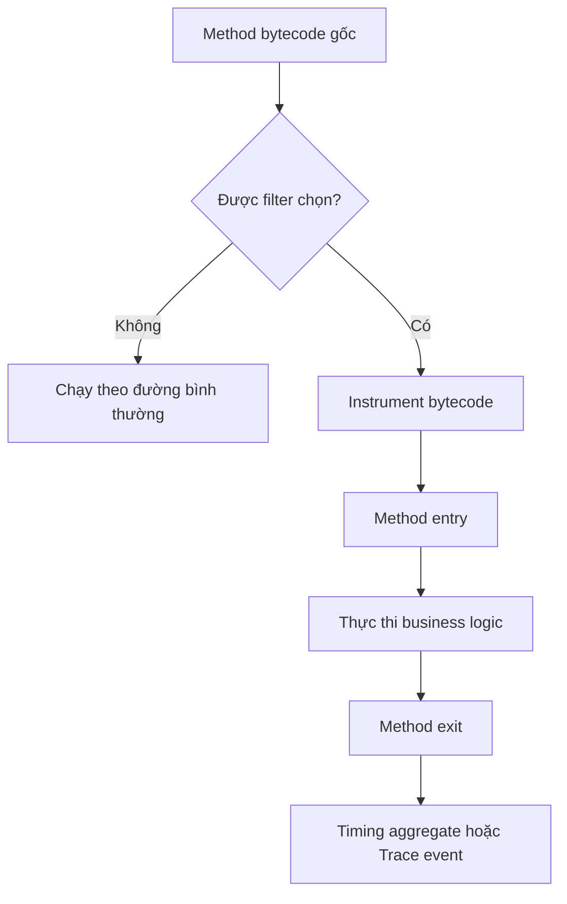
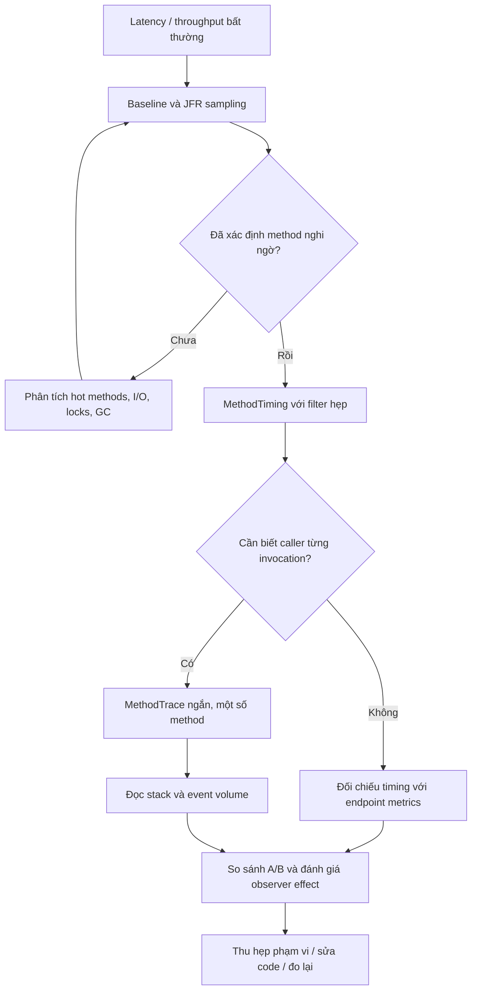

# Đánh giá ảnh hưởng của instrumentation tới độ trễ và kết quả đo

> **Chương:** Đo và truy vết JFR  
> **Phạm vi module:** `JAVA_VERSION_JAVA25` — sử dụng JDK Flight Recorder (JFR) để quan sát hiệu năng và hành vi runtime trong Java hiện đại; học cách đo method có chọn lọc bằng bytecode instrumentation, kết hợp sampling và đánh giá tác động lên độ trễ, throughput, CPU cùng độ tin cậy của kết quả.  
> **Mục tiêu:** Thiết kế phép thử có baseline; chọn `jdk.MethodTiming` hay `jdk.MethodTrace`; giới hạn method được instrument; đọc kết quả đúng và lượng hóa observer effect trước khi áp dụng vào staging/production.  
> **Mốc phiên bản:** JEP 520 — JFR Method Timing & Tracing đã final trong JDK 25. Các ví dụ dùng lệnh và event của JDK 25; không cần `--enable-preview`. Đến JDK 27, JFR vẫn hỗ trợ các event này; hãy kiểm tra JDK runtime thực tế trước khi dùng filter/cấu hình riêng.

Một profiler không chỉ quan sát ứng dụng: bản thân cách đo cũng có thể làm thay đổi ứng dụng. Đây là **observer effect**. Với JFR sampling, JVM định kỳ lấy stack snapshot; với JEP 520, JFR **instrument bytecode của các method được chọn** để ghi nhận từng lần gọi hoặc thống kê thời gian. Cách thứ hai cung cấp dữ liệu chi tiết hơn, nhưng có thể thêm công việc ở đường vào/ra method, tạo thêm event và làm thay đổi tối ưu hóa JIT.

Vì vậy, câu hỏi cần trả lời không chỉ là “method nào mất nhiều thời gian?” mà còn là:

- Dữ liệu được ghi nhận theo sampling hay instrumentation?
- Có bao nhiêu method và bao nhiêu invocation bị instrument?
- Độ trễ đo được có bị chính công cụ đo làm tăng không?
- Kết quả có đại diện cho workload thật và có thể lặp lại không?
- Mức overhead có chấp nhận được với mục tiêu chẩn đoán hay vận hành không?

## 1. JEP 520 thêm hai loại event khác nhau

JDK 25 bổ sung hai event JFR qua **JEP 520 — JFR Method Timing & Tracing**:

| Event | Cơ chế | Dữ liệu chính | Câu hỏi phù hợp |
|---|---|---|---|
| `jdk.MethodTiming` | Bytecode instrumentation; tổng hợp kết quả method được lọc | Method, số invocation, thời gian min/average/max gần đúng | Method được gọi bao nhiêu lần và thời gian thực thi trung bình/biên độ ra sao? |
| `jdk.MethodTrace` | Bytecode instrumentation; ghi event cho từng invocation được chọn | Method, thời điểm bắt đầu, duration, thread, stack trace | Invocation cụ thể đi từ đâu tới, mất bao lâu và xảy ra trên thread nào? |

Cả hai đều dùng filter để chọn method. JFR instrument method khi class được nạp và tạo bytecode event ở điểm thích hợp; không cần sửa source code của method được quan sát hoặc cài một Java agent riêng chỉ để bật tính năng này.

### MethodTiming: thống kê theo method

`jdk.MethodTiming` không tạo một event lớn cho mỗi lần gọi. Nó tổng hợp số invocation và thời gian thực thi gần đúng của method theo chu kỳ ghi nhận. Các trường quan trọng:

- `method`: method được đo.
- `invocations`: số lần gọi được tính trong kỳ thống kê.
- `minimum`, `average`, `maximum`: thời gian thực thi gần đúng của method.
- `startTime`: thời điểm tạo event thống kê.

Khi cần biết method có thực sự được gọi quá thường xuyên hay mỗi lần chạy quá lâu, đây thường là điểm bắt đầu hợp lý hơn trace từng invocation.

### MethodTrace: chi tiết từng invocation

`jdk.MethodTrace` ghi lại mỗi lần gọi method đã chọn, với:

- `method`: method được trace.
- `startTime` và `duration`: thời điểm bắt đầu và thời gian thực thi gần đúng.
- `eventThread`: thread thực thi.
- `stackTrace`: stack tại nơi gọi vào method được trace.

MethodTrace phù hợp khi cần biết **caller cụ thể** của một method, xác định đường gọi tạo ra invocation chậm hoặc kiểm tra một số lần gọi bất thường. Nếu method được gọi hàng trăm nghìn lần mỗi giây, trace mọi invocation có thể tạo lượng event rất lớn.

### Không phải mọi method đều instrument được

JEP 520 không đặt mục tiêu đo method không có bytecode body như abstract method, native method hoặc non-static interface method không phải default method. Không giả định filter sẽ làm mọi invocation trong JVM xuất hiện. Trước khi phân tích kết quả, kiểm tra method có bytecode thực thi phù hợp và có nằm trong phạm vi instrumentation hay không.

JEP cũng không đặt mục tiêu instrument số lượng method rất lớn cùng lúc, vì điều đó có thể làm giảm hiệu năng đáng kể. Mục tiêu chung JFR thường là overhead thấp, nhưng **không có cam kết overhead dưới 1% cho Method Timing/Tracing**.

## 2. Instrumentation thay đổi điều gì trong quá trình thực thi?

Với một method bình thường, JVM thực hiện bytecode của ứng dụng. Khi method được instrument, bytecode có thêm logic phục vụ ghi nhận thời điểm vào/ra, cập nhật thống kê hoặc tạo JFR event.



Những chi phí có thể phát sinh:

1. **Entry/exit work:** thêm thao tác khi method bắt đầu và kết thúc.
2. **Timestamp/counter:** lấy thời gian, tăng bộ đếm hoặc cập nhật dữ liệu thống kê.
3. **Event volume:** MethodTrace tạo event theo invocation; nhiều lần gọi có thể làm tăng buffer, recording size và công việc xử lý.
4. **Stack capture:** MethodTrace có thể ghi stack trace; stack càng sâu thì dữ liệu và chi phí càng lớn.
5. **JIT effects:** bytecode đã được instrument có thể làm thay đổi điều kiện tối ưu, profile và quyết định inlining của JIT.
6. **Cache/CPU effects:** thêm mã và ghi dữ liệu có thể làm thay đổi instruction count, memory traffic và lịch chạy thread.

Mức ảnh hưởng phụ thuộc method, tần suất gọi, số thread, cấu hình JFR, phần cứng và tải ứng dụng. Không có một hệ số overhead chung có thể nhân vào mọi kết quả.

### Thời gian method không đồng nghĩa CPU time

JEP 520 mô tả thời gian method là **thời gian thực gần đúng**, gồm thời gian ở các method được gọi bên trong và các delay xảy ra trong lúc method chạy. Ví dụ:

```java
Receipt createOrder(Order order) {
    validate(order);          // CPU
    Inventory stock = load(); // có thể chờ I/O
    return calculate(order, stock);
}
```

Nếu `createOrder` gọi `load` và `load` chờ database 100 ms, thời gian của `createOrder` có thể bao gồm phần chờ đó. Không được đọc MethodTiming rồi kết luận toàn bộ thời gian là CPU. Dùng JFR CPU/Execution sampling, socket/file I/O events, thread state và GC events để phân loại nguồn thời gian.

### Nested method có thể đếm chồng thời gian

Nếu đo cả `createOrder` và `load`, thời gian của `load` nằm bên trong thời gian của `createOrder`. Cộng hai số lại như hai chi phí độc lập sẽ **đếm trùng** phần thời gian lồng nhau. Hãy xem quan hệ caller/callee và xác định semantics của từng event.

## 3. Sampling và instrumentation trả lời hai loại câu hỏi

| Tiêu chí | JFR Execution Sampling | JFR MethodTiming | JFR MethodTrace |
|---|---|---|---|
| Ghi nhận | Snapshot stack theo thời gian | Aggregate cho method được lọc | Event từng invocation được lọc |
| Có instrument bytecode method được chọn? | Không dùng cơ chế method instrumentation của JEP 520 | Có | Có |
| Đếm invocation | Không chính xác theo sample | Có số invocation theo thống kê | Có thể đếm event invocation đã ghi |
| Thời gian method | Ước lượng theo tỷ lệ sample | Min/average/max gần đúng | Duration từng invocation gần đúng |
| Stack/caller | Stack snapshot thống kê | Không phải mục tiêu chính | Stack của invocation |
| Event volume | Theo sampling period | Thường nhỏ hơn trace từng lần gọi | Có thể rất lớn với method tần suất cao |
| Dùng đầu tiên? | Có, để tìm vùng code nóng tổng quan | Có, sau khi khoanh vùng | Chỉ khi cần điều tra một số method cụ thể |

Quy trình thực tế thường bắt đầu với sampling vì nó cho biết nơi tiêu tốn CPU trên diện rộng. Sau khi xác định một class/method đáng nghi, mới bật MethodTiming để đo số lần gọi và thời gian, hoặc MethodTrace để thấy từng call path.

**Không dùng MethodTrace thay sampling cho toàn ứng dụng.** JEP 520 nêu rõ việc instrument nhiều method cùng lúc có thể làm giảm performance đáng kể; sampling phù hợp hơn khi chưa biết điểm nóng ở đâu.

## 4. Chọn đúng filter để giới hạn instrumentation

JFR hỗ trợ filter cho `jdk.MethodTiming` và `jdk.MethodTrace`. Các dạng chính:

| Dạng filter | Ý nghĩa | Ví dụ |
|---|---|---|
| Tên class | Chọn các method trong class | `com.acme.checkout.PricingService` |
| Class + method | Chọn method cụ thể của class | `com.acme.checkout.PricingService::calculateTotal` |
| Tên method | Chọn method cùng tên trong các class | `::calculateTotal` |
| Annotation | Chọn method/class mang annotation | `@com.acme.ObservedOperation` |
| Nhiều target | Kết hợp nhiều filter bằng dấu chấm phẩy | `com.acme.A::open;com.acme.B::close` |

Filter có thể chỉ rõ `<init>` để chọn constructor hoặc `<clinit>` để chọn static initializer. Nếu method bị overload, filter theo tên method sẽ khớp các overload cùng tên trong class; JFR filter không yêu cầu khai báo toàn bộ kiểu tham số.

### Ví dụ chọn đúng một method

```java
package com.acme.checkout;

public class PricingService {

    public long calculateTotal(Order order) {
        long subtotal = calculateSubtotal(order);
        long tax = taxFor(subtotal);
        return subtotal + tax;
    }

    private long calculateSubtotal(Order order) {
        return order.items().stream()
                .mapToLong(item -> item.price() * item.quantity())
                .sum();
    }

    private long taxFor(long subtotal) {
        return Math.round(subtotal * 0.08);
    }
}
```

Để chỉ đo `calculateTotal`, filter:

```text
com.acme.checkout.PricingService::calculateTotal
```

Để trace tất cả method trong class, dùng filter class:

```text
com.acme.checkout.PricingService
```

Filter class tiện cho một class nhỏ, nhưng nếu class có nhiều method hot, instrumentation rộng hơn và overhead cũng có thể lớn hơn. Ưu tiên class-method filter khi câu hỏi chỉ liên quan một method.

### Annotation filter

Có thể đánh dấu các operation cần quan sát bằng annotation:

```java
package com.acme.observability;

import java.lang.annotation.ElementType;
import java.lang.annotation.Retention;
import java.lang.annotation.RetentionPolicy;
import java.lang.annotation.Target;

@Retention(RetentionPolicy.RUNTIME)
@Target({ElementType.TYPE, ElementType.METHOD})
public @interface ObservedOperation {
}
```

Dùng annotation:

```java
@ObservedOperation
public Receipt createOrder(Order order) {
    // business logic
}
```

Filter:

```text
@com.acme.observability.ObservedOperation
```

Annotation giúp chọn method theo nhóm nghiệp vụ mà không phải ghi từng class name. Chỉ dùng annotation trên phạm vi hẹp; nếu đánh dấu cả package/lớp chứa nhiều method tần suất cao, số method được instrument có thể tăng đáng kể.

## 5. Bật MethodTiming trên JDK 25

JEP 520 bổ sung tùy chọn tiện dụng cho `-XX:StartFlightRecording`. Ví dụ chạy ứng dụng executable JAR và chỉ đo method `calculateTotal`:

```bash
java '-XX:StartFlightRecording:method-timing=com.acme.checkout.PricingService::calculateTotal,filename=method-timing.jfr' -jar checkout-service.jar
```

Khi ứng dụng chạy, JFR instrument method được chọn và ghi thống kê. Khi cần giới hạn recording, thêm `duration`:

```bash
java '-XX:StartFlightRecording:method-timing=com.acme.checkout.PricingService::calculateTotal,duration=60s,filename=method-timing.jfr' -jar checkout-service.jar
```

Lệnh trên là cú pháp cho JDK 25. Không cần `--enable-preview`. Đường dẫn JAR và class filter phải khớp với ứng dụng thật.

### Đọc kết quả

```bash
jfr summary method-timing.jfr
jfr view method-timing method-timing.jfr
jfr print --events jdk.MethodTiming method-timing.jfr
```

- `jfr summary` cho biết số event và kích thước recording.
- `jfr view method-timing` hiển thị view tổng hợp nếu view có trong bản JDK đang dùng.
- `jfr print --events jdk.MethodTiming` in event và trường dữ liệu ở dạng dễ đọc.

Ví dụ kết quả minh họa:

```text
Method Timing

Method                                      Invocations  Average Time
com.acme.checkout.PricingService.calculateTotal()  12000      2.40 ms
```

Các con số trên chỉ minh họa định dạng, không phải benchmark thực tế. Dùng số invocation và thời gian gần đúng để tìm method có tần suất cao hoặc thời gian trung bình bất thường; sau đó đối chiếu latency request và workload.

## 6. Bật MethodTrace cho một method cụ thể

Khi cần biết ai gọi method và invocation mất bao lâu, bật MethodTrace cho **một method đã khoanh vùng**:

```bash
java '-XX:StartFlightRecording:method-trace=com.acme.checkout.PricingService::calculateTotal,duration=30s,filename=method-trace.jfr' -jar checkout-service.jar
```

Đọc event:

```bash
jfr print --events jdk.MethodTrace --stack-depth 20 method-trace.jfr
jfr view MethodTrace method-trace.jfr
```

Ví dụ một event minh họa:

```text
jdk.MethodTrace {
  startTime = 12:00:01.123
  duration = 2.40 ms
  method = com.acme.checkout.PricingService.calculateTotal()
  eventThread = "http-nio-8080-exec-4"
  stackTrace = [
    com.acme.checkout.OrderService.create(...)
    com.acme.checkout.OrderController.post(...)
    ...
  ]
}
```

Đây là ví dụ mô phỏng cấu trúc event. Dùng stack trace để tìm caller và xác định invocation xảy ra trên thread nào. Với method có tần suất cao, thời gian ghi trace và kích thước file có thể tăng nhanh; bắt đầu bằng recording ngắn và filter hẹp.

### Nhiều method trong một filter

JFR filter hỗ trợ nhiều target phân cách bằng dấu chấm phẩy:

```bash
java '-XX:StartFlightRecording:method-trace=com.acme.checkout.OrderService::create;com.acme.payment.PaymentService::charge,duration=20s,filename=selected-traces.jfr' -jar checkout-service.jar
```

Dấu chấm phẩy cũng có ý nghĩa đặc biệt với một số shell; đặt toàn bộ option trong dấu nháy để shell không tách nó thành lệnh khác. Trên Windows PowerShell, cũng nên giữ cả JVM option trong một argument.

**Đừng thêm tất cả method nghi ngờ vào một filter ngay lần đầu.** Bắt đầu với một method; nếu cần mở rộng, tăng từng bước và đo overhead sau mỗi lần.

## 7. Thay đổi cấu hình khi JVM đang chạy

JEP 520 hỗ trợ điều khiển qua `jcmd`/JFR recording, phù hợp khi không thể khởi động lại ứng dụng chỉ để bật tracing.

Ví dụ bắt đầu MethodTiming cho method đã chọn:

```bash
jcmd <pid> JFR.start name=method-timing method-timing=com.acme.checkout.PricingService::calculateTotal
```

Bắt đầu MethodTrace:

```bash
jcmd <pid> JFR.start name=method-trace method-trace=com.acme.checkout.PricingService::calculateTotal
```

`<pid>` là process ID của JVM đích. Lấy PID từ process manager hoặc công cụ vận hành; chỉ người có quyền attach phù hợp mới có thể điều khiển JVM.

Kiểm tra recording đang hoạt động:

```bash
jcmd <pid> JFR.check
```

Dừng và lưu recording theo tên:

```bash
jcmd <pid> JFR.stop name=method-trace filename=method-trace.jfr
```

Tên recording phải khớp giá trị `name` đã truyền cho `JFR.start`; có thể xem tên qua `JFR.check`. Đối với production, tuân thủ chính sách attach/diagnostic của runtime và lưu file recording ở vị trí có quyền truy cập hạn chế.

## 8. Thiết kế phép thử để đo observer effect

Để đánh giá ảnh hưởng của instrumentation, không so hai lần chạy khác workload hoặc hai máy khác cấu hình. Dùng một ma trận thí nghiệm có kiểm soát.

### Ba cấu hình cần so sánh

| Run | Cấu hình | Mục đích |
|---|---|---|
| **A — Baseline** | Không bật recording hoặc chỉ dùng cấu hình quan sát nền đã xác định | Đo hiệu năng gốc |
| **B — Sampling** | JFR `profile.jfc`/execution sampling, không instrument method | Đánh giá overhead của profiling tổng quan |
| **C — MethodTiming** | Instrument một hoặc vài method bằng filter hẹp | Đo chi phí của timing instrumentation |
| **D — MethodTrace** | Trace một method có tần suất thấp/vừa trong thời gian ngắn | Đo chi phí ghi từng invocation và stack |

Không nhất thiết chạy cả B, C, D trong mọi lần điều tra. Mục tiêu là tách chi phí của từng cơ chế để biết kết quả đo thay đổi vì ứng dụng hay vì profiler.

### Giữ các biến thử nghiệm giống nhau

- Cùng JDK vendor/build và cùng JVM flags.
- Cùng artifact, dependency, heap, GC và cấu hình ứng dụng.
- Cùng máy hoặc cùng loại CPU/OS; tránh tải nền khác biệt.
- Cùng dữ liệu đầu vào và phân bố request.
- Có warmup trước khi đo; tách startup khỏi steady state.
- Chạy mỗi cấu hình nhiều lần và so median/p95/p99 thay vì một lần duy nhất.
- Ghi rõ filter, recording duration, event settings và file JFR tương ứng.

### Các metric nên ghi lại

| Metric | Lý do |
|---|---|
| Throughput (requests/s) | Instrumentation có làm giảm khả năng xử lý không? |
| p50/p95/p99 latency | Độ trễ trung tâm và tail latency có thay đổi không? |
| CPU utilization / process CPU time | Thêm bytecode/event có làm tăng CPU không? |
| Allocation rate và GC pause | Recording/stack/event có làm tăng allocation hoặc áp lực GC không? |
| JFR file size và event count | MethodTrace có tạo dữ liệu quá lớn không? |
| MethodTiming invocation count | Có bao nhiêu lần method được đo trong kỳ? |
| Error rate/timeouts | Instrumentation có gây quá tải hoặc timeout không? |

### Ví dụ bảng kết quả

Các số dưới đây **chỉ minh họa cách lập bảng**, không phải kết quả đo của JDK:

| Cấu hình | Throughput | p95 latency | CPU | JFR size |
|---|---:|---:|---:|---:|
| Baseline | 10.000 req/s | 42 ms | 55% | 0 MB |
| Sampling | 9.950 req/s | 43 ms | 56% | 18 MB |
| MethodTiming hẹp | 9.700 req/s | 45 ms | 59% | 21 MB |
| MethodTrace hẹp | 8.900 req/s | 52 ms | 66% | 140 MB |

Nếu MethodTrace làm p95 tăng 20%, đó là một dấu hiệu observer effect đáng kể. Không được trừ 20% khỏi thời gian event rồi tuyên bố đã tìm ra “thời gian thật”; hãy thu hẹp filter, giảm thời lượng hoặc dùng sampling nếu mục tiêu là đo xu hướng tổng quan.

## 9. Cách đọc thời gian đo mà không đếm trùng

Giả sử:

```text
OrderService.createOrder        30 ms
  PricingService.calculate      12 ms
  InventoryService.reserve      10 ms
  AuditService.write             5 ms
```

Nếu MethodTiming đo cả parent và child:

- `createOrder` có thể bao gồm thời gian các method con.
- `calculate`, `reserve` và `write` nằm trong khoảng thời gian của `createOrder`.
- Không cộng 30 + 12 + 10 + 5 để tính tổng latency.
- Cũng không lấy 30 - 12 - 10 - 5 rồi coi là chính xác thời gian self-time, vì các method có thể chạy lồng nhau, có overlap concurrency hoặc delay khác.

Để hiểu chi phí độc lập, hãy kết hợp call tree/sampling với method timing, và xác định chính xác semantics của từng event. JEP 520 không biến các thời gian inclusive thành exclusive time tự động.

### Timing là gần đúng, không phải benchmark vi mô

MethodTiming có thể hữu ích để nhận diện method chậm trong ứng dụng đang chạy, nhưng không thay JMH cho microbenchmark. Nếu cần so sánh hai thuật toán với độ chính xác cao, kiểm soát warmup/JIT/dead-code elimination và đo trong môi trường benchmark chuyên dụng. JFR timing là công cụ chẩn đoán trong workload ứng dụng, nơi method chạy cùng framework, I/O và các hoạt động khác.

## 10. Những giới hạn của bytecode instrumentation

JEP 520 có các giới hạn thiết kế cần biết:

1. **Không ghi method arguments hoặc instance fields.** Điều này tránh biến method tracing thành cơ chế trích xuất payload/secret.
2. **Không instrument được method không có bytecode body** như abstract method, native method hoặc non-default interface method.
3. **Không nhắm tới instrument số lượng method rất lớn cùng lúc.** Sampling phù hợp hơn khi muốn quan sát toàn ứng dụng.
4. **Không cam kết overhead thấp như JFR sampling.** Mức tác động tùy số invocation và method được chọn.
5. **Method duration gồm các method con và delay.** Không diễn giải nó như CPU time thuần.
6. **JIT có thể bị ảnh hưởng bởi bytecode đã instrument.** Kết quả timing có thể khác run không instrument.
7. **Stack trace và event volume có thể làm recording lớn.** Cần giới hạn duration và filter.

### Rủi ro khi instrument chính JDK methods

JEP 520 lưu ý việc chọn method JDK được dùng bởi chính mã instrumentation có thể gây recursion không mong muốn. JFR cố gắng tránh điều đó nhưng cơ chế không đảm bảo tuyệt đối. Nếu gặp recursion hoặc hành vi bất thường, thu hẹp filter khỏi các method JDK liên quan và báo lỗi theo quy trình của runtime/vendor.

Với điều tra ứng dụng, ưu tiên instrument method nghiệp vụ thuộc namespace của ứng dụng trước; chỉ chọn method JDK khi có lý do cụ thể và hiểu rõ rủi ro.

## 11. Dùng annotation để tạo vùng đo có chủ đích

Một team có thể định nghĩa annotation riêng để đánh dấu method cần quan sát trong các đợt điều tra:

```java
package com.acme.observability;

import java.lang.annotation.ElementType;
import java.lang.annotation.Retention;
import java.lang.annotation.RetentionPolicy;
import java.lang.annotation.Target;

@Retention(RetentionPolicy.RUNTIME)
@Target({ElementType.TYPE, ElementType.METHOD})
public @interface DiagnoseMethod {
}
```

Đánh dấu một số method:

```java
@DiagnoseMethod
public Receipt createOrder(Order order) {
    // ...
}
```

Filter:

```text
@com.acme.observability.DiagnoseMethod
```

Chạy MethodTiming cho nhóm method mang annotation:

```bash
java '-XX:StartFlightRecording:method-timing=@com.acme.observability.DiagnoseMethod,duration=60s,filename=annotated-timing.jfr' -jar checkout-service.jar
```

Annotation phải được giữ ở runtime (`RetentionPolicy.RUNTIME`). Hãy kiểm tra annotation được áp dụng trên class hay method, vì filter có thể chọn tất cả method của class có annotation. Nếu dùng annotation ở cấp class, số method được instrument có thể tăng đáng kể.

## 12. Bảo vệ dữ liệu trong recording

JEP 520 không ghi method arguments hoặc instance fields, nhưng recording vẫn có thể tiết lộ:

- Tên package/class/method nội bộ.
- Cấu trúc call path, tên thread và thời điểm xử lý.
- Thông tin môi trường qua các event JFR khác.
- Tên tenant hoặc thông tin nhạy cảm nếu chúng bị đưa vào custom event/label/thread name.

Không ghi token, password, session data hoặc payload nghiệp vụ vào custom JFR event. Hạn chế quyền đọc file `.jfr`, thời gian lưu và cách chia sẻ. Khi cần chia sẻ, có thể lọc event trước bằng `jfr scrub` nhưng phải kiểm tra file sau scrub để chắc rằng dữ liệu cần chẩn đoán vẫn còn.

JDK 27 bổ sung JFR in-process redaction cho command-line arguments và giá trị ban đầu của environment variables/system properties. Điều đó giúp giảm rủi ro rò rỉ một số dữ liệu, nhưng không làm sạch mọi custom event hoặc stack trace. Không coi redaction là lý do để đưa secret vào command line.

## 13. Quy trình điều tra khuyến nghị



Một quy trình ngắn gọn:

1. Thu baseline latency, throughput, CPU và error rate.
2. Bật JFR sampling để tìm khu vực nóng.
3. Chọn một method cụ thể và bật MethodTiming trong khoảng thời gian giới hạn.
4. Nếu cần caller/invocation stack, bật MethodTrace cho một method và recording ngắn.
5. Đọc `jfr summary`, `jfr view`, `jfr print`; kiểm tra số event và kích thước file.
6. So sánh cùng workload với baseline để lượng hóa overhead.
7. Tắt instrumentation, lưu recording theo chính sách và đo lại sau khi sửa code.

## 14. Các lỗi phổ biến khi đo method

| Triệu chứng | Nguyên nhân có thể | Cách xử lý |
|---|---|---|
| Method không xuất hiện | Filter sai tên class/method, method không có bytecode body hoặc chưa được gọi | Kiểm tra filter, workload và method eligibility |
| Không có `jdk.MethodTiming` | Chưa bật method-timing/filter hoặc recording kết thúc trước khi có dữ liệu aggregate | Kiểm tra cấu hình và thời gian chạy |
| MethodTrace file rất lớn | Trace method tần suất cao hoặc chọn cả class | Thu hẹp filter, giảm duration |
| p95 tăng mạnh khi bật MethodTrace | Instrumentation/event stack làm tăng overhead | Chuyển sang MethodTiming hoặc sampling, giới hạn method |
| Thời gian parent và child không cộng khớp | Duration lồng nhau/inclusive | Không cộng các duration như chi phí độc lập |
| MethodTiming cao nhưng CPU thấp | Method duration gồm I/O/wait/delay | Đối chiếu socket/file/lock/thread events |
| Kết quả giữa các lần chạy khác nhau | Workload, warmup, JIT, tải nền hoặc dữ liệu khác | Chuẩn hóa thí nghiệm và lặp lại |
| Method không có stack | Stack trace setting tắt hoặc event không hỗ trợ stack theo cấu hình | Kiểm tra `stackTrace` setting và loại event |
| Lỗi recursion khi instrument JDK methods | Filter chọn method dùng bởi instrumentation runtime | Loại method JDK khỏi filter và báo lỗi runtime |
| Kết quả instrument khác hẳn baseline | Observer effect hoặc JIT optimization thay đổi | Dùng sampling để đối chiếu và thu hẹp instrumentation |

## 15. Bài tập thực hành

**Bối cảnh:** API `POST /orders` tăng p95 latency sau khi thêm quy tắc tính thuế. Nhóm nghi ngờ `PricingService.calculateTotal` và `TaxCalculator.compute`.

### Bài A — Baseline

1. Chạy workload cố định với dữ liệu đại diện.
2. Thu p50/p95/p99, throughput, CPU, allocation và error rate.
3. Ghi rõ warmup và số lần lặp.
4. Lưu kết quả baseline.

### Bài B — MethodTiming

1. Bật MethodTiming chỉ cho `PricingService::calculateTotal`.
2. Chạy lại cùng workload.
3. Ghi invocation count và average/min/max.
4. So sánh throughput, p95, CPU với baseline.
5. Giải thích nếu số invocation tăng hoặc timing thay đổi.

### Bài C — MethodTrace

1. Chỉ trace `TaxCalculator::compute` trong recording 20–30 giây.
2. Xem event thread và stack trace.
3. Tìm caller nào gọi method thường xuyên.
4. Kiểm tra số event và kích thước file.
5. Tắt tracing và xác nhận hiệu năng trở lại gần baseline.

### Bài D — Annotation filter

1. Đánh dấu một số method nghiệp vụ bằng `@DiagnoseMethod`.
2. Dùng annotation filter để bật MethodTiming.
3. So sánh với filter class-level.
4. Giải thích vì sao annotation trên cả class có thể instrument nhiều method hơn dự kiến.

### Bài E — Đánh giá observer effect

Lập bảng A/B/C gồm baseline, MethodTiming và MethodTrace. Kết luận:

- Cấu hình nào đủ để trả lời câu hỏi?
- Cấu hình nào gây overhead lớn nhất?
- Có cần ghi trace toàn bộ method không?
- Khi nào nên quay về sampling?
- Kết quả timing có thể dùng để dự đoán production latency ở mức nào?

**Tiêu chí đạt:** học viên phân biệt được event sampling và instrumentation, biết chọn filter hẹp, giải thích được thời gian inclusive, định lượng overhead và không coi số liệu instrument là thời gian “thật” không bị ảnh hưởng.

## 16. Checklist review trước khi bật instrumentation

- [ ] Có baseline cùng workload và cùng JDK/hardware.
- [ ] Đã dùng sampling để khoanh vùng trước nếu chưa biết điểm nóng.
- [ ] Filter chỉ gồm method/class cần điều tra.
- [ ] Chọn MethodTiming cho aggregate; MethodTrace cho invocation stack.
- [ ] Recording có thời lượng giới hạn và event volume được giám sát.
- [ ] Đã xác nhận method có bytecode body phù hợp.
- [ ] Không instrument diện rộng hoặc toàn bộ JDK khi chưa có lý do.
- [ ] Đọc duration như thời gian thực gần đúng, không phải CPU time.
- [ ] Không cộng parent/child durations như hai phần độc lập.
- [ ] So sánh p95/throughput/CPU/allocation với baseline.
- [ ] Kiểm tra JIT/warmup và tải nền trước khi kết luận.
- [ ] File recording được bảo vệ và chia sẻ theo chính sách dữ liệu.
- [ ] Tắt instrumentation sau khi hoàn tất chẩn đoán.
- [ ] Lặp lại benchmark sau khi sửa code bằng cùng workload.

## 17. Tài liệu tham khảo chính thức

1. [JEP 520 — JFR Method Timing & Tracing](https://openjdk.org/jeps/520): thiết kế bytecode instrumentation, hai event `jdk.MethodTiming`/`jdk.MethodTrace`, filter grammar, giới hạn và các trường dữ liệu.
2. [Oracle — Significant Changes in JDK 25](https://docs.oracle.com/en/java/javase/25/migrate/significant-changes-jdk-25.html): xác nhận JFR Method Timing & Tracing là tính năng JDK 25.
3. [Java SE 25 — `jdk.jfr` Package Summary](https://docs.oracle.com/en/java/javase/25/docs/api/jdk.jfr/jdk/jfr/package-summary.html): event settings `enabled`, `filter`, `period`, `threshold`, `stackTrace` và grammar filter.
4. [Java SE 25 — The `java` Command](https://docs.oracle.com/en/java/javase/25/docs/specs/man/java.html): `-XX:StartFlightRecording` và các tùy chọn ghi JFR.
5. [Java SE 25 — The `jcmd` Command](https://docs.oracle.com/en/java/javase/25/docs/specs/man/jcmd.html): bắt đầu, kiểm tra và dừng recording trên JVM đang chạy.
6. [Java SE 25 — The `jfr` Command](https://docs.oracle.com/en/java/javase/25/docs/specs/man/jfr.html): `jfr print`, `jfr view`, `jfr summary`, `jfr configure` và `jfr scrub`.
7. [JDK 27 Release Notes](https://www.oracle.com/java/technologies/javase/27-relnote-issues.html): thay đổi JFR redaction và lưu ý bảo vệ dữ liệu khi nâng JDK.

**Điểm mấu chốt:** JEP 520 cung cấp timing/tracing chi tiết bằng cách instrument bytecode của method được chọn. Đổi lại, instrumentation có thể làm tăng latency, CPU và event volume, đồng thời ảnh hưởng JIT. Hãy dùng sampling để tìm vùng nóng, MethodTiming để đo aggregate, MethodTrace để điều tra một số invocation, rồi luôn so sánh với baseline cùng workload trước khi diễn giải kết quả hoặc áp dụng cấu hình vào production.
