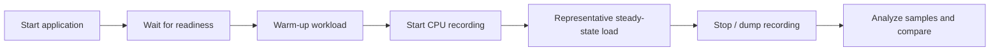

# Cấu hình lấy mẫu CPU và thu thập bản ghi cho tải đại diện

**CPU-time profiling** giúp xác định phần code Java hoặc native đang tiêu thụ năng lực xử lý của CPU. Với Java 25, **Java Flight Recorder (JFR)** thu thập CPU load của JVM/máy, CPU load theo thread và các mẫu stack trace khi thread đang thực thi. Khi phân tích các mẫu này cùng workload đại diện, ta có thể tìm method nóng, call path tốn CPU và sự khác biệt giữa các luồng xử lý.

Bài học thuộc chương **Lấy mẫu JFR** của module **Java 25** (JAVA_VERSION_JAVA25), theo đề bài **“Cấu hình lấy mẫu CPU và thu thập bản ghi cho tải đại diện”**. Nội dung hướng dẫn chọn `default.jfc` hoặc `profile.jfc`, bắt đầu/dừng recording, chọn workload có ý nghĩa, đọc các event `jdk.CPULoad`, `jdk.ThreadCPULoad`, `jdk.ExecutionSample` và `jdk.NativeMethodSample`, sau đó kiểm chứng bằng JDK Mission Control (JMC) và công cụ `jfr`.

Các ví dụ dùng JFR tích hợp trong JDK 25. Cần nhớ rằng **sampling là phương pháp thống kê**: số mẫu giúp ước lượng nơi CPU dành nhiều thời gian, không phải phép đo chính xác số CPU milliseconds cho từng method hoặc từng request.

## 1. CPU time, wall-clock time và CPU load

Khi một request mất 800 ms, không có nghĩa code của request đã dùng 800 ms CPU. Khoảng thời gian đó có thể gồm thời gian chờ database, socket, lock, scheduler, GC hoặc queue.

| Khái niệm | Ý nghĩa | Ví dụ |
| --- | --- | --- |
| **Wall-clock time** | Thời gian trôi qua từ lúc bắt đầu tới lúc kết thúc thao tác | Request mất 800 ms |
| **CPU time** | Thời gian CPU thực sự chạy code cho thread/process | Thread dùng 120 ms CPU trong request 800 ms |
| **CPU load/utilization** | Tỷ lệ năng lực CPU đang được sử dụng trong một khoảng đo | JVM dùng trung bình 75% CPU trong 10 giây |
| **CPU sample** | Một lần lấy mẫu stack của thread đang chạy tại thời điểm lấy mẫu | 240 mẫu cho một call path trong recording |

Ví dụ giả định:

```text
Wall-clock: 800 ms
  CPU execution:        120 ms
  Waiting for DB:       420 ms
  Waiting for network:  150 ms
  Queue/lock/scheduler:  80 ms
  Other:                 30 ms
```

Nếu request chậm nhưng CPU load thấp, tối ưu vòng lặp hoặc thuật toán có thể không giải quyết được vấn đề chính. Nếu CPU load cao và nhiều mẫu tập trung ở một call path, cần điều tra code path đó trước.

**JFR CPU profiling trả lời câu hỏi “thread đang chạy code nào khi được lấy mẫu?”** Các event I/O, monitor, park và sleep bổ sung bằng chứng về thời gian thread không chạy code.

## 2. Những event JFR hữu ích khi phân tích CPU

Các event chính trong JDK 25:

| Event | Thông tin | Cách sử dụng |
| --- | --- | --- |
| `jdk.CPULoad` | CPU load của JVM và toàn máy theo thời gian | Xác định JVM có đang tiêu thụ CPU cao hay máy bị process khác chiếm CPU |
| `jdk.ThreadCPULoad` | CPU load theo thread, dựa trên method sampling | Tìm thread đang thực thi nhiều và có khả năng là điểm nóng |
| `jdk.ExecutionSample` | Mẫu stack của Java execution | Phân tích method, call tree và hot methods |
| `jdk.NativeMethodSample` | Mẫu thực thi native method khi event được bật/hỗ trợ | Điều tra phần CPU nằm trong native code |

Các event hỗ trợ chẩn đoán nguyên nhân khác:

- `jdk.JavaMonitorEnter` và `jdk.JavaMonitorWait`: tranh chấp monitor/lock.
- `jdk.ThreadPark` và `jdk.ThreadSleep`: thread bị park hoặc sleep.
- `jdk.SocketRead`, `jdk.SocketWrite`, `jdk.FileRead`, `jdk.FileWrite`: thời gian I/O.
- Các event GC: xác định CPU và thời gian bị ảnh hưởng bởi garbage collection.

### CPU load ở JVM và toàn máy

`jdk.CPULoad` giúp phân biệt:

| Quan sát | Diễn giải cần kiểm tra |
| --- | --- |
| JVM CPU cao, machine CPU cao | Ứng dụng có thể là nguồn tải CPU chính |
| JVM CPU thấp, machine CPU cao | Process khác hoặc hoạt động ngoài JVM có thể đang dùng CPU |
| JVM CPU thấp, wall-clock latency cao | Xem I/O, lock, queue, scheduler và dependency |
| JVM CPU cao nhưng throughput không tăng | Có thể có contention, retry, serialization, GC hoặc công việc lặp |

Không kết luận chỉ từ một điểm dữ liệu. So sánh theo thời gian, theo instance và cùng cửa sổ workload.

## 3. Chọn recording template: default hay profile

JDK 25 cung cấp hai template JFR thông dụng:

| Template | Mục đích | Cách dùng |
| --- | --- | --- |
| `default.jfc` | Thu thập tập dữ liệu định sẵn với overhead thấp | Continuous recording và quan sát nền |
| `profile.jfc` | Thu thập nhiều dữ liệu hơn, gồm các event hữu ích cho profiling | Điều tra CPU trong khoảng thời gian ngắn, có workload rõ |

Với CPU profiling:

- Dùng `profile.jfc` khi cần nhiều method samples và stack traces hơn để tìm hot methods.
- Dùng `default.jfc` cho continuous recording hoặc khi cần quan sát ít tác động.
- Không bật đồng thời mọi event chỉ để tăng lượng dữ liệu. Thêm event theo câu hỏi đang điều tra.
- Không bật heap statistics chỉ để profiling CPU; tùy chọn này có thể kích hoạt old GC ở đầu/cuối recording và làm sai lệch phép đo latency.

Oracle ghi nhận recording profiling tiêu chuẩn với default settings thường có overhead dưới 2% ở phần lớn ứng dụng, nhưng overhead thay đổi theo ứng dụng và cấu hình. Hãy đo overhead trong môi trường của chính mình thay vì coi con số đó là cam kết.

## 4. Xác định câu hỏi và workload trước khi thu recording

Recording có nhiều mẫu nhưng workload không đại diện vẫn có thể dẫn tới tối ưu sai. Trước khi bắt đầu, viết rõ câu hỏi cần trả lời:

- Vì sao p95 của `POST /orders` tăng sau lần phát hành gần nhất?
- Method nào tiêu thụ CPU nhiều nhất khi xử lý 1.000 item?
- Một thread worker có đang chiếm phần lớn CPU trong lúc consumer backlog tăng?
- CPU của JVM tăng do JSON serialization, validation, database mapping hay native compression?
- Tải tăng có làm CPU tăng tuyến tính, hay một call path trở thành bottleneck?

### Lập danh mục đường chạy cần có

| Path | Loại tải | Mục tiêu profiling |
| --- | --- | --- |
| Startup → readiness | Startup | Tìm công việc CPU trong khởi tạo framework, class loading và cấu hình |
| Đọc catalog | Request thường xuyên | Tìm chi phí mapping, cache lookup, serialization |
| Tạo đơn thành công | Nghiệp vụ chính | Tìm chi phí validate, tính giá, inventory và persist |
| Tạo đơn bị từ chối | Nhánh lỗi | Kiểm tra validation/exception mapping có tiêu tốn CPU bất thường |
| Consumer xử lý event | Async | Tìm chi phí deserialize, handler và retry |
| Batch/reconciliation | Background | Phát hiện method nóng khi xử lý khối lượng lớn |

Chọn các path theo telemetry, SLO, tần suất và mức độ quan trọng. Không chỉ chạy health endpoint hoặc một method microbenchmark rồi dùng recording đó để kết luận về toàn bộ service.

### Giữ workload có thể tái lập

Ghi lại:

- Build/commit và dependency versions.
- JDK vendor/build, OS, CPU architecture và container CPU quota.
- JVM flags, heap size, GC, classpath/module path và agent.
- Dataset/seed, feature flags, cache state và dependency configuration.
- Request mix, concurrency, arrival rate, think time và thời lượng.
- Số lượt warm-up trước khi bắt đầu cửa sổ đo.

Dùng dữ liệu tổng hợp hoặc dữ liệu đã được phê duyệt. Không cần đưa payload chứa PII, token hoặc secret vào bộ tải chỉ để tái tạo cấu trúc request.

## 5. Chọn tỷ trọng và concurrency của tải đại diện

Workload cần mô phỏng cách ứng dụng được sử dụng. Ví dụ nếu traffic thường có 65% đọc catalog, 25% tạo đơn và 10% tra cứu trạng thái, hãy xây workload gần tỷ trọng đó thay vì chạy ba endpoint bằng nhau.

| Kịch bản | Tỷ trọng minh họa | Lượt trong 1.000 request |
| --- | ---: | ---: |
| Đọc catalog | 65% | 650 |
| Tạo đơn thành công | 25% | 250 |
| Tra cứu trạng thái | 10% | 100 |

Đây chỉ là số minh họa. Thay bằng traffic mix đo được hoặc workload mục tiêu của bài kiểm thử.

Concurrency cũng ảnh hưởng cách CPU được sử dụng:

- **Concurrency thấp:** dễ thấy chi phí CPU của một request, nhưng không đại diện cho tranh chấp dưới tải.
- **Concurrency gần production:** phù hợp để tìm điểm nóng khi service xử lý nhiều request đồng thời.
- **Concurrency quá cao:** có thể làm hàng đợi, context switching, throttling và contention chi phối kết quả, khác hẳn workload thực tế.
- **Tải tăng theo bậc:** giúp tìm thời điểm throughput ngừng tăng dù CPU tiếp tục cao.

Không chỉ tăng request rate tới khi CPU 100%. Hãy dùng nhiều mức tải có ý nghĩa với SLO và ghi rõ mức tải nào được dùng để phân tích.

## 6. Warm-up, steady-state và thời lượng recording

JVM có thể thay đổi hành vi sau khi khởi động: class được load, JIT biên dịch method nóng, cache nghiệp vụ được làm nóng và connection pool được tạo. Nếu recording chỉ bao gồm vài giây đầu, kết quả có thể phản ánh startup hơn là steady-state.



| Giai đoạn | Việc cần làm | Lưu ý |
| --- | --- | --- |
| Startup | Khởi động ứng dụng và dependency | Chỉ đo riêng nếu câu hỏi liên quan startup |
| Readiness | Đợi ứng dụng sẵn sàng nhận tải | Ghi lại thời điểm readiness |
| Warm-up | Chạy mix request/message đại diện | Không đưa giai đoạn này vào kết luận steady-state nếu không phải mục tiêu |
| Profiling window | Thu recording khi tải ổn định | Đủ lâu để có số mẫu cho critical paths |
| Cool-down | Giảm hoặc dừng tải sau cửa sổ đo | Giữ lại thời điểm kết thúc và trạng thái hệ thống |

Không có một thời lượng recording phù hợp cho mọi ứng dụng. Một cửa sổ 5 phút có thể đủ để bắt đầu điều tra, nhưng code path hiếm hoặc workload biến động có thể cần lâu hơn. Hãy kiểm tra số mẫu, sự xuất hiện của các path bắt buộc và độ ổn định giữa các lượt.

## 7. Bắt đầu profiling từ command line

Đối với ứng dụng chạy từ JAR, có thể bắt đầu một recording 5 phút bằng template `profile`:

```bash
java \
  -XX:StartFlightRecording:filename=cpu-profile.jfr,duration=5m,settings=profile,dumponexit=true \
  -jar shop-service.jar
```

Ý nghĩa:

- `filename`: đường dẫn file recording được ghi ra.
- `duration=5m`: giới hạn cửa sổ recording.
- `settings=profile`: chọn template profiling có sẵn trong `JAVA_HOME/lib/jfr`.
- `dumponexit=true`: ghi recording ra file khi JVM thoát.

Nếu ứng dụng chạy liên tục và không muốn restart, dùng `jcmd` để attach vào JVM đang chạy:

```bash
jcmd -l
jcmd <pid> JFR.start \
  name=cpu-profile \
  settings=profile \
  duration=5m \
  filename=/secure/recordings/cpu-profile.jfr
```

Thay `<pid>` bằng PID thực tế. `jcmd` phải chạy trên cùng máy với JVM và bằng effective user/group tương ứng với tiến trình đó. Giữ đường dẫn file trong vùng có quyền truy cập phù hợp vì recording có thể chứa thông tin nội bộ.

Kiểm tra recording đang hoạt động:

```bash
jcmd <pid> JFR.check name=cpu-profile verbose=true
```

Nếu muốn dump một bản trong lúc recording vẫn chạy:

```bash
jcmd <pid> JFR.dump \
  name=cpu-profile \
  filename=/secure/recordings/cpu-profile-snapshot.jfr \
  maxage=5m
```

`JFR.dump` không dừng recording. Nếu cần dừng và ghi file cuối cùng:

```bash
jcmd <pid> JFR.stop \
  name=cpu-profile \
  filename=/secure/recordings/cpu-profile-final.jfr
```

Không gọi `JFR.stop` mà bỏ `filename` nếu muốn giữ dữ liệu; theo JDK 25, khi không có file đích, dữ liệu recording bị discard.

## 8. Tinh chỉnh sample interval khi thực sự cần

JFR event settings có thể điều chỉnh theo event name và setting. Ví dụ `jdk.ExecutionSample#period` xác định khoảng lấy mẫu cho execution sample khi event hỗ trợ:

```bash
jcmd <pid> JFR.start \
  name=cpu-profile-focused \
  settings=profile \
  duration=3m \
  filename=/secure/recordings/cpu-focused.jfr \
  jdk.ExecutionSample#period=10ms
```

Đây là ví dụ cấu hình cụ thể, không phải khuyến nghị bắt buộc cho mọi ứng dụng. Trước khi thay interval:

- Xem event settings đang có bằng `jfr metadata` hoặc `JFR.check verbose=true`.
- Giữ nguyên template và interval khi so sánh baseline/candidate.
- Chỉ giảm interval khi cần thêm độ phân giải và đã đo overhead.
- Không giả định lấy mẫu càng dày thì kết luận càng chính xác; chi phí recording và lượng dữ liệu cũng tăng.
- Nếu số mẫu vẫn quá ít, tăng thời lượng hoặc cải thiện workload trước khi thay đổi nhiều setting.

Nếu cần tạo cấu hình lâu dài, copy template hiện có và tạo custom `.jfc`; không sửa trực tiếp file `default.jfc` hoặc `profile.jfc` đi kèm JDK.

## 9. Đọc recording bằng jfr và JDK Mission Control

Bắt đầu bằng summary:

```bash
jfr summary cpu-profile.jfr
```

In các event CPU quan trọng:

```bash
jfr print \
  --events jdk.CPULoad,jdk.ThreadCPULoad,jdk.ExecutionSample,jdk.NativeMethodSample \
  --stack-depth 20 \
  cpu-profile.jfr
```

`jfr print` hữu ích để kiểm tra event và stack trace, nhưng file có thể rất lớn. Đối với phân tích tương tác, mở file bằng **JDK Mission Control (JMC)**:

1. Mở recording trong JMC.
2. Xem trang **Automated Analysis Results** và tổng quan CPU.
3. Mở nhóm **Code** và xem **Hot Methods** để nhận diện method xuất hiện nhiều trong samples.
4. Dùng **Call Tree** để hiểu method nóng được gọi từ đâu và nằm trong luồng nghiệp vụ nào.
5. Xem **Threads** và **CPU usage** để xác định thread nào đang chạy nhiều.
6. Đối chiếu với GC, monitor, park, socket/file I/O và exception events.

JMC là công cụ riêng, không nhất thiết được cài cùng JDK. Chọn phiên bản JMC phù hợp với JDK/recording đang phân tích.

## 10. Hiểu Hot Methods và Call Tree đúng cách

Giả sử một recording có 10.000 execution samples. Nếu một method xuất hiện ở top frame trong 2.000 mẫu, đó là dấu hiệu method hoặc call path liên quan chiếm tỷ trọng lớn trong các thời điểm được lấy mẫu.

**Không diễn giải 2.000 mẫu thành chính xác 20% CPU time của process.** Sample distribution là ước lượng thống kê; kết quả phụ thuộc thời lượng, sample interval, thread đang chạy và workload trong recording.

| Dấu hiệu | Cách đọc | Bước điều tra tiếp |
| --- | --- | --- |
| Một method đứng đầu Hot Methods | Có thể là điểm nóng trực tiếp hoặc được gọi thường xuyên | Mở Call Tree, xem caller và input |
| Nhiều method con cùng xuất hiện | Một call path lớn có thể đang tiêu tốn CPU | Xem tổng thể subtree thay vì tối ưu một method đơn |
| Một thread có CPU load cao | Thread đó đang thực thi nhiều | Xác định loại worker/request và công việc nó xử lý |
| Nhiều thread có CPU load cao | Có thể có tải song song hoặc CPU saturation | So với số CPU khả dụng và throughput |
| Native samples nổi bật | Một phần thời gian nằm trong native code | Xem JNI, compression, crypto, regex/native library và cấu hình liên quan |
| CPU thấp nhưng request chậm | Không nhất thiết là CPU bottleneck | Kiểm tra socket, file I/O, lock, queue, dependency |

### Từ hot method tới nguyên nhân gốc

Không tối ưu method chỉ vì nó đứng đầu danh sách. Hãy kiểm tra:

- Nó được gọi bao nhiêu lần trong mỗi request/job?
- Có tạo object hoặc copy dữ liệu lặp lại không?
- Nó đang xử lý input lớn hơn dự kiến?
- Nó có nằm trong vòng lặp, serialization, validation hoặc conversion không?
- Có contention hoặc retry khiến cùng một công việc chạy nhiều lần không?
- Có thể giảm công việc ở caller hoặc thay đổi cấu trúc dữ liệu không?

Một method có thời gian mỗi lần rất nhỏ nhưng được gọi hàng triệu lần có thể đáng ưu tiên hơn một method lâu nhưng chỉ chạy một lần lúc startup.

## 11. CPU sampling không đo thời gian chờ

JFR method sampling thu thập dữ liệu từ các thread **đang thực thi code**. Thread đang chờ I/O, sleep hoặc lock thường không được lấy mẫu execution như thread đang chạy. Vì vậy, một thread có ít execution samples không có nghĩa nó không ảnh hưởng latency.

| Dấu hiệu | Event cần xem | Hướng xử lý |
| --- | --- | --- |
| CPU-bound | `jdk.ExecutionSample`, `jdk.ThreadCPULoad`, `jdk.CPULoad` | Tối ưu thuật toán, số lần gọi, allocation hoặc song song hóa |
| Monitor contention | `jdk.JavaMonitorEnter`, `jdk.JavaMonitorWait` | Giảm critical section, lock scope hoặc chia sẻ mutable state |
| Thread parked | `jdk.ThreadPark` | Kiểm tra queue, executor, synchronization và backpressure |
| Socket wait | `jdk.SocketRead`, `jdk.SocketWrite` | Kiểm tra network/dependency/connection pool |
| File I/O | `jdk.FileRead`, `jdk.FileWrite` | Kiểm tra storage, buffering và kích thước I/O |
| GC pause | GC phase/pause events | Kiểm tra allocation rate, heap pressure và GC behavior |

Oracle ghi nhận nhiều Java Application duration events mặc định chỉ được ghi khi duration vượt 20 ms. Một tác vụ I/O hoặc lock rất ngắn có thể không xuất hiện trong recording mặc định. Chỉ hạ threshold khi đã có giả thuyết cụ thể, giới hạn thời gian và theo dõi overhead.

## 12. Các giới hạn của CPU sampling

| Giới hạn | Hệ quả | Cách giảm sai lệch |
| --- | --- | --- |
| Số mẫu thấp | Phân bố method không ổn định | Tăng thời lượng hoặc số lần chạy có kiểm soát |
| Workload không đại diện | Hot method phản ánh test script chứ không phải production | Dùng request mix và concurrency dựa trên telemetry |
| Sampling interval khác nhau | Raw sample counts không so sánh trực tiếp được | Giữ cùng settings/interval khi A/B |
| Method rất ngắn hoặc hiếm | Có thể không xuất hiện trong mẫu | Lặp workload hợp lý; kết hợp benchmark/test có mục tiêu |
| Thread đang chờ | Không xuất hiện như CPU execution samples | Đọc I/O/lock/park events cùng lúc |
| Native execution | Java execution samples có thể không đủ | Xem native samples nếu bật và công cụ OS khi cần |
| JIT và warm-up | Profile startup khác steady-state | Tách warm-up khỏi cửa sổ đo hoặc đo riêng |
| CPU throttling/container quota | CPU load và throughput chịu giới hạn runtime | Ghi container limits, CPU quota và host contention |
| Virtual threads | Số lượng virtual threads không đồng nghĩa số thread đang tiêu thụ CPU | Kết hợp CPU samples với request trace, scheduler và virtual-thread events |

Không so sánh raw sample count giữa hai recording có thời lượng, sample period, số request hoặc concurrency khác nhau. Nếu cần so sánh, dùng cùng môi trường và cùng cấu hình, lặp nhiều lượt, sau đó đối chiếu với throughput và latency.

## 13. Quy trình A/B trước và sau khi tối ưu

Một phương pháp đáng tin cậy:

1. Chọn một câu hỏi hiệu năng và một hoặc vài critical paths.
2. Cố định build, JDK, JVM flags, OS/container limits, dataset và dependency state.
3. Chạy warm-up giống nhau cho baseline và candidate.
4. Tạo recording với cùng template, interval và thời lượng.
5. Chạy cùng workload mix, concurrency và arrival rate.
6. Thu thập throughput, p50/p95/p99, error rate, CPU load, GC và sample distribution.
7. Thay đổi một yếu tố chính mỗi lần để hiểu nguyên nhân.
8. Lặp lại vài lượt và so median/độ phân tán, không kết luận từ một lần.
9. Kiểm tra kết quả có cải thiện SLO hay chỉ chuyển chi phí sang phần khác.

Ví dụ bảng kết quả:

| Chỉ số | Baseline | Candidate | Nhận xét |
| --- | ---: | ---: | --- |
| Throughput | Chưa đo | Chưa đo | Cùng tải đầu vào |
| CPU load JVM | Chưa đo | Chưa đo | So theo cùng container quota |
| Request p95 | Chưa đo | Chưa đo | Giữ cùng dữ liệu/dependency |
| Request p99 | Chưa đo | Chưa đo | Kiểm tra tail latency |
| Error rate | Chưa đo | Chưa đo | Không đánh đổi tính đúng |
| Hot method share | Chưa đo | Chưa đo | So với cùng sample settings |
| GC pause/CPU | Chưa đo | Chưa đo | Xem chi phí chuyển dịch |

Không điền số liệu dự đoán vào báo cáo thực nghiệm. Giữ lại file recording, workload version, lệnh chạy và metadata để kết quả có thể tái lập.

## 14. Lỗi thường gặp khi profiling CPU

**Chỉ chạy health check.** Health check không đi qua các critical paths. Hãy chạy workload nghiệp vụ thực tế.

**Recording quá ngắn.** Số mẫu quá ít làm hot method thay đổi mạnh giữa các lượt. Tăng thời lượng hoặc đảm bảo path được kích hoạt đủ.

**Dùng `profile.jfc` liên tục trong production mà không đo overhead.** Profile template thu thập nhiều dữ liệu hơn và có thể tăng overhead. Dùng default cho quan sát nền, profile cho cửa sổ điều tra ngắn.

**Coi số mẫu là CPU milliseconds chính xác.** Samples là thống kê. Xác minh bằng CPU load, throughput, OS metrics và nhiều lượt chạy.

**Nhầm wall-clock với CPU time.** Request chậm do database/lock không được giải quyết bằng cách tối ưu method CPU không liên quan.

**Không tách warm-up khỏi steady-state.** JIT compilation và cache state có thể khiến profile khởi động khác với profile tải ổn định.

**So sánh recording khác settings.** Sample count không thể so trực tiếp nếu template/interval/thời lượng khác nhau.

**Bật heap statistics trong CPU benchmark.** Heap statistics có thể gây thêm old GC và làm ảnh hưởng phép đo latency.

**Không lưu lại môi trường.** JDK build, CPU quota, GC, JVM flags và workload khác nhau có thể làm kết quả không thể so sánh.

## 15. Bài thực hành: profiling CPU cho shop-service

### Bối cảnh

Một service Java 25 xử lý catalog và đơn hàng. Sau một lần nâng cấp, CPU của JVM tăng khi tải tạo đơn tăng, trong khi p95 cũng cao hơn. Nhóm cần xác định chi phí nằm ở validation, pricing, serialization, persistence hay background consumer.

### Nhiệm vụ

1. **Xác định workload:** lấy request mix, concurrency và latency từ telemetry được phép sử dụng.
2. **Chọn critical paths:** đọc catalog, tạo đơn thành công, validation failure và consumer xử lý `OrderCreated`.
3. **Chuẩn bị fixture:** tạo dữ liệu tổng hợp có seed cố định, giữ trạng thái database/cache có thể tái lập.
4. **Chọn template:** dùng `profile` cho cửa sổ profiling ngắn; không bật heap statistics.
5. **Warm-up:** chạy workload trước khi bắt đầu cửa sổ đo steady-state.
6. **Thu recording:** chạy lệnh `StartFlightRecording` hoặc `jcmd JFR.start` trong 5 phút làm lượt thử ban đầu.
7. **Xác minh event:** dùng `jfr summary` và `jfr print` để kiểm tra CPU events và sample counts.
8. **Phân tích:** mở JMC, xem CPU load, thread load, Hot Methods và Call Tree.
9. **Phân loại bottleneck:** xác định CPU-bound hay I/O/lock/GC-bound bằng các event liên quan.
10. **Đề xuất thay đổi:** chọn một call path hoặc method có bằng chứng, mô tả giả thuyết và tác động mong đợi.
11. **A/B:** chạy baseline/candidate với cùng workload và recording settings.
12. **Bàn giao:** lưu recording đã kiểm soát quyền, lệnh chạy, workload manifest và báo cáo so sánh.

### Mẫu báo cáo

| Hạng mục | Giá trị | Trạng thái |
| --- | --- | --- |
| JDK vendor/build | Chưa ghi | Chưa kiểm tra |
| Application build/commit | Chưa ghi | Chưa kiểm tra |
| OS/CPU/container quota | Chưa ghi | Chưa kiểm tra |
| JVM flags/GC/heap | Chưa ghi | Chưa kiểm tra |
| Workload mix/concurrency | Chưa lập | Chưa kiểm tra |
| Warm-up và profiling duration | Chưa đo | Chưa kiểm tra |
| JFR template/interval | Chưa ghi | Chưa kiểm tra |
| CPU load JVM/machine | Chưa đo | Chưa kiểm tra |
| Thread CPU load | Chưa đo | Chưa kiểm tra |
| Hot methods/call tree | Chưa phân tích | Chưa kiểm tra |
| I/O/lock/GC evidence | Chưa phân tích | Chưa kiểm tra |
| Baseline/candidate metrics | Chưa đo | Chưa kiểm tra |

### Tiêu chí hoàn thành

- Giải thích được CPU time khác wall-clock time và CPU load.
- Chọn được `profile.jfc` hoặc `default.jfc` theo mục tiêu.
- Thu được recording với workload đại diện và sample count đủ để phân tích.
- Đọc được `jdk.CPULoad`, `jdk.ThreadCPULoad` và execution samples.
- Phân biệt CPU-bound với I/O/lock/GC-bound.
- Không coi sample count là phép đo CPU time tuyệt đối.
- Có A/B profiling với cùng điều kiện và kết luận dựa trên số liệu.

## Tài liệu tham khảo

- [Oracle JDK 25 — Troubleshoot Performance Issues Using Flight Recorder](https://docs.oracle.com/en/java/javase/25/troubleshoot/troubleshoot-performance-issues-using-jfr.html): CPU load, thread CPU load, method sampling, Hot Methods, Call Tree và overhead.
- [Oracle JDK 25 — The jcmd Command](https://docs.oracle.com/en/java/javase/25/docs/specs/man/jcmd.html): `JFR.start`, `JFR.check`, `JFR.dump`, `JFR.stop` và các recording options.
- [Oracle JDK 25 — The java Command](https://docs.oracle.com/en/java/javase/25/docs/specs/man/java.html): `-XX:StartFlightRecording`, `settings=default/profile` và recording duration.
- [Oracle JDK 25 — The jfr Command](https://docs.oracle.com/en/java/javase/25/docs/specs/man/jfr.html): `jfr summary`, `jfr print`, event filters và recording inspection.
- [Java SE 25 — jdk.jfr package summary](https://docs.oracle.com/en/java/javase/25/docs/api/jdk.jfr/jdk/jfr/package-summary.html): event settings, `period`, `stackTrace` và cấu hình recording.
- [Oracle JDK 25 — Diagnostic Tools](https://docs.oracle.com/en/java/javase/25/troubleshoot/diagnostic-tools.html): JFR và JDK Mission Control trong quy trình profiling/diagnostics.

**Kết luận:** CPU profiling bằng JFR hiệu quả khi **câu hỏi rõ, workload đại diện và cấu hình recording nhất quán**. Dùng `profile.jfc` cho cửa sổ điều tra ngắn, `default.jfc` cho quan sát nền; kết hợp CPU load, thread load, execution samples và các event I/O/lock/GC để phân biệt nguyên nhân. Phân tích Hot Methods và Call Tree để tìm call path tốn CPU, sau đó xác nhận bằng A/B dưới cùng điều kiện. Luôn xem sample counts là bằng chứng thống kê, không phải CPU time tuyệt đối.
