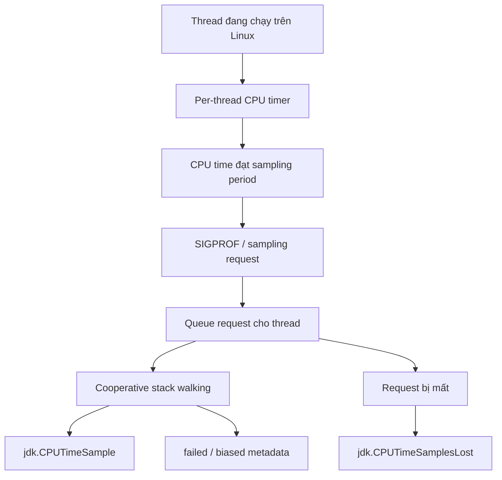

# Nhận diện giới hạn độ phân giải, sai lệch và chi phí của tính năng experimental

## 1. Bối cảnh: CPU-time profiling trong Java 25 là gì?

Java Flight Recorder (JFR) có cơ chế lấy mẫu method để tìm vùng code tiêu thụ nhiều CPU. Trên Java 25, **JEP 509 — JFR CPU-Time Profiling (Experimental)** bổ sung event `jdk.CPUTimeSample`, dùng CPU-time sampling trên **Linux** để ghi nhận stack của thread theo lượng CPU time mà thread đã sử dụng.

Cơ chế này giải quyết một giới hạn của event `jdk.ExecutionSample` truyền thống: ExecutionSample lấy mẫu thread đang chạy Java code, nên không phản ánh đầy đủ những khoảng thread đang thực thi native code. CPUTimeSample có thể lấy mẫu thread khi đang ở **Java state hoặc native state**, ví dụ khi một lời gọi Java đi vào native method hoặc Foreign Function & Memory API.

Tuy vậy, đây vẫn là **tính năng experimental**:

- Chỉ áp dụng cho HotSpot trên Linux có hỗ trợ cơ chế per-thread CPU timer cần thiết; không giả định hoạt động trên Windows hoặc macOS.
- Event `jdk.CPUTimeSample` **không bật mặc định**. Người vận hành phải chủ động bật trong recording.
- Kết quả là dữ liệu sampling thống kê, không phải phép đo chính xác từng nanosecond CPU của mỗi method.
- Sample có thể bị mất, không lấy được stack hoặc bị ảnh hưởng bởi safepoint bias; JFR có event và field để nhận diện một phần các trường hợp này.
- Tần suất cao làm tăng công việc phát tín hiệu, xử lý yêu cầu lấy stack, ghi event và dung lượng recording.

Bài này tập trung vào **độ phân giải, sai lệch và chi phí quan sát** để người học biết khi nào có thể tin kết quả, khi nào cần thu thêm dữ liệu và khi nào nên dùng một công cụ khác.

**Phạm vi phiên bản:** các ví dụ sử dụng JFR CPU-Time Profiling của JDK 25 theo JEP 509. Đây là experimental feature, không phải preview language feature; không cần `--enable-preview`. Khi chạy trên JDK hoặc vendor build khác, cần xác minh trạng thái và hỗ trợ của đúng runtime.

## 2. CPU time khác wall-clock time như thế nào?

Hai khái niệm này trả lời hai câu hỏi khác nhau.

- **Wall-clock time (elapsed time):** thời gian trôi qua từ lúc bắt đầu đến lúc kết thúc một operation, bao gồm cả thời gian chờ I/O, lock, scheduler hoặc thread park.
- **CPU time:** thời gian CPU thực sự thực thi thread. Khi thread chờ socket hoặc bị park, CPU time của thread gần như không tăng trong khoảng chờ đó.

Ví dụ một request:

```text
Bắt đầu request
  ├─ Tính toán Java:       8 ms CPU
  ├─ Chờ database:       90 ms elapsed, gần 0 ms CPU
  ├─ Xử lý native codec:  5 ms CPU
  └─ Hoàn thiện response: 2 ms CPU
Kết thúc request

Elapsed time xấp xỉ: 105 ms
CPU time xấp xỉ:      15 ms
```

Số liệu trên chỉ minh họa sự khác nhau giữa hai đại lượng.

Nếu mục tiêu là trả lời “vì sao request mất 105 ms?”, CPU-time profile chỉ chỉ ra nơi thread tiêu thụ CPU; cần event socket, monitor, park và trace nghiệp vụ để giải thích thời gian chờ. Nếu mục tiêu là “CPU đang được dùng trong method nào?”, CPU-time sampling phù hợp hơn wall-clock timing.

**Không cộng thời gian CPU của nhiều thread rồi so trực tiếp với elapsed time của request.** Nhiều thread có thể chạy song song trên nhiều core; tổng CPU time của chúng có thể lớn hơn thời gian thực tế đã trôi qua.

## 3. JEP 509 khác gì với ExecutionSample?

JFR có nhiều event liên quan đến profiling. Hai event cần phân biệt:

| Đặc điểm | `jdk.ExecutionSample` | `jdk.CPUTimeSample` |
|---|---|---|
| Cách lấy mẫu | Sampling thread đang thực thi Java code | CPU-time sampling theo từng thread |
| Thread đang chạy Java code | Có | Có |
| Thread đang chạy native code | Không được bao phủ bởi ExecutionSample | Có thể được lấy mẫu khi thread ở native state |
| Nền tảng | Cơ chế JFR thông thường trên các nền tảng được hỗ trợ | Experimental, Linux-only trong JDK 25 |
| Mặc định | Có cấu hình trong JFR continuous/profiling templates | Event CPUTimeSample tắt mặc định |
| Mục tiêu | Tìm Java code xuất hiện thường xuyên trong stack samples | Phân tích CPU-time với phạm vi Java và native rộng hơn |
| Giới hạn | Bỏ qua thread không chạy Java code | Vẫn có sai lệch, sample loss, stack-walk failure và chi phí |

`jdk.ExecutionSample` không phải phép đo CPU time chính xác; nó lấy mẫu các thread đang chạy Java code. Oracle lưu ý kết quả sampling có thể không chính xác nếu số mẫu thấp, và các thread đang chờ I/O, sleep hoặc lock không được lấy mẫu.

`jdk.CPUTimeSample` bổ sung khả năng lấy mẫu theo CPU time và bao phủ thread đang ở native state, nhưng không biến sampling thành phép đo đầy đủ từng lệnh máy. Nó cũng không thay thế một native profiler chuyên dụng khi cần symbol hóa chi tiết các frame C/C++ bên trong thư viện native.

### Khi nào nên dùng từng loại?

- Chọn **ExecutionSample** nếu cần một Java CPU profile thông thường, chạy đa nền tảng và không cần bao phủ native state.
- Chọn **CPUTimeSample** khi chạy trên Linux và cần điều tra CPU usage có cả Java/native execution.
- Chọn **JFR event I/O/lock/park** khi elapsed time cao nhưng CPU time thấp.
- Chọn **OS profiler hoặc native profiler** nếu cần native stack/symbols chi tiết hơn khả năng JFR cung cấp.
- Chọn **JMH** cho microbenchmark có kiểm soát; không dùng production sampling để so sánh hai phép tính rất nhỏ.

## 4. Cơ chế lấy mẫu và vì sao chỉ hỗ trợ Linux?

JEP 509 sử dụng tín hiệu `SIGPROF` cùng **per-thread CPU timers** trên Linux. Bộ định thời được gắn với CPU time của từng Java thread, thay vì chỉ đặt một chu kỳ theo wall-clock cho toàn process.

Khi thread tiêu thụ một khoảng CPU time tương ứng với sampling period, hệ thống tạo sampling request. JFR xử lý request, thu thập stack theo cơ chế stack walking an toàn và ghi event `jdk.CPUTimeSample`.



Linux có cơ chế per-thread CPU timers mà implementation này sử dụng. Trên Windows và macOS không có cùng cơ chế theo cách JEP 509 triển khai, vì vậy tính năng trong JDK 25 được giới hạn ở Linux.

**Phạm vi hỗ trợ không đồng nghĩa mọi Linux environment đều giống nhau.** Kernel, container, quyền vận hành, CPU scheduling và JVM distribution có thể ảnh hưởng đến việc bật và chất lượng profiling. Luôn thử trên đúng image/host production mục tiêu.

## 5. Độ phân giải: `throttle` không phải đồng hồ đo từng method

Event `jdk.CPUTimeSample` có setting `throttle`. Setting này hỗ trợ hai cách biểu diễn chính:

- **Giới hạn rate:** ví dụ `500/s`, đặt giới hạn trên cho tốc độ phát event.
- **Chu kỳ CPU time:** ví dụ `10ms`, yêu cầu lấy mẫu theo khoảng CPU time.

Ví dụ `10ms` là **CPU time**, không phải cứ 10 ms wall-clock thì mọi thread đều có một event. Một thread đang ngủ 1 giây không tiêu thụ 1 giây CPU và không tạo ra 100 sample chỉ vì đã trôi qua 1 giây.

### 5.1. Chu kỳ CPU time và thời gian thực tế

Giả sử một thread liên tục chạy CPU và đặt chu kỳ 10 ms. Về nguyên tắc, thread đó tạo sample sau mỗi khoảng CPU time tương ứng. Nếu thread chỉ chạy 2 ms rồi chờ database 200 ms, nó chưa tiêu thụ đủ 10 ms CPU để tạo sample tiếp theo.

Đối với nhiều thread chạy song song, mỗi thread có CPU-time behavior riêng. Vì vậy không nên quy đổi trực tiếp một cấu hình `10ms` thành “100 event mỗi giây cho toàn JVM”. Số event còn phụ thuộc số thread đang chạy, CPU availability, rate cap và hoạt động của sampler.

### 5.2. Throttle theo rate

Nếu dùng `500/s`, sampler giới hạn tốc độ phát event theo rate đã chọn. Implementation có thể tính chu kỳ lấy mẫu hiệu dụng dựa trên số processor đang hoạt động; vì thế chu kỳ thực tế có thể khác nhau theo tải và số CPU được JVM nhìn thấy.

Field `samplingPeriod` trong event ghi lại chu kỳ CPU time thực tế tương ứng với sample. Khi phân tích, hãy xem field này thay vì giả định mọi event đều cách nhau một khoảng cố định.

### 5.3. Độ phân giải có giới hạn

Một method chạy rất ngắn có thể không xuất hiện trong sample. Điều này không chứng minh method không tiêu thụ CPU; nó có thể đơn giản là chưa được lấy mẫu trong khoảng recording.

Ngược lại, method xuất hiện nhiều lần trong stack không có nghĩa từng invocation đều dài. Sampling ghi lại trạng thái tại thời điểm lấy mẫu, không ghi duration của từng lời gọi như một method tracing event.

**Không diễn giải sample count thành CPU nanoseconds chính xác.** Số lượng sample và sampling period hỗ trợ ước lượng tương đối, nhưng không thay thế hardware counter hoặc phép đo CPU time chi tiết ở cấp instruction.

## 6. Timer overrun và sampling period thực tế

Một timer có thể bị overrun nếu hệ thống không xử lý được tín hiệu theo nhịp mong muốn. Trong implementation Linux, nếu timer báo có nhiều lần hết hạn chưa được xử lý, sampling period thực tế được điều chỉnh theo số lần overrun.

Điều đó có nghĩa:

- Tần suất yêu cầu và tần suất event thực tế có thể khác nhau.
- Field `samplingPeriod` có thể lớn hơn giá trị throttle mong muốn.
- Tăng sampling rate không bảo đảm số sample tăng tuyến tính.
- Tải CPU, số thread, thời gian ở native state và hoạt động stack walking có thể ảnh hưởng đến khả năng xử lý request.

Nếu muốn so sánh hai recording, hãy kiểm tra phân bố `samplingPeriod` trong cả hai file. Không so sánh sample count thô khi chu kỳ thực tế khác nhau.

## 7. Safepoint bias và field `biased`

JFR sử dụng **cooperative sampling** theo JEP 518 để stack walking diễn ra tại safepoint an toàn. Cơ chế này giảm nguy cơ đọc stack không nhất quán, nhưng có thể tạo sai lệch về thời điểm lấy stack.

Trong một số trường hợp, sampler không lấy được top Java frame tại thời điểm yêu cầu. Implementation có thể dùng top Java frame tại safepoint làm fallback. Event `jdk.CPUTimeSample` có field:

- `biased = true`: stack có khả năng bị ảnh hưởng bởi safepoint bias.
- `biased = false`: sample không bị đánh dấu là biased theo điều kiện này.

**Biased không có nghĩa sample chắc chắn sai**, nhưng đó là dấu hiệu để người phân tích tách riêng hoặc kiểm tra thêm. Nếu method xuất hiện nhiều trong nhóm biased, không nên kết luận ngay rằng nó là CPU hotspot chính.

### Cách phân tích

1. Xem tổng số sample.
2. Tính tỷ lệ sample có `biased = true`.
3. So sánh top methods của nhóm biased và non-biased.
4. Nếu kết quả thay đổi đáng kể khi bỏ nhóm biased, hãy ghi rõ độ nhạy của kết luận.
5. Lặp lại recording với workload và cấu hình throttle phù hợp để kiểm tra tính ổn định.

Không loại bỏ mọi biased sample một cách máy móc. Chúng vẫn có thông tin, nhưng cần được diễn giải với mức tin cậy thấp hơn cho call path cụ thể.

## 8. Stack-walk failure: field `failed`

Event `jdk.CPUTimeSample` có field `failed` để biểu thị sampler không lấy được stack trace.

| Giá trị | Ý nghĩa | Cách xử lý |
|---|---|---|
| `failed = false` | Stack trace đã được thu thập | Có thể phân tích stack, vẫn cần xem `biased` |
| `failed = true` | Không lấy được stack trace | Không gán sample này cho một method cụ thể |
| `stackTrace` rỗng/null khi failed | Không có call path để phân loại | Tính vào số sample không phân giải được |

Không được bỏ qua các event `failed` rồi báo rằng profile đã giải thích toàn bộ CPU time. Nếu tỷ lệ failure cao, profile theo method có thể thiếu đại diện dù recording vẫn chứa nhiều event.

Cần xem đồng thời:

- Tổng số `CPUTimeSample`.
- Số event `failed = true`.
- Số event `biased = true`.
- Số sample lost trong `CPUTimeSamplesLost`.
- Phân bố sampling period.

Một profile có nhiều sample nhưng tỷ lệ failure/loss lớn vẫn có thể đưa ra kết luận sai về top methods.

## 9. Sample loss và event `jdk.CPUTimeSamplesLost`

Bên cạnh `jdk.CPUTimeSample`, JFR cung cấp `jdk.CPUTimeSamplesLost` để ghi nhận số sample bị mất.

Event này có các thông tin chính:

- `eventThread`: thread liên quan đến sample loss.
- `lostSamples`: số sample bị mất được ghi nhận cho thread đó.

Sample có thể bị mất khi sampler không thể enqueue request hoặc xử lý queue đúng hạn, chẳng hạn do queue đầy hoặc tranh chấp trong quá trình xử lý. Đây là tín hiệu chất lượng dữ liệu, không phải event CPU hotspot.

### Cách đọc loss

Ví dụ minh họa:

```text
CPUTimeSample events:        80,000
CPUTimeSample failed:         1,200
CPUTimeSamplesLost total:       450
CPUTimeSample biased:         2,000
```

Các con số trên không phải kết quả benchmark thật.

Cần phân biệt:

- **Failed:** event được ghi nhưng không có stack trace hữu ích.
- **Lost:** sampling request không được ghi thành event bình thường.
- **Biased:** có stack trace nhưng có khả năng chịu safepoint bias.

Ba trạng thái này không thể cộng hoặc diễn giải như một loại lỗi duy nhất. Chúng mô tả các vấn đề khác nhau trong quá trình thu thập dữ liệu.

Nếu lost samples tăng khi tăng throttle, đó là dấu hiệu sampling rate có thể vượt khả năng xử lý trong workload hiện tại. Hãy giảm tần suất, rút ngắn phạm vi method cần phân tích nếu có thể, hoặc dùng recording khác để kiểm tra.

## 10. Chi phí: vì sao tăng sampling rate làm tăng overhead?

CPU-time profiler phải làm nhiều công việc hơn việc chỉ ghi một timestamp:

1. Quản lý per-thread CPU timers và tín hiệu `SIGPROF`.
2. Tạo sampling request khi thread đạt CPU-time period.
3. Đưa request vào queue theo thread.
4. Thực hiện stack walking theo cơ chế an toàn.
5. Tạo JFR event, lưu stack trace và ghi dữ liệu vào recording.
6. Theo dõi sample bị lỗi hoặc bị mất.

Khi throttle dày hơn, số request và event tăng. Điều đó có thể làm tăng CPU overhead, lock/queue contention, lượng dữ liệu JFR và ảnh hưởng tới workload đang đo.

### Các yếu tố làm chi phí thay đổi

| Yếu tố | Ảnh hưởng có thể có |
|---|---|
| Sampling period nhỏ hơn | Tạo request thường xuyên hơn |
| Rate cap cao hơn | Cho phép phát nhiều event hơn |
| Nhiều thread CPU-bound | Có nhiều thread cùng tạo sampling request |
| Stack trace sâu/phức tạp | Tốn thêm công việc lưu và xử lý stack |
| Thread chuyển Java/native thường xuyên | Có thể làm quy trình lấy stack phức tạp hơn |
| Queue contention hoặc sample loss | Tăng chi phí xử lý nhưng dữ liệu vẫn thiếu |
| Recording dài | Tăng dung lượng file và chi phí lưu trữ |

Không có một con số overhead cố định áp dụng cho mọi ứng dụng. Mức overhead của JFR recording mặc định không thể dùng để suy ra chi phí khi bật event experimental CPUTimeSample với throttle cao.

## 11. Bật CPU-time profiling có kiểm soát

CPUTimeSample tắt mặc định. Trên Linux với HotSpot JDK 25, có thể bật bằng command line:

```bash
java '-XX:StartFlightRecording:jdk.CPUTimeSample#enabled=true,filename=cpu-time.jfr,duration=60s' -jar app.jar
```

Xem top methods theo CPU-time samples:

```bash
jfr view cpu-time-hot-methods cpu-time.jfr
```

In event và sample-loss:

```bash
jfr print --events jdk.CPUTimeSample,jdk.CPUTimeSamplesLost cpu-time.jfr
```

### 11.1. Chọn throttle khởi đầu

Ví dụ đặt sampling period theo CPU time:

```bash
java '-XX:StartFlightRecording:jdk.CPUTimeSample#enabled=true,jdk.CPUTimeSample#throttle=10ms,filename=cpu-time-10ms.jfr,duration=60s' -jar app.jar
```

Hoặc giới hạn rate:

```bash
java '-XX:StartFlightRecording:jdk.CPUTimeSample#enabled=true,jdk.CPUTimeSample#throttle=500/s,filename=cpu-time-500.jfr,duration=60s' -jar app.jar
```

Các giá trị này là ví dụ để minh họa cú pháp, không phải cấu hình tối ưu cho mọi hệ thống. Bắt đầu bằng sampling period/rate vừa phải, sau đó chỉ tăng độ chi tiết khi có câu hỏi cần trả lời và đã đo overhead.

### 11.2. Kiểm tra JFR summary và event fields

```bash
jfr summary cpu-time.jfr
jfr print --events jdk.CPUTimeSample cpu-time.jfr
jfr print --events jdk.CPUTimeSamplesLost cpu-time.jfr
```

Kiểm tra:

- Event có thực sự xuất hiện không?
- `samplingPeriod` có gần cấu hình mong muốn không?
- Có bao nhiêu event `failed`?
- Tỷ lệ `biased` là bao nhiêu?
- `CPUTimeSamplesLost` có ghi nhận loss không?
- Recording có đủ workload CPU-bound để phân tích không?

Nếu event không xuất hiện, xác nhận đang chạy Linux, đúng HotSpot/JDK hỗ trợ, event được bật và recording có thời lượng/workload đủ dài.

## 12. Thiết kế thí nghiệm overhead và độ ổn định

Không kết luận tính năng có overhead thấp chỉ từ một lần chạy. Hãy so sánh nhiều biến thể với cùng application build, JDK, OS, CPU, container limits và workload.

| Lần chạy | Cấu hình | Mục đích |
|---|---|---|
| A | JFR baseline, không bật CPUTimeSample | Đo hiệu năng nền |
| B | CPUTimeSample với throttle thưa | Đo chi phí thấp |
| C | CPUTimeSample với throttle dày hơn | Quan sát quan hệ giữa rate và overhead |
| D | ExecutionSample thông thường | So sánh profile Java-only |
| E | CPUTimeSample với workload có native calls | Kiểm tra giá trị của native-state sampling |

Thu thập ít nhất:

- Throughput.
- p50/p95/p99 latency.
- Process CPU và per-thread CPU.
- Recording size.
- Số `CPUTimeSample`, `failed`, `biased`, `CPUTimeSamplesLost`.
- Phân bố `samplingPeriod`.

### Quy trình A/B

1. Chạy baseline với workload cố định.
2. Chạy lại cùng workload với CPUTimeSample ở throttle ban đầu.
3. So sánh throughput/latency và CPU overhead.
4. Tăng throttle từng bước, không thay nhiều tham số cùng lúc.
5. Dừng tăng nếu overhead hoặc sample loss tăng mạnh mà thông tin mới không đáng kể.
6. Lặp lại mỗi cấu hình đủ lần để tránh kết luận từ nhiễu ngẫu nhiên.

Không chạy baseline và profile trên hai máy có CPU quota, số core, nhiệt độ hoặc tải nền khác nhau rồi coi chênh lệch là overhead của profiler.

## 13. Đọc kết quả mà không kết luận quá mức

### 13.1. Top method không đồng nghĩa method gây ra toàn bộ bottleneck

Một method có nhiều sample có thể là nơi CPU đang thực thi, nhưng nguyên nhân gốc có thể nằm ở caller, dữ liệu đầu vào hoặc thuật toán được gọi lặp. Xem cả call tree và các tầng phía trên.

### 13.2. Không có sample không có nghĩa không có CPU

Một method ngắn, hiếm hoặc chỉ xuất hiện trong một cửa sổ nhỏ có thể không được lấy mẫu. Tăng thời lượng recording hoặc chọn workload lặp lại phù hợp trước khi kết luận.

### 13.3. Sample count không phải số invocation

CPUTimeSample là snapshot theo sampling request. Một method được gọi hàng triệu lần nhưng mỗi lần rất ngắn có thể nhận ít sample; method khác chạy một vòng lặp dài có thể nhận nhiều sample dù số invocation thấp.

### 13.4. Native-state sampling không phải full native profiler

JEP 509 cho phép lấy mẫu thread khi đang ở native state, giúp tránh bỏ sót CPU tiêu thụ trong native execution. Tuy nhiên, đừng mặc định stack trace JFR cung cấp đầy đủ native symbols như một công cụ native profiling chuyên biệt. Nếu cần symbol hóa thư viện C/C++, hãy kết hợp OS/native profiler và symbol tương ứng.

### 13.5. CPU-time profile không giải thích latency

Nếu request chậm do chờ database, thread có thể không tiêu thụ CPU trong phần lớn thời gian đó. Hãy đối chiếu `jdk.SocketRead`, `jdk.SocketWrite`, `jdk.JavaMonitorEnter`, `jdk.JavaMonitorWait`, `jdk.ThreadPark` và các event nghiệp vụ.

## 14. Khi nào không nên bật tính năng experimental?

Không nên bật CPUTimeSample chỉ vì muốn có “nhiều số liệu hơn”. Cân nhắc các trường hợp:

- Ứng dụng chạy trên Windows/macOS hoặc runtime không hỗ trợ.
- Chỉ cần tìm Java CPU hotspot và ExecutionSample đã đủ.
- Hệ thống đang có yêu cầu latency rất chặt và chưa đo được overhead của profiler.
- Recording phải kéo dài nhưng chưa có chính sách quản lý dung lượng hoặc dữ liệu nhạy cảm.
- Sample loss/failure cao đến mức profile không còn đại diện.
- Không có khả năng tái lập workload hoặc đối chiếu với baseline.
- Mục tiêu là đo chính xác CPU time của từng invocation hoặc benchmark method cực ngắn.

Với môi trường production, hãy bắt đầu ở staging hoặc canary, đặt thời lượng ngắn, dùng throttle vừa phải, xác nhận event/loss fields và so sánh với baseline. Chỉ mở rộng phạm vi sau khi hiểu chi phí thực tế.

Vì đây là experimental feature, cần chấp nhận khả năng setting, event metadata hoặc implementation thay đổi ở các JDK release sau. Không xây hệ thống vận hành phụ thuộc cứng vào format nội bộ của event mà không có lớp tương thích và kiểm thử khi nâng JDK.

## 15. Bài thực hành: so sánh ExecutionSample và CPUTimeSample

Tạo ứng dụng mẫu có một đoạn tính toán Java và một lời gọi native (nếu môi trường thử nghiệm đã có thư viện native an toàn). Chạy trên Linux với JDK 25.

### Bước 1 — Ghi baseline

```bash
java -XX:StartFlightRecording=filename=baseline.jfr,duration=60s,settings=profile -jar app.jar
```

Xem các sample Java:

```bash
jfr view hot-methods baseline.jfr
```

### Bước 2 — Bật CPUTimeSample

```bash
java '-XX:StartFlightRecording=settings=profile,jdk.CPUTimeSample#enabled=true,jdk.CPUTimeSample#throttle=10ms,filename=cpu-time.jfr,duration=60s' -jar app.jar
```

### Bước 3 — Xem CPU-time profile và chất lượng sample

```bash
jfr view cpu-time-hot-methods cpu-time.jfr
jfr print --events jdk.CPUTimeSample,jdk.CPUTimeSamplesLost cpu-time.jfr
```

### Bước 4 — So sánh

Ghi lại:

| Chỉ số | ExecutionSample | CPUTimeSample |
|---|---:|---:|
| Tổng sample | ... | ... |
| Sample ở Java state | ... | ... |
| Sample ở native state | Không bao phủ theo mô hình event này | ... |
| Failed | Không có field tương ứng | ... |
| Biased | Không có field tương ứng | ... |
| Lost samples | Không có event loss tương ứng cho cơ chế này | ... |
| Top methods | ... | ... |
| Recording size | ... | ... |
| Throughput/latency impact | ... | ... |

Không so sánh sample count thô như thể hai sampler có cùng chu kỳ, cùng phạm vi và cùng chi phí. So sánh theo câu hỏi cần trả lời, sampling period, workload và các chỉ báo chất lượng.

### Bước 5 — Thử thay đổi throttle

Chạy lại với một throttle rate thấp hơn và một rate cao hơn. Quan sát:

- Sample count thay đổi ra sao?
- `samplingPeriod` có đúng như kỳ vọng không?
- `biased`, `failed`, `lostSamples` có tăng không?
- Throughput/latency thay đổi thế nào?
- Top methods có ổn định qua nhiều lần chạy không?

**Tiêu chí hoàn thành:** giải thích được vì sao CPUTimeSample chỉ dành cho Linux trong JDK 25, phân biệt CPU time với wall-clock, đọc đúng `samplingPeriod`, `biased`, `failed`, `CPUTimeSamplesLost` và định lượng overhead bằng thử nghiệm đối chứng.

## 16. Checklist vận hành

- [ ] Đã xác nhận runtime là HotSpot JDK 25 trên Linux có hỗ trợ JEP 509.
- [ ] Hiểu CPUTimeSample là experimental và event tắt mặc định.
- [ ] Không nhầm experimental feature với preview language feature; không bật `--enable-preview` chỉ vì JEP 509.
- [ ] Đã xác định cần CPU-time profile hay Java execution sampling thông thường.
- [ ] Đã phân biệt CPU time với wall-clock elapsed time.
- [ ] Đã chọn `throttle` phù hợp và hiểu `10ms` là CPU-time period, không phải wall-clock interval.
- [ ] Đã kiểm tra `samplingPeriod` thực tế trong event.
- [ ] Đã xem `biased`, không diễn giải tất cả stack như nhau.
- [ ] Đã đếm `failed` và `CPUTimeSamplesLost`.
- [ ] Không quy đổi sample count thành CPU nanoseconds chính xác hoặc invocation count.
- [ ] Đã kiểm tra native-state profiling trong đúng workload cần điều tra.
- [ ] Đã đo overhead bằng baseline và cùng workload.
- [ ] Đã theo dõi throughput, p95/p99, CPU, recording size và sample loss.
- [ ] Không dùng CPUTimeSample thay cho distributed tracing, I/O profiling hoặc JMH.
- [ ] Đã kiểm tra tính năng và event settings khi nâng JDK/vendor build.
- [ ] Recording được lưu trữ, chia sẻ và bảo vệ theo chính sách dữ liệu của hệ thống.

### Tài liệu tham khảo chính thức

1. [JEP 509 — JFR CPU-Time Profiling (Experimental)](https://openjdk.org/jeps/509)
2. [JEP 518 — JFR Cooperative Sampling](https://openjdk.org/jeps/518)
3. [Oracle Inside.java — What's New for JFR in JDK 25](https://inside.java/2025/06/03/new-jfr-jdk25/)
4. [Oracle Java SE 25 — Troubleshoot Performance Issues Using Flight Recorder](https://docs.oracle.com/en/java/javase/25/troubleshoot/troubleshoot-performance-issues-using-jfr.html)
5. [Oracle Java SE 25 — The `java` Command and StartFlightRecording](https://docs.oracle.com/en/java/javase/25/docs/specs/man/java.html)
6. [Oracle Java SE 25 — The `jfr` Command](https://docs.oracle.com/en/java/javase/25/docs/specs/man/jfr.html)
7. [OpenJDK JFR Event Reference for JDK 25 — CPUTimeSample and CPUTimeSamplesLost](https://sap.github.io/jfrevents/25.html)
8. [Java 25's New CPU-Time Profiler: The Implementation](https://mostlynerdless.de/blog/2025/07/30/java-25s-new-cpu-time-profiler-the-implementation-2/)
