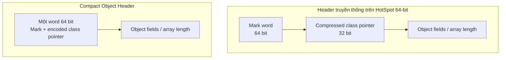

# Đánh giá độ tương thích của agent, công cụ phân tích và mã native

> **Chương:** Header đối tượng gọn  
> **Phạm vi module:** `JAVA_VERSION_JAVA25` — tìm hiểu các khả năng Java 25 còn có giá trị trong phát triển hiện đại, gồm thay đổi layout object của HotSpot, công cụ quan sát JVM, mã native và chiến lược kiểm thử khi nâng cấp JDK.  
> **Mục tiêu:** Đánh giá agent Java, profiler, debugger, heap analyzer, JVMTI/JNI agent và native library khi bật Compact Object Headers; phân biệt API được hỗ trợ với code phụ thuộc layout nội bộ; xây dựng ma trận kiểm thử trên JDK 25 và JDK 27.  
> **Mốc cập nhật:** Compact Object Headers là product feature trong JDK 25 (JEP 519), nhưng mặc định **tắt**; JDK 27 bật mặc định (JEP 534). Bài chỉ dùng cách cấu hình còn áp dụng hiện nay và không hướng dẫn cờ experimental cũ của JDK 24.

Compact Object Headers thay đổi cách HotSpot lưu metadata ở đầu mỗi object. Trên nền tảng 64-bit, header được thu gọn từ 96 hoặc 128 bit xuống 64 bit. Điều này có thể giảm footprint heap, tăng mật độ object và cải thiện locality. Nhưng một số agent, profiler, công cụ phân tích layout hoặc native extension từng dựa vào cấu trúc object nội bộ có thể đọc sai dữ liệu khi layout thay đổi.

Điểm cần phân biệt là **Java API và bytecode thông thường không thay đổi**. Những code dùng `synchronized`, `Object.wait()`, `Object.notify()`, `System.identityHashCode()` hoặc JNI accessor theo hợp đồng chuẩn không cần tự giải mã object header. Rủi ro tập trung ở thành phần đọc trực tiếp mark word, class pointer, object address hoặc các offset nội bộ của HotSpot.

## 1. Compact Object Headers thay đổi điều gì?

Trong HotSpot truyền thống trên kiến trúc 64-bit, object header thường gồm:

- **Mark word:** metadata về trạng thái khóa, identity hash code, tuổi object và thông tin runtime liên quan.
- **Class pointer:** tham chiếu đến metadata của class (Klass) trong JVM.
- **Array length:** với array, độ dài được lưu thêm trong header.

Compact Object Headers mã hóa class pointer nén trong cùng word 64-bit với mark word, thay vì giữ một word riêng. Nhờ đó header có thể giảm từ 12 byte xuống 8 byte trong cấu hình compressed class pointers phổ biến; trường hợp header truyền thống lớn hơn có thể giảm từ 16 byte xuống 8 byte.



Lợi ích thực tế phụ thuộc số lượng và kích thước object:

- Ứng dụng giữ hàng triệu object nhỏ như node trong graph, map entry, DTO, cache entry hoặc object trong AST có thể tiết kiệm heap đáng kể.
- Ứng dụng chủ yếu giữ mảng primitive lớn, direct buffer hoặc một số ít object lớn thường ít hưởng lợi hơn.
- Kích thước object, alignment và padding vẫn phụ thuộc field layout, compressed oops, array và JVM options; không nên lấy 8 byte tiết kiệm trên mỗi object làm công thức dự báo toàn bộ heap.

**Compact Object Headers là thay đổi implementation của HotSpot**, không phải thay đổi ngôn ngữ Java, class-file format hay API chuẩn. Tính tương thích cần kiểm tra nằm ở thành phần dựa vào layout JVM nội bộ.

## 2. Trạng thái theo JDK: 25 khác 27

Không được suy ra trạng thái mặc định của JDK 27 từ JDK 25:

| Phiên bản | Trạng thái | Cấu hình |
|---|---|---|
| JDK 24 | Experimental preview ban đầu | Cách bật cũ cần `-XX:+UnlockExperimentalVMOptions`; không dùng làm hướng dẫn hiện hành |
| **JDK 25** | **Product feature, mặc định tắt** | Bật thử bằng `-XX:+UseCompactObjectHeaders`; không cần `UnlockExperimentalVMOptions` |
| JDK 26 | Vẫn là opt-in theo tài liệu launcher | Bật bằng `-XX:+UseCompactObjectHeaders` nếu cần thử nghiệm |
| **JDK 27** | **Bật mặc định** theo JEP 534 | Có thể tạm tắt bằng `-XX:-UseCompactObjectHeaders` để khoanh vùng hồi quy; cờ tắt dự kiến bị deprecate và loại bỏ trong tương lai |

Với JDK 25, JEP 519 đưa tùy chọn `UseCompactObjectHeaders` thành product option và cho phép bật trực tiếp. Oracle release notes xác nhận mặc định của JDK 25 vẫn là `false`. JDK 27 bật compact headers mặc định theo JEP 534; tùy chọn tắt còn tồn tại để xử lý tương thích trong giai đoạn chuyển đổi, nhưng không nên xây dựng kế hoạch vận hành dài hạn dựa vào nó.

### Xác nhận runtime thực tế

Không chỉ dựa vào phiên bản ghi trong file build. Hãy kiểm tra chính JVM mà service/agent đang dùng:

Trên Linux/macOS:

```bash
java -XX:+PrintFlagsFinal -version 2>&1 | grep UseCompactObjectHeaders
```

Trên Windows PowerShell:

```powershell
java -XX:+PrintFlagsFinal -version 2>&1 |
    Select-String UseCompactObjectHeaders
```

Kết quả JDK 25 mặc định thường hiển thị `UseCompactObjectHeaders = false`; khi bật tường minh, giá trị là `true`. JDK 27 mặc định là `true`.

Nếu ứng dụng chạy trong container, application server hoặc process manager, kiểm tra JVM thực tế của tiến trình đó; lệnh `java` trong terminal có thể trỏ tới một JDK khác.

### Cờ cũ không còn phù hợp

- Không thêm `-XX:+UnlockExperimentalVMOptions` chỉ để bật Compact Object Headers trên JDK 25+.
- Không dùng `-XX:UseCompressedClassPointers` để cố điều khiển layout: tùy chọn này đã deprecated trong JDK 25 và obsolete/removed trong JDK 27.
- Không coi `-XX:-UseCompactObjectHeaders` là cách sửa lỗi lâu dài. Hãy tìm và nâng cấp thành phần phụ thuộc layout nội bộ.

## 3. API Java thông thường có bị ảnh hưởng không?

Các chương trình dùng Java API được hỗ trợ tiếp tục hoạt động theo hợp đồng của API. Ví dụ:

```java
public final class OrderLock {

    private final Object monitor = new Object();
    private int completed;

    public void completeOne() {
        synchronized (monitor) {
            completed++;
            monitor.notifyAll();
        }
    }

    public int completedCount() {
        synchronized (monitor) {
            return completed;
        }
    }

    public int identity() {
        return System.identityHashCode(this);
    }
}
```

Ứng dụng không cần tự thay đổi cách dùng `synchronized`, `wait`, `notify`, `notifyAll` hoặc `System.identityHashCode`. JVM vẫn phải bảo toàn semantics của các thao tác này dù cách biểu diễn lock state và class metadata trong header thay đổi.

Điều cần tránh là viết code suy luận trạng thái khóa bằng cách đọc trực tiếp mark word, hoặc giả định một bit/offset cụ thể luôn biểu diễn trạng thái monitor. Những chi tiết đó thuộc implementation của HotSpot.

### Tương thích source, binary và runtime behavior

| Loại tương thích | Kỳ vọng |
|---|---|
| Source compatibility | Java source không cần sửa chỉ vì header gọn |
| Binary compatibility | Class file/bytecode không đổi định dạng vì compact headers |
| Java API behavior | Các API chuẩn giữ semantics được đặc tả |
| Runtime internals | Layout header, mark word và cách lưu metadata thay đổi; code phụ thuộc nội bộ có thể hỏng |
| Performance | Heap/throughput có thể cải thiện hoặc thay đổi tùy workload; phải đo thực tế |

Vì vậy, một ứng dụng compile thành công không chứng minh mọi agent/native extension tương thích. Cần test runtime cùng toàn bộ agent và thư viện native đang được nạp trong production.

## 4. Phân loại agent theo cách chúng tương tác với JVM

Không phải mọi Java agent đều bị ảnh hưởng như nhau. Hãy phân loại theo **cách agent quan sát hoặc sửa ứng dụng**:

| Nhóm agent | Cơ chế | Rủi ro từ compact headers |
|---|---|---|
| Agent biến đổi bytecode qua `java.lang.instrument` | Đọc/sửa class bytes, thêm interceptor hoặc advice | Thường thấp nếu chỉ thao tác bytecode/API chuẩn |
| Agent dùng Byte Buddy/ASM để instrument method | Biến đổi bytecode và cài helper | Thường thấp; kiểm tra helper có dùng Unsafe/raw object layout không |
| Agent dùng JVMTI API chuẩn | Nhận event, truy vấn class/thread/object qua API | Thường thấp nếu chỉ dùng API được đặc tả |
| Agent dùng Serviceability Agent (SA)/HotSpot internals | Đọc VM structures, heap, mark word, Klass metadata | Cao; cần bản hỗ trợ layout mới |
| Agent/profiler dùng `Unsafe` để đọc header theo offset | Đọc raw memory bên trong object | Rất cao; giả định offset/bit cũ có thể sai |
| Agent native tự cast object reference thành địa chỉ heap | Truy cập object memory trực tiếp | Không an toàn và không portable; phải sửa về API JNI/JVMTI phù hợp |

### 4.1. Java instrumentation thuần

Một agent chỉ dùng `ClassFileTransformer` để thêm log hoặc tracing vào bytecode không cần biết object header nằm ở byte offset nào. Ví dụ agent có thể đọc method name và sửa class file trước khi class được định nghĩa. Layout object được JVM xử lý sau đó.

Tuy nhiên, không nên kết luận một agent luôn an toàn chỉ vì nó viết bằng Java. Một agent Java có thể gọi `sun.misc.Unsafe`, dùng internal APIs, gọi native helper hoặc cài thư viện phân tích heap. Kiểm tra toàn bộ dependency của agent, không chỉ ngôn ngữ triển khai.

### 4.2. Agent dùng JVMTI

JVMTI cung cấp các thao tác có hợp đồng như nhận event, truy vấn class, stack, thread, object size, object monitor usage hoặc heap iteration. Dùng API đúng cách không đồng nghĩa với việc agent được quyền đọc byte đầu tiên của object.

Ví dụ, truy vấn object size qua JVMTI là một API; tự suy ra kích thước header bằng phép trừ hoặc đọc raw memory là cách làm khác. Đừng thay API được hỗ trợ bằng giả định layout.

### 4.3. Agent dựa vào Serviceability Agent

SA/HSDB và một số công cụ chẩn đoán đọc cấu trúc HotSpot trực tiếp từ process/core dump. Chúng cần hiểu đúng JDK build và layout tương ứng. Nếu dùng SA từ JDK khác với JVM đang phân tích, kết quả có thể sai hoặc tool không khởi chạy.

Với SA, hãy dùng phiên bản công cụ tương ứng với runtime/core dump và kiểm tra release notes của tool. Đây là yêu cầu tương thích theo implementation, không phải lỗi của ứng dụng Java thông thường.

## 5. Công cụ phân tích object layout và heap

Các công cụ phân tích có mức độ phụ thuộc khác nhau:

| Công cụ / cách phân tích | Dữ liệu đọc | Cần kiểm tra gì? |
|---|---|---|
| JOL (Java Object Layout) | Dùng Unsafe, JVMTI, SA và các kỹ thuật nội bộ để đo layout | Dùng bản JOL có hỗ trợ JDK đích; so sánh output khi bật/tắt compact headers |
| Heap dump HPROF analyzer | Đọc record class, object, field và reference trong dump | Cập nhật parser theo phiên bản dump/JDK; không tự giả định HPROF chứa raw mark word |
| Core dump analyzer/SA | Đọc HotSpot structures trong dump | Phải tương thích JDK build, OS và kiến trúc |
| JFR/JMX/JVMTI profiler dùng API chuẩn | Đọc event, thread, class và object qua API | Xác minh tool version và semantics event; thường ít phụ thuộc layout hơn |
| Native memory profiler | Theo dõi cấp phát native/off-heap | Compact headers không trực tiếp đổi layout vùng native, nhưng agent có thể còn phần tích hợp heap/HotSpot |

### 5.1. Dùng JOL để xác minh layout

JOL rất hữu ích khi cần quan sát kích thước object thực tế, nhưng bản thân JOL dùng nhiều kỹ thuật nội bộ như Unsafe, JVMTI và Serviceability Agent. Vì thế, JOL cũng là một công cụ cần được kiểm tra tương thích.

Ví dụ với JOL sample hoặc CLI tương ứng của phiên bản JOL đang dùng:

```bash
java -jar jol-cli.jar internals java.lang.Object
java -jar jol-cli.jar internals java.util.HashMap
```

Chạy cùng một JDK 25 hai lần:

```bash
java -XX:-UseCompactObjectHeaders -jar jol-cli.jar internals java.lang.Object
java -XX:+UseCompactObjectHeaders -jar jol-cli.jar internals java.lang.Object
```

Kết quả mong đợi là header nhỏ hơn ở cấu hình bật compact headers. Output cụ thể còn phụ thuộc JOL version, VM, compressed oops, alignment và class được đo. Nếu JOL không nhận ra layout hoặc in cảnh báo, nâng cấp JOL trước khi kết luận JVM đã tạo object sai.

### 5.2. Heap dump không đồng nghĩa raw memory dump

HPROF là định dạng heap dump mô tả class, instance, field và reference theo cấu trúc dump. Một parser HPROF đúng chuẩn không nên tự giả định object header HotSpot nằm ở đầu mỗi record.

Ngược lại, core dump hoặc tool đọc process memory phải giải mã cấu trúc HotSpot cụ thể. Khi một sản phẩm gọi chung cả hai loại file là “heap dump”, hãy xác định nó thực sự đọc HPROF hay raw process memory.

## 6. JNI: object reference là opaque handle

JNI được thiết kế để native code thao tác object qua `JNIEnv` functions. `jobject` là reference/handle theo hợp đồng JNI, không phải cam kết rằng địa chỉ đó chính là địa chỉ object trên Java heap.

JNI specification nêu rõ VM có thể di chuyển object được native code tham chiếu; native code cần sử dụng accessor functions để làm việc với object. Đây là lý do JNI có thể hoạt động trên nhiều cách biểu diễn object nội bộ khác nhau.

Ví dụ an toàn:

```c
JNIEXPORT jlong JNICALL
Java_com_acme_NativeBridge_readId(JNIEnv *env, jobject self) {
    jclass cls = (*env)->GetObjectClass(env, self);
    if (cls == NULL) {
        return 0;
    }

    jfieldID idField = (*env)->GetFieldID(env, cls, "id", "J");
    if (idField == NULL) {
        (*env)->DeleteLocalRef(env, cls);
        return 0; // Java exception có thể đang pending
    }

    jlong value = (*env)->GetLongField(env, self, idField);
    (*env)->DeleteLocalRef(env, cls);
    return value;
}
```

Code sử dụng `GetObjectClass`, `GetFieldID` và `GetLongField` để đọc field theo tên/signature. Không cần biết field hoặc object header nằm ở byte offset nào.

### Anti-pattern cần loại bỏ

```c
// Không làm: jobject không phải cam kết là địa chỉ object trên heap.
uintptr_t raw = (uintptr_t) obj;
uint64_t header = *(uint64_t *) raw;
```

Đoạn trên sai từ giả định ban đầu: `jobject` là opaque reference; cast rồi dereference không phải cách truy cập Java object được JNI đặc tả. Compact Object Headers khiến code kiểu này càng dễ hỏng, nhưng code đó vốn đã không portable giữa các JVM/GC.

### Các API JNI vẫn dùng được

- `GetObjectClass`, `IsInstanceOf`, `IsSameObject`.
- `GetFieldID`, `GetObjectField`, `GetLongField` và các accessor tương ứng.
- `Get<Type>ArrayElements`, `GetPrimitiveArrayCritical` theo đúng quy tắc release.
- `NewGlobalRef`, `DeleteGlobalRef`, `DeleteLocalRef`.
- `GetStringUTFChars` và `ReleaseStringUTFChars`.

Các API này làm việc qua handle và function table, không đòi native code tự giải mã mark word.

## 7. JVMTI: dùng capability và object APIs thay cho raw layout

JVMTI agent có thể nhận event, truy vấn class/method/thread, duyệt heap và thực hiện một số thao tác monitor. Nên giữ agent trong phạm vi API được JVMTI specification hỗ trợ.

| Nhu cầu | API/hướng tiếp cận |
|---|---|
| Nhận biết class được load | `ClassFileLoadHook`, `ClassPrepare` |
| Xác định class và signature | `GetClassSignature`, `GetClassMethods` |
| Lấy kích thước object | `GetObjectSize` |
| Kiểm tra identity/hash | `GetObjectHashCode` |
| Theo dõi heap | `IterateThroughHeap`, `FollowReferences` |
| Kiểm tra monitor | `GetObjectMonitorUsage` và monitor events/capabilities tương ứng |

Không suy luận rằng `GetObjectSize` trả về một header layout cố định hoặc cho phép agent truy cập từng bit của header. API trả thông tin theo hợp đồng JVMTI; nếu cần đọc mark word/klass pointer, đó là truy cập implementation nội bộ và phải được xử lý như một phụ thuộc riêng.

### Kiểm tra agent native

- Dùng header và `jvmti.h` từ JDK đích để build.
- Chạy agent với compact headers bật và tắt trên JDK 25.
- Kiểm tra object iteration, tag, heap walk, monitor và class unload.
- Nếu agent dùng SA/HotSpot headers/internal symbols, xác định rõ nó hỗ trợ đúng JDK build nào.
- Không dựa vào việc agent compile được để kết luận runtime layout tương thích.

## 8. Unsafe, raw offsets và internal HotSpot structures

Rủi ro lớn nhất thường xuất hiện trong code đọc trực tiếp object header:

- Đọc `mark word` ở offset 0.
- Giả định class pointer nằm ở offset cố định sau mark word.
- Giải mã lock bits theo layout cũ.
- Đọc compressed class pointer bằng bit mask hard-code.
- Tính object size bằng cách cộng header size cố định.
- Giả định `jobject` hoặc reference trong heap là raw pointer.

Những giả định này không thuộc Java Language Specification, JVMS, JNI hoặc JVMTI contract.

### Không nhầm field offset với header offset

Một số thư viện cần truy cập field nhanh và dùng offset được VM trả về cho field. Điều này khác hoàn toàn với việc hard-code byte offset của object header. Khi có thể, dùng API cấp cao như reflection/VarHandle; với native memory, dùng Foreign Function & Memory API cho vùng nhớ native đã được cấp phát/kiểm soát.

`sun.misc.Unsafe` memory access methods đã có cảnh báo/deprecation hướng tới loại bỏ; không xây dựng một cơ chế đọc object header mới trên API nội bộ này. Nếu thư viện đang dùng Unsafe, kiểm tra nó dùng Unsafe để thao tác field/object hay để đọc raw header. Hai trường hợp có mức rủi ro khác nhau.

### Thay thế theo mục đích

| Mục tiêu cũ | Hướng thay thế |
|---|---|
| Đọc field theo tên/kiểu | Reflection hoặc `VarHandle` |
| Truy cập native memory | Foreign Function & Memory API với `MemorySegment` |
| Lấy object size | JVMTI `GetObjectSize` hoặc tool layout được cập nhật |
| Theo dõi lock contention | JFR monitor events/JMX phù hợp |
| Quan sát class loading | JFR, JVMTI hoặc class-loading MXBean |
| Phân tích raw heap/core dump | SA/tool đã cập nhật cho JDK đích |

Không có API công khai để ứng dụng Java đọc trực tiếp mark word của mọi object. Nếu một tính năng chỉ hoạt động khi đọc mark word, cần cân nhắc lại kiến trúc hoặc chấp nhận phụ thuộc HotSpot cụ thể với quy trình kiểm soát phiên bản chặt chẽ.

## 9. Lớp sinh động và plugin framework

Compact Object Headers cũng cần được kiểm thử với ứng dụng tạo nhiều class trong runtime:

- Plugin framework tạo class loader riêng cho mỗi plugin.
- Byte Buddy/CGLIB sinh proxy hoặc subclass.
- ORM tạo proxy/lazy-loading class.
- Script engine hoặc runtime compiler định nghĩa class mới.
- Application server cô lập deployment bằng class loader riêng.
- Framework tạo nhiều hidden classes/lambda implementation.

Các class loader không tự làm compact headers sai. Rủi ro đến từ code dùng custom loader để đọc object internals, tool phân tích không nhận dạng layout mới, hoặc giới hạn số lượng class khác nhau.

JDK 25 tài liệu hóa giới hạn khoảng **4 triệu class khác nhau** khi dùng Compact Object Headers. Ứng dụng tạo class động ở quy mô rất lớn, đặc biệt môi trường plugin/hot reload/script, cần đánh giá giới hạn này trước khi bật.

### Theo dõi class loading

Java cung cấp `ClassLoadingMXBean`:

```java
import java.lang.management.ManagementFactory;
import java.lang.management.ClassLoadingMXBean;

public class ClassLoadingSnapshot {
    public static void main(String[] args) {
        ClassLoadingMXBean bean =
                ManagementFactory.getClassLoadingMXBean();

        System.out.println("currently loaded = "
                + bean.getLoadedClassCount());
        System.out.println("total loaded = "
                + bean.getTotalLoadedClassCount());
        System.out.println("unloaded = "
                + bean.getUnloadedClassCount());
    }
}
```

- `getLoadedClassCount()` là số class hiện đang được JVM nạp.
- `getTotalLoadedClassCount()` là tổng số class đã được nạp kể từ khi JVM bắt đầu, kể cả class đã unload.
- `getUnloadedClassCount()` là số class đã unload.

Các số này giúp phát hiện class generation bất thường, nhưng không thay cho kiểm tra chính xác giới hạn implementation của HotSpot. Nếu hệ thống tiến gần hàng triệu class khác nhau, hãy thử nghiệm trên runtime đích và trao đổi với vendor trước khi bật.

## 10. Kiểm thử compatibility theo từng nhóm

Một lần chạy smoke test không đủ để chứng minh agent tương thích. Cần ma trận kiểm thử bao phủ các đường code dùng tới object, monitor, class loader, native bridge và profiler.

| Nhóm | Bài kiểm thử | Điều cần xác nhận |
|---|---|---|
| Java agent | Attach agent, transform class, instrument method | Không lỗi linkage/verification, không giả định object header |
| Bytecode framework | Tạo proxy, interceptor, subclass | Proxy hoạt động, method dispatch đúng |
| JVMTI | Heap walk, tag object, object size, monitor usage | Kết quả hợp lệ theo API và không crash |
| JNI | Đọc field, array, string, global/local refs | Không dereference `jobject` như raw pointer |
| Native library | Gọi downcall, giữ object reference, callback | Không dựa vào địa chỉ/offset object |
| Profiler | CPU/heap/allocation/lock profiling | Stack, class, allocation và monitor data hợp lý |
| JOL/layout tool | Đo `Object`, array, DTO, map entry | Tool nhận dạng đúng header mới |
| Heap dump analyzer | Dump HPROF, mở bằng parser | Class/field/reference được giải mã chính xác |
| SA/core dump | Attach hoặc mở dump bằng tool tương ứng | Tool build tương thích với JVM dump |
| Synchronization | `synchronized`, wait/notify, identity hash | Semantics ứng dụng không đổi |
| Class loader | Plugin load/unload, proxy, hot reload | Không lỗi khi nhiều loader cùng hoạt động |

### Test cả hai chế độ trên JDK 25

Vì JDK 25 mặc định tắt, hãy chạy cùng một bộ test với hai cấu hình:

```bash
# Baseline: compact headers tắt
java -XX:-UseCompactObjectHeaders -javaagent:agent.jar -jar app.jar

# Thử nghiệm: compact headers bật
java -XX:+UseCompactObjectHeaders -javaagent:agent.jar -jar app.jar
```

Giữ nguyên JDK build, OS/CPU, agent version, workload và JVM options khác. So sánh kết quả, log crash, native exception, class loading, heap size và latency.

### Test mặc định JDK 27

JDK 27 đã bật compact headers mặc định. Chạy ứng dụng theo cấu hình production bình thường và xác minh cờ:

```bash
java -XX:+PrintFlagsFinal -version 2>&1 | grep UseCompactObjectHeaders
```

Nếu cần khoanh vùng regression, có thể thử:

```bash
java -XX:-UseCompactObjectHeaders -javaagent:agent.jar -jar app.jar
```

Nếu lỗi chỉ xuất hiện khi headers bật, thu thập minimal reproduction và log để gửi vendor agent/tool. Dùng chế độ tắt như một phép thử chẩn đoán; kế hoạch dài hạn vẫn nên cập nhật agent/tool để hỗ trợ mặc định mới.

## 11. Đo tác động hiệu năng, không chỉ kiểm tra tương thích

Compact headers có thể giảm heap footprint, nhưng lợi ích tùy workload. Hãy đo trước và sau trên cùng artifact, dữ liệu và runtime.

### Các chỉ số nên so sánh

| Metric | Lý do |
|---|---|
| Live heap after GC | Xem footprint của object còn sống |
| Heap occupancy/peak heap | Đánh giá áp lực bộ nhớ trong tải thật |
| Allocation rate | Xem số object và byte được cấp phát |
| GC frequency/pause | Xem tác động gián tiếp lên collector |
| Throughput | Kiểm tra tốc độ xử lý |
| p50/p95/p99 latency | Phát hiện regression ở tail latency |
| CPU utilization | Header gọn có thể ảnh hưởng locality và cache behavior |
| Agent/profiler overhead | Đảm bảo công cụ quan sát không làm lệch benchmark |

### Ví dụ ma trận đo

Các số sau chỉ là **mẫu bảng**, không phải kết quả benchmark:

| Cấu hình | Live heap | p95 latency | Throughput | Kết quả agent |
|---|---:|---:|---:|---|
| JDK 25, headers off | 1.8 GB | 45 ms | 8.000 req/s | Pass |
| JDK 25, headers on | 1.65 GB | 43 ms | 8.150 req/s | Pass |
| JDK 25, headers on + agent cũ | 1.65 GB | Crash | — | Fail |
| JDK 25, headers on + agent đã cập nhật | 1.65 GB | 44 ms | 8.100 req/s | Pass |

Không dự báo heap giảm theo tỷ lệ cố định. Mức giảm tổng thể phụ thuộc tỷ trọng header trong heap; object nhỏ và nhiều thường hưởng lợi rõ hơn object lớn.

## 12. Class Data Sharing và custom runtime image

JDK 25 cung cấp các CDS archive bổ sung cho cấu hình Compact Object Headers, bao gồm archive tương ứng khi bật compact headers. Điều này quan trọng nếu tổ chức build custom runtime image bằng `jlink` hoặc quản lý CDS archive riêng.

Khi dùng `jlink` tạo runtime image tùy chỉnh và muốn dùng Compact Object Headers trên JDK 25, hãy theo hướng dẫn release notes của đúng JDK để tạo CDS archive tương ứng sau khi tạo image. Không copy archive từ một runtime khác hoặc từ cấu hình headers khác mà không xác minh.

Với JDK 27, Oracle cung cấp CDS archives của JDK image được cấu hình mặc định bật compact headers; archive thay thế tương ứng với chế độ tắt cũng được ghi trong release notes. Nếu ứng dụng dùng CDS riêng, kiểm tra cấu hình archive, runtime image và flag compact headers cùng nhau.

## 13. Lỗi thường gặp khi nâng cấp

| Triệu chứng | Nguyên nhân có thể | Hướng xử lý |
|---|---|---|
| Agent crash ngay khi bật compact headers | Đọc mark word/class pointer theo layout cũ | Nâng cấp agent hoặc bỏ code đọc raw header |
| Profiler báo object size bất thường | Dùng giả định header size cố định | Cập nhật profiler/JOL và đo lại trên runtime đích |
| Native library segmentation fault | Cast `jobject` thành raw object address hoặc đọc offset nội bộ | Chuyển sang JNI/JVMTI accessors |
| SA không mở được core dump | Tool version không khớp HotSpot layout/build | Dùng SA cùng JDK build hoặc bản hỗ trợ JDK đích |
| Proxy/plugin gặp lỗi khó tái hiện | Custom class loader hoặc class generation kết hợp agent nội bộ | Test loader/proxy riêng, cập nhật tool và kiểm tra class count |
| JDK 25 không bật headers dù có flag khác | JVM nhận cấu hình khác, flag không được truyền vào process | Kiểm tra `PrintFlagsFinal` trên PID/runtime thật |
| JDK 27 thay đổi memory footprint | Compact headers bật mặc định | Benchmark, kiểm tra agent và capacity planning |
| Cờ `UseCompressedClassPointers` gây warning ở JDK 27 | Tùy chọn đã obsolete/removed | Xóa cờ cũ khỏi script/container/JVM options |
| JDK 27 chạy tốt khi tắt headers nhưng lỗi khi bật | Thành phần nội bộ chưa tương thích | Khoanh vùng agent/tool/native library và cập nhật |
| Heap không giảm đáng kể | Workload ít object nhỏ hoặc heap chủ yếu là array/off-heap | Xem heap histogram/allocation profile, không kỳ vọng mức giảm cố định |

## 14. Kế hoạch migration cho hệ thống có agent và native extension

### Trước khi nâng cấp

1. Lập danh sách Java agents, JVMTI agents, profilers, debuggers, heap analyzers và native libraries đang nạp.
2. Ghi vendor, version, JDK support matrix và cách agent đọc object/class data.
3. Tìm code có `sun.misc.Unsafe`, HotSpot internal APIs, Serviceability Agent hoặc raw pointer arithmetic.
4. Kiểm tra ứng dụng có custom class loader/plugin/hot reload hay sinh class số lượng lớn không.
5. Chạy baseline JDK 25 với compact headers tắt và lưu kết quả.

### Trong giai đoạn thử nghiệm

1. Bật `-XX:+UseCompactObjectHeaders` trên JDK 25.
2. Chạy toàn bộ integration/native/agent tests.
3. Dùng JOL hoặc công cụ layout tương thích để xác minh header.
4. Benchmark heap, GC, throughput và latency.
5. Thử các luồng ít gặp: plugin load/unload, dynamic proxy, class redefinition, JNI callbacks và object monitor contention.
6. Thu log/crash dump nếu có regression và xác định thành phần sở hữu raw layout assumption.

### Khi lên JDK 27

1. Coi compact headers là chế độ mặc định.
2. Cập nhật agent/profiler/native library trước khi triển khai diện rộng.
3. Xóa cờ `UseCompressedClassPointers` khỏi JVM options.
4. Chỉ tạm tắt compact headers để khoanh vùng sự cố nếu cần.
5. Không duy trì rollback flag như một giải pháp lâu dài vì tùy chọn tắt được dự kiến deprecate/remove.
6. Theo dõi memory, GC, CPU và latency sau rollout.

## 15. Bài tập thực hành

**Bối cảnh:** một service Java dùng agent APM, thư viện JNI để xử lý ảnh, plugin loader và JOL trong môi trường staging.

### Bài A — Phân loại agent

1. Lập danh sách agent và phân loại theo Java Instrumentation, JVMTI, SA/HotSpot internal hoặc native code.
2. Xác định thành phần nào chỉ transform bytecode, thành phần nào đọc object header.
3. Kiểm tra phiên bản hỗ trợ JDK 25/27.
4. Ghi rõ API hoặc internal mechanism mà từng agent sử dụng.

### Bài B — So sánh layout

1. Chạy JOL trên JDK 25 với headers tắt.
2. Bật `-XX:+UseCompactObjectHeaders` và chạy lại.
3. So sánh `java.lang.Object`, array và một DTO nhiều field.
4. Giải thích vì sao tiết kiệm mỗi object không bằng mức giảm heap tổng thể.

### Bài C — JNI compatibility

1. Viết native method dùng `GetObjectClass` và `GetLongField` để đọc field.
2. Chạy với compact headers bật/tắt.
3. Tạo một bản anti-pattern cast `jobject` sang pointer trong bài lab cô lập (không đưa vào production).
4. Giải thích vì sao JNI handle không phải raw heap address và vì sao cách đọc header không hợp lệ.

### Bài D — Agent regression

1. Chạy service không agent, có agent APM và có profiler.
2. Lặp lại từng cấu hình với headers bật/tắt trên JDK 25.
3. Ghi startup, error rate, p95 latency, heap và CPU.
4. Nếu chỉ agent cũ thất bại, cập nhật agent rồi chạy lại.
5. Trên JDK 27, xác minh chế độ mặc định và thử rollback flag để khoanh vùng.

### Bài E — Plugin/class generation

1. Tạo plugin loader hoặc proxy workload có số lượng class tăng theo thời gian.
2. Ghi `ClassLoadingMXBean` và class loader statistics.
3. Kiểm tra hệ thống có tiến gần giới hạn class được tài liệu hóa không.
4. Đánh giá khả năng unload class và tác động của hot reload.

**Tiêu chí hoàn thành:** người học phân biệt được API chuẩn với HotSpot internals, giải thích được vì sao JNI/JVMTI accessor an toàn hơn raw pointer, lập ma trận tương thích cho agent/tool/native code và biết kiểm tra khác biệt default JDK 25/JDK 27.

## 16. Checklist review trước khi bật Compact Object Headers

- [ ] Xác nhận JDK vendor, build, OS và kiến trúc 64-bit.
- [ ] Phân biệt đúng default: JDK 25 off, JDK 27 on.
- [ ] Đã kiểm tra tất cả Java agents và phiên bản tương thích.
- [ ] Đã kiểm tra JVMTI agents và native libraries.
- [ ] Không có code cast `jobject` thành raw object address.
- [ ] Không có code đọc mark word/class pointer theo offset hard-code.
- [ ] Profiler, JOL, heap analyzer và SA hỗ trợ JDK đích.
- [ ] Plugin/custom class loader và generated classes đã được kiểm thử.
- [ ] Theo dõi giới hạn số lượng class khi ứng dụng sinh class động.
- [ ] Đã kiểm thử `synchronized`, wait/notify và identity hash behavior.
- [ ] CDS archive/runtime image khớp cấu hình compact headers.
- [ ] Đã đo live heap, GC, throughput, p95/p99 và CPU.
- [ ] Đã loại bỏ `UseCompressedClassPointers` khỏi JVM options khi nâng JDK 27.
- [ ] Nếu tạm tắt compact headers để khoanh vùng, có kế hoạch cập nhật agent/tool và bật lại.

## 17. Nguồn tham khảo chính thức

1. [JEP 519 — Compact Object Headers](https://openjdk.org/jeps/519): đưa Compact Object Headers từ experimental thành product feature trong JDK 25.
2. [JEP 450 — Compact Object Headers (Experimental)](https://openjdk.org/jeps/450): thiết kế ban đầu và cơ chế thu gọn object header.
3. [Java SE 25 — Compact Object Headers](https://docs.oracle.com/en/java/javase/25/gctuning/other-considerations.html): kích thước header 96/128 bit xuống 64 bit và giới hạn 4 triệu class.
4. [Java SE 25 — Consolidated Release Notes](https://www.oracle.com/java/technologies/javase/25all-relnotes.html): flag `UseCompactObjectHeaders` là product option và mặc định tắt trong JDK 25.
5. [Java SE 25 — The `java` Command](https://docs.oracle.com/en/java/javase/25/docs/specs/man/java.html): mô tả flag bật/tắt compact headers.
6. [JEP 534 — Compact Object Headers by Default](https://openjdk.org/jeps/534): bật compact headers mặc định trong JDK 27.
7. [JDK 27 Release Notes](https://www.oracle.com/java/technologies/javase/27-relnote-issues.html): compact headers bật mặc định; `UseCompressedClassPointers` trở thành obsolete/removed.
8. [Java SE 25 — JNI Design Overview](https://docs.oracle.com/en/java/javase/25/docs/specs/jni/design.html): object references, local/global handles và nguyên tắc native code thao tác qua JNI functions.
9. [Java SE 25 — JNI Types and Data Structures](https://docs.oracle.com/en/java/javase/25/docs/specs/jni/types.html): các kiểu `jobject`, `jclass`, `jarray` và cấu trúc reference.
10. [Java SE 25 — JVMTI Specification](https://docs.oracle.com/en/java/javase/25/docs/specs/jvmti.html): capabilities và API để agent quan sát JVM theo hợp đồng.
11. [OpenJDK JOL](https://github.com/openjdk/jol): công cụ phân tích object layout; tài liệu dự án mô tả việc sử dụng Unsafe, JVMTI và Serviceability Agent.

**Điểm mấu chốt:** Compact Object Headers không làm thay đổi Java API hoặc bytecode, nhưng thay đổi layout nội bộ của HotSpot. Agent Java chỉ transform bytecode và native code dùng JNI accessor thường ít phụ thuộc layout; profiler, SA, heap tool và extension đọc raw mark word/class pointer cần được cập nhật. JDK 25 là opt-in, JDK 27 bật mặc định, vì vậy hãy kiểm thử agent/tool/native library trên cả hai chế độ và chỉ dùng rollback flag để khoanh vùng regression.
