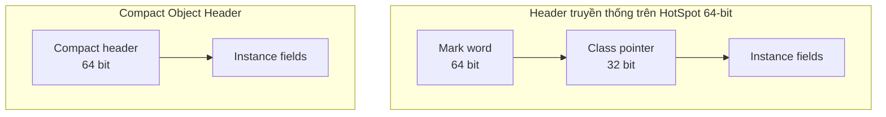

# Lựa chọn triển khai dựa trên phân bố kích thước đối tượng và kết quả thử nghiệm

**Compact Object Headers** là thay đổi bố cục object trong HotSpot, giảm header của một Java object từ 96 hoặc 128 bit xuống còn 64 bit trên kiến trúc 64-bit. Lợi ích chính là giảm phần heap dùng cho metadata của từng object. Tác động tích lũy có thể đáng kể với ứng dụng giữ hàng triệu object nhỏ, nhưng không thể suy ra mức tiết kiệm thực tế chỉ bằng cách nhân số object với một con số cố định: **field layout, object alignment, mảng, số lượng object và workload đều ảnh hưởng kết quả**.

Bài học thuộc chương **Header đối tượng gọn** của module **Java 25** (`JAVA_VERSION_JAVA25`), theo đề bài **“Lựa chọn triển khai dựa trên phân bố kích thước đối tượng và kết quả thử nghiệm”**. Nội dung tập trung vào cách đo phân bố object, ước tính vùng có thể hưởng lợi, chạy thử trên đúng JDK/platform và quyết định rollout dựa trên heap, GC, CPU, throughput cùng latency.

**Ngữ cảnh phiên bản cần nhớ:** trong JDK 25, Compact Object Headers là product feature nhưng mặc định tắt; bật bằng `-XX:+UseCompactObjectHeaders`. Theo JDK 27 Release Notes, compact headers đã trở thành layout mặc định của HotSpot từ JDK 27. Vì vậy, bài phân biệt quy trình bật thử trên Java 25 với cách xác minh/đánh giá trên JDK mới hơn. Chỉ dùng kiến thức còn áp dụng; không dùng quy trình experimental cũ của Java 24.

## 1. Compact Object Headers thay đổi điều gì?

Một object trong HotSpot có header chứa metadata do JVM quản lý, chẳng hạn thông tin class, trạng thái locking, identity hash code và thông tin GC. Với bố cục truyền thống trên HotSpot 64-bit:

- Mark word thường chiếm 64 bit.
- Class pointer thường chiếm 32 bit khi compressed class pointers được sử dụng.
- Tổng header là 96 bit, tương đương 12 byte.
- Nếu class pointer không được nén, header truyền thống có thể là 128 bit, tương đương 16 byte.

Compact Object Headers nén bố cục header xuống còn **64 bit (8 byte)**. JVM tổ chức lại các bit metadata để giữ thông tin cần thiết trong một word nhỏ hơn. Đây là thay đổi nội bộ của VM; code Java thông thường không cần sửa class hoặc field để hưởng lợi.



Oracle JDK 25 mô tả mức giảm trung bình khoảng **4 byte trên mỗi object** trong heap khi bật compact headers. Đây là mức trung bình tham khảo của bố cục phổ biến, không phải cam kết mỗi instance đều giảm chính xác 4 byte. Bố cục cũ 128 bit có thể có phần header giảm lớn hơn về mặt số học, còn kích thước object thực tế vẫn chịu ảnh hưởng của alignment.

## 2. Trạng thái theo phiên bản JDK

| Runtime | Trạng thái Compact Object Headers | Cách triển khai |
| --- | --- | --- |
| JDK 25 | Product feature, mặc định tắt | Bật bằng `-XX:+UseCompactObjectHeaders` khi thử nghiệm/triển khai |
| JDK 27 trở lên | Layout mặc định của HotSpot | Xác minh trạng thái thực tế; không cần thêm cờ bật |

JDK 27 Release Notes công bố compact headers được bật mặc định theo JEP 534. Cờ `-XX:-UseCompactObjectHeaders` vẫn có thể được dùng để tắt trong JDK 27 cho một phép so sánh có kiểm soát, nhưng Oracle cho biết cờ này dự kiến sẽ bị deprecated và loại bỏ trong tương lai. Không xây dựng cấu hình production dài hạn dựa vào việc tắt compact headers trên các bản JDK mới.

Trên Java 25, `-XX:+UseCompactObjectHeaders` là product option; **không cần** thêm `-XX:+UnlockExperimentalVMOptions`. Không lấy lệnh experimental của Java 24 làm hướng dẫn hiện hành.

Kiểm tra trạng thái flag trên JDK mục tiêu:

```bash
java -XX:+PrintFlagsFinal -version | grep UseCompactObjectHeaders
```

Với JDK 25, kết quả mặc định thường hiển thị `false`. Khi thêm cờ bật, kết quả phải phản ánh `true`. Trên JDK 27, mặc định của HotSpot là `true`. Luôn kiểm tra chính JDK vendor/build mà ứng dụng thực sự chạy; đừng chỉ suy ra từ phiên bản trong file build.

## 3. Phân biệt object headers với compressed object pointers

Hai cơ chế này có liên quan đến memory layout nhưng giải quyết hai phần khác nhau:

| Cơ chế | Phần được tối ưu | Ý nghĩa |
| --- | --- | --- |
| **Compact Object Headers** | Metadata nằm ở đầu mỗi object | Giảm header từ 96/128 bit xuống 64 bit |
| **Compressed Oops** | Các reference trỏ tới object trong heap | Dùng biểu diễn reference nén thay cho pointer đầy đủ trong các cấu hình phù hợp |
| **Compressed Class Pointers** | Pointer tới metadata class | Nén class pointer; có liên quan tới bố cục header truyền thống |

Không tắt `UseCompressedOops` để “bật” compact headers. Đây là các cơ chế riêng; thay đổi compressed oops có thể làm tăng kích thước reference và làm sai phép so sánh. Trên JDK 27, class pointers trong object luôn được nén và option `UseCompressedClassPointers` đã bị loại bỏ; không đưa option này vào JVM command line mới.

Compact headers cũng không làm object field, `String` payload hoặc `byte[]` tự biến mất. Phần giảm chủ yếu nằm ở header; object có payload lớn vẫn có thể chiếm gần như toàn bộ heap bởi fields và array elements.

## 4. Vì sao phải xem phân bố kích thước object?

Lợi ích phụ thuộc vào **số lượng object** và **tỷ lệ header trong tổng shallow size**. Một heap có 30 triệu node nhỏ có thể hưởng lợi nhiều hơn heap có cùng dung lượng nhưng chủ yếu là vài mảng lớn.

| Phân bố thường gặp | Tiềm năng hưởng lợi | Lý do |
| --- | --- | --- |
| Nhiều object nhỏ, ít field | Cao hơn | Header chiếm tỷ lệ lớn so với dữ liệu |
| Nhiều node trong `HashMap`, `ConcurrentHashMap`, graph hoặc cache | Cao hơn | Một cấu trúc nghiệp vụ có thể tạo rất nhiều node/wrapper |
| Nhiều DTO, entity hoặc record nhỏ được giữ đồng thời | Có thể cao | Số lượng instance lớn làm phần header tích lũy |
| Nhiều `String` và object phụ trợ | Có thể đáng kể | Một giá trị logic có thể gồm nhiều heap objects |
| Ít object lớn với payload lớn | Thấp hơn | Fields, arrays hoặc payload chiếm phần lớn kích thước |
| `byte[]`, `int[]`, `long[]` dài hoặc direct buffers chiếm đa số | Thường thấp hơn | Array elements/off-heap payload chiếm phần lớn footprint |

Không đánh giá chỉ bằng tỷ lệ số class. Một class có thể có rất ít instance nhưng mỗi instance lớn; ngược lại, class `HashMap$Node` có thể tạo hàng triệu instance nhỏ. Cần quan sát **instance count, shallow size và tổng bytes theo class**.

### Ví dụ phân bố giả định

| Nhóm object | Số instance | Shallow size trung bình | Tổng shallow size |
| --- | ---: | ---: | ---: |
| Node/cache entry nhỏ | 12.000.000 | 32 B | 366,2 MiB |
| DTO/entity | 3.000.000 | 64 B | 183,1 MiB |
| `String` | 2.000.000 | 40 B | 76,3 MiB |
| `byte[]` lớn | 20.000 | 32 KiB | 625 MiB |

Các số trên chỉ minh họa. Nhóm node và DTO có nhiều instance nên header có thể là phần đáng kể; nhóm `byte[]` ít instance nhưng chiếm tổng dung lượng lớn do payload. Cần đo trên heap thật để biết nhóm nào quyết định tổng footprint.

## 5. Alignment khiến mức tiết kiệm thực tế không cố định

Sau header và fields, HotSpot thường căn chỉnh kích thước object theo ranh giới alignment. Vì vậy, giảm header 4 byte không nhất thiết làm kích thước được cấp phát giảm đúng 4 byte.

Có thể hình dung:

\[
\text{allocatedSize} =
\operatorname{alignUp}(\text{headerSize} + \text{fieldAndArrayData},\ \text{alignment})
\]

Ví dụ minh họa với alignment 8 byte và header truyền thống 12 byte:

| Object shape | Header cũ + fields | Kích thước cũ sau alignment | Header mới + fields | Kích thước mới sau alignment |
| --- | ---: | ---: | ---: | ---: |
| Không có field | 12 B | 16 B | 8 B | 8 B |
| Một field `int` | 16 B | 16 B | 12 B | 16 B |
| Hai field `int` | 20 B | 24 B | 16 B | 16 B |

Đây là phép tính đơn giản hóa để thấy ảnh hưởng của padding, không thay cho layout thực tế của class. HotSpot có thể sắp xếp fields, xử lý kế thừa, array length và alignment theo quy tắc riêng. Với một số class, phần giảm header được hấp thụ bởi padding; với class khác, object có thể giảm cả một đơn vị alignment.

Vì vậy:

- Không lấy `4 bytes × số object` làm số tiết kiệm chính xác.
- Không thay `ObjectAlignmentInBytes` chỉ để tạo ra kết quả benchmark đẹp hơn.
- Đo lại từng class shape quan trọng trên đúng JDK, flag và architecture.
- Với arrays, phải tính cả array header, length và số phần tử; mảng dài thường bị chi phối bởi payload.

## 6. Xác định object distribution bằng công cụ phù hợp

Không có một công cụ duy nhất trả lời đầy đủ cả allocation, live set, object layout và retained heap. Kết hợp nhiều nguồn:

| Công cụ | Trả lời câu hỏi | Giới hạn |
| --- | --- | --- |
| JOL (`ClassLayout`) | Layout, field offsets, header, alignment và shallow size của class | Phân tích class/sample cụ thể; không tự thay thế heap census của ứng dụng |
| JOL (`GraphLayout`) | Footprint của object graph có thể truy cập từ root | Phụ thuộc root và graph được chọn |
| `jcmd GC.class_histogram` | Số lượng instance và tổng shallow bytes theo class | Tác động cao, phụ thuộc heap size/content |
| Heap dump + MAT/JOL | Phân bố object, array lengths, dominator và retained heap | Tốn dung lượng, có thể gây pause/full GC; cần bảo vệ dữ liệu |
| JFR `jdk.ObjectAllocationSample` | Allocation pressure theo class/thread/stack | Là mẫu allocation, không phải thống kê đầy đủ live objects tại một thời điểm |
| GC/JVM metrics | Heap used/committed, GC count/pause, allocation rate | Không cho biết layout từng object |

### Phân biệt allocation với live object distribution

Một service có thể tạo 100 triệu object tạm mỗi phút nhưng chỉ giữ 2 triệu object trong heap. JFR allocation samples giúp tìm nơi **tạo object** và lượng allocation tương đối; heap histogram/heap dump giúp hiểu **object còn tồn tại** tại thời điểm chụp. Hai góc nhìn phục vụ câu hỏi khác nhau.

Nếu mục tiêu là giảm heap live set và container memory, hãy xem cả retained/live objects. Nếu mục tiêu là giảm allocation pressure và GC work, hãy phân tích allocation rate cùng thời gian sống của object.

## 7. Đo layout class bằng Java Object Layout (JOL)

**Java Object Layout (JOL)** là bộ công cụ của OpenJDK để quan sát layout object thực tế của JVM. JOL có thể hiển thị header, field offsets, padding, instance size và footprint của object graph.

Ví dụ một domain class:

```java
package com.acme.shop;

public final class OrderLine {
    private final long productId;
    private final int quantity;
    private final int unitPriceCents;
    private final boolean taxable;

    public OrderLine(
            long productId,
            int quantity,
            int unitPriceCents,
            boolean taxable) {
        this.productId = productId;
        this.quantity = quantity;
        this.unitPriceCents = unitPriceCents;
        this.taxable = taxable;
    }
}
```

Trong một chương trình phân tích có dependency `org.openjdk.jol:jol-core`:

```java
import org.openjdk.jol.info.ClassLayout;
import org.openjdk.jol.info.GraphLayout;
import org.openjdk.jol.vm.VM;

public class ObjectLayoutReport {
    public static void main(String[] args) {
        System.out.println(VM.current().details());
        System.out.println(
                ClassLayout.parseClass(OrderLine.class).toPrintable());

        var sample = new OrderLine(101L, 2, 1599, true);
        System.out.println(
                GraphLayout.parseInstance(sample).toFootprint());
    }
}
```

Chạy chương trình này riêng dưới từng cấu hình JVM:

```bash
# Baseline trên JDK 25: compact headers mặc định tắt.
java -cp "app.jar:jol-core.jar" com.acme.shop.ObjectLayoutReport

# Candidate trên JDK 25: compact headers bật.
java -XX:+UseCompactObjectHeaders \
  -cp "app.jar:jol-core.jar" \
  com.acme.shop.ObjectLayoutReport
```

Đọc output:

- `VM.current().details()` cho biết VM mode, compressed references và object alignment mà JOL nhận diện.
- `ClassLayout` cho biết offset/header/fields và instance size của class.
- `GraphLayout` cho biết tổng footprint của các object có thể truy cập từ sample root.
- So sánh cùng class/sample dưới hai lần chạy; không so output từ hai JDK khác nhau mà không ghi rõ khác biệt.

JOL cần phiên bản hỗ trợ JDK đích và có thể dùng cơ chế như Unsafe/JVMTI/Serviceability Agent để đọc layout. Nếu JOL không nhận diện đúng runtime hoặc báo thiếu quyền attach, không dùng kết quả mô phỏng làm số đo production. Tham khảo tài liệu dự án OpenJDK JOL và cập nhật dependency có kiểm soát.

## 8. Dùng heap histogram để tìm class có nhiều instance

Trong môi trường staging hoặc khi đã có cửa sổ chẩn đoán được phê duyệt, có thể lấy histogram:

```bash
jcmd -l
jcmd <pid> GC.class_histogram
```

Thay `<pid>` bằng PID của JVM. Histogram liệt kê class, số instance và tổng bytes shallow. Dùng kết quả để tìm:

- Class có số instance rất lớn.
- Node/wrapper/entry class trong collection.
- Object nhỏ xuất hiện nhiều do boxing, mapping hoặc serialization.
- Array class có tổng bytes lớn.
- Class nội bộ framework hoặc thư viện chiếm phần đáng kể.

**Cảnh báo:** Oracle xếp `GC.class_histogram` ở mức impact **High**, tùy kích thước và nội dung heap. Không chạy lặp liên tục trên production đang chịu tải cao. Dùng staging, bản sao workload hoặc thời điểm off-peak; đánh giá pause và tác động trước khi dùng kết quả.

Histogram là thống kê shallow theo class, không phải retained-size report. Nếu cần hiểu object nào giữ cả graph trong bộ nhớ, dùng heap dump và dominator tree trong công cụ phân tích phù hợp.

## 9. Heap dump và JFR bổ sung góc nhìn nào?

### Heap dump

```bash
jcmd <pid> GC.heap_dump /secure/diagnostics/shop-before.hprof
```

Heap dump có thể giúp xem số object, kích thước instance/array và retained graph. Theo tài liệu JDK 25, `GC.heap_dump` có impact **High** và mặc định yêu cầu full GC nếu không dùng tùy chọn `-all`. Vì thế, chỉ tạo dump trong môi trường được phép hoặc khi đã đánh giá rủi ro pause/dung lượng. Heap dump cũng có thể chứa dữ liệu nghiệp vụ/PII; cần lưu trữ bảo mật.

### Java Flight Recorder

Event `jdk.ObjectAllocationSample` giúp xác định allocation pressure theo class, thread và stack trace. Nó hữu ích để tìm code path tạo nhiều object, nhưng **không phải** bản kiểm kê chính xác mọi object còn sống trong heap. Dùng JFR để biết nơi object được tạo; dùng histogram/heap dump để hiểu object đang được giữ.

Kết hợp:

1. JFR để nhận diện class và stack tạo allocation lớn.
2. Heap histogram để xếp hạng số instance và shallow bytes.
3. Heap dump để điều tra retained graph khi cần.
4. JOL để đo layout của class quan trọng dưới đúng flag.

## 10. Ước tính mức tiết kiệm trước khi benchmark

Với mỗi class `i`, ghi số instance `N_i` và kích thước shallow đo được ở hai cấu hình. Ước tính:

\[
\text{Estimated saving} =
\sum_i N_i \times
(\text{size}_{i,\text{off}} - \text{size}_{i,\text{on}})
\]

Đối với class có nhiều hình dạng instance (đặc biệt arrays có length khác nhau), chia thành nhóm kích thước hoặc dùng heap dump để tránh dùng một giá trị trung bình quá thô.

Ví dụ giả định:

| Class/shape | Số instance | Size off | Size on | Ước tính giảm |
| --- | ---: | ---: | ---: | ---: |
| Node nhỏ | 10.000.000 | 32 B | 24 B | 76,3 MiB |
| DTO | 2.000.000 | 48 B | 40 B | 15,3 MiB |
| Array payload lớn | 10.000 | 8.208 B | 8.200 B | 0,08 MiB |
| Tổng ước tính | — | — | — | 91,7 MiB |

Các số là giả định để minh họa cách tính; không phải kết quả benchmark của một ứng dụng cụ thể. Không nhân toàn bộ instance count với 4 byte nếu JOL cho thấy các class có mức giảm do alignment khác nhau.

## 11. Thiết kế A/B benchmark có thể tin cậy

Để quyết định bật compact headers, cần chạy cùng ứng dụng với cùng điều kiện, chỉ thay đổi object header layout.

### Cố định môi trường

- Cùng JDK vendor, build và patch level.
- Cùng application artifact, dependency, classpath/module path và agent.
- Cùng OS, CPU model, container CPU quota và memory limit.
- Cùng `-Xms`, `-Xmx`, GC configuration và JVM flags khác.
- Cùng database/broker/cache state và dataset.
- Cùng request mix, concurrency, arrival rate và số thao tác.
- Cùng warm-up, thời gian đo và quy trình reset.

Không đồng thời đổi heap size, GC, CPU limit hoặc application version. Nếu nhiều biến thay đổi cùng lúc, không thể quy kết khác biệt cho compact headers.

### Cấu hình trên JDK 25

Baseline (flag mặc định tắt):

```bash
java -Xms2g -Xmx2g -jar shop-service.jar
```

Candidate:

```bash
java -Xms2g -Xmx2g \
  -XX:+UseCompactObjectHeaders \
  -jar shop-service.jar
```

Nếu ứng dụng có các JVM flags khác trong production, giữ nguyên chúng ở cả hai lượt. Hai lệnh trên chỉ minh họa phần khác biệt là compact-header flag.

### Cấu hình trên JDK 27

JDK 27 đã bật compact headers mặc định. Dùng cấu hình mặc định làm candidate. Nếu cần một baseline đối chứng trong thử nghiệm ngắn, có thể chạy thêm:

```bash
java -XX:-UseCompactObjectHeaders \
  -Xms2g -Xmx2g \
  -jar shop-service.jar
```

Đây là cờ tắt tạm thời phục vụ A/B; JDK 27 Release Notes cho biết cờ này dự kiến bị deprecated và loại bỏ trong tương lai. Không lấy nó làm cấu hình production lâu dài.

## 12. Chọn workload và cách đo

Benchmark phải phản ánh phân bố object trong ứng dụng thật:

| Workload | Vì sao cần |
| --- | --- |
| Tải đọc/cache-heavy | Kiểm tra nhiều object nhỏ được giữ trong cache |
| Tạo/cập nhật entity hoặc DTO | Đánh giá object graph nghiệp vụ và allocation |
| Serialization/deserialization | Đánh giá object tạm, wrapper và array payload |
| Batch lớn | Kiểm tra lượng object đồng thời và thời gian sống |
| Background consumer | Bao phủ object được tạo ở worker và event pipeline |
| Steady-state traffic | Đánh giá heap/GC/latency khi hệ thống hoạt động ổn định |

Nên có hai nhóm phép đo:

1. **Memory-focused:** xử lý cùng số lượng bản ghi, giữ cùng trạng thái cuối, đo live heap/shallow bytes sau cùng một quy trình kết thúc hoặc điểm ổn định.
2. **Performance-focused:** chạy cùng arrival rate/concurrency và thời lượng, đo throughput, CPU, GC và latency.

Chạy nhiều lượt, xen kẽ thứ tự baseline/candidate để giảm sai lệch do nhiệt độ CPU, cache hệ điều hành, dependency và nhiễu môi trường. Dùng median và độ phân tán giữa các lượt; không kết luận từ một lần chạy.

## 13. Chỉ số cần so sánh

| Chỉ số | Cách diễn giải |
| --- | --- |
| Live heap / used heap ở cùng checkpoint | Đo mức giảm bộ nhớ object đang giữ |
| Tổng shallow bytes theo class | Xác định class nào thực sự giảm |
| Heap committed và RSS/container memory | Đánh giá ảnh hưởng tới footprint triển khai; RSS còn bao gồm native memory, stacks và mapped files |
| Allocation rate | Xem tốc độ tạo object có thay đổi không |
| GC frequency và pause | Kiểm tra áp lực GC có giảm hay không |
| CPU time/CPU utilization | Xem thay đổi layout có tác động tới CPU trên workload này không |
| Throughput | Kiểm tra năng lực xử lý có tăng/giảm |
| p50/p95/p99 latency | Kiểm tra cả latency trung bình và tail latency |
| Error rate | Đảm bảo không đánh đổi tính đúng đắn |

Nếu muốn so sánh live set sau GC, chỉ thực hiện một quy trình GC giống nhau trong môi trường benchmark cô lập. Không ép full GC vào production chỉ để lấy số đo đẹp. Với production-like load, quan sát các checkpoint tương đương và dùng JFR/GC logs để giải thích biến động.

Không kỳ vọng RSS giảm đúng bằng heap saving: JVM có thể giữ committed heap, native allocations và memory mapping ở mức riêng. Heap used, heap committed và process RSS là các chỉ số khác nhau.

## 14. Giới hạn tương thích và trường hợp cần thận trọng

Theo tài liệu Oracle JDK 25/27:

- Compact Object Headers áp dụng cho HotSpot 64-bit.
- Khi bật, có giới hạn khoảng **4 triệu class khác nhau được load**. Ứng dụng/plugin platform có số class rất lớn cần xác minh trước.
- Các công cụ hoặc thư viện dựa vào bố cục header nội bộ, hard-coded field offsets hoặc giả định layout HotSpot có thể cần cập nhật.
- Kiểm tra runtime vendor/build, agent, native integration và compiler/JVMCI components đang sử dụng.

Code Java bình thường truy cập fields qua ngôn ngữ/API không nên dựa vào byte offset của object. Tránh:

- Đọc/ghi trực tiếp bit header hoặc class pointer nội bộ.
- Hard-code offset lấy từ một JVM khác hoặc một lần chạy khác.
- Giả định `Unsafe.objectFieldOffset` có cùng giá trị giữa các runtime/layout.
- Dùng heap inspection tool cũ không hiểu compact headers để kết luận object size.

Nếu một ứng dụng dùng agent/native library thao tác trực tiếp với object memory, phải kiểm tra hỗ trợ từ nhà cung cấp và chạy integration tests với compact headers trước rollout.

## 15. Ma trận quyết định triển khai

| Bằng chứng từ workload | Kết quả thử nghiệm | Quyết định |
| --- | --- | --- |
| Rất nhiều object nhỏ; header chiếm tỷ lệ đáng kể | Live heap giảm rõ, p95/p99 và throughput không xấu đi | Ưu tiên bật trên JDK 25; xác nhận lại trên JDK đích |
| Nhiều object nhỏ nhưng thời gian sống ngắn | Allocation/GC giảm hoặc ổn định, latency đạt SLO | Có thể triển khai sau khi kiểm tra dưới tải thực |
| Heap chủ yếu là arrays lớn/direct buffers/off-heap | Chênh lệch heap nhỏ | Lợi ích có thể thấp; ưu tiên tối ưu payload hoặc vùng chiếm dụng lớn |
| Số class loaded gần giới hạn 4 triệu | Có nguy cơ chạm giới hạn | Không bật trên JDK 25 cho tới khi giải quyết/đánh giá giới hạn |
| Library/agent/native component chưa hỗ trợ | Lỗi hoặc layout assumptions chưa được xác minh | Hoãn rollout, nâng cấp component hoặc xin xác nhận vendor |
| Heap giảm nhưng CPU/p99 xấu đáng kể | Không đạt SLO | Điều tra nguyên nhân; không chấp nhận chỉ vì heap nhỏ hơn |
| Không thấy khác biệt có ý nghĩa | Chi phí vận hành/compatibility lớn hơn lợi ích | Trên JDK 25 có thể giữ mặc định tắt; trên JDK 27+ đánh giá theo default mới và xử lý regression thay vì phụ thuộc cờ tắt lâu dài |

Một quyết định triển khai nên có:

1. Bằng chứng object count/size distribution.
2. Layout report của các class chiếm nhiều instance.
3. Baseline/candidate benchmark có thể tái lập.
4. Kết quả compatibility và test chức năng.
5. Owner chịu trách nhiệm theo dõi heap, GC và SLO sau rollout.

## 16. Rollout và theo dõi sau triển khai

Với ứng dụng chạy JDK 25:

1. Bật compact headers ở staging bằng `-XX:+UseCompactObjectHeaders`.
2. Chạy test chức năng, integration, serialization, concurrency và native/agent tests liên quan.
3. So sánh heap/GC/CPU/latency với baseline.
4. Canary một nhóm instance và kiểm tra số liệu trong cùng traffic window.
5. Mở rộng khi memory benefit có ý nghĩa và SLO không xấu đi.
6. Giữ cấu hình flag và kết quả benchmark cùng release metadata để có thể tái lập.

Với JDK 27 trở lên, compact headers đã là mặc định. Khi nâng cấp, hãy kiểm tra các thư viện phụ thuộc layout nội bộ và theo dõi chỉ số sau upgrade. Nếu cần baseline đối chứng, dùng flag tắt chỉ trong thử nghiệm có kiểm soát; không để workaround đó trở thành cấu hình dài hạn.

Sau rollout, theo dõi:

- Heap used/committed và container RSS.
- GC frequency, pause và allocation rate.
- CPU utilization, throughput và p95/p99.
- Error rate, crash và cảnh báo từ native/agent components.
- Số class loaded nếu ứng dụng có plugin hoặc dynamic class loading lớn.

Nếu có regression, tái hiện trên đúng build/JDK/flags và so sánh bằng cùng workload. Không kết luận compact headers là nguyên nhân chỉ từ một lần deploy hoặc một metric biến động.

## 17. Bài thực hành: chọn triển khai cho shop-service

### Bối cảnh

`shop-service` giữ nhiều `OrderLine`, `ProductView`, `HashMap.Node` và `String` trong cache. Heap dump cho thấy hàng triệu object nhỏ; một số job batch tạo thêm nhiều object tạm. Nhóm đang nâng cấp lên Java 25 và muốn xác định có nên bật compact headers trước khi triển khai.

### Nhiệm vụ

1. **Ghi baseline:** JDK vendor/build, OS/CPU, container limits, heap, GC và JVM flags.
2. **Lấy histogram:** chạy `jcmd <pid> GC.class_histogram` trong staging để xếp hạng class theo instance count và shallow bytes.
3. **Đo layout:** dùng JOL `ClassLayout` cho `OrderLine`, `ProductView` và các node class quan trọng.
4. **Đo graph:** dùng `GraphLayout` trên sample object graph để biết footprint bao gồm những object con nào.
5. **Đọc allocation:** thu JFR `jdk.ObjectAllocationSample` để tìm stack tạo nhiều object; không coi nó là live heap census.
6. **Ước tính:** tính delta theo class count và size thực đo, ghi rõ giả định về array lengths/alignment.
7. **Chạy A/B:** cùng artifact/JDK25, baseline mặc định và candidate với `-XX:+UseCompactObjectHeaders`.
8. **Tải đại diện:** chạy catalog read, order creation, cache warm-up và batch workload với cùng dataset/arrival rate.
9. **Đo:** heap used/committed, RSS, GC, CPU, throughput, p95/p99 và error rate.
10. **Kiểm tra compatibility:** class count, agent/native integration và thư viện có thao tác layout nội bộ.
11. **Ra quyết định:** bật, hoãn hoặc không ưu tiên dựa trên bằng chứng và SLO.
12. **Lập rollout:** canary, dashboard, ngưỡng rollback và owner theo dõi.

### Mẫu báo cáo

| Hạng mục | Baseline | Compact headers | Nhận xét |
| --- | --- | --- | --- |
| JDK vendor/build | Chưa ghi | Chưa ghi | Phải cùng runtime |
| Object count | Chưa đo | Chưa đo | Cùng workload/checkpoint |
| Top classes theo instance count | Chưa đo | Chưa đo | Histogram |
| Shallow bytes | Chưa đo | Chưa đo | Theo class |
| JOL layout các class chính | Chưa đo | Chưa đo | Cùng JOL/JDK |
| Heap used/committed | Chưa đo | Chưa đo | Cùng thời điểm |
| RSS/container memory | Chưa đo | Chưa đo | Không đồng nhất với heap |
| GC frequency/pause | Chưa đo | Chưa đo | Cùng traffic |
| CPU/throughput | Chưa đo | Chưa đo | Cùng tải |
| p95/p99/error rate | Chưa đo | Chưa đo | Theo SLO |
| Compatibility | Chưa xác minh | Chưa xác minh | Agent/native/class count |
| Quyết định | Chưa có | Chưa có | Có owner và lý do |

Không điền số liệu giả định vào báo cáo. Ghi lại lệnh, file JFR/heap dump đã được kiểm soát, workload manifest và build metadata để người khác có thể tái lập.

### Tiêu chí hoàn thành

- Giải thích được header 96/128 bit được rút xuống 64 bit.
- Phân biệt compact headers với compressed oops/class pointers.
- Giải thích vì sao alignment làm mức giảm trên mỗi instance không cố định.
- Có số liệu phân bố object theo class và kích thước, không chỉ tổng heap.
- Dùng JOL/histogram/heap analysis/JFR đúng vai trò và hiểu tác động của từng công cụ.
- A/B benchmark chỉ thay đổi header layout, giữ nguyên workload và runtime.
- Quyết định rollout dựa trên heap, GC, CPU, throughput, p95/p99 và compatibility.
- Phân biệt cách bật trên Java 25 với trạng thái mặc định từ JDK 27.

## Tài liệu tham khảo

- [JEP 519 — Compact Object Headers](https://openjdk.org/jeps/519): đưa compact object headers thành product feature trong JDK 25.
- [JEP 534 — Compact Object Headers by Default](https://openjdk.org/jeps/534): chuyển compact object headers thành layout mặc định của HotSpot trong JDK 27.
- [Oracle JDK 25 — The java Command](https://docs.oracle.com/en/java/javase/25/docs/specs/man/java.html): `-XX:+UseCompactObjectHeaders`, trạng thái mặc định và mức giảm footprint trung bình.
- [Oracle JDK 25 — Garbage Collection Tuning Guide, Other Considerations](https://docs.oracle.com/en/java/javase/25/gctuning/other-considerations.html): header 64 bit, giới hạn class và ảnh hưởng tới live data.
- [Oracle JDK 25 — The jcmd Command](https://docs.oracle.com/en/java/javase/25/docs/specs/man/jcmd.html): `GC.class_histogram`, `GC.heap_dump` và mức impact.
- [Oracle JDK 25 — Diagnostic Tools](https://docs.oracle.com/en/java/javase/25/troubleshoot/diagnostic-tools.html): heap histogram, heap dump và công cụ chẩn đoán.
- [OpenJDK JOL — Java Object Layout](https://github.com/openjdk/jol): `ClassLayout`, `GraphLayout`, field offsets, alignment và footprint.
- [Oracle JDK 27 Release Notes](https://www.oracle.com/java/technologies/javase/27-relnote-issues.html): compact headers mặc định theo JEP 534 và trạng thái cờ tắt trong JDK 27.

**Kết luận:** Compact Object Headers đáng ưu tiên khi heap có **rất nhiều object nhỏ** và số liệu cho thấy header chiếm tỷ trọng đáng kể. Hãy đo instance count, shallow size, alignment và object graph; dùng JOL, histogram, heap dump và JFR cho đúng mục đích; sau đó A/B trên cùng JDK, artifact và workload. Trên Java 25, bật bằng `-XX:+UseCompactObjectHeaders` sau khi thử nghiệm; trên JDK 27 trở lên, compact headers đã là mặc định nên tập trung xác minh compatibility và SLO sau nâng cấp. Quyết định cuối cùng phải dựa trên heap/GC/CPU/throughput/latency đo được, không dựa vào một tỷ lệ tiết kiệm cố định.
