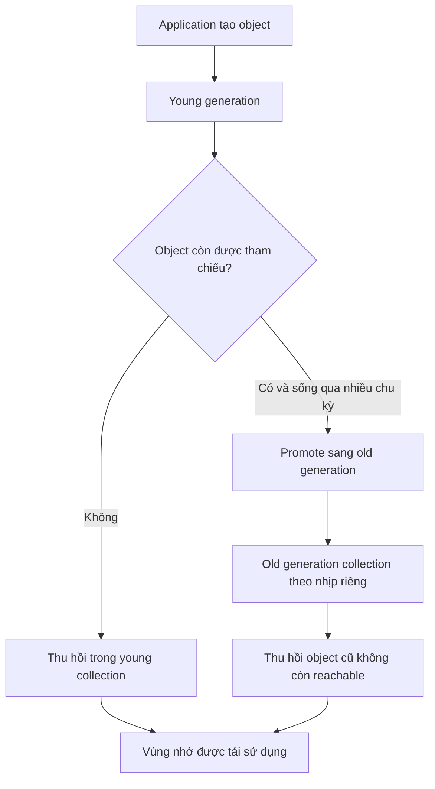

# Mục tiêu và trạng thái chính thức của Generational Shenandoah trong JDK 25

## 1. Vì sao Shenandoah cần chế độ generational?

Garbage Collector (GC) có nhiệm vụ thu hồi vùng nhớ của các object không còn được chương trình sử dụng. Trong nhiều ứng dụng Java, object được tạo ra với tốc độ cao nhưng phần lớn chỉ sống trong thời gian ngắn: object biểu diễn request, DTO, iterator, buffer tạm, kết quả mapping hoặc dữ liệu trung gian. Một phần nhỏ object tồn tại lâu hơn như cache, session, cấu hình và cấu trúc dùng chung.

Đó là **generational hypothesis**: trong nhiều workload, phần lớn object chết trẻ, còn một phần nhỏ sống lâu. GC generational tận dụng đặc điểm này bằng cách phân chia heap thành các vùng theo tuổi:

- **Young generation:** nơi chứa object mới tạo; được thu gom thường xuyên hơn.
- **Old generation:** nơi chứa object đã sống qua nhiều chu kỳ; được thu gom theo nhịp riêng, thường ít thường xuyên hơn.

Shenandoah vốn là GC concurrent, hướng tới pause time ngắn bằng cách thực hiện phần lớn công việc đánh dấu và di chuyển object đồng thời với application threads. Trước Generational Shenandoah, chế độ chính của collector là single-generation: GC xử lý heap theo một thế hệ. Khi bổ sung generational mode, Shenandoah có thể tập trung thu hồi object trẻ mà không phải thường xuyên xử lý toàn bộ dữ liệu sống lâu.

Mục tiêu của Generational Shenandoah là cải thiện **throughput bền vững, khả năng chịu các đợt tăng tải và mức sử dụng bộ nhớ**, trong khi tiếp tục duy trì đặc tính concurrent, pause thấp của Shenandoah. Đây là mục tiêu thiết kế; mức cải thiện thực tế phụ thuộc workload, heap, CPU headroom, allocation rate và cách ứng dụng giữ reference.



Bài học **“Mục tiêu và trạng thái chính thức của Generational Shenandoah trong JDK 25”** thuộc chương **Generational Shenandoah** của module `JAVA_VERSION_JAVA25`. Nội dung tập trung vào lý do ra đời, trạng thái chính thức trong JDK 25, cách bật chế độ, điểm khác biệt với Shenandoah single-generation và phương pháp xác minh bằng GC logs/benchmark.

Module Java 25 còn khảo sát compact source files, module import declarations, flexible constructor bodies, ScopedValue, Key Derivation Function API, AOT cache và JFR. Bài này tập trung vào Generational Shenandoah như một thay đổi runtime/GC; các hướng dẫn bên dưới chỉ sử dụng trạng thái và JVM options còn áp dụng trong JDK 25, đồng thời nhắc đến JDK 24 ở phần lịch sử để giải thích việc bỏ yêu cầu experimental unlock.

### Mục tiêu học tập

Sau bài học, bạn có thể:

1. Giải thích vì sao generational collection phù hợp với workload có nhiều object sống ngắn.
2. Phân biệt Shenandoah single-generation và Generational Shenandoah.
3. Trình bày mốc JEP 404 trong JDK 24 và JEP 521 trong JDK 25.
4. Bật Generational Shenandoah bằng các JVM flags hiện hành của JDK 25.
5. Hiểu vì sao chế độ generational không mặc định được bật chỉ vì đã có trong JDK 25.
6. Kiểm tra collector thực sự được kích hoạt và đọc GC logs theo cách hiện hành.
7. Thiết kế phép đo để so sánh pause, throughput, allocation, CPU và memory.
8. Nhận biết trường hợp workload không phù hợp hoặc bản phân phối JDK không cung cấp Shenandoah.

## 2. Trạng thái chính thức: JEP 404 và JEP 521

Generational Shenandoah có hai mốc quan trọng:

| JDK | JEP | Trạng thái | Ý nghĩa |
| --- | --- | --- | --- |
| JDK 24 | **JEP 404 — Generational Shenandoah (Experimental)** | Experimental feature | Đưa generational mode vào thử nghiệm để đánh giá tính đúng đắn và hiệu năng |
| JDK 25 | **JEP 521 — Generational Shenandoah** | Product feature | Nâng generational mode từ experimental lên product feature |

**Trong JDK 25, Generational Shenandoah là product feature, không còn là experimental feature.** Đây là điểm thay đổi quan trọng của bài học. Khi chạy JDK 25, không cần mở khóa experimental VM options để bật chế độ này.

JDK 24 là bối cảnh lịch sử cần biết khi nâng cấp. Cấu hình JDK 24 từng cần thêm `-XX:+UnlockExperimentalVMOptions`. Cấu hình hiện hành cho JDK 25 không cần flag đó:

```bash
java -XX:+UseShenandoahGC \
     -XX:ShenandoahGCMode=generational \
     -jar app.jar
```

Không tiếp tục mang `-XX:+UnlockExperimentalVMOptions` từ hướng dẫn JDK 24 sang cấu hình JDK 25 chỉ để bật Generational Shenandoah. Cấu hình production nên ghi rõ JDK vendor/build và xác nhận flags bằng chính runtime sẽ triển khai.

### 2.1. Product feature không có nghĩa là mặc định bật

JDK 25 đã nâng tính năng lên product status, nhưng Shenandoah vẫn không tự động chuyển sang generational mode trong mọi ứng dụng. Hai lựa chọn có ý nghĩa khác nhau:

- **Collector:** chọn Shenandoah bằng `-XX:+UseShenandoahGC`.
- **Mode:** chọn generational mode bằng `-XX:ShenandoahGCMode=generational`.

Nếu chỉ bật Shenandoah mà không chỉ định mode, chế độ mặc định vẫn là `satb`, tức Shenandoah single-generation. Product status có nghĩa tính năng được hỗ trợ như một product option; nó không có nghĩa tất cả JDK distributions đều phải bật nó mặc định.

### 2.2. Khả năng có mặt tùy thuộc bản phân phối JDK

Shenandoah là một HotSpot garbage collector, nhưng không nên giả định mọi JDK vendor/build đều đóng gói cùng tập collector hoặc cùng cấu hình build. Trước khi đưa flags vào production:

1. Xác nhận JDK vendor, version và build.
2. Kiểm tra tài liệu/release notes của vendor về Shenandoah.
3. Chạy thử JVM với flags generational trên đúng runtime.
4. Kiểm tra startup log xác nhận collector được chọn.
5. Thực hiện benchmark trên cùng image/container sẽ triển khai.

Nếu runtime báo `Unrecognized VM option` hoặc collector không khả dụng, hãy kiểm tra build JDK trước khi sửa cấu hình ứng dụng. Việc JEP 521 là product feature trong OpenJDK 25 không bảo đảm một bản phân phối cụ thể đã biên dịch hoặc đóng gói Shenandoah.

## 3. Shenandoah single-generation và Generational Shenandoah

### 3.1. Shenandoah vẫn là concurrent collector

Generational mode không biến Shenandoah thành một GC dừng ứng dụng để thu gom toàn bộ heap. Các đặc điểm cốt lõi vẫn là:

- GC làm phần lớn công việc đồng thời với application threads.
- Shenandoah dùng cơ chế đánh dấu và evacuation để thu hồi/di chuyển object.
- Pause vẫn tồn tại tại một số pha cần đồng bộ với application threads; concurrent không có nghĩa là không có pause.
- Chi phí CPU và memory cho GC vẫn phải được tính trong capacity planning.

Điểm thay đổi nằm ở cách tổ chức heap và chọn phạm vi thu gom theo tuổi object.

### 3.2. Single-generation mode

Mode `satb` là chế độ single-generation. Trong chế độ này, Shenandoah không chia heap thành young và old generation để thực hiện chu kỳ thu gom riêng theo thế hệ.

```text
Shenandoah mode = satb

Heap
+------------------------------------------------------+
|                  One generation                     |
|       Object mới và object sống lâu cùng vùng       |
+------------------------------------------------------+
```

Single-generation có thể là baseline tốt nếu workload của ứng dụng không hưởng lợi rõ từ phân thế hệ, hoặc nếu đội vận hành đã có cấu hình/benchmark ổn định với Shenandoah hiện tại.

### 3.3. Generational mode

Generational mode chia heap thành young và old generation. Object mới thường bắt đầu ở young; object còn sống qua nhiều lần thu gom có thể được promote sang old. Young collection tập trung vào object trẻ. Old generation có chu kỳ và heuristic riêng để xử lý object sống lâu.

```text
Shenandoah mode = generational

Heap
+---------------------------+--------------------------+
|      Young generation     |      Old generation     |
|  Object mới / sống ngắn   |  Object sống lâu hơn    |
|  Thu gom thường xuyên hơn |  Thu gom theo nhịp riêng|
+---------------------------+--------------------------+
```

Một điểm kỹ thuật cần hiểu: object ở old generation vẫn có thể tham chiếu đến object ở young generation. GC cần theo dõi các quan hệ tham chiếu liên thế hệ để không bỏ sót object còn reachable. Generational collector sử dụng remembered-set/barrier mechanisms phù hợp để tìm những tham chiếu liên quan khi thu gom young generation.

Không nên hiểu đơn giản rằng “old generation không bao giờ được quét khi young GC chạy” hoặc “mọi object tồn tại sau một lần GC lập tức thành old”. Việc phân loại, promotion và chu kỳ thu gom do implementation và heuristic của collector quản lý.

### 3.4. So sánh hai mode

| Khía cạnh | `satb` (single-generation) | `generational` |
| --- | --- | --- |
| Phân chia heap theo tuổi | Không | Có young và old |
| Trọng tâm thu gom | Heap theo một thế hệ | Có thể tập trung vào young generation |
| Object sống ngắn | Thu gom trong chu kỳ single-generation | Có cơ hội được thu hồi qua young collections |
| Object sống lâu | Cùng heap generation | Được giữ trong old generation sau promotion |
| Remembered set giữa generations | Không cần theo mô hình young/old | Cần theo dõi tham chiếu old-to-young |
| Heuristics | Có các lựa chọn theo runtime | Chỉ hỗ trợ `adaptive` trong generational mode |
| JVM option | `-XX:ShenandoahGCMode=satb` hoặc để mặc định | `-XX:ShenandoahGCMode=generational` |

Không có mode nào tốt hơn trong mọi ứng dụng. Generational mode đặc biệt đáng thử khi ứng dụng có allocation rate cao, phần lớn object chết trẻ và old live set tương đối ổn định. Với workload giữ phần lớn object lâu dài hoặc có nhiều mutation/reference phức tạp, lợi ích có thể nhỏ hơn và cần benchmark.

## 4. Mô hình hoạt động ở mức khái niệm

### 4.1. Young collection

Khi young generation cần thu gom, collector xác định các object còn reachable trong phạm vi young generation và những object trẻ được tham chiếu từ vùng khác. Object không còn reachable có thể được thu hồi; object còn sống có thể tiếp tục ở young hoặc được promote theo quy tắc của collector.

Mục tiêu là tránh phải xử lý toàn bộ old live set trong mọi chu kỳ thu gom object trẻ.

### 4.2. Old generation collection

Old generation chứa các object sống lâu hơn. Nó có thể được đánh dấu và thu gom theo chu kỳ riêng khi heuristic xác định cần thiết. Nếu old generation tăng nhanh, ứng dụng có thể vẫn chịu chi phí lớn từ các chu kỳ old/global hoặc full GC. Generational mode không loại bỏ nhu cầu quản lý old live set.

### 4.3. Promotion và tham chiếu liên thế hệ

Một object trẻ có thể sống lâu và được promote. Khi object old giữ reference đến object young, collector phải biết vùng old nào có tham chiếu cần xét trong young collection. Đây là lý do generational GC cần các cơ chế ghi nhận/duy trì remembered set và write barriers.

Những cơ chế này có chi phí: thêm công việc khi ứng dụng ghi reference, thêm metadata và thao tác GC. Vì vậy, lợi ích từ việc thu gom young generation phải được cân bằng với chi phí barriers và quản lý thế hệ.

### 4.4. Pause vẫn cần được đo

Shenandoah thực hiện nhiều công việc đồng thời, nhưng vẫn có các pha pause/safepoint. Khi đánh giá Generational Shenandoah, hãy đo:

- Pause duration và phân phối p50/p95/p99/max.
- Tổng thời gian GC và tỷ lệ CPU dành cho GC.
- Young, old, mixed hoặc full/global collection events theo log của build.
- Degenerated/full GC và nguyên nhân nếu xuất hiện.
- Allocation rate, promotion và live-set growth.
- Application latency trong lúc GC đang chạy.

Đừng chỉ nhìn vào giá trị pause trung bình. Một hệ thống có pause trung bình thấp nhưng thỉnh thoảng xuất hiện pause rất dài vẫn có thể vi phạm latency SLO.

## 5. Cấu hình Generational Shenandoah trong JDK 25

### 5.1. Hai JVM flags cần biết

Cấu hình cơ bản:

```bash
java -XX:+UseShenandoahGC \
     -XX:ShenandoahGCMode=generational \
     -jar app.jar
```

Ý nghĩa:

| Flag | Vai trò |
| --- | --- |
| `-XX:+UseShenandoahGC` | Chọn Shenandoah làm garbage collector |
| `-XX:ShenandoahGCMode=generational` | Chọn generational mode của Shenandoah |
| `-XX:ShenandoahGCMode=satb` | Chọn single-generation mode; đây là mode mặc định |
| `-XX:ShenandoahGCHeuristics=adaptive` | Chọn heuristic adaptive; đây là lựa chọn mặc định và là heuristic được hỗ trợ trong generational mode |

Trong generational mode, không tự đặt heuristic `static` hoặc `compact`. Tài liệu launcher của OpenJDK mô tả generational mode chỉ hỗ trợ heuristic mặc định `adaptive`. Hãy để collector tự quản lý heuristic trừ khi có tài liệu cụ thể của build đang dùng cho phép lựa chọn khác.

### 5.2. Xác nhận JDK có Shenandoah

Trước khi khởi chạy ứng dụng, kiểm tra trên đúng JDK 25:

```bash
java --version

java -XX:+UseShenandoahGC \
     -XX:ShenandoahGCMode=generational \
     -Xlog:gc \
     -version
```

Lệnh thứ hai tạo một JVM ngắn để xác nhận runtime chấp nhận flags và chọn Shenandoah. Nó không thay thế kiểm tra ứng dụng production, nhưng giúp phát hiện sớm JDK build không có collector hoặc không hỗ trợ mode.

Khi ứng dụng đang chạy, có thể xem flags và command line của process:

```bash
jcmd <pid> VM.command_line
jcmd <pid> VM.flags
```

Đối chiếu thông tin này với startup logs. Đừng chỉ dựa vào file cấu hình hoặc biến môi trường: launcher, container entrypoint hay framework script có thể ghi đè JVM options.

### 5.3. Bật unified GC logging

JDK hiện đại sử dụng Unified Logging. Một cấu hình chẩn đoán có rotation:

```bash
java -XX:+UseShenandoahGC \
     -XX:ShenandoahGCMode=generational \
     -Xlog:gc*:file=logs/gc.log:time,uptime,level,tags:filecount=5,filesize=20M \
     -jar app.jar
```

`-Xlog:gc*` thu thập các nhóm log GC phù hợp; decorators ghi thời gian, uptime, level và tags. Rotation giúp giới hạn dung lượng file trên service chạy lâu.

Trong giai đoạn điều tra, có thể tăng chi tiết cho các quyết định heuristic:

```bash
-Xlog:gc*=debug
```

Mức debug tạo thêm log và có thể tăng overhead/I/O. Chỉ bật trong một lượt chẩn đoán có kiểm soát; dùng mức phù hợp với chính sách logging của môi trường.

Không lấy các cờ GC logging cũ như `-XX:+PrintGCDetails`, `-XX:+PrintGCDateStamps` hoặc `-verbose:gc` làm cấu hình mới cho JDK 25. Dùng Unified Logging để có selector, level, output và rotation nhất quán.

### 5.4. Kiểm tra mode thực tế

Một cấu hình có thể bị bỏ qua hoặc không chạy như dự kiến nếu:

- JDK vendor/build không có Shenandoah.
- JVM command line thiếu `-XX:+UseShenandoahGC`.
- Một script khởi động khác thêm collector flag hoặc mode flag.
- Container đang chạy một JDK khác với JDK ở bước build.
- Log bạn xem thuộc process khác hoặc container khác.

Hãy ghép ba nguồn: `VM.command_line`, `VM.flags` và GC startup logs của đúng PID. Chỉ đưa kết quả vào benchmark generational sau khi xác nhận mode đã được chọn.

## 6. Đọc GC logs để nhận biết hoạt động generational

### 6.1. Đọc chu kỳ GC thay vì chỉ đếm số lần

Khi xem log, phân biệt:

- **Young collection:** thu gom young generation.
- **Old generation cycle:** xử lý object sống lâu ở old generation.
- **Mixed/combined work:** các hoạt động có phạm vi liên quan đến nhiều thế hệ theo implementation/log của build.
- **Degenerated GC:** collector phải chuyển sang một đường xử lý có nhiều công việc đồng bộ hơn khi chu kỳ concurrent không thể hoàn tất theo kế hoạch.
- **Full GC:** chu kỳ thu gom toàn cục; cần tìm nguyên nhân và đánh giá ảnh hưởng latency.

Tên phase và cách ghi log có thể thay đổi giữa các build. Dựa vào tags, phase names và release documentation của JDK đang chạy; không hard-code parser vào một chuỗi log đơn lẻ.

### 6.2. Ví dụ câu hỏi khi đọc log

| Dấu hiệu | Câu hỏi cần trả lời |
| --- | --- |
| Young GC xảy ra dày | Allocation rate có cao? Young collection có thu hồi được nhiều object không? |
| Promotion tăng | Object sống lâu hơn dự kiến hay young generation đang chịu áp lực? |
| Old generation tăng liên tục | Cache/session/object graph có giữ reference lâu? |
| Concurrent cycle kéo dài | CPU headroom, memory bandwidth hoặc live set có đủ cho GC hoàn thành? |
| Degenerated/full GC xuất hiện | Điều kiện nào khiến concurrent cycle không hoàn tất? Có áp lực allocation hoặc thiếu vùng trống? |
| Pause p99 tăng | Pha pause nào trùng với latency spike? Có lock, safepoint hoặc I/O khác không? |
| CPU GC tăng | Phần CPU bổ sung có đổi lấy throughput/latency phù hợp không? |

Đừng kết luận generational mode thất bại chỉ vì số chu kỳ young GC tăng. Young collection có thể xảy ra thường xuyên hơn và mỗi chu kỳ làm ít công việc hơn. Cần xem tổng thời gian GC, pause distribution, throughput, promotion và memory pressure cùng nhau.

### 6.3. Kết hợp GC log với JFR và application metrics

GC logs cho biết chu kỳ và phase; JFR cung cấp timeline và sự kiện JVM; application metrics cho biết người dùng thực sự cảm nhận gì. Một lần điều tra nên liên kết:

- GC pause timestamps và duration.
- Request latency p50/p95/p99, timeout và error rate.
- Allocation rate, heap occupancy và live-set size.
- CPU utilization, throttling và GC worker activity.
- Thread contention, blocking I/O và safepoint.
- Tốc độ tăng của old generation và số lần full/degenerated GC.

Một pause ngắn không đảm bảo request latency thấp nếu thread ứng dụng bị CPU throttling hoặc chờ database. Ngược lại, request p99 tăng trong lúc GC concurrent chạy không nhất thiết do stop-the-world pause; hãy kiểm tra CPU contention và memory bandwidth.

## 7. Khi nào nên cân nhắc Generational Shenandoah?

### 7.1. Workload có nhiều object sống ngắn

Generational mode đáng được benchmark nếu ứng dụng có:

- Request volume lớn, tạo nhiều DTO, collection và object trung gian.
- Serialization/deserialization hoặc mapping tạo nhiều object tạm.
- Allocation burst theo batch hoặc traffic spike.
- Old live set tương đối ổn định so với lượng object ngắn hạn.
- Yêu cầu pause thấp và ứng dụng còn CPU headroom cho concurrent GC.

Các đặc điểm này chỉ là tín hiệu để thử nghiệm. Chúng không tự chứng minh generational mode sẽ nhanh hơn trong ứng dụng cụ thể.

### 7.2. Workload có thể ít hưởng lợi

Cần thận trọng nếu:

- Phần lớn heap là object sống lâu hoặc cache lớn.
- Ứng dụng có allocation rate thấp, GC không phải bottleneck.
- CPU đã bị giới hạn chặt hoặc thường xuyên throttling.
- Memory bandwidth là tài nguyên khan hiếm.
- Ứng dụng có reference mutation dày đặc và chi phí barrier trở nên đáng kể.
- Heap quá nhỏ hoặc live set chiếm gần hết heap, khiến GC thiếu khoảng trống để vận hành hiệu quả.

Với workload không bị GC chi phối, đổi collector có thể tăng độ phức tạp vận hành mà không cải thiện SLO. Giữ collector hiện tại làm baseline và chỉ chuyển khi benchmark cho thấy lợi ích rõ.

### 7.3. Chọn GC theo SLO và chi phí hệ thống

| Mục tiêu | Câu hỏi khi lựa chọn |
| --- | --- |
| Pause thấp | p99/max pause có nằm trong SLO không? |
| Throughput | Tổng request/second có tăng hoặc giữ nguyên dưới cùng tài nguyên không? |
| CPU efficiency | GC dùng bao nhiêu CPU cho mỗi request? |
| Memory footprint | Heap, RSS và container memory có nằm trong giới hạn? |
| Load spike resilience | Khi allocation tăng đột ngột, latency/error rate biến động ra sao? |
| Operational simplicity | Log, alert, runbook và tuning có đủ rõ để vận hành không? |

Không chọn GC chỉ theo nhãn “low pause” hoặc “generational”. Một collector có pause thấp nhưng tiêu thụ quá nhiều CPU có thể làm throughput của toàn hệ thống giảm khi container chỉ được cấp ít core.

## 8. Benchmark để quyết định có chuyển sang generational hay không

### 8.1. So sánh tối thiểu ba cấu hình

Với một ứng dụng đang dùng GC khác, nên có ít nhất ba nhóm kết quả:

| Nhóm | Cấu hình | Mục đích |
| --- | --- | --- |
| A | Collector đang chạy trong production, ví dụ G1 | Baseline thực tế |
| B | Shenandoah single-generation | Đo riêng tác động khi chuyển sang Shenandoah |
| C | Shenandoah generational | Đo lợi ích của việc chia heap theo thế hệ |

Nếu ứng dụng đã dùng Shenandoah, so sánh B và C trên cùng JDK/build giúp cô lập tác động của generational mode. Nếu đang dùng G1, chỉ so sánh A và C sẽ không cho biết khác biệt đến từ collector hay từ generational mode.

Cấu hình minh họa cho hai mode Shenandoah:

```bash
# Baseline Shenandoah single-generation
java -Xms4g -Xmx4g \
     -XX:+UseShenandoahGC \
     -XX:ShenandoahGCMode=satb \
     -Xlog:gc*:file=logs/shenandoah-satb.log:time,uptime,level,tags \
     -jar app.jar

# Generational Shenandoah
java -Xms4g -Xmx4g \
     -XX:+UseShenandoahGC \
     -XX:ShenandoahGCMode=generational \
     -Xlog:gc*:file=logs/shenandoah-generational.log:time,uptime,level,tags \
     -jar app.jar
```

Các giá trị heap và tên file chỉ là ví dụ. Dùng cùng heap sizing, JDK vendor/build, CPU quota, memory limit, application artifact, JVM flags còn lại và dependency state trong các lần chạy.

### 8.2. Chuẩn hóa workload

Một benchmark có ý nghĩa cần cố định:

- Request mix, payload, dataset và tỷ lệ đọc/ghi.
- Concurrency hoặc offered request rate.
- Số lượng object được tạo trong mỗi thao tác.
- Tỷ lệ object ngắn hạn so với object được giữ lâu.
- Trạng thái cache ứng dụng, connection pool và database.
- Thời gian warm-up và cửa sổ đo.
- CPU quota, memory limit, số core và môi trường chạy.

Nên có nhiều kịch bản: workload bình thường, allocation-heavy, tải tăng đột ngột và workload có old live set lớn. Một benchmark chỉ tạo nhiều object tạm có thể thiên vị generational mode; một benchmark giữ object lâu dài có thể cho thấy chi phí ở old generation.

### 8.3. Đo nhiều hơn pause time

| Nhóm chỉ số | Chỉ số cần lưu |
| --- | --- |
| Pause | p50/p95/p99/max, tổng thời gian stop-the-world |
| Throughput | Requests/second hoặc transactions/second |
| Latency | Application p50/p95/p99, timeout và error rate |
| GC work | Tổng thời gian GC, số chu kỳ young/old/full/degenerated |
| Allocation | Bytes/second, allocation rate, object lifetime |
| Heap | Used/committed, live set sau GC, young/old occupancy nếu log cung cấp |
| CPU | Process CPU, GC CPU, CPU throttling |
| Memory | RSS, container memory, native memory và heap |
| Stability | Số lần full/degenerated GC, OOM và latency spike |

Đặc biệt, không coi “pause ngắn hơn” là thắng nếu throughput giảm mạnh hoặc application p99 xấu đi do concurrent GC tranh CPU với request threads.

### 8.4. Lặp lại và báo cáo phân phối

Quy trình thực tế:

1. Dùng cùng binary và cùng JDK build cho các biến thể.
2. Chạy warm-up theo cùng kịch bản.
3. Luân phiên thứ tự cấu hình để giảm thiên lệch do nhiệt độ, background load và page cache.
4. Lặp lại nhiều lần trên máy đại diện production.
5. Lưu từng sample và log đầy đủ; báo median cùng spread.
6. Báo p95/p99/max, không chỉ trung bình.
7. Ghi lại mọi lần full/degenerated GC và error/timeout.
8. Lặp lại với tải bình thường và tải đỉnh.

Không lấy một lần chạy nhanh nhất làm bằng chứng. Nếu kết quả khác nhau lớn giữa các lần chạy, hãy tìm nguyên nhân môi trường hoặc workload trước khi chọn GC.

## 9. Dùng JFR để điều tra GC và tác động đến ứng dụng

### 9.1. Bắt đầu recording

Có thể bật JFR khi khởi động JVM:

```bash
java -XX:+UseShenandoahGC \
     -XX:ShenandoahGCMode=generational \
     -XX:StartFlightRecording=filename=shenandoah.jfr,settings=profile,dumponexit=true \
     -jar app.jar
```

`profile` thu thập nhiều dữ liệu hơn `default` và có thể tạo overhead. Dùng cùng settings khi so sánh hai cấu hình; chạy benchmark chính thêm một lượt không bật JFR để kiểm tra kết quả không bị ảnh hưởng bởi recording.

### 9.2. Ghi trên JVM đang chạy

Dùng `jcmd` để bắt đầu recording có thời hạn:

```bash
jcmd <pid> JFR.start name=Shenandoah settings=profile \
     duration=3m filename=shenandoah-runtime.jfr
jcmd <pid> JFR.check
```

Sau khi recording hoàn tất:

```bash
jfr summary shenandoah-runtime.jfr
jfr print --categories GC shenandoah-runtime.jfr
```

Có thể mở file JFR bằng Java Mission Control để xem timeline, GC phases, allocation, thread activity và các sự kiện liên quan.

### 9.3. Ghép JFR với request metrics

Khi p99 tăng, đối chiếu timestamp giữa:

- GC pause và GC concurrent phases.
- CPU utilization và throttling.
- Allocation spike và promotion.
- Thread scheduling/contended locks.
- Request latency, timeout và error rate.
- Database/network latency.

Nếu request chậm trong khi GC đang concurrent, chưa thể kết luận pause là nguyên nhân. GC có thể đang dùng CPU hoặc memory bandwidth khiến application threads chậm lại; cũng có thể request đang chờ DB hoặc lock. JFR và metrics của ứng dụng giúp phân biệt các trường hợp này.

## 10. Chẩn đoán lỗi và tình huống vận hành

| Triệu chứng | Nguyên nhân có thể | Hướng xử lý |
| --- | --- | --- |
| `Unrecognized VM option` với Shenandoah flags | JDK build không cung cấp collector hoặc dùng runtime khác | Xác nhận vendor/version/build; thử flags trên đúng runtime |
| JVM vẫn dùng GC khác | Thiếu `UseShenandoahGC`, options bị override hoặc log thuộc process khác | Kiểm tra `VM.command_line`, `VM.flags` và startup logs |
| Generational mode không khởi động | Mode flag sai hoặc build không hỗ trợ | Kiểm tra chính tả, vendor release notes và command line |
| Heuristic flag bị từ chối | Generational mode chỉ hỗ trợ `adaptive` | Bỏ cấu hình `static`/`compact`; dùng heuristic mặc định |
| Không thấy young collection trong log | Mode chưa được bật, workload không tạo đủ áp lực hoặc đang xem sai process | Xác nhận mode và kiểm tra log của đúng PID |
| Young GC xảy ra rất thường xuyên | Allocation rate cao hoặc young generation chịu áp lực | Kiểm tra allocation profile, promotion và tổng GC CPU |
| Old generation tăng liên tục | Live set lớn, cache/session giữ reference hoặc promotion cao | Phân tích object retention và old generation occupancy |
| Full/degenerated GC xuất hiện | Concurrent cycle không hoàn tất hoặc heap pressure cao | Đọc phase log, allocation rate, free space và CPU headroom |
| Pause thấp nhưng p99 request xấu | Concurrent GC cạnh tranh CPU/memory bandwidth hoặc bottleneck ngoài GC | Ghép JFR, CPU throttling, thread và dependency metrics |
| CPU tăng sau khi chuyển mode | Barrier/GC work tăng hoặc workload không phù hợp | So CPU/request và throughput; chạy lại benchmark có kiểm soát |
| Container OOM dù heap chưa chạm Xmx | Native memory, thread stacks, direct buffers hoặc container limit | Theo dõi RSS/cgroup và native memory, không chỉ heap |
| Kết quả thay đổi nhiều giữa các lần chạy | Host noise, workload không ổn định hoặc benchmark quá ngắn | Luân phiên runs, cố định offered load và tăng số lần lặp |

### 10.1. Không tùy tiện tăng heap để che lỗi

Tăng `-Xmx` có thể tạo thêm headroom nhưng cũng tăng memory footprint và có thể làm thay đổi hành vi GC. Trước khi tăng heap, xác định:

- Live set thực tế sau GC.
- Tốc độ allocation và promotion.
- Old generation có tăng liên tục hay không.
- Container có đủ memory ngoài heap không.
- Concurrent GC có đủ CPU để hoàn thành không.

Heap lớn hơn không tự sửa object retention hoặc leak. Nếu live set tăng theo thời gian, hãy điều tra references và lifecycle của cache/session trước khi thay đổi GC flags.

### 10.2. Không gọi System.gc() để ép benchmark

Benchmark cần phản ánh hành vi của collector dưới workload thật. Gọi `System.gc()` theo chu kỳ có thể làm thay đổi nhịp thu gom và khiến kết quả không đại diện production. Nếu cần một phép đo diagnostic về live set, thực hiện riêng và ghi rõ điều kiện; không trộn kết quả đó vào benchmark throughput/latency.

## 11. Tình huống thực hành: đánh giá Generational Shenandoah cho API đơn hàng

### 11.1. Bối cảnh

Một service xử lý đơn hàng có các đặc điểm:

- Request volume thay đổi mạnh theo giờ.
- Mỗi request tạo nhiều DTO, object validation, collection và kết quả serialization.
- Một số object được giữ lâu trong cache và session.
- SLO yêu cầu p99 latency thấp, nhưng container có giới hạn CPU và memory.
- Đội vận hành muốn giảm GC pressure trong giờ cao điểm.

Đây là workload đáng thử Generational Shenandoah vì có thể tồn tại nhiều object sống ngắn cùng một nhóm object sống lâu. Tuy nhiên, phải đo thực tế để xác định phần allocation được thu hồi sớm có đủ bù cho chi phí generational barriers và concurrent GC hay không.

### 11.2. Quy trình thực hiện

1. Ghi lại JDK vendor/build, application image digest, heap, CPU quota, memory limit và cấu hình hiện tại.
2. Chạy baseline với collector production hiện tại, lưu GC logs, JFR và request metrics.
3. Chạy Shenandoah single-generation với cùng binary, heap và workload.
4. Chạy Generational Shenandoah với cùng điều kiện; xác nhận startup log và VM flags.
5. Chạy warm-up giống nhau, sau đó phát tải bình thường và tải đỉnh.
6. So sánh p95/p99/max latency, throughput, CPU/request, GC CPU, pause và memory.
7. Phân tích young collection, promotion, old generation growth và full/degenerated GC.
8. Chỉ triển khai canary nếu kết quả đáp ứng SLO, ổn định qua nhiều lần chạy và có rollback plan.

### 11.3. Ví dụ launch command cho staging

```bash
java -Xms4g -Xmx4g \
     -XX:+UseShenandoahGC \
     -XX:ShenandoahGCMode=generational \
     -Xlog:gc*:file=logs/orders-generational.log:time,uptime,level,tags:filecount=5,filesize=20M \
     -XX:StartFlightRecording=filename=orders-generational.jfr,settings=default,dumponexit=true \
     -jar orders-service.jar
```

Dùng `settings=default` cho recording có overhead thấp hơn; nếu cần điều tra sâu, có thể chạy một lượt riêng với `settings=profile`. Không dùng số liệu từ một lượt JFR profile nặng làm kết quả benchmark duy nhất.

### 11.4. Diễn giải kết quả

| Kết quả quan sát | Cách diễn giải |
| --- | --- |
| Young collections tăng nhưng tổng GC CPU giảm | GC đang thu gom object trẻ theo chu kỳ nhỏ hơn; kiểm tra throughput và pause để xác nhận lợi ích |
| Pause p99 giảm, throughput giữ nguyên | Có thể là cải thiện phù hợp nếu memory và error rate vẫn trong giới hạn |
| Pause thấp nhưng CPU/request tăng mạnh | Concurrent GC có thể đang tranh CPU với application threads |
| Promotion và old occupancy tăng | Object tồn tại lâu hơn dự kiến hoặc allocation pattern làm old generation tăng |
| Full/degenerated GC xuất hiện | Điều tra nguyên nhân; không chỉ nhìn pause của young collections |
| p99 tăng nhưng pause không tăng | Kiểm tra CPU throttling, concurrent GC work, lock và dependency latency |
| Không có khác biệt đáng kể | Workload có thể không hưởng lợi; giữ cấu hình đơn giản hơn nếu SLO đã đạt |

Không đặt mục tiêu “Generational Shenandoah phải nhanh hơn X phần trăm”. Mục tiêu hợp lý là đáp ứng SLO với chi phí CPU/memory có thể chấp nhận, dựa trên dữ liệu của ứng dụng thật.

### Bài tập tự thực hành

1. Giải thích vì sao workload tạo nhiều object ngắn hạn có thể hưởng lợi từ young collection.
2. Chạy cùng một ứng dụng với Shenandoah `satb` và `generational`, lưu GC logs của cả hai.
3. Xác định trong log có young/old activity hay không; đối chiếu với mode thực tế trong `VM.flags`.
4. Tạo một workload có cache lớn và object sống lâu, rồi so sánh với workload request tạo nhiều object tạm.
5. Ghi JFR trong một lượt staging và tìm mối quan hệ giữa GC, allocation, CPU và p99 request.
6. Viết một đề xuất rollout nêu rõ lợi ích đo được, rủi ro, ngưỡng rollback và điều kiện tạo lại benchmark sau khi nâng JDK.

### Câu hỏi tự đánh giá

1. Generational hypothesis mô tả đặc điểm vòng đời object nào?
2. Shenandoah được thiết kế để giảm loại chi phí nào của GC?
3. JEP 404 và JEP 521 khác nhau ở trạng thái tính năng ra sao?
4. Vì sao Generational Shenandoah là product feature trong JDK 25 nhưng không tự bật mặc định?
5. Hai JVM flags chính để bật Generational Shenandoah là gì?
6. Mode `satb` khác mode `generational` ở cách tổ chức heap như thế nào?
7. Vì sao young collection vẫn phải xét reference từ old generation?
8. Heuristic nào được hỗ trợ trong generational mode của JDK 25?
9. Vì sao pause thấp không bảo đảm p99 request thấp?
10. Cần đo những chỉ số nào trước khi chuyển production?
11. Vì sao phải so sánh cả Shenandoah single-generation và generational mode?
12. Khi nào cần điều tra full/degenerated GC thay vì chỉ nhìn young collection?

## 12. Checklist và nguồn tham khảo

### 12.1. Checklist trước khi bật trong JDK 25

- [ ] Xác nhận JDK vendor, version và build.
- [ ] Xác nhận bản phân phối có Shenandoah.
- [ ] Dùng `-XX:+UseShenandoahGC` để chọn collector.
- [ ] Dùng `-XX:ShenandoahGCMode=generational` để chọn generational mode.
- [ ] Không thêm `-XX:+UnlockExperimentalVMOptions` chỉ để bật tính năng trong JDK 25.
- [ ] Xác nhận mode qua command line, VM flags và startup/GC logs.
- [ ] Không đặt heuristic `static` hoặc `compact` trong generational mode; giữ `adaptive`.
- [ ] Chạy smoke test và integration test trên đúng JDK/image production.

### 12.2. Checklist benchmark

- [ ] Có baseline production hiện tại.
- [ ] Có kết quả Shenandoah single-generation và Generational Shenandoah.
- [ ] Cố định binary, JDK, heap, CPU/memory quota và dependency state.
- [ ] Workload bao gồm object sống ngắn, object sống lâu và load spike.
- [ ] Báo p50/p95/p99/max latency, throughput, error rate và CPU/request.
- [ ] Báo GC pause, tổng GC CPU, young/old cycles, full/degenerated GC.
- [ ] Theo dõi allocation, promotion, old live set, heap và RSS/container memory.
- [ ] Lặp lại benchmark, luân phiên thứ tự và báo phân phối.
- [ ] Dùng JFR để điều tra nhưng có benchmark riêng không bật recording nặng.

### 12.3. Checklist production rollout

- [ ] Canary chỉ bật trên một nhóm instance có thể quan sát và rollback.
- [ ] GC logs được lưu với rotation và retention phù hợp.
- [ ] Dashboard có GC pause, p99, throughput, CPU, memory và error rate.
- [ ] Alert phát hiện full/degenerated GC, OOM và SLO regression.
- [ ] Runbook ghi rõ cách xác minh mode và cách quay lại collector baseline.
- [ ] Sau khi nâng JDK/vendor/build, chạy lại compatibility test và benchmark.
- [ ] Không áp dụng kết quả benchmark từ máy nhỏ hoặc staging khác cấu hình làm cam kết cho production.

### 12.4. Nguồn tham khảo

- [JEP 404 — Generational Shenandoah (Experimental)](https://openjdk.org/jeps/404): lịch sử đưa generational mode vào JDK 24 dưới dạng experimental.
- [JEP 521 — Generational Shenandoah](https://openjdk.org/jeps/521): nâng generational mode từ experimental lên product feature trong JDK 25.
- [OpenJDK 25 Release Notes — Generational Shenandoah](https://docs.redhat.com/en/documentation/red_hat_build_of_openjdk/25/html/release_notes_for_eclipse_temurin_25/openjdk25-features): flags bật generational mode và khác biệt với JDK 24.
- [OpenJDK 25 java launcher manual — Shenandoah options](https://man.archlinux.org/man/extra/jre25-openjdk-headless/java-openjdk25.1.en): mode `satb`/`generational` và heuristic `adaptive`.
- [OpenJDK Shenandoah Wiki](https://wiki.openjdk.org/display/shenandoah/Main): đặc tính collector, logging và tài liệu vận hành Shenandoah.
- [Red Hat Developer — A beginner's guide to the Shenandoah garbage collector](https://developers.redhat.com/articles/2024/05/28/beginners-guide-shenandoah-garbage-collector): nền tảng về concurrent Shenandoah, GC logs và cách tiếp cận chẩn đoán.

**Kết luận:** Generational Shenandoah được nâng từ experimental lên product feature trong JDK 25 qua JEP 521. Chế độ này kết hợp đặc tính concurrent, pause thấp của Shenandoah với cách thu gom young/old generation để tận dụng việc phần lớn object thường chết trẻ. Muốn bật, chọn Shenandoah và generational mode bằng các JVM flags hiện hành; không cần experimental unlock flag. Tuy nhiên, mode mặc định của Shenandoah vẫn là single-generation, và hiệu quả generational phải được xác minh bằng benchmark có kiểm soát trên đúng JDK vendor/build, workload và giới hạn tài nguyên của hệ thống.


