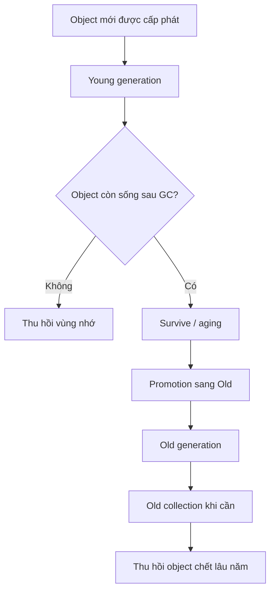

# Đọc log GC để đánh giá độ trễ, tốc độ cấp phát và áp lực heap

## 1. Mục tiêu: đọc log để hiểu ứng dụng đang chịu áp lực gì

**Generational Shenandoah** là chế độ thu gom rác theo thế hệ của Shenandoah GC, được hoàn thiện trong **JDK 25 qua JEP 521**. Nó tận dụng giả thuyết rằng phần lớn object có vòng đời ngắn: thu gom Young thường xuyên hơn và xử lý Old ít thường xuyên hơn, trong khi vẫn giữ phần lớn công việc GC chạy đồng thời với ứng dụng.

Trong module **JAVA_VERSION_JAVA25**, bài này hướng dẫn đọc log để trả lời ba câu hỏi vận hành:

1. **Độ trễ:** thời gian ứng dụng thực sự bị dừng vì GC là bao nhiêu? Có độ trễ do pacing hoặc concurrent work mà pause log không thể hiện không?
2. **Tốc độ cấp phát:** ứng dụng tạo object nhanh đến mức nào? Collector có theo kịp tốc độ đó không?
3. **Áp lực heap:** Young/Old còn đủ vùng trống để hấp thụ cấp phát và di chuyển object không? Live set có tăng dần hay heap chỉ đang dao động theo tải?

Một dòng log riêng lẻ hiếm khi đủ để kết luận. Hãy đọc theo chuỗi thời gian, kết hợp log GC với latency/throughput của ứng dụng, allocation metrics và giới hạn CPU/memory của môi trường.

**Phạm vi Java 25 cần nhớ:**

- JEP 521 đưa Generational Shenandoah thành tính năng **final** trong JDK 25; không cần tùy chọn preview hoặc mở khóa experimental VM options để bật chế độ này.
- Generational mode **chưa phải mặc định** trong JDK 25. Cần chỉ định tùy chọn ShenandoahGCMode là generational; chế độ mặc định vẫn là single-generation SATB.
- Chỉ một số bản phân phối JDK có Shenandoah. Hãy xác minh đúng runtime/vendor trước khi dùng; không suy ra mọi bản JDK đều có collector này.

## 2. Bật Generational Shenandoah và ghi log bằng Unified Logging

Ví dụ chạy ứng dụng JAR trên HotSpot JDK 25:

```bash
java \
  -Xms4g \
  -Xmx4g \
  -XX:+UseShenandoahGC \
  -XX:ShenandoahGCMode=generational \
  '-Xlog:gc*=info,gc+ergo=debug,gc+stats=info:file=shenandoah-gc.log:time,uptime,level,tags:filecount=5,filesize=20M' \
  -jar app.jar
```

Ý nghĩa các tùy chọn:

| Tùy chọn | Mục đích |
|---|---|
| -XX:+UseShenandoahGC | Chọn Shenandoah GC |
| -XX:ShenandoahGCMode=generational | Bật Young/Old generations trong JDK 25 |
| -Xms4g -Xmx4g | Đặt heap khởi đầu và giới hạn heap tối đa bằng nhau trong ví dụ để giảm biến động do co/giãn heap |
| -Xlog:gc*=info | Ghi sự kiện GC, các pha, heap và thông tin liên quan |
| -Xlog:gc+ergo=debug | Ghi quyết định heuristic và lý do kích hoạt chu kỳ |
| -Xlog:gc+stats=info | Ghi thống kê chu kỳ, phase timing, evacuation và allocation pacing |
| filecount=5,filesize=20M | Xoay vòng log, tránh file tăng không giới hạn |

-Xms bằng -Xmx là một cấu hình thử nghiệm dễ so sánh, không phải quy tắc bắt buộc cho mọi production workload. Nếu cần tối ưu footprint hoặc môi trường container có giới hạn bộ nhớ, hãy benchmark các cấu hình heap khác nhau.

### Xác minh runtime có hỗ trợ Shenandoah

Chạy:

```bash
java -XX:+UseShenandoahGC -XX:ShenandoahGCMode=generational -Xlog:gc -version
```

Trong log khởi động, kiểm tra JVM xác nhận đang dùng Shenandoah. Nếu báo tùy chọn không hợp lệ hoặc collector không khả dụng, hãy kiểm tra vendor/build JDK và platform. Không thêm tùy chọn experimental cũ chỉ để làm lệnh chạy được trên một JDK không hỗ trợ chế độ final.

## 3. Nhận diện các phần của một dòng log

Unified Logging của HotSpot có cấu trúc chung:

```text
[uptime][level][tags] nội dung thông báo
```

Ví dụ minh họa:

```text
[12.345s][info][gc,start] GC(42) Pause Init Mark
[12.346s][info][gc,phases] GC(42) Pause Init Mark 0.8ms
[12.347s][info][gc] GC(42) Concurrent marking ...
```

| Thành phần | Ý nghĩa |
|---|---|
| 12.345s | Thời gian từ khi JVM khởi động |
| info | Mức log |
| gc,start, gc,phases, gc,heap | Nhóm tag cho biết loại thông tin |
| GC(42) | ID của chu kỳ/sự kiện GC |
| Pause ... | Pha dừng ứng dụng (stop-the-world) |
| Concurrent ... | Pha collector chạy đồng thời với application threads |

Các tên phase và chi tiết format có thể thay đổi giữa các JDK build. Khi đọc log, ưu tiên ý nghĩa của phase và thời lượng thực tế thay vì phụ thuộc regex vào một chuỗi cố định.

**Quy tắc đầu tiên:** phân biệt thời gian **Pause** với thời gian **Concurrent**. Tổng thời gian một chu kỳ có thể dài hàng chục hoặc hàng trăm mili giây, nhưng application threads chỉ bị dừng ở các pause tương ứng. Các pha concurrent vẫn tiêu thụ CPU, băng thông bộ nhớ và có thể ảnh hưởng throughput/latency.

## 4. Generational Shenandoah tổ chức chu kỳ Young và Old ra sao?

Generational mode chia heap thành **Young generation** và **Old generation**:

- Object mới được cấp phát chủ yếu vào Young.
- Object sống sót qua các chu kỳ có thể được promotion sang Old.
- Young collection tập trung thu gom object mới, thường xuyên hơn.
- Old collection xử lý object sống lâu và có thể chạy song song với các chu kỳ Young.
- Có những thao tác toàn heap hoặc Full GC khi cần.



Khi đọc log:

- Nhiều Young cycles là hành vi bình thường nếu ứng dụng tạo nhiều object ngắn hạn.
- Old collection ít hơn Young collection là điều thường thấy, nhưng cần xem Old usage có được kiểm soát không.
- Young cycle có thể preempt old marking để xử lý yêu cầu Young. Một thông báo như Preempting old generation mark to allow Young GC tự nó không có nghĩa GC lỗi.
- Nếu Old usage tăng liên tục, old marking thường xuyên bị ngắt và cuối cùng xuất hiện allocation failure/degenerated/full GC, cần điều tra khả năng collector không theo kịp live-set growth hoặc allocation pressure.

Không áp dụng cách diễn giải log của G1 nguyên xi cho Shenandoah. Shenandoah có phase, generation và heuristic riêng.

## 5. Đọc pause time để đánh giá độ trễ do GC

Các pause thường gặp trong chu kỳ Shenandoah gồm:

- Pause Init Mark
- Pause Final Mark
- Pause Init Update Refs
- Pause Final Update Refs
- Các pause Degenerated hoặc Full GC khi collector phải chuyển sang đường xử lý dừng ứng dụng.

Đây là các điểm application threads có thể bị dừng. Để đánh giá latency:

1. Tính tổng thời gian các pause trong cửa sổ quan sát.
2. Xem pause count và phân bố duration, đặc biệt p95/p99/max.
3. Tìm pause bất thường trùng với spike của request latency.
4. Xác định pause đến từ phase nào và generation nào.
5. So sánh với cùng workload ở các lần chạy khác.

Ví dụ minh họa:

```text
Pause Init Mark        0.8 ms
Pause Final Mark       1.4 ms
Pause Init Update Refs 0.1 ms
Pause Final Update Refs 0.5 ms

Tổng pause trong chu kỳ: 2.8 ms
```

Các giá trị chỉ là ví dụ, không phải cam kết của Shenandoah.

**Không dùng pause time làm đại diện cho toàn bộ request latency.** Request có thể chậm do pacing, CPU contention, network, lock, scheduler hoặc concurrent GC work ngay cả khi các pause rất ngắn.

### Pause time không phải service p99

| Số liệu | Trả lời câu hỏi |
|---|---|
| GC pause p99 | 99% pause GC ngắn hơn hoặc bằng bao nhiêu |
| Request latency p99 | 99% request hoàn thành trong bao lâu |
| GC concurrent cycle duration | Collector cần bao lâu để hoàn thành công việc nền |
| End-to-end latency | Người dùng thực sự chờ bao lâu |

Cần đặt các biểu đồ cùng trục thời gian hoặc tương quan bằng uptime/timestamp. Không so sánh pause p99 với request p99 như thể chúng là cùng một metric.

## 6. Concurrent phase dài có luôn là vấn đề không?

Shenandoah thực hiện phần lớn marking, evacuation và update references đồng thời với ứng dụng. Vì vậy một chu kỳ có thể kéo dài khá lâu mà pause vẫn thấp.

Các phase cần quan sát:

| Phase | Công việc | Dấu hiệu cần chú ý |
|---|---|---|
| Concurrent marking | Tìm object còn sống | Kéo dài khi live set lớn hoặc object graph phức tạp |
| Concurrent evacuation | Di chuyển object sống ra khỏi collection set | Tốn CPU/băng thông; có thể cạnh tranh với application |
| Concurrent update references | Sửa reference trỏ tới vị trí object mới | Phụ thuộc số object/reference cần xử lý |
| Concurrent cleanup | Thu hồi region đã trống | Ít pause nhưng cần theo dõi tiến độ thu hồi |

Một concurrent phase dài không tự động đồng nghĩa với lỗi. Hãy xem thêm:

- Phase có hoàn thành trước khi free space cạn không?
- GC cycles có chạy liên tiếp gần như không có khoảng nghỉ không?
- Allocation pacing có tăng không?
- Degenerated/Full GC có xuất hiện không?
- Throughput của ứng dụng có giảm khi concurrent work tăng không?

Nếu collector hoàn thành công việc nền đúng hạn và latency của ứng dụng vẫn đạt SLO, một chu kỳ concurrent dài có thể chấp nhận được.

## 7. Đọc heap occupancy: used, committed và maximum

Khi đọc log heap, cần phân biệt:

- **Used:** dung lượng đang được sử dụng bởi object/region.
- **Committed:** dung lượng heap đã được JVM commit và có thể dùng.
- **Maximum (Xmx):** giới hạn heap tối đa.
- **Free:** phần dung lượng còn có thể cấp phát trong phạm vi heap/region hiện tại.

Không đồng nhất committed với used hoặc Xmx. Heap có thể còn nhiều vùng đã commit nhưng đang trống; ngược lại, used cao không nhất thiết là memory leak.

### Ví dụ đọc before/after

```text
Heap before GC: 3.2 GB
Heap after GC:  2.1 GB
Committed:      4.0 GB
Maximum:        4.0 GB
```

Diễn giải: tại thời điểm được ghi, khoảng 1.1 GB usage đã được giải phóng hoặc trở thành vùng có thể tái sử dụng theo cách collector báo cáo. Khoảng 2.1 GB còn lại có thể là live data và các khoản usage/waste mà collector tính vào heap. Đây chưa phải bằng chứng leak.

**Lưu ý với Shenandoah:** heap usage có thể tăng trong concurrent marking/evacuation vì application vẫn tiếp tục cấp phát. So sánh before/after ở các mốc khác nhau phải xét cả công việc GC đang chạy và allocation diễn ra trong cùng khoảng thời gian.

## 8. Đánh giá áp lực Young và Old riêng biệt

Generational mode cho phép nhìn hai phần heap theo vòng đời object:

### Young generation

Theo dõi:

- Tần suất Young collection.
- Young usage trước/sau collection.
- Số object sống sót và promotion.
- Khoảng thời gian giữa các Young cycles.
- Tình trạng free space và pacing khi workload tăng.

Nếu Young collection diễn ra dày nhưng phần lớn object được thu hồi, đó có thể là ứng dụng có allocation rate cao nhưng object lifetime ngắn. Điều này không tự động là xấu; cần xem pacing và throughput.

### Old generation

Theo dõi:

- Old usage sau các old marking/collection.
- Xu hướng Old live data qua nhiều chu kỳ.
- Số lần old cycle bị preempt/cancel.
- Promotion từ Young sang Old.
- Allocation failure hoặc Full GC liên quan đến thiếu chỗ cho promotion/evacuation.

Một Old generation tăng dần qua nhiều chu kỳ có thể do cache, session, queue hoặc dữ liệu nghiệp vụ được giữ lâu hơn. Hãy so sánh sau các chu kỳ old hoàn tất, không chỉ đọc một snapshot giữa lúc concurrent marking.

## 9. Tốc độ cấp phát: đo gross allocation, không suy từ heap delta

**Allocation rate** là lượng object bytes ứng dụng cấp phát trong một đơn vị thời gian, thường biểu diễn bằng MB/s hoặc GB/s.

Công thức:

\[
\text{Allocation rate} =
\frac{\text{Bytes allocated trong khoảng đo}}
{\text{Thời lượng khoảng đo}}
\]

Ví dụ giả định: ứng dụng cấp phát 1.5 GB trong 30 giây:

\[
1.5 \text{ GB} / 30 \text{ s} = 51.2 \text{ MB/s}
\]

(Theo cách quy đổi 1 GB = 1024 MB.)

### Vì sao không thể lấy heap delta làm allocation rate chính xác?

Giả sử heap usage tăng từ 1.8 GB lên 2.2 GB trong 10 giây. Chênh lệch ròng là 0.4 GB, nhưng trong 10 giây đó:

- Application có thể cấp phát 2 GB object.
- GC có thể đồng thời thu hồi 1.6 GB object.
- Heap usage ròng chỉ tăng 0.4 GB.

Do đó:

\[
\text{Gross allocation} \ne \text{Heap usage}_{t2} - \text{Heap usage}_{t1}
\]

GC log giúp nhận biết collector phải làm việc thường xuyên đến đâu và pacing có xuất hiện không. Để đo gross allocation rate chính xác hơn, hãy bổ sung allocation counters/metrics của runtime hoặc instrumentation phù hợp; JFR allocation sampling hữu ích để tìm class cấp phát nhiều nhưng là dữ liệu sampling, không phải bộ đếm byte tuyệt đối.

### Cách dùng GC log để đánh giá gián tiếp

- Young cycles xuất hiện dày hơn khi traffic tăng: có thể allocation pressure đang tăng.
- Young usage tăng nhanh giữa hai lần thu gom: có thể Young đang được lấp nhanh.
- Pacing delay xuất hiện/tăng: mutator allocation đang tiến gần hoặc vượt tốc độ collector có thể xử lý.
- Old usage tăng sau nhiều chu kỳ: cần xem promotion và live-set growth.
- Degenerated/full GC tăng: có thể heap slack không đủ để hấp thụ allocation trong lúc concurrent GC chạy.

Không kết luận allocation rate chỉ từ số lượng GC cycles; heuristic và free space cũng ảnh hưởng thời điểm kích hoạt.

## 10. Pacing: độ trễ có thể bị ẩn khỏi pause log

Shenandoah có **allocation pacing** để điều tiết các thread cấp phát khi GC cần thêm thời gian hoàn thành công việc. Nếu collector thấy application đang tiêu thụ free space nhanh hơn tiến độ thu gom, pacer có thể làm chậm các allocation threads.

Điểm quan trọng:

- Pacing tác động lên từng thread cấp phát.
- Thời gian bị pacing không nhất thiết xuất hiện như một stop-the-world pause.
- Pacing có thể làm tăng request latency và end-to-end latency dù GC pause vẫn rất thấp.
- gc+stats có thể cung cấp thống kê pacing, gồm maximum pacing delay và histogram độ trễ thực tế tùy JDK build.

Ví dụ minh họa thống kê:

```text
ALLOCATION PACING:
Max pacing delay is set to 10 ms.

Actual pacing delays histogram:
From -       To          Count
1 ms         2 ms           87
2 ms         4 ms          142
4 ms         8 ms          297
8 ms        16 ms         1733
```

Các giá trị trên là ví dụ minh họa cách đọc histogram, không phải kết quả của ứng dụng cụ thể.

Nếu histogram có nhiều mẫu ở các bucket lớn, hãy kiểm tra:

- Allocation rate có tăng đột biến không?
- Concurrent GC có chạy back-to-back không?
- Heap có đủ free space để hấp thụ allocation trong khi collector làm việc không?
- Live set có quá lớn khiến marking/evacuation kéo dài không?
- Request latency có tăng đúng trong khoảng pacing xảy ra không?

**Không tăng ShenandoahPacingMaxDelay chỉ để làm giảm số Degenerated GC.** Tăng delay có thể khiến allocation threads bị chờ lâu hơn và chuyển latency từ STW pause sang mutator path. Hãy đo end-to-end latency trước khi thay đổi.

## 11. Degenerated GC và Full GC là dấu hiệu áp lực nghiêm trọng

Shenandoah có các mức suy giảm khi collector không theo kịp application allocation:

1. **Pacing:** điều tiết thread cấp phát để tạo thời gian cho GC.
2. **Degenerated GC:** nếu allocation failure xảy ra, collector có thể phải hoàn tất phần công việc còn lại trong một pha dừng ứng dụng.
3. **Full GC:** khi các bước trước không giải phóng đủ vùng nhớ, JVM có thể phải chạy Full GC để thu hồi/compact toàn heap.

Trong Generational Shenandoah, Young/Old degenerated cycles có thể nâng cấp lên Full GC; Full GC có thể được kích hoạt trực tiếp bởi yêu cầu GC tường minh hoặc bởi điều kiện cấp phát thất bại.

Bảng đánh giá:

| Quan sát | Ý nghĩa có thể có | Hành động điều tra |
|---|---|---|
| Không có Degenerated/Full GC | Collector đang xử lý được workload trong cửa sổ quan sát | Tiếp tục theo dõi SLO và pacing |
| Degenerated GC lẻ tẻ khi có allocation spike | Collector bị vượt trong một khoảng ngắn | Đối chiếu spike, heap slack và allocation rate |
| Degenerated GC lặp lại | Concurrent cycle thường không hoàn thành kịp | Kiểm tra live set, allocation pressure, CPU cạnh tranh |
| Full GC do allocation failure | Áp lực heap nghiêm trọng hoặc collector không kịp giải phóng vùng nhớ | Xem old/young usage, promotion, heap sizing và object retention |
| Full GC lặp lại | Có thể sắp cạn heap hoặc giữ live data quá lớn | Kiểm tra memory leak/retention, workload và cấu hình heap |

Không xem một Degenerated GC đơn lẻ là bằng chứng memory leak. Cần kết hợp tần suất, nguyên nhân, heap usage sau GC và xu hướng qua nhiều cửa sổ.

## 12. Đọc heuristic log để hiểu vì sao GC bắt đầu

gc+ergo giúp thấy quyết định heuristic: vì sao Young/Old cycle được yêu cầu, vì sao một old cycle bị preempt hoặc tại sao collector chọn đường xử lý khác.

Một số thông điệp có thể gặp:

- Start GC cycle (Young) hoặc thông điệp tương đương: bắt đầu chu kỳ Young.
- Thông báo bắt đầu Old cycle: collector chuyển sang xử lý old-generation marking/collection.
- Preempting old generation mark to allow Young GC: ưu tiên Young collection; tự nó không phải lỗi.
- Preparation for old generation cycle was cancelled: bước chuẩn bị Old bị dừng để xử lý yêu cầu khác.
- Thông báo allocation failure/degenerated/full: collector đã chuyển sang mức xử lý khẩn cấp hơn.

Hãy đọc thông điệp theo GC ID, timestamp/uptime và các phase cùng chu kỳ. Không dựa vào một dòng Preempting để kết luận Old generation bị lỗi; cần xem Old usage có tiếp tục tăng và collector có quay lại hoàn tất old work hay không.

## 13. Tương quan GC log với latency và throughput của ứng dụng

GC log không biết request nào đang chậm. Muốn kết luận GC ảnh hưởng tới người dùng, cần kết hợp:

- Request latency p50/p95/p99.
- Throughput/requests per second.
- Error rate và timeout.
- CPU utilization và CPU throttling của container.
- GC pause timeline, concurrent phase, pacing histogram.
- Heap used/committed và Young/Old usage.

### Quy trình tương quan

1. Dùng cùng mốc thời gian (timestamp hoặc uptime) cho GC log và application metrics.
2. Tìm cửa sổ request p99 tăng.
3. Xem có pause GC trùng thời điểm không.
4. Nếu pause thấp, kiểm tra pacing và concurrent GC CPU.
5. Nếu không có dấu hiệu GC, xem CPU quota, scheduler, network, database, lock và application queue.
6. Lặp lại với cùng workload để kiểm tra tính tái lập.

Ví dụ: p99 tăng từ 80 ms lên 500 ms trong khi GC pause lớn nhất chỉ 2 ms. Nếu cùng thời điểm gc+stats ghi nhận pacing delay lớn, có thể allocation threads bị điều tiết. Nếu không có pacing, cần tìm nguyên nhân khác; không nên đổ lỗi cho GC chỉ vì log có nhiều chu kỳ concurrent.

## 14. Tốc độ cấp phát và áp lực heap: một ma trận chẩn đoán

| Allocation rate | Live set / Old usage | Pacing / GC signals | Cách diễn giải |
|---|---|---|---|
| Cao | Thấp, ổn định | Ít pacing, không degenerated | Nhiều object ngắn hạn; collector có thể đang xử lý tốt |
| Cao | Tăng dần | Pacing tăng | Cấp phát cao và dữ liệu sống tăng; cần tìm allocation hot spots và retention |
| Cao | Cao, ổn định | Concurrent cycles liên tục | Collector phải làm việc liên tục để duy trì free space |
| Vừa phải | Cao, tăng qua nhiều old cycles | Old collection khó thu hồi | Có thể có object retention/cache/session tăng |
| Đột biến | Chưa tăng đáng kể | Pacing spike, một degenerated cycle | Allocation burst có thể vượt free-space slack tạm thời |
| Cao | Rất cao | Degenerated/Full GC lặp lại | Collector không theo kịp; kiểm tra heap sizing, live set và allocation pressure |

Đây là ma trận gợi ý điều tra, không phải luật xác định nguyên nhân duy nhất. Một hệ thống có thể đồng thời có allocation spike, CPU quota thấp và live set lớn.

## 15. Thực hành: đọc một cửa sổ log và đưa ra kết luận có căn cứ

### Bối cảnh

Ứng dụng API xử lý đơn hàng chạy trên JDK 25, heap tối đa 4 GB, bật Generational Shenandoah. Trong giờ cao điểm, request p99 tăng từ 90 ms lên 420 ms.

### Bước 1 — Thu log đủ chi tiết

```bash
java \
  -Xms4g -Xmx4g \
  -XX:+UseShenandoahGC \
  -XX:ShenandoahGCMode=generational \
  '-Xlog:gc*=info,gc+ergo=debug,gc+stats=info:file=shenandoah-gc.log:time,uptime,level,tags:filecount=5,filesize=20M' \
  -jar orders-api.jar
```

### Bước 2 — Lập timeline

Với từng chu kỳ, ghi timestamp/uptime và GC ID, Young/Old/Global cycle, các pause và duration, concurrent phase duration, heap usage trước/sau, pacing histogram và Degenerated/Full GC cùng nguyên nhân.

### Bước 3 — Đối chiếu application metrics

Tạo bảng theo cùng cửa sổ 30 hoặc 60 giây:

| Cửa sổ | Request p99 | Max GC pause | Pacing | Young/Old usage | Degenerated/Full |
|---|---:|---:|---|---|---|
| Bình thường | 90 ms | 1.2 ms | Gần 0 | Ổn định | 0 / 0 |
| Cao điểm | 420 ms | 1.8 ms | Bucket 8–16 ms tăng | Old tăng | 1 / 0 |

Số liệu chỉ là giả định minh họa.

### Bước 4 — Viết kết luận đúng mức

Từ bảng giả định:

- GC pause không giải thích trực tiếp phần tăng 330 ms của request p99.
- Pacing tăng cùng lúc, nên cần kiểm tra thời gian thread cấp phát bị điều tiết.
- Old usage tăng, cần xem promotion và live data sau các old cycles.
- Một Degenerated GC cho thấy có ít nhất một thời điểm collector gặp allocation pressure đáng kể.
- Chưa đủ bằng chứng kết luận memory leak; cần theo dõi xu hướng Old usage qua nhiều chu kỳ và kiểm tra object retention.

### Bước 5 — Thử nghiệm thay đổi có kiểm soát

Thử từng thay đổi riêng biệt:

1. Giảm allocation hot spots ở tầng serialization/DTO nếu profile xác nhận.
2. Kiểm tra cache/session/queue có giữ object lâu hơn dự kiến không.
3. Đánh giá heap slack và CPU quota để concurrent GC có đủ tài nguyên hoàn thành.
4. Chạy lại cùng workload, so sánh p99, pacing, old usage và số Degenerated/Full GC.
5. Chỉ điều chỉnh JVM option khi log chỉ ra rõ heuristic/heap pressure cần xử lý.

Không tăng heap, thay heuristic hoặc tăng pacing delay đồng thời rồi không thể xác định thay đổi nào tạo ra kết quả.

## 16. Những ngộ nhận khi đọc log Shenandoah

| Ngộ nhận | Cách hiểu đúng |
|---|---|
| Pause thấp nghĩa là GC không ảnh hưởng latency | Pacing và concurrent CPU contention vẫn có thể tăng latency |
| Concurrent phase dài là application bị dừng | Concurrent phase chạy cùng application threads, nhưng vẫn tiêu thụ tài nguyên |
| Heap usage tăng trong concurrent marking nghĩa là GC không thu gom | Application vẫn cấp phát trong lúc marking; cần đọc toàn bộ cycle |
| Young GC nhiều là bất thường | Có thể bình thường với workload nhiều object ngắn hạn |
| Old cycle bị preempt luôn là lỗi | Young GC có thể được ưu tiên; cần xem Old có được tiếp tục và thu gom sau đó không |
| Heap used cao là memory leak | Cần xem live-set trend sau GC và object retention |
| Heap delta bằng allocation rate | Đó là net change sau khi allocation và reclamation cùng diễn ra |
| Không có Full GC nghĩa heap pressure thấp | Pacing/degenerated hoặc concurrent cycles liên tục vẫn có thể là áp lực |
| Generational mode là mặc định của Java 25 | Trong JDK 25, phải bật tường minh bằng tùy chọn ShenandoahGCMode=generational |
| Mọi JDK vendor đều có Shenandoah | Khả năng có collector phụ thuộc distribution/build |

## 17. Checklist vận hành

- [ ] Xác nhận JDK 25 runtime/vendor có Shenandoah.
- [ ] Bật UseShenandoahGC và ShenandoahGCMode=generational khi muốn dùng generational mode.
- [ ] Hiểu JEP 521 là final trong JDK 25; không cần preview hoặc experimental VM options.
- [ ] Không giả định generational mode là mặc định của JDK 25.
- [ ] Dùng Unified Logging (-Xlog) để ghi GC, heuristic và stats.
- [ ] Tách Pause khỏi Concurrent phase.
- [ ] Theo dõi Young/Old usage, promotion và xu hướng live data.
- [ ] Không suy gross allocation rate từ heap usage delta.
- [ ] Dùng allocation counters/metrics hoặc JFR để đo gross allocation và tìm allocation hot spots.
- [ ] Đọc gc+stats để xem phase timings, allocation pacing và histogram.
- [ ] Theo dõi Degenerated GC, Full GC và allocation failure.
- [ ] Tương quan GC timeline với request p95/p99, throughput và CPU throttling.
- [ ] Không tăng pacing delay chỉ để làm pause/degenerate count trông thấp hơn.
- [ ] Đo cùng workload trước/sau khi thay đổi heap hoặc JVM options.
- [ ] Không dùng các flag GC logging legacy; ưu tiên Unified Logging.
- [ ] Bảo vệ log theo chính sách vận hành và kiểm tra format khi nâng JDK/vendor build.

### Tài liệu tham khảo chính thức

1. [JEP 521 — Generational Shenandoah (JDK 25)](https://openjdk.org/jeps/521)
2. [OpenJDK Shenandoah — Performance Guidelines and Diagnostics](https://wiki.openjdk.org/display/shenandoah/Main)
3. [Oracle Java SE 25 — Garbage Collector Implementation and Performance Measurement](https://docs.oracle.com/en/java/javase/25/gctuning/garbage-collector-implementation.html)
4. [Oracle Java SE 25 — The java Command and Unified Logging (-Xlog)](https://docs.oracle.com/en/java/javase/25/docs/specs/man/java.html)
5. [Red Hat — New Features for OpenJDK 25: Generational Shenandoah](https://docs.redhat.com/en/documentation/red_hat_build_of_openjdk/25/html/release_notes_for_eclipse_temurin_25/openjdk25-features)
6. [Inside.java — What's New in JDK 25: JEP 521](https://inside.java/2025/10/17/new-in-jdk-25-2-mins/)
7. [OpenJDK Shenandoah JDK 25 source — Generational control thread and per-cycle statistics](https://builds.shipilev.net/patch-corretto-25/src/hotspot/share/gc/shenandoah/shenandoahGenerationalControlThread.cpp.html)
8. [OpenJDK Shenandoah JDK 25 source — Generational heap and allocation accounting](https://builds.shipilev.net/patch-corretto-25/src/hotspot/share/gc/shenandoah/shenandoahHeap.cpp.html)
