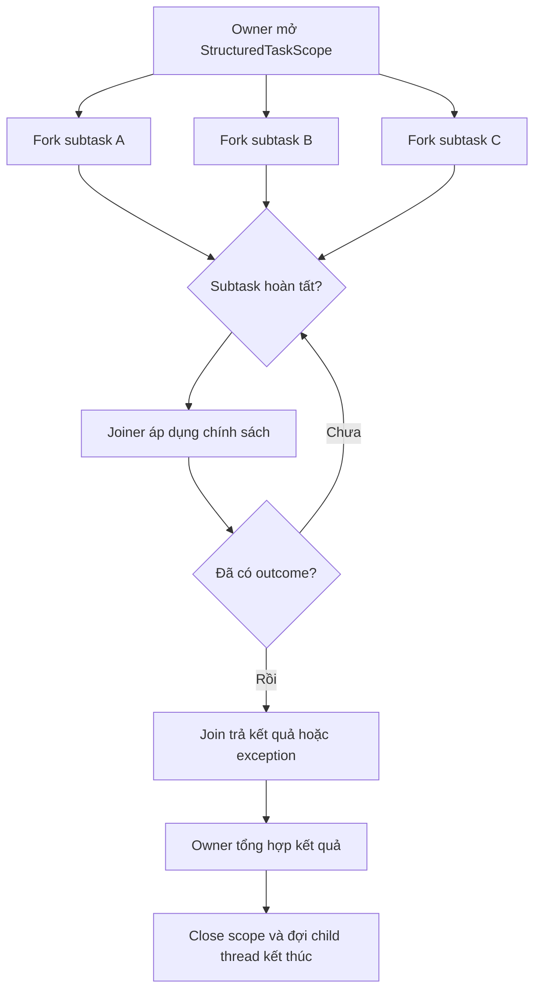

# Chọn chính sách tổng hợp kết quả và xử lý thành công hoặc thất bại

> **Chương:** Structured Concurrency  
> **Phạm vi module:** `JAVA_VERSION_JAVA25` — tổ chức các tác vụ đồng thời thành một đơn vị công việc có vòng đời, kết quả và quy tắc hủy rõ ràng; kết hợp virtual threads, xử lý lỗi và observability.  
> **Mục tiêu:** Chọn đúng `Joiner` theo yêu cầu nghiệp vụ: cần tất cả kết quả, chỉ cần một kết quả thành công, muốn thu thập cả thành công lẫn thất bại, hoặc muốn hủy khi đạt một điều kiện; biết đọc trạng thái `Subtask`, xử lý exception, timeout và cancellation mà không làm rò rỉ tác vụ.  
> **Mốc phiên bản:** Java 25 đưa `StructuredTaskScope` và `Joiner` vào **preview lần thứ năm** qua JEP 505. Các ví dụ mang nhãn **JDK 25** dùng đúng API preview của bản này và cần `--enable-preview`. Đến ngày **27/11/2026**, JDK 27 vẫn là preview lần thứ bảy; JEP 543 đã được tích hợp vào nhánh JDK 28 để trở thành API final, nhưng JDK 28 chưa phát hành GA. Bài phân biệt rõ các phiên bản để không dùng tên API cũ như hướng dẫn cho runtime mới.

Một request thường cần gọi nhiều dịch vụ độc lập: lấy hồ sơ khách hàng, lấy đơn hàng, kiểm tra tồn kho hoặc truy vấn nhiều nguồn dữ liệu. Ta có thể chạy các công việc này song song, nhưng **chính sách tổng hợp kết quả** phải xuất phát từ yêu cầu nghiệp vụ:

- Dashboard cần cả hồ sơ lẫn đơn hàng: thiếu một phần thì request không hoàn chỉnh.
- Tìm giá từ nhiều nhà cung cấp: chỉ cần kết quả hợp lệ đầu tiên, các request còn lại có thể hủy.
- Báo cáo tổng hợp từ nhiều nguồn không bắt buộc: cần thu thập phần thành công và ghi nhận nguồn thất bại.
- Kiểm tra một nhóm node: chỉ cần đủ số node khỏe mạnh hoặc đủ số phiếu chấp thuận thì có thể dừng các tác vụ còn lại.

`StructuredTaskScope` gom các subtasks vào một phạm vi. `Joiner` quyết định scope đợi điều gì, lúc nào hủy các công việc còn lại và kết quả của `join()` có dạng gì. Chọn Joiner là chọn **quy tắc hoàn tất của một đơn vị công việc**, không chỉ là cách gọi một API.

## 1. Mô hình: fork, join, aggregate và close

Trong Java 25, `StructuredTaskScope` là API preview thuộc `java.util.concurrent`. Scope thường được mở bằng `try-with-resources`:

```java
try (var scope = StructuredTaskScope.open()) {
    Subtask<User> user = scope.fork(() -> userService.load(userId));
    Subtask<List<Order>> orders =
            scope.fork(() -> orderService.load(userId));

    scope.join();

    return new Dashboard(user.get(), orders.get());
}
```

Trình tự:

1. **Open:** thread hiện tại mở scope và trở thành owner.
2. **Fork:** mỗi lần `fork` tạo một subtask chạy đồng thời trong thread riêng; mặc định là virtual thread.
3. **Join:** owner đợi các subtasks hoàn tất hoặc một điều kiện của Joiner xảy ra.
4. **Aggregate:** owner đọc kết quả/exception theo chính sách đã chọn.
5. **Close:** try-with-resources đóng scope; các subtasks chưa hoàn tất bị interrupt và scope đợi chúng kết thúc.



### Những quy tắc cấu trúc cần nhớ

- Chỉ **owner thread** mở scope mới được gọi `fork`, `join` và `close`.
- Phải gọi `join` sau khi đã fork subtasks; không fork thêm sau khi join.
- `join` chỉ được gọi một lần trên scope.
- `Subtask.get()` chỉ đọc được sau khi join và khi subtask ở trạng thái `SUCCESS`.
- `Subtask.exception()` chỉ đọc được sau khi join và khi subtask ở trạng thái `FAILED`.
- `close()` đợi các child thread kết thúc. Gửi interrupt không có nghĩa JVM cưỡng bức dừng một thread không hợp tác.

Nếu một subtask bị hủy trước khi hoàn tất, kết quả có thể ở trạng thái `UNAVAILABLE`; không được gọi `get()` hoặc `exception()` cho trạng thái này.

## 2. Joiner quyết định điều gì?

`Joiner<T,R>` trong API Java 25 là chính sách phối hợp hoàn tất của các subtasks:

- `T`: kiểu kết quả của subtask.
- `R`: kiểu kết quả mà `scope.join()` trả về.
- `onFork`: được gọi khi một subtask được fork.
- `onComplete`: được gọi khi subtask hoàn tất thành công hoặc thất bại.
- `result()`: tạo kết quả cuối cùng cho owner sau khi joiner kết thúc.

Joiner có thể yêu cầu scope **hủy sớm (short-circuit)** khi đã có đủ thông tin. Khi hủy, scope ngừng nhận công việc mới và interrupt các subtasks chưa hoàn tất. Các subtasks phải phản ứng với interrupt để scope đóng nhanh.

### Các Joiner có sẵn trong JDK 25

| Joiner | Kết quả của `join()` | Khi một subtask thất bại | Khi phù hợp |
|---|---|---|---|
| `awaitAllSuccessfulOrThrow()` | `null` | Hủy scope và ném `FailedException` | Tất cả phải thành công; subtasks có thể trả về kiểu khác nhau |
| `allSuccessfulOrThrow()` | `Stream<Subtask<T>>` theo thứ tự fork | Hủy scope và ném `FailedException` | Tất cả phải thành công; mọi subtask cùng kiểu |
| `anySuccessfulResultOrThrow()` | Kết quả của subtask thành công đầu tiên | Chỉ ném khi tất cả đều thất bại | Chỉ cần một nguồn trả lời hợp lệ |
| `awaitAll()` | `null` | Không hủy scope và không ném vì lỗi subtask | Cần đợi tất cả rồi tự phân loại thành công/thất bại |
| `allUntil(predicate)` | `Stream<Subtask<T>>` | Theo predicate do ứng dụng định nghĩa | Chính sách hủy theo ngưỡng, quorum hoặc điều kiện tùy chỉnh |

`StructuredTaskScope.open()` không truyền Joiner tương đương với mở scope bằng `awaitAllSuccessfulOrThrow()`. Vì vậy, mặc định là **fail-fast khi có subtask thất bại**.

Không chọn Joiner chỉ vì tên gọi nghe phù hợp. Hãy trả lời trước ba câu hỏi:

1. Nghiệp vụ cần tất cả kết quả hay chỉ cần một kết quả?
2. Nếu một subtask thất bại, những subtasks còn lại có còn giá trị không?
3. Owner cần kết quả tổng hợp hay cần tự đọc từng trạng thái subtask?

## 3. Chính sách 1 — Tất cả subtasks phải thành công

Dùng `awaitAllSuccessfulOrThrow()` khi một request chỉ hợp lệ nếu **mọi nguồn bắt buộc** đều trả kết quả. Ví dụ tạo trang chi tiết khách hàng cần hồ sơ và lịch sử đơn hàng; thiếu một phần thì không thể trả response đầy đủ.

### Ví dụ JDK 25: kết quả khác kiểu

```java
import java.util.List;
import java.util.concurrent.StructuredTaskScope;
import java.util.concurrent.StructuredTaskScope.Subtask;
import java.util.concurrent.StructuredTaskScope.Joiner;

record Dashboard(User user, List<Order> orders) {}

static Dashboard loadDashboard(String userId)
        throws InterruptedException {

    try (var scope = StructuredTaskScope.open(
            Joiner.awaitAllSuccessfulOrThrow())) {

        Subtask<User> user =
                scope.fork(() -> userService.load(userId));

        Subtask<List<Order>> orders =
                scope.fork(() -> orderService.load(userId));

        // Chỉ trả về bình thường nếu cả hai subtask thành công.
        scope.join();

        return new Dashboard(user.get(), orders.get());
    }
}
```

`join()` trả `null` vì Joiner chỉ đợi tất cả thành công; owner đọc từng kết quả qua các handle `Subtask`. Đây là lựa chọn phù hợp khi mỗi subtask trả một kiểu khác nhau.

### Nếu một subtask thất bại

Giả sử `orderService.load` ném `IOException`:

- Joiner nhận biết subtask thất bại.
- Scope bị hủy.
- Thread thực thi subtask còn lại nhận interrupt.
- `join()` ném `StructuredTaskScope.FailedException`; exception gốc nằm trong `getCause()`.
- `close()` vẫn đợi các thread con thực sự kết thúc trước khi thoát khỏi try-with-resources.

Không có kết quả Dashboard nửa vời được trả về theo chính sách này.

### Xử lý exception từ join

```java
static Dashboard loadDashboard(String userId)
        throws InterruptedException {

    try (var scope = StructuredTaskScope.open()) {
        var user = scope.fork(() -> userService.load(userId));
        var orders = scope.fork(() -> orderService.load(userId));

        scope.join();
        return new Dashboard(user.get(), orders.get());

    } catch (StructuredTaskScope.FailedException e) {
        Throwable cause = e.getCause();

        if (cause instanceof java.io.IOException ioe) {
            throw new DashboardUnavailableException(
                    "Cannot load required dashboard data", ioe);
        }

        throw new DashboardUnavailableException(
                "Dashboard subtask failed", cause);
    }
}
```

Ví dụ này dùng default Joiner, tương đương `awaitAllSuccessfulOrThrow()`. Với API Java 25, `FailedException` là exception của preview API; nó bao bọc lỗi từ subtask trong `cause`. Nếu nhiều subtasks thất bại gần nhau, đừng giả định có thể thu được mọi lỗi qua `FailedException`; chính sách này dừng ở lỗi đầu tiên được Joiner xử lý.

**Khi nào nên dùng:** kết quả bắt buộc phải đầy đủ, một phần dữ liệu không đủ để hoàn tất nghiệp vụ và các công việc còn lại không cần tiếp tục sau lỗi đầu tiên.

## 4. Chính sách 2 — Tất cả thành công và cùng kiểu kết quả

Nếu tất cả subtasks trả về cùng một kiểu, `allSuccessfulOrThrow()` cho phép `join()` trả về một stream các handle subtask theo thứ tự fork. Sau đó lấy kết quả bằng `Subtask.get()`.

```java
import java.util.List;
import java.util.concurrent.StructuredTaskScope;
import java.util.concurrent.StructuredTaskScope.Joiner;
import java.util.concurrent.StructuredTaskScope.Subtask;

static List<String> loadReplicas(String key)
        throws InterruptedException {

    try (var scope = StructuredTaskScope.open(
            Joiner.<String>allSuccessfulOrThrow())) {

        scope.fork(() -> replicaA.read(key));
        scope.fork(() -> replicaB.read(key));
        scope.fork(() -> replicaC.read(key));

        return scope.join()
                .map(Subtask::get)
                .toList();
    }
}
```

Điểm khác biệt với `awaitAllSuccessfulOrThrow()`:

- `allSuccessfulOrThrow()` thích hợp khi tất cả subtasks có cùng kiểu kết quả và owner muốn lấy toàn bộ danh sách.
- `awaitAllSuccessfulOrThrow()` thích hợp khi subtasks có kiểu khác nhau và owner đang giữ từng handle riêng.
- Cả hai đều hủy scope và ném `FailedException` nếu một subtask thất bại.

Thứ tự phần tử của stream là **thứ tự fork**, không phải thứ tự subtask hoàn tất. Nếu replica B trả lời trước A, kết quả vẫn được sắp theo thứ tự A, B, C.

Không gọi `Subtask.get()` trước `join()`. Không cần tự đợi từng handle bằng `get()`; Joiner đã thực hiện việc đợi như một đơn vị.

## 5. Chính sách 3 — Chỉ cần kết quả thành công đầu tiên

Dùng `anySuccessfulResultOrThrow()` khi có nhiều nguồn thay thế và chỉ cần **một nguồn thành công**. Ví dụ:

- Đọc cache từ hai replica.
- Gọi nhiều nhà cung cấp giá.
- Truy vấn các endpoint dự phòng.
- Tìm một node khỏe mạnh trong nhóm node tương đương.

```java
import java.util.concurrent.StructuredTaskScope;
import java.util.concurrent.StructuredTaskScope.Joiner;

static Quote findFirstAvailableQuote(String productId)
        throws InterruptedException {

    try (var scope = StructuredTaskScope.open(
            Joiner.<Quote>anySuccessfulResultOrThrow())) {

        scope.fork(() -> supplierA.quote(productId));
        scope.fork(() -> supplierB.quote(productId));
        scope.fork(() -> supplierC.quote(productId));

        // Kết quả thành công đầu tiên sẽ được trả về.
        return scope.join();
    }
}
```

Khi một subtask thành công:

1. Joiner nhận kết quả thành công.
2. Scope hủy các subtasks còn lại.
3. Các thread còn lại nhận interrupt.
4. `join()` trả kết quả của subtask thành công.

Nếu mọi subtask đều thất bại, `join()` ném `FailedException` với exception của một subtask thất bại làm cause. Nếu không fork subtask nào, `result()` của Joiner ném `NoSuchElementException` và `join()` bọc lỗi đó trong `FailedException`.

**“Đầu tiên” nghĩa là hoàn tất thành công đầu tiên**, không phải subtask được fork đầu tiên. Không có đảm bảo nhà cung cấp A được ưu tiên chỉ vì nó được fork trước B. Nếu nghiệp vụ cần ưu tiên nhà cung cấp theo thứ tự, phải xây dựng chính sách riêng thay vì dựa vào race giữa các kết quả.

### Không dùng chính sách này cho tác vụ có side effect không thể hủy

Ví dụ không nên gửi ba lệnh thanh toán thật rồi chọn kết quả thành công đầu tiên. Khi một lệnh thành công, hai lệnh còn lại nhận interrupt nhưng có thể đã gửi giao dịch tới hệ thống bên ngoài. Cancellation không hoàn tác side effect.

Dùng chính sách này cho các thao tác đọc hoặc tác vụ có thể hủy an toàn; với lệnh ghi, cần idempotency key, giao thức xác nhận và cơ chế bù trừ riêng.

## 6. Chính sách 4 — Đợi tất cả, tự xử lý từng thành công và thất bại

Có những nghiệp vụ chấp nhận một phần kết quả: tạo báo cáo tổng hợp, đọc dữ liệu từ nhiều nguồn không bắt buộc hoặc thu thập trạng thái của một nhóm node. Khi đó, không muốn một lỗi nhỏ hủy các công việc còn lại.

Trong JDK 25, dùng `awaitAll()`:

```java
import java.util.concurrent.StructuredTaskScope;
import java.util.concurrent.StructuredTaskScope.Joiner;
import java.util.concurrent.StructuredTaskScope.Subtask;

record SourceResult(String source, String value, Throwable failure) {}

static List<SourceResult> collectSources()
        throws InterruptedException {

    try (var scope = StructuredTaskScope.open(
            Joiner.<Object>awaitAll())) {

        Subtask<String> primary =
                scope.fork(() -> sourceA.fetch());

        Subtask<Integer> secondary =
                scope.fork(() -> sourceB.count());

        Subtask<String> archive =
                scope.fork(() -> sourceC.fetch());

        // Đợi mọi subtask; lỗi của một subtask không hủy các subtask khác.
        scope.join();

        var results = new java.util.ArrayList<SourceResult>();

        collectString("primary", primary, results);

        if (secondary.state() == Subtask.State.SUCCESS) {
            results.add(new SourceResult(
                    "secondary",
                    Integer.toString(secondary.get()),
                    null));
        } else if (secondary.state() == Subtask.State.FAILED) {
            results.add(new SourceResult(
                    "secondary", null, secondary.exception()));
        }

        collectString("archive", archive, results);
        return List.copyOf(results);
    }
}

static void collectString(
        String source,
        Subtask<String> task,
        List<SourceResult> results) {

    switch (task.state()) {
        case SUCCESS ->
                results.add(new SourceResult(source, task.get(), null));
        case FAILED ->
                results.add(new SourceResult(source, null, task.exception()));
        case UNAVAILABLE -> {
            // Chỉ có thể xảy ra khi scope bị hủy trước khi task hoàn tất.
        }
    }
}
```

Với `awaitAll()`:

- `join()` đợi tất cả subtasks hoàn tất.
- Một subtask thất bại không tự hủy các subtasks khác.
- `join()` không ném exception chỉ vì một subtask thất bại.
- Owner phải kiểm tra `Subtask.state()` để biết kết quả.
- `get()` chỉ hợp lệ với `SUCCESS`; `exception()` chỉ hợp lệ với `FAILED`.

### Ba trạng thái của Subtask

| Trạng thái | Ý nghĩa | Được phép gọi |
|---|---|---|
| `SUCCESS` | Subtask hoàn tất và có kết quả | `get()` |
| `FAILED` | Subtask kết thúc bằng exception/error | `exception()` |
| `UNAVAILABLE` | Kết quả chưa có, task chưa hoàn tất hoặc hoàn tất sau khi scope bị hủy | Không gọi `get()`/`exception()` |

Không được gọi `get()` một cách vô điều kiện sau `awaitAll()`. Joiner này không biến lỗi thành kết quả mặc định; nó chỉ đợi hết và để owner tự quyết định cách tổng hợp.

**Khi nào nên dùng:** các nguồn dữ liệu có tính độc lập, báo cáo có thể hiển thị một phần, hoặc nghiệp vụ cần ghi lại mọi lỗi thay vì dừng ở lỗi đầu tiên.

## 7. Chính sách 5 — Hủy khi đạt điều kiện với allUntil

`allUntil(predicate)` tạo một chính sách tùy chỉnh dựa trên trạng thái của từng subtask hoàn tất. Predicate được gọi khi subtask thành công hoặc thất bại; nếu trả `true`, scope bị hủy.

Ví dụ: gọi năm dịch vụ dự phòng, tiếp tục cho đến khi có **hai lỗi**; khi lỗi thứ hai xuất hiện thì hủy các công việc còn lại để không tiếp tục tốn tài nguyên.

```java
import java.util.concurrent.StructuredTaskScope;
import java.util.concurrent.StructuredTaskScope.Joiner;
import java.util.concurrent.StructuredTaskScope.Subtask;
import java.util.concurrent.atomic.AtomicInteger;

static List<Subtask<String>> queryUntilTwoFailures()
        throws InterruptedException {

    var failedCount = new AtomicInteger();

    var joiner = Joiner.<String>allUntil(subtask ->
            subtask.state() == Subtask.State.FAILED
                    && failedCount.incrementAndGet() >= 2);

    try (var scope = StructuredTaskScope.open(joiner)) {
        scope.fork(() -> serviceA.query());
        scope.fork(() -> serviceB.query());
        scope.fork(() -> serviceC.query());
        scope.fork(() -> serviceD.query());
        scope.fork(() -> serviceE.query());

        return scope.join().toList();
    }
}
```

Kết quả trả về là danh sách các handle subtask theo thứ tự fork. Danh sách có thể chứa:

- `SUCCESS`: đã có kết quả.
- `FAILED`: đã kết thúc với lỗi.
- `UNAVAILABLE`: chưa hoàn tất khi scope bị hủy hoặc không được khởi chạy vì scope đã bị hủy.

### Vì sao dùng AtomicInteger?

`onComplete` của Joiner được gọi từ các thread thực thi subtasks; nhiều subtasks có thể hoàn tất cùng lúc. Predicate vì thế phải **thread-safe**. `AtomicInteger` bảo đảm phép đếm lỗi không bị mất cập nhật khi nhiều thread đồng thời tăng bộ đếm.

Không dùng một biến `int failedCount` thông thường được nhiều thread cập nhật mà không đồng bộ. Nếu predicate cần nhiều trạng thái, dùng cấu trúc đồng bộ phù hợp hoặc tự triển khai Joiner thread-safe.

### Đọc kết quả sau khi đạt điều kiện

```java
List<Subtask<String>> completedOrUnavailable = queryUntilTwoFailures();

for (Subtask<String> task : completedOrUnavailable) {
    switch (task.state()) {
        case SUCCESS -> consume(task.get());
        case FAILED -> recordFailure(task.exception());
        case UNAVAILABLE -> recordCancelledOrUnfinished();
    }
}
```

Trong ví dụ này, helper `queryUntilTwoFailures()` đã gọi `join()` đúng một lần và trả về danh sách để owner duyệt. Không gọi `join()` lần thứ hai trên cùng scope.

`allUntil` cũng có thể triển khai quorum hoặc ngưỡng thành công. Ví dụ predicate có thể hủy khi đủ ba phiếu chấp thuận; sau khi join, owner đọc các trạng thái và kết quả đã thu được. Tuy nhiên, nếu chỉ cần kết quả thành công đầu tiên, `anySuccessfulResultOrThrow()` đơn giản và rõ nghĩa hơn.

## 8. Xử lý lỗi nghiệp vụ: lỗi nào nên làm fail scope?

Không phải mọi trường hợp “không có dữ liệu” đều là lỗi khiến scope phải hủy. Hãy phân biệt:

| Tình huống | Biểu diễn phù hợp | Lý do |
|---|---|---|
| Dịch vụ bắt buộc không thể truy cập | Subtask ném exception | Kết quả tổng thể không hợp lệ |
| Một nguồn tùy chọn không có dữ liệu | `Optional.empty()` hoặc kiểu kết quả nghiệp vụ | Đây là kết quả hợp lệ, không nhất thiết là lỗi thực thi |
| Nguồn phụ lỗi nhưng báo cáo vẫn dùng được | Thu thập trạng thái `FAILED` rồi tổng hợp phần còn lại | Chấp nhận kết quả từng phần |
| Một nguồn trả lời thành công là đủ | `anySuccessfulResultOrThrow()` | Không cần chờ nguồn còn lại |
| Lỗi tạm thời có fallback hợp lệ | Xử lý fallback ngay trong subtask | Không kích hoạt fail-fast cho lỗi đã được nghiệp vụ xử lý |
| Lỗi lập trình hoặc invariant bị vi phạm | Để exception lan ra | Không che giấu lỗi nghiêm trọng bằng kết quả giả |

### Đưa fallback vào subtask khi đó là kết quả nghiệp vụ

Javadoc Java 25 khuyến nghị nếu một loại exception cụ thể dẫn tới giá trị mặc định thì có thể xử lý ngay trong subtask, thay vì để subtask thất bại rồi owner xử lý sau.

```java
Subtask<Profile> profile = scope.fork(() -> {
    try {
        return profileService.load(userId);
    } catch (ProfileNotFoundException e) {
        return Profile.empty(userId);
    }
});
```

Nếu `ProfileNotFoundException` là tình huống bình thường theo hợp đồng nghiệp vụ, trả về `Profile.empty` giúp subtask kết thúc thành công. Ngược lại, `DatabaseUnavailableException` có thể vẫn cần được ném để kích hoạt fail-fast.

Không bắt mọi `Exception` rồi trả một object rỗng. Cách đó biến lỗi hệ thống, timeout và lỗi lập trình thành dữ liệu có vẻ hợp lệ, khiến hệ thống khó phát hiện sự cố.

### Phân loại exception ở owner

Với Joiner fail-fast của JDK 25, owner có thể bắt `StructuredTaskScope.FailedException` và kiểm tra `getCause()`:

```java
try (var scope = StructuredTaskScope.open()) {
    var account = scope.fork(() -> accountService.load(id));
    var balance = scope.fork(() -> balanceService.load(id));

    scope.join();
    return new AccountView(account.get(), balance.get());

} catch (StructuredTaskScope.FailedException e) {
    Throwable cause = e.getCause();

    if (cause instanceof java.io.IOException ioe) {
        throw new AccountReadException("Remote service unavailable", ioe);
    }

    if (cause instanceof IllegalArgumentException invalid) {
        throw invalid;
    }

    throw new AccountReadException("Unexpected concurrent failure", cause);
}
```

`FailedException` là lớp bao ngoài do chính sách Joiner tạo ra; cause mới là lỗi từ subtask. Nếu không cần chuyển đổi lỗi, có thể để exception lan lên handler cấp cao để ghi log và tạo response lỗi.

## 9. Timeout là một điều kiện hoàn tất riêng

Một scope có thể được mở với timeout. Trong JDK 25, cấu hình timeout được truyền qua hàm biến đổi `Configuration`:

```java
import java.time.Duration;
import java.util.concurrent.StructuredTaskScope;
import java.util.concurrent.StructuredTaskScope.Joiner;
import java.util.concurrent.StructuredTaskScope.Subtask;

static List<String> loadAllWithTimeout()
        throws InterruptedException {

    Duration timeout = Duration.ofSeconds(2);

    try (var scope = StructuredTaskScope.open(
            Joiner.<String>allSuccessfulOrThrow(),
            config -> config.withTimeout(timeout))) {

        scope.fork(() -> serviceA.load());
        scope.fork(() -> serviceB.load());

        return scope.join()
                .map(Subtask::get)
                .toList();
    }
}
```

Trong JDK 25:

- Timeout bắt đầu **khi scope được mở**, không phải khi gọi `join()`.
- Nếu hết thời gian trước hoặc trong lúc `join()` đợi, scope bị hủy.
- `join()` ném `StructuredTaskScope.TimeoutException`.
- Các subtasks chưa hoàn tất nhận interrupt; `close()` vẫn đợi chúng kết thúc.

Timeout là một outcome khác với exception do subtask thất bại. Hãy xử lý riêng để phân biệt “nguồn dữ liệu báo lỗi” và “toàn bộ công việc hết thời gian cho phép”.

### Chọn timeout theo ngân sách request

Nếu HTTP request có deadline 3 giây, không nên cấp 3 giây cho từng subtask độc lập. Tổng thời gian chờ phải nằm trong ngân sách request, bao gồm thời gian mở scope, gửi request, tổng hợp kết quả và tạo response.

Cần cấu hình timeout ở HTTP/database client để các lời gọi I/O thực sự dừng hoặc kết thúc khi bị hủy. StructuredTaskScope gửi interrupt nhưng không thể ép một thư viện I/O không hỗ trợ cancellation dừng tức thì.

## 10. Cancellation và xử lý interrupt đúng cách

Khi Joiner hủy scope, các subtasks đang chạy bị interrupt. Java không cưỡng bức kết thúc thread. Mỗi subtask cần tôn trọng interruption và giải phóng tài nguyên.

Ví dụ:

```java
static Result fetchRemote() throws IOException, InterruptedException {
    try {
        return httpClient.fetch();
    } catch (InterruptedException e) {
        Thread.currentThread().interrupt();
        throw e;
    }
}
```

Nếu API được gọi ném `InterruptedException`, để exception truyền lên nếu chữ ký cho phép. Nếu bắt để chuyển thành exception khác, khôi phục interrupt status trước khi ném tiếp.

Các lỗi cần tránh:

- Nuốt `InterruptedException` rồi tiếp tục chạy.
- Chờ một I/O không có timeout hoặc không có cơ chế cancellation.
- Chạy vòng lặp dài không kiểm tra interruption.
- Giữ lock hoặc tài nguyên lâu sau khi đã bị hủy.
- Giả định `close()` sẽ dừng thread ngay lập tức.

Nếu một subtask bỏ qua interrupt hoặc bị chặn trong thao tác không thể interrupt, `close()` có thể đợi rất lâu, thậm chí vô thời hạn. Điều này là một phần của bảo đảm lifetime: scope không cho phép child thread âm thầm sống lâu hơn task cha.

## 11. Tự triển khai Joiner khi chính sách có quy tắc riêng

Các Joiner có sẵn thường đủ cho đa số ứng dụng. Nếu cần thu thập đồng thời cả kết quả thành công và lỗi mà không hủy scope, có thể tạo Joiner riêng.

Ví dụ JDK 25:

```java
import java.util.List;
import java.util.Queue;
import java.util.concurrent.ConcurrentLinkedQueue;
import java.util.concurrent.StructuredTaskScope.Joiner;
import java.util.concurrent.StructuredTaskScope.Subtask;

record BatchOutcome<T>(
        List<T> successes,
        List<Throwable> failures
) {}

final class CollectingJoiner<T>
        implements Joiner<T, BatchOutcome<T>> {

    private final Queue<T> successes = new ConcurrentLinkedQueue<>();
    private final Queue<Throwable> failures =
            new ConcurrentLinkedQueue<>();

    @Override
    public boolean onComplete(Subtask<? extends T> subtask) {
        switch (subtask.state()) {
            case SUCCESS -> successes.add(subtask.get());
            case FAILED -> failures.add(subtask.exception());
            case UNAVAILABLE -> {
                // Không phải trạng thái hoàn tất thông thường.
            }
        }

        // false: không hủy scope; tiếp tục đợi các subtasks khác.
        return false;
    }

    @Override
    public BatchOutcome<T> result() {
        return new BatchOutcome<>(
                List.copyOf(successes),
                List.copyOf(failures));
    }
}
```

Sử dụng:

```java
try (var scope = StructuredTaskScope.open(
        new CollectingJoiner<String>())) {

    scope.fork(() -> sourceA.fetch());
    scope.fork(() -> sourceB.fetch());
    scope.fork(() -> sourceC.fetch());

    BatchOutcome<String> outcome = scope.join();

    logSuccesses(outcome.successes());
    logFailures(outcome.failures());
}
```

Các nguyên tắc khi tự triển khai Joiner:

- Tạo **một instance mới cho mỗi scope**; không chia sẻ Joiner giữa nhiều scope.
- `onComplete` có thể được gọi đồng thời từ nhiều thread; mọi state dùng chung phải thread-safe.
- `onComplete` nên tập trung vào việc thu thập trạng thái/kết quả và quyết định có hủy hay không.
- `result()` tạo outcome cuối cùng; đừng đặt logic nghiệp vụ lớn vào Joiner.
- Không gọi trực tiếp `onComplete` hoặc `result()` từ application code; scope gọi chúng theo lifecycle.
- Nếu Joiner có timeout policy, phải định nghĩa rõ timeout tạo kết quả hay exception.

Ví dụ trên dùng queue thread-safe để tránh mất kết quả khi nhiều subtask hoàn tất cùng lúc. Kết quả được sao chép thành immutable list trước khi trả về owner.

## 12. Cách chọn policy theo bài toán thực tế

| Bài toán | Chính sách nên chọn | Hành vi khi lỗi |
|---|---|---|
| Trang chi tiết cần user và order cùng có | `awaitAllSuccessfulOrThrow()` | Một lỗi hủy các subtasks còn lại |
| Đọc nhiều replica cùng kiểu, cần tất cả | `allSuccessfulOrThrow()` | Một lỗi hủy scope |
| Tìm replica đầu tiên trả lời | `anySuccessfulResultOrThrow()` | Tiếp tục sau lỗi đầu tiên; chỉ thất bại nếu mọi nguồn lỗi |
| Báo cáo thu thập nhiều nguồn tùy chọn | `awaitAll()` hoặc custom Joiner | Đợi hết, tự tổng hợp từng lỗi |
| Kiểm tra đủ số node khỏe mạnh | `allUntil(predicate)` | Hủy khi đạt ngưỡng |
| Dừng sau hai lỗi trong nhóm dịch vụ | `allUntil(predicate)` | Hủy khi bộ đếm lỗi đạt ngưỡng |
| Chỉ chấp nhận một lỗi cụ thể làm fallback | Xử lý trong subtask | Lỗi đã xử lý trở thành kết quả thành công |
| Yêu cầu toàn request hoàn tất trong deadline | Joiner phù hợp + timeout scope | Timeout hủy subtasks còn lại |

### Quy trình quyết định nhanh

1. Nếu thiếu một kết quả là request thất bại: chọn **all successful**.
2. Nếu chỉ cần một kết quả tốt: chọn **any successful**.
3. Nếu cần biết mọi nguồn thành công/thất bại: chọn **await all** hoặc custom Joiner.
4. Nếu có quorum/ngưỡng: chọn **allUntil** hoặc custom Joiner.
5. Nếu lỗi được chấp nhận theo nghiệp vụ: chuyển nó thành kiểu kết quả rõ ràng ngay trong subtask.
6. Nếu có deadline: cấu hình timeout ở scope và cả client I/O bên dưới.

## 13. JDK 25 và API Structured Concurrency hiện hành

Đây là phần cần chú ý nhất khi dùng kiến thức Java 25 trong dự án đang nâng cấp JDK.

### Trạng thái phiên bản

| JDK | Trạng thái Structured Concurrency | JEP | Ghi chú |
|---|---|---|---|
| JDK 25 | Preview lần thứ năm | JEP 505 | Các ví dụ `Joiner` trong bài chạy với API này |
| JDK 26 | Preview lần thứ sáu | JEP 525 | Đổi tên Joiner, đổi kiểu kết quả của `allSuccessfulOrThrow`, điều chỉnh cấu hình |
| JDK 27 | Preview lần thứ bảy | JEP 533 | Exception typing rõ hơn, dùng `ExecutionException`, bỏ `awaitAll()` |
| JDK 28 | API final đã tích hợp vào mainline | JEP 543 | API final theo hình dạng JDK 27; JDK 28 GA chưa phát hành tại mốc cập nhật |

**JDK 25 yêu cầu preview flags** khi compile/run code dùng `StructuredTaskScope`:

```bash
javac --release 25 --enable-preview -d out src/*.java
java --enable-preview -cp out com.acme.Main
```

Chỉ bật preview trong project/build profile dành cho JDK 25. Không thêm cờ preview vào ứng dụng chỉ dùng virtual threads hoặc `ScopedValue` final.

### Những thay đổi API phải biết khi chuyển sang JDK 28

| API JDK 25 | API final trong JDK 28 | Ý nghĩa |
|---|---|---|
| `anySuccessfulResultOrThrow()` | `anySuccessfulOrThrow()` | Bỏ từ `Result` trong tên Joiner |
| `allSuccessfulOrThrow()` trả `Stream<Subtask<T>>` | Trả `List<T>` trực tiếp | Owner không cần map `Subtask::get` |
| `awaitAll()` | Đã bị loại bỏ | Dùng `allUntil(_ -> false)` nếu cần đợi mọi task rồi kiểm tra trạng thái |
| `StructuredTaskScope.FailedException` | `ExecutionException` với cause | Cách bắt và xử lý lỗi thay đổi |
| `StructuredTaskScope<T,R>` | `StructuredTaskScope<T,R,R_X>` | Kiểu exception của `join()` được khai báo rõ |
| `Joiner<T,R>` | `Joiner<T,R,R_X>` | Joiner mang kiểu exception |
| `open(Joiner, Function<Configuration,Configuration>)` | `open(Joiner, UnaryOperator<Configuration>)` | Hàm cấu hình dùng `UnaryOperator` |
| `onTimeout()` trong preview trung gian | `timeout()` | API timeout được chuẩn hóa lại |
| Mọi code dùng preview flags | API final, không cần preview flags | Chỉ áp dụng khi dùng JDK 28 đã tích hợp JEP 543 |

Ví dụ JDK 28 final cho tất cả kết quả cùng kiểu:

```java
try (var scope = StructuredTaskScope.open(
        Joiner.<String>allSuccessfulOrThrow())) {

    scope.fork(() -> serviceA.fetch());
    scope.fork(() -> serviceB.fetch());

    // JDK 28: join trả List<String> trực tiếp.
    List<String> results = scope.join();
}
```

Ví dụ JDK 28 final cho kết quả thành công đầu tiên:

```java
try (var scope = StructuredTaskScope.open(
        Joiner.<Quote>anySuccessfulOrThrow())) {

    scope.fork(() -> supplierA.quote(productId));
    scope.fork(() -> supplierB.quote(productId));

    Quote quote = scope.join();
}
```

Với JDK 28 final, `join()` có thể ném `ExecutionException`; exception gốc được lấy từ `getCause()`. Nếu chuyển code từ JDK 25, cần cập nhật catch clause và các tên Joiner theo bảng trên. Không sao chép code JDK 25 preview rồi chỉ bỏ `--enable-preview`; việc đó không đủ để chuyển API.

### Thay thế awaitAll trong API mới

JDK 25 có `Joiner.awaitAll()` để đợi tất cả subtasks mà không hủy/throw do lỗi subtask. API mới dùng `allUntil(_ -> false)`:

```java
try (var scope = StructuredTaskScope.open(
        Joiner.<String>allUntil(_ -> false))) {

    Subtask<String> first = scope.fork(() -> serviceA.fetch());
    Subtask<String> second = scope.fork(() -> serviceB.fetch());

    // JDK 28: List<Subtask<String>>, có thể chứa SUCCESS/FAILED/UNAVAILABLE.
    List<Subtask<String>> tasks = scope.join();

    for (Subtask<String> task : tasks) {
        switch (task.state()) {
            case SUCCESS -> consume(task.get());
            case FAILED -> recordFailure(task.exception());
            case UNAVAILABLE -> recordCancelledOrUnfinished();
        }
    }
}
```

`allUntil(_ -> false)` không hủy theo predicate; scope chỉ kết thúc khi các subtasks hoàn tất hoặc có timeout/cancellation khác. Kết quả là danh sách các handle, do đó owner có thể kiểm tra trạng thái từng task.

## 14. Kiểm thử chính sách thành công/thất bại

Không chỉ kiểm tra trường hợp tất cả thành công. Một Joiner chỉ được chọn đúng khi các trường hợp lỗi và cancellation có hành vi đúng.

| Ca kiểm thử | Kết quả cần xác nhận |
|---|---|
| Mọi subtask thành công | Joiner trả kết quả đúng kiểu và đúng thứ tự |
| Một subtask thất bại sớm | Chính sách fail-fast hủy các subtasks còn lại |
| Một subtask thất bại nhưng các task khác còn hữu ích | Chính sách await-all vẫn đợi và thu kết quả còn lại |
| Một nguồn thành công, nguồn khác chậm | Any-success trả kết quả và gửi interrupt cho nguồn còn lại |
| Mọi nguồn đều thất bại | Any-success ném exception với cause từ lỗi subtask |
| Không fork task nào | Any-success phải xử lý `NoSuchElementException` theo hợp đồng |
| Đạt ngưỡng lỗi/quorum | `allUntil` hủy scope tại điều kiện đã chọn |
| Task bị timeout | Scope hủy task chưa hoàn tất; owner phân biệt timeout với lỗi nghiệp vụ |
| Owner bị interrupt trong join | Interrupt được truyền theo đúng hợp đồng; scope vẫn đóng child threads |
| Task bỏ qua interrupt | Test xác nhận close có thể chờ lâu; sửa task/client để cancellation hoạt động |

### Kiểm tra trạng thái Subtask

Sau khi Joiner kết thúc, kiểm tra state trước khi lấy kết quả:

```java
switch (task.state()) {
    case SUCCESS -> {
        var value = task.get();
        use(value);
    }
    case FAILED -> {
        Throwable failure = task.exception();
        logFailure(failure);
    }
    case UNAVAILABLE -> {
        logCancelledOrNotStarted();
    }
}
```

Đừng viết helper chỉ gọi `get()` rồi bắt `IllegalStateException` để đoán trạng thái. Hãy dùng `state()`; nó làm rõ kết quả nào thực sự có thể đọc.

### Test cancellation có hợp tác

Trong subtask, dùng API I/O có timeout, phản ứng với interrupt và giải phóng resource trong `finally`:

```java
static Result fetchRemote() throws IOException, InterruptedException {
    try {
        return httpClient.fetch();
    } catch (InterruptedException e) {
        Thread.currentThread().interrupt();
        throw e;
    }
}
```

Bài test cần xác nhận không còn request nền tiếp tục ghi dữ liệu sau khi scope đã trả outcome. Đặc biệt với tác vụ ghi hoặc gọi hệ thống bên ngoài, hãy dùng idempotency và cơ chế bù trừ.

## 15. Các lỗi thiết kế phổ biến

| Lỗi | Hậu quả | Cách sửa |
|---|---|---|
| Dùng default Joiner trong khi chấp nhận kết quả một phần | Một lỗi hủy mọi subtask còn lại | Chọn await-all/partial-result policy |
| Dùng any-success cho thao tác ghi có side effect | Nhiều lệnh có thể đã thực hiện trước khi bị interrupt | Chỉ dùng cho thao tác có thể hủy an toàn; thiết kế idempotency |
| Dùng all-success khi chỉ cần một nguồn | Chờ thừa, tăng latency | Chọn any-success |
| Dùng await-all nhưng không kiểm tra state | Bỏ sót lỗi và trạng thái unavailable | Duyệt `SUCCESS`, `FAILED`, `UNAVAILABLE` |
| Gọi `get()` trước join hoặc khi state không phải SUCCESS | `IllegalStateException` | Join trước, kiểm tra state rồi đọc |
| Gọi `exception()` khi state không phải FAILED | `IllegalStateException` | Kiểm tra state trước |
| Dùng biến đếm không đồng bộ trong predicate | Race condition, hủy sai ngưỡng | Atomic hoặc đồng bộ hóa |
| Joiner có mutable state nhưng không thread-safe | Mất kết quả hoặc hủy không nhất quán | Dùng queue/atomic/concurrent data structure |
| Chia sẻ một Joiner cho nhiều scope | Trộn trạng thái của các request | Tạo Joiner mới cho mỗi scope |
| Bắt mọi exception rồi trả kết quả mặc định | Che giấu lỗi hệ thống | Chỉ fallback với exception nghiệp vụ đã xác định |
| Nuốt interrupt | Task không dừng sau cancellation | Để interrupt truyền lên hoặc khôi phục interrupt status |
| Nghĩ close() cưỡng bức dừng thread | Scope bị kẹt khi child không hợp tác | Dùng timeout/cancellation-aware I/O |
| Dùng tên API JDK25 trên JDK28 | Không compile hoặc bắt sai exception | Chuyển theo bảng API version |
| Cho rằng JDK25 StructuredTaskScope là final | Phụ thuộc preview API đã thay đổi | Ghi rõ toolchain/version và kế hoạch nâng cấp |

## 16. Checklist chọn Joiner cho một use case

- [ ] Có thể xác định rõ kết quả nào là bắt buộc và kết quả nào là tùy chọn.
- [ ] Đã chọn giữa all-success, any-success, await-all hoặc cancellation theo điều kiện.
- [ ] Đã quyết định lỗi subtask nào cần hủy các subtasks còn lại.
- [ ] Đã quyết định lỗi nào nên chuyển thành kết quả fallback bên trong subtask.
- [ ] Đã kiểm tra `Subtask.state()` trước `get()`/`exception()`.
- [ ] Đã định nghĩa cách xử lý `UNAVAILABLE`.
- [ ] Đã thiết kế timeout và cancellation cho các lời gọi I/O.
- [ ] Các subtasks có thể phản ứng với interrupt.
- [ ] Predicate/Joiner tùy chỉnh thread-safe.
- [ ] Joiner được tạo riêng cho mỗi scope.
- [ ] Đã test tất cả thành công, một lỗi, nhiều lỗi, timeout và interrupt.
- [ ] Đã xác định JDK target và đúng API version.
- [ ] Nếu chuyển sang JDK 28, đã đổi `FailedException`, Joiner names, result types và `awaitAll()`.

## 17. Tài liệu tham khảo chính thức

1. [Java SE 25 — StructuredTaskScope API](https://docs.oracle.com/en/java/javase/25/docs/api/java.base/java/util/concurrent/StructuredTaskScope.html): vòng đời scope, fork/join/close, exception handling, timeout và cancellation.
2. [Java SE 25 — StructuredTaskScope.Joiner API](https://docs.oracle.com/en/java/javase/25/docs/api/java.base/java/util/concurrent/StructuredTaskScope.Joiner.html): các chính sách `allSuccessfulOrThrow`, `anySuccessfulResultOrThrow`, `awaitAllSuccessfulOrThrow`, `awaitAll`, `allUntil`.
3. [Java SE 25 — StructuredTaskScope.Subtask API](https://docs.oracle.com/en/java/javase/25/docs/api/java.base/java/util/concurrent/StructuredTaskScope.Subtask.html): `state()`, `get()`, `exception()`.
4. [Java SE 25 — Structured Concurrency guide](https://docs.oracle.com/en/java/javase/25/core/structured-concurrency.html): ví dụ thực hành và cách chọn Joiner.
5. [JEP 505 — Structured Concurrency (Fifth Preview)](https://openjdk.org/jeps/505): API được đưa vào JDK 25 và thay đổi từ các preview trước.
6. [Java SE 27 — StructuredTaskScope API](https://docs.oracle.com/en/java/javase/27/docs/api/java.base/java/util/concurrent/StructuredTaskScope.html): API seventh preview, `ExecutionException`, cancellation và Joiner mới.
7. [Java SE 27 — StructuredTaskScope.Joiner API](https://docs.oracle.com/en/java/javase/27/docs/api/java.base/java/util/concurrent/StructuredTaskScope.Joiner.html): kiểu exception `R_X`, các Joiner và timeout policy.
8. [JEP 533 — Structured Concurrency (Seventh Preview)](https://openjdk.org/jeps/533): thay đổi API trong JDK 27.
9. [JEP 525 — Structured Concurrency (Sixth Preview)](https://openjdk.org/jeps/525): các thay đổi API trong JDK 26.
10. [JEP 543 — Structured Concurrency](https://openjdk.org/jeps/543): đưa Structured Concurrency thành API final trong JDK 28.
11. [OpenJDK — JEP 543 integration review](https://www.mail-archive.com/core-libs-dev@openjdk.org/msg75715.html): xác nhận bỏ preview annotations và cập nhật `@since` cho JDK 28.
12. [OpenJDK — JDK 28 StructuredTaskScope API](https://cr.openjdk.org/~alanb/sc-jdk28/api/java.base/java/util/concurrent/StructuredTaskScope.html): API final trong nhánh JDK 28 đang phát triển; kiểm tra đúng build EA khi thử nghiệm.

**Điểm mấu chốt:** Joiner là nơi chọn quy tắc hoàn tất: cần tất cả, cần một kết quả thành công, cần thu thập mọi trạng thái hay cần hủy theo ngưỡng. Hãy để Joiner quyết định cancellation, owner kiểm tra và tổng hợp outcome, còn từng subtask phải hợp tác với interrupt. Khi dùng JDK 25, nhớ API đang ở preview lần thứ năm; khi nâng lên JDK 28, chuyển sang tên Joiner, kiểu kết quả và exception của API final thay vì chỉ bỏ cờ preview.
