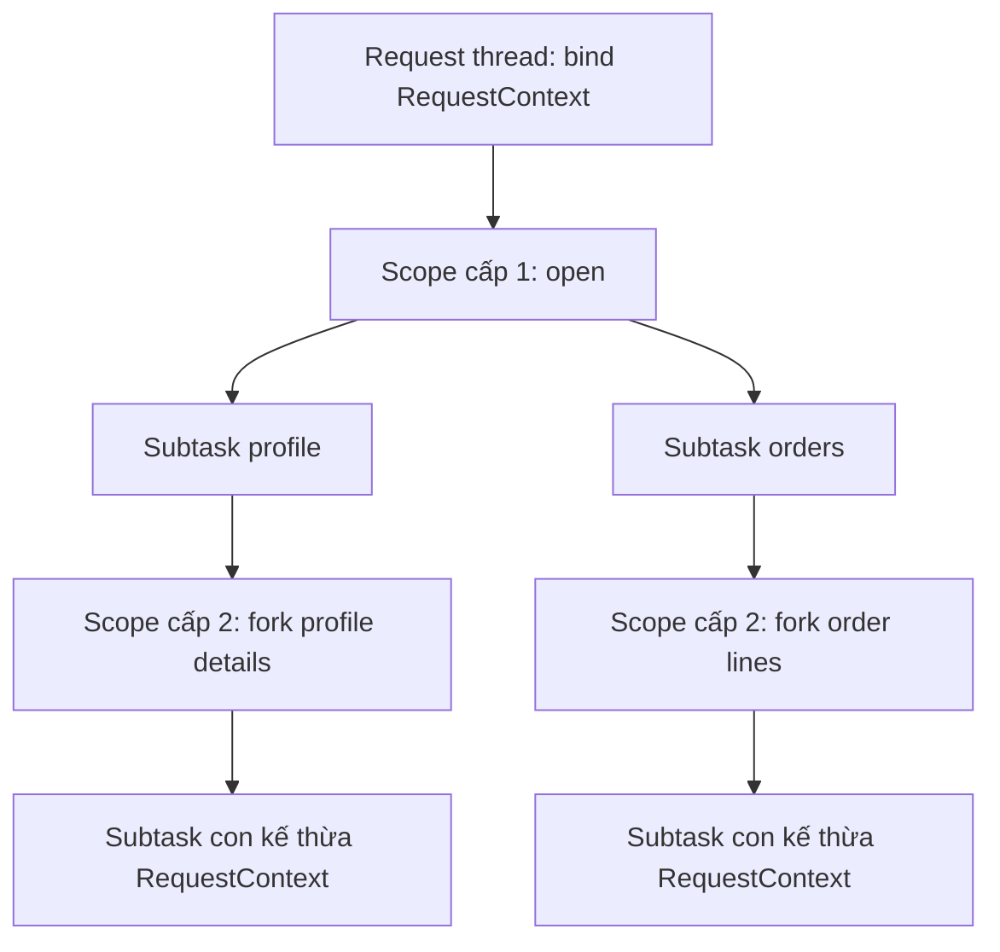

# Truyền ràng buộc ScopedValue cho tác vụ con trong phạm vi có cấu trúc

> **Chương:** Structured Concurrency  
> **Học phần:** `JAVA_VERSION_JAVA25` — tìm hiểu các khả năng Java 25 còn áp dụng trong Java hiện đại, trong đó `ScopedValue` đã final còn `StructuredTaskScope` ở Java 25 vẫn là preview.  
> **Mục tiêu:** Hiểu cách một `ScopedValue` được kế thừa từ tác vụ cha sang các tác vụ con do `StructuredTaskScope` tạo; biết thời điểm scope chụp binding, vòng đời của binding, điều kiện để fork an toàn và cách xử lý khi tác vụ con lỗi hoặc bị hủy.

## 1. Bài toán: nhiều tác vụ con cần cùng một request context

Một request tải trang hồ sơ có thể cần gọi đồng thời nhiều dịch vụ:

- Đọc hồ sơ người dùng.
- Lấy danh sách đơn hàng.
- Tải quyền hoặc thiết lập hiển thị.
- Ghi log và trace với cùng `requestId`, `tenantId`, `userId`.

Các method ở tầng sâu cần biết context để truy vấn đúng tenant, ghi log hoặc kiểm tra chính sách. Nếu truyền từng trường qua mọi method, chữ ký có thể dài và nhiều lớp trung gian phải nhận tham số chỉ để chuyển tiếp.

`ScopedValue` giải quyết việc truyền dữ liệu một chiều trong dynamic scope. `StructuredTaskScope` tổ chức một nhóm tác vụ con thành một đơn vị công việc: tác vụ cha fork các tác vụ con, chờ kết quả và không rời scope trước khi các thread con kết thúc.

Khi kết hợp hai API, một binding `ScopedValue` được thiết lập trong tác vụ cha có thể được kế thừa bởi các thread thực thi subtask được fork trong `StructuredTaskScope`. Nhờ đó, mỗi subtask đọc cùng request context mà không cần truyền nó qua từng lời gọi method.

Ví dụ điển hình:

```text
HTTP request
  └─ bind RequestContext(requestId, tenantId, userId)
       └─ open StructuredTaskScope
            ├─ fork loadProfile()       ─┐
            ├─ fork loadOrders()        ─┼─ cùng đọc RequestContext
            └─ fork loadPermissions()   ─┘
       └─ join, lấy kết quả
  └─ đóng scope, kết thúc binding
```

Điểm cốt lõi là **binding được kế thừa theo cấu trúc tác vụ**, không phải mọi thread trong JVM đều tự động nhận request context.

## 2. Structured concurrency tổ chức vòng đời tác vụ con

Với structured concurrency, nhóm tác vụ con có ranh giới bắt đầu và kết thúc rõ ràng. Một scope thường có trình tự:

1. Mở `StructuredTaskScope` trong tác vụ cha.
2. Gọi `fork(...)` để tạo các subtask chạy đồng thời.
3. Gọi `join()` để chờ kết quả theo chính sách của scope.
4. Đọc kết quả từ các subtask đã hoàn tất thành công.
5. Đóng scope bằng `try`-with-resources.

Trong Java 25, `StructuredTaskScope.open()` mặc định tạo virtual thread cho mỗi subtask. Scope được sở hữu bởi thread đã mở nó; chỉ owner thread được gọi `fork`, `join` và `close`. Không được fork thêm sau khi đã join.

`close()` bảo đảm các thread do scope tạo đã kết thúc trước khi luồng điều khiển rời khỏi khối `try`. Nếu một subtask lỗi theo chính sách mặc định, scope hủy các subtask còn lại bằng interrupt; `join()` truyền lỗi về tác vụ cha. Các subtask cần hợp tác với interruption để kết thúc nhanh.

### 2.1. Vì sao cấu trúc này quan trọng với context?

Một binding có phạm vi hữu hạn chỉ an toàn nếu các thread con dùng binding kết thúc trước khi binding cha hết hiệu lực. Structured concurrency cung cấp ranh giới đó: `close()` chờ các thread con kết thúc trước khi tác vụ cha tiếp tục ra ngoài scope.

Nếu tự tạo thread rồi để nó chạy sau khi method cha kết thúc, binding của cha có thể đã được khôi phục hoặc hết hiệu lực trong khi thread con vẫn cần đọc context. `StructuredTaskScope` được thiết kế để tránh vòng đời con vượt ra ngoài vòng đời cha.

### 2.2. Structured concurrency khác executor thông thường

| Cách chạy | Nhóm tác vụ có một ranh giới lifetime? | Hủy khi subtask lỗi | Chờ thread con kết thúc khi rời scope |
|---|---|---|---|
| `StructuredTaskScope` | Có | Theo chính sách `Joiner` | Có |
| `ExecutorService` + `Future` | Không tự động | Caller phải quản lý | Phụ thuộc cách shutdown/join |
| `CompletableFuture` | Không tự động | Phải thiết kế cancellation/exception chain | Không tự động |
| Tạo `Thread` trực tiếp | Không | Tự quản lý | Phải tự join |

`ExecutorService`, `Future` và `CompletableFuture` vẫn là API hiện hành và phù hợp với nhiều hệ thống. Structured concurrency phù hợp khi các tác vụ là các phần của cùng một request hoặc operation, có thể gom thành một nhóm và cần kết thúc cùng nhau.

## 3. ScopedValue là binding theo phạm vi thực thi

`ScopedValue<T>` là API final từ Java 25 qua JEP 506. Nó cung cấp một key để caller bind một value trong khoảng thời gian thực thi một operation. Những method được gọi trực tiếp hoặc gián tiếp trong khoảng đó và có quyền truy cập key có thể đọc value bằng `get()`.

Ví dụ:

```java
private static final ScopedValue<String> REQUEST_ID =
        ScopedValue.newInstance();

static void handleRequest() {
    ScopedValue.where(REQUEST_ID, "req-42").run(() -> {
        serviceCall();
    });
}

static void serviceCall() {
    System.out.println(REQUEST_ID.get());
}
```

Binding chỉ tồn tại trong thời gian operation của `run()` đang thực thi. Khi operation kết thúc bình thường hoặc bằng exception, binding được khôi phục về trạng thái trước đó. `ScopedValue` không có `set()` hoặc `remove()`; caller tạo binding bằng `where(...)`, callee đọc bằng `get()`.

### 3.1. Binding là per-thread, inheritance là trường hợp có cấu trúc

Bản thân `ScopedValue` binding gắn với thread hiện tại. Khi chỉ gọi method đồng bộ, các method trong call chain trên cùng thread đọc được binding.

Khi dùng `StructuredTaskScope`, API bổ sung quy tắc inheritance:

- Khi mở scope, JVM chụp các binding `ScopedValue` đang có trên owner thread.
- Các thread được tạo bởi `scope.fork(...)` kế thừa những binding đã chụp.
- Subtask có thể gọi `REQUEST_CONTEXT.get()` để đọc cùng value.
- Khi scope đóng, mọi subtask phải kết thúc trước khi tác vụ cha rời khỏi phạm vi binding.

Đây là cơ chế được JDK hỗ trợ trực tiếp; không cần tự sao chép `ScopedValue` sang từng subtask.

### 3.2. Vì sao nên dùng một context bất biến?

Giá trị được chia sẻ qua nhiều thread nên là object immutable, hoặc mọi truy cập tới nó phải được đồng bộ đúng cách. Một record với các thành phần bất biến thường là lựa chọn phù hợp:

```java
record RequestContext(
        String requestId,
        String tenantId,
        String userId) {
}
```

Record giúp cố định các tham chiếu field, nhưng chỉ bảo đảm bất biến nông. Nếu record chứa `Map`, `List` hoặc object mutable, nội dung bên trong vẫn có thể bị thay đổi. Hãy dùng collection immutable, defensive copy hoặc cơ chế đồng bộ phù hợp.

Không đưa toàn bộ servlet request, session object hoặc một mutable security context vào `ScopedValue` chỉ vì tiện. Chỉ truyền dữ liệu nhỏ, cần thiết và có vòng đời không vượt quá operation.

## 4. Quy tắc quan trọng: bind trước khi mở scope

`StructuredTaskScope` chụp các binding đang có **tại thời điểm scope được mở**. Khi gọi `fork`, binding trên owner thread phải khớp với binding đã chụp.

Vì vậy, thứ tự đúng là:

```text
ScopedValue.where(context, value)
  └─ run/call
       └─ StructuredTaskScope.open()  ← chụp binding tại đây
            └─ fork()                 ← subtask kế thừa binding đã chụp
            └─ join()
       └─ close()                     ← chờ tất cả subtask kết thúc
  └─ run/call kết thúc                ← binding được khôi phục
```

Nếu mở scope khi key chưa bind, rồi bind key sau đó trước khi fork, binding hiện tại sẽ không khớp snapshot của scope. JDK phát hiện vi phạm cấu trúc (`StructureViolationException` trong các API preview tương ứng) thay vì âm thầm truyền một context có vòng đời không rõ ràng.

### 4.1. Mẫu đúng

```java
ScopedValue.where(REQUEST_CONTEXT, context).run(() -> {
    try (var scope = StructuredTaskScope.open()) {
        var a = scope.fork(() -> serviceA());
        var b = scope.fork(() -> serviceB());

        scope.join();
        consume(a.get(), b.get());
    }
});
```

Binding được tạo trước `open()`. Scope được đóng bên trong `run()`, do đó các subtask hoàn tất trước khi binding kết thúc.

### 4.2. Mẫu sai: mở scope trước, bind sau

```java
try (var scope = StructuredTaskScope.open()) {
    ScopedValue.where(REQUEST_CONTEXT, context).run(() -> {
        scope.fork(() -> serviceA());
    });

    scope.join();
}
```

Scope đã chụp trạng thái key trước khi bind. Lúc `fork`, binding hiện tại khác snapshot. Đây là lỗi thứ tự vòng đời, không phải lỗi của service trong subtask.

### 4.3. Không để scope vượt ra ngoài `run()` hoặc `call()`

Không tạo scope trong một binding rồi lưu scope vào field để đóng ở nơi khác. Hãy đặt `try`-with-resources bên trong operation của `ScopedValue`. Nếu operation kết thúc khi scope còn mở, runtime phát hiện cấu trúc không hợp lệ và có thể tự đóng scope rồi ném `StructureViolationException`.

## 5. Ví dụ JDK 25: request context được kế thừa vào hai subtask

Đoạn ví dụ sau dùng API `StructuredTaskScope` của JDK 25. `ProfileService`, `OrderService` và `Dashboard` là các kiểu nghiệp vụ của ứng dụng.

```java
import java.lang.ScopedValue;
import java.util.concurrent.StructuredTaskScope;

record RequestContext(
        String requestId,
        String tenantId,
        String userId) {}

record Profile(String userId, String displayName) {}
record Dashboard(Profile profile, java.util.List<Order> orders) {}

final class DashboardService {
    private static final ScopedValue<RequestContext> REQUEST_CONTEXT =
            ScopedValue.newInstance();

    private final ProfileService profileService;
    private final OrderService orderService;

    DashboardService(
            ProfileService profileService,
            OrderService orderService) {
        this.profileService = profileService;
        this.orderService = orderService;
    }

    Dashboard load(
            String requestId,
            String tenantId,
            String userId) throws Exception {

        var context = new RequestContext(requestId, tenantId, userId);

        return ScopedValue.where(REQUEST_CONTEXT, context).call(() -> {
            try (var scope = StructuredTaskScope.open()) {
                var profileTask = scope.fork(() ->
                        profileService.load(
                                REQUEST_CONTEXT.get().userId()));

                var ordersTask = scope.fork(() ->
                        orderService.findByTenant(
                                REQUEST_CONTEXT.get().tenantId()));

                scope.join();

                return new Dashboard(
                        profileTask.get(),
                        ordersTask.get());
            }
        });
    }
}
```

Trình tự thực thi:

1. `load(...)` tạo một `RequestContext` mới cho request.
2. `ScopedValue.where(...).call(...)` bind context trên thread xử lý request.
3. `StructuredTaskScope.open()` chụp binding đang có.
4. Hai lần `fork(...)` tạo các subtask; thread con kế thừa binding của `REQUEST_CONTEXT`.
5. `profileService` và `orderService` đọc cùng context bằng `REQUEST_CONTEXT.get()`.
6. `join()` chờ kết quả theo chính sách mặc định.
7. `get()` lấy kết quả sau khi join thành công.
8. `close()` chờ các thread con kết thúc; sau đó `call()` kết thúc và binding được khôi phục.

Các subtask không nhận `RequestContext` qua tham số của lambda, nhưng vẫn đọc được nó vì scope đã kế thừa binding. Tham số nghiệp vụ như `userId` vẫn có thể truyền tường minh nếu đó là dependency cần thể hiện rõ trong API; ScopedValue nên dành cho context xuyên nhiều tầng.

### 5.1. Chạy ví dụ trên JDK 25

`StructuredTaskScope` là preview API trong JDK 25 qua JEP 505. Vì vậy, ví dụ JDK 25 cần bật preview ở cả compile và runtime:

```bash
javac --release 25 --enable-preview -d out src/DashboardService.java
java --enable-preview -cp out example.Main
```

Dùng JDK 25 để biên dịch và chạy preview code của JDK 25. Không giả định có thể biên dịch preview của JDK 25 bằng một JDK mới hơn chỉ bằng cách thêm `--release 25`; preview features gắn với đúng phiên bản JDK đang chạy compiler.

`ScopedValue` tự nó đã final trong Java 25 và không cần preview flag. Cờ preview trong ví dụ là do `StructuredTaskScope`, không phải do `ScopedValue`.

## 6. Scope chụp binding và kiểm tra tính nhất quán khi fork

Khi `StructuredTaskScope` được mở, runtime chụp snapshot các `ScopedValue` binding đang hoạt động trên owner thread. Mỗi lần `fork(...)`, runtime kiểm tra binding hiện tại có còn khớp snapshot đó hay không.

Quy tắc này ngăn tình huống một scope được mở trong context A nhưng một subtask lại kế thừa context B do owner thread đã rebinding giữa chừng.

```java
ScopedValue.where(CONTEXT, contextA).run(() -> {
    try (var scope = StructuredTaskScope.open()) {
        // Scope đã chụp CONTEXT = contextA.

        // Fork ở đây kế thừa contextA.
        scope.fork(() -> service.load(CONTEXT.get()));

        scope.join();
    }
});
```

Nếu code bind `contextB` sau khi scope đã mở rồi gọi `scope.fork(...)`, binding tại thời điểm fork không còn khớp snapshot. Java 25 preview có thể ném `StructureViolationException`. Hãy mở scope bên trong binding mà các subtask cần kế thừa.

### 6.1. Đừng mở scope rồi mới bind context

```java
try (var scope = StructuredTaskScope.open()) {
    ScopedValue.where(CONTEXT, contextA).run(() -> {
        // Không dùng scope được mở trước binding này.
        scope.fork(() -> service.load(CONTEXT.get()));
    });
}
```

Scope không chụp `contextA`, vì binding được thiết lập sau khi scope được mở. Cách sửa là đặt toàn bộ `try`-with-resources bên trong `run()` hoặc `call()` của binding.

### 6.2. Binding phải còn hiệu lực cho tới khi scope đóng

Một subtask có thể đọc binding trong suốt thời gian chạy. Do đó, operation của `ScopedValue` phải bao trọn cả `open`, `fork`, `join` và `close`.

Không trả một scope đang mở ra ngoài lambda để một method khác đóng sau. Nếu scope vượt khỏi dynamic scope đã tạo binding, vòng đời context và vòng đời thread con không còn khớp. Runtime có cơ chế phát hiện một số trường hợp vi phạm cấu trúc và đóng scope còn mở, nhưng ứng dụng không nên dựa vào cơ chế khôi phục này.

## 7. Subtask lồng nhau và rebinding

Một subtask có thể tự mở `StructuredTaskScope` khác. Các binding mà subtask kế thừa từ cha sẽ được chụp khi scope con được mở và tiếp tục được truyền xuống các subtask cấp dưới.



Vì vậy, inheritance không chỉ áp dụng cho một cấp. Binding có thể được truyền theo cây tác vụ, miễn mỗi scope được mở trong binding cần chia sẻ và được đóng trước khi binding cha hết hiệu lực.

### 7.1. Subtask có thể rebinding trong phạm vi riêng

Một subtask có thể thiết lập binding mới cho một operation con. Binding mới chỉ có hiệu lực trong dynamic scope lồng nhau và khi operation kết thúc, giá trị kế thừa ban đầu được khôi phục.

```java
scope.fork(() -> {
    var childContext = new RequestContext(
            CONTEXT.get().requestId(),
            CONTEXT.get().tenantId(),
            "service-account");

    ScopedValue.where(CONTEXT, childContext).run(() -> {
        auditService.record(CONTEXT.get());
    });

    // Ở đây CONTEXT trở về binding được kế thừa từ tác vụ cha.
});
```

Rebinding không thay đổi context của sibling task hoặc owner thread. Đây là cách giới hạn một context đặc biệt cho một operation con, ví dụ chạy audit dưới một principal dịch vụ riêng.

Không dùng rebinding để thay đổi một object context mutable dùng chung. Tạo value mới bất biến cho scope con sẽ dễ hiểu và an toàn hơn.

## 8. Thiết kế context: immutable, nhỏ và có quyền truy cập rõ ràng

Khi nhiều thread đọc cùng một value, hãy ưu tiên immutable object. Nếu value có trạng thái mutable, mọi truy cập cần được đồng bộ hóa đúng cách.

### 8.1. Dùng record chứa các giá trị bất biến

```java
record RequestContext(
        String requestId,
        String tenantId,
        String userId) {}
```

Các trường `String` phù hợp với ví dụ vì chúng bất biến. Nếu cần đưa collection vào context, tạo snapshot bất biến:

```java
record RequestContext(
        String requestId,
        java.util.Map<String, String> attributes) {
    RequestContext {
        attributes = java.util.Map.copyOf(attributes);
    }
}
```

`Map.copyOf` ngăn sửa map qua reference được lưu trong record; nếu value bên trong map là object mutable thì cần xử lý riêng. Bất biến của record chỉ là bất biến nông.

### 8.2. Giữ key ở phạm vi hẹp

Khai báo key thường là `private static final` trong class quản lý context. Chỉ expose các method đọc cần thiết như `currentRequestId()` hoặc `currentTenant()` thay vì public key cho toàn bộ module.

`ScopedValue` key hoạt động như một capability: code có quyền truy cập key mới có thể đọc value. Giới hạn quyền truy cập key giúp giảm nơi có thể sử dụng context.

### 8.3. Không dùng context thay thế authorization

Nếu `tenantId` ảnh hưởng tới dữ liệu được phép đọc, repository hoặc service vẫn phải thực thi authorization. Context nên được tạo từ principal đã xác thực; không tin `tenantId` do client tự gửi.

Tránh đặt password, access token, refresh token hoặc private key vào context dùng chung. Với correlation, chỉ truyền ID đã được phép sử dụng. ScopedValue không mã hóa value và không phải ranh giới bảo mật thay thế cơ chế phân quyền.

## 9. Lỗi, timeout và cancellation

Structured concurrency cho phép tác vụ cha xử lý một nhóm subtask như một operation. Với chính sách mặc định của JDK 25:

- Nếu mọi subtask thành công, `join()` hoàn tất và owner có thể lấy kết quả.
- Nếu một subtask lỗi, scope hủy các subtask còn lại bằng interrupt và `join()` ném `StructuredTaskScope.FailedException` với exception gây lỗi làm cause.
- Nếu scope có timeout, hết thời gian sẽ hủy các subtask đang chạy; JDK 25 preview dùng `StructuredTaskScope.TimeoutException`.
- `close()` chờ các thread con kết thúc trước khi thoát khối `try`, kể cả khi scope đã bị hủy.

### 9.1. Subtask phải hợp tác với interruption

```java
static Result fetchWithRetry() throws InterruptedException {
    while (true) {
        if (Thread.currentThread().isInterrupted()) {
            throw new InterruptedException("Task cancelled");
        }

        Result result = tryFetch();
        if (result != null) {
            return result;
        }

        Thread.sleep(100);
    }
}
```

Ví dụ trên minh họa một vòng lặp có điểm kiểm tra cancellation. Với JDBC, HTTP client hoặc thư viện I/O, hãy dùng API có timeout/cancellation phù hợp và kiểm tra cách thư viện phản ứng với interrupt.

Không nuốt `InterruptedException` rồi tiếp tục chạy vô hạn. Nếu không thể truyền exception lên, khôi phục trạng thái interrupt bằng `Thread.currentThread().interrupt()` trước khi thoát.

### 9.2. `close()` có thể phải chờ lâu

Hủy scope không đồng nghĩa mọi thread dừng ngay lập tức. `close()` đợi các subtask kết thúc. Nếu subtask gọi một API không interruptible hoặc bỏ qua interrupt, thời gian đóng scope có thể kéo dài đáng kể.

Vì vậy:

- Đặt timeout cho I/O ở cấp client.
- Đặt deadline cho operation khi phù hợp.
- Tránh vòng lặp CPU không có điểm kiểm tra cancellation.
- Không thực hiện side effect không thể đảo ngược nếu task có thể bị hủy giữa chừng.
- Thiết kế idempotency cho các thao tác gửi message hoặc ghi dữ liệu có thể được retry.

### 9.3. Không đọc kết quả trước khi join

`Subtask.get()` chỉ được dùng sau khi owner đã gọi `join()` và subtask đã hoàn tất thành công. Trước thời điểm đó, kết quả chưa sẵn sàng hoặc subtask có thể đã bị hủy.

## 10. Những ranh giới không tự động nhận ScopedValue

Inheritance chỉ được bảo đảm cho thread do `StructuredTaskScope` tạo qua `fork(...)`. Không suy rộng nó thành cơ chế truyền context toàn JVM.

| Cách tạo tác vụ | Có tự kế thừa binding của scope không? | Cách xử lý |
|---|---|---|
| `scope.fork(callable)` | Có | Đọc `ScopedValue.get()` trong subtask |
| Scope lồng nhau được mở trong subtask | Có, theo binding tại lúc mở scope con | Giữ đúng thứ tự bind/open/fork |
| `new Thread(...)` | Không dựa vào inheritance của StructuredTaskScope | Truyền dữ liệu tường minh hoặc dùng cơ chế phù hợp |
| `Thread.startVirtualThread(...)` | Không tự động trở thành subtask có cấu trúc | Capture context và bind lại nếu cần |
| `ExecutorService.submit(...)` | Không | Capture value rồi bind trong task |
| `CompletableFuture.supplyAsync(...)` | Không | Truyền context hoặc tích hợp context propagation của framework |
| HTTP/RPC sang service khác | Không | Truyền trace/context qua protocol, header hoặc message metadata |

Ví dụ với executor thường:

```java
RequestContext captured = CONTEXT.get();

executor.submit(() ->
        ScopedValue.where(CONTEXT, captured).run(() -> {
            backgroundService.process();
        }));
```

Đoạn này capture dữ liệu trên owner thread và bind lại trong worker. Đây là thao tác tường minh; executor không tự thừa kế binding của `StructuredTaskScope`.

### 10.1. ScopedValue không thay thế distributed tracing

`ScopedValue` truyền dữ liệu trong cùng JVM theo dynamic scope và các cấu trúc concurrency được hỗ trợ. Nó không tự thêm trace headers vào HTTP request, không truyền metadata qua message broker và không liên kết trace giữa nhiều process.

Nếu cần distributed tracing, tích hợp với OpenTelemetry hoặc cơ chế tracing của framework. Dùng ScopedValue để các method và subtask trong cùng operation đọc context đã được tạo ở entry point.

### 10.2. Quan hệ happens-before và khả năng nhìn thấy dữ liệu

JDK định nghĩa quan hệ bộ nhớ cho scope: các thao tác của owner thread trước khi fork subtask xảy ra-trước các thao tác trong subtask. Các thao tác của subtask xảy ra-trước khi owner lấy kết quả thành công qua `Subtask.get()`; các kết quả góp phần tạo outcome của `join()` cũng được công bố cho owner khi `join()` trả về.

Điều này giúp dữ liệu được chuẩn bị trước `fork()` có thể được subtask nhìn thấy. Tuy nhiên, happens-before không làm một object mutable trở nên thread-safe. Nếu owner và nhiều subtask cùng sửa một object, vẫn cần immutable design, lock hoặc cơ chế đồng bộ phù hợp.

## 11. Phiên bản API: JDK 25 preview, JDK 27 preview và JDK 28 final

Cần phân biệt **nguyên tắc inheritance của ScopedValue** với **phiên bản API StructuredTaskScope**. Nguyên tắc kế thừa binding theo scope vẫn còn áp dụng, nhưng API preview đã thay đổi qua nhiều release.

| JDK | JEP | Trạng thái StructuredTaskScope | Điểm cần biết |
|---|---|---|---|
| JDK 25 | JEP 505 | Preview lần thứ năm | API có hai type parameter; lỗi từ `join()` dùng `FailedException`; timeout dùng `TimeoutException` |
| JDK 26 | JEP 525 | Preview lần thứ sáu | API tiếp tục được điều chỉnh; cần dùng đúng tài liệu và compiler của JDK 26 |
| JDK 27 | JEP 533 | Preview lần thứ bảy; là bản GA mới nhất tại thời điểm bài viết | API có type parameter thứ ba `R_X`; lỗi mặc định của `join()` dùng `ExecutionException`; timeout được biểu diễn qua `CancelledByTimeoutException` làm cause |
| JDK 28 | JEP 543 | API final đã tích hợp trong nhánh JDK 28 Early Access | Giữ API shape của preview lần thứ bảy; không cần `--enable-preview` cho StructuredTaskScope |

Tại thời điểm biên soạn, JDK 27 là bản GA mới nhất và `StructuredTaskScope` vẫn là preview. JDK 28 đã có bản Early Access với API final, nhưng bản phát hành JDK 28 GA chưa tới. Vì vậy, có thể thử nghiệm API final trên JDK 28 EA; hãy chờ bản GA và kiểm tra lại release notes trước khi chọn làm nền tảng production.

### 11.1. Những thay đổi không được trộn lẫn

| Chi tiết | JDK 25 preview | JDK 27 preview / JDK 28 final |
|---|---|---|
| Type parameters | `StructuredTaskScope<T, R>` | `StructuredTaskScope<T, R, R_X extends Throwable>` |
| Lỗi theo chính sách mặc định | `StructuredTaskScope.FailedException` | `ExecutionException` |
| Timeout | `StructuredTaskScope.TimeoutException` | `ExecutionException` với `CancelledByTimeoutException` làm cause |
| `Joiner` | Hai type parameter | Ba type parameter, khai báo kiểu exception |
| Cờ preview | Cần bật | JDK 27 vẫn cần bật; JDK 28 final không cần |

Các thay đổi này ảnh hưởng cách khai báo type, xử lý exception và custom `Joiner`. Không copy code bắt `FailedException` từ JDK 25 rồi dùng nguyên trạng trên JDK 27/28.

### 11.2. Ví dụ API final trên JDK 28

Nguyên tắc truyền binding không đổi. Phần code sau dùng API final có trong JDK 28 Early Access:

```java
import java.lang.ScopedValue;
import java.util.concurrent.StructuredTaskScope;

record RequestContext(
        String requestId,
        String tenantId,
        String userId) {}

record Dashboard(Profile profile, java.util.List<Order> orders) {}

final class DashboardService {
    private static final ScopedValue<RequestContext> CONTEXT =
            ScopedValue.newInstance();

    private final ProfileService profiles;
    private final OrderService orders;

    DashboardService(ProfileService profiles, OrderService orders) {
        this.profiles = profiles;
        this.orders = orders;
    }

    Dashboard load(
            String requestId,
            String tenantId,
            String userId) throws Exception {

        var context = new RequestContext(requestId, tenantId, userId);

        return ScopedValue.where(CONTEXT, context).call(() -> {
            try (var scope = StructuredTaskScope.open()) {
                var profile = scope.fork(() ->
                        profiles.load(CONTEXT.get().userId()));

                var orderList = scope.fork(() ->
                        orders.findByTenant(CONTEXT.get().tenantId()));

                scope.join();

                return new Dashboard(profile.get(), orderList.get());
            }
        });
    }
}
```

Biên dịch trên JDK 28 EA không cần `--enable-preview` cho `StructuredTaskScope`:

```bash
javac -d out src/DashboardService.java
java -cp out example.Main
```

Đây là ví dụ hướng tới API final trong JDK 28. Không dùng lệnh trên để biên dịch code preview JDK 25; hãy giữ đúng compiler/runtime cho từng phiên bản.

### 11.3. Khi nào cần nâng cấp code JDK 25?

Nếu ứng dụng đang dùng preview JDK 25:

1. Đọc lại API của đúng JDK đích; không chỉ đổi `--release`.
2. Cập nhật cách khai báo `StructuredTaskScope` và `Joiner` theo phiên bản mới.
3. Chuyển xử lý `FailedException` sang kiểu exception của API mới.
4. Kiểm tra timeout và cause của exception.
5. Biên dịch lại, chạy test cancellation và kiểm tra cấu trúc scope.
6. Chỉ bỏ `--enable-preview` khi dùng JDK có API final.

Nếu tổ chức không cho phép preview API trong production, hãy dùng API concurrency đã final của JDK đang triển khai. Không lấy preview API của JDK 25 làm dependency ổn định chỉ vì phần inheritance với ScopedValue đã có tài liệu chính thức.

## 12. Quan sát và chẩn đoán nhóm tác vụ

Structured concurrency làm rõ cây tác vụ, nên việc điều tra thread dump có thể dễ hơn so với một tập thread rời rạc.

Khi cần chẩn đoán:

- Đặt tên scope nếu API version đang dùng hỗ trợ cấu hình tên.
- Đặt tên thread bằng `ThreadFactory` khi có lý do vận hành.
- Dùng thread dump để xem owner và các virtual thread thực thi subtask.
- Ghi lại operation/request ID bằng logging hoặc tracing phù hợp.
- Kiểm tra subtask nào đang chờ I/O, giữ lock hoặc không phản hồi interrupt.
- Đối chiếu thời điểm `join()` bắt đầu/kết thúc và timeout của từng dependency.

Không đưa dữ liệu nhạy cảm vào tên scope hoặc thread name. Dùng ID ngắn, không chứa access token, email hoặc payload người dùng.

## 13. Hiệu năng và giới hạn vận hành

ScopedValue được thiết kế để truyền một số lượng context key tương đối nhỏ. Inheritance qua StructuredTaskScope được tối ưu để tránh phải sao chép toàn bộ một bản đồ ThreadLocal cho từng child thread. Dù vậy, không nên suy ra rằng mọi workload đều nhanh hơn; hãy đo ứng dụng thực tế.

### 13.1. Dùng một record thay vì quá nhiều key

Nếu `requestId`, `tenantId`, `userId` và locale luôn đi cùng nhau, hãy gói chúng trong một record rồi bind một key. Cách này giúp giảm số key và giữ dữ liệu có cùng vòng đời trong một context.

### 13.2. Virtual thread không đồng nghĩa với capacity vô hạn

Mặc định, mỗi lần `fork` tạo một virtual thread. Virtual thread giảm chi phí tạo thread so với platform thread, nhưng không làm database, HTTP service hoặc message broker có khả năng xử lý vô hạn request.

Cần giới hạn concurrency theo capacity của dependency, dùng connection pool phù hợp, timeout, rate limit và backpressure. Không fork hàng trăm nghìn tác vụ chỉ vì virtual thread nhẹ.

### 13.3. Không bind object lớn hoặc giữ tài nguyên lâu

Binding nên giữ metadata cần thiết, không giữ cả request body lớn, file stream, JDBC connection hoặc resource phải đóng. Hãy mở và đóng tài nguyên trong chính subtask sở hữu nó; context chỉ mang ID hoặc dữ liệu bất biến cần cho operation.

## 14. Lỗi thiết kế thường gặp

| Lỗi | Hậu quả | Cách sửa |
|---|---|---|
| Bind sau khi đã mở scope | Snapshot không khớp khi fork | Bind trước `open()` |
| Scope được đóng sau khi `run()`/`call()` kết thúc | Vi phạm cấu trúc; binding có thể hết trước subtask | Đặt scope trong `try`-with-resources bên trong operation |
| Dùng `ScopedValue` chứa `Map` mutable dùng chung | Race condition hoặc context thay đổi ngoài ý muốn | Dùng snapshot immutable hoặc đồng bộ |
| Nghĩ executor tự kế thừa binding | Worker đọc context không tồn tại hoặc sai | Capture và bind lại trong task |
| Subtask bỏ qua interrupt | `close()` phải chờ lâu | Dùng I/O có timeout và xử lý interruption đúng |
| Đọc `Subtask.get()` trước `join()` | Kết quả chưa sẵn sàng | Join trước, đọc kết quả sau |
| Dùng context thay authorization | Có thể truy cập sai tenant | Kiểm tra quyền ở service/repository |
| Dùng preview API như API ổn định | Nâng JDK có thể phải sửa source và exception handling | Theo dõi JEP, dùng API final khi có |
| Fork không giới hạn | Làm quá tải downstream service | Áp dụng concurrency limit, batching và backpressure |

## 15. Bài tập thực hành và tiêu chí hoàn thành

### Bài tập 1 — Truyền context cho hai subtask

Một request cần tải hồ sơ và đơn hàng song song. Thiết kế `RequestContext` gồm `requestId`, `tenantId`, `userId`; bind context trước khi mở scope; để hai subtask đọc context qua `ScopedValue.get()`.

Giải thích vì sao không cần truyền context vào từng method trung gian, và tại sao vẫn nên giữ các tham số nghiệp vụ cần thiết trong chữ ký method.

### Bài tập 2 — Snapshot binding

Một scope được mở khi `TENANT` chưa bind. Sau đó owner thread bind `TENANT = "tenant-a"` rồi gọi `fork()`. Dự đoán kết quả và giải thích quy tắc snapshot tại `open()`.

### Bài tập 3 — Scope lồng nhau

Subtask A nhận context của request cha, rồi mở một scope con để gọi hai service. Mô tả binding nào được truyền cho hai subtask cấp dưới và điều kiện để scope con hợp lệ.

### Bài tập 4 — Rebinding trong subtask

Một subtask cần chạy audit bằng service identity. Hãy tạo một context mới trong dynamic scope lồng nhau; giải thích vì sao sibling task vẫn giữ context gốc.

### Bài tập 5 — Cancellation

Subtask tải hồ sơ lỗi sau 100 ms, trong khi subtask tải đơn hàng đang chờ I/O. Mô tả chính sách mặc định, tác động của interrupt và lý do `close()` vẫn phải chờ thread con kết thúc.

### Bài tập 6 — Executor không kế thừa context

Một subtask gọi `executor.submit(...)` để xử lý việc nền. Giải thích vì sao task trong executor không tự nhận binding của StructuredTaskScope. Viết wrapper capture context và bind lại trong task nếu nghiệp vụ yêu cầu.

### Bài tập 7 — Nâng cấp JDK

So sánh JDK 25 preview, JDK 27 preview và JDK 28 final về type parameters, exception của `join()` và preview flags. Chỉ ra những thay đổi cần xử lý khi chuyển code từ JDK 25 lên API final.

### Tiêu chí đạt

Bạn hoàn thành bài học khi có thể:

1. Giải thích vai trò của StructuredTaskScope trong việc gom subtask thành một operation có lifetime rõ.
2. Giải thích `ScopedValue` final trong Java 25 và cách binding được kế thừa vào thread do `scope.fork()` tạo.
3. Nêu đúng rằng scope chụp binding tại `open()` và kiểm tra binding khi fork.
4. Đặt `open`, `fork`, `join`, `close` bên trong dynamic scope của `ScopedValue`.
5. Thiết kế context immutable hoặc đồng bộ đúng cách.
6. Hiểu nested scope, rebinding và inheritance theo cây tác vụ.
7. Xử lý lỗi, timeout, cancellation và interruption có hợp tác.
8. Phân biệt StructuredTaskScope inheritance với executor, raw thread và distributed tracing.
9. Phân biệt API preview JDK 25/27 với API final đã tích hợp trong JDK 28.
10. Chọn concurrency limit phù hợp với capacity của downstream service thay vì fork không giới hạn.

### Tài liệu tham khảo

1. [JEP 505 — Structured Concurrency (Fifth Preview)](https://openjdk.org/jeps/505): phiên bản preview được đưa vào JDK 25.
2. [Java SE 25 API — `StructuredTaskScope`](https://docs.oracle.com/en/java/javase/25/docs/api/java.base/java/util/concurrent/StructuredTaskScope.html): `open`, `fork`, `join`, `close`, owner thread và inheritance của scoped value.
3. [Java SE 25 API — `ScopedValue`](https://docs.oracle.com/en/java/javase/25/docs/api/java.base/java/lang/ScopedValue.html): dynamic scope, per-thread binding và inheritance trong StructuredTaskScope.
4. [Java SE 25 API — `ScopedValue.Carrier`](https://docs.oracle.com/en/java/javase/25/docs/api/java.base/java/lang/ScopedValue.Carrier.html): `run`, `call`, khôi phục binding và kiểm tra structure violation.
5. [JEP 525 — Structured Concurrency (Sixth Preview)](https://openjdk.org/jeps/525): lần preview trong JDK 26.
6. [JEP 533 — Structured Concurrency (Seventh Preview)](https://openjdk.org/jeps/533): API preview trong JDK 27.
7. [Oracle JDK 27 API — `StructuredTaskScope`](https://docs.oracle.com/en/java/javase/27/docs/api/java.base/java/util/concurrent/StructuredTaskScope.html): API ba type parameters và exception model của preview lần thứ bảy.
8. [JEP 543 — Structured Concurrency](https://openjdk.org/jeps/543): hoàn tất API trong JDK 28.
9. [JDK 28 Early Access API — `StructuredTaskScope`](https://download.java.net/java/early_access/jdk28/docs/api/java.base/java/util/concurrent/StructuredTaskScope.html): API final trong nhánh JDK 28; tài liệu EA vẫn có thể thay đổi trước GA.

> **Ghi chú phiên bản:** `ScopedValue` đã final từ Java 25. `StructuredTaskScope` ở JDK 25 là preview lần thứ năm; JDK 27 GA vẫn là preview lần thứ bảy. JEP 543 đã hoàn tất API trong JDK 28 Early Access và giữ API shape của JDK 27; hãy xác minh lại khi JDK 28 GA phát hành. Không dùng các lớp `ShutdownOnFailure`/`ShutdownOnSuccess` từ những bản incubator cũ làm ví dụ cho API hiện tại.
