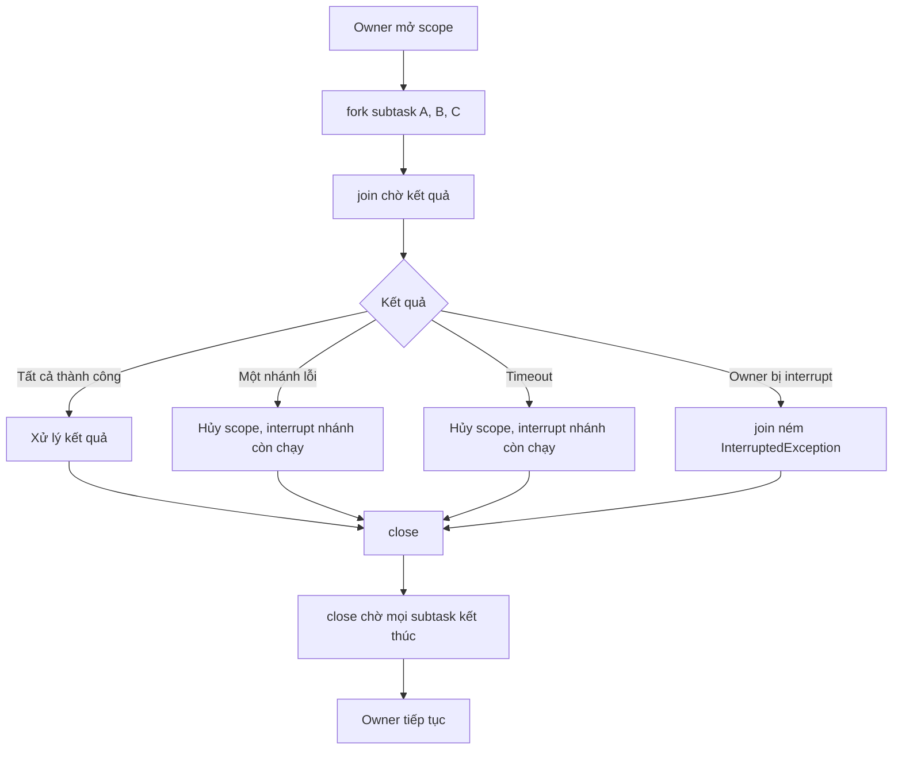

# Kiểm thử lỗi từng nhánh, timeout và tác vụ không phản hồi ngắt

**Structured Concurrency** gom các tác vụ con của một công việc vào một phạm vi có vòng đời rõ ràng. Khi một nhánh lỗi hoặc deadline hết hạn, scope có thể hủy các nhánh chưa hoàn tất bằng cách gửi **interrupt** tới thread thực thi. Tuy nhiên, interrupt chỉ là tín hiệu hợp tác. Một tác vụ chặn trong thư viện không hỗ trợ interrupt hoặc cố tình bỏ qua tín hiệu đó vẫn có thể tiếp tục chạy; khi ấy phương thức **close()** phải chờ tác vụ kết thúc trước khi luồng sở hữu scope được đi tiếp.

Bài học thuộc chương **Structured Concurrency** của module **Java 25** (JAVA_VERSION_JAVA25), theo đề bài **“Kiểm thử lỗi từng nhánh, timeout và tác vụ không phản hồi ngắt”**. Trọng tâm là kiểm thử các kết quả lỗi, xác nhận sibling cancellation, kiểm tra timeout, xử lý interruption của owner và chứng minh hành vi khi một subtask không chịu kết thúc.

**Lưu ý phiên bản:** Structured Concurrency là preview trong Java 25 (JEP 505, preview lần thứ năm) và vẫn là preview trong JDK 27 (JEP 533, preview lần thứ bảy). API đã thay đổi giữa các phiên bản preview. Các ví dụ kiểm thử chính trong bài dùng API JDK 27 hiện tại; phần riêng phía dưới ghi rõ khác biệt nếu dự án đang biên dịch bằng JDK 25. Không trộn hai bộ API trong cùng source file.

## 1. Điều cần chứng minh khi kiểm thử một scope

Một test tốt không chỉ xác nhận kết quả cuối cùng. Nó cần chứng minh cả **đường đi của lỗi và vòng đời của các nhánh còn lại**.

| Câu hỏi | Bằng chứng cần có |
| --- | --- |
| Một subtask thất bại thì join trả gì? | Exception đúng loại và cause đúng với lỗi gốc |
| Các sibling còn chạy có bị hủy không? | Subtask nhận interrupt và kết thúc trong thời hạn |
| Timeout có kích hoạt không? | Kết quả timeout đúng với phiên bản API đang dùng |
| Owner bị interrupt khi join thì sao? | join ném InterruptedException, scope được đóng và các task được dọn dẹp |
| Task bỏ qua interrupt thì sao? | close vẫn chờ task kết thúc; test có cách giải phóng task |
| Task gọi API không thể hủy thì sao? | Deadline ở tầng client hoặc process isolation bảo vệ hệ thống |

Không nên chỉ kiểm tra rằng exception xuất hiện. Cũng phải xác nhận không còn subtask chạy ngầm sau khi công việc cha đã kết thúc, trừ khi test đang chủ động mô phỏng một task không hợp tác.

## 2. Trạng thái API và ranh giới phiên bản

Structured Concurrency đã trải qua nhiều lần preview. Bảng dưới giúp xác định đúng exception và cú pháp khi đọc ví dụ:

| JDK | JEP | Trạng thái | Khác biệt cần nhớ |
| --- | --- | --- | --- |
| JDK 25 | JEP 505 | Preview lần 5 | StructuredTaskScope có hai tham số kiểu T,R; lỗi mặc định là FailedException; timeout là TimeoutException |
| JDK 26 | JEP 525 | Preview lần 6 | API tiếp tục được điều chỉnh; vẫn phải bật preview |
| JDK 27 | JEP 533 | Preview lần 7 | StructuredTaskScope có ba tham số kiểu T,R,R_X; lỗi mặc định là ExecutionException; timeout mặc định được biểu diễn bằng CancelledByTimeoutException làm cause |

Trong JDK 25, StructuredTaskScope đã là interface với open, fork, join, close và Joiner. Ví dụ từ những preview cũ hơn có thể dùng các lớp ShutdownOnFailure, ShutdownOnSuccess, shutdown() hoặc joinUntil(). Đó là API của các thiết kế preview trước; không sao chép chúng vào code JDK 25/27 hiện tại.

Các đoạn code chính tiếp theo được viết cho **JDK 27 preview** để dùng hình dạng API hiện hành. Nếu đang học hoặc chạy đúng JDK 25, hãy dùng phần “Chuyển ví dụ về JDK 25” ở mục 16.

## 3. Vòng đời và quyền sở hữu scope

Một scope có owner là thread gọi StructuredTaskScope.open(...). Chỉ owner được gọi fork, join và close.



Các quy tắc cần đưa vào test:

- Mỗi scope có một owner; thread khác không được fork, join hoặc close scope đó.
- fork diễn ra trước join.
- join chỉ được gọi một lần để lấy kết quả; ngoại lệ là lần gọi trước bị InterruptedException.
- Khi scope kết thúc, close() hủy scope nếu chưa bị hủy và chờ tất cả thread con kết thúc.
- close() không phải lệnh kill thread. Nó không thể cưỡng bức dừng code Java hoặc native đang bỏ qua interrupt.

## 4. Chính sách lỗi mặc định trên JDK 27

StructuredTaskScope.open() mặc định dùng chính sách chờ các subtask thành công; nếu một subtask lỗi, scope bị hủy và join() ném ExecutionException. Exception của subtask thất bại đầu tiên là getCause().

```java
import java.util.concurrent.ExecutionException;
import java.util.concurrent.StructuredTaskScope;

record Product(String id) {}
record Stock(int available) {}
record ProductPage(Product product, Stock stock) {}

ProductPage loadProductPage(String id) throws InterruptedException {
    try (var scope = StructuredTaskScope.<Object>open()) {
        var product = scope.fork(() -> loadProduct(id));
        var stock = scope.fork(() -> loadStock(id));

        scope.join();

        return new ProductPage(
                (Product) product.get(),
                (Stock) stock.get());
    } catch (ExecutionException e) {
        Throwable cause = e.getCause();
        if (cause instanceof ProductNotFoundException notFound) {
            throw new IllegalStateException("Không tìm thấy sản phẩm", notFound);
        }
        if (cause instanceof InventoryUnavailableException unavailable) {
            throw new IllegalStateException("Dịch vụ tồn kho không khả dụng", unavailable);
        }
        throw new IllegalStateException("Không thể tải trang sản phẩm", cause);
    }
}
```

loadProduct, loadStock và các exception trong ví dụ là kiểu nghiệp vụ minh họa. Trong ứng dụng thật, nên dùng kiểu kết quả có tên rõ ràng thay cho ép kiểu Object; đoạn trên chỉ làm nổi bật cách join chuyển lỗi subtask lên owner.

Nếu nhiều subtask lỗi gần như đồng thời, exception được báo là lỗi đầu tiên theo kết quả điều phối. Thứ tự giữa hai lỗi cạnh tranh có thể thay đổi giữa các lần chạy. Test nên kiểm tra tập nguyên nhân có thể xảy ra hoặc dùng latch để điều khiển thứ tự; không khẳng định một nhánh luôn thắng nếu chưa đồng bộ thứ tự.

## 5. Kiểm thử một nhánh lỗi và sibling cancellation

Test này buộc nhánh đọc tồn kho thất bại sau khi nhánh đọc sản phẩm đã bắt đầu chờ. Kết quả mong đợi là join ném ExecutionException, cause là lỗi tồn kho và sibling nhận interrupt.

```java
import static org.junit.jupiter.api.Assertions.*;

import java.util.concurrent.CountDownLatch;
import java.util.concurrent.ExecutionException;
import java.util.concurrent.StructuredTaskScope;
import java.util.concurrent.TimeUnit;

import org.junit.jupiter.api.Test;

class StructuredFailureTest {
    @Test
    void firstFailureCancelsUnfinishedSibling() throws Exception {
        var siblingStarted = new CountDownLatch(1);
        var siblingInterrupted = new CountDownLatch(1);

        try (var scope = StructuredTaskScope.<String>open()) {
            scope.fork(() -> {
                siblingStarted.countDown();
                try {
                    new CountDownLatch(1).await();
                    return "unexpected";
                } catch (InterruptedException e) {
                    siblingInterrupted.countDown();
                    throw e;
                }
            });

            assertTrue(siblingStarted.await(2, TimeUnit.SECONDS));

            scope.fork(() -> {
                throw new IllegalStateException("pricing failed");
            });

            ExecutionException failure =
                    assertThrows(ExecutionException.class, scope::join);

            assertInstanceOf(IllegalStateException.class, failure.getCause());
            assertEquals("pricing failed", failure.getCause().getMessage());
            assertTrue(siblingInterrupted.await(2, TimeUnit.SECONDS));
        }
    }
}
```

Các điểm test đã kiểm tra:

1. Sibling thực sự bắt đầu trước khi nhánh lỗi được fork.
2. Cause là exception gốc, không chỉ kiểm tra ExecutionException bên ngoài.
3. Sibling nhận interrupt trong thời hạn.
4. Khi thoát try, close() có thể hoàn tất vì sibling tôn trọng interrupt.

Không dùng Thread.sleep() để đoán thứ tự. CountDownLatch tạo mốc đồng bộ rõ ràng và giảm flaky test.

## 6. Kiểm thử nhiều nhánh lỗi

Khi nhiều subtask cùng có thể lỗi, cần kiểm tra chính sách thay vì giả định thứ tự:

| Kịch bản | Kết quả mong đợi với open() mặc định |
| --- | --- |
| A lỗi trước, B chưa hoàn tất | Scope bị hủy; B nhận interrupt; join báo lỗi A nếu A là lỗi đầu tiên |
| B lỗi trước, A chưa hoàn tất | Tương tự, cause là lỗi B |
| A và B lỗi gần đồng thời | Một lỗi đầu tiên được chọn; không giả định thứ tự ổn định |
| A lỗi, B đã hoàn tất thành công | Scope vẫn báo lỗi A |
| A và B thành công | join hoàn tất bình thường |

Nếu test cần chứng minh lỗi A được chọn, dùng latch để giữ B chưa chạy đến điểm lỗi cho tới khi A đã thất bại. Nếu test chỉ cần chứng minh một lỗi được truyền lên, chấp nhận một trong các cause đã định nghĩa.

### Lỗi có thể phục hồi nên được biểu diễn thành kết quả nghiệp vụ

Không phải lỗi của một nhánh nào cũng cần hủy cả scope. Ví dụ dịch vụ gợi ý sản phẩm có thể cho phép thiếu dữ liệu đề xuất:

```java
record RecommendationResult(
        java.util.List<String> productIds,
        boolean available) {}

RecommendationResult loadRecommendations() {
    try {
        return new RecommendationResult(fetchRecommendations(), true);
    } catch (RecommendationUnavailableException e) {
        return new RecommendationResult(java.util.List.of(), false);
    }
}
```

Khi đó subtask hoàn tất thành công với trạng thái “không khả dụng”, thay vì ném lỗi làm hủy các nhánh bắt buộc. Chỉ chuyển lỗi thành kết quả mặc định khi đó là chính sách nghiệp vụ đã định nghĩa; không bắt Throwable rồi âm thầm trả dữ liệu giả.

## 7. Kiểm thử timeout của scope

Trên JDK 27, cấu hình timeout qua open(config -> config.withTimeout(...)). Timeout bắt đầu **ngay khi scope được mở**, không phải khi join() bắt đầu. Nếu deadline hết trước hoặc trong lúc join() chờ, scope bị hủy và các subtask chưa xong nhận interrupt.

Với default joiner của JDK 27, timeout làm join() ném ExecutionException có cause là StructuredTaskScope.CancelledByTimeoutException.

```java
import java.time.Duration;
import java.util.concurrent.ExecutionException;
import java.util.concurrent.StructuredTaskScope;

String loadWithDeadline() throws InterruptedException {
    try (var scope = StructuredTaskScope.<String>open(
            config -> config.withTimeout(Duration.ofSeconds(2)))) {

        scope.fork(this::loadProfile);
        scope.fork(this::loadPermissions);
        scope.join();
        return "loaded";

    } catch (ExecutionException e) {
        if (e.getCause()
                instanceof StructuredTaskScope.CancelledByTimeoutException) {
            throw new IllegalStateException("Hết thời gian tải hồ sơ", e);
        }
        throw new IllegalStateException("Một nhánh tải hồ sơ thất bại", e.getCause());
    }
}
```

Duration.ofSeconds(2) là ví dụ. Thời hạn thực tế cần dựa trên deadline của request và thời gian còn lại sau khi trừ các bước đã thực hiện.

### Kiểm thử timeout và xác nhận task nhận interrupt

```java
import static org.junit.jupiter.api.Assertions.*;

import java.time.Duration;
import java.util.concurrent.CountDownLatch;
import java.util.concurrent.ExecutionException;
import java.util.concurrent.StructuredTaskScope;
import java.util.concurrent.TimeUnit;

import org.junit.jupiter.api.Test;

class StructuredTimeoutTest {
    @Test
    void timeoutCancelsAnUnfinishedSubtask() throws Exception {
        var started = new CountDownLatch(1);
        var interrupted = new CountDownLatch(1);

        ExecutionException failure = assertThrows(
                ExecutionException.class,
                () -> {
                    try (var scope = StructuredTaskScope.<String>open(
                            config -> config.withTimeout(Duration.ofSeconds(2)))) {
                        scope.fork(() -> {
                            started.countDown();
                            try {
                                new CountDownLatch(1).await();
                                return "late";
                            } catch (InterruptedException e) {
                                interrupted.countDown();
                                throw e;
                            }
                        });

                        assertTrue(started.await(1, TimeUnit.SECONDS));
                        scope.join();
                    }
                });

        assertInstanceOf(
                StructuredTaskScope.CancelledByTimeoutException.class,
                failure.getCause());
        assertTrue(interrupted.await(2, TimeUnit.SECONDS));
    }
}
```

Test có timeout nội bộ để tránh treo nếu scheduler không chạy task đúng lúc. Khi chạy trong CI chậm, điều chỉnh timeout có kiểm soát nhưng vẫn giữ deadline ngoài của test runner.

## 8. Phân biệt scope timeout với timeout của dependency

Scope timeout là deadline cho toàn bộ công việc có cấu trúc. Nó không thay thế timeout ở HTTP client, database driver, socket hoặc native library.

| Lớp timeout | Phạm vi | Ví dụ |
| --- | --- | --- |
| Request deadline | Toàn request từ đầu tới cuối | 2 giây cho trang chi tiết |
| Scope timeout | Nhóm subtask nằm trong một scope | 1,5 giây cho profile + permissions |
| HTTP connect/read/request timeout | Một lần gọi dịch vụ ngoài | Giới hạn thời gian kết nối và chờ response |
| JDBC query timeout | Một câu truy vấn | Giới hạn thời gian thực thi query |
| Socket/native operation timeout | Một thao tác ở tầng hệ điều hành/thư viện | Read timeout hoặc API hủy riêng |

Nếu chỉ đặt scope timeout, một subtask có thể nhận interrupt nhưng thư viện đang gọi không xử lý interrupt. Khi đó join có thể đã biết timeout, nhưng close vẫn chờ subtask kết thúc.

Nên truyền **thời gian còn lại** của request vào mỗi dependency. Ví dụ nếu request deadline còn 700 ms, không khởi tạo một HTTP call có timeout 3 giây. Cũng không đặt timeout cho từng subtask bằng toàn bộ request budget nếu các nhánh chạy song song và còn cần thời gian tổng hợp kết quả.

## 9. Kiểm thử khi owner thread bị interrupt

join() có thể ném InterruptedException nếu owner bị interrupt trong lúc chờ. Exception này không giống lỗi nghiệp vụ của subtask. Khi InterruptedException được ném, interrupt status của owner được clear theo quy ước của Java; sau đó try-with-resources vẫn đóng scope, hủy các task còn lại và chờ chúng kết thúc.

```java
import static org.junit.jupiter.api.Assertions.*;

import java.util.concurrent.CountDownLatch;
import java.util.concurrent.ExecutionException;
import java.util.concurrent.StructuredTaskScope;
import java.util.concurrent.TimeUnit;
import java.util.concurrent.atomic.AtomicReference;

import org.junit.jupiter.api.Test;

class StructuredOwnerInterruptTest {
    @Test
    void interruptingOwnerCancelsChildrenDuringClose() throws Exception {
        var childStarted = new CountDownLatch(1);
        var childInterrupted = new CountDownLatch(1);
        var ownerFinished = new CountDownLatch(1);
        var unexpected = new AtomicReference<Throwable>();

        Thread owner = Thread.ofVirtual().start(() -> {
            try (var scope = StructuredTaskScope.<String>open()) {
                scope.fork(() -> {
                    childStarted.countDown();
                    try {
                        new CountDownLatch(1).await();
                        return "late";
                    } catch (InterruptedException e) {
                        childInterrupted.countDown();
                        throw e;
                    }
                });
                scope.join();
            } catch (InterruptedException expected) {
                // join bị interrupt; close sẽ hủy và chờ subtask.
            } catch (ExecutionException e) {
                unexpected.set(e);
            } catch (Throwable e) {
                unexpected.set(e);
            } finally {
                ownerFinished.countDown();
            }
        });

        assertTrue(childStarted.await(2, TimeUnit.SECONDS));
        owner.interrupt();

        assertTrue(childInterrupted.await(2, TimeUnit.SECONDS));
        assertTrue(ownerFinished.await(2, TimeUnit.SECONDS));
        owner.join(2_000);
        assertFalse(owner.isAlive());
        assertNull(unexpected.get());
    }
}
```

Trong code production, nếu bắt InterruptedException mà không kết thúc luồng xử lý, hãy khôi phục interrupt status bằng Thread.currentThread().interrupt() rồi trả quyền điều khiển cho caller. Không biến interruption của owner thành lỗi nghiệp vụ chung.

## 10. Quy tắc viết subtask phản hồi interrupt

Một subtask có khả năng được hủy cần tuân theo quy tắc:

1. Để InterruptedException truyền lên nếu chữ ký phương thức cho phép.
2. Nếu cần cleanup trước khi thoát, thực hiện cleanup hữu hạn rồi ném lại exception.
3. Nếu buộc phải bắt exception ở tầng hiện tại, gọi Thread.currentThread().interrupt() và kết thúc công việc.
4. Không bắt InterruptedException rồi tiếp tục vòng lặp như không có gì xảy ra.
5. Không dùng Thread.interrupted() để kiểm tra trạng thái một cách tùy tiện vì method này đọc và xóa interrupt status.

Ví dụ:

```java
String fetchFromRemote() throws InterruptedException {
    try {
        return remoteClient.fetch();
    } catch (InterruptedException e) {
        releaseLocalResources();
        throw e;
    }
}
```

Nếu API phía dưới dùng một cơ chế cancellation riêng, adapter phải nối interruption với cơ chế đó, ví dụ cancel request/future, đóng resource hoặc gọi API cancel của driver. Chỉ kiểm tra cờ interrupt mà không hủy thao tác đang block là chưa đủ.

## 11. Điều gì xảy ra khi subtask cố tình bỏ qua interrupt?

Ví dụ dưới đây chỉ dùng trong test để mô phỏng task không hợp tác:

```java
static String ignoreInterruptUntilReleased(
        CountDownLatch started,
        CountDownLatch interrupted,
        CountDownLatch release) {

    started.countDown();
    while (true) {
        try {
            release.await();
            return "released";
        } catch (InterruptedException ignored) {
            // Chỉ mô phỏng task không hợp tác trong test.
            interrupted.countDown();
        }
    }
}
```

Khi scope bị hủy, thread nhận interrupt nhưng helper này cố tình tiếp tục đợi latch release. Vì close() phải chờ tất cả subtask kết thúc, owner sẽ bị giữ lại cho đến khi test mở latch.

**Không sử dụng mẫu bỏ qua interrupt này trong code ứng dụng.** Nó chỉ tồn tại để chứng minh close() không cưỡng bức kết thúc thread. Nếu dùng kiểu vòng lặp này trong production, request có thể giữ thread, tài nguyên và scope vô thời hạn.

## 12. Kiểm thử có giới hạn cho task không hợp tác

Test sau tạo một owner thread riêng. Một subtask cố tình bỏ qua interrupt; sibling thứ hai thất bại để kích hoạt cancellation. Test xác nhận owner chưa kết thúc khi task còn bị giữ, sau đó mở latch để dọn dẹp.

```java
import static org.junit.jupiter.api.Assertions.*;

import java.util.concurrent.CountDownLatch;
import java.util.concurrent.ExecutionException;
import java.util.concurrent.StructuredTaskScope;
import java.util.concurrent.TimeUnit;
import java.util.concurrent.atomic.AtomicReference;

import org.junit.jupiter.api.Test;

class StructuredUncooperativeTaskTest {
    @Test
    void closeWaitsUntilUncooperativeSubtaskExits() throws Exception {
        var started = new CountDownLatch(1);
        var interrupted = new CountDownLatch(1);
        var release = new CountDownLatch(1);
        var ownerFinished = new CountDownLatch(1);
        var unexpected = new AtomicReference<Throwable>();

        Thread owner = Thread.ofVirtual().start(() -> {
            try (var scope = StructuredTaskScope.<String>open()) {
                scope.fork(() ->
                        ignoreInterruptUntilReleased(started, interrupted, release));

                if (!started.await(2, TimeUnit.SECONDS)) {
                    throw new AssertionError("Subtask chưa bắt đầu");
                }

                scope.fork(() -> {
                    throw new IllegalStateException("sibling failed");
                });

                scope.join();
                unexpected.set(new AssertionError("join đáng lẽ phải thất bại"));
            } catch (ExecutionException expected) {
                if (!(expected.getCause() instanceof IllegalStateException)) {
                    unexpected.set(expected);
                }
            } catch (Throwable e) {
                unexpected.set(e);
            } finally {
                ownerFinished.countDown();
            }
        });

        try {
            assertTrue(started.await(2, TimeUnit.SECONDS));
            assertTrue(interrupted.await(2, TimeUnit.SECONDS));
            assertFalse(ownerFinished.await(100, TimeUnit.MILLISECONDS));
        } finally {
            // Luôn giải phóng task để test không để lại thread bị treo.
            release.countDown();
            boolean finished = ownerFinished.await(2, TimeUnit.SECONDS);
            owner.join(2_000);
            assertTrue(finished);
            assertFalse(owner.isAlive());
        }

        assertNull(unexpected.get());
    }
}
```

Test này có ba mốc đồng bộ: task bắt đầu, task nhận interrupt và task được phép thoát. ownerFinished chỉ được đếm xuống sau khi close() trả về. Vì vậy, assertFalse(ownerFinished.await(...)) chứng minh owner đang chờ subtask kết thúc.

Thời hạn 100 ms chỉ để quan sát rằng owner chưa hoàn tất trong cửa sổ ngắn; không dùng nó làm benchmark. Latch release luôn được mở trong finally, kể cả khi assertion thất bại.

## 13. Kiểm thử API thực sự không thể hủy

Một số lời gọi native hoặc thư viện bên ngoài có thể block trong thao tác không hỗ trợ interrupt. Ví dụ: native call không có API cancel, driver cũ bị kẹt ở I/O hoặc thư viện bỏ qua thread interruption.

Trong trường hợp này:

- Timeout của scope có thể làm join trả kết quả timeout.
- Scope gửi interrupt tới subtask.
- Subtask tiếp tục mắc kẹt trong lời gọi không thể hủy.
- close() vẫn chờ thread đó kết thúc; thời gian chờ có thể không giới hạn.

Không chạy test thật sự không thể hủy trong JVM test suite chính, vì nó có thể giữ test process sống mãi. Hãy chạy probe trong **process con riêng**, đặt watchdog ở process cha và kết thúc process con bằng cơ chế của hệ điều hành nếu vượt quá deadline. Đây là biện pháp cách ly cho test, không phải cách hủy một subtask trong Structured Concurrency.

Ví dụ chiến lược kiểm thử:

```text
Test runner (process cha)
  |
  +-- start child JVM: NonResponsiveProbe
  |      |
  |      +-- open StructuredTaskScope with timeout
  |      +-- fork task calling the non-cancellable API
  |      +-- timeout cancels scope and interrupts task
  |      +-- close remains blocked
  |
  +-- wait for a fixed outer deadline
  +-- collect diagnostic output
  +-- destroy child process if still alive
  +-- assert that the expected timeout/blocked-close state occurred
```

Nếu có thể, thay probe native bằng fake dependency có thể giải phóng qua latch. Chỉ dùng process isolation khi cần chứng minh hành vi của thư viện/native thật.

## 14. Timeout không phải cơ chế cưỡng bức kết thúc thread

| Tình huống | join() | close() |
| --- | --- | --- |
| Task tôn trọng interrupt | Trả/throw theo policy sau cancellation | Chờ task kết thúc nhanh |
| Task đang chờ CountDownLatch.await() | Timeout hoặc sibling failure kích hoạt cancellation | Interrupt làm await() ném InterruptedException; task kết thúc |
| Task bắt và bỏ qua interrupt | Có thể trả timeout/lỗi theo policy | Tiếp tục chờ cho đến khi task thật sự kết thúc |
| Task block trong API không thể hủy | Có thể có kết quả timeout ở owner | Có thể chờ vô hạn |

Đây là lý do phải đặt timeout ở nhiều lớp:

- Deadline cho request.
- Timeout cho scope.
- Connect/read/request timeout cho HTTP.
- Query timeout hoặc cancel API cho database.
- Timeout/close semantics cho socket và native library.

Timeout scope giúp điều phối các nhánh. Nó không thể thay thế deadline và cơ chế cancel của dependency.

## 15. Ma trận kiểm thử và lỗi thường gặp

| ID | Tình huống | Cách tạo | Kết quả cần xác nhận |
| --- | --- | --- | --- |
| SC01 | Tất cả subtask thành công | Hai task trả kết quả | join hoàn tất bình thường |
| SC02 | Một subtask lỗi | Task ném exception đã định nghĩa | join ném exception của policy; cause đúng |
| SC03 | Sibling đang chờ | Dùng latch rồi làm task khác lỗi | Sibling nhận interrupt và thoát |
| SC04 | Hai task cùng lỗi | Dùng barrier cho hai nhánh | Cause thuộc một trong các lỗi dự kiến; không giả định thứ tự |
| SC05 | Một nhánh lỗi có thể phục hồi | Task chuyển lỗi nghiệp vụ thành result rõ ràng | Scope hoàn tất theo policy, không che lỗi ngoài dự kiến |
| SC06 | Scope timeout | withTimeout(Duration) | Đúng timeout exception/cause theo JDK |
| SC07 | Task bị timeout nhưng phản hồi interrupt | Dùng CountDownLatch.await() | Task kết thúc, close trả về |
| SC08 | Owner bị interrupt trong join | Interrupt owner thread đang chờ | join ném InterruptedException, child được dọn dẹp |
| SC09 | Task bỏ qua interrupt | Dùng helper có latch release | Owner chưa hoàn tất trước release; hoàn tất sau release |
| SC10 | API không thể hủy | Chạy probe trong process con | Watchdog process cha thu hồi process quá hạn |
| SC11 | Fork từ thread không phải owner | Gọi fork từ thread khác | API từ chối theo quy tắc owner |
| SC12 | Fork sau join hoặc join lặp | Gọi sai thứ tự | Nhận IllegalStateException theo contract |
| SC13 | Dependency timeout riêng | Mock HTTP/DB chậm | Client timeout kết thúc lời gọi; scope được dọn dẹp |
| SC14 | Nhiều lần chạy test | Lặp cùng workload | Không rò thread, latch hoặc task từ lượt trước |

### Lỗi thường gặp

**Chỉ assert exception ngoài cùng.** Hãy kiểm tra getCause() và xác nhận sibling có nhận interrupt.

**Dùng Thread.sleep() để sắp xếp thứ tự.** Dùng latch hoặc barrier để test xác định.

**Cho rằng timeout sẽ kill task.** Timeout chỉ hủy scope và gửi interrupt; close vẫn đợi task.

**Nuốt InterruptedException.** Task tiếp tục chạy có thể giữ scope mở vô hạn.

**Chạy test non-interruptible trong process chính.** Test có thể treo cả suite; dùng fake có latch hoặc process con với watchdog.

**Đổi API preview nhưng không đổi JDK compiler.** Source code và preview API phải được biên dịch/chạy bằng đúng JDK release đã chọn.

## 16. Chuyển ví dụ về JDK 25 và bật preview đúng cách

### API JDK 25 (JEP 505, preview lần 5)

Trong JDK 25, StructuredTaskScope có hai tham số kiểu T,R. Với default policy, join() ném StructuredTaskScope.FailedException khi một subtask thất bại. Timeout được cấu hình qua overload open(Joiner, configFunction) và ném StructuredTaskScope.TimeoutException.

Ví dụ timeout tương ứng trên JDK 25:

```java
import java.time.Duration;
import java.util.concurrent.StructuredTaskScope;

void loadWithJdk25Preview() throws InterruptedException {
    try (var scope = StructuredTaskScope.<String, Void>open(
            StructuredTaskScope.Joiner.<String>awaitAllSuccessfulOrThrow(),
            config -> config.withTimeout(Duration.ofSeconds(2)))) {

        scope.fork(this::loadProfile);
        scope.fork(this::loadPermissions);
        scope.join();

    } catch (StructuredTaskScope.TimeoutException e) {
        throw new IllegalStateException("Hết thời gian", e);
    } catch (StructuredTaskScope.FailedException e) {
        throw new IllegalStateException("Subtask thất bại", e.getCause());
    }
}
```

Không dùng đoạn code JDK 25 này trên JDK 27. Ở JDK 27, ví dụ tương ứng dùng open(config -> ...), ExecutionException và CancelledByTimeoutException như các mục trước.

### Compile và chạy preview

Với JDK 25:

```bash
javac --release 25 --enable-preview -d out src/Example.java
java --enable-preview -cp out Example
```

Với JDK 27:

```bash
javac --release 27 --enable-preview -d out src/Example.java
java --enable-preview -cp out Example
```

Preview API phải được biên dịch và chạy bằng cùng JDK release. Không biên dịch source preview bằng JDK 25 rồi kỳ vọng chạy trên JDK 27 như một API ổn định. Mỗi lần nâng JDK cần đọc lại JEP và API docs của đúng release.

## 17. Bài thực hành: kiểm thử fan-out của order service

### Bối cảnh

Một request xem chi tiết đơn hàng gọi song song ba dịch vụ: order, payment và shipment. Order là dữ liệu bắt buộc; payment có thể trả trạng thái chưa đồng bộ; shipment có thể chậm hoặc không phản hồi interrupt. Nhóm muốn xác định khi một nhánh lỗi hoặc deadline hết thì scope có dọn dẹp đúng không.

### Nhiệm vụ

1. **Chốt JDK:** ghi rõ đang dùng JDK 25 preview hay JDK 27 preview; không trộn exception/API giữa các phiên bản.
2. **Kiểm thử thành công:** ba nhánh trả kết quả và owner tổng hợp sau join().
3. **Kiểm thử order failure:** làm nhánh order thất bại; xác nhận join báo cause đúng và payment/shipment đang chạy nhận interrupt.
4. **Kiểm thử payment fallback:** trả một result có trạng thái “pending” cho lỗi được phép phục hồi; không nuốt lỗi hệ thống.
5. **Kiểm thử shipment timeout:** cấu hình timeout scope; xác nhận timeout exception/cause theo JDK đang chạy.
6. **Kiểm thử owner interruption:** interrupt owner khi join() đang chờ; xác nhận child được dọn dẹp.
7. **Kiểm thử task bỏ qua interrupt:** dùng latch để giữ shipment worker, chứng minh close() chờ; luôn release latch trong finally.
8. **Kiểm thử driver thật:** nếu driver có lời gọi không thể hủy, chạy test trong process con với watchdog.
9. **Kiểm tra deadline dependency:** cấu hình HTTP/database timeout riêng và xác minh task thoát trong budget.
10. **Lặp test:** chạy nhiều lượt để phát hiện thread leak, flaky order và tài nguyên không được đóng.
11. **Bàn giao:** lưu test output, JDK version, preview flags, thời hạn và sơ đồ lỗi/cancellation.

### Mẫu báo cáo

| Hạng mục | Kết quả | Bằng chứng |
| --- | --- | --- |
| JDK vendor/build và preview | Chưa chạy | java -version, compile command |
| All-success branch | Chưa kiểm tra | Kết quả test |
| First-failure cause | Chưa kiểm tra | Exception chain |
| Sibling interruption | Chưa kiểm tra | Latch/log test |
| Timeout outcome | Chưa kiểm tra | Exception/cause đúng phiên bản |
| Owner interruption | Chưa kiểm tra | InterruptedException và cleanup |
| Interrupt-ignoring task | Chưa kiểm tra | Owner chờ trước release |
| Non-cancellable dependency | Chưa kiểm tra | Process watchdog report |
| HTTP/DB timeout | Chưa kiểm tra | Client/driver configuration |
| Thread/resource leak | Chưa kiểm tra | Test lặp và thread dump |

Không điền số liệu giả định. Ghi lại đúng JDK, lệnh compile/run, exception cause và thời gian test thực tế.

### Tiêu chí hoàn thành

- Giải thích được lỗi subtask làm scope hủy sibling như thế nào.
- Kiểm tra được exception và cause theo đúng phiên bản preview.
- Chứng minh timeout kích hoạt cancellation nhưng không kill thread.
- Chứng minh owner interruption dẫn đến cleanup.
- Tái hiện được close() chờ task bỏ qua interrupt và giải phóng task an toàn trong test.
- Có process isolation cho lời gọi không thể hủy.
- Có timeout ở dependency và request deadline, không chỉ ở scope.
- Phân biệt được JDK 25 preview với API preview hiện hành của JDK 27.

## Tài liệu tham khảo

- [JEP 505 — Structured Concurrency (Fifth Preview)](https://openjdk.org/jeps/505): API và thay đổi trong JDK 25.
- [JEP 525 — Structured Concurrency (Sixth Preview)](https://openjdk.org/jeps/525): các điều chỉnh trong JDK 26.
- [JEP 533 — Structured Concurrency (Seventh Preview)](https://openjdk.org/jeps/533): trạng thái và thay đổi preview trong JDK 27.
- [Java SE 25 API — StructuredTaskScope](https://docs.oracle.com/en/java/javase/25/docs/api/java.base/java/util/concurrent/StructuredTaskScope.html): FailedException, TimeoutException, Joiner, join() và close().
- [Java SE 27 API — StructuredTaskScope](https://docs.oracle.com/en/java/javase/27/docs/api/java.base/java/util/concurrent/StructuredTaskScope.html): API hiện hành, ExecutionException, CancelledByTimeoutException, Configuration và cancellation semantics.
- [Oracle JDK 27 — Structured Concurrency](https://docs.oracle.com/en/java/javase/27/core/structured-concurrency.html): mô hình scope, join, timeout, error handling và quan sát thread hierarchy.
- [Oracle JDK 27 — Preview Features](https://docs.oracle.com/en/java/javase/27/docs/api/preview-list.html): xác nhận StructuredTaskScope vẫn là preview.

**Kết luận:** Khi kiểm thử Structured Concurrency, hãy xác nhận cả **exception, cause, cancellation và thời điểm mọi subtask thật sự kết thúc**. Lỗi hoặc timeout gửi interrupt tới các nhánh còn chạy; close() vẫn đợi chúng hoàn tất. Task hợp tác sẽ thoát nhanh, còn task bỏ qua interrupt có thể giữ owner chờ vô hạn. Dùng latch để kiểm thử hành vi đó một cách có giới hạn, dùng process isolation cho lời gọi không thể hủy và đặt timeout riêng ở dependency. Luôn pin đúng JDK preview vì API của Java 25 và JDK 27 chưa ổn định và không tương thích source trực tiếp.
