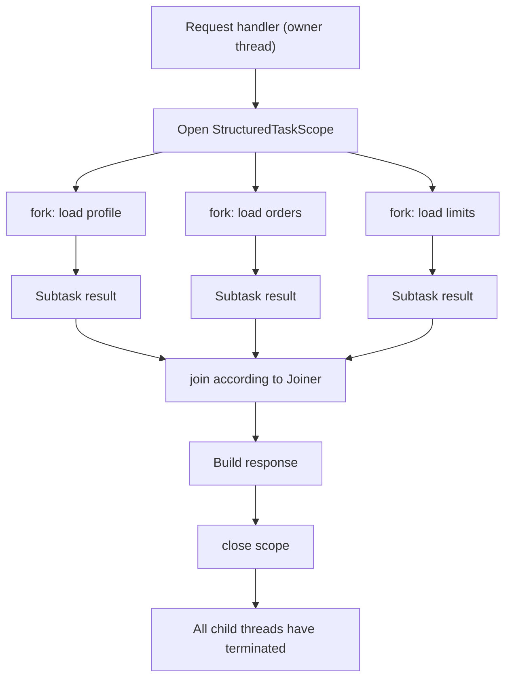

# Cấu hình preview và đánh giá lại API khi chuyển sang phiên bản JDK khác

**Structured Concurrency** giúp nhóm các tác vụ con có quan hệ với một tác vụ cha thành một đơn vị công việc. Phạm vi của các tác vụ được biểu diễn bằng `StructuredTaskScope`: tác vụ cha mở scope, fork các tác vụ con, join kết quả và đóng scope. Nếu một tác vụ con thất bại hoặc chính sách join đã đạt điều kiện kết thúc, các tác vụ còn lại có thể bị hủy; scope không đóng xong cho đến khi các thread con đã kết thúc.

Trong **Java 25**, Structured Concurrency vẫn là **preview API lần thứ năm**, theo **JEP 505**. Vì vậy, mã nguồn phải được biên dịch và chạy với `--enable-preview` trên đúng JDK 25. API này tiếp tục thay đổi ở Java 26 và Java 27. Đến nhánh JDK 28, **JEP 543** hoàn tất tính năng với hình dạng API đã được định hình ở JDK 27; JDK 28 vẫn là Early Access tại thời điểm biên soạn bài này (27-11-2026).

Bài thuộc chương **Structured Concurrency** của module `JAVA_VERSION_JAVA25`, tập trung vào cách cấu hình preview trong Java 25 và cách đánh giá thay đổi API khi nâng cấp JDK. Mục tiêu là giúp bạn nhận biết chính xác phiên bản đang biên dịch/chạy, hiểu vì sao class file preview không thể mang sang JDK khác, và lập kế hoạch chuyển từ API Java 25 sang API hiện hành.

> **Lưu ý phiên bản:** Ví dụ có `--enable-preview` trong bài được biên dịch và chạy bằng JDK 25. Không dùng ví dụ này như cấu hình mặc định cho JDK 26/27/28. Khi chuyển JDK, hãy biên dịch lại bằng toolchain đích và điều chỉnh API theo JEP của phiên bản đó.

## 1. Mục tiêu học tập

Sau bài này, bạn có thể:

1. Giải thích vì sao Structured Concurrency trong Java 25 vẫn cần preview flag.
2. Cấu hình `javac`, `java`, Maven, Gradle, test runner và IDE để dùng preview nhất quán.
3. Phân biệt `--enable-preview` với `--release`, `--source` và `--target`.
4. Hiểu giới hạn tương thích của class file được biên dịch bằng preview feature.
5. Sử dụng đúng API Java 25: `StructuredTaskScope.open`, `fork`, `join`, `Subtask` và `Joiner`.
6. Nhận diện các thay đổi API giữa JDK 25, 26, 27 và JDK 28.
7. Điều chỉnh exception handling, custom `Joiner`, timeout và kiểu generic khi nâng cấp.
8. Thiết kế CI kiểm tra đúng JDK compiler và runtime.
9. Quyết định khi nào nên tiếp tục thử nghiệm preview và khi nào nên chuyển sang API đã final.

## 2. Structured Concurrency giải quyết vấn đề gì?

Một request thường cần gọi nhiều nguồn dữ liệu độc lập: hồ sơ người dùng, đơn hàng, hạn mức và khuyến nghị. Nếu dùng các thread hoặc `Future` rời rạc, code phải tự quản lý việc chờ, hủy và thu gom kết quả. Khi request cha lỗi hoặc timeout, tác vụ con có thể tiếp tục chạy nếu không được hủy đúng cách.

Structured Concurrency tạo quan hệ cha-con có phạm vi rõ ràng:

- Tác vụ cha mở một scope.
- Tác vụ cha fork các tác vụ con trong scope đó.
- Các tác vụ con chạy đồng thời, mặc định trên virtual thread.
- Tác vụ cha join theo chính sách của scope.
- Scope đóng và chờ các tác vụ con kết thúc trước khi luồng điều khiển rời khỏi khối `try`.



### 2.1. Những bảo đảm quan trọng

| Quy tắc | Ý nghĩa |
|---|---|
| Scope có owner thread | Chỉ thread mở scope được gọi `fork`, `join` và `close` |
| Tác vụ con nằm trong scope | Vòng đời của chúng gắn với thao tác cha |
| Join áp dụng một chính sách | Chờ tất cả thành công, lấy kết quả đầu tiên thành công hoặc chính sách tùy chỉnh |
| Hủy có truyền tới tác vụ con | Các thread chưa hoàn thành được interrupt khi scope bị hủy |
| Close chờ thread con kết thúc | Tác vụ cha không rời scope khi child thread còn chạy |
| Scoped Values được kế thừa | Binding hiện hành được truyền vào các tác vụ con theo quy tắc của scope |

Tác vụ con phải phản hồi interruption. Nếu một subtask mắc kẹt trong thao tác không thể interrupt hoặc bỏ qua interrupt, `close()` có thể phải chờ rất lâu. Structured Concurrency không tự biến một lời gọi I/O không thể hủy thành lời gọi có thể hủy.

### 2.2. Khi nào nên dùng?

Phù hợp khi một thao tác cha cần một nhóm công việc con có quan hệ vòng đời, ví dụ:

- Một request cần gọi đồng thời nhiều service rồi tổng hợp kết quả.
- Một tác vụ cần truy vấn nhiều replica và chấp nhận kết quả đầu tiên hoặc đủ quorum.
- Một workflow có các bước song song nhưng cần hủy phần còn lại khi một nhánh thất bại.
- Một tác vụ cần truyền context bất biến qua cây tác vụ, kết hợp `ScopedValue`.

Không nên dùng scope để tạo background job sống lâu hơn request đã tạo nó. Với công việc cần tiếp tục sau khi request kết thúc, hãy dùng hàng đợi công việc, scheduler hoặc cơ chế xử lý nền có vòng đời riêng.

## 3. Vì sao Structured Concurrency trong Java 25 vẫn là preview?

Structured Concurrency là một API thư viện mới trong `java.util.concurrent`. Java 25 đưa API này vào lần preview thứ năm qua **JEP 505**. Preview có nghĩa là API đã có implementation để thử nghiệm và thu thập phản hồi, nhưng hợp đồng chưa được cam kết ổn định.

Preview feature có thể:

- Được giữ nguyên và trở thành permanent.
- Được điều chỉnh rồi preview lại trong bản JDK tiếp theo.
- Bị thay đổi đáng kể về kiểu dữ liệu, method hoặc exception.
- Bị rút khỏi một bản JDK tương lai.

Trong Java 25, `StructuredTaskScope`, `StructuredTaskScope.Joiner`, `StructuredTaskScope.Subtask`, `Configuration` và các exception preview đều được đánh dấu là preview API. Tính năng không tự bật mặc định.

### 3.1. Lịch sử phiên bản cần biết

| JDK | JEP | Trạng thái Structured Concurrency | Điều cần ghi nhớ |
|---|---|---|---|
| JDK 21 | JEP 453 | Preview lần đầu | API đời đầu dựa trên class và các chính sách shutdown |
| JDK 22 | JEP 462 | Preview lần hai | API tiếp tục được thử nghiệm |
| JDK 23 | JEP 480 | Preview lần ba | Tiếp tục điều chỉnh |
| JDK 24 | JEP 499 | Preview lần bốn | Còn thuộc giai đoạn preview |
| **JDK 25** | **JEP 505** | **Preview lần năm** | API chuyển sang `StructuredTaskScope` dạng interface, factory `open` và `Joiner` |
| JDK 26 | JEP 525 | Preview lần sáu | Điều chỉnh kết quả `Joiner` và callback timeout |
| JDK 27 | JEP 533 | Preview lần bảy | Bổ sung kiểu exception `R_X`, thay đổi exception/timeout và overload `open` |
| JDK 28 | JEP 543 | Final được tích hợp vào nhánh JDK 28 | Không đổi hình dạng API so với JDK 27; bỏ trạng thái preview |

Không lấy ví dụ cũ từ các preview JDK 21–24 rồi dùng trực tiếp trong Java 25. Những kiểu như `ShutdownOnFailure`/`ShutdownOnSuccess` thuộc các vòng API trước. Với Java 25, hãy bắt đầu từ `StructuredTaskScope.open()` và `Joiner`.

### 3.2. Trạng thái tại thời điểm hiện tại

Tại ngày 27-11-2026:

- JDK 25: Structured Concurrency là preview lần năm.
- JDK 26: preview lần sáu.
- JDK 27: preview lần bảy.
- JDK 28: JEP 543 đã được tích hợp để final hóa API; JDK 28 vẫn đang ở giai đoạn Early Access, chưa phải bản GA.

Khi JDK 28 GA được phát hành, kiểm tra lại release notes và API docs của đúng build triển khai. Không dùng một ad-hoc API build để khẳng định mọi vendor/build JDK 28 đã phát hành có cùng trạng thái.

## 4. Cấu hình preview bằng javac và java trên JDK 25

Để sử dụng preview API, cần bật preview ở **cả compile time và runtime**.

### 4.1. Kiểm tra toolchain

Xác nhận `java` và `javac` đang trỏ tới JDK 25:

```bash
java --version
javac --version
```

Kết quả cần cho biết cả hai công cụ thuộc JDK 25. Trong CI, kiểm tra thêm `JAVA_HOME` hoặc cấu hình toolchain của build tool; không chỉ dựa vào phiên bản Java hiển thị trong terminal tương tác.

### 4.2. Biên dịch

Giả sử source nằm ở `src/main/java/example/ParallelProfile.java`:

```bash
javac --enable-preview --release 25 \
      -d out \
      src/main/java/example/ParallelProfile.java
```

Ý nghĩa:

- `--enable-preview`: cho phép compiler chấp nhận preview feature của JDK đang dùng.
- `--release 25`: biên dịch theo Java SE 25 và API của Java 25.
- `-d out`: ghi class file vào thư mục `out`.

Khi dùng preview, release phải khớp với JDK đang cung cấp preview feature. Không thể dùng `javac` JDK 28 với `--enable-preview --release 25` để biên dịch lại preview API Java 25. Hãy dùng JDK 25 toolchain cho source preview 25.

### 4.3. Chạy

```bash
java --enable-preview -cp out example.ParallelProfile
```

Nếu chạy ứng dụng đóng gói thành JAR:

```bash
java --enable-preview -jar app.jar
```

Runtime cũng cần `--enable-preview`. Chỉ bật flag lúc biên dịch là chưa đủ. Khi chạy class file phụ thuộc preview feature mà preview chưa được bật, JVM từ chối tải hoặc thực thi class file đó.

### 4.4. Bật cảnh báo preview

Có thể yêu cầu compiler cung cấp chi tiết cảnh báo:

```bash
javac --enable-preview --release 25 -Xlint:preview \
      -d out \
      src/main/java/example/ParallelProfile.java
```

Cảnh báo giúp xác định vị trí source sử dụng preview API. Hãy giữ cảnh báo trong CI để nhóm phát triển nhận biết phần code phụ thuộc preview.

## 5. Cấu hình preview trong Maven

Dùng Maven compiler plugin để truyền `--release 25` và `--enable-preview` cho compiler. Test JVM cũng cần bật preview.

Ví dụ phần cấu hình trong `pom.xml`:

```xml
<properties>
    <maven.compiler.release>25</maven.compiler.release>
</properties>

<build>
    <plugins>
        <plugin>
            <groupId>org.apache.maven.plugins</groupId>
            <artifactId>maven-compiler-plugin</artifactId>
            <configuration>
                <release>25</release>
                <compilerArgs>
                    <arg>--enable-preview</arg>
                    <arg>-Xlint:preview</arg>
                </compilerArgs>
            </configuration>
        </plugin>

        <plugin>
            <groupId>org.apache.maven.plugins</groupId>
            <artifactId>maven-surefire-plugin</artifactId>
            <configuration>
                <argLine>--enable-preview</argLine>
            </configuration>
        </plugin>

        <plugin>
            <groupId>org.apache.maven.plugins</groupId>
            <artifactId>maven-failsafe-plugin</artifactId>
            <configuration>
                <argLine>--enable-preview</argLine>
            </configuration>
        </plugin>
    </plugins>
</build>
```

Chạy kiểm thử:

```bash
./mvnw clean verify
```

Lưu ý:

- Maven process, compiler toolchain và test runtime phải dùng JDK 25.
- `maven-compiler-plugin` phải hỗ trợ JDK đang dùng.
- Surefire và Failsafe chạy test trong JVM riêng; thêm `--enable-preview` vào runtime của các plugin này.
- Nếu dùng plugin khác để chạy ứng dụng, cấu hình preview cho JVM của plugin đó hoặc chạy launcher với flag tương ứng.
- Không đưa `--enable-preview` vào cấu hình cho mọi JDK vô điều kiện. Khi chuyển sang JDK có API final, hãy bỏ flag sau khi đã sửa source và test.

## 6. Cấu hình preview trong Gradle

Ví dụ dùng Groovy DSL trong `build.gradle`:

```groovy
java {
    toolchain {
        languageVersion = JavaLanguageVersion.of(25)
    }
}

tasks.withType(JavaCompile).configureEach {
    options.release = 25
    options.compilerArgs.add("--enable-preview")
    options.compilerArgs.add("-Xlint:preview")
}

tasks.withType(Test).configureEach {
    jvmArgs("--enable-preview")
}

tasks.withType(JavaExec).configureEach {
    jvmArgs("--enable-preview")
}
```

Chạy:

```bash
./gradlew clean test
```

Với Kotlin DSL (`build.gradle.kts`), cách cấu hình tương đương:

```kotlin
java {
    toolchain {
        languageVersion.set(JavaLanguageVersion.of(25))
    }
}

tasks.withType<JavaCompile>().configureEach {
    options.release.set(25)
    options.compilerArgs.add("--enable-preview")
    options.compilerArgs.add("-Xlint:preview")
}

tasks.withType<Test>().configureEach {
    jvmArgs("--enable-preview")
}

tasks.withType<JavaExec>().configureEach {
    jvmArgs("--enable-preview")
}
```

Kiểm tra thêm các task chạy integration test, application plugin hoặc custom JavaExec. Một cấu hình `Test` đúng không tự động bật preview cho mọi JVM do plugin khác khởi chạy.

## 7. Ví dụ Structured Concurrency đúng API Java 25

Ví dụ sau tải hồ sơ và danh sách đơn hàng song song. Cả hai kết quả đều cần thiết để tạo response.

```java
import java.util.List;
import java.util.concurrent.StructuredTaskScope;

record UserProfile(String name) {}
record Order(String id) {}
record ProfileResponse(UserProfile user, List<Order> orders) {}

public class ParallelProfile {

    static UserProfile findUser(String userId) {
        // Thay bằng lời gọi service thực tế.
        return new UserProfile("Duke");
    }

    static List<Order> findOrders(String userId) {
        // Thay bằng lời gọi service thực tế.
        return List.of(new Order("order-1001"));
    }

    static ProfileResponse load(String userId)
            throws InterruptedException {

        try (var scope = StructuredTaskScope.open()) {
            var user = scope.fork(() -> findUser(userId));
            var orders = scope.fork(() -> findOrders(userId));

            // Chính sách mặc định: chờ tất cả thành công,
            // hủy scope nếu một subtask thất bại.
            scope.join();

            return new ProfileResponse(user.get(), orders.get());
        } catch (StructuredTaskScope.FailedException e) {
            throw new IllegalStateException(
                "Không thể tải đầy đủ dữ liệu hồ sơ",
                e.getCause()
            );
        }
    }

    public static void main(String[] args) throws InterruptedException {
        System.out.println(load("user-42"));
    }
}
```

Biên dịch và chạy bằng JDK 25:

```bash
javac --enable-preview --release 25 -d out ParallelProfile.java
java --enable-preview -cp out ParallelProfile
```

### 7.1. Diễn giải vòng đời

1. `StructuredTaskScope.open()` tạo scope và gắn owner là thread hiện tại.
2. Mỗi `fork` khởi chạy một subtask trên thread mới; mặc định là virtual thread.
3. `join()` đợi theo chính sách của `Joiner` mặc định.
4. Nếu tất cả thành công, `Subtask.get()` lấy kết quả sau khi join.
5. Nếu một subtask thất bại, chính sách mặc định hủy scope và `join()` báo `FailedException`.
6. Khi rời `try`, `close()` bảo đảm các thread con đã kết thúc.

### 7.2. Subtask cần phản hồi interruption

Một subtask nên dừng nhanh khi bị interrupt. Với lời gọi I/O, dùng API có khả năng timeout/cancel phù hợp; không nuốt `InterruptedException`.

Ví dụ xử lý interruption trong một tác vụ:

```java
static Result callRemote() throws InterruptedException {
    try {
        return remoteClient.call();
    } catch (InterruptedException e) {
        Thread.currentThread().interrupt();
        throw e;
    }
}
```

Nếu API được gọi ném `InterruptedException`, giữ trạng thái interrupt khi chuyển đổi hoặc xử lý exception theo hợp đồng của ứng dụng. Không viết vòng lặp bỏ qua interrupt, vì scope có thể không đóng được trong thời gian hợp lý.

## 8. Joiner trong Java 25

Java 25 dùng `StructuredTaskScope.Joiner<T,R>` để định nghĩa chính sách hoàn thành và kết quả của `join()`. Đây là hướng thiết kế composition: scope nhận một joiner thay vì phải tạo subclass cho từng chính sách.

Một số factory method của Java 25:

| Joiner | Hành vi | Giá trị trả về từ `join()` |
|---|---|---|
| `awaitAllSuccessfulOrThrow()` | Chờ mọi subtask thành công; hủy scope khi có lỗi | `null` |
| `allSuccessfulOrThrow()` | Chờ mọi subtask thành công; hủy scope khi có lỗi | `Stream<Subtask<T>>` |
| `anySuccessfulResultOrThrow()` | Dừng khi có một subtask thành công; hủy các subtask còn lại | Kết quả đầu tiên thành công |
| `awaitAll()` | Chờ tất cả hoàn tất, không hủy chỉ vì một subtask lỗi | `null` |
| `allUntil(predicate)` | Hủy khi predicate trên subtask hoàn tất trả về `true` | `Stream<Subtask<T>>` |

Ví dụ thu thập kết quả cùng kiểu bằng `allSuccessfulOrThrow()` trong Java 25:

```java
import java.util.List;
import java.util.concurrent.StructuredTaskScope;

static List<String> searchAll(List<String> terms)
        throws InterruptedException {

    try (var scope = StructuredTaskScope.open(
            StructuredTaskScope.Joiner.<String>allSuccessfulOrThrow())) {

        terms.forEach(term -> scope.fork(() -> search(term)));

        // Java 25: join trả Stream<Subtask<String>>.
        return scope.join()
                    .map(StructuredTaskScope.Subtask::get)
                    .toList();
    }
}
```

Tạo một `Joiner` mới cho mỗi scope. Không chia sẻ một joiner chứa state giữa nhiều scope. Các callback `onComplete` có thể được gọi đồng thời từ nhiều thread, vì vậy custom joiner phải thread-safe. Giữ logic nghiệp vụ trong code gọi scope; joiner nên tập trung vào chính sách hoàn tất và tổng hợp kết quả.

## 9. Cấu hình tên scope, thread factory và timeout trong Java 25

Java 25 cho phép truyền hàm cấu hình vào factory `open`. Cấu hình mặc định tạo virtual thread không tên và không đặt timeout.

Ví dụ đặt tên scope và timeout:

```java
import java.time.Duration;
import java.util.concurrent.StructuredTaskScope;

try (var scope = StructuredTaskScope.open(
        StructuredTaskScope.Joiner.awaitAllSuccessfulOrThrow(),
        config -> config
            .withName("profile-page")
            .withTimeout(Duration.ofSeconds(2)))) {

    var user = scope.fork(() -> findUser("user-42"));
    var orders = scope.fork(() -> findOrders("user-42"));

    scope.join();

    return new ProfileResponse(user.get(), orders.get());
}
```

Tên scope hỗ trợ quan sát và quản lý. Timeout bắt đầu khi scope được mở. Trong Java 25, timeout khiến scope bị hủy và `join()` ném `StructuredTaskScope.TimeoutException` nếu timeout hết trước hoặc trong lúc join.

Timeout không bảo đảm mọi subtask lập tức dừng. Các thread con vẫn cần phản hồi interrupt; `close()` chờ chúng kết thúc.

## 10. Khác biệt API từ Java 25 sang Java 26

JDK 26 tiếp tục Structured Concurrency qua **JEP 525 — Sixth Preview**. Mô hình scope và joiner vẫn được giữ, nhưng một số kiểu trả về và tên API thay đổi.

### 10.1. Các thay đổi cần xử lý

| Java 25 (JEP 505) | Java 26 (JEP 525) | Tác động khi nâng cấp |
|---|---|---|
| `Joiner.allSuccessfulOrThrow()` trả `Stream<Subtask<T>>` | Trả `List<T>` | Bỏ bước `map(Subtask::get).toList()`; kết quả đã là list |
| `Joiner.anySuccessfulResultOrThrow()` | Đổi thành `Joiner.anySuccessfulOrThrow()` | Sửa tên factory method |
| `Joiner` chưa có callback timeout riêng | Thêm `onTimeout()` | Custom joiner có thể xử lý khi scope timeout |
| `TimeoutException` vẫn được dùng | Vẫn có `TimeoutException` | Xử lý callback và kết quả partial theo hợp đồng mới |
| `Joiner<T,R>` | Vẫn là `Joiner<T,R>` | Chưa có generic exception thứ ba |

Ví dụ Java 25:

```java
var results = scope.join()
    .map(StructuredTaskScope.Subtask::get)
    .toList();
```

Tương ứng Java 26, `allSuccessfulOrThrow()` trả thẳng danh sách kết quả:

```java
List<String> results = scope.join();
```

Đây là thay đổi source-level. Đừng chỉ đổi JDK chạy mà giữ nguyên class file preview Java 25; hãy biên dịch lại với JDK 26 và preview flag của JDK 26.

### 10.2. Callback timeout ở Java 26

Java 26 thêm `Joiner.onTimeout()`. Callback này được gọi khi timeout của scope hết trước hoặc trong lúc `join()` chờ. Joiner có thể xử lý dữ liệu đã hoàn thành trước deadline hoặc ném `TimeoutException` theo hợp đồng.

Nếu custom joiner cần trả partial result, hãy xác định rõ:

- Subtask nào đã hoàn thành trước deadline.
- Subtask nào chưa có kết quả.
- Kết quả partial có hợp lệ cho nghiệp vụ hay không.
- Caller có cần phân biệt timeout với lỗi subtask không.

Không biến timeout thành thành công giả bằng cách trả về một danh sách thiếu dữ liệu mà không có trạng thái thể hiện partial result.

## 11. Khác biệt API từ Java 26 sang Java 27

JDK 27 tiếp tục Structured Concurrency qua **JEP 533 — Seventh Preview**. Đây là lần thay đổi quan trọng hơn đối với exception typing và timeout.

### 11.1. Generic thứ ba R_X

Trong Java 25/26:

```text
StructuredTaskScope<T, R>
StructuredTaskScope.Joiner<T, R>
```

Từ Java 27, API thêm generic `R_X extends Throwable` để mô tả kiểu exception mà `join()` có thể ném:

```text
StructuredTaskScope<T, R, R_X extends Throwable>
StructuredTaskScope.Joiner<T, R, R_X extends Throwable>
```

Điều này giúp custom joiner khai báo checked exception riêng. Kiểu kết quả và kiểu lỗi của `join()` được mô tả trong type system, thay vì gói mọi lỗi custom trong một exception preview tổng quát.

### 11.2. Exception khi subtask thất bại

| Java 25/26 | Java 27 |
|---|---|
| Default joiner ném `StructuredTaskScope.FailedException` | Default throwing joiner ném `ExecutionException` |
| `FailedException.getCause()` chứa lỗi subtask | `ExecutionException.getCause()` chứa lỗi subtask |
| Custom `Joiner.result()` có thể ném `Throwable`, được bọc bởi `FailedException` | `R_X` cho phép khai báo exception cụ thể; custom joiner có thể ném kiểu đã khai báo |

Khi chuyển sang JDK 27, sửa `catch (StructuredTaskScope.FailedException)` thành xử lý exception phù hợp với joiner đang dùng, thường là `ExecutionException` cho default throwing joiner. Nếu dùng custom joiner, đọc kiểu `R_X` mà joiner khai báo; không giả định tất cả lỗi đều là `ExecutionException`.

### 11.3. Thay đổi timeout

| Java 25/26 | Java 27 |
|---|---|
| `StructuredTaskScope.TimeoutException` | Bỏ exception này |
| `Joiner.onTimeout()` | Thay bằng method trừu tượng `Joiner.timeout()` |
| Timeout thường được biểu diễn bằng exception preview riêng | `CancelledByTimeoutException` được dùng làm cause trong đường lỗi mặc định |
| Custom joiner xử lý timeout bằng callback `onTimeout` | Custom joiner triển khai `timeout()` và khai báo kiểu lỗi qua `R_X` |

JDK 27 cũng loại bỏ `Joiner.awaitAll()`. Nếu code dùng `awaitAll`, hãy đánh giá lại mục tiêu: chờ các tác vụ có side effect, thu thập kết quả hay xử lý fan-in. Chọn joiner còn được hỗ trợ và kiểm tra lại semantics khi một subtask thất bại.

### 11.4. Overload cấu hình scope

JDK 27 bổ sung overload `open(UnaryOperator<Configuration>)`, cho phép cấu hình scope mà không cần truyền joiner rõ ràng:

```java
try (var scope = StructuredTaskScope.open(
        config -> config
            .withName("profile-page")
            .withTimeout(Duration.ofSeconds(2)))) {

    var user = scope.fork(() -> findUser("user-42"));
    var orders = scope.fork(() -> findOrders("user-42"));

    scope.join();
    return new ProfileResponse(user.get(), orders.get());
}
```

Đây là API JDK 27 preview; khi chuyển sang JDK 27, biên dịch bằng JDK 27 với preview flag và kiểm tra chính xác kiểu exception của `join()`.

## 12. JDK 28: Structured Concurrency được final hóa

**JEP 543 — Structured Concurrency** được tích hợp vào nhánh JDK 28 để đưa API ra khỏi trạng thái preview. Hình dạng API final giữ nguyên hình dạng đã được định hình ở JDK 27; việc final hóa không tạo thêm một vòng đổi API source.

Khi dùng JDK 28 build có JEP 543:

- `StructuredTaskScope` không còn là preview API.
- `Joiner` và các thành phần liên quan không còn yêu cầu preview flag.
- Không truyền `--enable-preview` khi compile/run chỉ để dùng Structured Concurrency.
- Dùng generic `R_X`, exception typing và timeout API theo hình dạng JDK 27.
- Biên dịch lại source bằng JDK 28; không dùng lại class file preview từ JDK 25–27.

Ví dụ dạng API final trên JDK 28:

```java
import java.util.List;
import java.util.concurrent.ExecutionException;
import java.util.concurrent.StructuredTaskScope;

static ProfileResponse load(String userId)
        throws InterruptedException, ExecutionException {

    try (var scope = StructuredTaskScope.open()) {
        var user = scope.fork(() -> findUser(userId));
        var orders = scope.fork(() -> findOrders(userId));

        scope.join();

        return new ProfileResponse(user.get(), orders.get());
    }
}
```

Ví dụ này dùng default joiner; nếu subtask thất bại, `join()` ném `ExecutionException`. Nếu ứng dụng dùng custom joiner, khai báo `R_X` và kiểu lỗi cụ thể tương ứng. Với JDK 28 GA, xác nhận lại signature từ Java SE 28 API docs của đúng vendor/build trước khi xóa hoàn toàn cấu hình preview khỏi pipeline.

## 13. Bảng đối chiếu nhanh Java 25–28

| Thành phần | JDK 25 | JDK 26 | JDK 27 | JDK 28 |
|---|---|---|---|---|
| JEP | 505 | 525 | 533 | 543 |
| Trạng thái | Preview 5 | Preview 6 | Preview 7 | Final được tích hợp |
| `StructuredTaskScope` generic | `<T,R>` | `<T,R>` | `<T,R,R_X>` | `<T,R,R_X>` |
| `Joiner` generic | `<T,R>` | `<T,R>` | `<T,R,R_X>` | `<T,R,R_X>` |
| `allSuccessfulOrThrow()` | `Stream<Subtask<T>>` | `List<T>` | `List<T>` | `List<T>` |
| First-success joiner | `anySuccessfulResultOrThrow()` | `anySuccessfulOrThrow()` | `anySuccessfulOrThrow()` | `anySuccessfulOrThrow()` |
| Exception default | `FailedException` | `FailedException` | `ExecutionException` | `ExecutionException` |
| Timeout callback | Chưa có | `onTimeout()` | `timeout()` | `timeout()` |
| Timeout exception | `TimeoutException` | `TimeoutException` | `CancelledByTimeoutException` làm cause | `CancelledByTimeoutException` làm cause |
| `Joiner.awaitAll()` | Có | Có | Bị loại bỏ | Không có |
| `open(config)` không joiner | Chưa có | Chưa có | Có | Có |
| `--enable-preview` | Bắt buộc | Bắt buộc | Bắt buộc | Không cần cho Structured Concurrency |

Bảng này tóm tắt các thay đổi source-level quan trọng nhất cho migration. Khi nâng cấp thư viện hoặc vendor JDK, vẫn cần đọc API docs và release notes của bản build cụ thể.

## 14. Quy trình đánh giá API khi nâng cấp JDK

Đừng nâng JDK chỉ bằng cách đổi `JAVA_HOME` rồi chạy lại ứng dụng. Với preview API, cần kiểm tra cả compiler, bytecode, runtime, dependency và semantics.

### 14.1. Bước 1 — Ghi nhận baseline

Trước khi nâng cấp, ghi lại:

- Vendor và full version của JDK.
- JEP/preview round mà code đang sử dụng.
- Compiler flags (`--release`, `--enable-preview`).
- Runtime flags của application, test và integration test.
- Các class/API preview được dùng.
- Custom `Joiner`, timeout, exception handling và cách hủy subtask.
- Bộ test concurrency, timeout, cancellation và failure hiện có.

### 14.2. Bước 2 — Đọc JEP và API diff

Với mỗi lần nâng cấp:

1. Đọc JEP của preview mới hoặc JEP finalization.
2. Đọc API docs của `StructuredTaskScope`, `Joiner`, `Subtask`, `Configuration` và exception.
3. So sánh method signature, generic parameter, return type và checked exception.
4. Đọc release notes và migration guide.
5. Tìm tất cả nơi source dùng API preview bằng IDE hoặc tìm kiếm code.

Đừng chỉ đọc tiêu đề JEP. Nhiều thay đổi ảnh hưởng trực tiếp tới cách xử lý lỗi và timeout, dù mục tiêu tổng thể của API không đổi.

### 14.3. Bước 3 — Biên dịch bằng JDK đích

Với JDK 26/27 preview, dùng toolchain đúng phiên bản:

```bash
javac --enable-preview --release 26 -d out-26 src/main/java/example/*.java
java --enable-preview -cp out-26 example.Main
```

Khi chuyển sang JDK 27, thay `26` bằng `27` và sửa API trước khi biên dịch. Với JDK 28 có JEP 543 final, bỏ preview flag sau khi đã chuyển code sang API final.

### 14.4. Bước 4 — Kiểm thử semantics, không chỉ compile

Tối thiểu cần test:

- Một subtask thành công và tất cả thành công.
- Một subtask thất bại trong khi sibling còn đang chạy.
- Nhiều subtask thất bại gần như đồng thời.
- Timeout xảy ra trước khi join và trong lúc join.
- Owner thread bị interrupt.
- Subtask phản hồi và không phản hồi interrupt.
- Scope lồng nhau.
- Scoped Value binding được kế thừa vào subtask.
- Custom Joiner có state được truy cập đồng thời.
- Scope đóng khi có tác vụ chưa hoàn tất.

Compile thành công chỉ chứng minh source phù hợp với signature API. Nó không chứng minh hành vi cancellation, timeout và exception vẫn đúng với nghiệp vụ.

### 14.5. Bước 5 — Đánh giá runtime và observability

Kiểm tra:

- Thread dump có thể hiện cây scope/tác vụ theo kỳ vọng không.
- Timeout có dừng đúng các lời gọi downstream không.
- Không còn child thread chạy sau khi request kết thúc.
- Latency và resource usage không tăng bất thường.
- Log/metric phân biệt được lỗi subtask, timeout và interruption.
- Các APM agent, profiler và framework hỗ trợ đúng JDK mục tiêu.

### 14.6. Bước 6 — Bỏ preview flag đúng thời điểm

Chỉ bỏ `--enable-preview` khi runtime đích cung cấp API final và source đã được điều chỉnh theo API đó. Khi chuyển từ Java 27 sang JDK 28 final, biên dịch lại toàn bộ source và test suite; không giữ class file preview cũ trong artifact.

## 15. Những lỗi thường gặp khi cấu hình preview và nâng cấp

| Triệu chứng | Nguyên nhân | Cách xử lý |
|---|---|---|
| Compiler báo preview feature disabled | Thiếu `--enable-preview` lúc compile | Thêm flag vào compiler |
| Runtime từ chối class preview | Thiếu `--enable-preview` lúc chạy | Thêm flag vào JVM runtime cùng phiên bản |
| Preview class Java 25 chạy trên JDK 26 thất bại | Preview class file gắn với release đã biên dịch | Biên dịch lại bằng JDK 26 và sửa API |
| `--enable-preview` không dùng được với `--release 25` trên JDK mới hơn | Preview chỉ bật cho release của compiler hiện tại | Dùng JDK 25 toolchain cho preview 25 |
| Maven compile được nhưng Surefire lỗi | Test JVM không có preview flag | Cấu hình `argLine` cho Surefire/Failsafe |
| Gradle test lỗi dù compile được | Test/JavaExec task thiếu preview flag | Cấu hình JVM args cho từng task |
| Không tìm thấy `FailedException` khi chuyển JDK 27 | API đã chuyển sang exception typing mới | Dùng `ExecutionException` hoặc exception `R_X` phù hợp |
| `join()` không còn trả đúng kiểu cũ | `Joiner.allSuccessfulOrThrow()` đổi từ stream sang list ở JDK 26 | Sửa xử lý kết quả |
| Không tìm thấy `anySuccessfulResultOrThrow()` | Factory method đã đổi tên ở JDK 26 | Dùng `anySuccessfulOrThrow()` |
| Custom Joiner không compile ở JDK 27 | Generic thứ ba `R_X` và `timeout()` mới | Cập nhật type parameter và callback |
| `TimeoutException` không còn ở JDK 27 | Timeout API đã thay đổi | Xử lý `CancelledByTimeoutException` theo cause |
| Scope đóng rất lâu | Subtask không phản hồi interrupt hoặc bị kẹt ở I/O | Thiết kế cancellation/timeout cho lời gọi bên dưới |
| Test pass nhưng request vẫn treo | Test chưa bao phủ cancellation và close semantics | Bổ sung test interruption/timeout thực tế |

## 16. Chiến lược tổ chức code khi API còn preview

Nếu ứng dụng phải thử Structured Concurrency trên Java 25, cô lập phần phụ thuộc preview để migration không lan ra toàn bộ codebase.

Một hướng tổ chức:

```text
application/
  profile/
    ProfileService.java
    ProfileDataSource.java
  concurrency/
    ProfileTaskCoordinator.java
    StructuredConcurrencyAdapter.java
    SequentialCoordinator.java
```

`ProfileService` gọi một abstraction điều phối. Adapter Java 25 dùng `StructuredTaskScope`; adapter khác có thể dùng `ExecutorService` hoặc implementation phù hợp với JDK đích. Khi API final xuất hiện, chỉ cần thay adapter và kiểm tra contract.

Không expose `StructuredTaskScope`, `Joiner` hoặc `Subtask` trong public API của thư viện dùng chung nếu consumer không thể đảm bảo cùng JDK preview. Public API nên dùng kiểu ổn định của ứng dụng như record, interface và exception riêng.

Đây là biện pháp giảm phạm vi migration; nó không làm preview API trở thành stable API.

## 17. Checklist trước khi bật preview trong CI hoặc môi trường triển khai

- [ ] JDK compiler và runtime đúng cùng một release.
- [ ] `javac` dùng `--enable-preview --release 25`.
- [ ] Runtime dùng `--enable-preview`.
- [ ] Maven Surefire/Failsafe hoặc Gradle Test/JavaExec được cấu hình tương ứng.
- [ ] IDE dùng đúng JDK 25 và bật preview.
- [ ] CI log ghi rõ `java --version` và `javac --version`.
- [ ] Source không dùng API Structured Concurrency từ preview cũ.
- [ ] Custom Joiner thread-safe.
- [ ] Subtask phản hồi interruption.
- [ ] Test có failure, cancellation, timeout và nested scopes.
- [ ] Có kế hoạch cập nhật source khi JDK preview tiếp theo thay đổi API.
- [ ] Có kế hoạch rollback nếu API mới làm thay đổi semantics hoặc hiệu năng.
- [ ] Không publish artifact phụ thuộc preview như một thư viện ổn định cho consumer dùng JDK bất kỳ.

## 18. Ma trận nghiệm thu

| Mã | Kịch bản | Kết quả kỳ vọng |
|---|---|---|
| SC-PRE-01 | Xác nhận `java --version` và `javac --version` là JDK 25 | Compiler/runtime cùng release |
| SC-PRE-02 | Compile với `--enable-preview --release 25` | Source dùng StructuredTaskScope biên dịch được |
| SC-PRE-03 | Compile không có `--enable-preview` | Compiler từ chối preview API |
| SC-PRE-04 | Run class preview có `--enable-preview` | JVM tải và chạy class |
| SC-PRE-05 | Run class preview không có flag | JVM từ chối class phụ thuộc preview |
| SC-PRE-06 | Maven compile và Surefire | Cả compiler lẫn test JVM đều bật preview |
| SC-PRE-07 | Gradle compile và Test | Cả JavaCompile lẫn test runtime đều bật preview |
| SC-PRE-08 | Fork hai subtask và join | Scope trả kết quả đúng |
| SC-PRE-09 | Một subtask thất bại | Scope áp dụng chính sách hủy và báo lỗi đúng |
| SC-PRE-10 | Timeout scope | Các subtask được interrupt và kết quả timeout được xử lý |
| SC-PRE-11 | Subtask không phản hồi interrupt | Phát hiện close có thể bị trì hoãn |
| SC-PRE-12 | Scoped Value được bind ở owner | Subtask kế thừa binding theo quy tắc |
| SC-PRE-13 | Custom Joiner chạy đồng thời | Không có race condition |
| SC-PRE-14 | Chuyển JDK 25 sang JDK 26 | Sửa return type, tên joiner và timeout callback |
| SC-PRE-15 | Chuyển JDK 26 sang JDK 27 | Sửa `R_X`, exception và timeout API |
| SC-PRE-16 | Chuyển JDK 27 sang JDK 28 final | Biên dịch lại và bỏ preview flag |
| SC-PRE-17 | Kiểm tra artifact sau nâng cấp | Không còn class file preview của release cũ |
| SC-PRE-18 | Chạy integration test trên JDK đích | Cancellation, timeout và close đúng semantics |

## 19. Bài thực hành tổng hợp

### Bài A — Cấu hình preview Java 25

Tạo một ứng dụng nhỏ dùng `StructuredTaskScope.open()` và hai tác vụ con.

1. Xác nhận JDK 25.
2. Biên dịch với `javac --enable-preview --release 25`.
3. Chạy với `java --enable-preview`.
4. Bỏ flag ở compile và ghi lại lỗi.
5. Giữ compile flag nhưng bỏ runtime flag và ghi lại lỗi.
6. Thêm cấu hình tương đương vào Maven hoặc Gradle.

**Sản phẩm:** source, lệnh compile/run, log compiler và test.

### Bài B — Đánh giá khác biệt Java 25 và Java 26

Dùng `Joiner.allSuccessfulOrThrow()` để thu thập kết quả từ nhiều subtask.

1. Biên dịch Java 25 và ghi nhận kiểu `Stream<Subtask<T>>`.
2. Chuyển toolchain sang JDK 26 preview.
3. Sửa code để dùng `List<T>`.
4. Đổi `anySuccessfulResultOrThrow()` sang `anySuccessfulOrThrow()`.
5. Thử custom timeout handler bằng `onTimeout()`.

**Sản phẩm:** diff source và test xác nhận kết quả.

### Bài C — Đánh giá khác biệt Java 26 và Java 27

1. Chuyển sang JDK 27 preview.
2. Cập nhật `StructuredTaskScope` và `Joiner` với generic `R_X`.
3. Chuyển xử lý lỗi mặc định từ `FailedException` sang `ExecutionException`.
4. Chuyển callback `onTimeout()` sang `timeout()`.
5. Xử lý `CancelledByTimeoutException` theo cause.
6. Thay `Joiner.awaitAll()` nếu code đang sử dụng.

**Sản phẩm:** diff source, exception tests và timeout tests.

### Bài D — Chuyển sang JDK 28 final

Dùng JDK 28 build có JEP 543:

1. Biên dịch lại source theo API final.
2. Bỏ `--enable-preview` khỏi compile/test/runtime.
3. Xác nhận không còn import hoặc exception preview cũ.
4. Chạy toàn bộ test concurrency.
5. Ghi lại JDK vendor/build và API docs đã đối chiếu.

**Sản phẩm:** build log, test report và danh sách thay đổi migration.

### Bài E — Kiểm tra cancellation thực tế

Tạo hai subtask: một task hoàn thành nhanh, một task chờ I/O hoặc sleep có thể interrupt. Làm task nhanh thất bại để scope hủy task còn lại. Kiểm tra thời gian đóng scope, trạng thái thread và cách ứng dụng ghi nhận nguyên nhân hủy. Sau đó thay task chậm bằng một lời gọi không phản hồi interruption để quan sát rủi ro close bị trì hoãn trong môi trường test có kiểm soát.

## 20. Câu hỏi tự đánh giá

1. Vì sao Structured Concurrency trong Java 25 vẫn cần preview flag?
2. Vì sao phải bật preview ở cả compile time và runtime?
3. `--enable-preview` có cho phép biên dịch preview Java 25 bằng compiler JDK 28 không?
4. Vì sao class file preview của một release không nên được tái sử dụng trên release tiếp theo?
5. `StructuredTaskScope.open()` và `fork()` có vai trò gì?
6. Owner thread là gì và vì sao chỉ owner được điều khiển scope?
7. `join()` khác `close()` như thế nào?
8. Vì sao subtask phải phản hồi interruption?
9. `Joiner` trong Java 25 thay đổi thiết kế API so với các preview cũ như thế nào?
10. Vì sao `allSuccessfulOrThrow()` đổi từ `Stream<Subtask<T>>` sang `List<T>` ở Java 26?
11. `anySuccessfulResultOrThrow()` đổi thành tên nào ở Java 26?
12. JDK 27 thêm generic `R_X` để giải quyết vấn đề gì?
13. Vì sao `FailedException` được thay bằng `ExecutionException` ở default joiner trong JDK 27?
14. `onTimeout()` và `timeout()` khác nhau ở những phiên bản nào?
15. Vì sao cần kiểm tra `CancelledByTimeoutException` trong JDK 27?
16. JEP 543 thay đổi điều gì khi Structured Concurrency được final hóa trong JDK 28?
17. Khi nào cần bỏ `--enable-preview` khỏi Maven/Gradle?
18. Vì sao nên cô lập preview API trong adapter thay vì public API của thư viện?

**Tiêu chí hoàn thành:** Bạn cấu hình được Structured Concurrency preview trên đúng JDK 25, biên dịch và chạy được ví dụ, hiểu các thay đổi source-level qua JDK 26/27, và có quy trình chuyển sang JDK 28 final mà không tái sử dụng class file preview cũ hoặc bỏ sót thay đổi về exception, timeout và kết quả `Joiner`.

## 21. Nguồn tham khảo chính thức

- [OpenJDK JEP 505 — Structured Concurrency (Fifth Preview, JDK 25)](https://openjdk.org/jeps/505)
- [OpenJDK JEP 525 — Structured Concurrency (Sixth Preview, JDK 26)](https://openjdk.org/jeps/525)
- [OpenJDK JEP 533 — Structured Concurrency (Seventh Preview, JDK 27)](https://openjdk.org/jeps/533)
- [OpenJDK JEP 543 — Structured Concurrency (JDK 28)](https://openjdk.org/jeps/543)
- [Oracle Java SE 25 — Preview Language and VM Features](https://docs.oracle.com/en/java/javase/25/language/preview-language-vm-features.html)
- [Oracle Java SE 25 — StructuredTaskScope API](https://docs.oracle.com/en/java/javase/25/docs/api/java.base/java/util/concurrent/StructuredTaskScope.html)
- [Oracle Java SE 25 — StructuredTaskScope.Joiner API](https://docs.oracle.com/en/java/javase/25/docs/api/java.base/java/util/concurrent/StructuredTaskScope.Joiner.html)
- [Oracle Java SE 26 — StructuredTaskScope.Joiner API](https://docs.oracle.com/en/java/javase/26/docs/api/java.base/java/util/concurrent/StructuredTaskScope.Joiner.html)
- [Oracle Java SE 27 — StructuredTaskScope API](https://docs.oracle.com/en/java/javase/27/docs/api/java.base/java/util/concurrent/StructuredTaskScope.html)
- [Oracle JDK 25 Release Notes — Structured Concurrency (Fifth Preview)](https://www.oracle.com/java/technologies/javase/25-relnote-issues.html)
- [Oracle JDK 26 Release Notes — Structured Concurrency (Sixth Preview)](https://www.oracle.com/java/technologies/javase/26-relnote-issues.html)
- [Oracle JDK 27 Release Notes — Structured Concurrency (Seventh Preview)](https://www.oracle.com/java/technologies/javase/27-relnote-issues.html)
- [OpenJDK core-libs-dev — JEP 543 implementation and finalization discussion](https://www.mail-archive.com/core-libs-dev@openjdk.org/msg75711.html)

**Điểm cần nhớ:** Trên Java 25, Structured Concurrency vẫn là preview nên phải bật `--enable-preview` ở cả compiler và runtime cùng JDK 25. Khi nâng cấp, hãy đọc API diff theo từng JEP: Java 26 thay đổi kiểu trả về và timeout callback, Java 27 thay đổi exception typing và timeout contract, còn JDK 28 final hóa API theo hình dạng JDK 27. Luôn biên dịch lại bằng toolchain đích và chạy lại test cancellation, timeout, failure trước khi triển khai rộng.
