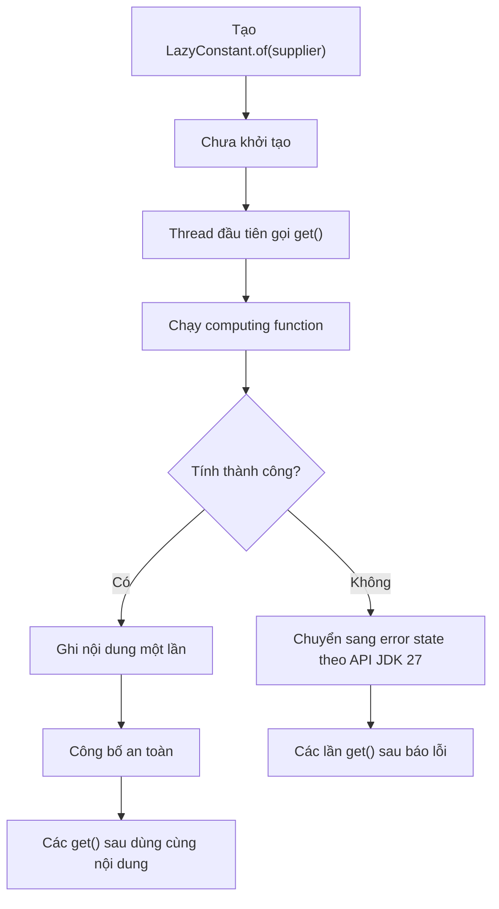
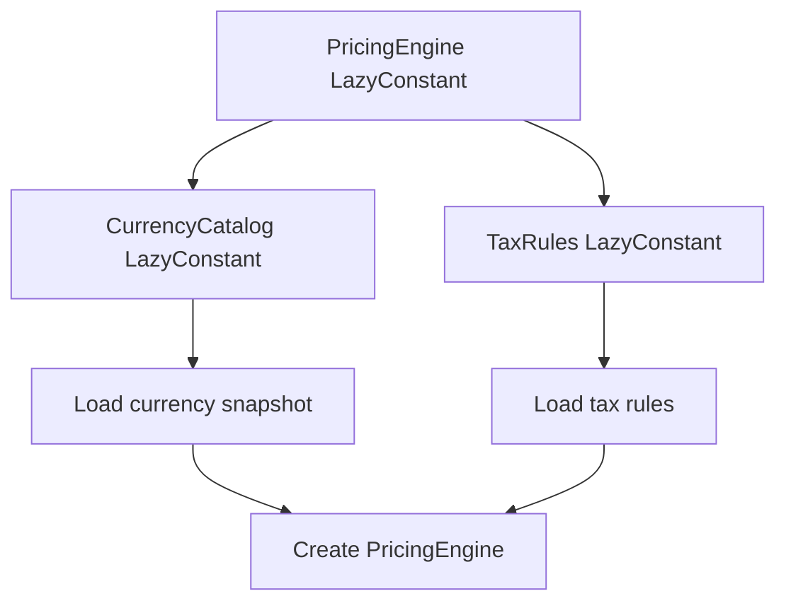

# Ứng dụng cho dữ liệu hoặc dịch vụ khởi tạo tốn chi phí sau khi đo đạc

**Stable Values** trong Java 25 là nền tảng cho một ý tưởng hữu ích: tạo một giá trị khi thật sự cần, sau đó giữ nguyên giá trị đó để JVM có thể tối ưu như một hằng số. Tuy nhiên, tên và API đã thay đổi sau Java 25. Từ JDK 26, tính năng được gọi là **Lazy Constants** và dùng **java.lang.LazyConstant**; JDK 27 tiếp tục điều chỉnh API và bổ sung các collection khởi tạo lười.

Vì vậy, khi áp dụng vào ứng dụng hiện nay, hãy hiểu mục tiêu thiết kế qua Stable Values nhưng viết code theo API **LazyConstant** hiện hành của JDK 27. JDK 25 chỉ có API **StableValue** ở trạng thái preview. Tại ngày 27-11-2026, Lazy Constants vẫn là preview: JDK 26 dùng JEP 526, JDK 27 dùng JEP 531; JEP 547 đã được nhắm tới JDK 28 như preview lần thứ tư, nhưng danh sách preview của JDK 28 Early Access build 25 vẫn hiển thị JEP 531. Hãy kiểm tra đúng build trước khi thử nghiệm.

Bài này thuộc chương **Stable Values** của module **JAVA_VERSION_JAVA25**, tập trung vào việc chọn dữ liệu hoặc dịch vụ khởi tạo tốn chi phí, đo lợi ích, áp dụng lazy initialization đúng chỗ và tránh chuyển chi phí từ startup sang request đầu tiên mà không nhận ra.

## 1. Mục tiêu học tập

Sau bài này, bạn có thể:

1. Giải thích vì sao một giá trị vừa được khởi tạo lười vừa bất biến sau khi tạo có thể được JVM tối ưu.
2. Phân biệt Stable Values của JDK 25 với Lazy Constants từ JDK 26.
3. Dùng **LazyConstant.of(Supplier)** và **get()** trên JDK 27.
4. Dùng **List.ofLazy**, **Map.ofLazy** và **Set.ofLazy** khi tập phần tử hoặc khóa đã biết trước.
5. Chọn dữ liệu phù hợp như bảng tra cứu, rule engine, parser metadata hoặc cấu hình bất biến.
6. Đo startup, lần truy cập đầu tiên, steady-state latency, CPU, allocation và memory trước khi áp dụng.
7. Hiểu cách Lazy Constant đồng bộ hóa, công bố an toàn và xử lý lỗi.
8. Nhận biết rủi ro từ dependency cycle, blocking, memory retention và lifecycle của tài nguyên.
9. Xác định trường hợp nên dùng cache có eviction, DI provider hoặc cơ chế refresh thay vì Lazy Constant.
10. Lập kế hoạch migration từ JDK 25 sang API mới mà không dùng lại các method preview đã bị loại bỏ.

## 2. Vấn đề: khởi tạo eager có thể làm chậm đường khởi động

Một ứng dụng thường tạo nhiều thành phần ngay khi class được nạp hoặc container khởi động:

- Bộ máy đánh giá chính sách với hàng nghìn rule.
- Bảng mã quốc gia, tiền tệ hoặc vùng địa lý được đọc từ tài nguyên.
- Parser/schema registry phải phân tích metadata.
- Bộ máy tìm kiếm hoặc compiler nội bộ cần dựng index.
- Bộ dữ liệu tra cứu được tạo từ file cấu hình lớn.
- Thành phần chỉ được dùng trong một tính năng ít người truy cập.

Nếu ứng dụng luôn khởi tạo tất cả thành phần, startup sẽ phải trả chi phí ngay cả khi một số tính năng không bao giờ được dùng trong process đó.

Ví dụ eager initialization:

```java
public final class ApplicationServices {

    private static final RuleEngine RULE_ENGINE =
            RuleEngine.loadAndCompile("/rules");

    public static RuleEngine ruleEngine() {
        return RULE_ENGINE;
    }
}
```

**RuleEngine.loadAndCompile()** chạy trong quá trình khởi tạo class **ApplicationServices**. Nếu việc này tốn 700 ms và chỉ 15% process thực sự cần rule engine, phần lớn lần khởi động đã làm công việc không cần thiết.

Lazy initialization trì hoãn việc tạo đối tượng tới lần đầu truy cập. Lazy Constant bổ sung một thuộc tính: sau khi đã tạo, giá trị không thể bị thay đổi hoặc thay thế qua holder. Nhờ đó, JVM có thể coi giá trị đã được khởi tạo như constant trong các điều kiện tối ưu phù hợp.

## 3. Stable Values và Lazy Constants: cùng mục tiêu, API đã đổi tên

Tên Stable Values mô tả tính chất của holder: nội dung chỉ được thiết lập tối đa một lần. Tên Lazy Constants mô tả rõ hơn cách dùng phổ biến: giá trị được tính khi cần và trở thành constant sau khi tính xong.

| Phiên bản | JEP | Tên/API | Trạng thái |
|---|---|---|---|
| JDK 25 | JEP 502 | StableValue trong java.lang | Preview lần đầu |
| JDK 26 | JEP 526 | LazyConstant trong java.lang | Preview lần hai |
| JDK 27 | JEP 531 | LazyConstant và lazy collections | Preview lần ba |
| JDK 28 | JEP 547 | Lazy Constants | Preview lần bốn được nhắm tới; xác minh build EA cụ thể |

Các điểm migration quan trọng:

- JDK 25 dùng **StableValue.of()** và **orElseSet()** hoặc **StableValue.supplier(...)**.
- JDK 26 chuyển sang **LazyConstant.of(Supplier)** và **get()**.
- JDK 26 có **isInitialized()** và **orElse()**, nhưng các method này không còn trong API JDK 27.
- JDK 27 dùng **LazyConstant** như một **Supplier<T>**, và có **List.ofLazy**, **Map.ofLazy**, **Set.ofLazy** cho các tập dữ liệu có miền xác định.
- JDK 28 chưa phải bản GA tại ngày biên soạn; JEP 547 được nhắm tới như preview thứ tư. Không coi tính năng đã final.

**Đối với code mới cần chạy trên JDK 26/27, dùng LazyConstant.** Tên StableValue chỉ cần thiết khi duy trì source dành riêng cho JDK 25.

## 4. Lazy Constant hoạt động như thế nào?

Một Lazy Constant được tạo bằng factory **LazyConstant.of(computingFunction)**. Khi mới tạo, nó chưa có nội dung. Lần đầu gọi **get()**:

1. Một thread được chọn để thực thi computing function.
2. Thread đó tính và thiết lập nội dung.
3. Khi tính thành công, nội dung trở thành bất biến qua Lazy Constant.
4. Những thread khác đang chờ sẽ quan sát cùng giá trị.
5. Các lần **get()** tiếp theo trả về nội dung đã được khởi tạo.



Ví dụ khởi tạo một logger:

```java
import java.lang.LazyConstant;
import java.util.logging.Logger;

public final class OrderComponent {

    private final LazyConstant<Logger> logger =
            LazyConstant.of(
                    () -> Logger.getLogger(OrderComponent.class.getName())
            );

    public void process() {
        logger.get().info("Processing order");
    }
}
```

Đối tượng **LazyConstant** được tạo khi **OrderComponent** được tạo. Logger chỉ được lấy khi **process()** thực sự cần dùng. Nếu không gọi **process()**, computing function không chạy.

### 4.1. Giá trị được khởi tạo tối đa một lần

Nếu nhiều thread đồng thời gọi **get()** khi Lazy Constant chưa khởi tạo, chỉ một thread chạy computing function. Những thread còn lại chờ kết quả hoặc chờ quá trình khởi tạo kết thúc bất thường.

Điều này quan trọng nếu supplier có side effect như đọc và biên dịch rule file, tạo bảng tra cứu hoặc dựng metadata. Không cần tự viết double-checked locking cho cùng một giá trị.

### 4.2. Nội dung được công bố an toàn

Việc tính toán và khởi tạo Lazy Constant có quan hệ happens-before với lần đọc nội dung đã khởi tạo. Những field **final** bên trong object vừa tạo được công bố an toàn cho thread đọc.

Điều đó không làm mọi object bên trong trở thành immutable. Nếu Lazy Constant giữ một **ArrayList**, list đó vẫn có thể bị sửa và cần cơ chế bảo vệ thread-safety riêng.

### 4.3. Supplier chạy trên thread gọi get()

Lazy Constant không tự tạo executor hoặc background thread. Thread đầu tiên gọi **get()** chính là thread chạy computing function.

Nếu computing function mất 500 ms, request đầu tiên gọi **get()** có thể phải chờ 500 ms. Các request đồng thời khác cũng có thể chờ quá trình khởi tạo đó. Vì vậy, cần đo cả startup lẫn first-use latency.

## 5. Ứng dụng 1: rule engine hoặc bảng chính sách chỉ dùng ở một số request

Đây là trường hợp phù hợp nếu:

- Rule engine tốn thời gian phân tích và biên dịch.
- Tập rule không thay đổi trong suốt vòng đời process.
- Không phải request nào cũng gọi engine.
- Việc khởi tạo có thể thực hiện đồng bộ khi cần.
- Engine an toàn khi được nhiều thread sử dụng sau khi tạo.

Ví dụ trên JDK 27:

```java
import java.lang.LazyConstant;

public final class PricingRules {

    private static final LazyConstant<RuleEngine> ENGINE =
            LazyConstant.of(
                    () -> RuleEngine.loadAndCompile("/rules/pricing")
            );

    private PricingRules() {}

    public static RuleEngine engine() {
        return ENGINE.get();
    }
}
```

Các request không cần tính giá theo rule có thể không bao giờ khởi tạo engine. Khi một request đầu tiên cần engine, nó sẽ kích hoạt việc load và compile.

### 5.1. Không dùng Lazy Constant cho rule cần refresh

Nếu rule thay đổi khi quản trị viên cập nhật cấu hình, Lazy Constant không có API reset hoặc thay nội dung. Một khi đã khởi tạo, nội dung không thể được thay bằng giá trị mới.

Với rule cần refresh, hãy dùng một trong các mô hình sau:

- Atomic reference trỏ tới immutable rule snapshot; publisher thay snapshot khi có phiên bản mới.
- Cache có TTL hoặc invalidation.
- Config service có version và refresh callback.
- DI container có cơ chế reload/recreate bean phù hợp.

Lazy Constant phù hợp với một snapshot bất biến trong vòng đời holder, không phải kho cấu hình có thể thay đổi.

## 6. Ứng dụng 2: dữ liệu tham chiếu đắt tiền nhưng không thay đổi

Ví dụ ứng dụng có bảng tiền tệ, danh mục vùng hoặc metadata của parser. Việc đọc và kiểm tra file có thể tốn chi phí, nhưng dữ liệu được dùng lại nhiều lần.

```java
import java.lang.LazyConstant;
import java.util.Map;

public final class CurrencyCatalog {

    private static final LazyConstant<Map<String, CurrencyInfo>> CATALOG =
            LazyConstant.of(CurrencyCatalog::loadCatalog);

    private CurrencyCatalog() {}

    public static CurrencyInfo find(String code) {
        return CATALOG.get().get(code);
    }

    private static Map<String, CurrencyInfo> loadCatalog() {
        // Đọc file, xác thực schema và tạo immutable snapshot.
        return CatalogLoader.loadCurrencies();
    }
}
```

Ở đây, nên tạo map immutable trước khi trả về. Lazy Constant giữ reference ổn định tới snapshot đó. Nếu trả về map có thể sửa, holder không ngăn code khác thay đổi nội dung map.

### 6.1. Khi nào nên khởi tạo eager?

Nếu mọi request đều cần **CurrencyCatalog**, lazy initialization có thể chỉ chuyển thời gian load từ startup sang request đầu tiên. Nếu ứng dụng cần dữ liệu này trước khi readiness thành công, hãy khởi tạo trong startup lifecycle và kiểm tra lỗi trước khi nhận traffic.

Lazy không tự làm phép tính nhanh hơn. Nó giúp trì hoãn phép tính và giữ kết quả sau khi đã tạo.

## 7. Ứng dụng 3: đồ thị phụ thuộc giữa các thành phần

Các thành phần đắt tiền có thể phụ thuộc nhau. Ví dụ engine định giá cần bảng tiền tệ và bộ quy tắc thuế.

```java
import java.lang.LazyConstant;

public final class PricingComponents {

    private static final LazyConstant<CurrencyCatalog> CURRENCIES =
            LazyConstant.of(CurrencyCatalog::load);

    private static final LazyConstant<TaxRules> TAX_RULES =
            LazyConstant.of(TaxRules::load);

    private static final LazyConstant<PricingEngine> ENGINE =
            LazyConstant.of(
                    () -> new PricingEngine(
                            CURRENCIES.get(),
                            TAX_RULES.get()
                    )
            );

    private PricingComponents() {}

    public static PricingEngine engine() {
        return ENGINE.get();
    }
}
```

Khi gọi **ENGINE.get()**, engine được tạo. Nếu catalog hoặc tax rules chưa có, các Lazy Constant phụ thuộc sẽ được khởi tạo trước.



### 7.1. Tránh dependency cycle

Nếu A cần B trong constructor và B lại gọi **A.get()**, dependency graph có chu trình. Lazy Constant phát hiện recursive initialization và báo lỗi theo hợp đồng API.

Thiết kế dependency theo hướng một chiều. Đưa phần dùng chung vào một thành phần nền, sau đó để A và B phụ thuộc vào thành phần nền thay vì phụ thuộc vòng tròn.

### 7.2. Lưu ý class initialization

Dùng Lazy Constant trong static initializer có thể tương tác với thứ tự khởi tạo class. Nếu nhiều class có static dependency lồng nhau, hãy kiểm tra class initialization order và tránh gọi ngược giữa các class khi đang khởi tạo.

## 8. Lazy collections trong JDK 27

Khi có nhiều giá trị độc lập nhưng miền đầu vào đã biết trước, một Lazy Constant đơn lẻ có thể không đủ. JDK 27 có các factory collection lazy:

| API | Miền đầu vào | Cách tính |
|---|---|---|
| **List.ofLazy(size, mapper)** | Chỉ số [0, size) | IntFunction tính từng phần tử khi được truy cập |
| **Map.ofLazy(keys, mapper)** | Tập key cố định từ đầu | Function tính value khi key được truy cập |
| **Set.ofLazy(candidates, predicate)** | Tập candidate cố định từ đầu | Predicate tính membership khi cần |

Các collection này không sửa đổi được. Mỗi phần tử, value hoặc membership status được tính tối đa một lần cho từng index/key/candidate thành công theo hợp đồng của API; các truy cập cạnh tranh chờ kết quả.

### 8.1. Lazy List: tạo pool dữ liệu theo index

Giả sử ứng dụng có một pool gồm 16 parser độc lập, nhưng không phải instance nào cũng được dùng trong mọi process:

```java
import java.util.List;

public final class ParserPool {

    private static final int SIZE = 16;

    private static final List<Parser> PARSERS =
            List.ofLazy(SIZE, index -> Parser.create(index));

    private ParserPool() {}

    public static Parser get(int index) {
        return PARSERS.get(index);
    }
}
```

Mỗi index có một parser được tạo khi lần đầu truy cập. List không cho thêm, xóa hoặc thay phần tử. Chỉ dùng cách này khi kích thước pool cố định và parser có thể sống trong toàn bộ vòng đời process.

Không dùng chỉ số thread ID làm chiến lược phân phối pool nếu thread count hoặc vòng đời thread không được kiểm soát. Hãy dùng connection pool hoặc object pool có chính sách thuê/trả rõ ràng nếu cần phân phối tài nguyên có giới hạn.

### 8.2. Lazy Map: các key đã biết trước

Ví dụ tính metadata cho một tập mã quốc gia cố định:

```java
import java.util.Map;
import java.util.Set;

public final class CountryMetadata {

    private static final Set<String> CODES =
            Set.of("VN", "SG", "JP", "AU", "DE");

    private static final Map<String, Metadata> VALUES =
            Map.ofLazy(CODES, CountryMetadata::load);

    private CountryMetadata() {}

    public static Metadata find(String code) {
        return VALUES.get(code);
    }

    private static Metadata load(String code) {
        return MetadataLoader.load(code);
    }
}
```

Map chỉ biết những key đã cung cấp khi tạo. Nếu cần thêm key động, đây không phải cache tổng quát. Dùng cache phù hợp với miền key thay đổi, có eviction và giới hạn kích thước.

### 8.3. Lazy Set: xác định membership theo nhu cầu

Ví dụ có một tập tùy chọn cấu hình đã biết, nhưng việc xác định mỗi option có bật hay không cần đọc nhiều nguồn:

```java
import java.util.Set;

public final class EnabledOptions {

    private static final Set<String> CANDIDATES =
            Set.of("DRY_RUN", "VERBOSE", "STRICT", "AUDIT");

    private static final Set<String> ENABLED =
            Set.ofLazy(CANDIDATES, EnabledOptions::isEnabled);

    private EnabledOptions() {}

    public static boolean contains(String option) {
        return ENABLED.contains(option);
    }

    private static boolean isEnabled(String option) {
        return ConfigResolver.resolve(option);
    }
}
```

Predicate chỉ chạy khi membership của candidate được yêu cầu. Tập trả về không sửa đổi được và chỉ có thể chứa các candidate đã khai báo lúc tạo.

## 9. Đo đạc trước khi chuyển sang lazy initialization

Đề bài yêu cầu áp dụng sau khi đo đạc. Không nên chuyển mọi field sang lazy chỉ vì API mới tồn tại.

Hãy bắt đầu bằng một baseline có thể lặp lại.

### 9.1. Các chỉ số cần thu thập

| Chỉ số | Câu hỏi cần trả lời |
|---|---|
| Process startup time | Thành phần đang xét đóng góp bao nhiêu vào startup? |
| Time to readiness | Ứng dụng sẵn sàng nhận traffic sau bao lâu? |
| First-use latency | Request đầu tiên cần thành phần đó mất bao lâu? |
| First-use p95/p99 | Có request nào bị chậm mạnh khi nhiều thread cùng khởi tạo? |
| Steady-state latency | Sau khi khởi tạo, các lần truy cập có đủ nhanh không? |
| CPU time | Việc khởi tạo tốn bao nhiêu CPU? |
| Allocation bytes | Load/compile tạo bao nhiêu object? |
| Heap live set | Thành phần giữ lại bao nhiêu bộ nhớ sau khi tạo? |
| GC activity | Thành phần có tạo áp lực allocation/GC đáng kể không? |
| Feature adoption | Bao nhiêu process thực sự sử dụng thành phần trong vòng đời? |

### 9.2. So sánh eager và lazy

Chạy cùng binary logic, dữ liệu, JDK, CPU quota và heap limit:

- **Eager:** khởi tạo thành phần trong startup.
- **Lazy:** khởi tạo khi lần đầu gọi **get()**.

Ghi ít nhất ba nhóm kết quả:

1. Startup và readiness.
2. Request/job đầu tiên gọi thành phần.
3. Steady-state sau khi thành phần đã được khởi tạo.

Nếu chỉ đo startup, bạn có thể thấy ứng dụng nhanh hơn nhưng bỏ qua việc request đầu tiên bị tăng latency. Nếu chỉ đo steady-state, bạn có thể bỏ qua lợi ích giảm startup.

### 9.3. Lặp lại và kiểm soát nhiễu

- Dùng cùng JDK vendor/build và cùng JVM flags.
- Chạy process mới cho mỗi lượt cold-start.
- Dùng cùng dataset và cùng kịch bản request.
- Warm-up các phần không liên quan trước khi đo steady-state.
- Đổi thứ tự eager/lazy giữa các lượt.
- Ghi median và p95/p99; không kết luận từ một lần chạy.
- Dùng cùng cấu hình JFR hoặc tách riêng lượt đo có instrumentation và không instrumentation.

## 10. Dùng JFR và JMH để kiểm chứng

JFR giúp quan sát startup, class loading, allocation, GC và các khoảng thời gian xử lý. Có thể thêm custom JFR event cho quá trình khởi tạo thành phần để biết thời điểm và duration.

Ví dụ custom event:

```java
import jdk.jfr.Event;
import jdk.jfr.Label;

@Label("Rule Engine Initialization")
public class RuleEngineInitializationEvent extends Event {
    @Label("Rule Set")
    public String ruleSet;
}
```

Đo quanh thao tác khởi tạo:

```java
static RuleEngine loadRuleEngine() {
    var event = new RuleEngineInitializationEvent();
    event.ruleSet = "pricing";

    event.begin();
    try {
        return RuleEngine.loadAndCompile("/rules/pricing");
    } finally {
        event.end();
        event.commit();
    }
}
```

Recording JFR có thể giúp trả lời:

- Thời điểm nào engine được khởi tạo?
- Thread nào thực hiện khởi tạo?
- Khởi tạo có trùng với request latency tăng không?
- Có allocation hoặc GC burst cùng thời điểm không?

JMH phù hợp để đo các đường truy cập nhỏ và allocation của dữ liệu. Tuy nhiên, benchmark **get()** sau khi Lazy Constant đã khởi tạo không đại diện cho cold initialization. Hãy tách benchmark khởi tạo mới và benchmark truy cập đã khởi tạo; dùng macrobenchmark cho startup và request thật.

Không kết luận hiệu năng từ một benchmark chỉ gọi cùng một static Lazy Constant trong một fork. JIT có thể tối ưu đường truy cập sau warm-up và làm kết quả khác đáng kể so với lần khởi tạo đầu tiên.

## 11. Xác định ngưỡng áp dụng

Một thành phần phù hợp để thử Lazy Constant khi đồng thời có các dấu hiệu:

- Chi phí khởi tạo đo được là đáng kể.
- Thành phần không được dùng trong mọi process hoặc mọi request.
- Kết quả sau khi tạo không cần refresh trong vòng đời holder.
- Computing function có thể chạy đồng bộ trên thread đầu tiên truy cập.
- Các thread có thể chờ trong khoảng thời gian khởi tạo.
- Đối tượng kết quả có thể được dùng an toàn sau khi tạo.
- Không cần eviction, timeout hoặc cancellation tích hợp.

Bảng quyết định:

| Đặc điểm | Lựa chọn phù hợp |
|---|---|
| Singleton immutable, khởi tạo chậm, chỉ dùng ở một số process | Lazy Constant |
| Singleton luôn được dùng ngay sau startup | Eager initialization hoặc warm-up có kiểm soát |
| Metadata theo tập key cố định | **Map.ofLazy** |
| Giá trị theo index trong miền cố định | **List.ofLazy** |
| Membership theo tập candidate cố định | **Set.ofLazy** |
| Cache key động, cần TTL/eviction | Cache chuyên dụng |
| Service cần close/dispose hoặc refresh | DI container/lifecycle manager |
| Remote call có timeout/retry/cancel | Client hoặc async abstraction chuyên dụng |
| Secret/config có thể rotate | Config/secret provider có refresh |
| Dữ liệu theo request/user | Tính theo request hoặc request-scoped cache |

## 12. Những giới hạn phải hiểu trước khi dùng

### 12.1. Không có reset hoặc invalidation

Sau khi khởi tạo, nội dung không thể được thay hoặc xóa qua Lazy Constant. Nếu dữ liệu thay đổi theo thời gian, cần một mô hình versioned snapshot hoặc cache có invalidation.

### 12.2. Không có timeout hoặc cancellation

**LazyConstant.get()** không cung cấp timeout hoặc cancellation. Nếu computing function bị kẹt, thread đầu tiên tiếp tục bị kẹt và những thread cạnh tranh có thể chờ vô hạn.

Thread interruption không hủy quá trình khởi tạo. **get()** không xóa trạng thái interrupt và không ném **InterruptedException** chỉ vì thread bị interrupt.

### 12.3. Lỗi khởi tạo trong JDK 27 chuyển sang error state

Trong API JDK 27, nếu computing function ném unchecked exception hoặc trả **null**, Lazy Constant chuyển sang error state. Lần truy cập sau ném **NoSuchElementException**; computing function không tự chạy lại.

Vì vậy:

- Không dùng Lazy Constant cho thao tác có lỗi tạm thời cần retry tự động.
- Không trả **null**; dùng **Optional<T>** nếu nghiệp vụ cần biểu diễn không có giá trị.
- Nếu cần retry/backoff, hãy dùng một abstraction có trạng thái retry rõ ràng.
- Ghi nhận lỗi khởi tạo để vận hành có thể phát hiện.

Đây là khác biệt quan trọng so với StableValue trong JDK 25 và LazyConstant JDK 26, nơi hợp đồng exception đã khác. Không giả định hành vi retry giữa các release là giống nhau.

### 12.4. Nội dung được giữ mạnh và không tự giải phóng

Lazy Constant giữ strong reference tới nội dung đã tạo. Nếu holder còn reachable, object được giữ lại. Điều này có thể tạo memory retention ngoài dự kiến nếu giá trị chứa graph lớn.

Không dùng nó cho dữ liệu cần eviction hoặc giải phóng theo thời gian.

### 12.5. Không đảm bảo nội dung sâu bất biến

Holder không thay đổi nội dung sau khi set, nhưng object được chứa có thể mutable. Nếu nhiều thread dùng chung service hoặc collection, object đó vẫn phải có thiết kế thread-safe.

### 12.6. Không hỗ trợ Serializable

Lazy Constant không phải kiểu serialization. Không đưa holder vào DTO, session hoặc persistent model với kỳ vọng nó tự serialize.

### 12.7. Tránh đồng bộ hóa trực tiếp trên holder

Implementation có thể đồng bộ trên chính Lazy Constant. Không dùng holder làm monitor trong **synchronized (lazyConstant)** và tránh lock graph có thể gây deadlock.

## 13. Lazy Constant không thay thế dependency injection và resource lifecycle

Một service có thể cần:

- Khởi tạo kết nối hoặc pool.
- Đăng ký shutdown hook.
- Đóng file/socket.
- Refresh chứng chỉ hoặc token.
- Reconnect khi dependency phục hồi.
- Health check và readiness state.

Lazy Constant chỉ cung cấp một giá trị được tính tối đa một lần. Nó không quản lý lifecycle hoặc resource disposal.

Nếu dùng Spring hoặc một DI container khác, hãy ưu tiên cơ chế lazy bean/provider của container khi container cần quản lý destroy method, scope, proxy, lifecycle callback và readiness.

Có thể dùng Lazy Constant cho một immutable engine hoặc metadata bên trong service đã được container quản lý, nhưng đừng bọc connection pool hoặc service closeable mà không có kế hoạch đóng tài nguyên rõ ràng.

## 14. Đường tối ưu của JVM: constant folding

Sau khi Lazy Constant được khởi tạo, nội dung không thể đổi. JVM có thể loại bỏ các lần đọc holder trong một số điều kiện và dùng trực tiếp giá trị đã quan sát. Đây là dạng constant folding.

Khả năng này phụ thuộc đường tham chiếu tới holder. Với JDK 27, tối ưu có thể áp dụng khi có tham chiếu trực tiếp từ **static final** field hoặc chuỗi trusted fields như field **static final**, field record hoặc final instance field của hidden class.

Ví dụ:

```java
private static final LazyConstant<LookupTable> TABLE =
        LazyConstant.of(LookupTable::load);
```

Đây là hình dạng thuận lợi để JVM xem xét tối ưu. Tuy nhiên, constant folding là quyền tối ưu của JVM, không phải cam kết rằng mọi lần **get()** sẽ bị loại bỏ hoặc mọi ứng dụng đều nhanh hơn.

Đừng viết code dựa trên giả định compiler luôn thay **get()** bằng một literal. Đo bằng JFR/JMH và workload thật.

## 15. Migration từ Java 25 StableValue sang LazyConstant

Bảng dưới đây tập trung các thay đổi cần biết khi chuyển source.

| JDK 25 Stable Values | JDK 26 Lazy Constants | JDK 27 Lazy Constants |
|---|---|---|
| **StableValue<T>** | **LazyConstant<T>** | **LazyConstant<T>** |
| **StableValue.supplier(supplier)** | **LazyConstant.of(supplier)** | **LazyConstant.of(supplier)** |
| **supplier.get()** | **lazyConstant.get()** | **lazyConstant.get()** |
| **StableValue.of()** + **orElseSet()** | Không còn cùng mô hình mutable holder | Không còn cùng mô hình mutable holder |
| **StableValue.intFunction()** | **List.ofLazy()** cho index-based values | **List.ofLazy()** |
| **StableValue.function()** / **map()** | **Map.ofLazy()** | **Map.ofLazy()** |
| **StableValue.list()** | **List.ofLazy()** | **List.ofLazy()** |
| Chưa có **Set.ofLazy()** | Chưa có **Set.ofLazy()** | **Set.ofLazy()** |
| Supplier ném lỗi: lần gọi thất bại được ném lại và holder chưa set | **get()** ném lỗi và lần sau có thể thử lại theo API JDK 26 | Lỗi unchecked/null đưa constant vào error state |
| Preview | Preview | Preview |

### 15.1. Mapping đơn giản

Java 25:

```java
private static final Supplier<RuleEngine> ENGINE =
        StableValue.supplier(RuleEngine::load);

static RuleEngine engine() {
    return ENGINE.get();
}
```

JDK 27:

```java
private static final LazyConstant<RuleEngine> ENGINE =
        LazyConstant.of(RuleEngine::load);

static RuleEngine engine() {
    return ENGINE.get();
}
```

Hai đoạn có cùng mục tiêu nhưng thuộc API của release khác nhau. Không import **StableValue** trong code mới dành cho JDK 26/27.

### 15.2. API JDK 26 không nên được mang nguyên sang JDK 27

JDK 26 có **isInitialized()** và **orElse()**, nhưng JDK 27 không còn hai method này. Hãy thiết kế code theo hướng gọi **get()** tại điểm cần giá trị, thay vì dựa vào việc kiểm tra trạng thái rồi mới lấy giá trị.

Việc kiểm tra trước bằng **isInitialized()** rồi gọi **get()** cũng dễ tạo race giữa hai thao tác. Nếu cần quan sát trạng thái cho diagnostics, hãy thiết kế metric riêng thay vì dùng một lần kiểm tra làm điều kiện đồng bộ hóa.

## 16. Cấu hình preview cho JDK 27

Lazy Constants trong JDK 27 vẫn là preview API. Dùng đúng compiler và runtime của JDK 27:

```bash
javac --enable-preview --release 27 \
      -d out \
      src/main/java/example/RuleEngineHolder.java
```

Chạy:

```bash
java --enable-preview -cp out example.RuleEngineHolder
```

Không compile preview API JDK 27 bằng compiler JDK 25. Khi nâng cấp JDK, biên dịch lại toàn bộ source bằng toolchain đích và kiểm tra thay đổi API.

Nếu thử JDK 28 Early Access, kiểm tra preview list của đúng build. JEP 547 được nhắm tới JDK 28 như preview lần thứ tư; tại thời điểm bài này biên soạn, JDK 28 chưa phải GA và build EA có thể chưa phản ánh JEP 547 trong preview list.

## 17. Checklist trước khi đưa vào ứng dụng

- [ ] Đã đo startup và xác định thành phần thực sự gây chậm.
- [ ] Đã đo tỷ lệ process/request thực sự sử dụng thành phần.
- [ ] Đã đo first-use latency, p95 và p99.
- [ ] Đã so sánh eager và lazy trên cùng workload.
- [ ] Computing function trả về giá trị khác **null**.
- [ ] Đã xác định hành vi khi computing function lỗi.
- [ ] Không cần timeout, cancellation hoặc retry tích hợp.
- [ ] Không có dependency cycle.
- [ ] Nội dung có thể được giữ trong suốt vòng đời holder.
- [ ] Đối tượng kết quả có thread-safety phù hợp.
- [ ] Có kế hoạch đóng tài nguyên nếu kết quả quản lý resource.
- [ ] Holder được giữ qua đường tham chiếu phù hợp để JVM có thể tối ưu.
- [ ] Đã kiểm tra API preview trên đúng JDK vendor/build.
- [ ] Có rollback về eager initialization nếu first-use latency hoặc error rate tăng.

## 18. Ma trận nghiệm thu

| Mã | Kịch bản | Kết quả kỳ vọng |
|---|---|---|
| SV-01 | Xác nhận phiên bản JDK và API preview | Dùng đúng StableValue/LazyConstant của release |
| SV-02 | Tạo LazyConstant nhưng không gọi **get()** | Computing function chưa chạy |
| SV-03 | Gọi **get()** lần đầu | Giá trị được tính và trả về |
| SV-04 | Gọi **get()** nhiều lần | Cùng một nội dung được trả lại |
| SV-05 | Nhiều thread gọi **get()** đồng thời | Computing function chỉ chạy một lần khi thành công |
| SV-06 | Kiểm tra safe publication | Thread đọc thấy object đã khởi tạo đầy đủ |
| SV-07 | Computing function trả **null** | Xử lý theo hợp đồng JDK, không lưu null |
| SV-08 | Computing function ném unchecked exception | JDK 27 chuyển sang error state |
| SV-09 | Gọi lại sau lỗi khởi tạo trên JDK 27 | Không giả định supplier tự retry |
| SV-10 | Computing function tự gọi lại cùng LazyConstant | Phát hiện recursive initialization |
| SV-11 | Hai Lazy Constant phụ thuộc nhau theo một chiều | Dependency được khởi tạo đúng thứ tự |
| SV-12 | Tạo dependency cycle | Phát hiện lỗi recursive/cyclic initialization |
| SV-13 | Dùng **List.ofLazy** với index hợp lệ | Mỗi phần tử được tính khi truy cập |
| SV-14 | Dùng **Map.ofLazy** với key đã khai báo | Value được tính khi key được truy cập |
| SV-15 | Dùng **Set.ofLazy** với candidate đã khai báo | Membership được tính theo nhu cầu |
| SV-16 | Truy cập key/index ngoài miền | Xử lý theo hợp đồng collection |
| SV-17 | Kiểm tra dữ liệu mutable bên trong | Có bảo vệ thread-safety riêng |
| SV-18 | Kiểm tra memory retention | Không giữ graph lớn ngoài ý muốn |
| SV-19 | So eager/lazy startup | Có số liệu startup/readiness |
| SV-20 | So first-use latency | Không che giấu chi phí bị chuyển sang request đầu |
| SV-21 | So steady-state | Xác nhận đường truy cập sau khởi tạo |
| SV-22 | Kiểm tra service cần close/refresh | Dùng lifecycle manager phù hợp |
| SV-23 | So JDK 25 → 26 → 27 | Sửa tên API, factory và exception semantics |
| SV-24 | Kiểm tra JDK 28 Early Access | Xác nhận JEP 547 trong preview list của build cụ thể |

## 19. Bài thực hành tổng hợp

### Bài A — Đo một rule engine khởi tạo chậm

Tạo **RuleEngine.loadAndCompile()** đọc một tập rule cố định.

1. Chạy baseline eager initialization.
2. Ghi startup, readiness và thời gian compile rule.
3. Chuyển sang **LazyConstant**.
4. Ghi startup và first-use latency.
5. Gửi cùng workload qua hai cấu hình.
6. So sánh p50/p95/p99, CPU, allocation và heap live set.

**Sản phẩm:** bảng benchmark, JFR recording đã được phép chia sẻ và quyết định eager/lazy có lý do.

### Bài B — Kiểm tra cạnh tranh khởi tạo

1. Tạo Lazy Constant có computing function mất một khoảng thời gian xác định.
2. Dùng nhiều thread gọi **get()** đồng thời.
3. Đếm số lần computing function chạy.
4. Ghi thời gian chờ của thread đầu và các thread còn lại.
5. Xác nhận chỉ một lần khởi tạo thành công.

**Sản phẩm:** test concurrency và kết quả số lần tính.

### Bài C — Kiểm tra error state

1. Tạo computing function ném unchecked exception.
2. Gọi **get()** lần đầu.
3. Gọi lại **get()** và ghi nhận exception.
4. So sánh với hành vi JDK 25 StableValue và JDK 26 LazyConstant.
5. Thiết kế một phương án retry riêng nếu nghiệp vụ cần retry.

**Sản phẩm:** test lỗi và quyết định cơ chế retry.

### Bài D — Lazy Map cho tập key cố định

Tạo tập mã quốc gia hoặc loại tài liệu đã biết trước. Dùng **Map.ofLazy** để load metadata theo key khi cần. Kiểm tra:

- Key hợp lệ.
- Key không thuộc tập ban đầu.
- Nhiều thread cùng truy cập một key.
- Mapper trả null hoặc ném lỗi.
- Kích thước tập dữ liệu và memory retention.

**Sản phẩm:** code mẫu và ma trận kiểm thử.

### Bài E — Quyết định rollout

Viết báo cáo đề xuất dùng Lazy Constant cho từng thành phần. Mỗi đề xuất phải ghi:

- Chi phí khởi tạo đo được.
- Tỷ lệ sử dụng thành phần.
- Startup giảm bao nhiêu.
- First-use latency tăng bao nhiêu.
- Chi phí steady-state.
- Hành vi lỗi và retry.
- Lifecycle, memory retention và phương án rollback.

## 20. Câu hỏi tự đánh giá

1. Stable Values trong JDK 25 được đổi tên thành gì từ JDK 26?
2. Vì sao Lazy Constant vừa lazy vừa có thể được JVM tối ưu như constant?
3. **LazyConstant.of()** khác **get()** ở thời điểm tính giá trị như thế nào?
4. Điều gì xảy ra khi nhiều thread gọi **get()** đồng thời?
5. Vì sao Lazy Constant không tự hủy computation khi thread bị interrupt?
6. Vì sao một computing function bị block có thể làm các thread khác chờ lâu?
7. JDK 27 xử lý unchecked exception trong computing function như thế nào?
8. Vì sao không nên dùng Lazy Constant cho dữ liệu cần refresh?
9. **List.ofLazy**, **Map.ofLazy** và **Set.ofLazy** khác nhau ở miền đầu vào nào?
10. Vì sao **Map.ofLazy** không phải cache tổng quát cho key động?
11. Vì sao holder immutable không làm object được giữ bên trong trở thành immutable?
12. Vì sao phải đo first-use latency cùng startup time?
13. Khi nào nên dùng eager initialization?
14. Khi nào nên dùng DI provider hoặc lifecycle manager?
15. Vì sao cần tránh dependency cycle?
16. Điều kiện nào giúp JVM có cơ hội constant folding?
17. JDK 26 có những method nào bị loại bỏ trong JDK 27?
18. JEP 547 có trạng thái gì trên lộ trình JDK 28 tại ngày biên soạn?

**Tiêu chí hoàn thành:** Bạn xác định được một thành phần có chi phí khởi tạo đáng kể bằng số liệu, áp dụng **LazyConstant** hoặc lazy collection đúng miền dữ liệu, kiểm thử concurrency và lỗi khởi tạo, đồng thời chứng minh lợi ích bằng startup, first-use latency, steady-state và memory. Bạn cũng phân biệt đúng API StableValue của Java 25 với Lazy Constants của các JDK mới hơn.

## 21. Nguồn tham khảo chính thức

- [OpenJDK JEP 502 — Stable Values (JDK 25)](https://openjdk.org/jeps/502)
- [Oracle Java SE 25 — StableValue API](https://docs.oracle.com/en/java/javase/25/docs/api/java.base/java/lang/StableValue.html)
- [Oracle Java SE 25 — Stable Values in Core Libraries](https://docs.oracle.com/en/java/javase/25/core/lazy-constants.html)
- [OpenJDK JEP 526 — Lazy Constants (Second Preview, JDK 26)](https://openjdk.org/jeps/526)
- [Oracle Java SE 26 — LazyConstant API](https://docs.oracle.com/en/java/javase/26/docs/api/java.base/java/lang/LazyConstant.html)
- [Oracle Java SE 26 — Lazy Constants in Core Libraries](https://docs.oracle.com/en/java/javase/26/core/lazy-constants.html)
- [OpenJDK JEP 531 — Lazy Constants (Third Preview, JDK 27)](https://openjdk.org/jeps/531)
- [Oracle Java SE 27 — LazyConstant API](https://docs.oracle.com/en/java/javase/27/docs/api/java.base/java/lang/LazyConstant.html)
- [Oracle Java SE 27 — Lazy Constants in Core Libraries](https://docs.oracle.com/en/java/javase/27/core/lazy-constants.html)
- [Oracle Java SE 27 — List API](https://docs.oracle.com/en/java/javase/27/docs/api/java.base/java/util/List.html)
- [Oracle Java SE 27 — Map API](https://docs.oracle.com/en/java/javase/27/docs/api/java.base/java/util/Map.html)
- [Oracle Java SE 27 — Set API](https://docs.oracle.com/en/java/javase/27/docs/api/java.base/java/util/Set.html)
- [Inside.java — JEP 547: Lazy Constants (Fourth Preview) targeted to JDK 28](https://inside.java/2026/11/20/jep547-target-jdk28/)
- [Oracle Java SE 28 Early Access — Preview API List](https://download.java.net/java/early_access/jdk28/docs/api/preview-list.html)

**Điểm cần nhớ:** Chỉ chuyển một thành phần sang lazy sau khi đã đo startup, first-use latency và tỷ lệ sử dụng. Với code mới trên JDK 26/27, dùng **LazyConstant** và lazy collections; **StableValue** là tên API preview riêng của JDK 25. Lazy Constant bảo đảm khởi tạo một lần và giữ giá trị, nhưng không cung cấp retry, timeout, cancellation, refresh hoặc resource lifecycle. Hãy chọn nó cho dữ liệu bất biến có vòng đời rõ ràng và chứng minh lợi ích bằng benchmark của ứng dụng thật.
