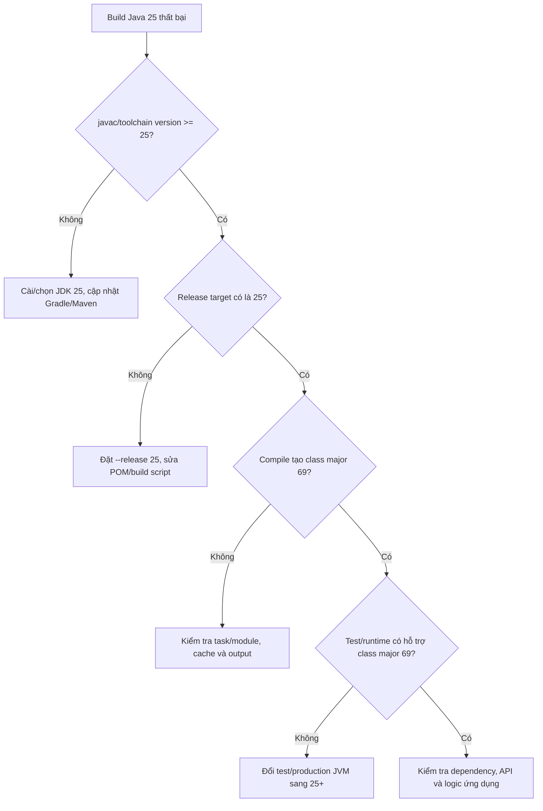

# Cấu hình toolchain và mức phát hành để biên dịch đúng Java 25

## 1. Bối cảnh: “máy có JDK 25” chưa có nghĩa dự án biên dịch bằng Java 25

Trong một dự án nhiều lập trình viên và môi trường CI, có thể xảy ra những tình huống sau:

- Terminal hiển thị `java --version` là 25 nhưng Gradle/Maven thực tế gọi một `javac` khác.
- IDE biên dịch thành công, CI báo `release version 25 not supported`.
- Mã biên dịch được trên JDK mới nhưng dùng API không tồn tại ở Java 25.
- Artifact chạy trên máy phát triển nhưng gặp `UnsupportedClassVersionError` ở server.
- Bản build chạy với JDK 25 mà vẫn sinh bytecode của Java 21 do cấu hình release cũ.

Vì vậy, **JDK đang cài**, **JDK chạy build tool**, **JDK dùng để biên dịch**, **mức phát hành (`--release`)** và **JVM chạy ứng dụng** phải được phân biệt.

Bài **Cấu hình toolchain và mức phát hành để biên dịch đúng Java 25** thuộc chương **Thiết lập JDK 25**, học phần **JAVA_VERSION_JAVA25**. Học phần hướng tới các khả năng Java 25 còn hữu ích trong Java hiện đại, gồm compact source files, module import declarations, flexible constructor bodies, `ScopedValue`, KDF API, AOT cache, JFR và đánh giá tác động nâng JDK. Bài này chuẩn bị **hệ thống biên dịch chính xác** cho những nội dung đó.

Bài chỉ sử dụng các phương thức cấu hình và công cụ **còn phù hợp tại thời điểm viết (27/11/2026)**. Java 25 là phiên bản LTS; Java 27 đã ra mắt nhưng JDK 25 vẫn là mục tiêu phổ biến cho ứng dụng cần vòng đời hỗ trợ dài. Ví dụ chính dùng **tính năng Java 25 đã ổn định**, không yêu cầu bật preview.

### 1.1. Kết quả cần đạt

Người học phải có thể:

1. Kiểm tra JDK 25 ở máy và phân biệt phiên bản `java` với `javac`, Maven JVM, Gradle daemon JVM.
2. Dùng **Gradle Java toolchains** để chọn trình biên dịch Java 25 và đặt `options.release = 25`.
3. Dùng **Maven Compiler Plugin** với `release=25` cùng Maven Toolchains để chọn JDK biên dịch độc lập với JDK chạy Maven.
4. Biên dịch trực tiếp bằng `javac --release 25` và chạy bằng Java 25.
5. Xác minh `major version: 69` của class file, API tương thích và runtime test dùng JDK mong muốn.
6. Chẩn đoán lỗi chọn sai toolchain, môi trường IDE/CI và artifact không tương thích.

## 2. Năm lớp cấu hình Java cần tách biệt

| Lớp | Điều khiển | Lệnh/thông số xác minh |
|---|---|---|
| **JDK cài đặt** | Những JDK hiện có trên máy/runner | Thư mục JDK, `java --version`, `javac --version` |
| **JVM của build tool** | JDK chạy Gradle daemon hoặc Maven | `./gradlew --version`, `mvn -version` |
| **JDK toolchain biên dịch** | Bộ `javac`, `java`, `javadoc` dùng cho tác vụ build hỗ trợ toolchain | `./gradlew javaToolchains`, Gradle `--info`, Maven toolchain log |
| **Release target** | Ngôn ngữ, API Java SE được phép dùng và định dạng class file | Gradle `options.release.set(25)`, Maven `<release>25</release>`, `javac --release 25` |
| **JVM thực thi** | JDK/JRE chạy test và ứng dụng triển khai | Test Java version, `java --version` ở container/server |

**Toolchain** và **release** bổ sung cho nhau:

- Chọn **toolchain 25** để yêu cầu compiler/JDK 25, kể cả khi build tool được khởi động bằng JDK khác.
- Chọn **release 25** để compiler kiểm tra cú pháp Java 25, API công khai của Java SE 25 và sinh class files dành cho Java 25.
- Chạy **test và ứng dụng bằng Java 25 hoặc JVM tương thích hơn** để kiểm tra liên kết thư viện và hành vi runtime.

Không chỉ dựa vào `JAVA_HOME` hoặc thiết lập “Project SDK” của IDE. Chúng ảnh hưởng đến quá trình khởi chạy và fallback, nhưng không thay thế khai báo toolchain trong build.

### 2.1. Khác nhau giữa `--release`, `--source` và `--target`

| Tuỳ chọn | Kiểm soát | Có bảo vệ khỏi dùng nhầm API của JDK mới hơn? |
|---|---|---|
| `--release 25` | Cú pháp, API nền tảng Java SE 25, class-file target 25 | **Có**, đối với API nền tảng được `javac` kiểm tra |
| `--source 25` | Quy tắc cú pháp/ngôn ngữ | Không tự giới hạn API nền tảng |
| `--target 25` | Class-file target | Không tự giới hạn cú pháp và API |
| Java toolchain 25 | Chọn bộ công cụ biên dịch/thử nghiệm Java 25 | Chỉ lựa chọn JDK; không đặt chính sách cross-compile nếu target khác |
| `JAVA_HOME` | JDK mặc định của quy trình khởi chạy, phụ thuộc môi trường | Không |

**Khuyến nghị hiện hành:** cho dự án cần Java 25, khai báo cả **toolchain 25** và **release 25**. Không coi cách cấu hình chỉ dùng `sourceCompatibility`/`targetCompatibility` là đủ để bảo đảm dùng đúng API; `--release` là cách an toàn hơn. Với thư viện ngoài JDK, vẫn cần chọn dependency tương thích và kiểm thử runtime: `--release` không xác minh mọi API của third-party dependencies.

## 3. Cài và xác minh JDK 25

### 3.1. Chọn bản JDK hiện hành

Bạn có thể cài một bản phân phối OpenJDK 25 được duy trì, ví dụ Eclipse Temurin, Microsoft Build of OpenJDK hoặc Oracle JDK theo chính sách giấy phép và cập nhật bảo mật của tổ chức. Trong CI, chọn một vendor được phép và ghi rõ version/digest của image nếu cần khả năng tái lập cao.

Đừng chỉ tải một **JRE** thiếu compiler rồi mong `javac` hoạt động. JDK cần có các công cụ như `java`, `javac`, `javap`, `jar` và `jdeps`.

Java 25 ra mắt vào tháng 9/2025 và là LTS. Ưu tiên bản vá 25.0.x còn được nhà cung cấp hỗ trợ tại thời điểm cài, thay vì cố định mã nguồn vào bản GA 25.0.0 đã có các bản sửa lỗi sau đó.

### 3.2. Kiểm tra trên Linux/macOS

```bash
java --version
javac --version
command -v java
command -v javac
echo "$JAVA_HOME"
```

Đầu ra kỳ vọng, ví dụ:

```text
openjdk 25.0.x ...
javac 25.0.x
```

`25.0.x` ở đây là ví dụ dạng phiên bản, không phải output thật. Nếu `java` và `javac` khác major version, hãy kiểm tra PATH hoặc lệnh `java`/`javac` đang trỏ vào JDK nào.

Một phiên shell có thể đặt JDK 25 như sau (thay đường dẫn bằng thư mục đã cài thật):

```bash
export JAVA_HOME=/opt/jdks/jdk-25
export PATH="$JAVA_HOME/bin:$PATH"
java --version
javac --version
```

Thay đổi trên chỉ áp dụng cho phiên shell đó. Muốn áp dụng bền vững, sử dụng cấu hình môi trường/manager của hệ điều hành hoặc runner theo quy định dự án.

### 3.3. Kiểm tra trên Windows PowerShell

```powershell
java --version
javac --version
Get-Command java
Get-Command javac
where.exe java
where.exe javac
$env:JAVA_HOME
```

Nếu đang kiểm tra một JDK đã cài mà không muốn sửa thiết lập máy, gọi executable theo đường dẫn tuyệt đối:

```powershell
& "C:\Dev\jdks\jdk-25\bin\java.exe" --version
& "C:\Dev\jdks\jdk-25\bin\javac.exe" --version
```

Nếu muốn đổi JDK **cho riêng phiên PowerShell hiện tại**:

```powershell
$env:JAVA_HOME = "C:\Dev\jdks\jdk-25"
$env:Path = "$env:JAVA_HOME\bin;$env:Path"
java --version
javac --version
```

Đây là ví dụ đường dẫn, không phải vị trí cài mặc định. Đảm bảo cả `java` lẫn `javac` đến từ JDK 25; `java --version` riêng lẻ chưa chứng minh dự án sẽ được biên dịch bằng JDK 25.

## 4. Thử trực tiếp `javac --release 25`

### 4.1. Ví dụ Java chuẩn, không cần build tool

Tạo `src/demo/Hello25.java`:

```java
package demo;

public class Hello25 {
    public static void main(String[] args) {
        System.out.println("Java feature version: "
            + Runtime.version().feature());
    }
}
```

Biên dịch bằng JDK 25:

```bash
javac --release 25 -d out src/demo/Hello25.java
java -cp out demo.Hello25
```

Kết quả khi chạy trên JVM Java 25:

```text
Java feature version: 25
```

`--release 25` yêu cầu target Java 25; `-d out` đặt class files ngoài thư mục nguồn; `-cp out` cho runtime tìm `demo.Hello25`. Nếu chạy trên JDK 27, phương thức `Runtime.version().feature()` sẽ trả về 27 mặc dù class file được biên dịch nhắm Java 25. Do đó cần kiểm tra runtime riêng.

### 4.2. Một phép thử tính năng Java 25 đã chính thức

Java 25 đã **hoàn thiện** các tính năng ngôn ngữ như compact source files và instance main methods (JEP 512), module import declarations (JEP 511), flexible constructor bodies (JEP 513). Chúng không cần `--enable-preview` ở Java 25.

Ví dụ tệp `HelloCompact.java`:

```java
void main() {
    IO.println("Compact Java 25 is ready");
}
```

Chạy ở chế độ source-file bằng JDK 25:

```bash
java --source 25 HelloCompact.java
```

Ở Java 25, `java.lang.IO.println` là API có sẵn và `IO` được import ngầm từ `java.lang`. Lưu ý hướng dẫn preview đời cũ có thể dùng cách gọi I/O khác; bài này dùng cú pháp **đã hoàn thiện ở Java 25**.

Ví dụ khác để kiểm tra module import (JEP 511):

```java
import module java.base;

public class JavaBaseImport {
    public static void main(String[] args) {
        List<String> names = List.of("Java", "25");
        System.out.println(String.join(" ", names));
    }
}
```

Có thể biên dịch bằng `javac --release 25 JavaBaseImport.java`, vì `import module java.base;` đã là tính năng chính thức của Java 25. Dòng import đưa các kiểu công khai của module `java.base` vào phạm vi import theo quy tắc Java; không cần thêm `import java.util.List;` trong ví dụ này.

**Giới hạn quan trọng:** nếu chuyển build target về `--release 21`, những đặc điểm **chỉ được chuẩn hóa ở Java 25** sẽ không còn được phép dùng theo cú pháp Java 25. Không dùng `--enable-preview` để “vá” sự thiếu tương thích của code production cần chạy trên Java 21.

### 4.3. Xác minh class-file version

Với class `demo.Hello25` vừa biên dịch:

```bash
javap -verbose -classpath out demo.Hello25
```

Tìm dòng:

```text
major version: 69
```

Theo Java Virtual Machine Specification, class-file major version **69** tương ứng Java SE 25. Class file bình thường sẽ có minor version 0. Nếu ứng dụng đòi preview feature, class file có thể có minor version 65535 và yêu cầu runtime xử lý preview; đó **không phải mục tiêu** của bài.

| Class-file major | Release | Ý nghĩa trong bài |
|---|---|---|
| 65 | Java 21 | Build đang target 21 |
| 68 | Java 24 | Build đang target 24 |
| **69** | **Java 25** | Target đúng Java 25 |
| 70 | Java 26 | Build đã target Java 26, lệch yêu cầu |
| 71 | Java 27 | Build đã target Java 27, lệch yêu cầu |

Một JVM Java 21 không đọc được class file có major 69. `UnsupportedClassVersionError` trong trường hợp đó là lỗi runtime JVM không đủ phiên bản, **không** phải lỗi mã nguồn Java 25.

## 5. Gradle: chọn đúng Java 25 bằng toolchain và release

### 5.1. Kiểm tra Gradle có hỗ trợ Java 25

Theo **Gradle Compatibility Matrix**, Java 25 được hỗ trợ chính thức cho **toolchains từ Gradle 9.1.0** và **chạy Gradle trên JVM Java 25 từ Gradle 9.1.0**. Với một dự án nhắm Java 25, nên dùng Gradle Wrapper của dự án ở **Gradle 9.1+**, chọn phiên bản tương thích plugin và kiểm thử trong CI.

```bash
./gradlew --version
./gradlew -q javaToolchains
```

Trên Windows:

```powershell
.\gradlew.bat --version
.\gradlew.bat -q javaToolchains
```

`--version` có thể cho biết JVM chạy Gradle, **không đủ để chứng minh JavaCompile dùng JDK 25**. Task `javaToolchains` giúp xem các JDK mà Gradle phát hiện.

### 5.2. Gradle Kotlin DSL (`build.gradle.kts`)

```kotlin
plugins {
    java
}

java {
    toolchain {
        languageVersion.set(JavaLanguageVersion.of(25))
    }
}

tasks.withType<JavaCompile>().configureEach {
    options.release.set(25)
}
```

Lệnh build:

```bash
./gradlew clean compileJava test
./gradlew compileJava --info
```

Ý nghĩa:

- `languageVersion = 25` yêu cầu Gradle chọn JDK 25 cho các task Java hỗ trợ toolchains.
- `options.release = 25` ép `javac` dùng ngôn ngữ/API/bytecode Java 25.
- Gradle Java plugin thường đưa test/javadoc sang toolchain đã chọn; kiểm tra thực tế nếu dự án cấu hình task Java riêng, Kotlin/Scala plugin hoặc test JVM khác.
- Build tool có thể được chạy bằng JDK khác, nhưng project code phải được compile bằng JDK 25 theo cấu hình.

Nếu dự án đã có plugin khác tự áp dụng `java` hoặc `java-library`, không cần thêm block `plugins { java }` trùng lặp; chỉ dùng đoạn `java.toolchain` và cấu hình `JavaCompile` vào script phù hợp.

### 5.3. Gradle Groovy DSL (`build.gradle`)

```groovy
plugins {
    id 'java'
}

java {
    toolchain {
        languageVersion = JavaLanguageVersion.of(25)
    }
}

tasks.withType(JavaCompile).configureEach {
    options.release = 25
}
```

Hai cách cấu hình Kotlin/Groovy DSL cùng ý nghĩa. Không trộn cú pháp của hai DSL vào cùng build script.

### 5.4. Nếu Gradle không tìm được JDK 25

Gradle sẽ ưu tiên JDK 25 được phát hiện tại máy. **Tải JDK tự động chỉ hoạt động khi có toolchain download repository/resolver đã cấu hình**; không mặc định sẽ tải được JDK trên mọi runner.

Với Gradle hỗ trợ, một giải pháp là dùng plugin Foojay resolver trong `settings.gradle.kts`:

```kotlin
plugins {
    id("org.gradle.toolchains.foojay-resolver-convention") version "1.0.0"
}
```

Hoặc `settings.gradle`:

```groovy
plugins {
    id 'org.gradle.toolchains.foojay-resolver-convention' version '1.0.0'
}
```

Dùng theo chính sách kết nối và nguồn JDK được tổ chức cho phép. Plugin resolver được cấu hình trong **settings**, không phải trong `build.gradle.kts` của module. Nếu tổ chức tự quản JDK hoặc runner không có internet, cài JDK 25 trước và cấu hình đường dẫn JDK đã được cấp; không dựa vào tải động lúc build.

Để debug môi trường dùng các biến/cấu hình của Gradle như `org.gradle.java.installations.paths` hoặc `org.gradle.java.installations.auto-detect` theo tài liệu toolchains. Tránh hard-code đường dẫn riêng của một developer vào build script version-controlled.

### 5.5. Kiểm tra JDK mà Gradle thực sự chọn

```bash
./gradlew javaToolchains
./gradlew compileJava --info
./gradlew test --info
```

Trong log `--info`, kiểm tra đường dẫn/metadata của compiler và test JVM nếu Gradle in ra. Đối chiếu với danh sách toolchains. Build có thể lấy kết quả từ cache hoặc task `UP-TO-DATE`; nếu muốn thấy một lần compile thật trong môi trường kiểm soát, chạy tác vụ phù hợp sau khi thay đổi source hoặc dùng `--rerun-tasks` có chủ đích.

**Cần phân biệt:**

- JVM chạy Gradle daemon (`./gradlew --version`).
- JVM compiler được Java toolchain chọn.
- JVM chạy test và ứng dụng.
- Mức bytecode target qua `options.release`.

Tối thiểu phải kiểm tra compilation target **và** runtime; một dòng “Gradle chạy trên Java 25” chưa chứng minh bytecode Java 25.


## 6. Maven: đặt `release=25` và chọn JDK bằng toolchain

Maven Compiler Plugin truyền cấu hình `release` tới `javac`. Maven Toolchains giúp dự án sử dụng một JDK cụ thể để biên dịch dù tiến trình Maven chạy bằng JDK khác. Hai cơ chế nên được sử dụng cùng nhau khi team có nhiều phiên bản JDK.

### 6.1. Cấu hình hiện hành trong `pom.xml`

Ví dụ sau là phần khai báo trong `<project>` của POM; giả định dự án đã có groupId/artifactId/dependencies phù hợp. Các version plugin được chọn theo tài liệu chính thức tại thời điểm soạn bài:

```xml
<properties>
    <maven.compiler.release>25</maven.compiler.release>
    <project.build.sourceEncoding>UTF-8</project.build.sourceEncoding>
</properties>

<build>
    <plugins>
        <plugin>
            <groupId>org.apache.maven.plugins</groupId>
            <artifactId>maven-toolchains-plugin</artifactId>
            <version>3.3.0</version>
            <executions>
                <execution>
                    <goals>
                        <goal>select-jdk-toolchain</goal>
                    </goals>
                </execution>
            </executions>
            <configuration>
                <version>[25,26)</version>
            </configuration>
        </plugin>

        <plugin>
            <groupId>org.apache.maven.plugins</groupId>
            <artifactId>maven-compiler-plugin</artifactId>
            <version>3.16.0</version>
            <configuration>
                <release>25</release>
            </configuration>
        </plugin>
    </plugins>
</build>
```

Giải thích:

- `maven.compiler.release=25` và `<release>25</release>` đều thể hiện một ý; ví dụ đặt cả hai để nhận diện rõ ở POM, nhưng **chỉ một trong hai là đủ**. Trong dự án thực, nên chọn một nguồn cấu hình nhất quán, ưu tiên property khi nhiều module dùng chung.
- `maven-toolchains-plugin:select-jdk-toolchain` (có từ plugin 3.2.0, ví dụ dùng 3.3.0) dò các JDK trên máy và chọn JDK đáp ứng khoảng phiên bản `[25,26)`, tức mọi bản JDK 25.x, không nhận JDK 26.
- `maven-compiler-plugin` sẽ dùng JDK do toolchain cung cấp khi có tương tác đúng với toolchains; `release=25` bảo vệ API/bytecode.
- `mvn -version` chỉ phản ánh JDK đang **chạy Maven**, chưa đủ nói compiler được chọn là JDK nào. Khi build toolchain được chọn, JDK compiler có thể khác Maven runtime.

Để tránh khai báo trùng trong POM, một biến thể gọn là:

```xml
<properties>
    <maven.compiler.release>25</maven.compiler.release>
</properties>
```

và giữ plugin Compiler cùng Toolchains như ví dụ trên, bỏ `<configuration><release>25</release></configuration>` ở Compiler Plugin.

### 6.2. Khám phá JDK và chạy build Maven

```bash
mvn -version

mvn org.apache.maven.plugins:maven-toolchains-plugin:3.3.0:display-discovered-jdk-toolchains

mvn --batch-mode clean verify
```

Nếu dự án có Maven Wrapper, ưu tiên `./mvnw` hoặc `mvnw.cmd` để cố định bản Maven giữa developer và CI. Maven Toolchains Plugin có cơ chế discovery từ version 3.2.0; với JDK ở vị trí tùy biến, hãy kiểm tra liệu discovery có nhìn thấy hay không.

Trong quá trình chẩn đoán, có thể dùng `mvn -X compile` **ở môi trường phát triển được phép** để tìm compiler/toolchain đã chọn. Log debug có thể chứa thông tin nội bộ, nên không công bố toàn bộ log lên kênh công cộng.

### 6.3. Khi cần khai báo `~/.m2/toolchains.xml`

Cơ chế mới `select-jdk-toolchain` hỗ trợ tự phát hiện các JDK. Với một môi trường không tìm được JDK từ vị trí chuẩn, phương án chuẩn vẫn còn được Maven hỗ trợ là cung cấp `~/.m2/toolchains.xml` và mục tiêu `toolchains:toolchain` phù hợp.

Ví dụ nội dung `~/.m2/toolchains.xml` (thay đường dẫn và phiên bản bằng JDK thực tế):

```xml
<?xml version="1.0" encoding="UTF-8"?>
<toolchains>
    <toolchain>
        <type>jdk</type>
        <provides>
            <version>25.0.2</version>
        </provides>
        <configuration>
            <jdkHome>/opt/jdks/jdk-25.0.2</jdkHome>
        </configuration>
    </toolchain>
</toolchains>
```

**Lưu ý phiên bản:** nếu toolchain cung cấp `25.0.2`, yêu cầu so khớp chính xác `25` trong mục tiêu toolchain cũ có thể **không khớp**. Dùng khoảng `[25,26)` khi muốn chấp nhận mọi bản vá 25.x. `jdkHome` phải trỏ đến **thư mục gốc JDK** chứ không phải `bin/java`.

Ví dụ mục tiêu cổ điển vẫn có thể dùng với `toolchains.xml`:

```xml
<plugin>
    <groupId>org.apache.maven.plugins</groupId>
    <artifactId>maven-toolchains-plugin</artifactId>
    <version>3.3.0</version>
    <executions>
        <execution>
            <goals>
                <goal>toolchain</goal>
            </goals>
        </execution>
    </executions>
    <configuration>
        <toolchains>
            <jdk>
                <version>[25,26)</version>
            </jdk>
        </toolchains>
    </configuration>
</plugin>
```

Đây là **phương án thay thế** cho block `select-jdk-toolchain` ở mục 6.1; không cần đăng ký cả hai kiểu chọn toolchain trong một build thông thường.

### 6.4. Maven tests cũng phải chạy trên JVM tương thích

Toolchains có thể phục vụ Compiler, Surefire/Failsafe và Javadoc khi plugin tương ứng hỗ trợ. Tuy nhiên, hành vi cụ thể phụ thuộc phiên bản/plugin configuration, vì vậy hãy **xác minh runtime của test**. Nếu compiler tạo class files Java 25 nhưng Surefire chạy test trên Java 21, test có thể thất bại với `UnsupportedClassVersionError`.

Không kết luận rằng test đã chạy bằng 25 chỉ vì Maven báo `BUILD SUCCESS`; trong một dự án nhiều module có thể có test bị skip hoặc plugin/test runner dùng JDK khác. Dùng test đọc `Runtime.version().feature()` (mục 9) để chứng minh rõ.

## 7. Lựa chọn khi có nhiều JDK trong cùng một đội

### 7.1. Yêu cầu chính xác là JDK 25 hay bytecode Java 25?

Có hai tình huống:

| Nhu cầu | Cấu hình đề xuất |
|---|---|
| Phát triển, build và kiểm thử **trực tiếp trên JDK 25** | Java toolchain `25` + release `25` + runtime/test JDK 25 |
| Dùng compiler JDK mới hơn nhưng **xuất artifact nhắm Java 25** | Toolchain compiler mới hơn hỗ trợ `--release 25` + release `25`; test trên JDK 25 |

Trong bài học này, yêu cầu là **thiết lập JDK 25**, vì vậy ưu tiên tình huống đầu tiên. Dùng JDK 27 với `--release 25` có thể tạo bytecode tương thích Java 25, nhưng chưa chứng minh kết quả build/test đã được kiểm tra bằng compiler và runtime JDK 25.

Mỗi thay đổi compiler hoặc bộ annotation processor có thể ảnh hưởng kết quả build. Vì vậy nếu cần tính tái lập cao, cố định vendor/bản vá JDK và build container image đã duyệt bên cạnh major version.

### 7.2. Phân biệt Gradle daemon JVM, Maven runtime JVM và compiler JDK

Ví dụ máy phát triển có hai JDK:

```text
JDK 21: chạy một số công cụ hệ thống
JDK 25: biên dịch và test dự án Java 25

Gradle >= 9.1:
  Gradle daemon: có thể chạy bằng JDK 21
  Java toolchain: yêu cầu JDK 25
  JavaCompile --release: 25
  Test JVM: kiểm tra thực tế

Maven:
  mvn -version: có thể hiển thị JDK 21
  Maven Toolchains: chọn JDK 25
  Maven Compiler --release: 25
  Surefire JVM: kiểm tra cấu hình và runtime
```

**Không nhầm** việc IDE chạy Gradle bằng JVM 21 với lỗi: nếu Gradle phiên bản phù hợp và task chọn đúng Java 25 toolchain, đó có thể là cấu hình có chủ đích. Sai ở chỗ dự án thiếu khai báo toolchain nên compiler tình cờ sử dụng JVM mặc định 21.

### 7.3. Thiết lập IDE

Với IntelliJ IDEA, kiểm tra các mục:

- **Project SDK**: dùng JDK 25 cho dự án.
- **Gradle JVM**: JDK được dùng khởi chạy Gradle, tương thích với Gradle Wrapper.
- **Gradle toolchain**: được khai báo trong build script; kiểm tra Gradle import/build thực tế.
- **Language level**: nhận từ Gradle/Maven project, không dùng IDE setting làm “nguồn sự thật” duy nhất.
- **Run configuration**: JVM thực thi chương trình và test có được chọn là Java 25 không?

Với Maven, kiểm tra Maven runner JVM và Toolchains Plugin; nếu IDE tự build bằng cơ chế riêng thay vì Maven/Gradle, cần so compiler options của IDE với `--release 25`. Trong team, **build script và CI là hợp đồng build**, IDE nên đồng bộ theo đó.

## 8. Phân biệt tính năng Java 25 ổn định và preview

JDK 25 có cả tính năng **đã hoàn thiện** và tính năng **preview**. Chỉ nên dùng tính năng được hỗ trợ ổn định trong bài setup mặc định; preview cần quyết định riêng cho dự án thực nghiệm.

Các tính năng nổi bật đã **hoàn thiện ở Java 25**:

| Tính năng | Tình trạng ở Java 25 | Cần `--enable-preview`? |
|---|---|---|
| Module Import Declarations (JEP 511) | Hoàn thiện | Không |
| Compact Source Files and Instance Main Methods (JEP 512) | Hoàn thiện | Không |
| Flexible Constructor Bodies (JEP 513) | Hoàn thiện | Không |
| Scoped Values (JEP 506) | Hoàn thiện | Không |
| Key Derivation Function API (JEP 510) | Hoàn thiện | Không |

Một số tính năng khác ở Java 25 còn ở **preview/incubator/experimental** và có thể được sửa ở JDK tiếp theo. Chúng không nằm trong bài thiết lập chuẩn này.

Nếu một nhóm quyết định thử *preview feature* của chính JDK 25, cần cấu hình nhất quán ở **cả compiler và runtime**:

```bash
# Chỉ dùng cho thử nghiệm preview được chấp thuận.
javac --enable-preview --release 25 MyPreviewExperiment.java
java --enable-preview MyPreviewExperiment
```

Không bật `--enable-preview` vô điều kiện cho toàn bộ dự án Java 25 đang triển khai, vì preview có thể thay đổi và class files preview có điều kiện nạp đặc biệt. Không mang các chỉ dẫn preview của Java 21–24 sang Java 25 khi tính năng đó đã hoàn thiện hoặc bị loại bỏ. Ví dụ **String Templates** đã rút khỏi Java, không đưa vào thực hành nâng cấp Java 25.

## 9. Xác nhận test runtime và class-file target

### 9.1. Viết test kiểm chứng JVM thực thi

Trong dự án dùng JUnit Jupiter, tạo một test:

```java
import static org.junit.jupiter.api.Assertions.assertEquals;

import org.junit.jupiter.api.Test;

class JavaRuntimeContractTest {

    @Test
    void testsRunOnJdk25() {
        assertEquals(25, Runtime.version().feature(),
            "Test JVM phải là JDK 25 theo hợp đồng của dự án");
    }
}
```

Test này hữu ích khi CI/IDE có nhiều JDK. Nó yêu cầu **chạy đúng 25**, phù hợp bài thực hành. Nếu một dự án có chủ đích kiểm thử cả 25 và 27, hãy đổi assertion để phản ánh matrix đó; không giữ assertion `==25` khi nhiệm vụ thật là kiểm thử đa JVM.

### 9.2. Kiểm tra class file sau Gradle

Với ví dụ `demo.Hello25` được biên dịch bằng Java plugin:

```bash
./gradlew clean compileJava

javap -verbose \
  -classpath build/classes/java/main \
  demo.Hello25
```

Trong output, tìm `major version: 69`. Trên Windows:

```powershell
.\gradlew.bat clean compileJava
javap -verbose -classpath build\classes\java\main demo.Hello25 |
  Select-String "major version"
```

Lệnh `javap` được chạy từ JDK 25 thích hợp. Nếu project định nghĩa source sets hoặc output layout khác, điều chỉnh `-classpath` theo đường dẫn thực.

### 9.3. Kiểm tra class file sau Maven

```bash
mvn --batch-mode clean compile
javap -verbose -classpath target/classes demo.Hello25
```

Sau khi đóng gói JAR, kiểm tra artifact thực sự chứa các classes vừa biên dịch. Nếu Maven Multi-Module Project có POM cha và các module con, khai báo release/toolchains ở nơi chúng thực sự được kế thừa/áp dụng; đừng chỉ kiểm tra một module và mặc định tất cả module khác đều target 25.

### 9.4. Kiểm tra không vô tình dùng API Java 26/27

Biên dịch với `--release 25` bằng một compiler mới hơn sẽ giới hạn API Java SE về mức 25. Một phép thử âm nên thất bại khi mã sử dụng API Java SE chỉ có từ 26/27. Tuy nhiên không chọn một API giả định hoặc không còn tồn tại chỉ để tạo test; lấy API thực sự được giới thiệu sau 25 từ tài liệu chính thức nếu cần bài thử như vậy.

Ngoài `--release`, ứng dụng vẫn cần xác minh thư viện bên thứ ba và các plugin build/annotation processors có tương thích Java 25. Compiler không thể bảo đảm mọi dependency sẽ chạy được chỉ từ số class-file major của mã ứng dụng.

## 10. Thiết lập Java 25 trong CI

Một build chỉ đáng tin khi cấu hình giống nhau trên máy phát triển và CI. Ví dụ **GitHub Actions** đang được hướng dẫn với `actions/setup-java@v6` (tài liệu hiện hành năm 2026), chọn Temurin JDK 25 rồi build bằng Gradle Wrapper:

```yaml
name: Build with JDK 25

on:
  push:
  pull_request:

jobs:
  verify:
    runs-on: ubuntu-latest
    steps:
      - uses: actions/checkout@v7

      - name: Install JDK 25
        uses: actions/setup-java@v6
        with:
          distribution: temurin
          java-version: '25'
          cache: gradle

      - name: Verify runtime and Gradle
        run: |
          java --version
          javac --version
          ./gradlew --version
          ./gradlew javaToolchains

      - name: Compile and test
        run: ./gradlew clean test
```

Ví dụ giả định dự án có `gradlew` executable và Wrapper 9.1+ đã được commit. Nếu dự án dùng Maven Wrapper, có thể đổi bước build thành `./mvnw --batch-mode verify` và `cache: maven`, giữ nguyên bước cài JDK 25.

Một quy trình CI có thể dùng image/container chứa JDK 25 đã được tổ chức phê duyệt; trong trường hợp đó không cần tải JDK động. Dù dùng cách nào, lưu metadata build: JDK vendor/version, build-tool version, artifact SHA/checksum và test results.

### 10.1. Lỗi dễ gặp khi lên CI

- Đặt `java-version: '25'` nhưng Wrapper Gradle quá cũ, không hiểu toolchain JDK 25.
- Chạy Maven dưới JDK 21 nhưng không cấu hình toolchain, Compiler Plugin không thể dùng `--release 25`.
- Dùng một container runtime có Java 21 cho artifact class version 69.
- Nâng version JDK của runner nhưng quên nâng test plugin/annotation processors, dẫn đến lỗi build dù code hợp lệ.
- Build thành công do cache của bản cũ; cần xác minh output/metadata chứ không chỉ xem trạng thái job.

Nếu muốn kiểm thử nhiều runtime mà vẫn publish artifact cho Java 25, dùng matrix theo các JVM hỗ trợ dự định và chắc chắn compile target được giữ là 25. Một dự án **Java 25-only** không cần giả vờ tương thích Java 21.

## 11. Bảng chẩn đoán lỗi thường gặp

| Triệu chứng | Nguyên nhân khả dĩ | Hướng xử lý |
|---|---|---|
| `error: release version 25 not supported` | `javac` đang dùng JDK thấp hơn 25 | Kiểm tra `javac --version`, toolchain Maven/Gradle, compiler được chọn |
| `No matching toolchains found` (Gradle) | Gradle không tìm được JDK 25 hoặc resolver chưa được cấu hình | Kiểm tra `javaToolchains`, cài JDK 25 hoặc cấu hình download resolver |
| Gradle không khởi động được trên JDK 25 | Wrapper Gradle cũ không tương thích | Dùng Gradle 9.1+ theo compatibility matrix và plugin tương ứng |
| `mvn -version` cho JDK 21 nhưng compile 25 | Có thể đúng khi Maven Toolchains dùng JDK 25 | Kiểm tra toolchain log và output bytecode |
| Maven `toolchain not found` | Không có JDK phù hợp, version range sai hoặc discovery không thấy | Xem discovered JDKs/`toolchains.xml`; dùng `[25,26)` cho mọi 25.x |
| `UnsupportedClassVersionError` khi chạy | Runtime JVM quá cũ để nạp class major 69 | Chạy bằng JVM 25+ hoặc biên dịch target thấp hơn nếu thực sự yêu cầu |
| Build thành công nhưng `major version: 65` | Release target vẫn là 21 hoặc output cũ | Kiểm tra `release`, build script kế thừa, rebuild và `javap` |
| IDE pass nhưng CLI fail | IDE dùng SDK/JDK khác build tool, toolchain chưa thống nhất | Đồng bộ IDE import/build với Wrapper/POM và Java 25 toolchain |
| Compile pass nhưng test crash | Test JVM/plugin chưa tương thích Java 25 | Kiểm tra test runner JVM, plugin versions và `Runtime.version().feature()` |
| API Java 26/27 xuất hiện trong mã dù target 25 | Thiếu `--release 25`, chỉ cấu hình target bytecode | Thêm `options.release` / `maven.compiler.release` và thử compile lại |
| `JAVA_HOME` trỏ 25 nhưng `javac` khác | PATH ưu tiên bản JDK khác; Gradle/Maven chọn riêng toolchain | Dò executable thật và cấu hình toolchain |
| `--enable-preview` bị yêu cầu dù dùng feature Java 25 chính thức | Mã hoặc build đang dùng bản preview cũ hay source level khác | Chuyển sang cú pháp Java 25 đã hoàn thiện; chỉ dùng preview khi cần |

### 11.1. Quy trình chẩn đoán ngắn



Điểm quan trọng là xem **compiler nào được chọn**, **release nào được truyền** và **JVM nào chạy artifact**, thay vì thử nhiều lệnh thay `JAVA_HOME` mà không có bằng chứng.

## 12. Bài thực hành có thể kiểm chứng

### Nhiệm vụ A — Thiết lập và biên dịch trực tiếp

1. Cài JDK 25 có bản vá được hỗ trợ, ghi `java --version` và `javac --version`.
2. Tạo `src/demo/Hello25.java` như mục 4.
3. Chạy `javac --release 25 -d out src/demo/Hello25.java`.
4. Chạy `java -cp out demo.Hello25` bằng JVM 25.
5. Dùng `javap -verbose -classpath out demo.Hello25` xác nhận major **69**.
6. Thử cú pháp compact source file `void main()` với `IO.println` trên Java 25 mà **không bật preview**.

### Nhiệm vụ B — Gradle toolchain và release

1. Dùng Gradle Wrapper **9.1+**.
2. Chọn Java toolchain 25 và `options.release.set(25)`.
3. Chạy `javaToolchains` và `compileJava --info`.
4. Chạy test `JavaRuntimeContractTest` để xác nhận JVM test.
5. Dùng `javap` trên class file trong `build/classes/java/main` và lưu kết quả.

### Nhiệm vụ C — Maven Toolchains và release

1. Cấu hình Maven Compiler Plugin `release=25`.
2. Dùng Maven Toolchains Plugin lựa chọn JDK 25.x và xem kết quả discovery.
3. Chạy `mvn --batch-mode clean verify`.
4. Kiểm tra compiler JVM, test runtime và class file `target/classes/demo/Hello25.class`.
5. Giải thích vì sao `mvn -version` không nhất thiết phải hiển thị Java 25 nếu Maven chạy bằng JDK khác nhưng toolchain dùng 25.

### Nhiệm vụ D — Kiểm tra sai cấu hình có chủ đích

Trong một bản sao dự án thử nghiệm:

- Đổi `options.release` từ 25 xuống 21 nhưng giữ code Java 25: xác định lỗi cú pháp/API.
- Dùng JVM Java 21 chạy class major 69: giải thích `UnsupportedClassVersionError`.
- Tạm bỏ toolchain nhưng chạy build bằng JDK 21: ghi rõ tại sao `release 25 not supported`.
- Khôi phục cấu hình đúng, build lại và ghi nhận delta trước/sau.

Không thử trên nhánh production hoặc xóa cấu hình tổ chức để tạo lỗi. Bài tập dùng bản sao dự án ở môi trường lab.

## 13. Checklist nghiệm thu

| Kiểm tra | Bằng chứng đạt |
|---|---|
| JDK cài đặt | `java` và `javac` mục tiêu có version 25.x |
| Build tool tương thích | Gradle Wrapper ≥9.1 hoặc Maven và plugin tương thích |
| Compiler toolchain | Gradle/Maven đã chọn JDK 25 cho Java compilation |
| Release target | `options.release=25` hoặc Maven Compiler `release=25` |
| Class-file version | `javap` hiển thị `major version: 69` |
| Runtime test | Test `Runtime.version().feature()==25` pass trong bài lab |
| Stable Java 25 syntax | `void main()` + `IO.println` và module import compile được không cần preview |
| API contract | Không dùng API Java 26/27 khi target 25; dependencies được kiểm tra |
| CI | Runner sử dụng JDK 25, Wrapper/POM đúng, build/test pass |
| IDE | IDE import dùng build config thống nhất, chạy test bằng JVM mục tiêu |
| Artifact deployment | JVM production ít nhất hỗ trợ class major 69 và thư viện tương thích |
| Evidence | Lưu log versions, compile task, test và class-file kiểm tra |

Người học đạt bài khi có thể chỉ ra **ba bằng chứng độc lập**: JDK/compiler được chọn là Java 25, release target thực tế bằng 25 và class file/runtime hoạt động tương thích; đồng thời giải thích được vì sao chỉ đặt `JAVA_HOME` hoặc chỉ đặt bytecode target là chưa đủ.

## 14. Tài liệu chính thức và phạm vi cập nhật

Tất cả tài liệu dưới đây mô tả công cụ/API còn được sử dụng trong Java hiện đại; kiểm tra bản phát hành thực tế của công cụ và JDK khi áp dụng:

- [Oracle JDK 25 — `javac` command](https://docs.oracle.com/en/java/javase/25/docs/specs/man/javac.html): `--release`, cấu trúc biên dịch và giới hạn API nền tảng.
- [Oracle — Preparing for Migration](https://docs.oracle.com/en/java/javase/25/migrate/preparing-migration.html): khuyến nghị `--release` thay `-source`/`-target` khi cross-compile.
- [Java Virtual Machine Specification 25 — Chapter 1](https://docs.oracle.com/javase/specs/jvms/se25/html/jvms-1.html): class-file major version 69.
- [Oracle — Java SE 25 Language Changes](https://docs.oracle.com/en/java/javase/25/language/java-language-changes-release.html): JEP 511, 512, 513 được hoàn thiện ở Java 25.
- [Gradle — Compatibility Matrix](https://docs.gradle.org/current/userguide/compatibility.html): Java 25 được hỗ trợ chính thức bởi Gradle từ 9.1.0.
- [Gradle — Toolchains for JVM Projects](https://docs.gradle.org/current/userguide/toolchains.html): toolchains, `options.release` và cấu hình resolver.
- [Gradle — Building Java & JVM Projects](https://docs.gradle.org/current/userguide/building_java_projects.html): khác nhau giữa toolchain và release target.
- [Maven Compiler Plugin — Setting `--release`](https://maven.apache.org/components/plugins/maven-compiler-plugin/examples/set-compiler-release.html): `maven.compiler.release` và compiler plugin.
- [Maven — Guide to Using Toolchains](https://maven.apache.org/guides/mini/guide-using-toolchains): Maven toolchains, file `toolchains.xml` và tính tương thích của plugin.
- [Maven Toolchains Plugin — `select-jdk-toolchain`](https://maven.apache.org/plugins/maven-toolchains-plugin/select-jdk-toolchain-mojo.html): cơ chế dò JDK và khoảng phiên bản.
- [GitHub Actions — `setup-java`](https://github.com/actions/setup-java): CI cài JDK 25, version hiện hành của action, Maven/Gradle cache.
- [Oracle Java Downloads](https://www.oracle.com/java/technologies/downloads/): bản Java 25 LTS và bản vá hỗ trợ.
- [Oracle — Preview Language Features](https://docs.oracle.com/en/java/javase/25/language/preview-language-vm-features.html): cách bật preview khi thực sự cần, khác với tính năng Java 25 đã hoàn thiện.

*Phạm vi cập nhật: 27/11/2026.* Các version ví dụ của Gradle/Maven plugins và GitHub Actions phản ánh tài liệu được kiểm tra tại thời điểm này. Khi cập nhật một build thực, nên đối chiếu compatibility matrix, release notes của plugin và chính sách phân phối JDK của tổ chức trước khi thay version; không duy trì các thủ thuật cấu hình JDK đã lỗi thời chỉ vì chúng từng được dùng ở các dự án cũ.
