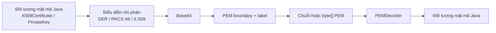

# Mô hình mã hóa và giải mã PEM cho đối tượng mật mã được hỗ trợ

## 1. PEM giải quyết vấn đề gì?

Các giao thức và thư viện mật mã thường biểu diễn khóa, chứng chỉ và dữ liệu PKI dưới dạng nhị phân, chẳng hạn cấu trúc ASN.1 được mã hóa bằng DER. Dạng nhị phân phù hợp để máy xử lý, nhưng khi cần lưu trong file cấu hình, trao đổi qua email, đưa vào secret store hoặc chuyển giữa các công cụ, một biểu diễn văn bản dễ nhận biết sẽ thuận tiện hơn.

**PEM (Privacy-Enhanced Mail)** là định dạng văn bản bao bọc dữ liệu nhị phân đã mã hóa Base64. Một khối PEM có nhãn ở phần đầu và cuối để cho biết nội dung dự kiến là loại đối tượng nào, ví dụ chứng chỉ X.509, khóa công khai hoặc khóa riêng PKCS #8.

PEM chỉ là lớp biểu diễn và vận chuyển. Nó không tự mã hóa nội dung, không xác thực chữ ký chứng chỉ, không kiểm tra chuỗi tin cậy và không chứng minh một khóa riêng thuộc về một chứng chỉ cụ thể. Base64 cũng không phải cơ chế bảo mật. Với khóa riêng cần bảo vệ, phải dùng dạng encrypted PKCS #8 và quản lý password theo chính sách phù hợp.

Java 25 giới thiệu API PEM trong **JEP 470 — PEM Encodings of Cryptographic Objects (Preview)**. API gồm `PEMEncoder` và `PEMDecoder` trong `java.security`, giúp chuyển đổi các đối tượng mật mã được hỗ trợ sang PEM và ngược lại. Tính năng tiếp tục được cập nhật qua JEP 524 ở Java 26 và JEP 538 ở Java 27; tại thời điểm đối chiếu 27/11/2026, API vẫn là preview.

Bài **Mô hình mã hóa và giải mã PEM cho đối tượng mật mã được hỗ trợ** thuộc chương **Mã hóa PEM** của học phần **JAVA_VERSION_JAVA25**. Học phần tập trung vào những khả năng Java 25 còn áp dụng trong phát triển hiện đại, gồm compact source files, module imports, flexible constructor bodies, `ScopedValue`, KDF API, AOT cache, JFR và đánh giá nâng cấp JDK. Bài này tập trung vào cấu trúc PEM, ánh xạ đối tượng được hỗ trợ, API encode/decode và các giới hạn bảo mật khi tích hợp với hệ thống PKI.

### Kết quả cần đạt

Sau bài học, bạn có thể:

1. Phân biệt PEM, Base64, DER và cấu trúc ASN.1.
2. Đọc nhãn PEM và nhận biết loại dữ liệu được biểu diễn.
3. Xác định những đối tượng Java mà `PEMEncoder` và `PEMDecoder` hỗ trợ.
4. Mã hóa/giải mã certificate, CRL, public key, private key và key pair.
5. Xử lý private key được bảo vệ bằng password qua encrypted PKCS #8.
6. Nhận biết PEM có định dạng hợp lệ nhưng chưa chắc chứa đối tượng được Java API hỗ trợ.
7. Dùng provider phù hợp khi tạo đối tượng khóa hoặc chứng chỉ.
8. Phân biệt API preview Java 25 với các thay đổi ở Java 26/27.

> **Trạng thái tính năng:** JEP 470 đưa PEM API vào Java 25 ở trạng thái preview. Java 26 tiếp tục preview lần hai qua JEP 524; Java 27 tiếp tục preview lần ba qua JEP 538. Không xem API này là permanent hoặc mặc định tương thích nguồn giữa các JDK release. Ví dụ chính trong bài dùng API Java 27 hiện hành để tránh lấy tên API của preview cũ làm mẫu cho code mới.

## 2. Cấu trúc một khối PEM

### 2.1. Ba phần chính

Một khối PEM theo RFC 7468 có ba phần:

1. **Encapsulation boundary đầu:** dòng `-----BEGIN LABEL-----`.
2. **Nội dung:** dữ liệu nhị phân đã mã hóa Base64, thường được ngắt dòng.
3. **Encapsulation boundary cuối:** dòng `-----END LABEL-----` với cùng nhãn.

Ví dụ cấu trúc chứng chỉ:

```text
-----BEGIN CERTIFICATE-----
MIIB...phần Base64 của dữ liệu DER...
...các dòng Base64 tiếp theo...
-----END CERTIFICATE-----
```

Nhãn `CERTIFICATE` cho biết nội dung dự kiến là chứng chỉ X.509. Các dòng Base64 là cách biểu diễn dữ liệu nhị phân; bản thân nhãn không xác minh nội dung có thật sự là certificate hay không.

### 2.2. PEM là văn bản bao bọc DER

Một luồng chuyển đổi thường gặp:



Các lớp định dạng có vai trò khác nhau:

| Thành phần | Vai trò |
|---|---|
| ASN.1 | Mô tả cấu trúc dữ liệu mật mã |
| DER | Quy tắc mã hóa nhị phân xác định cho cấu trúc ASN.1 |
| Base64 | Chuyển byte nhị phân thành ký tự văn bản |
| PEM | Đóng gói Base64 cùng nhãn BEGIN/END |
| `PEMEncoder` / `PEMDecoder` | Chuyển đổi giữa PEM và đối tượng Java được hỗ trợ |

Không nên gọi PEM là “mã hóa khóa” theo nghĩa encryption. Khi chỉ dùng Base64 và boundary, ai có file đều có thể giải mã Base64 để lấy dữ liệu nhị phân.

### 2.3. Các nhãn PEM thường gặp

| Nhãn | Nội dung thường được biểu diễn | Đối tượng/định dạng liên quan |
|---|---|---|
| `CERTIFICATE` | Chứng chỉ X.509 | `X509Certificate` |
| `X509 CRL` | Certificate Revocation List | `X509CRL` |
| `PUBLIC KEY` | Khóa công khai theo SubjectPublicKeyInfo | `PublicKey`, `X509EncodedKeySpec` |
| `PRIVATE KEY` | Khóa riêng không mã hóa theo PKCS #8 | `PrivateKey`, `PKCS8EncodedKeySpec` |
| `ENCRYPTED PRIVATE KEY` | Khóa riêng PKCS #8 được mã hóa | `EncryptedPrivateKeyInfo` hoặc `PrivateKey` sau giải mã |
| `CERTIFICATE REQUEST` | Yêu cầu ký chứng chỉ PKCS #10 | Có thể được giữ dưới dạng PEM thô nếu không có lớp Java tương ứng |
| `PKCS7` / `CMS` | Gói dữ liệu PKCS #7/CMS | Cần API hoặc thư viện phù hợp với loại nội dung |

Nhãn giúp chọn cách diễn giải, nhưng không phải bằng chứng xác thực. Ví dụ, đổi nhãn `PUBLIC KEY` thành `CERTIFICATE` không biến byte của public key thành chứng chỉ.

### 2.4. Một file có thể chứa nhiều khối

Một file PEM có thể chứa nhiều khối liên tiếp, ví dụ một certificate chain:

```text
-----BEGIN CERTIFICATE-----
...certificate của leaf...
-----END CERTIFICATE-----
-----BEGIN CERTIFICATE-----
...certificate của intermediate CA...
-----END CERTIFICATE-----
-----BEGIN CERTIFICATE-----
...certificate của root CA...
-----END CERTIFICATE-----
```

Thứ tự và ý nghĩa của từng khối phụ thuộc giao thức hoặc ứng dụng. Một file có nhiều certificate không tự chứng minh rằng chuỗi đó tin cậy hoặc hợp lệ. Ứng dụng vẫn phải kiểm tra issuer/subject, chữ ký, thời hạn, key usage, trust anchor và trạng thái thu hồi theo yêu cầu.

### 2.5. Quy tắc định dạng theo RFC 7468

Với PEM theo RFC 7468:

- Dòng BEGIN và END phải dùng cùng nhãn.
- Boundary có đúng năm dấu gạch ngang ở mỗi đầu.
- Nhãn phân biệt chữ hoa/chữ thường theo quy ước của chuẩn.
- Generator nên ngắt dòng Base64 ở 64 ký tự, ngoại trừ dòng cuối.
- Không phát sinh khoảng trắng thừa hoặc header tùy biến giữa boundary và Base64.
- Parser cần xử lý quy ước xuống dòng khác nhau và nội dung trước boundary theo quy định.

RFC 7468 không cho phép các header kiểu legacy nằm giữa boundary và Base64. Những chuỗi có header `Proc-Type`/`DEK-Info` thuộc cách mã hóa PEM cũ, không phải dạng encrypted PKCS #8 hiện đại được API này hướng tới. Với khóa riêng mã hóa, dùng nhãn `ENCRYPTED PRIVATE KEY` và cấu trúc PKCS #8 phù hợp.

## 3. Ánh xạ giữa PEM và đối tượng mật mã Java

### 3.1. Khóa công khai: X.509 SubjectPublicKeyInfo

Nhãn `PUBLIC KEY` thường chứa cấu trúc SubjectPublicKeyInfo của X.509. Cấu trúc này bao gồm thuật toán khóa và dữ liệu khóa công khai. Java có thể biểu diễn nó bằng `PublicKey` hoặc `X509EncodedKeySpec`.

Không nhầm `PUBLIC KEY` với nhãn `RSA PUBLIC KEY` của một số định dạng triển khai riêng. Hai nhãn có thể đại diện cấu trúc ASN.1 khác nhau; không nên giả định mọi parser đều xử lý chúng giống nhau.

### 3.2. Khóa riêng: PKCS #8

Nhãn `PRIVATE KEY` thường đại diện cấu trúc PKCS #8 không mã hóa. PKCS #8 chứa thông tin thuật toán và dữ liệu khóa riêng theo định dạng chuẩn hóa, giúp cùng một API xử lý nhiều thuật toán khác nhau.

Java có thể trả về một `PrivateKey` cụ thể như `RSAPrivateKey`, `ECPrivateKey` hoặc kiểu khóa tương ứng nếu provider hỗ trợ thuật toán và tham số trong dữ liệu.

### 3.3. Khóa riêng được mã hóa: Encrypted PKCS #8

Nhãn `ENCRYPTED PRIVATE KEY` biểu diễn cấu trúc `EncryptedPrivateKeyInfo` của PKCS #8. Nội dung gồm thông tin thuật toán mã hóa, tham số cần thiết và ciphertext. Người nhận cần password hoặc khóa giải mã tương ứng để khôi phục khóa riêng.

Không tự thêm một lớp Base64 thứ hai hoặc tự mã hóa chuỗi PEM rồi vẫn giữ nguyên nhãn. Hãy để API tạo đúng cấu trúc encrypted PKCS #8.

### 3.4. Key pair và OneAsymmetricKey

`KeyPair` chứa public key và private key. Khi `PEMEncoder` mã hóa `KeyPair`, API dùng cấu trúc PKCS #8 v2.0 `OneAsymmetricKey` với nhãn `PRIVATE KEY`; cấu trúc này có thể mang cả public key cùng private key.

Không phải mọi file `PRIVATE KEY` đều chứa public key. Khi decode, nếu dữ liệu có cả hai thành phần và provider hỗ trợ, `PEMDecoder` có thể trả về `KeyPair`; nếu không, có thể chỉ trả về `PrivateKey`.

### 3.5. Certificate và CRL

- `X509Certificate` biểu diễn chứng chỉ X.509; nó chứa public key, subject, issuer, thời hạn và các extension.
- `X509CRL` biểu diễn danh sách chứng chỉ bị thu hồi theo một issuer.
- PEM chỉ vận chuyển các đối tượng này; nó không thực hiện kiểm tra trust chain, chữ ký, thời hạn hoặc revocation.

Nếu cần kiểm tra certificate chain, hãy dùng các API PKI/JSSE phù hợp như `CertPath`, `CertPathValidator`, `PKIXParameters` và trust store. Không xem thao tác decode thành công là thao tác xác minh chứng chỉ thành công.

## 4. API PEM qua Java 25, 26 và 27

### 4.1. Những lớp API chính

Trong các JDK có preview PEM API, hai lớp chính nằm trong module `java.base`, package `java.security`:

- `PEMEncoder`: mã hóa đối tượng mật mã được hỗ trợ thành PEM.
- `PEMDecoder`: phân tích PEM và tạo lại đối tượng Java tương ứng.

JDK 27 còn có:

- `BinaryEncodable`: interface đánh dấu đối tượng mật mã có thể chuyển đổi sang/ từ biểu diễn nhị phân.
- `PEM`: container giữ nhãn, nội dung Base64 và dữ liệu đứng trước PEM boundary nếu có.

Các lớp này là preview API. Khi dùng phải bật preview ở compiler và runtime của đúng release.

### 4.2. Lịch sử thay đổi API

| JDK | JEP | Trạng thái | Tên/điểm đáng chú ý |
|---|---|---|---|
| Java 25 | JEP 470 | Preview lần đầu | `DEREncodable`, `PEMRecord`, `withFactory(Provider)` |
| Java 26 | JEP 524 | Preview lần hai | `PEMRecord` được đổi tên thành `PEM`; bổ sung khả năng xử lý mã hóa/giải mã `KeyPair` và key spec |
| Java 27 | JEP 538 | Preview lần ba | `DEREncodable` đổi thành `BinaryEncodable`; `withFactory` đổi thành `withFactoriesOf`; `PEM` trở thành class; bổ sung `CryptoException` |

Do API đã đổi qua các lần preview, code biên dịch với Java 25 không nên được kỳ vọng sẽ compile nguyên trạng bằng Java 27. Hãy biên dịch lại bằng đúng JDK mục tiêu và kiểm tra các API đã đổi tên.

### 4.3. Bảng tương ứng tên API

| Java 25 preview | Java 27 preview | Ý nghĩa |
|---|---|---|
| `DEREncodable` | `BinaryEncodable` | Đối tượng có thể chuyển đổi sang biểu diễn nhị phân |
| `PEMRecord` | `PEM` | Container cho PEM không có lớp mật mã Java tương ứng |
| `withFactory(Provider)` | `withFactoriesOf(Provider)` | Chọn provider cho `KeyFactory` và `CertificateFactory` |
| `RuntimeException` trong một số lỗi giải mã | `CryptoException` | Lỗi xử lý mật mã trong API mới |

Các tên Java 25 được nêu để nhận diện mã nguồn của release đó. Ví dụ chính trong các mục sau dùng tên API Java 27 hiện hành; nếu đang biên dịch bằng JDK 25, phải đối chiếu Javadoc Java 25 và thay bằng tên tương ứng của JEP 470.

### 4.4. Preview cần bật ở cả compile và run

Ví dụ khi thử nghiệm API Java 25:

```bash
javac --enable-preview --release 25 PemDemo.java
java --enable-preview PemDemo
```

Ví dụ khi thử nghiệm API Java 27:

```bash
javac --enable-preview --release 27 PemDemo.java
java --enable-preview PemDemo
```

Không compile class với preview của một release rồi chạy nó trên runtime release khác. Preview class file được gắn với release đã biên dịch. Khi nâng JDK, hãy cập nhật code theo JEP mới và compile lại.


## 5. Mã hóa đối tượng bằng `PEMEncoder`

### 5.1. Khởi tạo encoder

Tạo encoder bằng factory method:

```java
PEMEncoder encoder = PEMEncoder.of();
```

`PEMEncoder` là immutable và thread-safe trong API hiện hành. Có thể tái sử dụng instance để encode nhiều đối tượng cùng cấu hình. Hai phương thức chính:

- `encode(BinaryEncodable)`: trả về `byte[]` chứa PEM.
- `encodeToString(BinaryEncodable)`: trả về `String` chứa PEM.

Nếu cần ghi file, chọn `byte[]` hoặc `String` tùy luồng I/O. Khi ghi PEM dạng văn bản, dùng UTF-8 và bảo vệ quyền truy cập file nếu nội dung chứa khóa riêng.

### 5.2. Mã hóa chứng chỉ và CRL

Ví dụ với chứng chỉ đã có trong ứng dụng:

```java
import java.security.PEMEncoder;
import java.security.cert.X509Certificate;

String certificatePem = PEMEncoder.of().encodeToString(certificate);
```

Với CRL:

```java
import java.security.PEMEncoder;
import java.security.cert.X509CRL;

String crlPem = PEMEncoder.of().encodeToString(crl);
```

Encoder dùng nhãn `CERTIFICATE` cho `X509Certificate` và `X509 CRL` cho `X509CRL`. API chỉ chuyển đổi biểu diễn. Nó không xác nhận certificate được CA tin cậy, CRL có chữ ký hợp lệ hay CRL còn mới.

### 5.3. Mã hóa public key

Public key được mã hóa với nhãn `PUBLIC KEY`, thường theo SubjectPublicKeyInfo:

```java
import java.security.PEMEncoder;
import java.security.PublicKey;

String publicKeyPem = PEMEncoder.of().encodeToString(publicKey);
```

Đối tượng public key cần có biểu diễn chuẩn mà provider hỗ trợ. Nếu khóa nằm trong HSM hoặc là non-exportable key, việc encode có thể thất bại vì không thể lấy phần dữ liệu nhị phân cần thiết. Không cố trích xuất khóa từ HSM chỉ để tạo PEM nếu chính sách thiết kế yêu cầu khóa không rời thiết bị.

### 5.4. Mã hóa private key không mã hóa

Ví dụ:

```java
import java.security.PEMEncoder;
import java.security.PrivateKey;

String privateKeyPem = PEMEncoder.of().encodeToString(privateKey);
```

Kết quả thường có nhãn `PRIVATE KEY` và nội dung PKCS #8. Đây là dữ liệu bí mật ở dạng có thể khôi phục trực tiếp khóa riêng. Chỉ dùng cách này khi có một lớp bảo vệ bên ngoài phù hợp, chẳng hạn secret manager được mã hóa, filesystem permission chặt hoặc kênh truyền đã được bảo vệ.

Không đưa `privateKeyPem` vào log, exception, metric label, telemetry, ticket hoặc output debug. Không commit file này vào source control.

### 5.5. Mã hóa key pair

`KeyPair` chứa cả public key và private key. API Java 27 có thể encode nó theo PKCS #8 v2.0 `OneAsymmetricKey`:

```java
import java.security.KeyPair;
import java.security.PEMEncoder;

String keyPairPem = PEMEncoder.of().encodeToString(keyPair);
```

Nhãn vẫn là `PRIVATE KEY`. Dữ liệu có thể chứa cả public key và private key. Không dựa vào nhãn để suy luận file có chứa một hay hai thành phần; cần decode và kiểm tra kiểu đối tượng được trả về.

### 5.6. Bảng ánh xạ đối tượng được encoder hỗ trợ

Theo Javadoc Java 27, encoder hỗ trợ các ánh xạ chính:

| Đối tượng Java | Nhãn PEM |
|---|---|
| `X509Certificate` | `CERTIFICATE` |
| `X509CRL` | `X509 CRL` |
| `PublicKey` | `PUBLIC KEY` |
| `PrivateKey` | `PRIVATE KEY` |
| `KeyPair` | `PRIVATE KEY` |
| `X509EncodedKeySpec` | `PUBLIC KEY` |
| `PKCS8EncodedKeySpec` | `PRIVATE KEY` |
| `EncryptedPrivateKeyInfo` | `ENCRYPTED PRIVATE KEY` |
| `PEM` | Nhãn lấy từ `PEM.type()` |

Khi encoder được cấu hình bằng `withEncryption(char[])`, các đối tượng được phép mã hóa chỉ gồm `PrivateKey`, `KeyPair` và `PKCS8EncodedKeySpec`; chúng được xuất ra nhãn `ENCRYPTED PRIVATE KEY`. Cố encode certificate hoặc public key bằng encoder đã cấu hình encryption sẽ gây `IllegalArgumentException`.

Implementation có thể hỗ trợ thêm PEM types. Không giả định một nhãn mở rộng được hỗ trợ trên mọi JDK vendor/provider; hãy kiểm tra runtime đích.

## 6. Giải mã PEM bằng `PEMDecoder`

### 6.1. Giải mã khi biết kiểu đối tượng mong đợi

Khởi tạo decoder:

```java
PEMDecoder decoder = PEMDecoder.of();
```

Nếu biết dữ liệu là certificate, chỉ định class đích để tránh cast:

```java
import java.security.PEMDecoder;
import java.security.cert.X509Certificate;

X509Certificate certificate =
    PEMDecoder.of().decode(certificatePem, X509Certificate.class);
```

Tương tự, giải mã public key:

```java
PublicKey publicKey =
    PEMDecoder.of().decode(publicKeyPem, PublicKey.class);
```

Với private key không mã hóa:

```java
PrivateKey privateKey =
    PEMDecoder.of().decode(privateKeyPem, PrivateKey.class);
```

Nếu class được yêu cầu không tương ứng với nhãn/nội dung PEM, API có thể ném `ClassCastException`. Nếu PEM sai cú pháp, không có khối PEM hoặc không thể tạo đối tượng yêu cầu, có thể nhận `IllegalArgumentException` hoặc lỗi mật mã tương ứng.

### 6.2. Giải mã theo kiểu thực tế khi chưa biết trước

Khi chưa biết loại dữ liệu, gọi `decode(String)` để lấy `BinaryEncodable`:

```java
import java.security.BinaryEncodable;
import java.security.PEMDecoder;
import java.security.PrivateKey;
import java.security.PublicKey;
import java.security.KeyPair;

BinaryEncodable decoded = PEMDecoder.of().decode(pemText);

switch (decoded) {
    case PublicKey publicKey ->
        usePublicKey(publicKey);

    case PrivateKey privateKey ->
        usePrivateKey(privateKey);

    case KeyPair keyPair ->
        useKeyPair(keyPair);

    default ->
        handleOtherPemObject(decoded);
}
```

`BinaryEncodable` là sealed interface nhưng danh sách subtype được phép không được cam kết là đầy đủ cho mọi phiên bản tương lai. Vì vậy, `switch` phải có `default` hoặc nhánh tổng quát phù hợp. Không viết switch chỉ liệt kê các subtype hiện thấy rồi giả định compiler sẽ luôn xem đó là exhaustive.

### 6.3. Bảng ánh xạ decode phổ biến

| Nhãn PEM | Kết quả decode mặc định có thể nhận |
|---|---|
| `CERTIFICATE` | `X509Certificate` |
| `X509 CRL` | `X509CRL` |
| `PUBLIC KEY` | `PublicKey` |
| `PRIVATE KEY` | `PrivateKey`, hoặc `KeyPair` nếu dữ liệu có public key và provider hỗ trợ |
| `ENCRYPTED PRIVATE KEY` | `EncryptedPrivateKeyInfo` nếu chưa cấu hình giải mã; `PrivateKey`/`KeyPair` khi đã cấu hình giải mã |
| Nhãn không có lớp Java tương ứng | `PEM` |

Với nhãn `PRIVATE KEY`, có thể chỉ định `KeyPair.class` nếu dữ liệu thực sự chứa cả hai khóa. Nếu file chỉ chứa private key, việc yêu cầu `KeyPair.class` không phù hợp và sẽ không tạo được key pair.

### 6.4. Yêu cầu class cụ thể để lấy encoded key spec

Trong một số workflow, ứng dụng cần `KeySpec` thay vì `Key`:

```java
X509EncodedKeySpec publicKeySpec =
    PEMDecoder.of().decode(publicKeyPem, X509EncodedKeySpec.class);

PKCS8EncodedKeySpec privateKeySpec =
    PEMDecoder.of().decode(privateKeyPem, PKCS8EncodedKeySpec.class);
```

`X509EncodedKeySpec` phù hợp với biểu diễn public key X.509; `PKCS8EncodedKeySpec` phù hợp với private key PKCS #8. Sau đó ứng dụng có thể dùng `KeyFactory` để tạo đối tượng khóa theo thuật toán và provider đã chọn.

Không lấy byte của `PEM` rồi truyền thẳng cho `KeyFactory` nếu chưa bóc Base64 và xác định đúng cấu trúc nhị phân. `PEM` và `BinaryEncodable` có mục đích khác với `KeySpec`.

### 6.5. Giải mã từ `InputStream`

Với file hoặc luồng lớn, có thể decode trực tiếp từ `InputStream`:

```java
import java.io.InputStream;
import java.nio.file.Files;
import java.nio.file.Path;
import java.security.PEMDecoder;
import java.security.cert.X509Certificate;

try (InputStream input = Files.newInputStream(Path.of("server-cert.pem"))) {
    X509Certificate certificate =
        PEMDecoder.of().decode(input, X509Certificate.class);
    inspectCertificate(certificate);
}
```

`InputStream` được đọc đến cuối PEM footer hoặc hết stream. Nếu có lỗi I/O trong lúc decode, vị trí stream có thể không còn nhất quán; không nên tiếp tục decode từ cùng stream sau lỗi đó. Dùng try-with-resources để đóng stream đúng cách.

Nếu không tìm thấy PEM trong stream, API có thể ném `EOFException`. Với `String`, input được diễn giải là UTF-8. Với dữ liệu byte, nên cung cấp stream chứa đúng văn bản PEM theo encoding mà giao thức sử dụng.

## 7. Mã hóa và giải mã private key bằng password

### 7.1. PEM không mã hóa private key theo mặc định

Đoạn code sau chỉ Base64-encode private key:

```java
String privateKeyPem =
    PEMEncoder.of().encodeToString(privateKey);
```

Nội dung vẫn có thể khôi phục mà không cần password. Chỉ có thêm boundary và Base64. Nếu file bị lộ, kẻ tấn công có thể decode và lấy private key.

### 7.2. Dùng `withEncryption(char[])`

Để mã hóa private key theo encrypted PKCS #8:

```java
char[] password = obtainPassword();

try {
    PEMEncoder encoder = PEMEncoder.of().withEncryption(password);
    String encryptedPem = encoder.encodeToString(privateKey);
    storeInProtectedLocation(encryptedPem);
} finally {
    java.util.Arrays.fill(password, '\0');
}
```

`withEncryption` trả về một encoder mới, được cấu hình với password và thuật toán mã hóa mặc định. API chỉ cho phép encoder đã cấu hình encryption xử lý `PrivateKey`, `KeyPair` hoặc `PKCS8EncodedKeySpec`.

Mảng password đầu vào được clone và lưu trong encoder mới. Vì vậy, xóa mảng password phía caller không đồng nghĩa với việc xóa bản sao nội bộ của encoder. Hãy giới hạn vòng đời của encoder có cấu hình password, không lưu nó thành singleton hoặc chia sẻ ngoài phạm vi thao tác cần thiết.

### 7.3. Giải mã encrypted private key

Dùng decoder có cấu hình decryption:

```java
char[] password = obtainPassword();

try {
    PEMDecoder decoder = PEMDecoder.of().withDecryption(password);
    PrivateKey privateKey =
        decoder.decode(encryptedPrivateKeyPem, PrivateKey.class);

    usePrivateKey(privateKey);
} finally {
    java.util.Arrays.fill(password, '\0');
}
```

Decoder đã cấu hình decryption vẫn có thể giải mã PEM không mã hóa. Nếu dữ liệu là `ENCRYPTED PRIVATE KEY`, decoder sẽ dùng password để giải mã rồi tạo đối tượng khóa. Password sai hoặc thao tác mật mã thất bại có thể phát sinh `CryptoException` trong API Java 27.

Nếu không cấu hình decryption, decode `ENCRYPTED PRIVATE KEY` có thể trả về `EncryptedPrivateKeyInfo`, cho phép ứng dụng thực hiện quy trình giải mã riêng.

### 7.4. Thuật toán mã hóa mặc định

Thuật toán PBE mặc định được điều khiển bởi security property `jdk.epkcs8.defaultAlgorithm`. Tham số mặc định còn phụ thuộc provider được chọn. Không hard-code giả định rằng mọi JDK vendor, bản cập nhật hoặc môi trường đều có cùng thuật toán mặc định.

PEM encrypted PKCS #8 chứa thông tin thuật toán và tham số cần để giải mã. Vì vậy, thay đổi thuật toán mặc định của JDK không tự làm cho file đã tạo trước đó mất khả năng giải mã; nhưng khả năng hỗ trợ thuật toán cụ thể vẫn phụ thuộc provider/runtime.

Nếu cần thuật toán, tham số hoặc provider cụ thể, dùng các phương thức `EncryptedPrivateKeyInfo.encrypt(...)` phù hợp để tạo encrypted object, sau đó truyền object đó cho `PEMEncoder`. Không tự thiết kế một định dạng password encryption riêng bằng cách nối chuỗi, Base64 hoặc tự đặt header.

### 7.5. Chọn đúng lớp đầu ra khi giải mã

| Nhu cầu | Cách dùng |
|---|---|
| Lấy private key sau giải mã | `withDecryption(password).decode(pem, PrivateKey.class)` |
| Lấy key pair nếu PEM chứa cả hai khóa | `withDecryption(password).decode(pem, KeyPair.class)` |
| Giữ encrypted object để xử lý riêng | `decode(pem, EncryptedPrivateKeyInfo.class)` |
| Lấy encoded PKCS #8 sau giải mã | `decode(pem, PKCS8EncodedKeySpec.class)` với decoder đã cấu hình decryption |

Không đưa password vào source code, biến môi trường được in ra log, command line dễ quan sát hoặc file cấu hình công khai. Lấy secret từ secret manager hoặc cơ chế bảo vệ tương đương; giới hạn quyền truy cập và vòng đời của password.


## 8. PEM không được hỗ trợ trực tiếp: dùng lớp `PEM`

### 8.1. Khi nào decoder trả về `PEM`?

Không phải mọi nhãn PEM đều có một lớp Java tương ứng. Ví dụ, một file có thể chứa `CERTIFICATE REQUEST` (PKCS #10), `CMS` hoặc một loại dữ liệu mà ứng dụng cần giữ nguyên để chuyển tiếp sang thư viện khác.

Trong Java 27, khi decoder không thể biểu diễn nội dung thành đối tượng mật mã Java được hỗ trợ, `decode(String)` hoặc `decode(InputStream)` trả về một đối tượng `PEM`. Đối tượng này giữ:

- `type()`: nhãn PEM.
- `content()`: phần nội dung Base64.
- `decode()`: nội dung nhị phân sau khi giải Base64.
- `leadingData()`: dữ liệu đứng trước PEM boundary nếu được giữ lại.

Ví dụ lấy PEM thô:

```java
import java.security.PEM;
import java.security.PEMDecoder;

PEM raw = PEMDecoder.of().decode(csrPem, PEM.class);

String label = raw.type();
byte[] derBytes = raw.decode();

System.out.println("PEM label: " + label);
System.out.println("DER bytes: " + derBytes.length);
```

Đoạn code chỉ bóc cấu trúc PEM và Base64. Nó chưa parse `derBytes` thành một certificate request hoặc xác minh chữ ký CSR. Muốn làm việc với PKCS #10, cần một API hoặc thư viện có hỗ trợ loại đối tượng đó.

### 8.2. Giữ nguyên nhãn và nội dung PEM

Có thể encode lại đối tượng `PEM`:

```java
String preservedPem = PEMEncoder.of().encodeToString(raw);
```

Encoder bao nội dung bằng boundary theo `raw.type()` và `raw.content()`. `leadingData()` không được đưa vào kết quả encode. Nếu ứng dụng cần giữ metadata đứng trước boundary, phải xử lý riêng và không giả định nó được round-trip tự động.

### 8.3. `PEM` không xác minh nội dung

Khi tạo `PEM` thủ công, API không xác minh:

- Nhãn có tuân theo RFC 7468 hay không.
- Base64 content có đúng định dạng hay không.
- Dữ liệu nhị phân có tương ứng với nhãn hay không.
- Đối tượng có chữ ký hợp lệ hay có nguồn gốc tin cậy hay không.

Ví dụ, ứng dụng có thể tạo `PEM` với nhãn `CERTIFICATE` nhưng nội dung thực tế lại là một chuỗi byte bất kỳ. Encode thành công chỉ cho biết API có thể tạo văn bản theo cấu trúc được yêu cầu.

Không dùng `PEM` như một cách “bỏ qua” kiểm tra kiểu dữ liệu. Nếu cần parse certificate, CSR hoặc CMS, hãy dùng parser chuyên biệt rồi xác minh đối tượng theo chuẩn tương ứng.

### 8.4. Phân biệt decode tự động và decode yêu cầu `PEM.class`

| Cách gọi | Hành vi |
|---|---|
| `decode(pemText)` | Trả về đối tượng Java phù hợp nếu được hỗ trợ; nếu không thì trả về `PEM` |
| `decode(pemText, X509Certificate.class)` | Yêu cầu kết quả là `X509Certificate`; lỗi nếu nội dung không tương ứng |
| `decode(pemText, PEM.class)` | Lấy container PEM thô, gồm type, Base64 content và leading data |
| `decode(pemText, PrivateKey.class)` | Chỉ lấy private key nếu PEM và provider hỗ trợ; không tự biến certificate hoặc public key thành private key |

Khi ứng dụng nhận PEM từ nguồn bên ngoài, decode theo class cụ thể giúp hợp đồng đầu vào rõ ràng. Nếu cần giữ lại loại chưa biết để chuyển tiếp, hãy decode thành `PEM` rồi xử lý theo chính sách riêng.

## 9. Provider và khả năng hỗ trợ thuật toán

### 9.1. Vai trò của provider

Java Cryptography Architecture (JCA) dùng provider để cung cấp implementation cho các dịch vụ mật mã. `PEMDecoder` cần tạo đối tượng như `PublicKey`, `PrivateKey` hoặc `X509Certificate` từ dữ liệu nhị phân; việc đó có thể cần `KeyFactory` hoặc `CertificateFactory`.

Mặc định, decoder dùng các provider được runtime lựa chọn. Nếu hệ thống có yêu cầu dùng một provider cụ thể, Java 27 cung cấp `withFactoriesOf(Provider)`:

```java
import java.security.PEMDecoder;
import java.security.Provider;
import java.security.Security;

Provider provider = Security.getProvider("MyCryptoProvider");

if (provider == null) {
    throw new IllegalStateException("Provider chưa được cài đặt");
}

PEMDecoder decoder = PEMDecoder.of().withFactoriesOf(provider);
PublicKey key = decoder.decode(publicKeyPem, PublicKey.class);
```

Tên `MyCryptoProvider` là ví dụ. Chỉ dùng provider đã được cài đặt và kiểm định trong môi trường triển khai.

### 9.2. Phạm vi của `withFactoriesOf`

`withFactoriesOf(provider)` cấu hình provider được dùng khi decoder lấy `KeyFactory` và `CertificateFactory` để tạo đối tượng. Nó không có nghĩa mọi hoạt động mật mã trong quá trình giải mã, bao gồm password-based decryption, đều tự động dùng cùng provider.

Nếu cần kiểm soát provider hoặc tham số PBE, hãy cấu hình đúng API mã hóa/giải mã tương ứng và kiểm tra tài liệu của provider. Không dùng `withFactoriesOf` như một tùy chọn tổng quát để ép toàn bộ JCA dùng một provider.

### 9.3. Không phải thuật toán nào cũng được mọi provider hỗ trợ

Một PEM có thể đúng cú pháp và chứa cấu trúc khóa chuẩn, nhưng provider đang dùng không có `KeyFactory` cho thuật toán đó. Trong trường hợp này, việc tạo `PublicKey` hoặc `PrivateKey` có thể thất bại.

Hãy tách ba câu hỏi:

1. PEM có cấu trúc và Base64 hợp lệ không?
2. Nội dung nhị phân có đúng cấu trúc PKCS #8, X.509 hoặc loại được khai báo không?
3. Provider có hỗ trợ thuật toán và tham số để tạo đối tượng Java không?

Đừng xử lý mọi lỗi như lỗi Base64. Khi cần, lấy `PEM` hoặc encoded key spec rồi dùng provider phù hợp để chẩn đoán riêng.

### 9.4. Các loại lỗi thường gặp

| Tình huống | Kết quả có thể gặp | Hướng xử lý |
|---|---|---|
| Không tìm thấy PEM trong `String` | `IllegalArgumentException` | Kiểm tra input và boundary |
| Không có PEM trong `InputStream` | `EOFException` | Kiểm tra file rỗng hoặc stream sai |
| PEM sai cú pháp/Base64 | `IllegalArgumentException` hoặc `IOException` | Kiểm tra nhãn, Base64 và encoding |
| Yêu cầu sai class đầu ra | `ClassCastException` | Chỉ định class phù hợp với PEM type |
| Provider không hỗ trợ thuật toán | Lỗi tạo key/certificate | Kiểm tra provider và thuật toán |
| Password sai hoặc giải mã thất bại | `CryptoException` trong Java 27 | Xác minh password, PBE algorithm và tham số |
| Đối tượng không có encoding được hỗ trợ | `IllegalArgumentException` | Dùng đối tượng/định dạng được API hỗ trợ hoặc parser chuyên biệt |

Lỗi cụ thể có thể phụ thuộc JDK build và provider. Hãy giữ nguyên cause của exception cho log nội bộ đã được kiểm soát, nhưng không đưa PEM chứa private key hoặc password vào log.

## 10. PEM không thay thế kiểm tra PKI

### 10.1. Decode certificate không đồng nghĩa tin cậy certificate

Nếu `PEMDecoder` trả về `X509Certificate`, điều đó chỉ cho biết dữ liệu có thể được parse thành đối tượng certificate. Nó không khẳng định:

- Certificate được ký bởi CA mà ứng dụng tin cậy.
- Chuỗi certificate dẫn đến trust anchor hợp lệ.
- Certificate chưa hết hạn hoặc chưa bị thu hồi.
- Subject Alternative Name khớp hostname cần kết nối.
- Key Usage và Extended Key Usage phù hợp với mục đích sử dụng.
- Chữ ký và thuật toán được phép theo policy hiện tại.

Với TLS client/server, hãy dùng trust store, `TrustManagerFactory`, JSSE và cơ chế xác minh hostname phù hợp. Với PKIX path validation, dùng `CertPathValidator` và `PKIXParameters`.

### 10.2. Không suy luận private key thuộc certificate chỉ từ PEM

Một file có thể chứa certificate và private key đặt cạnh nhau, nhưng hai đối tượng không nhất thiết là một cặp. Ứng dụng cần xác minh public key trong certificate tương ứng với private key đang dùng.

Một phép kiểm tra thực tế là ký một challenge bằng private key rồi xác minh chữ ký bằng public key trong certificate, dùng thuật toán chữ ký phù hợp với loại khóa. Chỉ so sánh chuỗi PEM hoặc nhãn `PRIVATE KEY`/`CERTIFICATE` không chứng minh được quan hệ này.

### 10.3. Certificate chain cần được xử lý theo ngữ cảnh

Một file có nhiều khối `CERTIFICATE` có thể chứa leaf certificate, intermediate CA và root CA. Không tự động tin cậy mọi certificate chỉ vì chúng cùng nằm trong file.

Ứng dụng nên:

1. Parse từng certificate.
2. Xác định vai trò và thứ tự chain theo giao thức.
3. Chọn trust anchor từ nguồn tin cậy đã cấu hình.
4. Xác minh chữ ký và đường dẫn PKIX.
5. Kiểm tra thời hạn, key usage, extended key usage và revocation theo policy.
6. Kiểm tra hostname khi dùng certificate cho TLS server.

PEM chỉ là định dạng lưu/chuyển giao. Chính sách tin cậy thuộc tầng PKI và ứng dụng.

## 11. Bảo vệ dữ liệu và vận hành file PEM

### 11.1. Public material và private material có mức độ nhạy cảm khác nhau

| Dữ liệu | Mức độ bảo vệ thường cần |
|---|---|
| Certificate công khai | Có thể phân phối công khai, nhưng vẫn cần kiểm tra tính toàn vẹn và nguồn |
| CRL | Có thể công khai, cần kiểm tra nguồn và thời điểm cập nhật |
| Public key | Thường không bí mật, nhưng phải gắn đúng danh tính/chứng chỉ |
| Private key không mã hóa | Bí mật cao; chỉ lưu trong vùng được bảo vệ |
| Encrypted private key | Vẫn là dữ liệu nhạy cảm; password và file phải được bảo vệ riêng |
| PEM/CSR chưa được xác minh | Dữ liệu đầu vào không tin cậy; cần parse và xác minh trước khi sử dụng |

Mã hóa private key trong PEM giảm rủi ro khi file bị lộ, nhưng không thay thế quyền truy cập file, secret management, rotation hoặc kiểm soát sử dụng khóa.

### 11.2. Tránh rò rỉ private key

- Không ghi private PEM hoặc `PrivateKey.toString()` vào log.
- Không lưu private PEM trong repository, issue, paste, telemetry hoặc metric label.
- Không truyền password qua command line nếu hệ điều hành cho phép process khác quan sát tham số.
- Không lưu password cùng thư mục hoặc cùng secret object với encrypted key nếu mục tiêu là tách lớp bảo vệ.
- Giới hạn quyền đọc/ghi file và quyền truy cập secret manager.
- Có quy trình xoay vòng, thu hồi và thay thế khóa khi lộ lọt.
- Chỉ giải mã khóa trong phạm vi cần thiết; giảm thời gian tồn tại của bản rõ trong bộ nhớ.

### 11.3. Cẩn thận khi dùng `String` và `char[]`

PEM thường được xử lý dưới dạng `String` hoặc `byte[]`. `String` bất biến nên ứng dụng không thể chủ động xóa nội dung khỏi vùng nhớ ngay sau khi dùng. Với private key, tránh tạo nhiều bản sao chuỗi không cần thiết.

Password được API nhận dưới dạng `char[]`. JDK clone mảng password và giữ bản sao trong encoder/decoder được cấu hình. Xóa mảng của caller chỉ xóa bản sao caller; không đảm bảo xóa bản sao bên trong object đã cấu hình. Vì vậy:

- Tạo encoder/decoder cấu hình password trong phạm vi hẹp.
- Không giữ object có password trong cache hoặc singleton dùng lâu dài.
- Xóa mảng password do ứng dụng sở hữu sau thao tác.
- Không tuyên bố rằng thao tác xóa mảng caller đã xóa toàn bộ password khỏi heap.

### 11.4. Ghi file PEM an toàn

Khi lưu certificate công khai, ghi file văn bản UTF-8 là thao tác thông thường. Khi lưu private key, phải dùng vị trí có quyền truy cập hạn chế và chính sách backup/rotation rõ ràng.

Ví dụ ghi certificate PEM:

```java
import java.nio.charset.StandardCharsets;
import java.nio.file.Files;
import java.nio.file.Path;

Files.writeString(
    Path.of("server-cert.pem"),
    certificatePem,
    StandardCharsets.UTF_8
);
```

Ví dụ trên chỉ minh họa cách ghi văn bản. Với private key, trước khi dùng cần cấu hình ACL hoặc POSIX permissions phù hợp với hệ điều hành và user chạy ứng dụng. Không giả định file mới tạo luôn có quyền an toàn ở mọi môi trường.


## 12. Khả năng tương thích và thay đổi qua các JDK

### 12.1. Vì sao không dùng lẫn API của các preview?

Preview API có thể thay đổi tên kiểu, phương thức, cách biểu diễn dữ liệu và ngoại lệ. PEM API đã có một số thay đổi rõ ràng:

- Java 25 dùng `DEREncodable` và `PEMRecord`.
- Java 26 đổi `PEMRecord` thành `PEM`, đồng thời mở rộng hỗ trợ `KeyPair` và các key spec trong luồng mã hóa/giải mã.
- Java 27 đổi `DEREncodable` thành `BinaryEncodable`, đổi `withFactory` thành `withFactoriesOf`, chuyển `PEM` thành class và bổ sung `CryptoException`.

Vì vậy, khi mở một ví dụ trên Internet, hãy xác định JDK release mà ví dụ nhắm tới trước khi copy code. Một đoạn code dùng `DEREncodable` có thể đúng với JDK 25 nhưng không compile bằng JDK 27.

### 12.2. Chọn baseline theo môi trường triển khai

| Môi trường | Hướng xử lý |
|---|---|
| Ứng dụng đang chạy JDK 25 | Dùng JEP 470 và đúng Javadoc Java 25; compile/run với preview |
| Ứng dụng nâng lên JDK 26 | Đọc JEP 524; kiểm tra đổi tên `PEMRecord` thành `PEM` và các API mới |
| Ứng dụng nâng lên JDK 27 | Dùng `BinaryEncodable`, `PEM` và `withFactoriesOf`; kiểm tra `CryptoException` |
| Ứng dụng không cho phép preview | Không dùng PEM preview API trong code sản phẩm; chọn thư viện PEM đã được phê duyệt hoặc API ổn định phù hợp |

Nếu cần duy trì một thư viện chạy trên nhiều JDK release, không nên giả định một binary dùng preview API sẽ tương thích xuyên phiên bản. Có thể tách adapter theo release hoặc dùng một thư viện PEM ổn định đã được kiểm tra trên các runtime cần hỗ trợ.

### 12.3. Kiểm tra API tại runtime đích

Trước khi nâng cấp JDK:

1. Kiểm tra JDK vendor và version chính xác.
2. Đọc preview list và Javadoc của release đích.
3. Cập nhật tên interface/class/method theo API của release.
4. Biên dịch với `--enable-preview` và `--release` tương ứng.
5. Chạy bằng cùng release với compiler.
6. Chạy test round-trip cho certificate, public key, private key và encrypted private key.
7. Kiểm tra provider, thuật toán PBE mặc định và hành vi lỗi.

Không coi việc code compile là đủ. Một provider khác hoặc một JDK build khác có thể hỗ trợ tập thuật toán khác nhau.

## 13. Lỗi thường gặp và cách xử lý

| Triệu chứng | Nguyên nhân có thể | Cách xử lý |
|---|---|---|
| `PEMDecoder` báo không tìm thấy PEM | File rỗng, thiếu BEGIN/END hoặc chỉ có văn bản thông thường | Kiểm tra boundary và encoding |
| Decode ra `PEM` thay vì `X509Certificate` | Nhãn/loại nội dung chưa có lớp Java tương ứng | Kiểm tra `type()`; dùng parser phù hợp cho loại dữ liệu |
| `ClassCastException` | Yêu cầu sai class đích | Dùng `decode(pem, Class)` với kiểu phù hợp |
| Không tạo được `PrivateKey` | Thuật toán không được provider hỗ trợ hoặc cấu trúc không phải PKCS #8 | Kiểm tra định dạng nhị phân, algorithm identifier và provider |
| `ENCRYPTED PRIVATE KEY` chỉ trả về `EncryptedPrivateKeyInfo` | Decoder chưa cấu hình decryption | Dùng `withDecryption(password)` hoặc xử lý object mã hóa riêng |
| Giải mã private key thất bại | Password sai, tham số PBE không được hỗ trợ hoặc dữ liệu bị hỏng | Xác minh password, algorithm parameters và provider |
| Encoder từ chối certificate sau khi gọi `withEncryption` | Encoder đó chỉ cho phép mã hóa private key, key pair hoặc PKCS #8 key spec | Dùng encoder thường cho certificate/public key |
| `withFactoriesOf` không giải quyết lỗi PBE | Provider này chỉ áp dụng cho `KeyFactory`/`CertificateFactory` | Cấu hình provider và PBE riêng theo API mã hóa |
| Compile báo preview API bị tắt | Thiếu `--enable-preview` | Bật preview ở compiler và runtime cùng release |
| JDK mới không nhận tên `DEREncodable` | API đã đổi sang `BinaryEncodable` | Dùng API đúng release và biên dịch lại |
| PEM decode được nhưng TLS handshake thất bại | Certificate không tin cậy, sai hostname, hết hạn hoặc key usage không phù hợp | Thực hiện PKIX validation và kiểm tra cấu hình TLS |
| Private key bị lộ qua log hoặc file tạm | Ứng dụng log/ghi dữ liệu nhạy cảm không kiểm soát | Loại bỏ log, bảo vệ file, thay khóa nếu cần và rà soát secret exposure |

### 13.1. Phân biệt lỗi cú pháp với lỗi xác thực

Một PEM có thể parse thành `X509Certificate` nhưng certificate vẫn không hợp lệ cho ứng dụng. Tương tự, private key có thể decode thành công nhưng không tương ứng với certificate đang dùng.

Quy trình chẩn đoán nên tách:

1. Kiểm tra boundary và Base64.
2. Parse thành đối tượng đúng loại.
3. Xác minh cấu trúc và thuật toán.
4. Kiểm tra provider có hỗ trợ.
5. Xác minh chữ ký, trust chain, hostname hoặc quan hệ key pair theo ngữ cảnh.

Không khắc phục lỗi PKI bằng cách nới lỏng parser hoặc bỏ qua xác minh certificate.

## 14. Bài thực hành: tạo, mã hóa và khôi phục key pair

### 14.1. Mục tiêu

Tạo một cặp khóa EC trong Java, encode public key thành PEM, encode private key dưới dạng encrypted PKCS #8, decode lại và kiểm tra cặp khóa bằng chữ ký số.

Bài thực hành dùng API Java 27 preview để minh họa tên API hiện hành. Nếu dùng JDK 25 hoặc 26, phải chuyển code theo Javadoc preview của release đó.

### 14.2. Code hoàn chỉnh

Tạo file `PemRoundTrip.java`:

```java
import java.nio.charset.StandardCharsets;
import java.security.KeyPair;
import java.security.KeyPairGenerator;
import java.security.PEMDecoder;
import java.security.PEMEncoder;
import java.security.PrivateKey;
import java.security.PublicKey;
import java.security.Signature;
import java.security.spec.ECGenParameterSpec;
import java.util.Arrays;

public final class PemRoundTrip {

    public static void main(String[] args) throws Exception {
        KeyPairGenerator generator = KeyPairGenerator.getInstance("EC");
        generator.initialize(new ECGenParameterSpec("secp256r1"));
        KeyPair original = generator.generateKeyPair();

        String publicPem =
            PEMEncoder.of().encodeToString(original.getPublic());

        char[] password = obtainPassword();
        String encryptedPrivatePem;

        try {
            encryptedPrivatePem = PEMEncoder.of()
                .withEncryption(password)
                .encodeToString(original.getPrivate());
        } finally {
            Arrays.fill(password, '\0');
        }

        PublicKey decodedPublic =
            PEMDecoder.of().decode(publicPem, PublicKey.class);

        char[] decryptionPassword = obtainPassword();
        PrivateKey decodedPrivate;

        try {
            decodedPrivate = PEMDecoder.of()
                .withDecryption(decryptionPassword)
                .decode(encryptedPrivatePem, PrivateKey.class);
        } finally {
            Arrays.fill(decryptionPassword, '\0');
        }

        byte[] message =
            "PEM round-trip check".getBytes(StandardCharsets.UTF_8);

        Signature signer = Signature.getInstance("SHA256withECDSA");
        signer.initSign(decodedPrivate);
        signer.update(message);
        byte[] signature = signer.sign();

        Signature verifier = Signature.getInstance("SHA256withECDSA");
        verifier.initVerify(decodedPublic);
        verifier.update(message);

        if (!verifier.verify(signature)) {
            throw new IllegalStateException("Key pair không khớp");
        }

        System.out.println("PEM encode/decode round-trip: OK");
        System.out.println("Public PEM chars: " + publicPem.length());
        System.out.println("Encrypted private PEM chars: "
            + encryptedPrivatePem.length());
    }

    private static char[] obtainPassword() {
        // Chỉ là password minh họa cho bài lab.
        // Trong ứng dụng thật, lấy secret từ secret manager.
        return "replace-this-lab-password".toCharArray();
    }
}
```

### 14.3. Biên dịch và chạy bằng JDK 27

```bash
javac --enable-preview --release 27 -Xlint:preview PemRoundTrip.java
java --enable-preview PemRoundTrip
```

Kết quả mong đợi là dòng `PEM encode/decode round-trip: OK`. Bài lab tạo khóa mới mỗi lần chạy; không dùng khóa sinh trong lab làm credential cho production.

### 14.4. Thực hành với certificate PEM

Nếu có một certificate thử nghiệm:

```java
import java.nio.file.Files;
import java.nio.file.Path;
import java.security.PEMDecoder;
import java.security.cert.X509Certificate;

String pem = Files.readString(
    Path.of("test-certificate.pem"),
    java.nio.charset.StandardCharsets.UTF_8
);

X509Certificate certificate =
    PEMDecoder.of().decode(pem, X509Certificate.class);

System.out.println("Subject: " + certificate.getSubjectX500Principal());
System.out.println("Issuer: " + certificate.getIssuerX500Principal());
System.out.println("Not before: " + certificate.getNotBefore());
System.out.println("Not after: " + certificate.getNotAfter());
```

Các thông tin trên chỉ mô tả nội dung certificate. Bài tập mở rộng là xây dựng `CertPath` và dùng `CertPathValidator` với trust anchor phù hợp để xác minh chain.

### 14.5. Bài tập mở rộng

1. Encode một `X509Certificate` và decode lại bằng `X509Certificate.class`.
2. Encode một `KeyPair`, decode thành `KeyPair.class` và xác minh chữ ký.
3. Encode private key với `withEncryption`, sau đó thử decode bằng password sai và ghi nhận lỗi.
4. Decode một nhãn không được API hỗ trợ thành `PEM.class`, kiểm tra `type()` và `decode()`.
5. Tạo PEM có dữ liệu đứng trước boundary; dùng `decode(pem, PEM.class)` để quan sát `leadingData()`.
6. Dùng `withFactoriesOf(provider)` với provider đã cài đặt và so sánh kết quả decode.
7. Thử cùng bộ test trên JDK 25, 26 và 27; ghi lại thay đổi tên API và kiểu ngoại lệ.
8. Viết kiểm thử chứng minh decode thành certificate không tự xác minh trust chain hoặc hostname.

## 15. Checklist và tài liệu chính thức

### 15.1. Checklist triển khai

Trước khi encode:

- [ ] Đã xác định loại đối tượng và PEM label tương ứng.
- [ ] Đã xác nhận object có encoding mà API/provider hỗ trợ.
- [ ] Đã quyết định private key có cần encrypted PKCS #8 hay không.
- [ ] Password được lấy từ secret manager hoặc nguồn bảo vệ phù hợp.
- [ ] Không dùng PEM/Base64 như một cơ chế encryption.

Trước khi decode:

- [ ] Input đến từ nguồn được kiểm soát hoặc được xem là dữ liệu không tin cậy.
- [ ] Dùng class đích rõ ràng khi đã biết loại đối tượng.
- [ ] Có nhánh xử lý `PEM` khi gặp nhãn chưa được hỗ trợ.
- [ ] Đã xác minh provider và thuật toán khóa.
- [ ] Xử lý lỗi cú pháp, lỗi provider, sai password và sai class riêng biệt.

Trước khi sử dụng certificate/key:

- [ ] Certificate chain được xác minh với trust anchor phù hợp.
- [ ] Đã kiểm tra thời hạn, hostname, key usage và revocation theo policy.
- [ ] Đã xác minh private key tương ứng với public key trong certificate.
- [ ] Private key không xuất hiện trong log, source control hoặc file tạm không bảo vệ.
- [ ] Có kế hoạch rotation, backup và thu hồi khóa.

Trước khi nâng JDK:

- [ ] Đã xác định API preview của JDK đích.
- [ ] Đã cập nhật `DEREncodable`/`PEMRecord` sang tên API tương ứng nếu cần.
- [ ] Đã compile và run với preview flag cùng release.
- [ ] Đã chạy lại test encode/decode và encrypted private key.
- [ ] Đã kiểm tra provider, PBE algorithm và lỗi runtime.

### 15.2. Tài liệu tham khảo

- [JEP 470 — PEM Encodings of Cryptographic Objects (Preview)](https://openjdk.org/jeps/470): API PEM được đưa vào Java 25.
- [JEP 524 — PEM Encodings of Cryptographic Objects (Second Preview)](https://openjdk.org/jeps/524): các thay đổi trong preview Java 26.
- [JEP 538 — PEM Encodings of Cryptographic Objects (Third Preview)](https://openjdk.org/jeps/538): các thay đổi trong preview Java 27.
- [Java SE 25 — PEMEncoder](https://docs.oracle.com/en/java/javase/25/docs/api/java.base/java/security/PEMEncoder.html): API encoder ở Java 25.
- [Java SE 25 — PEMDecoder](https://docs.oracle.com/en/java/javase/25/docs/api/java.base/java/security/PEMDecoder.html): API decoder ở Java 25.
- [Java SE 25 — PEMRecord](https://docs.oracle.com/en/java/javase/25/docs/api/java.base/java/security/PEMRecord.html): container PEM trong preview Java 25.
- [Java SE 27 — PEMEncoder](https://docs.oracle.com/en/java/javase/27/docs/api/java.base/java/security/PEMEncoder.html): API encoder hiện hành ở Java 27.
- [Java SE 27 — PEMDecoder](https://docs.oracle.com/en/java/javase/27/docs/api/java.base/java/security/PEMDecoder.html): API decoder hiện hành ở Java 27.
- [Java SE 27 — PEM](https://docs.oracle.com/en/java/javase/27/docs/api/java.base/java/security/PEM.html): container cho PEM chưa có lớp mật mã tương ứng.
- [Java SE 27 — BinaryEncodable](https://docs.oracle.com/en/java/javase/27/docs/api/java.base/java/security/BinaryEncodable.html): interface chung cho đối tượng có biểu diễn nhị phân.
- [Oracle Java 27 — Java Cryptography Architecture Reference Guide](https://docs.oracle.com/en/java/javase/27/security/java-cryptography-architecture-jca-reference-guide.html): hướng dẫn PEMEncoder, PEMDecoder, encrypted private key và provider.
- [RFC 7468 — Textual Encodings of PKIX, PKCS, and CMS Structures](https://www.rfc-editor.org/rfc/rfc7468.html): cấu trúc PEM text và quy tắc tương thích.
- [RFC 5958 — Asymmetric Key Packages](https://www.rfc-editor.org/rfc/rfc5958.html): cấu trúc `OneAsymmetricKey` có thể mang public key và private key.
- [RFC 5280 — Internet X.509 Public Key Infrastructure Certificate and CRL Profile](https://www.rfc-editor.org/rfc/rfc5280.html): cấu trúc certificate và CRL X.509.

*Phạm vi đối chiếu: 27/11/2026.* PEM API được giới thiệu trong Java 25, tiếp tục thay đổi ở Java 26 và Java 27, và vẫn là preview ở Java 27. Bài dùng tên API Java 27 trong ví dụ hiện hành; các tên Java 25 được ghi để người học nhận diện khác biệt giữa các release. Khi triển khai, dùng đúng JDK, provider và preview API của môi trường đích; xác minh PKI riêng biệt với thao tác encode/decode PEM.


