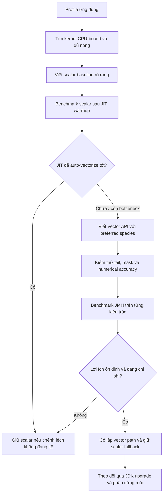

# Đánh giá SIMD thực tế, chi phí chuyển đổi và hiệu năng trên nhiều kiến trúc

> **Chương:** Vector API  
> **Học phần:** `JAVA_VERSION_JAVA25` — tìm hiểu các khả năng Java hiện đại còn áp dụng, gồm tối ưu runtime, xử lý dữ liệu và đánh giá hiệu năng trên nhiều kiến trúc CPU.  
> **Mục tiêu:** Biết khi nào SIMD đem lại lợi ích thực tế; viết và đọc một vòng lặp Vector API có xử lý phần tử dư; nhận diện chi phí load/store, chuyển kiểu, mask, shuffle và reduction; thiết kế benchmark công bằng giữa scalar và vector trên x86-64, ARM64 và các nền tảng được JDK hỗ trợ.

> **Trạng thái phiên bản:** Vector API trong Java 25 là incubator lần thứ mười (JEP 508), không phải API final. JDK 27 GA tiếp tục ở incubator lần thứ mười hai (JEP 537). Không cần `--enable-preview`; cần thêm module `jdk.incubator.vector`. Hãy dùng API này cho thử nghiệm và các phần code có thể thay thế, đồng thời kiểm tra trạng thái JEP trước mỗi lần nâng JDK.

## 1. SIMD giải quyết bài toán nào?

SIMD (*Single Instruction, Multiple Data*) là cách thực hiện cùng một phép toán trên nhiều phần tử dữ liệu trong một lệnh vector. Thay vì cộng từng cặp số theo từng vòng lặp scalar, CPU có thể cộng nhiều lane cùng lúc bằng các thanh ghi vector.

Ví dụ, phép nhân hai mảng:

\[
c[i] = a[i] \times b[i]
\]

Scalar xử lý một phần tử mỗi lần. Vector có thể xử lý một nhóm phần tử trong mỗi vòng lặp, tùy theo độ rộng vector và kiểu dữ liệu.

```text
Scalar loop:
a[0] * b[0] -> c[0]
a[1] * b[1] -> c[1]
a[2] * b[2] -> c[2]
a[3] * b[3] -> c[3]

Vector loop (ví dụ 128-bit với float):
[a0 a1 a2 a3] * [b0 b1 b2 b3]
              |
              v
          [c0 c1 c2 c3]
```

SIMD có thể hữu ích khi cùng một phép toán được lặp lại trên lượng dữ liệu lớn:

- Xử lý ảnh: brightness, blur, convolution, pixel conversion.
- Audio/video: sample conversion, mixing, filtering, codec kernels.
- Phân tích số liệu: sum, dot product, normalization, distance.
- Machine learning: một số phép toán tensor nhỏ hoặc kernel inference.
- Mã hóa/giải mã và checksum: các phép toán lane-wise phù hợp.
- Mô phỏng khoa học: cập nhật trạng thái nhiều phần tử độc lập.
- Tìm kiếm tương đồng: so sánh vector, distance và scoring.

Vectorization không tự động làm toàn bộ ứng dụng nhanh hơn. Nó chỉ tác động vào những đoạn tính toán có thể biểu diễn thành phép toán trên nhiều lane. Nếu thời gian chủ yếu nằm ở database, network, lock, allocation hoặc chờ I/O, SIMD ở một vòng lặp nhỏ có thể gần như không thay đổi latency đầu cuối.

## 2. Vector API hiện nay: còn incubator, chưa phải API production ổn định

Vector API cho phép viết phép toán vector bằng Java và để JIT compiler ánh xạ xuống SIMD instructions phù hợp với CPU tại runtime. API nằm trong module `jdk.incubator.vector`.

| JDK | JEP | Trạng thái | Điểm cần lưu ý |
|---|---|---|---|
| JDK 25 | JEP 508 | Incubator lần thứ mười | API được cung cấp để thử nghiệm và lấy phản hồi |
| JDK 26 | JEP 529 | Incubator lần thứ mười một | Tiếp tục incubate |
| JDK 27 GA | JEP 537 | Incubator lần thứ mười hai | Không có thay đổi implementation/API lớn so với JDK 25; bundled SLEEF cho vector math trên ARM/RISC-V được nâng lên 3.9.0 |
| JDK 28 EA | JEP 548 | Đề xuất cho incubator lần thứ mười ba | Đề xuất bổ sung `Vector<Float16>` với lane IEEE 754 `binary16`; trạng thái này chưa đồng nghĩa API đã được tích hợp vào JDK 28 |

Tại ngày biên soạn, JDK 27 là bản GA mới nhất. JDK 28 đang phát triển; JEP 548 mới ở trạng thái Proposed to Target. Không viết code dựa trên tính năng `Float16` của JEP 548 rồi giả định JDK 27 hoặc JDK 28 EA hiện tại đã có API đó.

### 2.1. Incubator khác preview

Vector API là incubator module, không phải preview feature:

- Dùng `--add-modules jdk.incubator.vector` khi compile và run.
- Không cần `--enable-preview` chỉ để dùng Vector API.
- API có thể thay đổi đáng kể hoặc bị loại bỏ trong một JDK tương lai.
- Không nên đưa incubator API vào public contract của thư viện dùng rộng rãi nếu chưa chấp nhận chi phí migration.
- Có thể cô lập phần vector trong implementation module và giữ API nghiệp vụ ở kiểu Java chuẩn.

Đối với code production không muốn phụ thuộc incubator, giữ scalar implementation làm fallback hoặc implementation chính. Chỉ bật vector path ở nơi đã benchmark và có kiểm thử tương đương.

### 2.2. Vì sao API vẫn tiếp tục incubate?

Một lý do quan trọng là Vector API cần phối hợp với Project Valhalla và value classes để biểu diễn vector values tự nhiên hơn, giảm các special-case trong compiler/runtime. Việc JDK 28 có các bước tiến về Valhalla không tự động có nghĩa Vector API đã final hoặc đã chuyển sang preview.

Không dùng số lần incubator để suy luận API đã ổn định. Trạng thái cần căn cứ vào JEP và release notes của đúng JDK đang triển khai.

## 3. Scalar loop, auto-vectorization và Vector API khác nhau thế nào?

Có ba cách thường gặp để xử lý cùng một phép toán:

| Cách | Ai quyết định SIMD? | Ưu điểm | Giới hạn |
|---|---|---|---|
| Scalar loop | JIT có thể tự vectorize nếu nhận diện được pattern | Code đơn giản, portable, dễ bảo trì | Không phải loop nào cũng auto-vectorize được |
| Vector API | Developer mô tả phép toán theo lane; JIT ánh xạ xuống SIMD | Kiểm soát rõ thao tác vector, mask, reduction, shuffle | Incubator API; phải quản lý tail và benchmark |
| Native SIMD qua JNI/FFM | Developer hoặc native library chọn intrinsics/instructions | Kiểm soát sâu theo nền tảng | Chi phí tích hợp, build và bảo trì nhiều architecture |

Một vòng lặp Java thông thường không đồng nghĩa với “chạy scalar”. HotSpot C2 có thể tự vectorize các loop đủ điều kiện. Vì vậy, benchmark Vector API chỉ so với một scalar loop ngây thơ có thể tạo ra kết luận sai nếu JIT đã tối ưu scalar loop tốt.

Hãy so sánh tối thiểu:

1. Scalar loop tự nhiên, không viết thủ công unroll.
2. Scalar loop đã warmup đủ để JIT tối ưu.
3. Vector API với preferred species.
4. Nếu có lý do, một biến thể đã tối ưu khác như unroll hoặc FMA.

Nếu scalar loop đã được auto-vectorize và hiệu năng gần bằng Vector API, dùng scalar thường đơn giản hơn. Vector API có giá trị hơn khi nó biểu đạt được reduction, cross-lane operation hoặc pattern mà compiler không tự nhận diện tốt.

## 4. Species, shape và lane quyết định kích thước vector

Vector API không yêu cầu developer cố định một độ rộng SIMD cho mọi CPU. Các khái niệm chính:

- **Vector:** một dãy lane có cùng element type.
- **Lane:** một vị trí dữ liệu trong vector.
- **VectorShape:** độ rộng vector, ví dụ 128, 256 hoặc 512 bit.
- **VectorSpecies:** kết hợp element type và shape, xác định số lane của vector.
- **VectorMask:** mặt nạ bật/tắt từng lane trong thao tác vector.
- **VectorShuffle:** cách sắp xếp/chọn lane từ một hoặc nhiều vector.

Ví dụ với `float`:

| Vector shape | Tổng bit | Số lane `float` |
|---:|---:|---:|
| 128-bit | 128 | 4 |
| 256-bit | 256 | 8 |
| 512-bit | 512 | 16 |

Bảng này chỉ minh họa phép chia độ rộng cho 32 bit mỗi `float`. Không phải mọi CPU hoặc JDK build đều hỗ trợ mọi shape.

### 4.1. Ưu tiên `SPECIES_PREFERRED`

```java
import jdk.incubator.vector.FloatVector;
import jdk.incubator.vector.VectorSpecies;

static final VectorSpecies<Float> SPECIES =
        FloatVector.SPECIES_PREFERRED;
```

`SPECIES_PREFERRED` chọn species được runtime xem là phù hợp cho nền tảng. Đây là lựa chọn tốt cho code portable qua nhiều CPU vì số lane được lấy từ `SPECIES.length()` thay vì hard-code.

Có thể quan sát runtime:

```java
System.out.println("shape = " + SPECIES.vectorShape());
System.out.println("bits  = " + SPECIES.vectorBitSize());
System.out.println("lanes = " + SPECIES.length());
```

Không viết `i += 8` với giả định vector luôn có tám lane. Trên CPU khác, preferred species có thể có độ rộng khác. Dùng `SPECIES.length()` và `SPECIES.loopBound(length)`.

### 4.2. Khi nào dùng species cố định?

Các species như `FloatVector.SPECIES_128`, `SPECIES_256` hoặc `SPECIES_512` hữu ích khi:

- Đang nghiên cứu một kiến trúc cụ thể.
- Muốn so sánh ảnh hưởng của vector width.
- Một thuật toán cần shape nhất định để phối hợp với layout dữ liệu.
- Có benchmark chứng minh fixed species có lợi trên tập máy triển khai.

Không mặc định `SPECIES_512` nhanh nhất. Vector rộng hơn có thể giảm số vòng lặp, nhưng không đảm bảo throughput cao hơn. CPU có thể giảm xung nhịp khi chạy vector instruction rộng, có giới hạn execution ports hoặc bị nghẽn memory bandwidth.

## 5. Ví dụ: nhân hai mảng bằng scalar và Vector API

Trước khi đo SIMD, cần có scalar baseline đúng và dễ hiểu.

```java
static void scalarMultiply(
        float[] a, float[] b, float[] out) {

    if (a.length != b.length || a.length != out.length) {
        throw new IllegalArgumentException("Array lengths must match");
    }

    for (int i = 0; i < a.length; i++) {
        out[i] = a[i] * b[i];
    }
}
```

Vector implementation dùng preferred species và xử lý phần tử dư bằng scalar loop:

```java
import jdk.incubator.vector.FloatVector;
import jdk.incubator.vector.VectorSpecies;

static final VectorSpecies<Float> SPECIES =
        FloatVector.SPECIES_PREFERRED;

static void vectorMultiply(
        float[] a, float[] b, float[] out) {

    if (a.length != b.length || a.length != out.length) {
        throw new IllegalArgumentException("Array lengths must match");
    }

    int i = 0;
    int upperBound = SPECIES.loopBound(a.length);

    for (; i < upperBound; i += SPECIES.length()) {
        FloatVector va = FloatVector.fromArray(SPECIES, a, i);
        FloatVector vb = FloatVector.fromArray(SPECIES, b, i);

        va.mul(vb).intoArray(out, i);
    }

    // Xử lý các lane còn dư sau vòng vector.
    for (; i < a.length; i++) {
        out[i] = a[i] * b[i];
    }
}
```

`loopBound(length)` trả về vị trí lớn nhất không vượt quá length mà tại đó có thể load đủ một vector. Nếu vector có 8 lane và mảng dài 19 phần tử, vòng vector xử lý 16 phần tử đầu, scalar tail xử lý 3 phần tử cuối.

Cách này tránh kiểm tra mask ở mỗi vòng lặp chính. Với mảng lớn, loop body không phải xử lý phần tử dư; tail chỉ chạy tối đa `SPECIES.length() - 1` lần.

### 5.1. Vì sao không tự tính loop bound bằng bit mask?

Không nên viết:

```java
int upperBound = length & ~(SPECIES.length() - 1);
```

Công thức bit mask chỉ đúng khi lane count là lũy thừa của 2. API cho phép species có độ dài khác; tài liệu còn nêu trường hợp shape có thể có lane count như 384. Dùng `SPECIES.loopBound(length)` để code đúng theo hợp đồng API.

## 6. Masked operation và chi phí xử lý tail

Có thể xử lý phần tử dư bằng `VectorMask` thay cho scalar tail:

```java
static void vectorMultiplyMasked(
        float[] a, float[] b, float[] out) {

    if (a.length != b.length || a.length != out.length) {
        throw new IllegalArgumentException("Array lengths must match");
    }

    for (int i = 0; i < a.length; i += SPECIES.length()) {
        var mask = SPECIES.indexInRange(i, a.length);

        FloatVector va = FloatVector.fromArray(SPECIES, a, i, mask);
        FloatVector vb = FloatVector.fromArray(SPECIES, b, i, mask);

        va.mul(vb).intoArray(out, i, mask);
    }
}
```

`indexInRange(i, length)` bật các lane có chỉ số nằm trong mảng. Masked load không đọc phần tử ngoài phạm vi; masked store chỉ ghi các lane được bật.

### 6.1. Mask không miễn phí

Masked load/store có thể cần xử lý bổ sung, tùy CPU và cách JIT hạ lệnh. Nếu dùng mask cho mọi iteration, kể cả các vòng đầy đủ, có thể làm mất một phần lợi ích. Tài liệu Vector API vì vậy trình bày cả hai cách:

- Loop đầy đủ với `loopBound()` rồi scalar tail.
- Masked loop cho toàn bộ phần tử.

Đo cả hai nếu workload có nhiều mảng nhỏ hoặc độ dài không chia hết cho lane count. Không giả định masked loop luôn nhanh hơn vì code ngắn hơn.

### 6.2. Mask còn hữu ích cho điều kiện dữ liệu

Mask có ích hơn khi thuật toán vốn có điều kiện theo lane, ví dụ:

- Chỉ cập nhật phần tử thỏa điều kiện.
- Chọn các lane có giá trị dương.
- Bỏ qua dữ liệu không hợp lệ.
- Thực hiện phép tính trên một vùng cuối mảng có kích thước thay đổi.

Khi dùng reduction trên vector đã masked, phải truyền mask cho `reduceLanes(...)` nếu lane không hoạt động không được tham gia kết quả. Không dựa vào giá trị mặc định của lane bị tắt để thay thế semantics của thuật toán.

## 7. Dot product: reduction và sai khác số học dấu phẩy động

Dot product là ví dụ tốt để thấy SIMD không chỉ là load nhiều phần tử, mà còn cần gom nhiều lane thành một scalar result.

```java
import jdk.incubator.vector.FloatVector;
import jdk.incubator.vector.VectorOperators;
import jdk.incubator.vector.VectorSpecies;

static final VectorSpecies<Float> SPECIES =
        FloatVector.SPECIES_PREFERRED;

static float scalarDot(float[] a, float[] b) {
    if (a.length != b.length) {
        throw new IllegalArgumentException("Array lengths must match");
    }

    float sum = 0.0f;
    for (int i = 0; i < a.length; i++) {
        sum += a[i] * b[i];
    }
    return sum;
}

static float vectorDot(float[] a, float[] b) {
    if (a.length != b.length) {
        throw new IllegalArgumentException("Array lengths must match");
    }

    int i = 0;
    int upperBound = SPECIES.loopBound(a.length);
    FloatVector accumulator = FloatVector.zero(SPECIES);

    for (; i < upperBound; i += SPECIES.length()) {
        FloatVector va = FloatVector.fromArray(SPECIES, a, i);
        FloatVector vb = FloatVector.fromArray(SPECIES, b, i);

        accumulator = va.fma(vb, accumulator);
    }

    float sum = accumulator.reduceLanes(VectorOperators.ADD);

    for (; i < a.length; i++) {
        sum += a[i] * b[i];
    }

    return sum;
}
```

`fma` thực hiện multiply-add trên từng lane. `reduceLanes(ADD)` cộng các lane thành một scalar. Đây là mô hình tính toán phù hợp cho nhiều kernel số học, nhưng có một khác biệt quan trọng so với scalar loop.

### 7.1. Kết quả float có thể không giống từng bit

Floating-point addition không có tính kết hợp tuyệt đối:

\[
(a+b)+c \ne a+(b+c)
\]

Vector reduction có thể cộng các lane theo thứ tự khác scalar loop. `fma` cũng có thể làm tròn một lần cho phép nhân-cộng thay vì làm tròn riêng phép nhân và phép cộng. Do đó, kết quả có thể sai khác ở một số bit cuối.

Điều này không nhất thiết là bug. Nhưng ứng dụng phải xác định tolerance và yêu cầu tính đúng đắn:

- Nếu chỉ cần sai số trong giới hạn cho phép, kiểm tra bằng absolute/relative tolerance.
- Nếu cần kết quả bit-for-bit giống scalar, reduction và FMA có thể không phù hợp nếu thay đổi thứ tự phép toán.
- Nếu có NaN, infinity, signed zero hoặc overflow, phải kiểm thử riêng.
- Không dùng `assertEquals(expected, actual)` với exact equality cho mọi bài toán floating-point vector.

### 7.2. Không bật FMA chỉ vì nó có tên nhanh

FMA có thể cải thiện throughput và độ chính xác của phép multiply-add theo một lần làm tròn, nhưng kết quả sẽ khác scalar sequence. Chọn FMA dựa trên yêu cầu numerical accuracy, không chỉ dựa trên benchmark thời gian.

Nếu muốn kiểm soát semantics gần scalar hơn, dùng `mul(...).add(...)` và kiểm tra kết quả; nhưng thứ tự reduction vẫn có thể khác. Khi yêu cầu số học nghiêm ngặt, cần thiết kế thuật toán và tolerance phù hợp thay vì chỉ thay scalar loop bằng vector loop.

## 8. Chi phí chuyển đổi và di chuyển dữ liệu

Một kernel vector không chỉ tốn thời gian cho phép cộng hoặc nhân. Tổng chi phí còn gồm:

\[
T_{\text{total}} =
T_{\text{load}} +
T_{\text{convert}} +
T_{\text{compute}} +
T_{\text{shuffle}} +
T_{\text{store}} +
T_{\text{tail}}
\]

Đây là mô hình tư duy, không phải công thức đo chính xác theo chu kỳ CPU. JIT có thể gộp hoặc loại bỏ một số bước; một số thao tác có thể chạy song song hoặc bị giới hạn bởi memory subsystem.

### 8.1. Load/store thường quyết định hiệu năng

Trường hợp tốt nhất thường là dữ liệu liên tục:

```java
FloatVector va = FloatVector.fromArray(SPECIES, a, i);
FloatVector vb = FloatVector.fromArray(SPECIES, b, i);
FloatVector result = va.mul(vb).add(va);
result.intoArray(out, i);
```

CPU có thể tải một vùng liên tiếp, thực hiện phép toán theo lane rồi ghi kết quả liên tiếp. Nếu kernel chỉ làm vài phép toán trên mỗi byte đọc/ghi, nó có thể bị giới hạn bởi memory bandwidth thay vì năng lực tính toán.

Ngược lại, `gather`/`scatter` lấy hoặc ghi lane từ nhiều vị trí rời rạc. Các thao tác này có thể cần nhiều lần truy cập cache hoặc lệnh phức tạp hơn, đặc biệt khi index phân tán và cache miss cao.

| Pattern dữ liệu | Chi phí thường gặp |
|---|---|
| Load/store liên tục | Thường thuận lợi cho SIMD và cache line |
| Strided access nhỏ, đều | Có thể vẫn tối ưu được, cần đo |
| Gather/scatter theo index ngẫu nhiên | Có thể đắt do cache miss và address calculation |
| Nhiều shuffle/slice/rearrange | Tốn lệnh cross-lane, tùy kiến trúc |
| Nhiều lần convert giữa kiểu | Tốn instruction và có thể làm giảm số lane |
| Lặp `toArray()`/cấp phát array trung gian | Tạo thêm allocation và copy dữ liệu |

Không gọi `toArray()` trong vòng lặp nóng chỉ để chuyển qua lại giữa scalar và vector. Hãy giữ dữ liệu trong mảng primitive hoặc `MemorySegment` phù hợp và dùng `fromArray`/`intoArray` trực tiếp khi có thể.

### 8.2. Chi phí chuyển kiểu và thay đổi shape

Vector API hỗ trợ chuyển kiểu lane, ví dụ `int` sang `float`, `float` sang `double`, hoặc chuyển giữa vector species có element type/shape khác nhau.

Một conversion có thể làm thay đổi số lane:

- Widening: mỗi lane dùng nhiều bit hơn, số lane trong cùng vector width giảm.
- Narrowing: mỗi lane dùng ít bit hơn, có thể tăng số lane nhưng có nguy cơ mất độ chính xác hoặc tràn.
- `convertShape(...)`: chuyển giá trị sang species khác; khi kết quả không vừa shape có thể cần chọn một phần (`part`).
- `reinterpretShape(...)`: diễn giải lại bit pattern theo shape/type khác; đây không phải numeric conversion.

Ví dụ, chuyển `int` sang `double` không chỉ đổi kiểu Java. Mỗi lane kết quả chiếm nhiều bit hơn; số lane của vector đích có thể ít hơn. Nếu thuật toán liên tục chuyển qua lại `int → double → int`, chi phí conversion và thay shape có thể ăn hết lợi ích SIMD.

Hãy thiết kế dữ liệu và phép toán để ở cùng element type trong phần lớn kernel. Chỉ chuyển kiểu ở ranh giới cần thiết, và đo độ chính xác sau conversion.

### 8.3. Array of Structures và Structure of Arrays

Layout dữ liệu ảnh hưởng khả năng load vector.

Giả sử có danh sách điểm 3D:

```java
record Point(float x, float y, float z) {}
Point[] points;
```

Đây là dạng Array of Structures (AoS): các field của một điểm đi cùng nhau. Nếu kernel cần tính riêng toàn bộ `x`, dữ liệu không nằm trong một `float[]` liên tục; cần truy cập field qua object hoặc gather.

Structure of Arrays (SoA) tách thành các mảng:

```java
float[] xs;
float[] ys;
float[] zs;
```

Nếu kernel xử lý tất cả giá trị `x`, `xs` là vùng liên tục, dễ load vector hơn. SoA có thể cải thiện locality và giảm gather, nhưng có thể không phù hợp nếu phần lớn code thường đọc đủ cả ba tọa độ của một điểm.

Không đổi toàn bộ domain model sang SoA chỉ vì SIMD. Chọn layout theo workload chiếm ưu thế và cân nhắc chi phí chuyển đổi khi nhận/trả dữ liệu.

### 8.4. Conversion, mask và shuffle cần được tính vào benchmark

Một benchmark chỉ đo `va.mul(vb)` nhưng bỏ qua load, conversion, mask, shuffle và store có thể phóng đại lợi ích. Hãy benchmark cả kernel hoàn chỉnh với cùng đầu vào/đầu ra và cùng công việc cần thực hiện.

## 9. Nhiều kiến trúc CPU: cùng source, instruction khác nhau

Một ưu điểm của Vector API là source Java có thể chạy trên nhiều nền tảng mà không phải tự viết riêng intrinsics cho từng ISA. Tuy nhiên, hiệu năng phụ thuộc CPU, JDK build, OS, vector width và instruction support.

| Kiến trúc | Các họ vector instruction phổ biến | Điều cần lưu ý |
|---|---|---|
| x86-64 | SSE, AVX2, AVX-512 | Số lane thay đổi theo vector width; AVX-512 không phải lúc nào cũng nhanh hơn AVX2 |
| ARM64 | NEON/Advanced SIMD, SVE, SVE2 trên CPU hỗ trợ | NEON thường 128-bit; SVE có vector length phụ thuộc CPU |
| RISC-V | RISC-V Vector extension trên CPU/JDK hỗ trợ | Không phải mọi chip RISC-V đều có cùng vector capability |
| CPU không có vector instruction phù hợp | Tùy khả năng runtime/JIT | Không giả định mọi phép toán đều có native vector mapping hoặc cùng hiệu năng |

### 9.1. x86-64: AVX2 và AVX-512

Một số CPU x86-64 hỗ trợ AVX2 256-bit; một số CPU/server hỗ trợ AVX-512 512-bit. Với `float`, hai độ rộng tương ứng 8 và 16 lane.

Nhưng vector width gấp đôi không có nghĩa throughput gấp đôi:

- Số execution port và số lệnh vector có thể phát hành mỗi chu kỳ khác nhau.
- Một số CPU giảm tần số khi chạy AVX-512 nặng.
- Kernel có thể bị memory bandwidth giới hạn.
- Gather, shuffle hoặc conversion có thể không đạt throughput như arithmetic đơn giản.
- JDK và flags có thể giới hạn tập instruction mà JVM sử dụng.

Không ép `SPECIES_512` cho mọi máy x86-64. Dùng preferred species làm mặc định và benchmark fixed species khi có lý do.

### 9.2. ARM64: NEON và SVE

NEON/Advanced SIMD phổ biến trên ARM64 và có vector width cố định 128-bit. SVE hỗ trợ vector length có thể thay đổi theo triển khai CPU; cùng binary có thể chạy trên các máy SVE với độ dài vector khác nhau.

Vector API giúp code thích nghi qua `SPECIES_PREFERRED` và `SPECIES.length()`. Không hard-code số lane hoặc giả định tất cả máy ARM64 đều có SVE/SVE2.

### 9.3. RISC-V và vector math

RISC-V vector support phụ thuộc phần cứng, JDK build và cấu hình runtime. JDK 27 tiếp tục incubate Vector API và cập nhật bundled SLEEF lên 3.9.0 cho các vector math intrinsics trên ARM/RISC-V.

SLEEF liên quan đến các hàm toán học vector như sin/cos/log/exp. Không suy ra mọi phép toán trong Vector API đều đi qua SLEEF; phép cộng, nhân, compare, load/store và các thao tác cơ bản có đường triển khai riêng.

Nếu triển khai trên RISC-V, phải benchmark trên đúng CPU và JDK distribution sẽ chạy production. Một kết quả trên ARM không thể dùng để dự đoán trực tiếp hiệu năng RISC-V.

### 9.4. Kiểm tra species trên từng máy

Ghi lại ít nhất:

```java
System.out.println("JDK: " + Runtime.version());
System.out.println("OS: " + System.getProperty("os.name"));
System.out.println("Arch: " + System.getProperty("os.arch"));
System.out.println("Preferred shape: " + SPECIES.vectorShape());
System.out.println("Vector bits: " + SPECIES.vectorBitSize());
System.out.println("Float lanes: " + SPECIES.length());
```

Thông tin này giúp giải thích vì sao cùng source có thể chạy với số lane khác nhau. Nó không thay thế việc kiểm tra assembly hoặc benchmark.

## 10. Compute-bound hay memory-bound?

SIMD có lợi rõ nhất khi CPU thực hiện đủ nhiều phép toán trên mỗi lần đọc dữ liệu. Có thể dùng arithmetic intensity làm khái niệm định hướng:

\[
\text{Arithmetic intensity} =
\frac{\text{Số phép toán}}{\text{Số byte dữ liệu đọc/ghi}}
\]

- **Compute-bound:** thời gian chủ yếu bị giới hạn bởi khả năng thực hiện phép toán. SIMD có thể tăng throughput nếu JIT ánh xạ tốt và không bị giới hạn khác.
- **Memory-bound:** thời gian chủ yếu chờ dữ liệu từ cache/RAM. Vector instruction rộng hơn có thể không giúp nhiều vì memory bandwidth đã bão hòa.
- **Latency-bound:** kernel nhỏ, phụ thuộc kết quả tuần tự hoặc thường xuyên chờ tài nguyên. SIMD có thể không giải quyết được critical path.

Ví dụ:

| Kernel | Tính chất thường gặp | Hướng đánh giá |
|---|---|---|
| Nhân hai mảng lớn rồi ghi mảng kết quả | Có thể memory-bound | Đo bandwidth, cache behavior và số byte di chuyển |
| Dot product nhiều phép toán trên mỗi phần tử | Có thể compute-bound | Đo FMA/reduction và throughput |
| Image filter nhiều phép toán lân cận | Compute + memory | Đo load reuse, shuffle và cache |
| Tìm kiếm trong cấu trúc pointer-heavy | Thường latency/cache-miss bound | SIMD có thể khó giúp nếu truy cập phụ thuộc |
| Xử lý mảng rất nhỏ trong mỗi request | Overhead-bound | Đo chi phí gọi method, dispatch và tail |

Một kernel có SIMD nhanh gấp 4 lần vẫn có thể chỉ cải thiện ứng dụng 5% nếu nó chiếm 10% tổng thời gian. Hãy đo profiling trước để xác định đoạn code đáng tối ưu.

## 11. Benchmark công bằng bằng JMH

Không dùng một vòng `System.nanoTime()` đơn giản để kết luận Vector API nhanh hơn. JIT cần warmup; dead-code elimination, constant folding, CPU frequency, GC và cache state có thể làm sai kết quả.

JMH là harness benchmark dành cho JVM. Benchmark nên:

- Có warmup đủ dài để JIT biên dịch cả scalar và vector paths.
- Có nhiều measurement iterations và nhiều fork JVM.
- Khởi tạo dữ liệu ngoài vùng đo.
- Trả về kết quả hoặc dùng `Blackhole` để tránh dead-code elimination.
- Dùng dữ liệu không hằng để tránh constant folding.
- Benchmark nhiều kích thước, gồm nhỏ hơn một vector, đúng một vector, lệch một lane và mảng lớn.
- Tách các tình huống dữ liệu nằm trong L1/L2/LLC và dữ liệu lớn hơn cache.
- Đo throughput hoặc average time phù hợp mục tiêu; không trộn nhiều metric thành một kết luận.
- Chạy trên phần cứng thật của từng kiến trúc cần hỗ trợ.

### 11.1. Ví dụ JMH benchmark

```java
import java.util.Random;
import java.util.concurrent.TimeUnit;

import org.openjdk.jmh.annotations.*;

import jdk.incubator.vector.FloatVector;
import jdk.incubator.vector.VectorOperators;
import jdk.incubator.vector.VectorSpecies;

@State(Scope.Thread)
@BenchmarkMode(Mode.AverageTime)
@OutputTimeUnit(TimeUnit.MICROSECONDS)
@Warmup(iterations = 5)
@Measurement(iterations = 8)
@Fork(3)
public class DotProductBenchmark {
    private static final VectorSpecies<Float> SPECIES =
            FloatVector.SPECIES_PREFERRED;

    @Param({"4", "15", "1024", "65536", "1048576"})
    int size;

    float[] a;
    float[] b;

    @Setup(Level.Trial)
    public void setup() {
        a = new float[size];
        b = new float[size];

        Random random = new Random(42);
        for (int i = 0; i < size; i++) {
            a[i] = random.nextFloat() - 0.5f;
            b[i] = random.nextFloat() - 0.5f;
        }
    }

    @Benchmark
    public float scalar() {
        float sum = 0.0f;
        for (int i = 0; i < size; i++) {
            sum += a[i] * b[i];
        }
        return sum;
    }

    @Benchmark
    public float vector() {
        int i = 0;
        int upperBound = SPECIES.loopBound(size);
        FloatVector acc = FloatVector.zero(SPECIES);

        for (; i < upperBound; i += SPECIES.length()) {
            FloatVector va = FloatVector.fromArray(SPECIES, a, i);
            FloatVector vb = FloatVector.fromArray(SPECIES, b, i);
            acc = va.fma(vb, acc);
        }

        float sum = acc.reduceLanes(VectorOperators.ADD);
        for (; i < size; i++) {
            sum += a[i] * b[i];
        }
        return sum;
    }
}
```

Các kích thước `4` và `15` giúp kiểm tra trường hợp nhỏ và tail; `1024`, `65536`, `1048576` cho các vùng dữ liệu lớn hơn. Những con số này chỉ là bộ tham số minh họa; hãy bổ sung kích thước sát workload thật.

### 11.2. Đọc kết quả và profiler

Ví dụ chạy benchmark JMH:

```bash
java -jar target/benchmarks.jar ".*DotProductBenchmark.*" \
     -f 3 -wi 5 -i 8
```

Nếu cần quan sát allocation:

```bash
java -jar target/benchmarks.jar ".*DotProductBenchmark.*" -prof gc
```

Trên Linux, nếu đã cài và cấp quyền cho công cụ `perf`, có thể thử profiler như `perfasm` để xem assembly và instruction được tạo. Công cụ profiler phụ thuộc OS và quyền hệ thống; không giả định mọi máy có thể chạy cùng một profiler.

Đọc kết quả theo từng kích thước. Nếu vector chỉ thắng ở mảng lớn, có thể cần một ngưỡng kích thước trước khi chọn vector path. Nếu scalar thắng ở mảng nhỏ, chi phí dispatch và tail có thể lớn hơn lợi ích SIMD.

## 12. Benchmark trên nhiều kiến trúc: giữ điều kiện so sánh tương đương

Để đánh giá portability, chạy cùng source, cùng bộ dữ liệu và cùng benchmark configuration trên từng máy. Không so số đo của laptop x86 với server ARM có số core, memory bandwidth và power limit khác rồi quy mọi chênh lệch cho Vector API.

Ghi lại:

| Metadata | Vì sao cần |
|---|---|
| JDK vendor, version, build | JIT và Vector API implementation có thể khác |
| CPU model, ISA extensions | Xác định AVX/NEON/SVE/RISC-V vector capability |
| OS, kernel, architecture | Ảnh hưởng scheduling và runtime |
| Preferred species, vector bits, lane count | Xác nhận shape runtime |
| JVM options và GC | Tránh khác biệt cấu hình |
| CPU frequency/power mode | Tránh kết quả bị lệch do throttling |
| Memory channel/speed và NUMA | Quan trọng với memory-bound kernel |
| JMH forks/warmup/measurement | Bảo đảm phương pháp đo có thể lặp lại |
| Input size, data distribution | Cùng kernel nhưng workload khác có thể đảo kết quả |

Nếu sản phẩm chạy cả x86-64 và ARM64, hãy benchmark riêng từng target và dùng kết quả của từng nhóm máy để quyết định. `SPECIES_PREFERRED` giúp một source thích nghi, nhưng không làm cho hai kiến trúc có throughput bằng nhau.

## 13. Tích hợp Vector API vào project Java

Vì Vector API là incubator module, project phải khai báo module khi compile và khi chạy.

### 13.1. Compile và run trên JDK 25

Với project dùng classpath:

```bash
javac --release 25 \
      --add-modules jdk.incubator.vector \
      -d out src/VectorMultiply.java

java --add-modules jdk.incubator.vector \
     -cp out example.VectorMultiply
```

Vector API không phải preview feature, vì vậy không thêm `--enable-preview`. JDK sẽ cảnh báo đây là incubating module; đó là dấu hiệu trạng thái API, không phải compile error.

### 13.2. Dùng named module

Nếu ứng dụng có `module-info.java`, khai báo dependency:

```java
module com.example.simd {
    requires jdk.incubator.vector;
}
```

Sau đó compile/run theo module path với đúng JDK chứa module incubator. Không cần đưa `jdk.incubator.vector` vào public API của module khác nếu chỉ muốn giữ implementation nội bộ.

### 13.3. Tách implementation vector khỏi API nghiệp vụ

Không nên để kiểu `FloatVector`, `VectorSpecies` hoặc `VectorMask` xuất hiện trong public method signature của thư viện dùng chung. Giữ giao diện bằng primitive arrays, `MemorySegment` hoặc kiểu domain ổn định; implementation nội bộ có thể chọn scalar hoặc vector.

Ví dụ:

```java
public interface SimilarityKernel {
    float dot(float[] left, float[] right);
}
```

Có thể có `ScalarSimilarityKernel` và `VectorSimilarityKernel` cùng triển khai interface. Cách này giúp thay implementation khi Vector API đổi qua các vòng incubator mà không buộc caller thay source.

### 13.4. Chạy trên JDK 27 và JDK 28

JDK 27 vẫn cung cấp module `jdk.incubator.vector`; JEP 537 tiếp tục incubate API. Dùng module flag tương tự JDK 25, nhưng compile bằng đúng JDK 27 để nhận API và implementation của release đó.

JEP 548 cho JDK 28 mới ở trạng thái đề xuất cho target tại thời điểm biên soạn. Không thêm API `Vector<Float16>` của đề xuất này vào code cần chạy trên JDK 25 hoặc JDK 27. Khi JDK 28 EA/GA thay đổi, kiểm tra API thực tế và trạng thái JEP trước khi dùng.

## 14. Quy trình quyết định: có nên dùng SIMD cho kernel này?



### 14.1. Checklist trước khi viết vector code

- Đã profile và xác định kernel nằm trên critical path chưa?
- Kernel có cùng phép toán trên nhiều phần tử độc lập không?
- Dữ liệu có thể load/store liên tục không?
- Phần tính toán đủ lớn để bù chi phí gọi, mask, tail và conversion không?
- Scalar loop đã được warmup để JIT tối ưu chưa?
- Có yêu cầu bit-for-bit numerical equivalence không?
- Các input size nhỏ, lẻ và không chia hết lane count đã được kiểm tra chưa?
- Project có chấp nhận dependency vào incubator module không?

### 14.2. Checklist benchmark

- Dùng cùng JDK vendor/build cho scalar và vector.
- Cùng CPU, power mode, OS, heap và workload.
- Có JMH warmup, measurement và nhiều forks.
- Dữ liệu được tạo ở setup, không cấp phát trong vùng đo nếu kernel thật không cần.
- Đo nhiều kích thước, gồm nhỏ hơn lane count và kích thước lớn.
- Đo throughput/latency cùng allocation và memory bandwidth khi phù hợp.
- Chạy trên từng kiến trúc triển khai, không suy hiệu năng ARM từ kết quả x86.
- Xác minh kết quả số học trong tolerance được nghiệp vụ chấp nhận.
- Kiểm tra JIT assembly khi kết quả khó giải thích và profiler hỗ trợ.

### 14.3. Khi nào chọn scalar?

Giữ scalar khi:

- JIT đã tự vectorize và kết quả gần tương đương.
- Kernel nhỏ, chạy ít lần hoặc bị giới hạn bởi I/O/latency.
- Dữ liệu có truy cập pointer-heavy, gather hoặc branch khó vectorize.
- Conversion và shuffle chiếm phần lớn công việc.
- Độ chính xác yêu cầu không cho phép thay đổi thứ tự phép toán.
- Incubator API tạo chi phí nâng cấp lớn hơn lợi ích.

Scalar code không phải lựa chọn kém hiện đại. Một loop rõ ràng giúp HotSpot tối ưu, dễ đọc và không phụ thuộc module incubator có thể là lựa chọn tốt nhất.

## 15. Sai lầm thường gặp khi tối ưu SIMD

| Sai lầm | Vì sao sai | Cách sửa |
|---|---|---|
| Giả định vector width cố định | CPU và species khác nhau | Dùng `SPECIES_PREFERRED`, `length()` và `loopBound()` |
| Cộng dồn bằng `i += 8` | Không portable với mọi species | Dùng `SPECIES.length()` |
| Bỏ scalar tail | Bỏ sót phần tử cuối hoặc truy cập ngoài mảng | Dùng loopBound + tail hoặc masked loop |
| Dùng mask ở mọi vòng mà chưa đo | Có thể tăng chi phí so với tail scalar | Benchmark hai cách |
| Chỉ đo phép toán, bỏ load/store | Không phản ánh kernel thật | Đo toàn bộ đường dữ liệu |
| So vector với scalar chưa warmup | Scalar chưa được JIT tối ưu | Dùng JMH warmup |
| Cho rằng AVX-512 luôn nhanh hơn AVX2 | Vector width lớn không đảm bảo throughput cao | Đo trên CPU mục tiêu |
| Dùng `toArray()` trong vòng nóng | Có thể tạo allocation/copy | Giữ vector và dùng load/store trực tiếp |
| Dùng gather cho dữ liệu rời rạc rồi kỳ vọng như load liên tục | Cache miss và address calculation có thể đắt | Xem lại layout dữ liệu, thử SoA |
| So sánh float bằng exact equality | Reduction/FMA có thể đổi thứ tự làm tròn | Dùng tolerance phù hợp |
| Dùng `--enable-preview` cho Vector API | Vector API là incubator module | Dùng `--add-modules jdk.incubator.vector` |
| Đưa Vector API vào public contract | API còn incubator và có thể đổi | Cô lập implementation, giữ interface ổn định |

## 16. Bài tập thực hành và tiêu chí hoàn thành

### Bài tập 1 — Nhân mảng với tail

Viết scalar và vector implementation để nhân hai mảng `float[]`. Kiểm thử độ dài 1, 3, 4, 7, 8, 9, 15, 16 và 17; không giả định preferred species có 4 hoặc 8 lane.

### Bài tập 2 — Mask hay scalar tail?

Benchmark hai phiên bản: một phiên bản dùng `loopBound()` + scalar tail, một phiên bản dùng `indexInRange()` cho tất cả iteration. Chạy với mảng nhỏ và mảng lớn; giải thích vì sao kết quả có thể khác nhau.

### Bài tập 3 — Dot product và numerical accuracy

So sánh scalar dot product, vector multiply + reduction và vector FMA + reduction. Ghi lại sai khác số học trên dữ liệu có giá trị lớn/nhỏ, số âm, NaN và infinity. Đề xuất tolerance theo yêu cầu nghiệp vụ.

### Bài tập 4 — Conversion cost

Một pipeline đọc `int[]`, chuyển sang `float`, thực hiện tính toán rồi chuyển về `int[]`. Tách benchmark conversion riêng và benchmark kernel hoàn chỉnh. Xác định conversion chiếm bao nhiêu thời gian.

### Bài tập 5 — AoS và SoA

Dùng dữ liệu `Point(x,y,z)` để tính tổng toàn bộ tọa độ x. So sánh AoS (`Point[]`) với SoA (`float[] xs`). Giải thích khác biệt do load liên tục, gather và cache locality.

### Bài tập 6 — So sánh nhiều kiến trúc

Chạy cùng JMH benchmark trên một máy x86-64 và một máy ARM64. Ghi lại JDK, CPU, preferred vector shape, lane count, throughput và sai số số học. Không so sánh kết quả nếu cấu hình và workload không tương đương.

### Bài tập 7 — Quyết định dùng Vector API

Một service có ba kernel:

- Kernel A: nhân mảng 32 phần tử mỗi request.
- Kernel B: dot product trên 1 triệu phần tử, chạy hàng trăm lần mỗi giây.
- Kernel C: truy cập node qua graph pointer-heavy và nhiều nhánh điều kiện.

Chọn kernel đáng thử SIMD trước, nêu lý do và thiết kế benchmark để kiểm chứng. Không giả định mọi kernel đều cần Vector API.

### Tiêu chí đạt

Bạn hoàn thành bài học khi có thể:

1. Giải thích SIMD và phân biệt scalar, JIT auto-vectorization với explicit Vector API.
2. Nêu đúng trạng thái Vector API là incubator, không phải preview/final.
3. Dùng `SPECIES_PREFERRED`, `VectorSpecies.length()` và `loopBound()` để viết code portable.
4. Xử lý tail bằng scalar loop hoặc mask và kiểm thử các độ dài biên.
5. Hiểu chi phí load/store, conversion, gather/scatter, shuffle, reduction và memory movement.
6. Giải thích FMA/reduction có thể làm thay đổi kết quả floating-point.
7. Nhận diện khác biệt hiệu năng giữa x86-64, ARM64 và RISC-V.
8. Dùng JMH với warmup, forks và nhiều input sizes để benchmark công bằng.
9. Đánh giá kernel compute-bound, memory-bound hoặc latency-bound.
10. Cô lập incubator API, giữ scalar fallback và xác minh lại khi nâng JDK.

### Tài liệu tham khảo

1. [JEP 508 — Vector API (Tenth Incubator)](https://openjdk.org/jeps/508): phiên bản Vector API trong JDK 25.
2. [JEP 529 — Vector API (Eleventh Incubator)](https://openjdk.org/jeps/529): phiên bản incubator trong JDK 26.
3. [JEP 537 — Vector API (Twelfth Incubator)](https://openjdk.org/jeps/537): trạng thái JDK 27 và các thay đổi của vòng incubator thứ mười hai.
4. [JEP 548 — Vector API (Thirteenth Incubator)](https://openjdk.org/jeps/548): đề xuất cho JDK 28; kiểm tra trạng thái trước khi dùng API mới.
5. [Oracle JDK 27 — Significant Changes](https://docs.oracle.com/en/java/javase/27/migrate/significant-changes-jdk-27-release.html): xác nhận Vector API vẫn là incubating feature trong JDK 27.
6. [Java SE 25 — `jdk.incubator.vector` package](https://docs.oracle.com/en/java/javase/25/docs/api/jdk.incubator.vector/jdk/incubator/vector/package-summary.html): ví dụ vector multiply, masked loop, scalar tail và preferred species.
7. [Java SE 25 — `FloatVector`](https://docs.oracle.com/en/java/javase/25/docs/api/jdk.incubator.vector/jdk/incubator/vector/FloatVector.html): `fromArray`, `fma`, `reduceLanes`, `intoArray` và các thao tác lane.
8. [Java SE 25 — `VectorSpecies`](https://docs.oracle.com/en/java/javase/25/docs/api/jdk.incubator.vector/jdk/incubator/vector/VectorSpecies.html): `length`, `vectorBitSize`, `indexInRange` và `loopBound`.
9. [Java SE 25 — `Vector`](https://docs.oracle.com/en/java/javase/25/docs/api/jdk.incubator.vector/jdk/incubator/vector/Vector.html): semantics của reduction, conversion, shape và vector operations.
10. [OpenJDK JMH](https://github.com/openjdk/jmh): harness benchmark JVM, annotations, warmup, forks và profiler.
11. [OpenJDK Valhalla](https://openjdk.org/projects/valhalla/): bối cảnh value classes liên quan lộ trình phát triển Vector API.

> **Ghi chú hiện hành:** JDK 25 có Vector API lần incubator thứ mười; JDK 27 GA tiếp tục ở lần thứ mười hai. JDK 28 JEP 548 mới là đề xuất incubator thứ mười ba tại thời điểm biên soạn, chưa phải API đã phát hành. Vector API vẫn hữu ích để thử nghiệm kernel SIMD và đo hiệu năng, nhưng chưa phải API final để mặc định đưa vào public contract. Luôn so với scalar loop đã warmup, kiểm tra sai số số học và benchmark trên từng kiến trúc triển khai.
