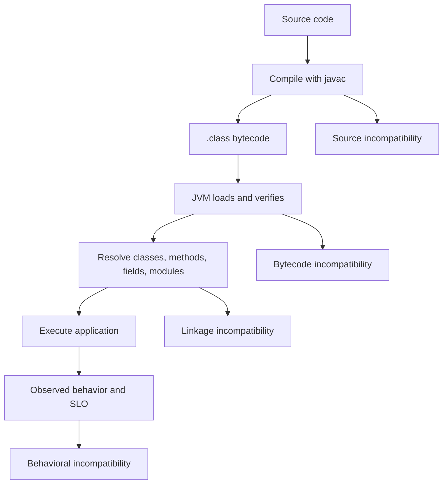

# Phân biệt tương thích mã nguồn, bytecode, liên kết và hành vi lúc chạy

Nâng cấp JDK có thể thành công ở bước biên dịch nhưng vẫn thất bại khi khởi động, khi JVM nạp dependency hoặc khi chạy một luồng nghiệp vụ cụ thể. Nguyên nhân là **tương thích mã nguồn, định dạng bytecode, liên kết nhị phân và hành vi runtime là những lớp khác nhau**. Mỗi lớp cần một cách kiểm tra riêng.

Bài học thuộc chương **Tác động nâng cấp** của module **Java 25** (JAVA_VERSION_JAVA25), theo đề bài **“Phân biệt tương thích mã nguồn, bytecode, liên kết và hành vi lúc chạy”**. Nội dung dùng JDK 27 làm mốc runtime hiện hành tại thời điểm biên soạn (27/11/2026), đồng thời giải thích cách kiểm tra dự án Java 25 và các JDK cũ hơn. Trọng tâm là xác định chính xác lỗi thuộc lớp nào, dùng công cụ phù hợp và lập ma trận kiểm thử trước khi rollout.

## 1. Bốn lớp tương thích khi nâng JDK

| Lớp | Câu hỏi chính | Thời điểm lỗi thường xuất hiện |
| --- | --- | --- |
| **Source compatibility** | Source code cũ còn biên dịch được bằng compiler mới không? | Compile |
| **Bytecode compatibility** | JVM đích có đọc và xác minh được file .class không? | Load/verify class |
| **Linking compatibility** | Các class, method, field, module và provider mà bytecode tham chiếu có còn được tìm thấy và truy cập được không? | Link/resolve hoặc lần đầu gọi |
| **Behavioral compatibility** | Code chạy có giữ ngữ nghĩa, kết quả, bảo mật và đặc tính vận hành mong đợi không? | Runtime/test/production |

JDK 27 Release Notes dùng ba nhóm Source, Binary và Behavioral compatibility. Trong thực tế nâng cấp, nên tách **định dạng bytecode** khỏi **liên kết nhị phân** để dễ định vị lỗi: file class có thể được JVM đọc nhưng một method mà nó tham chiếu đã biến mất khỏi dependency. Đó là lỗi linking, không phải lỗi định dạng bytecode.



Một dự án có thể vượt qua một lớp nhưng thất bại ở lớp tiếp theo. Ví dụ, source không đổi và class file cũ vẫn được JVM mới đọc, nhưng lúc chạy lại phát sinh NoSuchMethodError do thư viện đã thay đổi chữ ký method.

## 2. Source compatibility: mã nguồn cũ còn biên dịch được không?

Source compatibility nói về khả năng compiler mới chấp nhận source code hiện có. Các thay đổi có thể ảnh hưởng gồm:

- Ngôn ngữ thêm keyword hoặc thay đổi quy tắc cú pháp.
- API bị deprecated rồi bị loại bỏ.
- Kiểu trả về, overload, generic signature hoặc access modifier của dependency thay đổi.
- Annotation processor, compiler plugin hoặc build plugin không tương thích với JDK mới.
- Code phụ thuộc JDK-internal API hoặc package không được export.
- Code dùng preview feature của một release khác.

### Dùng --release để kiểm soát cả ngôn ngữ và API đích

Khi dùng compiler JDK mới nhưng cần tạo artifact chạy trên một release cũ hơn, ưu tiên --release. Option này ràng buộc phiên bản ngôn ngữ, class-file target và tập Java/JDK APIs được phép dùng cho release đó.

Ví dụ dùng JDK 27 compiler để tạo artifact Java 25:

```bash
javac --release 25 \
  -d build/classes \
  src/main/java/com/example/App.java
```

Không thay thế bằng cặp -source 25 -target 25 nếu mục tiêu là kiểm soát API. -source và -target riêng lẻ không tự giới hạn toàn bộ platform API theo release cũ; code có thể vô tình tham chiếu API chỉ có trong JDK mới rồi lỗi khi chạy trên JDK đích.

Không dùng đồng thời --release với --source hoặc --target. Hãy xem javac --help của compiler đang dùng để biết các release target được hỗ trợ.

### Compile pass chưa chứng minh runtime pass

--release 25 chỉ kiểm tra source và API compile-time theo Java 25. Nó không chứng minh:

- Third-party dependencies đã tương thích với JDK runtime đích.
- Reflection, JNI, agents hoặc service loading hoạt động.
- Các giá trị mặc định về TLS, locale, charset, GC và JVM options giữ nguyên.
- Ứng dụng đáp ứng throughput/latency trong môi trường triển khai thật.

Do đó, compile là một cổng kiểm tra, không phải toàn bộ quy trình nâng cấp.

## 3. Bytecode compatibility: JVM có đọc được file .class không?

Compiler chuyển source thành file class theo định dạng quy định trong JVM Specification. File class chứa major_version và minor_version.

Các mốc thường gặp:

| Java release | Class-file major version |
| --- | ---: |
| Java 8 | 52 |
| Java 17 | 61 |
| Java 21 | 65 |
| Java 25 | 69 |
| Java 26 | 70 |
| Java 27 | 71 |

JVM mới thường đọc được bytecode không-preview từ release cũ hơn. Chiều ngược lại không đúng: JVM cũ không thể nạp class file có major version mới hơn mức nó hỗ trợ.

Ví dụ: một dependency được build bằng JDK 27 có major version 71. Nếu ứng dụng chạy trên JDK 25, JVM có thể báo:

```text
java.lang.UnsupportedClassVersionError:
  ... class file version 71.0,
  this runtime only recognizes class file versions up to 69.0
```

Lỗi này không có nghĩa source code sai. Runtime đang cố nạp bytecode mới hơn khả năng của JVM.

### Kiểm tra class-file version

Dùng javap -verbose để xem class file:

```bash
javap -verbose \
  -classpath build/libs/app.jar \
  com.example.App
```

Trong output, tìm major version và minor version. Thực hiện trên các dependency quan trọng khi nghi ngờ một JAR được build bằng JDK cao hơn runtime.

### Preview bytecode là trường hợp đặc biệt

Class file sử dụng preview feature có minor_version bằng **65535**. Loại class file này gắn với đúng Java release đã tạo ra nó và chỉ được nạp khi preview được bật trên đúng release đó.

Ví dụ:

- Class file preview tạo bởi JDK 25 không trở thành bytecode dùng chung cho JDK 27 chỉ bằng cách thêm --enable-preview.
- Khi chuyển sang release mới, cần biên dịch lại source với preview API/language feature tương ứng hoặc loại bỏ dependency vào preview.
- Không nhầm preview feature với incubator module. Incubator module được resolve bằng module options như --add-modules; preview feature dùng --enable-preview.

Đối với artifact dùng trong production dài hạn, hạn chế phụ thuộc preview nếu không có kế hoạch nâng cấp và biên dịch lại theo từng release.

## 4. Linking compatibility: bytecode tham chiếu tới thứ không còn tồn tại

Sau khi JVM đọc và xác minh class file, JVM cần resolve các symbolic references tới class, interface, method, field và module. Một binary được biên dịch thành công trước đó vẫn có thể không liên kết được với bộ dependency mới.

Các thay đổi thường gây lỗi:

- Xóa class hoặc method mà bytecode cũ tham chiếu.
- Đổi method từ instance sang static hoặc ngược lại.
- Đổi class thành interface hoặc ngược lại.
- Thay đổi access level hoặc module exports.
- Thay dependency bằng phiên bản không giữ API mà ứng dụng đã biên dịch dựa vào.
- Runtime không tìm thấy provider được khai báo trong service configuration.

### Những lỗi linkage thường gặp

| Exception/Error | Ý nghĩa thường gặp | Nơi cần kiểm tra |
| --- | --- | --- |
| NoClassDefFoundError | JVM cần một class nhưng không thể định nghĩa/nạp class đó; cũng có thể xảy ra sau khi khởi tạo class thất bại trước đó | Classpath/module path, dependency packaging, class initialization |
| NoSuchMethodError | Bytecode tham chiếu method không còn trong class được nạp | Phiên bản thư viện, method descriptor, dependency mediation |
| NoSuchFieldError | Field được tham chiếu không còn trong class runtime | Phiên bản thư viện, field name/type |
| AbstractMethodError | Đối tượng runtime không cung cấp implementation cho method abstract mà caller cần | Interface/base class và implementation JAR |
| IncompatibleClassChangeError | Quan hệ class/interface hoặc static/instance không còn phù hợp với bytecode | Thay đổi API và các JAR bị lệch phiên bản |
| IllegalAccessError | Bytecode không còn quyền truy cập class/member ở runtime | Access modifier, module exports, module graph |
| VerifyError | Bytecode không vượt qua verifier của JVM | Bytecode generator, compiler, instrumentation/agent |
| ServiceConfigurationError | ServiceLoader không thể tải hoặc khởi tạo provider theo cấu hình | META-INF/services, provides/uses, module path |

ClassNotFoundException khác NoClassDefFoundError: nó thường được ném bởi API nạp class tường minh như Class.forName, trong khi NoClassDefFoundError là một LinkageError xuất hiện khi JVM không thể định nghĩa class cần thiết trong quá trình liên kết/chạy.

### Ví dụ lệch phiên bản dependency

Giả sử ứng dụng đã biên dịch với thư viện:

```java
package com.acme.billing;

public class InvoiceFormatter {
    public String format(long invoiceId) {
        return "INV-" + invoiceId;
    }
}
```

Bytecode của ứng dụng ghi nhận lời gọi format(long). Nếu khi triển khai, dependency bị thay bằng phiên bản chỉ còn format(String), source application không nhất thiết được biên dịch lại; nhưng khi gọi method cũ, JVM có thể ném NoSuchMethodError.

Đây là lý do cần kiểm tra **dependency graph thực tế được đóng gói**, không chỉ xem file pom.xml hoặc build.gradle.

## 5. Phân biệt lỗi bytecode với lỗi linking

| Triệu chứng | Bytecode format | Linking |
| --- | --- | --- |
| UnsupportedClassVersionError | Thường là lỗi class file mới hơn JVM | Không phải lỗi thiếu method |
| VerifyError | JVM không xác minh được bytecode | Có thể do bytecode generator/agent làm sai bytecode |
| NoSuchMethodError | Class file đã được đọc | Symbolic method reference không resolve được |
| NoSuchFieldError | Class file đã được đọc | Field reference không resolve được |
| IllegalAccessError | Class file đã được đọc | Quyền truy cập runtime không còn hợp lệ |

Khi nhận lỗi, đừng vội đổi --release, nâng heap hoặc thêm module flag. Hãy xác định class nào được nạp, từ JAR nào, với major version nào và method/field descriptor nào đang được resolve.

Một cách điều tra:

1. Ghi lại full exception và stack trace.
2. Xác định class gây lỗi và classloader/module đang nạp nó.
3. Kiểm tra phiên bản JAR thực tế trong image/package.
4. Dùng javap -verbose để xem bytecode và method reference khi cần.
5. So sánh API của dependency compile-time với dependency runtime.
6. Kiểm tra classpath, module path, service provider và các agent biến đổi bytecode.

## 6. Kiểm tra dependency và JDK-internal APIs

JDK có các API công khai được hỗ trợ và các package nội bộ phục vụ implementation. Dependency vào API nội bộ có thể chạy trong một release nhưng bị chặn, đổi hoặc xóa ở release khác.

### Dùng jdeps

Tìm tham chiếu tới JDK-internal APIs:

```bash
jdeps --jdk-internals \
  --class-path "lib/*" \
  build/libs/app.jar
```

Với multi-release JAR, chỉ định release cần phân tích:

```bash
jdeps --multi-release 27 \
  --jdk-internals \
  build/libs/app.jar
```

jdeps phân tích dependency tĩnh từ class files. Nó hữu ích để phát hiện package/class nội bộ mà bytecode tham chiếu trực tiếp, nhưng không nhìn thấy đầy đủ:

- Reflection tạo tên class/method từ chuỗi.
- JNI/native code truy cập cấu trúc nội bộ.
- Service provider chỉ xuất hiện trong cấu hình runtime.
- Plugin được nạp động từ thư mục ngoài.
- Các đường gọi được tạo bởi framework hoặc bytecode instrumentation.

Vì vậy, kết quả không có cảnh báo không đồng nghĩa ứng dụng hoàn toàn không phụ thuộc implementation details của JDK.

### Dùng jdeprscan

Quét các API Java SE đã deprecated được tham chiếu trong JAR/class:

```bash
jdeprscan build/libs/app.jar
jdeprscan --for-removal build/libs/app.jar
```

jdeprscan tập trung vào deprecated APIs thuộc Java SE. Nó không báo các API deprecated của thư viện bên thứ ba. Tùy phiên bản tool, --release của jdeprscan chỉ hỗ trợ một số release lịch sử được liệt kê trong jdeprscan --help; không truyền --release 27 nếu tool không hỗ trợ giá trị đó.

Kết hợp hai công cụ:

- jdeps: tìm dependency nội bộ và quan hệ module/package.
- jdeprscan: tìm việc sử dụng Java SE APIs đã deprecated, đặc biệt API deprecated for removal.
- Unit/integration tests: kiểm tra reflection, native calls, service loading và các nhánh không thể phát hiện bằng static analysis.

## 7. Strong encapsulation và module access

Từ JDK 17, các package nội bộ của JDK được strongly encapsulated. Reflection truy cập private field/method của package java.* mà module không mở có thể ném InaccessibleObjectException. Compile pass không bảo đảm reflection pass ở runtime.

Các điểm cần nhớ:

- --illegal-access đã obsolete từ JDK 17 và không còn là cách mở toàn bộ JDK internals.
- --add-exports cho phép truy cập public types trong package được export tới module đích.
- --add-opens mở package cho deep reflection tới module đích.
- Hai option trên là workaround có phạm vi; chúng không biến JDK-internal APIs thành hợp đồng tương thích ổn định.

Ví dụ mở một package cho code trên classpath:

```bash
java \
  --add-opens java.base/java.lang=ALL-UNNAMED \
  -jar app.jar
```

Chỉ dùng option như vậy khi đã xác định thư viện nào cần quyền truy cập, package nào cần mở và lý do. Cách xử lý dài hạn là nâng cấp/thay thư viện hoặc chuyển sang API công khai được hỗ trợ. Không dùng một danh sách --add-opens rộng như cấu hình mặc định cho mọi môi trường.

## 8. Preview features, incubator modules và binary deployment

Ba loại dependency này có yêu cầu triển khai khác nhau:

| Loại | Ví dụ | Điều kiện |
| --- | --- | --- |
| Standard API | java.util, java.net.http | API được Java SE hỗ trợ theo release |
| Preview feature | Structured Concurrency ở các release hiện tại | Compile và run với --enable-preview trên đúng JDK release |
| Incubator module | Vector API trong jdk.incubator.vector | Resolve module bằng --add-modules hoặc khai báo requires; API có thể thay đổi |

Nếu library công khai expose kiểu preview/incubator trong method signature, người dùng library phải chia sẻ cùng ràng buộc JDK. Hạn chế đưa các kiểu này vào public API nếu muốn thư viện chạy trên nhiều release.

Khi nâng JDK:

1. Kiểm kê preview/incubator dependency trong source và dependency JAR.
2. Xác nhận API còn tồn tại và chữ ký đã thay đổi thế nào trong release đích.
3. Biên dịch lại bằng đúng JDK đích nếu dùng preview.
4. Kiểm tra compile flags, runtime flags và module graph trong container/image.
5. Không coi bytecode preview của release trước là artifact dùng chung cho release mới.

## 9. Behavioral compatibility: code chạy nhưng kết quả có thể khác

Behavioral compatibility liên quan tới ngữ nghĩa và kết quả quan sát được khi chạy. Thay đổi có thể đến từ:

- Default charset, locale, timezone và dữ liệu CLDR/IANA.
- TLS protocols, cipher suites, certificate validation và security properties.
- Default garbage collector, heap ergonomics, JIT và object layout.
- Quy tắc reflection, final-field mutation và native access.
- Service provider defaults, module resolution và classloader.
- JVM options bị deprecated hoặc removed.
- Khác biệt giữa vendor distribution, OS, architecture và container limits.

Một ứng dụng có thể không cần sửa source nhưng vẫn thay đổi cách đọc file, format tiền tệ, xác thực TLS, chọn GC hoặc ghi diagnostic data.

## 10. Ví dụ hành vi đã thay đổi qua các JDK

Các ví dụ sau vẫn có ảnh hưởng thực tế tới ứng dụng đang nâng từ JDK cũ lên JDK hiện hành:

| Thay đổi | Release | Rủi ro cần kiểm tra |
| --- | --- | --- |
| UTF-8 trở thành default charset của Java SE APIs | JDK 18 | File/import/export phụ thuộc encoding mặc định có thể đọc/ghi khác trên Windows hoặc môi trường locale cũ |
| Strong encapsulation mặc định | JDK 17 | Framework dùng deep reflection vào JDK internals có thể lỗi |
| Security Manager bị vô hiệu hóa vĩnh viễn | JDK 24 | Ứng dụng không thể bật/install Security Manager như trước; các policy dựa vào nó không còn tác dụng |
| G1 là default GC trong mọi môi trường HotSpot | JDK 27 | Môi trường constrained trước đây chọn Serial GC có thể có throughput/latency/memory profile khác |
| Compact Object Headers là default | JDK 27 | Heap footprint và layout thay đổi; agent/native code phụ thuộc header nội bộ cần được xác minh |
| JFR redact một số command-line arguments, initial environment variables và system properties | JDK 27 | Diagnostic recording có thể không còn hiển thị các giá trị này; không dựa vào JFR để lưu secret |
| Cảnh báo khi deep reflection mutate final fields | JDK 27 | Thư viện serializer/mock/injection dựa vào việc sửa final field cần nâng cấp trước các hạn chế tương lai |
| LDAP provider không còn tự đặt ba JNDI factory properties mặc định | JDK 27 | Ứng dụng dựa vào factory control/object/state được provider tự đặt phải khai báo rõ cấu hình |

Không phải mọi ứng dụng đều chịu tác động của mọi thay đổi. Hãy chọn các mục liên quan tới API, cấu hình và môi trường thực tế của hệ thống.

### Ví dụ: default charset

Trên JDK 17 trở về trước, default charset có thể phụ thuộc OS/locale. Từ JDK 18, Java SE APIs mặc định dùng UTF-8.

Code có rủi ro:

```java
// Encoding phụ thuộc default charset của runtime.
try (var reader = new java.io.FileReader("legacy-data.txt")) {
    // ...
}
```

Nếu file được tạo theo một encoding cụ thể, hãy chỉ định charset:

```java
try (var reader = java.nio.file.Files.newBufferedReader(
        java.nio.file.Path.of("legacy-data.txt"),
        java.nio.charset.Charset.forName("windows-1252"))) {
    // ...
}
```

windows-1252 chỉ là ví dụ. Chọn charset theo định dạng hợp đồng của file/dịch vụ; không hard-code encoding dựa trên máy phát triển.

### Ví dụ: thay đổi default GC ở JDK 27

JDK 27 chọn G1 làm default collector trong mọi môi trường HotSpot. Một số môi trường rất hạn chế tài nguyên trước đây có thể được chọn Serial GC. Ứng dụng đã chỉ định -XX:+UseSerialGC hoặc -XX:+UseG1GC không bị đổi collector do default mới.

Khi nâng JDK, so sánh:

- Throughput và p95/p99 latency.
- GC pause, allocation rate và heap occupancy.
- Native memory và RSS trong container.
- Startup time và hành vi khi CPU/memory quota thấp.

Không chọn GC chỉ dựa vào tên hoặc kết quả microbenchmark. Chạy workload đại diện và chọn collector theo SLO.

## 11. Bảo mật cũng là một phần của behavioral compatibility

Một JDK mới có thể từ chối protocol, certificate, key size hoặc thuật toán mà môi trường cũ còn chấp nhận. Đây thường là thay đổi có chủ đích để nâng mức an toàn.

Kiểm tra:

- TLS protocol và cipher suites mà client/server thương lượng được.
- Certificate chain, validity, hostname verification và truststore.
- Security properties như jdk.tls.disabledAlgorithms, jdk.certpath.disabledAlgorithms, jdk.crypto.disabledAlgorithms.
- Provider được cài và thứ tự provider.
- Key size, signature algorithm và certificate algorithm còn được chấp nhận.
- Mutual TLS, LDAP, Kerberos, XML signature và các tích hợp xác thực khác.

Trên Oracle JDK 27, có thể kiểm tra thông tin TLS hiện tại bằng:

```bash
java -XshowSettings:security:tls -version
keytool -showinfo -tls
```

Danh sách protocol/cipher suite thay đổi theo JDK vendor, security properties và provider. Không hạ security level hoặc bật lại thuật toán yếu chỉ để làm test cũ pass. Nếu đối tác còn dùng thuật toán không an toàn, xử lý nâng cấp hai đầu hoặc thiết kế chuyển tiếp có thời hạn và được phê duyệt.

### Security Manager không còn là hàng rào runtime

Từ JDK 24, Security Manager đã bị vô hiệu hóa vĩnh viễn. Ứng dụng không thể bật nó khi khởi động hoặc cài custom Security Manager ở runtime. Nếu ứng dụng cũ dựa vào policy file/permission checks để cô lập plugin, cần thiết kế lại bằng ranh giới process/container, OS permissions, network policy, secret isolation và API gateway phù hợp. Không giữ các lệnh -Djava.security.manager trong startup scripts mới.

## 12. Kiểm tra removed/deprecated APIs và JVM options

Một số vấn đề không xuất hiện khi compile source vì chúng nằm trong startup scripts, build plugins, agents hoặc thư viện runtime.

Kiểm tra:

- JVM options đã bị removed hoặc không còn tác dụng.
- API deprecated for removal mà dependency vẫn gọi.
- Tool/compiler/annotation processor có hỗ trợ JDK mới.
- Java agents, native libraries và profiler có build tương thích.
- Docker base image và JRE/JDK runtime image có đủ module/resource.

Ví dụ JDK 27 loại bỏ các tùy chọn xác minh bytecode cũ như -noverify, -verifyremote và -Xverify:none. Nếu script triển khai còn chứa chúng, JVM có thể không khởi động được. Không giữ các cờ tắt verifier để né lỗi bytecode; sửa bytecode generator/agent gây ra vấn đề.

Đọc release notes của **từng JDK release nằm giữa source và target**. Khi nâng từ JDK 17 lên JDK 27, thay đổi ở JDK 18, 21, 24, 25, 26 và 27 đều có thể tác động, dù ứng dụng bỏ qua các bản JDK trung gian.

## 13. Quy trình phân tích theo từng lớp

| Bước | Câu hỏi | Công cụ/bằng chứng |
| --- | --- | --- |
| 1. Chốt môi trường | Đang build/run bằng JDK vendor/build nào? | java -version, javac -version, image digest, JVM flags |
| 2. Source | Code và annotation processors còn compile không? | Compiler đích, --release, compile warnings/errors |
| 3. Bytecode | Class files có major/minor version phù hợp không? | javap -verbose, dependency inventory |
| 4. Linking | Runtime có resolve đúng class/method/field/module/provider không? | Full stack trace, classpath/module path, jdeps, dependency tree |
| 5. Runtime behavior | Kết quả nghiệp vụ, security và performance có giữ đúng không? | Unit/integration/contract tests, TLS tests, locale/charset tests, JFR/GC metrics |
| 6. Deployment | Runtime image, flags, agents và native libraries có đúng không? | Container smoke test, startup logs, platform matrix |
| 7. Rollout | Canary có đạt SLO không? | Error rate, throughput, p95/p99, heap/GC, rollback signal |

### Thu thập baseline trước khi đổi JDK

Lưu các số liệu cùng điều kiện workload:

- Build ID, dependency lock/graph và JDK vendor/build.
- JVM flags, GC, heap, CPU/memory limits và OS/architecture.
- Startup-to-ready, throughput, p50/p95/p99 và error rate.
- Heap used/committed, RSS, allocation rate, GC count/pause.
- Kết quả test hợp đồng cho file encoding, locale, timezone, TLS và persistence.
- Warning/deprecation output, startup options và class-loading diagnostics.

Không dùng số liệu từ hai workload khác nhau để kết luận JDK mới nhanh/chậm hơn.

## 14. Lệnh kiểm tra thực tế trước và sau nâng cấp

### Xác định JDK đang chạy

```bash
java -version
javac -version
java -XshowSettings:properties -version
```

Ghi lại vendor, runtime version, java.home, file.encoding, native.encoding, user.language, user.country và user.timezone nếu có liên quan.

### Kiểm tra API/bytecode đích

```bash
javac --release 25 -d build/classes src/main/java/com/example/App.java
javap -verbose -classpath build/libs/app.jar com.example.App
```

--release 25 là ví dụ nếu cần artifact tương thích Java 25. Nếu target khác, chọn release đúng với runtime tối thiểu mà sản phẩm cam kết hỗ trợ.

### Phân tích dependency

```bash
jdeps --jdk-internals --class-path "lib/*" build/libs/app.jar
jdeprscan build/libs/app.jar
jdeprscan --for-removal build/libs/app.jar
jar --describe-module --file build/libs/app.jar
```

Trên Windows, dấu phân cách nhiều đường dẫn trong classpath là dấu chấm phẩy. Dùng jdeps --help, jdeprscan --help và jar --help của đúng JDK để kiểm tra option được hỗ trợ.

### Chạy thử runtime trước khi recompile

Oracle khuyến nghị thử chạy ứng dụng trên JDK mới trước khi thay đổi source. Cách này giúp tách lỗi runtime/dependency khỏi lỗi do source code vừa được sửa.

```bash
java -jar build/libs/app.jar
```

Ghi lại startup warnings, obsolete VM options, linkage errors và hành vi test. Sau đó nâng thư viện/build plugins, chạy phân tích static và compile lại bằng --release phù hợp.

## 15. Thiết kế ma trận kiểm thử nâng JDK

Không chỉ kiểm thử một cấu hình laptop. Ứng dụng thường chạy ở nhiều runtime/OS/container khác nhau.

| Chiều kiểm thử | Các trường hợp cần có |
| --- | --- |
| JDK | Runtime hiện tại, target JDK và các bản vendor được hỗ trợ |
| Build | Compiler mới với --release target; build plugin/annotation processor |
| Packaging | Classpath, module path, shaded JAR, multi-release JAR, runtime image |
| OS/architecture | Linux/Windows/macOS; x64/ARM64 nếu được hỗ trợ |
| Container | CPU quota, memory limit, read-only filesystem, non-root user |
| Security | TLS/mTLS, truststore, certificate, key provider, LDAP/Kerberos |
| Data | Charset, locale, timezone, serialization, database driver |
| Runtime | GC, JIT, agents, JNI, reflection, classloader, service loader |
| Workload | Startup, steady-state, peak load, batch, background jobs, failure/retry |

### Bộ test theo lớp tương thích

| Test group | Ví dụ test |
| --- | --- |
| Source | Compile toàn bộ source bằng target compiler hoặc --release |
| Bytecode | Kiểm tra major/minor version của application và dependencies |
| Linking | Chạy với dependency graph cuối cùng; kiểm tra class/method/field/module/provider |
| Behavior | Contract tests, golden files, timezone/locale/charset, TLS và business invariants |
| Performance | Cùng workload, cùng CPU quota; so throughput, latency, GC và RSS |
| Operations | Startup scripts, health checks, shutdown, logging, JFR, monitoring và rollback |

Các test phải bao gồm những nhánh hiếm: error path, retry, plugin load, serialization cũ, scheduled jobs và xử lý dữ liệu lịch sử. Đây thường là nơi thay đổi hành vi chỉ xuất hiện sau một thời gian chạy.

## 16. Bài thực hành: đánh giá nâng shop-service từ JDK 25 lên JDK 27

### Bối cảnh

shop-service đang build và chạy bằng JDK 25. Nhóm muốn chuyển runtime sang JDK 27 để nhận các cải tiến hiện hành. Ứng dụng có HTTP client, JDBC, LDAP integration, JSON serialization, scheduled jobs và một Java agent theo dõi hiệu năng.

### Nhiệm vụ

1. **Lập baseline:** ghi JDK vendor/build, JVM flags, dependency graph, OS/container limits, throughput, p95/p99, error rate, heap/GC và RSS.
2. **Kiểm tra source:** build bằng JDK 27; nếu vẫn cần hỗ trợ Java 25, dùng --release 25 và kiểm tra source/processor warnings.
3. **Kiểm tra bytecode:** kiểm tra major/minor của app, agent và tất cả dependency; tìm class preview gắn với JDK 25.
4. **Kiểm tra linking:** chạy với dependency graph cuối cùng; xử lý NoSuchMethodError, NoClassDefFoundError, IllegalAccessError và service provider failures.
5. **Phân tích internals/deprecations:** chạy jdeps --jdk-internals, jdeprscan và jdeprscan --for-removal; rà soát reflection/native integration.
6. **Kiểm tra behavior:** test charset, locale, timezone, JSON/file import-export, JDBC, LDAP factory properties, TLS/mTLS và certificate validation.
7. **Kiểm tra runtime changes:** đo G1 mặc định, compact headers mặc định, final-field mutation warnings và JFR redaction trên JDK 27.
8. **Kiểm tra startup options:** loại cờ JVM đã removed; xác nhận agent/profiler và container entrypoint hỗ trợ JDK 27.
9. **Chạy integration/performance tests:** cùng dataset, workload, CPU/memory limits và dependency state như baseline.
10. **Canary:** triển khai một nhóm instance JDK 27; theo dõi startup, errors, latency, heap/GC, TLS và business metrics.
11. **Quyết định rollout:** mở rộng khi các compatibility gates và SLO đạt; nếu lỗi, rollback image/JDK/dependency pair đã biết tốt.
12. **Bàn giao:** ghi từng incompatibility, nguyên nhân, bản sửa, test evidence và owner theo dõi.

### Mẫu báo cáo

| Hạng mục | JDK 25 | JDK 27 | Kết quả |
| --- | --- | --- | --- |
| JDK vendor/build | Chưa ghi | Chưa ghi | Chưa kiểm tra |
| Compiler/--release | Chưa ghi | Chưa ghi | Chưa kiểm tra |
| Class-file major/minor | Chưa đo | Chưa đo | Chưa kiểm tra |
| Deprecated/internal APIs | Chưa quét | Chưa quét | Chưa kiểm tra |
| Dependency/linkage errors | Chưa đo | Chưa đo | Chưa kiểm tra |
| Reflection/agents/native | Chưa kiểm tra | Chưa kiểm tra | Chưa kiểm tra |
| Charset/locale/timezone | Chưa đo | Chưa đo | Chưa kiểm tra |
| TLS/LDAP/security | Chưa đo | Chưa đo | Chưa kiểm tra |
| Startup-to-ready | Chưa đo | Chưa đo | Chưa kiểm tra |
| Throughput/p95/p99 | Chưa đo | Chưa đo | Chưa kiểm tra |
| Heap/GC/RSS | Chưa đo | Chưa đo | Chưa kiểm tra |
| Error rate/business invariants | Chưa đo | Chưa đo | Chưa kiểm tra |

Không điền số liệu giả định. Ghi rõ JDK build, image digest, workload manifest, command line và test report để người khác tái lập.

### Tiêu chí hoàn thành

- Giải thích được source, bytecode, linking và behavioral compatibility khác nhau.
- Phân loại được UnsupportedClassVersionError với các lỗi linkage.
- Dùng --release đúng mục tiêu và kiểm tra class-file version.
- Biết giới hạn của jdeps và jdeprscan.
- Xác định được ảnh hưởng của strong encapsulation, preview/incubator và removed JVM options.
- Kiểm tra các thay đổi runtime/security có liên quan tới ứng dụng.
- Có baseline, ma trận kiểm thử, canary criteria và rollback pair.

## Tài liệu tham khảo

- [Oracle JDK 27 Migration Guide](https://docs.oracle.com/en/java/javase/27/migrate/index.html): quy trình migration, compatibility issues, removed APIs và tools.
- [Oracle JDK 27 Release Notes](https://www.oracle.com/java/technologies/javase/27-relnote-issues.html): các thay đổi source, binary, behavioral và thay đổi runtime theo release.
- [Oracle JDK 27 — Preparing for Migration](https://docs.oracle.com/en/java/javase/27/migrate/preparing-migration.html): chạy ứng dụng trước khi recompile, cập nhật dependencies, --release, jdeps.
- [Oracle JDK 27 — The javac Command](https://docs.oracle.com/en/java/javase/27/docs/specs/man/javac.html): ý nghĩa --release, --source, --target và preview compile.
- [Oracle JDK 27 — The jdeps Command](https://docs.oracle.com/en/java/javase/27/docs/specs/man/jdeps.html): phân tích dependencies và JDK-internal APIs.
- [Oracle JDK 27 — The jdeprscan Command](https://docs.oracle.com/en/java/javase/27/docs/specs/man/jdeprscan.html): quét deprecated Java SE APIs và giới hạn phân tích.
- [Java Virtual Machine Specification, Java SE 27 — Class File Format](https://docs.oracle.com/en/java/javase/27/docs/specs/jvms/jvms-4.html): major/minor version và quy tắc nạp class file preview.
- [Java Language Specification, Java SE 27 — Binary Compatibility](https://docs.oracle.com/en/java/javase/27/docs/specs/jls/jls-13.html): binary compatibility và các thay đổi API có thể gây linkage errors.
- [Oracle JDK 27 — Significant Changes](https://docs.oracle.com/en/java/javase/27/migrate/significant-changes-jdk-27-release.html): thay đổi G1, compact headers, JFR và final-field mutation.
- [Oracle JDK 25 — Security Manager Is Permanently Disabled](https://docs.oracle.com/en/java/javase/25/security/security-manager-is-permanently-disabled.html): ảnh hưởng từ JDK 24 và hướng chuyển đổi.
- [JEP 400 — UTF-8 by Default](https://openjdk.org/jeps/400): thay đổi default charset từ JDK 18.

**Kết luận:** Một lần nâng JDK chỉ được xem là tương thích khi **source biên dịch được, bytecode được JVM nạp, mọi symbolic reference liên kết thành công và hành vi runtime vẫn đáp ứng yêu cầu**. Dùng --release, javap, jdeps, jdeprscan để tìm vấn đề tĩnh; dùng integration/contract/security/performance tests để phát hiện thay đổi runtime. Đọc release notes qua từng mốc JDK, xử lý dependency và JVM options trước rollout, sau đó canary theo SLO. Compile pass là bước đầu; bằng chứng runtime mới quyết định nâng cấp có an toàn hay không.
