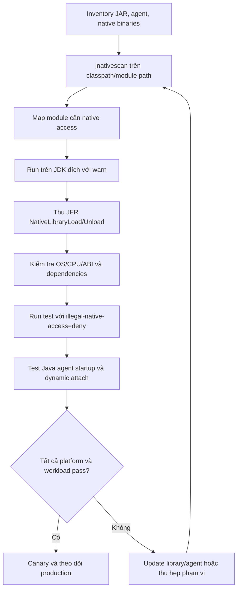

# Đánh giá JNI, native access, agent và thư viện có mã native khi chuyển JDK

## 1. Vì sao nâng JDK có thể làm lộ vấn đề ở native code?

Một ứng dụng Java có thể chạy ổn định nhiều năm nhưng vẫn phụ thuộc vào thành phần nằm ngoài JVM: thư viện C/C++, driver, SDK thiết bị, thư viện xử lý ảnh, mã hóa, nén, cơ sở dữ liệu, profiler hoặc agent giám sát. Những thành phần này có vòng đời và điều kiện tương thích khác với bytecode Java. Việc thay JDK không tự biên dịch lại native library, không kiểm tra ABI của nó và không bảo đảm agent cũ hiểu cấu trúc class file mới.

Khi chuyển sang Java 25, có một thay đổi cần đưa vào kế hoạch nâng cấp: **JEP 472 — Prepare to Restrict the Use of JNI**. Từ JDK 24, các thao tác JNI có rủi ro như nạp native library và liên kết lần đầu một native method được xếp vào nhóm native access bị hạn chế. Nếu module chưa được cấp native access, JVM mặc định vẫn cho phép thao tác nhưng phát cảnh báo. Mục tiêu là giúp ứng dụng chuẩn bị cho một JDK tương lai có thể từ chối các thao tác đó theo mặc định.

Một thay đổi khác cần tách riêng là **JEP 451 — Prepare to Disallow the Dynamic Loading of Agents**. Khi một công cụ nạp Java agent vào JVM đang chạy qua cơ chế attach, HotSpot phát cảnh báo. Việc nạp agent lúc khởi động bằng `-javaagent` có quy trình riêng và không bị thay đổi bởi cảnh báo dynamic attach này.

Bài **Đánh giá JNI, native access, agent và thư viện có mã native khi chuyển JDK** thuộc chương **Tác động nâng cấp** của học phần **JAVA_VERSION_JAVA25**. Học phần tập trung vào những khả năng Java 25 còn áp dụng trong phát triển hiện đại, như compact source files, module imports, flexible constructor bodies, `ScopedValue`, KDF API, AOT cache và JFR. Bài này giúp lập danh mục phụ thuộc native, dự báo lỗi khi nâng JDK, kiểm thử quyền native access và quyết định phần nào nên tiếp tục dùng JNI, phần nào có thể chuyển dần sang Foreign Function and Memory API (FFM).

### Kết quả cần đạt

Sau bài học, bạn có thể:

1. Phân biệt JNI, FFM, Java agent và native JVMTI agent.
2. Nhận diện những thao tác bị native access restrictions tác động trong JDK 24 trở lên.
3. Dùng `jnativescan` để tìm restricted method và khai báo `native` trong JAR.
4. Cấu hình `--enable-native-access` theo module và kiểm thử với `--illegal-native-access=deny`.
5. Kiểm tra tương thích của native library theo OS, CPU architecture, ABI và dependency.
6. Đánh giá agent khởi chạy cùng JVM và agent được nạp động.
7. Dùng JFR theo dõi sự kiện nạp/gỡ native library.
8. Lập kế hoạch kiểm thử, triển khai và rollback khi nâng JDK.

> **Phạm vi phiên bản:** JEP 472 được đưa vào JDK 24; Java 25 tiếp tục chính sách cảnh báo này. Tài liệu Java 27 hiện hành vẫn ghi `warn` là mặc định và `deny` là chế độ dự kiến cho một JDK tương lai. Không giả định việc nâng từ Java 25 lên Java 26/27 đã tự chuyển mặc định sang `deny`; hãy xác minh bằng tài liệu của đúng vendor/build và chạy thử chế độ `deny` ngay trong pipeline.

## 2. Phân biệt các lớp tích hợp native

Các khái niệm sau thường bị gọi chung là “native integration”, nhưng cách nạp, quyền và rủi ro khác nhau.

| Thành phần | Mục đích | Cách khởi chạy/nạp | Thay đổi cần chú ý |
|---|---|---|---|
| JNI | Java gọi hàm native và native code gọi lại JVM | `System.loadLibrary`, `System.load`, khai báo `native` | JEP 472 yêu cầu chuẩn bị native access |
| FFM | Java gọi foreign function và truy cập foreign memory qua API chuẩn | `SymbolLookup`, `Linker`, `Arena` | Restricted methods cũng cần native access |
| Java agent | Instrument bytecode, theo dõi hoặc thay đổi hành vi ứng dụng | `-javaagent` hoặc attach API | JEP 451 cảnh báo khi nạp agent động |
| Native JVMTI agent | Theo dõi hoặc can thiệp JVM ở tầng native | `-agentlib` hoặc `-agentpath` | Kiểm tra ABI, phiên bản JVMTI và binary theo nền tảng |
| Native library thông thường | Cung cấp thuật toán hoặc dịch vụ cho JNI/FFM | Được JNI/FFM hoặc agent nạp | Kiểm tra kiến trúc, ABI, loader và dependency |

Một ứng dụng có thể dùng nhiều lớp cùng lúc. Ví dụ, agent APM là Java agent, agent đó có thể nạp một native profiler, còn ứng dụng chính dùng JNI để gọi thư viện xử lý ảnh. Khi điều tra lỗi, cần xác định chính xác lớp nào phát sinh warning hoặc load failure.

### 2.1. JNI và FFM

JNI là giao diện tiêu chuẩn lâu đời giữa JVM và mã native. JNI vẫn là một lựa chọn hợp lệ cho hệ thống hiện có, đặc biệt khi thư viện native có nhiều callback vào Java, dùng framework JNI lâu năm hoặc cần tích hợp đã được kiểm thử.

FFM API được hoàn thiện trong JDK 22 (JEP 454). Với phát triển mới, FFM thường là lựa chọn nên đánh giá trước vì cung cấp `Linker`, `SymbolLookup`, `FunctionDescriptor`, `MemorySegment` và `Arena` mà không cần viết lớp C/C++ trung gian chỉ để gọi hàm C. FFM vẫn có các restricted methods, nên vẫn cần cấp native access đúng module.

### 2.2. Java agent và native agent

Java agent chạy bytecode trong JVM và dùng `java.lang.instrument.Instrumentation` để biến đổi class. Native JVMTI agent là thư viện native được JVM nạp và hoạt động qua giao diện JVMTI. Một agent có thể dùng cả hai lớp.

`--enable-native-access` và `-XX:+EnableDynamicAgentLoading` giải quyết hai vấn đề khác nhau. Không dùng một cờ để thay thế cờ còn lại.

## 3. JEP 472: native access thay đổi thế nào?

### 3.1. Những thao tác JNI bị ảnh hưởng

JDK 24 trở lên áp dụng native access restrictions cho JNI trong các trường hợp chính:

- Gọi `System.loadLibrary(String)`.
- Gọi `System.load(String)`.
- Gọi `Runtime.loadLibrary(String)`.
- Gọi `Runtime.load(String)`.
- Liên kết lần đầu một method được khai báo bằng từ khóa `native`.

Nạp library có thể thực thi mã tùy ý ngay trong quá trình khởi tạo thư viện hoặc hàm `JNI_OnLoad`. Liên kết native method cũng là thao tác nhạy cảm vì JVM không thể xác minh native function có đúng chữ ký Java đã khai báo hay không.

Với FFM, các restricted methods gồm những thao tác như `SymbolLookup.libraryLookup(...)`, `Linker.downcallHandle(...)`, `Linker.upcallStub(...)` và `MemorySegment.reinterpret(...)`. Danh sách đầy đủ được mô tả trong tài liệu Restricted Methods của JDK đích.

### 3.2. Cảnh báo xuất hiện khi nào?

Nếu module thực hiện restricted operation mà chưa được cấp native access, chế độ mặc định `warn` cho phép thao tác tiếp tục và phát warning lần đầu cho module đó. Vì warning được giới hạn theo module, một ứng dụng có thể chỉ thấy một warning dù có nhiều lần gọi sau đó.

Có hai vị trí cần phân biệt:

- Với `System.loadLibrary` hoặc `System.load`, warning liên quan đến module chứa code gọi phương thức nạp library.
- Với `native` method, warning xuất hiện khi native method được bind lần đầu và liên quan đến module khai báo native method.

Do đó, nếu một module gọi `System.loadLibrary` và module khác khai báo native method, cần rà soát cả hai module.

### 3.3. Ba chế độ xử lý

| Giá trị | Hành vi | Cách dùng |
|---|---|---|
| `allow` | Cho phép native access trái phép mà không cảnh báo | Chỉ nên dùng như biện pháp chuyển tiếp ngắn hạn khi điều tra |
| `warn` | Cho phép tiếp tục và cảnh báo lần đầu trong mỗi module | Mặc định của JDK 24, 25 và tài liệu JDK 27 |
| `deny` | Ném `IllegalCallerException` khi module chưa được cấp quyền thực hiện restricted operation | Chế độ kiểm thử để phát hiện thiếu cấu hình trước khi nâng JDK |

`--illegal-native-access` là công cụ chuyển tiếp để quan sát và chuẩn bị. Tài liệu JDK hiện hành cho biết tùy chọn này sẽ được loại bỏ trong một release tương lai; `deny` được dự kiến trở thành mặc định. Vì vậy, mục tiêu vận hành là cấp quyền tường minh cho đúng module và xác nhận ứng dụng chạy được ở chế độ `deny`.

## 4. Tìm điểm sử dụng JNI và FFM bằng `jnativescan`

### 4.1. `jnativescan` làm gì?

JDK cung cấp công cụ `jnativescan` để phân tích tĩnh JAR trên class path hoặc module path. Công cụ có thể báo cáo:

- Method tham chiếu tới restricted methods, ví dụ `System.loadLibrary` hoặc FFM restricted methods.
- Các method được khai báo bằng từ khóa `native`.
- JAR, class, method và module liên quan.
- Danh sách module cần được cấp native access qua tùy chọn `--print-native-access`.

Công cụ này giúp tìm nơi cần rà soát trước khi chạy ứng dụng trên JDK mới.

### 4.2. Quét JAR trên class path

Ví dụ khi ứng dụng và các dependency nằm trên class path:

```bash
jnativescan --class-path "app.jar;lib-a.jar;lib-b.jar" --release 25
```

Trên Windows, dấu phân cách class path là dấu chấm phẩy. Trên Linux/macOS, dùng dấu hai chấm:

```bash
jnativescan --class-path "app.jar:lib-a.jar:lib-b.jar" --release 25
```

`--release 25` yêu cầu scanner xét tập restricted methods và class file phù hợp với runtime mục tiêu. Với multi-release JAR, tùy chọn này cũng quyết định phiên bản class file được quét.

Có thể lấy danh sách module cần native access:

```bash
jnativescan --class-path "app.jar;lib-a.jar;lib-b.jar" --release 25 --print-native-access
```

Nếu kết quả là `ALL-UNNAMED`, có code native functionality nằm trên class path. Điều này chưa có nghĩa toàn bộ dependency đều cần quyền; xem output dạng cây để tìm JAR và method cụ thể.

### 4.3. Quét module path

Với ứng dụng modular:

```bash
jnativescan --module-path "mods;lib" --add-modules com.example.application --release 25
```

Scanner xét root modules được chỉ định cùng các dependency module liên quan. Nếu module dùng service provider, các module cung cấp service đó cũng có thể được đưa vào quá trình quét.

Hãy dùng đúng cấu hình module path và root module giống môi trường runtime. Quét thiếu module hoặc dependency sẽ làm báo cáo không đầy đủ.

### 4.4. Giới hạn của phân tích tĩnh

`jnativescan` phân tích bytecode trong JAR. Nó không kiểm tra nội dung của file `.so`, `.dll`, `.dylib`, không xác minh ABI, không xác nhận native library có load được trên máy đích và không thay thế runtime test.

Một số hành vi phụ thuộc cấu hình động, reflection, plugin hoặc class loader có thể chỉ xuất hiện khi ứng dụng chạy. Vì vậy, kết hợp:

1. `jnativescan` để tìm các tham chiếu tĩnh.
2. JFR để quan sát library thực tế được nạp/gỡ.
3. Log ứng dụng và OS loader để chẩn đoán dependency.
4. Test tích hợp trên từng OS/CPU architecture triển khai.

## 5. Cấp native access đúng phạm vi

### 5.1. Ứng dụng dùng class path

Nếu code cần native access nằm trong unnamed module trên class path, dùng:

```bash
java --enable-native-access=ALL-UNNAMED -jar app.jar
```

Cấu hình này cấp native access cho toàn bộ code trên class path. Đây là cách tương thích khi chưa thể modular hóa dependency, nhưng phạm vi quyền khá rộng.

### 5.2. Ứng dụng dùng module path

Nếu module `com.example.nativebridge` là module gọi restricted methods hoặc khai báo native methods, có thể cấp quyền riêng:

```bash
java --enable-native-access=com.example.nativebridge --module-path mods --module com.example.application/com.example.Main
```

Có thể chỉ định nhiều module bằng dấu phẩy:

```bash
java --enable-native-access=com.example.nativebridge,com.vendor.codec --module-path mods --module com.example.application/com.example.Main
```

Ưu tiên đặt JAR có native access trên module path. JAR không có `module-info.class` vẫn có thể được runtime xem là automatic module, với tên module được suy ra từ tên JAR. Cách này giúp cấp quyền hẹp hơn so với `ALL-UNNAMED`.

### 5.3. Những nơi có thể cấu hình

Ngoài command line, `--enable-native-access` có thể được truyền qua:

- Biến môi trường `JDK_JAVA_OPTIONS`.
- Argument file của launcher.
- Manifest executable JAR với thuộc tính `Enable-Native-Access: ALL-UNNAMED`.
- Cấu hình `jlink` thông qua plugin `--add-options`.
- `ModuleLayer.Controller.enableNativeAccess(Module)` khi tạo module layer động, nếu module gọi được phép thực hiện restricted operation.

Không đặt cờ ở một script không được dùng trong production. Kiểm tra command line thực tế của process sau khi deploy để bảo đảm cấu hình đã đến JVM.

### 5.4. Vì sao không nên cấp quyền cho tất cả?

Native code có thể đọc/ghi bộ nhớ ngoài heap, gọi syscall, thay đổi trạng thái process hoặc làm hỏng JVM nếu có lỗi. Cấp `ALL-UNNAMED` cho ứng dụng có nhiều dependency đồng nghĩa nhiều code trên class path có thể thực hiện native access.

Hãy tạo danh sách module tối thiểu từ `jnativescan`, xác minh runtime, rồi cấp quyền cho các module thực sự cần. Nếu dùng `ALL-UNNAMED` vì ứng dụng chưa modular hóa, ghi nhận đây là quyết định có phạm vi rộng và lên kế hoạch thu hẹp.

### 5.5. Phân biệt native access với quyền truy cập reflection

`--enable-native-access` không thay thế `--add-opens`, và `--add-opens` cũng không cấp native access. Hai nhóm cờ giải quyết hai cơ chế khác nhau:

- Native access: nạp/liên kết mã native và gọi restricted methods.
- Deep reflection: mở package/module để code khác truy cập thành viên không public.

Khi lỗi xảy ra, đọc đúng loại exception và warning trước khi thêm JVM option. Không thêm nhiều cờ rộng để che nguyên nhân.

## 6. Kiểm thử ứng dụng trong chế độ `deny`

### 6.1. Chạy test với quyền đã cấp

Sau khi xác định module cần quyền, chạy test:

```bash
java --illegal-native-access=deny --enable-native-access=ALL-UNNAMED -jar app.jar
```

Nếu ứng dụng chạy được qua các đường chức năng có JNI/FFM, đây là bằng chứng rằng các thao tác đã được cấp quyền đúng trong kịch bản test.

### 6.2. Cố ý bỏ quyền để xác nhận test bắt được lỗi

Trong môi trường test riêng, chạy lại mà không có `--enable-native-access`:

```bash
java --illegal-native-access=deny -jar app.jar
```

Nếu code gọi restricted method, JVM sẽ ném `IllegalCallerException`. Đây là cách xác nhận pipeline có thể phát hiện cấu hình native access bị thiếu.

Không dùng lần chạy thiếu quyền này làm cấu hình production. Nó là negative test để chứng minh guardrail hoạt động.

### 6.3. Không dùng `allow` để che warning

`--illegal-native-access=allow` khiến thao tác tiếp tục mà không phát warning. Điều đó có thể làm log sạch hơn nhưng không giúp xác định module cần quyền. Trong migration pipeline, ưu tiên `deny` để lộ đầy đủ vấn đề; dùng `warn` khi cần quan sát hành vi mà vẫn cho ứng dụng tiếp tục chạy.

## 7. Kiểm tra tương thích JNI ở cấp mã nguồn và binary

### 7.1. JNI API và phiên bản runtime

Native library được biên dịch từ header `jni.h` và gọi các hàm thông qua `JNIEnv`/`JavaVM`. Khi nâng JDK:

- Build lại native code với header từ JDK/toolchain mục tiêu nếu có thể.
- Kiểm tra giá trị JNI version mà `JNI_OnLoad` trả về.
- Xác nhận native library chỉ dùng các JNI functions có trong phiên bản runtime hỗ trợ.
- Kiểm tra `JNI_OnLoad` có gọi `GetEnv` với phiên bản phù hợp và trả về lỗi đúng khi không khởi tạo được.
- Không dựa vào symbol hoặc cấu trúc nội bộ của HotSpot nếu không thuộc API được hỗ trợ.

JNI là giao diện tiêu chuẩn, nhưng điều đó không bảo đảm mọi native binary cũ đều tương thích với OS, CPU, C runtime hoặc dependency mới của môi trường triển khai.

### 7.2. Tạo header JNI bằng javac

Với JDK hiện đại, dùng `javac -h` để sinh header từ khai báo native method:

```java
package example;

public final class NativeCalc {
    static {
        System.loadLibrary("nativecalc");
    }

    public static native long add(long left, long right);

    public static void main(String[] args) {
        System.out.println(add(20, 22));
    }
}
```

Biên dịch và sinh header:

```bash
javac -h native/include -d out src/example/NativeCalc.java
```

Header được tạo ra sẽ chứa khai báo C có đúng tên JNI và chữ ký tương ứng. Hãy dùng header này trong native build để tránh tự gõ sai tên hàm hoặc kiểu tham số.

### 7.3. Quy tắc chữ ký và kiểu dữ liệu

Các lỗi phổ biến gồm:

- Tên JNI function không khớp package, class hoặc method.
- Nhầm `jclass` với `jobject` ở tham số thứ hai của static/instance native method.
- Sai thứ tự hoặc kiểu tham số.
- Dùng `jint` cho pointer hoặc địa chỉ có thể vượt miền 32-bit.
- Lưu `jobject` local reference rồi dùng sau khi native call kết thúc.
- Giữ `JNIEnv*` rồi truyền sang thread native khác.

`JNIEnv*` chỉ hợp lệ trên thread hiện tại. Thread do native code tự tạo cần attach vào JVM trước khi gọi JNI và detach khi hoàn thành. Với object reference cần sống lâu hơn một native call, phải tạo global reference và giải phóng đúng lúc.

### 7.4. `RegisterNatives` và symbol-based binding

JNI có thể liên kết native methods theo tên symbol hoặc dùng `RegisterNatives` trong `JNI_OnLoad`. Cả hai đều cần chữ ký chính xác.

`RegisterNatives` giúp kiểm soát bảng mapping trong một nơi, nhưng không tự loại bỏ rủi ro sai chữ ký. Hãy kiểm thử từng native entry point và xác minh lỗi được truyền về Java đúng cách.

## 8. Tương thích native library theo OS, CPU và ABI

### 8.1. JDK không thay thế native build

Một file native library phải phù hợp với hệ điều hành, CPU architecture và ABI của môi trường đang chạy. Ví dụ, binary Linux x86-64 không thể dùng trực tiếp trên Windows x64 hoặc Linux AArch64.

Tạo ma trận artifact tối thiểu:

| Nền tảng | Định dạng phổ biến | Những điều cần xác nhận |
|---|---|---|
| Linux x86-64 | `.so` ELF | glibc/musl, symbol version, C/C++ runtime, RPATH/RUNPATH |
| Linux AArch64 | `.so` ELF | ARM64 ABI, compiler target, CPU instruction set |
| Windows x64 | `.dll` PE | MSVC runtime, calling convention, DLL dependencies |
| macOS arm64/x64 | `.dylib` Mach-O | architecture slice, deployment target, `@rpath`, code signing |

Nếu phát hành một artifact cho nhiều kiến trúc, xác minh mỗi binary slice thực sự có trong file. Không suy luận chỉ từ tên file hoặc tên container image.

### 8.2. Kiểm tra dependency bắc cầu

Một JNI library có thể tồn tại nhưng vẫn load thất bại vì thiếu dependency mà nó liên kết tới.

Kiểm tra:

- Linux: `ldd`, `readelf -d`, `objdump -T`.
- Windows: `dumpbin /DEPENDENTS` hoặc công cụ phân tích PE tương đương.
- macOS: `otool -L`, `file`, `lipo -info`.

Các công cụ này giúp kiểm tra định dạng binary, dependency, symbol và architecture. Không chạy `ldd` trên binary không đáng tin cậy vì cách triển khai cụ thể có thể thực thi mã; chỉ dùng với artifact đã được kiểm soát.

### 8.3. Tìm kiếm library và dependency của loader

`System.loadLibrary("nativecalc")` nhận tên logic, không có prefix, extension hoặc đường dẫn. `System.load("/absolute/path/libnativecalc.so")` yêu cầu đường dẫn tuyệt đối.

`java.library.path` ảnh hưởng đến việc JVM tìm JNI library. Sau khi library chính được tìm thấy, OS loader còn phải tìm dependency bắc cầu của nó:

- Linux: kiểm tra RUNPATH/RPATH và chính sách dynamic loader.
- Windows: kiểm tra DLL search path và PATH theo cấu hình process.
- macOS: kiểm tra install name và `@rpath` của dependency.

Đừng chỉ thêm thư mục chứa library chính vào `java.library.path` rồi kết luận mọi dependency đã sẵn sàng. Ghi nhận đường dẫn thực tế và kiểm tra trên image/host production.

### 8.4. C runtime, C++ runtime và thư viện hệ thống

Native code có thể phụ thuộc vào phiên bản glibc, libstdc++, MSVC runtime, OpenSSL hoặc thư viện hệ thống khác. JDK upgrade thường đi kèm thay đổi base image, OS package hoặc container runtime; chính các thay đổi đó có thể làm binary cũ không load được.

Đặc biệt, tránh build native library trên một hệ điều hành mới hơn rồi triển khai lên môi trường có ABI nền thấp hơn nếu binary yêu cầu symbol version mới. Hãy build theo baseline OS được hỗ trợ hoặc dùng toolchain/cross-build được kiểm soát.

### 8.5. CPU instruction set

Native library có thể được tối ưu cho AVX2, AVX-512, NEON hoặc extension khác. Binary chạy được trên máy build nhưng crash trên instance cũ nếu thực thi instruction không hỗ trợ.

Nếu library cung cấp nhiều implementation, xác minh cơ chế runtime dispatch. Nếu chỉ có một binary, quy định rõ CPU baseline và kiểm tra fleet production.

## 9. Đánh giá Java agent và dynamic attach

### 9.1. Java agent lúc JVM khởi động

Java agent được nạp từ command line bằng `-javaagent`:

```bash
java -javaagent:observability-agent.jar=service=orders -jar app.jar
```

Agent JAR khai báo `Premain-Class` trong manifest và class agent cung cấp method `premain`. JVM gọi `premain` trước khi gọi `main` của ứng dụng.

JEP 451 không nhằm cấm cách khởi chạy này. Với agent cần thiết cho production, cấu hình startup rõ ràng giúp deployment tái lập được và tránh phụ thuộc vào attach sau khi JVM đã chạy.

### 9.2. Nạp agent động vào JVM đang chạy

Một số profiler, APM hoặc công cụ chẩn đoán dùng Attach API để gọi `VirtualMachine.loadAgent(...)`. Agent JAR phải khai báo `Agent-Class` và class agent cung cấp `agentmain`.

Từ JDK 21, HotSpot cảnh báo khi agent được nạp động vào JVM đang chạy. Cảnh báo này chuẩn bị cho một release tương lai có thể không cho phép dynamic agent loading theo mặc định.

HotSpot có tùy chọn `-XX:+EnableDynamicAgentLoading` để opt-in cho dynamic loading và tắt warning tương ứng. Đây là tùy chọn riêng của HotSpot. Không bật nó chỉ để làm mất warning trong lúc kiểm kê; trước tiên hãy xác định công cụ nào đang attach và có thể chuyển sang startup agent hay không.

### 9.3. Phân biệt các cơ chế agent

| Cơ chế | Vai trò | Cách kiểm tra |
|---|---|---|
| `-javaagent:agent.jar` | Java agent khởi động cùng JVM | Manifest `Premain-Class`, log `premain` |
| Attach API / `loadAgent` | Java agent nạp vào JVM đang chạy | Manifest `Agent-Class`, method `agentmain`, warning JEP 451 |
| `-agentlib:name` | Nạp native agent theo tên thư viện | Kiểm tra JVMTI, OS loader và native dependencies |
| `-agentpath:/absolute/path` | Nạp native agent bằng đường dẫn | Kiểm tra file binary, architecture, ABI và dependency |

`-XX:+EnableDynamicAgentLoading` không phải `--enable-native-access`. `--enable-native-access` cũng không thay thế việc bật dynamic agent loading.

### 9.4. Lần vết việc sử dụng Instrumentation API

Có thể bật:

```bash
java -Djdk.instrument.traceUsage -jar app.jar
```

Thuộc tính `jdk.instrument.traceUsage` giúp lần vết nơi sử dụng API `java.lang.instrument.Instrumentation`. Nó hỗ trợ tìm công cụ hoặc thư viện đang dùng instrumentation trong runtime. Kết quả trace cần được đối chiếu với cấu hình attach của APM/profiler; không giả định mọi lời gọi Instrumentation đều đồng nghĩa một agent vừa được nạp động.

### 9.5. Native JVMTI agent

Native agent thường được nạp lúc JVM khởi động bằng `-agentlib` hoặc `-agentpath`. Agent dùng JVMTI để nhận event, theo dõi thread, class loading, heap hoặc hoạt động khác của VM.

Khi nâng JDK, xác nhận:

- Agent build đúng OS/CPU architecture.
- JVMTI version và capabilities cần thiết còn được hỗ trợ.
- Native dependencies và symbol tương thích.
- Vendor của agent hỗ trợ JDK đích.
- Không có giả định về cấu trúc nội bộ HotSpot không được bảo đảm.

## 10. Kiểm tra agent có tương thích bytecode và module mới không

Java agent có thể biến đổi class khi load hoặc retransform class đã được nạp. Khi chuyển JDK, agent cần hiểu class file version, bytecode, attribute, constant pool và hành vi runtime mới.

Các thư viện nền tảng như ASM, Byte Buddy hoặc Javassist thường được agent dùng để đọc/ghi bytecode. Hãy kiểm tra phiên bản được agent đóng gói; một agent cũ có thể lỗi khi gặp class file mới dù ứng dụng không có JNI.

Cũng cần kiểm tra:

- Agent có dùng reflection vào package nội bộ của JDK hay không.
- Agent có yêu cầu `--add-opens` hoặc `--add-exports` cụ thể không.
- Agent có append helper JAR vào bootstrap/system class loader không.
- Agent có thay đổi module graph hoặc yêu cầu module platform phải được resolve ở startup không.
- Agent có native component cần `--enable-native-access` riêng không.

Không gộp mọi lỗi agent vào JEP 451. Warning dynamic attach là một vấn đề; lỗi transform bytecode, strong encapsulation, JVMTI hoặc ABI là những vấn đề khác.

## 11. Khi nào nên chuyển một phần JNI sang FFM?

### 11.1. Trường hợp nên đánh giá FFM

FFM phù hợp để gọi các hàm có ABI C rõ ràng, truyền primitive/struct/memory segment và quản lý vòng đời foreign memory bằng `Arena`. Nó có thể giảm số lượng wrapper JNI và tránh một phần boilerplate C/C++.

Các abstraction chính:

- `SymbolLookup`: tìm symbol trong native library.
- `FunctionDescriptor`: mô tả chữ ký hàm native.
- `Linker`: tạo downcall handle để Java gọi hàm native và upcall stub để native gọi Java.
- `MemorySegment` và `Arena`: mô hình hóa vùng nhớ native và vòng đời truy cập.

### 11.2. Khi nào tiếp tục dùng JNI?

JNI có thể vẫn là lựa chọn hợp lý khi:

- Đã có native library và wrapper ổn định, được kiểm thử rộng.
- Framework vendor chỉ cung cấp JNI binding.
- Tích hợp cần callback phức tạp hoặc hành vi gắn với JNI class loader.
- Chi phí chuyển đổi lớn hơn lợi ích dự kiến.
- Native code có hợp đồng JNI đã được duy trì và kiểm định.

Không cần viết lại toàn bộ JNI chỉ vì JEP 472. Trước tiên, cấp native access đúng phạm vi, chạy `deny` để kiểm tra, rồi lập kế hoạch chuyển đổi riêng cho phần có lợi ích rõ ràng.

### 11.3. FFM vẫn cần native access

FFM là API chuẩn và đã permanent từ JDK 22, nhưng một số thao tác vẫn restricted vì có thể gây crash hoặc memory corruption nếu dùng sai. Ví dụ `SymbolLookup.libraryLookup` nạp native library và `Linker.downcallHandle` liên kết địa chỉ hàm với function descriptor.

Do đó, module dùng FFM vẫn cần được cấp native access. Chuyển từ JNI sang FFM không có nghĩa là loại bỏ cấu hình native access; nó thay đổi cách biểu diễn và gọi hàm native.

## 12. Quan sát native library trong runtime bằng JFR

### 12.1. Hai event cần biết

JFR cung cấp:

- `jdk.NativeLibraryLoad`: thông tin thao tác nạp native library.
- `jdk.NativeLibraryUnload`: thông tin thao tác gỡ native library.

Các event này giúp biết library nào được nạp/gỡ trong một khoảng recording và hỗ trợ đối chiếu với log startup hoặc class loader.

### 12.2. Tạo recording

Ví dụ ghi một khoảng chạy có kiểm soát:

```bash
java --enable-native-access=ALL-UNNAMED -XX:StartFlightRecording=filename=native-audit.jfr,settings=profile,duration=60s -jar app.jar
```

Sau đó đọc event:

```bash
jfr summary native-audit.jfr
jfr print --events jdk.NativeLibraryLoad,jdk.NativeLibraryUnload native-audit.jfr
```

Nếu event không xuất hiện, kiểm tra recording có chứa event tương ứng và thao tác nạp/gỡ có thực sự xảy ra trong cửa sổ ghi hay không. Không kết luận ứng dụng không dùng native chỉ vì recording ngắn không có event.

### 12.3. Kết hợp JFR với `jnativescan`

`jnativescan` cho biết code có tham chiếu tới restricted methods hoặc khai báo native method. JFR cho biết library nào thực sự được nạp trong lần chạy đã quan sát.

Đối chiếu hai nguồn:

| Kết quả static scan | JFR runtime | Cách diễn giải |
|---|---|---|
| Có native references | Có library load | Có đường native đã chạy trong kịch bản |
| Có native references | Không có library load | Có thể đường code chưa được kích hoạt hoặc load xảy ra ngoài recording |
| Không có native references | Có library load | Kiểm tra agent, thư viện gián tiếp, code động hoặc thành phần ngoài JAR đã quét |
| Không có native references | Không có library load | Chưa thấy native activity trong phạm vi quét và kịch bản test |

JFR không phải công cụ phân tích mọi lời gọi native function. Dùng thêm OS process diagnostics và log của native component khi cần.

## 13. Quy trình nâng cấp có kiểm soát

Một quy trình tốt nên chạy từ kiểm kê tĩnh đến runtime test và rollout:



### 13.1. Trước khi chạy ứng dụng trên JDK mới

- Lưu danh sách dependency JAR, Java agent, native JVMTI agent và native library.
- Ghi phiên bản, checksum, vendor và nguồn phát hành của từng binary.
- Xác định module gọi `System.loadLibrary`/FFM và module khai báo native method.
- Chạy `jnativescan` với classpath/module path đúng runtime.
- Kiểm tra native artifacts cho từng OS/CPU architecture.
- Xác nhận vendor hỗ trợ JDK đích.

### 13.2. Trong giai đoạn test

- Chạy đầy đủ integration test có kích hoạt native path.
- Ghi warning khi `--illegal-native-access=warn`.
- Cấu hình native access có chọn lọc rồi chạy `--illegal-native-access=deny`.
- Thu JFR native library events.
- Kiểm thử startup agent, dynamic attach nếu sản phẩm thật sự cần và native JVMTI agent.
- Test load/unload class loader nếu ứng dụng có plugin hoặc nhiều application class loader.
- Chạy test với container image và OS package giống production.

### 13.3. Trước rollout

- Chốt danh sách module được cấp native access.
- Chốt cờ startup cho agent và native JVMTI agent.
- Chốt thư mục native library và dependency search path.
- Lưu JDK version, JVM arguments, checksum và architecture trong release metadata.
- Chuẩn bị rollback về JDK/binary pair đã được kiểm thử.
- Theo dõi warning, `UnsatisfiedLinkError`, `IllegalCallerException`, crash native và event JFR trong canary.

Không rollout chỉ vì ứng dụng đã khởi động thành công. Nhiều native method chỉ được gọi trong một luồng nghiệp vụ hiếm; phải kiểm thử các chức năng thực sự sử dụng chúng.

## 14. Chẩn đoán lỗi thường gặp

| Triệu chứng | Nguyên nhân có thể | Hướng xử lý |
|---|---|---|
| Warning restricted method trong `System.loadLibrary` | Module chưa được cấp native access | Xác định module gọi và thêm `--enable-native-access` tối thiểu |
| `IllegalCallerException` khi chạy `deny` | Module thực hiện restricted operation chưa được enable | Dùng `jnativescan`, xem call stack và cấp quyền đúng module |
| `UnsatisfiedLinkError: no ... in java.library.path` | Không tìm thấy library chính | Kiểm tra tên library, `java.library.path` và file artifact |
| `UnsatisfiedLinkError: ... wrong ELF class` | Binary sai kiến trúc hoặc word size | Dùng đúng OS/CPU architecture và ABI |
| Library chính tìm thấy nhưng load vẫn fail | Thiếu dependency bắc cầu hoặc symbol version | Kiểm tra `ldd`, `readelf`, `dumpbin` hoặc `otool` |
| `UnsatisfiedLinkError: Native Method ... not found` | JNI symbol hoặc chữ ký không khớp | Sinh lại header bằng `javac -h`, kiểm tra tên và signature |
| `JNI_OnLoad` trả lỗi hoặc JNI version không hỗ trợ | Khởi tạo native library thất bại | Kiểm tra `GetEnv`, version và log của native library |
| Native method crash sau nâng JDK | Sai ABI, pointer/lifetime bug hoặc native memory corruption | Chạy native tests, sanitizer và debugger phù hợp |
| Agent dynamic attach phát warning | Công cụ đang nạp agent vào JVM đang chạy | Chuyển sang `-javaagent` startup nếu có thể; xác minh agent version |
| Agent không transform class mới | Bytecode library trong agent chưa hỗ trợ class file mới | Cập nhật agent/ASM/Byte Buddy/Javassist |
| `-javaagent` chạy nhưng ứng dụng fail sớm | `premain` ném exception hoặc agent thiếu dependency | Kiểm tra manifest, class loader và startup log |
| `-agentpath` không nạp được | Native JVMTI agent sai path/architecture hoặc thiếu dependency | Kiểm tra binary và OS loader |
| Chỉ lỗi trong plugin class loader | Native library đã được nạp bởi class loader khác hoặc lifecycle không phù hợp | Kiểm tra nơi load library và chiến lược class loader |
| JFR không có native load event | Không có load trong recording hoặc event chưa được ghi | Kéo dài recording, xác minh event settings và runtime path |

### 14.1. Phân biệt lỗi quyền với lỗi binary

- `IllegalCallerException` thường chỉ ra module chưa được cấp native access.
- `UnsatisfiedLinkError` thường chỉ ra library không tìm thấy, không load được hoặc không bind được native method.
- Crash JVM hoặc memory corruption có thể là lỗi trong native code, sai ABI, pointer lifetime hoặc concurrency.

Không sửa `UnsatisfiedLinkError` bằng `--enable-native-access`; cờ này không cài library và không sửa dependency. Tương tự, không giải quyết `IllegalCallerException` bằng cách đổi tên file `.so` hoặc `.dll`.

## 15. Bài thực hành và checklist nghiệm thu

### 15.1. Mục tiêu bài lab

Tạo một native library C nhỏ, gọi từ Java bằng JNI, quét JAR bằng `jnativescan`, chạy với native access được cấp và kiểm tra hành vi khi quyền bị từ chối.

### 15.2. Tạo lớp Java

Tạo file `src/example/NativeCalc.java`:

```java
package example;

public final class NativeCalc {

    static {
        System.loadLibrary("nativecalc");
    }

    public static native long add(long left, long right);

    public static void main(String[] args) {
        System.out.println("20 + 22 = " + add(20, 22));
    }
}
```

Sinh class và JNI header:

```bash
mkdir -p native/include out
javac -h native/include -d out src/example/NativeCalc.java
```

Header được tạo trong `native/include`. Mở header để xem đúng tên hàm và chữ ký C mà compiler sinh ra.

### 15.3. Viết native implementation

Tạo file `native/nativecalc.c`:

```c
#include "example_NativeCalc.h"

JNIEXPORT jlong JNICALL Java_example_NativeCalc_add(
    JNIEnv *env,
    jclass clazz,
    jlong left,
    jlong right
) {
    return left + right;
}
```

Ví dụ chỉ dùng phép cộng số nguyên 64-bit. Trong native library thật, cần kiểm tra overflow theo hợp đồng nghiệp vụ, kiểm tra lỗi và quản lý mọi tài nguyên native được cấp phát.

### 15.4. Biên dịch native library

Ví dụ Linux x86-64/AArch64 với GCC và JDK đã cài:

Đặt biến môi trường `JAVA_HOME` trỏ tới JDK dùng để biên dịch Java và native code.

```bash
gcc -shared -fPIC -I"$JAVA_HOME/include" -I"$JAVA_HOME/include/linux" -Inative/include native/nativecalc.c -o native/libnativecalc.so
```

Trên macOS, dùng thư mục header theo nền tảng `darwin` và tạo dynamic library `.dylib`. Trên Windows, dùng compiler tương ứng như MSVC, header platform `win32` và tạo `.dll`. Tên file, compiler flags và dependency runtime phải phù hợp với OS/CPU đang chạy.

Không copy file `.so` của Linux sang Windows hoặc dùng binary x64 cho ARM64.

### 15.5. Đóng gói và quét tĩnh

Đóng gói class:

```bash
jar --create --file native-demo.jar -C out .
```

Quét trên JDK 25:

```bash
jnativescan --class-path native-demo.jar --release 25
jnativescan --class-path native-demo.jar --release 25 --print-native-access
```

Kết quả cần nhận diện được `System.loadLibrary` và khai báo native method trong lớp `NativeCalc`. Vì JAR nằm trên class path, module tương ứng là `ALL-UNNAMED`.

### 15.6. Chạy khi đã cấp native access

Trên Linux/macOS, nếu thư viện nằm trong thư mục `native`:

```bash
java --illegal-native-access=deny --enable-native-access=ALL-UNNAMED -Djava.library.path=./native -cp native-demo.jar example.NativeCalc
```

Trên Windows, dùng đường dẫn thư mục `native` theo cú pháp của Windows. Kết quả mong đợi:

```text
20 + 22 = 42
```

### 15.7. Chạy negative test

Chạy lại mà không cấp native access:

```bash
java --illegal-native-access=deny -Djava.library.path=./native -cp native-demo.jar example.NativeCalc
```

Kết quả mong đợi là `IllegalCallerException` tại thao tác `System.loadLibrary`, trước khi native function được gọi. Đây là kiểm tra để xác nhận ứng dụng thực sự phụ thuộc vào native access.

### 15.8. Quan sát library load bằng JFR

Tạo recording khi chạy ứng dụng với quyền hợp lệ:

```bash
java --enable-native-access=ALL-UNNAMED -Djava.library.path=./native -XX:StartFlightRecording=filename=native-audit.jfr,settings=profile,duration=60s -cp native-demo.jar example.NativeCalc
```

Đọc event:

```bash
jfr print --events jdk.NativeLibraryLoad,jdk.NativeLibraryUnload native-audit.jfr
```

Xác nhận library được ghi nhận trong recording. Nếu ứng dụng kết thúc quá nhanh, tăng thời lượng hoặc tạo workload đủ lâu để việc ghi event được quan sát.

### 15.9. Checklist nghiệm thu

Trước khi nâng JDK:

- [ ] Đã liệt kê JNI libraries, FFM calls, Java agents và native JVMTI agents.
- [ ] Đã ghi version/checksum của binary và vendor hỗ trợ.
- [ ] Đã quét JAR bằng `jnativescan` theo runtime target.
- [ ] Đã lập danh sách module cần native access.
- [ ] Đã kiểm tra OS, CPU architecture, ABI và native dependencies.
- [ ] Đã cập nhật Java agent và bytecode libraries.

Trong CI/staging:

- [ ] Đã chạy ứng dụng với `--illegal-native-access=deny`.
- [ ] Đã chạy các integration test kích hoạt mọi native path quan trọng.
- [ ] Đã kiểm tra startup agent và dynamic attach theo nhu cầu thực tế.
- [ ] Đã ghi JFR native library load/unload events.
- [ ] Đã kiểm tra native method binding, JNI version và error handling.
- [ ] Đã thử từng nền tảng/architecture triển khai.

Trước production:

- [ ] Chỉ cấp native access cho module cần thiết.
- [ ] Đã xác định rõ startup flags và native library search path.
- [ ] Không dựa vào `allow` để che warning.
- [ ] Có artifact JDK/native library tương ứng cho từng platform.
- [ ] Có canary, metrics, log và phương án rollback.
- [ ] Có chủ sở hữu và kế hoạch cập nhật cho mỗi native dependency/agent.

### 15.10. Tài liệu chính thức

- [JEP 472 — Prepare to Restrict the Use of JNI](https://openjdk.org/jeps/472): native access restrictions và warning cho JNI/FFM.
- [JEP 451 — Prepare to Disallow the Dynamic Loading of Agents](https://openjdk.org/jeps/451): cảnh báo và kế hoạch hạn chế dynamic agent loading.
- [JEP 454 — Foreign Function and Memory API](https://openjdk.org/jeps/454): FFM API được hoàn thiện trong JDK 22.
- [Oracle JDK 25 Migration Guide — Restrictions on and Warnings from Accessing Native Code](https://docs.oracle.com/en/java/javase/25/migrate/jdk-migration-guide.pdf): thao tác JNI bị hạn chế, cách cấp native access và công cụ chẩn đoán.
- [Oracle JDK 25 — The `jnativescan` Command](https://docs.oracle.com/en/java/javase/25/docs/specs/man/jnativescan.html): quét restricted method và native method declarations.
- [Oracle Java SE 25 — Restricted Methods](https://docs.oracle.com/en/java/javase/25/core/restricted-methods.html): các restricted methods trong FFM và cách cấp native access.
- [Java SE 25 — Restricted Method List](https://docs.oracle.com/en/java/javase/25/docs/api/restricted-list.html): danh sách restricted methods, gồm JNI loading và FFM.
- [Java SE 25 — `java.lang.instrument`](https://docs.oracle.com/en/java/javase/25/docs/api/java.instrument/java/lang/instrument/package-summary.html): startup agent, dynamic agent và `Instrumentation`.
- [Java SE 25 — `SymbolLookup`](https://docs.oracle.com/en/java/javase/25/docs/api/java.base/java/lang/foreign/SymbolLookup.html): tìm symbol và nạp library trong FFM.
- [Java SE 25 — `Linker`](https://docs.oracle.com/en/java/javase/25/docs/api/java.base/java/lang/foreign/Linker.html): downcall/upcall và ABI.
- [Java SE 25 — JNI Design Overview](https://docs.oracle.com/en/java/javase/25/docs/specs/jni/design.html): loading, linking, native methods và class loader.
- [Java SE 27 — Restricted Methods](https://docs.oracle.com/en/java/javase/27/core/restricted-methods.html): kiểm tra chính sách native access ở tài liệu JDK 27.
- [Java SE 27 — The `java` Command](https://docs.oracle.com/en/java/javase/27/docs/specs/man/java.html): kiểm tra trạng thái hiện hành của `--enable-native-access` và `--illegal-native-access`.

*Phạm vi đối chiếu: 27/11/2026.* Java 25 áp dụng cảnh báo native access theo JEP 472; tài liệu JDK 27 hiện vẫn ghi `warn` là mặc định và `deny` là chế độ dự kiến cho release tương lai. JEP 451 tiếp tục phân biệt agent khởi động cùng JVM với agent nạp động. FFM đã permanent từ JDK 22 và là hướng cần đánh giá cho tích hợp mới, nhưng restricted FFM methods vẫn cần native access. Khi triển khai, xác minh lại đúng JDK vendor/build, OS/CPU architecture, agent và native binary trên môi trường đích.

