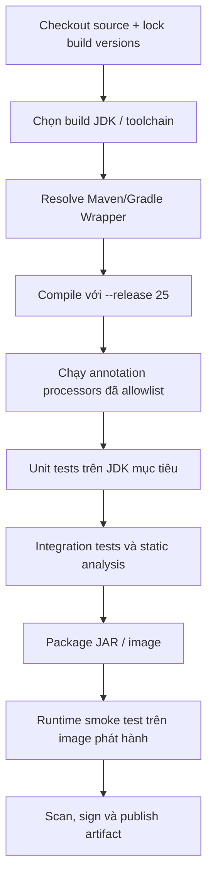

# Kiểm tra khả năng hỗ trợ Java 25 của Maven, Gradle, plugin và annotation processor

> **Chương:** Build và triển khai  
> **Học phần:** `JAVA_VERSION_JAVA25` — xây dựng và triển khai ứng dụng trên Java hiện đại, kiểm tra toolchain, plugin, annotation processor và runtime tương thích với Java 25.  
> **Mục tiêu:** Phân biệt JDK chạy build với JDK biên dịch, test và chạy production; cấu hình Maven/Gradle bằng `--release 25` và toolchain; xác minh plugin/processor có hỗ trợ JDK 25; chuẩn hóa build để CI và máy developer tạo ra cùng artifact.

> **Mốc kiểm tra:** Nội dung phản ánh tài liệu và bản phát hành công khai tại ngày 27-11-2026. Phiên bản plugin trong ví dụ là mốc tham khảo để pin trong build, không phải cam kết mọi plugin bên thứ ba đều tương thích. Trước khi nâng cấp, kiểm tra release notes và compatibility matrix của đúng phiên bản đang dùng.

## 1. “Hỗ trợ Java 25” gồm nhiều lớp khác nhau

Một build có thể chạy trên JDK 25 nhưng vẫn không biên dịch được source Java 25. Một compiler có thể tạo class file Java 25 nhưng plugin kiểm thử hoặc annotation processor lại không đọc được class file đó. Ứng dụng build thành công trên máy developer cũng có thể lỗi khi chạy trên container production dùng runtime khác.

Hãy đánh giá riêng bốn môi trường:

| Môi trường | Vai trò | Câu hỏi cần xác minh |
|---|---|---|
| **Build JVM** | Chạy Maven/Gradle và plugin của build tool | Phiên bản Maven/Gradle có chạy được trên JDK đang cấp cho build daemon không? |
| **Compiler toolchain** | Chạy `javac` để biên dịch source | Compiler có hiểu source level 25 và các API Java 25 không? |
| **Test JVM** | Chạy unit/integration test, test engine và agent | Test runner, framework, coverage agent và test code có chạy được trên JDK 25 không? |
| **Production runtime** | Chạy JAR/module trong máy chủ hoặc container | Runtime có đủ API, module, native library và kiến trúc mà artifact yêu cầu không? |

Bốn môi trường có thể dùng cùng JDK 25, nhưng không bắt buộc. Ví dụ, Gradle daemon có thể chạy trên JDK 27 trong khi Java toolchain của project dùng JDK 25 để compile và test. Điều quan trọng là khai báo rõ từng phiên bản, tránh phụ thuộc vào `JAVA_HOME` hoặc JDK mặc định của IDE.

### 1.1. Phân biệt phiên bản chạy build và phiên bản target

Giả sử Gradle daemon chạy trên JDK 27, Java toolchain chọn JDK 25 và `options.release = 25`:

- JDK 27 cung cấp JVM để chạy Gradle.
- JDK 25 cung cấp `javac` và các công cụ của toolchain.
- `--release 25` giới hạn ngôn ngữ, bytecode và API nền tảng mà source được phép sử dụng.
- Test có thể chạy bằng JDK 25 nếu task dùng toolchain.
- Production cần runtime tương thích với bytecode/API của ứng dụng, thường là JDK 25 trở lên.

Không suy ra rằng “build chạy bằng JDK 27” thì artifact mặc nhiên target Java 27. Target được quyết định bởi compiler options như `--release`, không chỉ bởi `java -version` của build daemon.

## 2. Tình trạng tương thích Maven và Gradle với JDK 25

### 2.1. Maven

Tại ngày 27-11-2026, Apache Maven duy trì hai dòng GA gần nhất là Maven 3.10.2 và 3.9.16. Maven 4.0.0-rc-7 vẫn là release candidate, chưa phải GA; không lấy RC làm mặc định cho build production nếu tổ chức chưa chủ động chấp nhận rủi ro của bản tiền phát hành.

Maven 4 yêu cầu tối thiểu JDK 17 để chạy. Maven 3.10.x cũng là dòng hiện hành; khi chọn phiên bản, hãy kiểm tra yêu cầu Java của chính Maven distribution và plugin trong project. [Apache Maven — Release History](https://maven.apache.org/docs/history.html)

Các plugin cốt lõi có mốc hiện hành:

| Thành phần | Phiên bản tham khảo tại ngày kiểm tra | Vai trò |
|---|---:|---|
| Maven | 3.10.2 (GA) | Chạy lifecycle và plugin |
| Maven Compiler Plugin | 3.16.0 | Gọi compiler, thiết lập `--release 25`, annotation processor |
| Maven Surefire | 3.6.1 | Chạy unit test |
| Maven Failsafe | 3.6.1 | Chạy integration test trong lifecycle `verify` |
| Maven Wrapper | Phiên bản wrapper được pin trong repository | Cố định Maven distribution cho developer và CI |

Maven Compiler Plugin 3.16.0 là bản 3.x hiện hành; Surefire/Failsafe 3.6.1 là dòng phát hành hiện hành tại thời điểm biên soạn. Hãy pin version trong POM thay vì dựa vào phiên bản mặc định ngầm của super POM hoặc Maven đang cài trên máy. [Maven Compiler Plugin releases](https://github.com/apache/maven-compiler-plugin/releases) · [Maven Surefire Plugin](https://maven.apache.org/surefire/maven-surefire-plugin/)

### 2.2. Gradle

Gradle 9.1.0 là phiên bản tối thiểu hỗ trợ JDK 25 làm JVM chạy Gradle và hỗ trợ Java 25 toolchains. Tài liệu hiện hành là Gradle 9.9.2; compatibility matrix cho biết bản này chạy trên JVM 17–27, còn JVM 28 chưa được hỗ trợ. [Gradle Compatibility Matrix](https://docs.gradle.org/current/userguide/compatibility.html)

| Nhu cầu | Mốc Gradle |
|---|---:|
| Dùng JDK 25 làm Java toolchain | 9.1.0 trở lên |
| Chạy Gradle daemon trên JDK 25 | 9.1.0 trở lên |
| Chạy Gradle daemon trên JDK 27 | 9.8.0 trở lên |
| Phiên bản tài liệu hiện hành tại ngày kiểm tra | 9.9.2 |

Đừng nhầm khả năng Gradle daemon chạy trên một JDK với khả năng project compile bằng JDK đó. Toolchain là cách khai báo JDK cho compile, test và Javadoc tasks; daemon JVM được chọn riêng qua môi trường hoặc Gradle Daemon JVM criteria.

### 2.3. Bảng quyết định nhanh

| Project | Cấu hình phù hợp |
|---|---|
| Maven project cần Java 25 | Maven GA được duy trì, Compiler Plugin 3.16.0, `maven.compiler.release=25`, Surefire/Failsafe được pin |
| Gradle project cần Java 25 | Gradle 9.1+; dùng 9.9.2 làm mốc hiện hành, khai báo Java toolchain 25 |
| Build daemon chạy JDK 27 nhưng target Java 25 | Gradle 9.8+ cho daemon JDK 27, compiler toolchain 25 và release 25 |
| Project có annotation processor | Kiểm tra riêng phiên bản processor, processor path và khả năng chạy trên JDK compiler |
| Project dùng preview feature của Java 25 | Compile và test/runtime bằng đúng JDK 25, bật preview ở cả compiler và JVM thực thi |

## 3. `--release 25` và toolchain giải quyết hai việc khác nhau

Với JDK 9 trở lên, `javac --release N` kiểm soát đồng thời:

1. Quy tắc ngôn ngữ Java của release N.
2. Phiên bản class file được tạo.
3. Tập API nền tảng được phép sử dụng theo release N.

Đây là cách phù hợp để tránh vô tình gọi API chỉ có trong JDK mới hơn khi project phải chạy trên một runtime cũ hơn. Ví dụ, `--release 25` ngăn source target 25 gọi API chỉ xuất hiện ở JDK 26 hoặc 27.

Không dùng riêng `-source 25` và `-target 25` để thay thế `--release`. Hai tùy chọn cũ này điều khiển language level và bytecode target nhưng không tự giới hạn tập API nền tảng giống `--release`. [Maven — Setting the `--release` of the Java Compiler](https://maven.apache.org/plugins/maven-compiler-plugin/examples/set-compiler-release.html)

### 3.1. Khi nào cần compiler JDK 25?

Nếu chỉ viết Java 25 language/API đã final, có thể dùng một compiler JDK mới hơn hỗ trợ target `--release 25`. Tuy nhiên, khi dùng preview feature của Java 25, phải compile bằng chính JDK 25 và bật `--enable-preview`; preview bytecode không phải cơ chế target ngược cho các JDK mới hơn.

Với project học và phát triển tính năng Java 25, cấu hình dễ tái lập nhất là:

- Dùng JDK 25 làm compiler toolchain.
- Đặt `--release 25`.
- Chỉ bật `--enable-preview` nếu source thật sự dùng preview feature.
- Nếu bật preview, truyền cờ tương ứng cho cả JVM chạy test và production.

Không bật preview toàn project chỉ để “phòng trường hợp cần”. Điều đó làm artifact phụ thuộc vào đúng release preview và gây thêm ràng buộc khi deploy.

### 3.2. Class file target và runtime

Java 25 tạo class file với major version 69. Runtime cũ hơn Java 25 không thể chạy class file target 25 chỉ bằng cách đổi tên JAR hoặc đổi cấu hình Maven/Gradle. Nếu cần hỗ trợ runtime cũ, compile bằng `--release` tương ứng và tránh gọi API mới hơn.

Khi deploy, kiểm tra runtime thật trong image/container, không chỉ JDK cài trên runner CI. Build xanh không chứng minh container production có đúng Java version.

## 4. Cấu hình Maven cho Java 25

Maven cần một distribution chạy được trên JDK của build agent và một compiler plugin được pin rõ ràng. Ví dụ POM sau đặt Java release 25, compiler plugin 3.16.0 và Surefire 3.6.1:

```xml
<properties>
    <maven.compiler.release>25</maven.compiler.release>
    <project.build.sourceEncoding>UTF-8</project.build.sourceEncoding>
</properties>

<build>
    <pluginManagement>
        <plugins>
            <plugin>
                <groupId>org.apache.maven.plugins</groupId>
                <artifactId>maven-compiler-plugin</artifactId>
                <version>3.16.0</version>
                <configuration>
                    <release>${maven.compiler.release}</release>
                </configuration>
            </plugin>

            <plugin>
                <groupId>org.apache.maven.plugins</groupId>
                <artifactId>maven-surefire-plugin</artifactId>
                <version>3.6.1</version>
            </plugin>

            <plugin>
                <groupId>org.apache.maven.plugins</groupId>
                <artifactId>maven-failsafe-plugin</artifactId>
                <version>3.6.1</version>
            </plugin>
        </plugins>
    </pluginManagement>
</build>
```

`pluginManagement` quản lý version và cấu hình mặc định. Plugin chỉ được thực thi khi được lifecycle hoặc phần `plugins` kích hoạt. Trong cấu hình Maven chuẩn, Compiler Plugin đã được gắn vào các phase compile/test-compile; nếu muốn quản lý plugin trực tiếp, có thể khai báo thêm trong `build/plugins`.

Nếu project cần integration test, Failsafe phải được kích hoạt bằng các goal `integration-test` và `verify`; chỉ khai báo version trong `pluginManagement` chưa làm các goal này tự chạy:

```xml
<plugin>
    <groupId>org.apache.maven.plugins</groupId>
    <artifactId>maven-failsafe-plugin</artifactId>
    <version>3.6.1</version>
    <executions>
        <execution>
            <goals>
                <goal>integration-test</goal>
                <goal>verify</goal>
            </goals>
        </execution>
    </executions>
</plugin>
```

Đặt cấu hình này trong `build/plugins` hoặc parent POM phù hợp. `mvn verify` sẽ chạy integration-test và sau đó để Failsafe tổng hợp kết quả ở phase verify.

### 4.1. Dùng Maven Wrapper

Đưa Maven Wrapper vào repository để mọi máy chạy cùng Maven distribution:

```bash
# Tạo hoặc cập nhật wrapper từ Maven đã cài
mvn wrapper:wrapper -Dmaven=3.10.2

# Linux/macOS
./mvnw -version
./mvnw clean verify

# Windows
mvnw.cmd -version
mvnw.cmd clean verify
```

Commit các file wrapper do dự án tạo ra, gồm `.mvn/wrapper/maven-wrapper.properties`, `mvnw` và `mvnw.cmd` cùng wrapper JAR nếu loại wrapper sử dụng yêu cầu. Pin `distributionUrl` và cấu hình SHA-256 để xác minh distribution/JAR tải về. Maven Wrapper tải đúng Maven distribution được khai báo thay vì phụ thuộc bản Maven trên PATH. [Apache Maven Wrapper](https://maven.apache.org/tools/wrapper/)

### 4.2. Phân biệt Maven runtime với JDK compiler

Maven Compiler Plugin có thể dùng compiler toolchain nếu project cấu hình Maven Toolchains và JDK đã được khai báo. Nếu không, compiler thường dùng JDK mà Maven process đang chạy. Vì vậy, khi `mvn -version` báo Java 25, điều đó chưa thay thế việc kiểm tra toolchain/compiler thực tế.

Trong CI, ghi lại:

```bash
mvnw.cmd -version
java -version
javac -version
```

Trên Linux/macOS, gọi `./mvnw` thay cho `mvnw.cmd`. Với Maven Toolchains, kiểm tra log build để biết chính xác JDK được chọn cho compile và test.

## 5. Cấu hình Gradle cho Java 25

Gradle có hai lựa chọn độc lập:

- **Daemon JVM:** JVM chạy Gradle và các plugin build.
- **Java toolchain:** JDK dùng bởi `JavaCompile`, test tasks và Javadoc tasks.

Với Java 25, Gradle 9.1.0 là mốc tối thiểu đã hỗ trợ JDK 25 để chạy Gradle và làm toolchain. Tài liệu hiện hành là Gradle 9.9.2. Nên dùng Gradle Wrapper để mọi máy trong team và CI lấy cùng một Gradle distribution.

### 5.1. Gradle Groovy DSL

```groovy
plugins {
    id 'java'
}

java {
    toolchain {
        languageVersion = JavaLanguageVersion.of(25)
    }
}

tasks.withType(JavaCompile).configureEach {
    options.release = 25
}

tasks.withType(Test).configureEach {
    useJUnitPlatform()
}
```

`toolchain` chọn JDK 25 để compile và test. `options.release = 25` giới hạn API/language/bytecode target ở Java 25. Nếu build daemon chạy bằng JDK 27, compiler vẫn có thể dùng JDK 25 toolchain đã khai báo.

### 5.2. Gradle Kotlin DSL

```kotlin
plugins {
    java
}

java {
    toolchain {
        languageVersion.set(JavaLanguageVersion.of(25))
    }
}

tasks.withType<JavaCompile>().configureEach {
    options.release.set(25)
}

tasks.withType<Test>().configureEach {
    useJUnitPlatform()
}
```

Không đặt `sourceCompatibility` và `targetCompatibility` như hai cơ chế duy nhất để chọn Java 25. Gradle hiện khuyến nghị toolchain và `options.release`; hai thuộc tính source/target là cơ chế lịch sử và không tự giới hạn API nền tảng như `--release`.

### 5.3. Pin Gradle Wrapper

Tạo hoặc cập nhật wrapper:

```bash
gradle wrapper --gradle-version 9.9.2 --distribution-type bin

# Linux/macOS
./gradlew --version
./gradlew clean test

# Windows
gradlew.bat --version
gradlew.bat clean test
```

Commit `gradlew`, `gradlew.bat`, thư mục `gradle/wrapper` và `gradle-wrapper.properties`. Nên giữ `distributionUrl` cố định và khai báo `distributionSha256Sum` để xác minh Gradle distribution tải về.

Gradle Wrapper cố định Gradle version; nó không tự bảo đảm mọi plugin trong `plugins {}` tương thích với JDK 25. Plugin vẫn phải được nâng cấp và kiểm thử riêng.

### 5.4. Cấu hình toolchain download

Nếu CI/developer không cài sẵn JDK 25, Gradle có thể tự tìm hoặc tải toolchain khi build được cấu hình repository resolver phù hợp. Hãy kiểm soát nguồn tải JDK, vendor, architecture và checksum theo chính sách tổ chức.

Không để một máy dùng JDK 25 Temurin, máy khác tự chọn JDK 25 vendor khác mà không biết. Các bản build có thể khác về compiler patch level, provider, CA certificates hoặc native tools dù cùng major version.

## 6. Annotation processing đã thay đổi từ JDK 23

Từ JDK 23, `javac` không còn tự động quét classpath để chạy annotation processor chỉ vì processor JAR tình cờ xuất hiện ở đó. Annotation processing chỉ chạy khi có cấu hình tường minh, ví dụ:

- `-processor` chỉ định tên processor.
- `--processor-path` chỉ định classpath chứa processor.
- `--processor-module-path` chỉ định module path chứa processor.
- `-proc:full` hoặc `-proc:only` yêu cầu bật annotation processing.

Vì vậy, một build cũ có Lombok, MapStruct hoặc processor nội bộ trong classpath nhưng không khai báo processor path có thể ngừng sinh code sau khi nâng compiler lên JDK 25. [Oracle JDK 25 — `javac` Annotation Processing](https://docs.oracle.com/en/java/javase/25/docs/specs/man/javac.html) · [JDK 23 Release Notes](https://www.oracle.com/java/technologies/javase/23-relnote-issues.html)

### 6.1. Phân biệt dependency dùng lúc compile và processor

Annotation processor chạy trong môi trường JVM của compiler. Nó đọc element/annotation trong chương trình đang compile, rồi có thể sinh source hoặc resource cho các vòng compile tiếp theo.

Cần phân biệt:

| Thành phần | Vai trò | Có cần ở runtime ứng dụng? |
|---|---|---|
| Annotation API/library | Annotation xuất hiện trong source hoặc bytecode | Tùy annotation retention và cách ứng dụng dùng |
| Annotation processor | Chạy trong quá trình compile để sinh code | Thông thường không |
| Generated source/class | Kết quả do processor tạo | Có, nếu được ứng dụng sử dụng |
| Processor dependencies | Thư viện mà processor cần khi chạy | Thông thường không |

Ví dụ, `mapstruct` API được dùng trong source; `mapstruct-processor` chạy khi compile để sinh mapper implementation. Không đưa tất cả processor vào runtime classpath của ứng dụng chỉ vì build cần chúng.

### 6.2. Chỉ định processor path một cách tường minh

Với lệnh `javac`, cấu hình đơn giản có thể như sau:

```bash
javac --release 25 \
      --processor-path "processor.jar:processor-dependency.jar" \
      -processor com.example.MyProcessor \
      -s target/generated-sources \
      -d target/classes \
      src/main/java/com/example/App.java
```

Trên Windows, dấu phân tách classpath là `;` thay vì `:`. Nếu processor được đóng gói thành module, dùng `--processor-module-path`.

Có thể dùng `-proc:full` để yêu cầu annotation processing cùng compilation, nhưng trong build có kiểm soát nên ưu tiên chỉ rõ processor path và processor được phép chạy. Việc allowlist processor giúp tránh vô tình thực thi processor lạ được kéo vào classpath qua dependency bắc cầu.

### 6.3. Processor phải tương thích với JDK chạy compiler

`--release 25` giới hạn API mà source ứng dụng được dùng. Nó không làm cho annotation processor cũ tự tương thích với JDK 25.

Processor có thể thất bại vì:

- Dùng `com.sun.tools.javac.*` là API nội bộ thay đổi giữa các JDK.
- Không nhận diện class file hoặc language constructs mới.
- Phụ thuộc ASM/bytecode parser cũ không đọc được class file version 69.
- Dựa vào module access hoặc reflection bị giới hạn.
- Sinh source không hợp lệ hoặc source level cũ.

Do đó, cần kiểm tra phiên bản processor chạy trên JDK compiler thực tế, không chỉ kiểm tra version dependency API của ứng dụng.

## 7. Maven: khai báo annotationProcessorPaths

Với Maven Compiler Plugin 3.16.0, dùng `annotationProcessorPaths` để đặt processor vào một đường dẫn riêng. Ví dụ dưới đây kết hợp MapStruct và Lombok:

```xml
<properties>
    <maven.compiler.release>25</maven.compiler.release>
    <mapstruct.version>1.6.3</mapstruct.version>
    <lombok.version>1.18.48</lombok.version>
</properties>

<dependencies>
    <dependency>
        <groupId>org.mapstruct</groupId>
        <artifactId>mapstruct</artifactId>
        <version>${mapstruct.version}</version>
    </dependency>

    <dependency>
        <groupId>org.projectlombok</groupId>
        <artifactId>lombok</artifactId>
        <version>${lombok.version}</version>
        <scope>provided</scope>
    </dependency>
</dependencies>

<build>
    <plugins>
        <plugin>
            <groupId>org.apache.maven.plugins</groupId>
            <artifactId>maven-compiler-plugin</artifactId>
            <version>3.16.0</version>
            <configuration>
                <release>${maven.compiler.release}</release>
                <annotationProcessorPaths>
                    <path>
                        <groupId>org.mapstruct</groupId>
                        <artifactId>mapstruct-processor</artifactId>
                        <version>${mapstruct.version}</version>
                    </path>
                    <path>
                        <groupId>org.projectlombok</groupId>
                        <artifactId>lombok</artifactId>
                        <version>${lombok.version}</version>
                    </path>
                    <path>
                        <groupId>org.projectlombok</groupId>
                        <artifactId>lombok-mapstruct-binding</artifactId>
                        <version>0.2.0</version>
                    </path>
                </annotationProcessorPaths>
            </configuration>
        </plugin>
    </plugins>
</build>
```

Ví dụ version ở trên là bộ phiên bản minh họa đã kiểm tra tài liệu tại ngày biên soạn: Lombok 1.18.40 bổ sung hỗ trợ JDK 25; Lombok 1.18.48 bổ sung hỗ trợ JDK 27; MapStruct hiện tài liệu cài đặt dùng 1.6.3. Nếu không dùng Lombok hoặc không kết hợp Lombok với MapStruct, bỏ processor/dependency không cần thiết.

`lombok-mapstruct-binding` giúp MapStruct làm việc đúng với model được Lombok tạo accessor/builder. Đây là processor bổ trợ cho tổ hợp cụ thể, không phải dependency bắt buộc cho mọi dự án MapStruct.

### 7.1. Vì sao không đặt processor trong runtime scope?

Maven tách `annotationProcessorPaths` khỏi dependency runtime. Nhờ đó, processor chỉ tham gia compiler, tránh đóng gói Lombok hoặc processor code vào ứng dụng nếu ứng dụng không cần chúng khi chạy.

### 7.2. Kiểm tra processor đã chạy

Chạy build với log đủ chi tiết khi cần chẩn đoán:

```bash
./mvnw -X clean compile
```

Kiểm tra generated source ở `target/generated-sources/annotations` hoặc đường dẫn được compiler plugin cấu hình. Đừng chỉ nhìn build exit code nếu project mong đợi mapper, metamodel hoặc source generated nhưng chưa có test nào tham chiếu tới chúng.

## 8. Gradle: dùng cấu hình `annotationProcessor`

Gradle tách processor khỏi compile classpath bằng configuration chuyên dụng:

```groovy
dependencies {
    implementation 'org.mapstruct:mapstruct:1.6.3'

    compileOnly 'org.projectlombok:lombok:1.18.48'
    annotationProcessor 'org.projectlombok:lombok:1.18.48'

    annotationProcessor 'org.mapstruct:mapstruct-processor:1.6.3'
    annotationProcessor 'org.projectlombok:lombok-mapstruct-binding:0.2.0'

    testCompileOnly 'org.projectlombok:lombok:1.18.48'
    testAnnotationProcessor 'org.projectlombok:lombok:1.18.48'
}
```

`compileOnly` cung cấp annotation/type cho source compile nhưng không đưa Lombok vào runtime. `annotationProcessor` cung cấp processor cho main source set. Nếu test source cũng dùng annotation Lombok, khai báo `testAnnotationProcessor` tương ứng.

Với Kotlin DSL:

```kotlin
dependencies {
    implementation("org.mapstruct:mapstruct:1.6.3")

    compileOnly("org.projectlombok:lombok:1.18.48")
    annotationProcessor("org.projectlombok:lombok:1.18.48")

    annotationProcessor("org.mapstruct:mapstruct-processor:1.6.3")
    annotationProcessor("org.projectlombok:lombok-mapstruct-binding:0.2.0")

    testCompileOnly("org.projectlombok:lombok:1.18.48")
    testAnnotationProcessor("org.projectlombok:lombok:1.18.48")
}
```

Không dùng cấu hình `apt` từ plugin bên ngoài của các Gradle đời cũ khi Gradle hiện đại đã có `annotationProcessor`, `testAnnotationProcessor` và các configuration tương ứng. Cách khai báo hiện hành dễ hiểu hơn, tách bạch dependency và tích hợp tốt với incremental build.

### 8.1. Annotation processor và incremental compilation

Gradle có thể tối ưu incremental annotation processing khi processor khai báo đúng loại incremental (isolating hoặc aggregating) theo cơ chế của Gradle. Processor không khai báo hoặc không tuân thủ contract có thể khiến compile phải chạy lại rộng hơn.

Khi nâng JDK hoặc processor version, hãy kiểm tra:

- Generated source có được cập nhật khi input thay đổi không?
- Xóa annotation hoặc đổi type có loại bỏ generated file cũ không?
- Build sạch và build incremental có cho cùng kết quả không?
- Processor có tạo file ngoài output directory được quản lý không?

Không tự thêm cấu hình incremental cho processor nếu chưa xác nhận processor hỗ trợ contract đó.

## 9. Phiên bản plugin và annotation processor: kiểm tra theo từng loại

“Plugin hỗ trợ Java 25” không phải một cờ tương thích duy nhất. Mỗi plugin có thể dùng một phần khác nhau của toolchain.

| Nhóm plugin/processor | Ví dụ | Cần xác minh |
|---|---|---|
| Compiler plugin | Maven Compiler, Gradle Java plugin | Truyền đúng `--release 25`, xử lý class file và generated source |
| Test runner | Surefire/Failsafe, Gradle Test | Fork JVM, JUnit/TestNG engine, module path và preview flags |
| Bytecode/coverage | JaCoCo, ASM-based plugin, Byte Buddy | Đọc class file major version 69 và bytecode mới |
| Static analysis | Error Prone, Checkstyle, SpotBugs | Chạy được trên JDK compiler, hiểu source/API mới |
| Annotation processor | Lombok, MapStruct, processor nội bộ | Chạy trên JDK 25, hỗ trợ annotations/language constructs và module path |
| Packaging/plugin deploy | Shade, JAR, Spring Boot plugin, jlink integration | Đóng gói đúng dependency, metadata, module và runtime target |
| IDE build integration | IntelliJ, Eclipse, VS Code | Dùng cùng toolchain và processor path như CLI/CI |

Một plugin có thể khai báo minimum JDK 8 nhưng vẫn chưa chắc đã hiểu mọi bytecode hoặc source construct mới của Java 25. Minimum runtime requirement chỉ nói plugin có thể chạy trên JDK nào; nó không thay thế kiểm thử tính năng.

### 9.1. Lombok và MapStruct là ví dụ khác nhau

Lombok can thiệp vào compiler model để biến annotation thành constructor, getter, builder hoặc các cấu trúc khác. Vì phụ thuộc sâu vào compiler implementation, cần theo dõi changelog theo JDK; không nên giữ Lombok rất cũ chỉ vì dependency vẫn resolve thành công.

MapStruct tạo implementation mapper trong compile time dựa trên type model và annotation. Cần khai báo `mapstruct-processor` riêng với API `mapstruct`, sau đó kiểm tra source generated. [MapStruct — Installation](https://mapstruct.org/documentation/installation/) · [Lombok Changelog](https://projectlombok.org/changelog)

### 9.2. Plugin có thể chạy nhưng chưa hỗ trợ Java 25 language constructs

Một processor có thể chạy trên JDK 25 nhưng vẫn không hiểu cấu trúc source mới hoặc phát warning `Supported source version`. Hãy xem log compiler, release notes và test generated source. Nếu processor chỉ hỗ trợ tới một `SourceVersion` cũ, nâng cấp processor hoặc thay thế bằng giải pháp còn được duy trì.

Không sửa `SourceVersion.latest()` trong processor nội bộ để che warning nếu processor chưa thật sự hiểu cú pháp mới. Khai báo source version mới mà không xử lý đúng construct có thể tạo source sai hoặc bỏ qua annotation.

## 10. Java 25 preview feature trong build và test

Phần lớn tính năng đã final trong Java 25 không cần preview flag. Chỉ khi source dùng một preview feature của JDK 25, cần bật preview ở cả compiler và JVM chạy code.

### 10.1. Maven

Compiler cần nhận `--enable-preview` cùng `--release 25` và phải dùng JDK 25 compiler:

```xml
<plugin>
    <groupId>org.apache.maven.plugins</groupId>
    <artifactId>maven-compiler-plugin</artifactId>
    <version>3.16.0</version>
    <configuration>
        <release>25</release>
        <compilerArgs>
            <arg>--enable-preview</arg>
        </compilerArgs>
    </configuration>
</plugin>
```

Test fork JVM cũng cần preview flag:

```xml
<plugin>
    <groupId>org.apache.maven.plugins</groupId>
    <artifactId>maven-surefire-plugin</artifactId>
    <version>3.6.1</version>
    <configuration>
        <argLine>--enable-preview</argLine>
    </configuration>
</plugin>
```

Nếu Failsafe chạy integration test có load class dùng preview feature, cấu hình tương tự cho `maven-failsafe-plugin`. Nếu JaCoCo hoặc agent khác cũng dùng `argLine`, phải kết hợp các JVM arguments theo cách plugin đó hỗ trợ, không ghi đè mất agent arguments.

### 10.2. Gradle

Thêm cờ cho compiler và test JVM:

```kotlin
tasks.withType<JavaCompile>().configureEach {
    options.release.set(25)
    options.compilerArgs.add("--enable-preview")
}

tasks.withType<Test>().configureEach {
    jvmArgs("--enable-preview")
}
```

Khi chạy ứng dụng dùng preview feature, JVM production cũng cần:

```bash
java --enable-preview -jar app.jar
```

Preview API/language feature gắn với release cụ thể. Class được compile với preview feature của JDK 25 phải được chạy trên JDK 25 tương ứng; không coi preview bytecode là artifact có thể deploy tùy ý lên JDK 26/27.

### 10.3. Không bật preview nếu source không cần

Bật preview tạo thêm ràng buộc cho compile, test, IDE, container và runtime. Nếu chỉ dùng tính năng final của Java 25, giữ build không có `--enable-preview`. Điều này giúp artifact không phụ thuộc vào preview contract.

## 11. Kiểm tra runtime và artifact khi triển khai

Compiler thành công chỉ xác nhận source có thể được biên dịch với cấu hình hiện tại. Trước khi deploy, cần xác minh runtime mà ứng dụng thực sự sử dụng.

### 11.1. Kiểm tra Java trong môi trường triển khai

Trong image/container hoặc máy đích, chạy:

```bash
java -version
java -XshowSettings:properties -version
```

Xác nhận:

- Vendor và build JDK đúng với baseline vận hành.
- Runtime hỗ trợ class file target và API mà ứng dụng dùng.
- Preview flag được truyền nếu artifact phụ thuộc preview.
- Module được đóng gói hoặc có mặt trong runtime image.
- Native libraries/agents tương thích với OS và CPU architecture.
- Environment variables, timezone, CA certificates và trust store phù hợp.

Đừng chỉ chạy `java -version` trên runner rồi kết luận container production cũng dùng cùng JDK. Docker base image, Kubernetes init container và runtime container có thể dùng các image khác nhau.

### 11.2. Artifact Java thuần và artifact có native dependency

JAR chỉ chứa bytecode Java thường có thể dùng trên nhiều kiến trúc CPU nếu runtime có hỗ trợ và không phụ thuộc native code. Nhưng thư viện JNI/JNA, native agent, compression library, database driver có native component hoặc image build có platform-specific binary có thể cần artifact riêng theo OS/architecture.

Trong CI, nếu deploy x86-64 và ARM64, hãy build/test trên cả hai target khi dependency có native component. Không giả định một lần test trên amd64 đủ xác nhận arm64.

### 11.3. Pin image và runtime

Với container deployment:

- Chọn image có JDK 25 vendor/build được tổ chức hỗ trợ.
- Pin image bằng digest thay vì chỉ dùng tag mutable.
- Build image từ artifact đã kiểm tra checksum/provenance.
- Chạy smoke test bằng chính runtime image sẽ phát hành.
- Kiểm tra user, file permissions, certificate store và timezone.
- Quét dependency và image theo quy trình supply-chain của tổ chức.

Nếu build bằng JDK 25 nhưng chạy bằng runtime cũ hơn, có thể gặp `UnsupportedClassVersionError`. Nếu runtime đúng major version nhưng thiếu native library hoặc module, ứng dụng vẫn có thể thất bại khi khởi động.

## 12. Pipeline CI cho Java 25 có thể tái lập

Một pipeline nên kiểm tra cả compile, processor, test và runtime:



Một build ổn định nên có:

1. Wrapper version cố định và được commit trong repository.
2. JDK vendor/version/build rõ ràng cho daemon, compiler và test.
3. Maven/Gradle plugin versions được pin.
4. Annotation processors được khai báo rõ ràng và không phụ thuộc discovery ngầm.
5. Dependency versions được quản lý tập trung; dùng dependency locking/verification khi phù hợp.
6. Build sạch trong CI để phát hiện generated source bị sót từ build trước.
7. Test chạy trên đúng runtime target.
8. Artifact được smoke test trong image/runtime gần production.
9. Build metadata ghi source revision, JDK, build tool, plugin/processor versions và digest artifact.

### 12.1. Ví dụ lệnh CI

Maven:

```bash
./mvnw --version
./mvnw -B -ntp clean verify
```

Gradle:

```bash
./gradlew --version
./gradlew clean check
```

Sau build, chạy ứng dụng trong môi trường runtime mục tiêu:

```bash
java -version
java -jar target/application.jar
```

Đối với Gradle, tên artifact thường nằm trong `build/libs`; với Maven, mặc định nằm trong `target`. Dùng đường dẫn artifact do project cấu hình thực tế.

### 12.2. Matrix kiểm thử theo JDK

Nếu ứng dụng chỉ yêu cầu Java 25 trở lên, tối thiểu nên kiểm tra:

| Job | JDK | Mục tiêu |
|---|---|---|
| Compile/test baseline | 25 | Xác nhận target và runtime mục tiêu |
| Compatibility forward | JDK mới hơn được build tool/plugin hỗ trợ | Phát hiện thay đổi compiler/runtime sớm |
| Runtime container | JDK 25 image phát hành | Xác nhận artifact chạy trong môi trường thực |
| Native architecture | amd64/arm64 nếu có native dependency | Xác nhận thư viện native và agent |

Nếu code dùng preview feature Java 25, job preview phải dùng JDK 25 đúng release; không chuyển preview artifact sang JDK mới hơn rồi giả định tương thích.

## 13. Lỗi thường gặp khi nâng lên JDK 25

| Lỗi/dấu hiệu | Nguyên nhân thường gặp | Hướng xử lý |
|---|---|---|
| `invalid target release: 25` | Maven/Gradle đang dùng compiler JDK cũ hoặc toolchain không được chọn | Kiểm tra `JAVA_HOME`, `mvn -version`, Gradle toolchain và compiler log |
| `release version 25 not supported` | Compiler plugin/JDK quá cũ hoặc đang gọi compiler khác | Nâng compiler JDK và Maven Compiler Plugin; xác minh compiler executable |
| Lombok không sinh getter/builder hoặc lỗi compiler internals | Lombok quá cũ với JDK đang chạy compiler | Nâng Lombok tới bản có hỗ trợ JDK mục tiêu; kiểm tra changelog |
| Mapper MapStruct không được sinh | Processor không nằm trong `annotationProcessorPaths`/`annotationProcessor` | Khai báo `mapstruct-processor` riêng và kiểm tra generated sources |
| Annotation processor không tự chạy sau nâng JDK | Dự án dựa vào discovery ngầm từ classpath | Khai báo processor path/module path hoặc cấu hình processing rõ ràng |
| `NoSuchMethodError`/`IllegalAccessError` trong processor | Processor hoặc dependency dùng compiler internals không tương thích | Nâng processor và dependency; bỏ phụ thuộc API `com.sun.tools.javac.*` nội bộ |
| `Unsupported class file major version 69` | ASM/bytecode parser/coverage plugin chưa đọc được class file Java 25 | Nâng plugin và dependency bytecode reader lên bản hỗ trợ JDK 25 |
| Unit test không chạy trên JDK 25 | Surefire/Failsafe, JUnit engine hoặc test agent cũ | Pin phiên bản test plugin hiện hành và nâng test engine/agent |
| `Preview features are not enabled` | Compile hoặc test runtime thiếu `--enable-preview` | Bật ở compiler và JVM thực thi; chỉ dùng JDK đúng release |
| `UnsupportedClassVersionError` khi deploy | Runtime production thấp hơn class file target | Dùng runtime Java 25+ hoặc build target thấp hơn nếu source/API cho phép |
| Build IDE thành công nhưng CI thất bại | IDE và CLI dùng JDK/toolchain hoặc processor path khác nhau | Đồng bộ wrapper, toolchain và annotation processor configuration |
| Build khác nhau giữa developer | Plugin/tool version thả nổi hoặc JDK tự chọn | Pin wrapper, plugin, toolchain và dependency versions |

### 13.1. Lệnh chẩn đoán nhanh

Maven:

```bash
./mvnw -version
./mvnw help:effective-pom
./mvnw -X clean compile
```

Gradle:

```bash
./gradlew --version
./gradlew javaToolchains
./gradlew buildEnvironment
./gradlew dependencies
```

`effective-pom` cho biết version/plugin/configuration Maven thực sự hợp nhất. `javaToolchains` cho biết Gradle nhận diện những JDK nào. Log `-X` hoặc `--info` giúp tìm compiler executable, processor path và JVM test fork.

Không sửa lỗi bằng cách thêm hàng loạt `--add-opens` hoặc `--add-exports` cho compiler internals nếu chưa xác định processor/plugin nào cần quyền truy cập. Nâng cấp thành phần không tương thích thường bền vững hơn việc mở rộng quyền truy cập nội bộ của JDK.

## 14. Checklist nâng cấp project lên Java 25

### Build tool

- [ ] Maven distribution hoặc Gradle Wrapper đã được pin.
- [ ] Build daemon chạy trên JDK nằm trong compatibility matrix.
- [ ] Compiler toolchain được khai báo rõ là JDK 25.
- [ ] `--release 25` được cấu hình cho compile và test compile.
- [ ] Không dựa riêng vào `sourceCompatibility`/`targetCompatibility`.

### Plugin và processor

- [ ] Compiler plugin, Surefire/Failsafe hoặc Gradle plugin đã được pin version.
- [ ] Test engine, coverage agent, bytecode parser và static analysis hỗ trợ JDK 25.
- [ ] Annotation processor được khai báo tường minh.
- [ ] Processor chạy được trên JDK compiler đang dùng.
- [ ] Generated source được kiểm tra trong clean build và incremental build.
- [ ] Không đưa processor vào runtime dependency nếu ứng dụng không cần.

### Preview và runtime

- [ ] Chỉ bật `--enable-preview` khi source thực sự dùng preview feature.
- [ ] Nếu dùng preview, compiler, test JVM và production runtime đều được cấu hình đúng release.
- [ ] Runtime image/container có JDK 25 hoặc mới hơn và đủ native dependencies.
- [ ] Artifact đã được smoke test trong image sẽ phát hành.
- [ ] CI lưu build metadata và digest của artifact.

## 15. Bài tập thực hành và tiêu chí hoàn thành

### Bài tập 1 — Xác định bốn JDK trong pipeline

Một project có Gradle daemon chạy JDK 27, compiler toolchain JDK 25, test chạy JDK 25 và production chạy JDK 25. Giải thích vai trò từng JDK và vì sao cấu hình này hợp lệ với Gradle 9.9.2.

### Bài tập 2 — Maven `--release`

Cấu hình Maven Compiler Plugin để compile Java 25 bằng `maven.compiler.release`. Giải thích vì sao `source` và `target` không thay thế hoàn toàn `--release`.

### Bài tập 3 — Gradle toolchain

Viết `build.gradle.kts` dùng Java toolchain 25, `options.release=25`, và cấu hình test chạy bằng JDK 25. Xác định Gradle tối thiểu cần có để chạy trên JDK 25.

### Bài tập 4 — Annotation processing

Một project có Lombok và MapStruct nhưng sau khi đổi sang JDK 25 không còn generated mapper. Hãy kiểm tra `annotationProcessorPaths` hoặc Gradle `annotationProcessor`, phiên bản processor và output generated source. Giải thích thay đổi mặc định annotation processing từ JDK 23.

### Bài tập 5 — Plugin không đọc được class file

Build báo `Unsupported class file major version 69` trong coverage plugin. Hãy xác định plugin/dependency đọc bytecode, nâng phiên bản tương thích và chạy lại test trên JDK 25.

### Bài tập 6 — Preview feature

Một module dùng preview feature của JDK 25. Viết cấu hình compile và test cho Maven hoặc Gradle, sau đó giải thích vì sao runtime production phải bật preview bằng đúng JDK release.

### Bài tập 7 — Build tái lập

Tạo pipeline dùng Maven Wrapper hoặc Gradle Wrapper, pin compiler/test plugins, khai báo JDK toolchain, chạy clean build, test và runtime smoke test trong container. Liệt kê metadata cần lưu cùng artifact.

### Tiêu chí đạt

Bạn hoàn thành bài học khi có thể:

1. Phân biệt build JVM, compiler toolchain, test JVM và production runtime.
2. Nêu đúng các mốc hỗ trợ Java 25 của Gradle và cấu hình Maven hiện hành.
3. Dùng `--release 25` để khóa language, bytecode và API target.
4. Cố định Maven/Gradle bằng Wrapper và pin plugin versions.
5. Cấu hình annotation processor bằng processor path hoặc configuration chuyên dụng.
6. Giải thích thay đổi annotation processing từ JDK 23 và hệ quả khi nâng lên JDK 25.
7. Kiểm tra Lombok, MapStruct, test engine, coverage agent và bytecode tooling độc lập.
8. Bật preview flags đúng ở compile, test và runtime khi thật sự cần.
9. Chẩn đoán lỗi target release, processor discovery, class file version và runtime mismatch.
10. Xây CI có clean build, test, runtime smoke test và metadata artifact có thể truy vết.

### Tài liệu tham khảo

1. [Apache Maven — Release History](https://maven.apache.org/docs/history.html): Maven 3.10.2/3.9.16 là các dòng GA đang được duy trì; Maven 4 RC chưa GA.
2. [Apache Maven — Maven in Five Minutes](https://maven.apache.org/guides/getting-started/maven-in-five-minutes.html): cấu hình `maven.compiler.release` và pin Compiler Plugin.
3. [Maven Compiler Plugin 3.16.0](https://maven.apache.org/plugins/maven-compiler-plugin/): compiler plugin hiện hành, `release` và annotation processor paths.
4. [Maven Surefire Plugin 3.6.1](https://maven.apache.org/surefire/maven-surefire-plugin/): chạy unit test và cấu hình test provider.
5. [Apache Maven Wrapper](https://maven.apache.org/tools/wrapper/): pin Maven distribution và checksum.
6. [Gradle Compatibility Matrix](https://docs.gradle.org/current/userguide/compatibility.html): mốc Gradle 9.1.0 cho JDK 25 và phiên bản JVM được hỗ trợ để chạy Gradle.
7. [Gradle Toolchains](https://docs.gradle.org/current/userguide/toolchains.html): chọn JDK riêng cho compile, test và Javadoc.
8. [Oracle JDK 25 — `javac` Command](https://docs.oracle.com/en/java/javase/25/docs/specs/man/javac.html): `--release`, processor path, module processor path và cách yêu cầu annotation processing.
9. [JDK 23 Release Notes](https://www.oracle.com/java/technologies/javase/23-relnote-issues.html): annotation processing không còn tự động chạy chỉ từ việc tìm thấy processor trên classpath.
10. [MapStruct — Installation](https://mapstruct.org/documentation/installation/): khai báo API và processor riêng cho Maven/Gradle.
11. [Project Lombok — Changelog](https://projectlombok.org/changelog): các phiên bản bổ sung hỗ trợ JDK 25, 26 và 27.

> **Ghi chú hiện hành:** Java 25 là target của bài học; Gradle 9.1+ hỗ trợ JDK 25 và Gradle 9.9.2 là bản tài liệu hiện hành tại thời điểm biên soạn. Maven 3.10.2/3.9.16 là các dòng GA đang được duy trì; Maven 4 RC-7 chưa phải GA. Annotation processing cần được khai báo tường minh từ JDK 23. Luôn kiểm tra plugin/processor theo JDK thực sự chạy compiler, và tách preview feature khỏi các tính năng Java 25 đã final.

