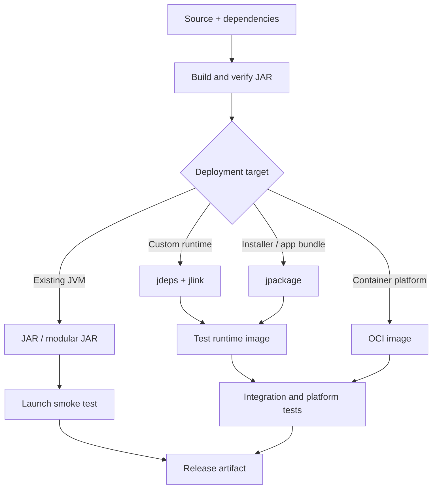

# Kiểm tra đóng gói JAR, module, runtime image và container trên JDK 25

Một ứng dụng Java có thể chạy tốt trong IDE nhưng thất bại sau khi đóng gói vì thiếu dependency, thiếu module, không tìm thấy service provider, thiếu native library hoặc runtime image không có dữ liệu locale cần thiết. Khi đưa ứng dụng vào container, giới hạn CPU/bộ nhớ, quyền ghi file và tín hiệu dừng của container cũng ảnh hưởng trực tiếp tới cách JVM vận hành.

Bài học thuộc chương **Build và triển khai** của module **Java 25** (JAVA_VERSION_JAVA25), theo đề bài **“Kiểm tra đóng gói JAR, module, runtime image và container trên JDK 25”**. Nội dung đi từ artifact JAR, module graph và dependency analysis tới runtime image bằng jlink, application package bằng jpackage, sau đó kiểm tra container image và hành vi JVM dưới resource limits. Các ví dụ dùng công cụ JDK 25 và quy trình đóng gói hiện hành.

## 1. Chọn đúng loại artifact cho cách triển khai

Không phải mọi ứng dụng Java đều cần modular JAR hoặc custom runtime. Chọn hình thức theo cách ứng dụng được chạy và yêu cầu phân phối:

| Đầu ra | Nội dung | Khi phù hợp |
| --- | --- | --- |
| Executable JAR | Class, resource và manifest chỉ định main class | Ứng dụng chạy bằng một Java runtime đã có |
| JAR + dependency directory | JAR chính và các dependency riêng trong thư mục lib | Muốn kiểm soát dependency, cập nhật và kiểm tra từng artifact |
| Modular JAR | JAR có module-info.class, khai báo requires, exports, uses, provides | Ứng dụng cần module boundaries và module resolution |
| Custom runtime image | JVM runtime chỉ gồm các module được chọn, tạo bằng jlink | Muốn đóng gói runtime phù hợp với ứng dụng |
| Self-contained application image/package | Launcher, ứng dụng và runtime được đóng gói bằng jpackage | Phân phối ứng dụng có launcher hoặc installer riêng cho từng OS |
| Container image | Artifact Java và runtime trong OCI image | Triển khai qua Docker/Kubernetes hoặc nền tảng container |



Các công cụ có vai trò riêng:

- **jar** tạo, liệt kê, kiểm tra và mô tả JAR.
- **jdeps** phân tích dependency giữa class, package và module.
- **jlink** liên kết các module thành custom Java runtime image.
- **jpackage** tạo application image hoặc native package có runtime đi kèm.
- **Docker/BuildKit** đóng gói artifact vào container image.

## 2. Executable JAR và manifest

JAR là archive dựa trên ZIP, có thể chứa class, resource và thư mục META-INF. Để chạy bằng java -jar, manifest phải có Main-Class trỏ tới lớp chứa entry point.

Ví dụ MANIFEST.MF:

```text
Manifest-Version: 1.0
Main-Class: com.acme.shop.Main
```

Tạo executable JAR từ thư mục class đã biên dịch:

```bash
jar --create \
  --file build/shop-service.jar \
  --manifest build/MANIFEST.MF \
  -C build/classes .
```

Chạy ứng dụng:

```bash
java -jar build/shop-service.jar
```

java -jar sử dụng JAR được chỉ định làm nguồn class người dùng. Các thiết lập classpath bên ngoài như -cp hoặc -classpath bị bỏ qua ở chế độ này. Vì vậy, nếu ứng dụng có dependency JAR riêng, cần cấu hình manifest Class-Path hoặc dùng cách launch classpath/module phù hợp.

Ví dụ manifest có dependency tương đối với JAR chính:

```text
Manifest-Version: 1.0
Main-Class: com.acme.shop.Main
Class-Path: lib/postgresql.jar lib/metrics-core.jar
```

Các entry Class-Path được phân giải tương đối với vị trí JAR khai báo chúng. Đảm bảo cấu trúc thư mục khi triển khai khớp với manifest.

Nếu muốn chỉ định classpath trực tiếp:

```bash
# Linux/macOS
java -cp "build/shop-service.jar:build/lib/*" com.acme.shop.Main

# Windows
java -cp "build\shop-service.jar;build\lib\*" com.acme.shop.Main
```

Không giả định một JAR được gọi là fat JAR hoặc uber JAR sẽ tự động giữ nguyên mọi metadata của dependency. Cần kiểm tra resource trùng tên, service descriptors, signature files, license notices và cấu hình logging sau khi hợp nhất.

## 3. Modular JAR và module descriptor

Một modular JAR có module-info.class ở root archive. Khi được đặt trên module path, JVM coi nó là explicit module và áp dụng module descriptor. Nếu cùng JAR được đặt trên classpath, nó hoạt động như một JAR không modular.

Ví dụ module-info.java cho shop-service:

```java
module com.acme.shop {
    requires java.net.http;
    requires java.sql;

    exports com.acme.shop.api;
    exports com.acme.shop.spi;

    uses com.acme.shop.spi.PaymentProvider;
}
```

Module provider có thể khai báo:

```java
module com.acme.shop.payment.card {
    requires com.acme.shop;

    provides com.acme.shop.spi.PaymentProvider
        with com.acme.shop.payment.card.CardPaymentProvider;
}
```

Các directive chính:

| Directive | Mục đích |
| --- | --- |
| requires | Khai báo module dependency |
| requires transitive | Truyền dependency tới module đọc module hiện tại |
| exports | Cho module khác truy cập public types của package |
| opens | Cho phép deep reflection trong phạm vi đã khai báo |
| uses | Khai báo module sử dụng service |
| provides ... with ... | Khai báo module cung cấp implementation của service |

Đóng gói module sau khi compiler đã tạo module-info.class cùng các class:

```bash
jar --create \
  --file build/mods/com.acme.shop.jar \
  --main-class com.acme.shop.Main \
  -C build/classes/com.acme.shop .
```

Chạy trên module path:

```bash
java --module-path "build/mods:build/lib" \
  --module com.acme.shop
```

Trên Windows, module-path dùng dấu chấm phẩy thay cho dấu hai chấm. Dependency module phải được đặt ở vị trí mà module resolver có thể tìm thấy.

## 4. Kiểm tra nội dung và descriptor của JAR

Không chỉ kiểm tra file có tồn tại. Hãy xác minh archive có đúng class, resource, manifest và module descriptor.

```bash
jar --list --file build/shop-service.jar
jar --describe-module --file build/shop-service.jar
jar --validate --file build/shop-service.jar
```

Ý nghĩa:

- --list: liệt kê entries trong archive.
- --describe-module: hiển thị module descriptor hoặc automatic module name được suy ra.
- --validate: kiểm tra tính hợp lệ của nội dung JAR theo các quy tắc của công cụ.

Với executable JAR, kiểm tra manifest:

```bash
jar --extract --file build/shop-service.jar META-INF/MANIFEST.MF
```

Sau khi kiểm tra, xác nhận:

- Manifest có Main-Class chính xác.
- Resource cần lúc chạy đã được đóng gói.
- Không thiếu file cấu hình được cung cấp cùng ứng dụng.
- Dependency JAR được đặt đúng vị trí và có thể đọc được.
- Modular JAR có module descriptor hợp lệ.
- Service descriptors hoặc uses/provides được giữ đúng.
- Không có file cấu hình chứa secret hoặc thông tin môi trường production.

Nếu JAR được ký, hãy ký sau khi hoàn tất mọi thao tác sửa archive. Cập nhật nội dung sau khi ký sẽ làm chữ ký không còn hợp lệ. Kiểm tra chữ ký trên artifact cuối cùng:

```bash
jarsigner -verify -strict build/shop-service.jar
```

Lệnh này dành cho artifact có chữ ký; nếu tổ chức không dùng JAR signing, kiểm soát tính toàn vẹn bằng checksum và chữ ký của pipeline/container registry theo chính sách phát hành.

## 5. Phân tích dependency bằng jdeps

jdeps phân tích dependency ở cấp package/class và hỗ trợ phân tích module. Đây là bước quan trọng trước khi tạo runtime image vì jlink chỉ đưa vào runtime các module được chọn cùng dependency closure của chúng.

Phân tích dependency JDK của ứng dụng classpath:

```bash
jdeps --class-path "build/lib/*" \
  --print-module-deps \
  build/shop-service.jar
```

Đầu ra là danh sách module JDK dạng phân cách bằng dấu phẩy, có thể dùng làm gợi ý cho jlink --add-modules. Với ứng dụng modular:

```bash
jdeps --module-path "build/mods:build/lib" \
  --check com.acme.shop

jdeps --module-path "build/mods:build/lib" \
  --print-module-deps \
  --module com.acme.shop
```

Các lệnh hữu ích khác:

```bash
# Xem dependency chi tiết
jdeps -verbose:package build/shop-service.jar

# Tìm tham chiếu tới JDK internal APIs
jdeps --jdk-internals build/shop-service.jar

# Tạo sơ đồ dependency ở định dạng DOT
jdeps --dot-output build/jdeps-report build/shop-service.jar
```

### Giới hạn của phân tích tĩnh

jdeps không thể phát hiện đầy đủ class được nạp qua reflection, tên class được tạo động, plugin nằm ngoài dependency graph hoặc mọi service provider chỉ được tìm thấy lúc runtime. Native libraries cũng cần được kiểm tra riêng.

Vì vậy:

- Không dùng --ignore-missing-deps để che dependency chưa được giải quyết trong bước phát hành.
- Kiểm tra module provider và service loader theo cấu hình thực tế.
- Bổ sung module được nạp động bằng cấu hình có kiểm soát.
- Chạy integration test trên chính runtime image được tạo.

## 6. Tạo custom runtime image bằng jlink

jlink kết hợp một tập module cùng dependency của chúng để tạo Java runtime image. Runtime image thường nhỏ hơn một JDK đầy đủ vì không chứa compiler, debugger và các module không được chọn.

Với modular application:

```bash
jlink \
  --module-path "$JAVA_HOME/jmods:build/mods:build/lib" \
  --add-modules com.acme.shop \
  --bind-services \
  --strip-debug \
  --no-header-files \
  --no-man-pages \
  --output build/runtime
```

Đường dẫn module trên ví dụ dùng dấu hai chấm của Linux/macOS. Trên Windows, dùng dấu chấm phẩy. Module path có thể chứa JMOD, modular JAR hoặc exploded modules.

Trong ví dụ này, thư mục build/lib chỉ chứa explicit modular JAR. Nếu thư viện chỉ là automatic module hoặc JAR không có module descriptor, không đưa nó vào module path của jlink; giữ dependency ngoài runtime image hoặc thay bằng bản modular phù hợp.

--add-modules chọn root module. jlink tự thêm các module dependency có quan hệ transitive cần thiết. --bind-services yêu cầu linker đưa các service provider module và dependency của chúng vào runtime image.

Với ứng dụng classpath, có thể dùng jdeps --print-module-deps để xác định module JDK cần thiết, sau đó tạo runtime chỉ gồm các module JDK đó:

```bash
jlink \
  --module-path "$JAVA_HOME/jmods" \
  --add-modules java.base,java.logging,java.sql,java.net.http \
  --strip-debug \
  --no-header-files \
  --no-man-pages \
  --output build/runtime
```

Danh sách trên chỉ là ví dụ. Thay bằng module thực tế mà ứng dụng và dependency sử dụng; JAR ứng dụng vẫn được triển khai bên ngoài runtime image và chạy qua classpath.

### Dependency tự động và modular hóa

jlink cần module graph có descriptor rõ ràng. Một dependency chỉ là automatic module hoặc JAR trên classpath có thể chạy được với launcher thông thường nhưng không thể được liên kết như explicit module vào custom runtime image. Nếu gặp lỗi này:

1. Kiểm tra dependency có module-info.class hay không.
2. Ưu tiên phiên bản thư viện có explicit module descriptor.
3. Nếu không thể modular hóa dependency, giữ dependency đó ngoài runtime image và triển khai theo classpath/JRE phù hợp.
4. Không tạo module descriptor giả mà chưa kiểm tra package exports, reflection và service usage.

## 7. ServiceLoader và thay đổi quan trọng của jpackage trên JDK 25

Một ứng dụng có thể chạy đúng trên JDK đầy đủ nhưng lỗi ServiceConfigurationError hoặc không tìm thấy provider sau khi tạo runtime image. Nguyên nhân có thể là service provider module không được đưa vào runtime image.

**Từ JDK 25, jpackage không còn đưa service bindings vào runtime image mà nó tự tạo theo mặc định.** Đây là thay đổi so với các JDK trước. Nếu ứng dụng modular sử dụng SPI hoặc ServiceLoader, cần yêu cầu linker bind service providers.

Với jlink, dùng:

```bash
jlink \
  --module-path "$JAVA_HOME/jmods:build/mods:build/lib" \
  --add-modules com.acme.shop \
  --bind-services \
  --output build/runtime
```

Với jpackage, truyền tùy chọn cho jlink:

```bash
jpackage \
  --type app-image \
  --name shop-service \
  --module-path build/mods \
  --module com.acme.shop/com.acme.shop.Main \
  --jlink-options --bind-services
```

Nếu cần giữ các tùy chọn mặc định khác của jpackage, có thể truyền cả nhóm tùy chọn trong một giá trị --jlink-options, bao gồm:

```bash
jpackage \
  --type app-image \
  --name shop-service \
  --module-path build/mods \
  --module com.acme.shop/com.acme.shop.Main \
  --jlink-options "--strip-native-commands --strip-debug --no-man-pages --no-header-files --bind-services"
```

Không chỉ dựa vào việc lệnh đóng gói thành công. Hãy khởi chạy image và kiểm tra từng provider mà ứng dụng cần, ví dụ JDBC driver, security provider, logging provider hoặc payment plugin. --bind-services chỉ giải quyết provider modules có mặt trên module path; dependency classpath và service descriptor của ứng dụng vẫn phải được đóng gói đúng.

## 8. Bổ sung module runtime theo tính năng ứng dụng

Static dependency analysis có thể không thấy mọi module được tải qua provider, reflection hoặc cấu hình. Cần kiểm tra các tính năng đặc thù:

| Tính năng | Module có thể cần |
| --- | --- |
| JDBC và SQL | java.sql, module JDBC driver tương ứng |
| HTTP client | java.net.http |
| TLS với thuật toán elliptic curve | jdk.crypto.ec |
| PKCS#11/HSM | jdk.crypto.cryptoki nếu dùng provider này |
| JNDI/DNS | java.naming, jdk.naming.dns theo provider được sử dụng |
| JFR/recording | jdk.jfr, và module quản lý tương ứng nếu ứng dụng cần |
| Locale ngoài tập mặc định | jdk.localedata |

Nếu runtime image cần dữ liệu locale cụ thể:

```bash
jlink \
  --module-path "$JAVA_HOME/jmods:build/mods" \
  --add-modules com.acme.shop,jdk.localedata \
  --include-locales=vi,en \
  --bind-services \
  --output build/runtime
```

--include-locales cần module jdk.localedata. Không thêm locale tùy tiện; chọn các locale mà sản phẩm thực sự hỗ trợ rồi kiểm thử định dạng ngày, số, tiền tệ và collation.

Native library/JNI, font, CA certificates, timezone data và file hệ điều hành không được bảo đảm chỉ bằng việc chọn JDK module. Kiểm tra riêng các dependency này trên đúng OS/architecture của runtime.

## 9. Kiểm tra runtime image sau khi tạo

Một runtime image nhỏ chưa chắc là runtime image đúng. Kiểm tra module list và chạy ứng dụng từ chính image đó:

```bash
build/runtime/bin/java --version
build/runtime/bin/java --list-modules
build/runtime/bin/java --module com.acme.shop/com.acme.shop.Main
```

Nếu ứng dụng classpath:

```bash
build/runtime/bin/java \
  -cp "build/shop-service.jar:build/lib/*" \
  com.acme.shop.Main
```

Các kiểm tra bắt buộc:

- Ứng dụng khởi động và đi qua readiness.
- Database driver, logging, security provider và các SPI provider được tìm thấy.
- TLS handshake, truststore và certificate hoạt động.
- Locale, timezone, font và charset đáp ứng dữ liệu sản phẩm.
- File cấu hình, keystore, truststore và resource được nạp từ đường dẫn dự kiến.
- Native library được nạp trên đúng kiến trúc.
- Shutdown hook, log và metrics vẫn hoạt động.
- Các tính năng diagnostic cần thiết còn có trong runtime image.

Runtime image do jlink tạo là một artifact cần được cập nhật cùng ứng dụng. Khi nâng JDK hoặc dependency, phải tạo và kiểm thử lại image; không tái sử dụng runtime image cũ chỉ vì application JAR mới biên dịch thành công.

## 10. Dùng jpackage để tạo application image hoặc installer

jpackage tạo application image tự chứa runtime và ứng dụng. Từ application image có thể tạo installer như DEB/RPM trên Linux, EXE/MSI trên Windows hoặc PKG/DMG trên macOS tùy nền tảng.

Với modular application:

```bash
jpackage \
  --type app-image \
  --name shop-service \
  --app-version 1.0.0 \
  --module-path build/mods \
  --module com.acme.shop/com.acme.shop.Main \
  --jlink-options --bind-services \
  --dest build/package
```

Với non-modular application:

```bash
jpackage \
  --type app-image \
  --name shop-service \
  --input build/package-input \
  --main-jar shop-service.jar \
  --main-class com.acme.shop.Main \
  --jlink-options --bind-services \
  --dest build/package
```

Thư mục build/package-input phải chứa main JAR và các file cần phân phối. Nếu có dependency JAR riêng, cấu hình manifest Class-Path hoặc launcher phù hợp để chúng được tìm thấy trong application image.

jpackage sử dụng jlink để tạo runtime nếu không truyền --runtime-image. Nếu đã tạo và kiểm tra custom runtime:

```bash
jpackage \
  --type app-image \
  --name shop-service \
  --module-path build/mods \
  --module com.acme.shop/com.acme.shop.Main \
  --runtime-image build/runtime \
  --dest build/package
```

### Khác biệt giữa jlink và jpackage

| Công cụ | Đầu ra | Trách nhiệm |
| --- | --- | --- |
| jlink | Java runtime image | Chọn và liên kết module thành runtime |
| jpackage | Application image hoặc native installer | Đóng runtime cùng ứng dụng, tạo launcher/package |

jpackage không hỗ trợ build native package chéo nền tảng. Hãy build package trên OS/architecture đích. Ví dụ DEB/RPM cần build trên Linux phù hợp, MSI/EXE trên Windows và DMG/PKG trên macOS. Các runtime image chứa native code cũng phải được tạo cho nền tảng mục tiêu.

## 11. Chuẩn bị artifact và image có thể tái lập

Đóng gói có thể chạy được chưa đủ để phát hành đáng tin cậy. Cần biết chính xác artifact được tạo từ source, dependency và toolchain nào.

Các nguyên tắc:

- Ghim JDK vendor/build, Maven/Gradle wrapper và plugin version trong build.
- Ghim phiên bản dependency; không dùng version động hoặc snapshot không kiểm soát trong release.
- Lưu dependency graph và checksum của JAR cuối cùng.
- Dùng reproducible-build settings của build tool để giảm khác biệt do timestamp/thứ tự archive.
- Sinh SBOM cho artifact và container image.
- Quét dependency và image trước khi phát hành.
- Ký artifact/image theo quy trình phát hành của tổ chức.
- Dùng image tag bất biến hoặc digest cho production.
- Lưu build metadata, source revision và kết quả kiểm thử cùng release.

Nếu ký JAR bằng jarsigner, thực hiện sau bước shade/repackage/update archive cuối cùng. Nếu ký container image, ký đúng digest image đã kiểm thử; không build lại image sau khi ký rồi dùng digest mới.

## 12. Chọn base image cho container Java 25

Có hai hướng phổ biến:

| Runtime trong container | Ưu điểm | Điều cần kiểm tra |
| --- | --- | --- |
| JRE image của nhà cung cấp JDK | Đơn giản, dễ cập nhật, phù hợp với classpath hoặc modular app thông thường | Chọn đúng JDK 25 vendor/build, OS, architecture và cập nhật security patches |
| Custom runtime từ jlink | Chỉ chứa module cần thiết, có thể giảm footprint | Phải kiểm tra SPI, locale, TLS, native library, CA certificates và OS compatibility |

Không đưa toàn bộ JDK build stage vào production image nếu ứng dụng chỉ cần runtime. Dùng multi-stage build để tách compiler/build tools khỏi runtime.

Khi chọn base image:

- Dùng image JDK 25 đang được tổ chức hỗ trợ.
- Pin image digest trong release pipeline để tái lập build.
- Chọn base image có libc và native libraries tương thích với runtime image.
- Đảm bảo có CA certificates và timezone data nếu ứng dụng cần TLS/timezone.
- Chọn image theo OS/architecture của node triển khai.
- Không đưa credentials, private keys hoặc file .env vào build context hay image layer.

## 13. Multi-stage Dockerfile cho shop-service

Ví dụ dưới đây dùng Maven Wrapper và JRE image ở runtime stage. Các image tag minh họa cần được thay bằng tag/digest đã được kiểm duyệt trong pipeline:

```dockerfile
# syntax=docker/dockerfile:1

FROM eclipse-temurin:25-jdk AS build
WORKDIR /workspace

COPY .mvn/ .mvn/
COPY mvnw pom.xml ./
RUN ./mvnw -B dependency:go-offline

COPY src/ src/
RUN ./mvnw -B package

FROM eclipse-temurin:25-jre AS runtime
WORKDIR /app

COPY --from=build --chown=10001:10001 \
     /workspace/target/shop-service.jar \
     /app/shop-service.jar

USER 10001:10001
ENTRYPOINT ["java", "-jar", "/app/shop-service.jar"]
```

Lợi ích của multi-stage build:

- Compiler, Maven và source tree chỉ tồn tại trong build stage.
- Runtime image chỉ nhận artifact cần chạy.
- Có thể tách dependency cache khỏi source để tăng hiệu quả build.
- Có thể chạy test trong stage riêng trước khi tạo runtime stage.

Nếu dùng Gradle Wrapper, áp dụng cùng nguyên tắc: build ở stage có JDK, chỉ copy JAR/runtime image sang stage cuối. Không copy thư mục .gradle, Maven cache hoặc credentials vào runtime image.

Ví dụ .dockerignore:

```text
.git
.idea
.vscode
target
build
.env
.env.*
*.pem
*.key
*.p12
*.jks
```

Không loại bỏ nhầm JAR hoặc resource cần đóng gói. .dockerignore phải được kiểm tra cùng cấu trúc build thực tế.

### Dùng custom jlink runtime trong container

Nếu chọn custom runtime, tạo runtime image ở build stage bằng đúng JDK 25 và copy runtime cùng application module sang final stage. Final base image phải tương thích OS/libc/architecture với runtime được tạo. Không copy runtime Linux sang Windows hoặc ARM64 sang x86-64.

Trước khi tối ưu kích thước image, so sánh cả dung lượng image, thời gian khởi động, khả năng cập nhật security patch và khả năng chẩn đoán sự cố.

## 14. JVM container awareness và ngân sách bộ nhớ

Trên Linux, JDK 25 bật container support mặc định. HotSpot có thể nhận diện giới hạn bộ nhớ và số CPU mà container được cấp để điều chỉnh ergonomics.

Kiểm tra thông tin nhận diện container:

```bash
java -Xlog:os+container=trace -version
```

Nếu JVM không nhận đúng giới hạn cgroup, hãy kiểm tra phiên bản kernel/container runtime và cách orchestration đặt resource limits trước khi ghi đè bằng JVM flags.

### Heap không phải toàn bộ memory limit

Container memory còn cần cho:

- Java heap.
- Metaspace và class metadata.
- Thread stacks.
- Direct buffers và native allocations.
- JIT code cache.
- GC structures, JVM runtime và native libraries.
- Agent, profiler và thư viện JNI.

JDK 25 đặt MaxRAMPercentage mặc định là 25% của lượng RAM JVM nhận diện để tính heap maximum. Có thể điều chỉnh khi đã đo workload:

```bash
java -XX:MaxRAMPercentage=65 \
  -jar shop-service.jar
```

65% chỉ là giá trị minh họa, không phải mặc định khuyến nghị. Hãy dành headroom cho native memory, thread stacks, direct buffers và spike; theo dõi RSS/container working set cùng heap usage để tránh OOMKill.

Nếu cần kiểm tra JVM nhận diện CPU:

```bash
java -XshowSettings:system -version
```

Chỉ dùng -XX:ActiveProcessorCount khi cần override có chủ đích sau khi đo và xác nhận giới hạn CPU mà JVM nhìn thấy. Không đặt một con số CPU cố định cho mọi container nếu orchestration có thể thay đổi quota.

## 15. Quyền, tín hiệu dừng và quan sát container

Container production nên chạy với quyền thấp nhất và có hành vi shutdown rõ ràng.

### Chạy non-root

Dockerfile nên khai báo user không phải root:

```dockerfile
USER 10001:10001
ENTRYPOINT ["java", "-jar", "/app/shop-service.jar"]
```

Đảm bảo thư mục cần ghi có owner/quyền phù hợp. Nếu ứng dụng chỉ log ra stdout/stderr và không cần ghi vào application directory, giữ phần lớn filesystem ở chế độ read-only. Nếu cần temp files, mount một vùng /tmp có quyền ghi và đặt java.io.tmpdir rõ ràng.

Không nhúng secret vào image. Truyền secret qua secret manager hoặc cơ chế secret mount của nền tảng, giới hạn quyền đọc và luân chuyển theo chính sách.

### PID 1 và graceful shutdown

Dùng exec form cho ENTRYPOINT:

```dockerfile
ENTRYPOINT ["java", "-jar", "/app/shop-service.jar"]
```

Exec form giúp tiến trình Java nhận tín hiệu từ container runtime trực tiếp. Khi nhận SIGTERM, JVM có thể chạy shutdown hooks. Ứng dụng cần dừng nhận request mới, hoàn tất hoặc hủy công việc đang chạy, đóng pool/connection và flush dữ liệu trong thời hạn termination grace period của nền tảng.

Nếu dùng shell entrypoint, script phải exec tiến trình Java thay vì để shell giữ vai trò PID 1 và chặn tín hiệu.

### Health, logs và diagnostics

- Dùng readiness probe để báo ứng dụng đã sẵn sàng nhận traffic.
- Dùng liveness probe để phát hiện tiến trình bị treo; tránh liveness check quá nhạy gây restart liên tục.
- Dùng startup probe cho ứng dụng có thời gian khởi động dài.
- Ghi log có cấu trúc ra stdout/stderr để nền tảng thu thập.
- Xuất metrics và traces qua cơ chế observability của ứng dụng.
- Giữ lại JFR/GC diagnostics cần thiết; custom runtime phải chứa module phục vụ công cụ được chọn.
- Kiểm tra CA certificates, timezone, locale và DNS trong đúng final image.

Không dựa vào shell, ps, curl hoặc package manager trong final image nếu chúng không được cài. Có thể kiểm tra health qua endpoint của ứng dụng hoặc probe do nền tảng quản lý.

## 16. Kiểm tra tương thích theo OS, architecture và runtime image

Runtime image và native dependencies phụ thuộc nền tảng. Build một lần trên máy x64 không chứng minh artifact chạy được trên ARM64 hoặc trên một base image có libc khác.

| Chiều kiểm tra | Câu hỏi |
| --- | --- |
| JDK vendor/build | Runtime image được tạo từ đúng JDK 25 build được phê duyệt chưa? |
| OS/libc | Runtime image có tương thích base image cuối không? |
| Architecture | Artifact và native libraries có đúng x86-64/ARM64 không? |
| Module graph | Module bắt buộc, service provider và locale data có đủ không? |
| Dependencies | Classpath/module path có đầy đủ dependency và resource không? |
| Security | CA certificates, truststore, file permissions và user có đúng không? |
| Container resources | JVM nhìn thấy đúng memory/CPU limits không? |
| Lifecycle | SIGTERM, readiness, liveness và shutdown hooks hoạt động không? |
| Operations | Logs, metrics, JFR/GC diagnostics và crash reports có thể thu thập không? |

Nếu phát hành multi-architecture image, tạo runtime image tương ứng cho từng target platform và chạy smoke/integration test trên đúng architecture. Không coi manifest multi-arch của container registry là bằng chứng các native artifacts bên trong đã tương thích.

## 17. Bài thực hành: đóng gói và triển khai shop-service trên JDK 25

### Bối cảnh

shop-service là ứng dụng Spring Boot/Java 25 có REST API, JDBC, HTTP client, logging, một SPI payment provider và một số resource locale tiếng Việt/Anh. Nhóm muốn tạo executable JAR, đánh giá modular runtime image và triển khai container image không chứa JDK build tools.

### Nhiệm vụ

1. **Chốt toolchain:** ghi JDK 25 vendor/build, Maven/Gradle Wrapper, OS và architecture của builder.
2. **Tạo artifact:** build JAR từ source; kiểm tra manifest, main class, resource và dependency packaging.
3. **Kiểm tra JAR:** dùng jar --list, jar --validate và jar --describe-module.
4. **Phân tích dependency:** dùng jdeps --print-module-deps, --check và --jdk-internals; ghi nhận phần reflection/service/native cần kiểm tra thủ công.
5. **Kiểm tra module:** nếu dùng modular JAR, xác nhận requires, uses, provides, exports và module path.
6. **Tạo runtime image:** dùng jlink với module graph đã xác minh; thêm jdk.localedata cho locale cần thiết và --bind-services cho SPI provider modules.
7. **Kiểm tra runtime image:** chạy --list-modules, khởi động app, kết nối JDBC, thực hiện TLS request và xác nhận PaymentProvider được tìm thấy.
8. **Tạo application image:** chạy jpackage; truyền --jlink-options --bind-services nếu cần service binding.
9. **Tạo container:** dùng multi-stage build, runtime JRE/JDK image được duyệt, non-root user và exec-form entrypoint.
10. **Kiểm tra resource limits:** chạy container với memory/CPU quota đại diện; quan sát container log và JVM container detection.
11. **Kiểm tra lifecycle:** readiness/liveness, SIGTERM, graceful shutdown, temp directory, read-only filesystem và CA certificates.
12. **Kiểm tra artifact:** checksum, SBOM, signature/image digest và build metadata.
13. **Kiểm tra nền tảng:** chạy smoke/integration test trên từng OS/architecture được hỗ trợ.
14. **Bàn giao:** lưu command line, module list, image digest, test results và hướng rollback.

### Mẫu báo cáo

| Hạng mục | Kết quả | Trạng thái |
| --- | --- | --- |
| JDK 25 vendor/build | Chưa ghi | Chưa kiểm tra |
| Application JAR/manifest | Chưa tạo | Chưa kiểm tra |
| Dependency graph/jdeps | Chưa phân tích | Chưa kiểm tra |
| Module descriptor | Chưa xác minh | Chưa kiểm tra |
| Runtime image module list | Chưa tạo | Chưa kiểm tra |
| ServiceLoader providers | Chưa kiểm tra | Chưa kiểm tra |
| Locale/TLS/JDBC/native | Chưa kiểm tra | Chưa kiểm tra |
| jpackage application image | Chưa tạo | Chưa kiểm tra |
| Container base image/digest | Chưa ghi | Chưa kiểm tra |
| Non-root/entrypoint | Chưa kiểm tra | Chưa kiểm tra |
| Memory/CPU limits | Chưa đo | Chưa kiểm tra |
| Graceful shutdown/probes | Chưa kiểm tra | Chưa kiểm tra |
| SBOM/checksum/signature | Chưa tạo | Chưa kiểm tra |
| OS/architecture matrix | Chưa chạy | Chưa kiểm tra |

Không điền số liệu dự đoán vào báo cáo. Ghi đúng module list, image digest, command line, JDK build và test output thực tế.

### Tiêu chí hoàn thành

- Phân biệt được executable JAR, modular JAR, runtime image, application image và container image.
- Xác minh được manifest, module descriptor và dependency graph.
- Tạo được runtime image với module và service provider cần thiết.
- Nhớ thay đổi JDK 25: jpackage không tự bind services mặc định.
- Khởi chạy thành công ứng dụng từ runtime image độc lập.
- Container chỉ chứa runtime cần thiết, chạy non-root và nhận SIGTERM đúng.
- JVM nhận diện đúng giới hạn CPU/bộ nhớ của container.
- Có kiểm thử TLS, locale, JDBC, SPI, health probes và graceful shutdown.
- Có checksum/SBOM/image digest và ma trận OS/architecture cho release.

## Tài liệu tham khảo

- [Oracle JDK 25 — The jar Command](https://docs.oracle.com/en/java/javase/25/docs/specs/man/jar.html): tạo, liệt kê, validate và mô tả modular JAR.
- [Oracle JDK 25 — JAR File Specification](https://docs.oracle.com/en/java/javase/25/docs/specs/jar/jar.html): manifest, Main-Class, Class-Path, modular JAR và multi-release JAR.
- [Oracle JDK 25 — The java Command](https://docs.oracle.com/en/java/javase/25/docs/specs/man/java.html): launch JAR/module, classpath, container support và JVM options.
- [Oracle JDK 25 — The jdeps Command](https://docs.oracle.com/en/java/javase/25/docs/specs/man/jdeps.html): dependency analysis và --print-module-deps.
- [Oracle JDK 25 — The jlink Command](https://docs.oracle.com/en/java/javase/25/docs/specs/man/jlink.html): module path, --add-modules, --bind-services, locale và runtime image.
- [Oracle JDK 25 — The jpackage Command](https://docs.oracle.com/en/java/javase/25/docs/specs/man/jpackage.html): application image, native package và runtime options.
- [Oracle JDK 25 — Packaging Overview](https://docs.oracle.com/en/java/javase/25/jpackage/packaging-overview.html): runtime requirements và service binding behavior trong JDK 25.
- [Oracle JDK 25 Release Notes — jpackage service bindings](https://www.oracle.com/java/technologies/javase/25-relnote-issues.html): thay đổi không bind services mặc định từ JDK 25.
- [Oracle JDK 25 — The jnativescan Command](https://docs.oracle.com/en/java/javase/25/docs/specs/man/jnativescan.html): phân tích native functionality khi ứng dụng dùng native access.
- [Docker Docs — Multi-stage builds](https://docs.docker.com/build/building/multi-stage/): tách build stage khỏi runtime image.
- [Docker Docs — Building best practices](https://docs.docker.com/build/building/best-practices/): non-root user, exec-form entrypoint và cách xây dựng image.

**Kết luận:** Đóng gói Java 25 cần xác minh toàn bộ đường đi từ JAR đến runtime image và container. Kiểm tra manifest/module descriptor, dùng jdeps để hiểu dependency, dùng jlink để tạo runtime phù hợp và jpackage khi cần application bundle. Đặc biệt, từ JDK 25 cần chủ động bật service binding nếu modular application dùng SPI. Cuối cùng, kiểm tra container bằng đúng OS/architecture, non-root user, signal handling và CPU/memory limits; chỉ phát hành artifact đã vượt qua smoke, integration và operational checks.
