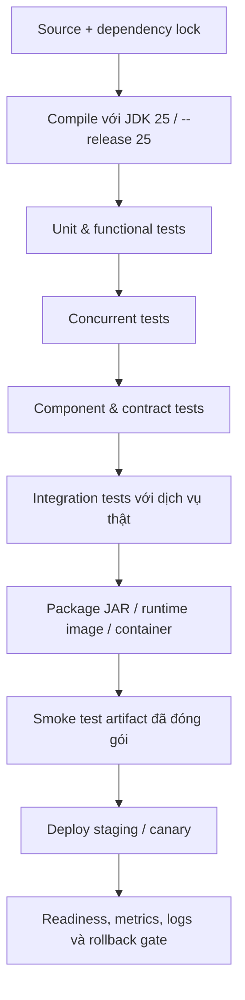

# Chạy kiểm thử chức năng, đồng thời, tích hợp và thư viện bên thứ ba

> **Chương:** Build và triển khai  
> **Phạm vi module:** `JAVA_VERSION_JAVA25` — xây dựng, kiểm thử và triển khai ứng dụng Java hiện đại bằng JDK 25, công cụ build, test framework và thư viện tích hợp.  
> **Mục tiêu:** Thiết kế bộ kiểm thử bao phủ hành vi nghiệp vụ, xử lý đồng thời, tích hợp hạ tầng thật và tương thích thư viện bên thứ ba; tổ chức test vào build pipeline; kiểm tra artifact/runtime trước và sau triển khai.  
> **Mốc cập nhật:** Ví dụ dùng JUnit 6.1.3 (GA, yêu cầu Java 17 trở lên), Maven Surefire/Failsafe 3.6.1, Maven Compiler Plugin 3.16.0 và Testcontainers 2.0.5. Các cấu hình tập trung vào API ổn định trên JDK 25; không dùng JUnit 4 hoặc runner/provider cũ. Với Testcontainers 2.x, artifact module đã đổi tên và extension JUnit Jupiter chỉ được dự án xác nhận chạy tuần tự.

Một build thành công chưa chứng minh ứng dụng hoạt động đúng khi chạy thật. Unit test có thể xác nhận phép tính và quy tắc nghiệp vụ, nhưng không phát hiện hết lỗi transaction, SQL, serialization, timeout, race condition, cấu hình TLS hoặc khác biệt giữa môi trường build và production.

Một bộ kiểm thử tốt cần trả lời bốn câu hỏi:

1. **Chức năng có đúng không?** Với dữ liệu đầu vào và trạng thái cụ thể, hệ thống trả kết quả đúng theo hợp đồng nghiệp vụ không?
2. **Đồng thời có an toàn không?** Nhiều request cùng cập nhật dữ liệu, hủy tác vụ hoặc tranh chấp tài nguyên có tạo race condition, deadlock hay mất dữ liệu không?
3. **Tích hợp có đúng không?** Ứng dụng có giao tiếp đúng với database, broker, HTTP service, filesystem và runtime thực tế không?
4. **Thư viện bên thứ ba có tương thích không?** Phiên bản thư viện, dependency bắc cầu, provider, driver và runtime JDK có phối hợp đúng không?

Bốn câu hỏi này nên được kiểm tra ở các lớp khác nhau, sau đó ghép lại thành pipeline build và triển khai. Không phải test nào cũng cần chạy ở mọi lần commit; cần chọn độ sâu phù hợp với chi phí và rủi ro.

## 1. Phân lớp kiểm thử và mục tiêu của từng lớp

| Lớp kiểm thử | Phạm vi | Tốc độ tương đối | Phát hiện tốt |
|---|---|---:|---|
| Unit / functional test | Một class hoặc một quy tắc nghiệp vụ, dependency được thay bằng fake/mock khi hợp lý | Rất nhanh | Sai logic, biên dữ liệu, trạng thái và exception |
| Component test | Một module/service cùng các adapter chính | Nhanh đến trung bình | Lỗi wiring, mapping, validation, transaction boundary |
| Concurrent test | Nhiều thread/task cùng thao tác lên component | Trung bình | Race condition, visibility, ordering, cancellation và deadlock |
| Integration test | Nhiều thành phần thật như ứng dụng + PostgreSQL + broker | Trung bình đến chậm | SQL, transaction, protocol, serialization, migration và cấu hình |
| Contract / compatibility test | Tương tác với API hoặc thư viện bên ngoài theo hợp đồng | Trung bình | Thay đổi schema, API, version và hành vi provider |
| System / end-to-end test | Ứng dụng được đóng gói, chạy như môi trường triển khai | Chậm | Cấu hình, startup, routing, authentication và luồng nghiệp vụ xuyên hệ thống |
| Load / stress test | Workload gần thực tế ở quy mô lớn | Chậm, tốn tài nguyên | Throughput, latency, saturation, giới hạn và suy giảm dưới tải |

Không dùng một lớp test để thay thế mọi lớp còn lại. Unit test nên chiếm số lượng lớn vì chạy nhanh và định vị lỗi dễ. Integration test ít hơn nhưng phải xác minh những ranh giới mà mock không thể mô phỏng đáng tin cậy. End-to-end test nên tập trung vào các luồng quan trọng nhất.



Mỗi lớp nên tạo bằng chứng có thể truy vết: test report, log, artifact checksum, dependency report và kết quả smoke test. Khi một bước thất bại, pipeline phải giữ lại thông tin đủ để xác định lỗi ở source, dependency, build configuration hay runtime.

## 2. Thiết lập JDK và test framework cho Java 25

JDK dùng để chạy Maven/Gradle, JDK dùng để compile và JDK dùng để chạy test có thể khác nhau. Cần khai báo rõ để máy phát triển, CI và môi trường phát hành không vô tình dùng các cấu hình khác nhau.

Với dự án đặt Java 25 làm baseline:

- Dùng JDK 25 làm toolchain compile và test.
- Dùng `--release 25` để giới hạn source language, bytecode target và Java SE API có sẵn ở release 25.
- Ghim phiên bản Maven/Gradle Wrapper và plugin build.
- Chỉ bật preview flags nếu source thực sự dùng preview API của JDK 25; không bật preview toàn cục chỉ vì dự án chạy JDK 25.
- Nếu production chạy trên một JDK khác, thêm runtime đó vào ma trận kiểm thử.

### 2.1. JUnit 6 là lựa chọn hiện hành

JUnit 6.1.3 là bản GA tại mốc cập nhật và yêu cầu Java 17 trở lên khi chạy. Vì thế nó có thể chạy test suite trên JDK 25. JUnit Jupiter vẫn là programming/extension model của JUnit 6; các package quen thuộc như `org.junit.jupiter.api` tiếp tục được sử dụng.

Ví dụ test chức năng:

```java
import static org.junit.jupiter.api.Assertions.assertEquals;
import static org.junit.jupiter.api.Assertions.assertThrows;

import org.junit.jupiter.api.Test;
import org.junit.jupiter.params.ParameterizedTest;
import org.junit.jupiter.params.provider.CsvSource;

class PriceCalculatorTest {

    private final PriceCalculator calculator = new PriceCalculator();

    @ParameterizedTest
    @CsvSource({
        "100, 0, 100",
        "100, 10, 90",
        "250, 20, 200"
    })
    void appliesDiscount(
            int originalPrice,
            int discountPercent,
            int expectedPrice) {

        assertEquals(
                expectedPrice,
                calculator.applyDiscount(originalPrice, discountPercent));
    }

    @Test
    void rejectsDiscountOutsideSupportedRange() {
        assertThrows(
                IllegalArgumentException.class,
                () -> calculator.applyDiscount(100, 120));
    }
}
```

Bài test thể hiện hợp đồng nghiệp vụ, không kiểm tra implementation detail như số lần gọi một private method. Khi thuật toán bên trong được refactor nhưng kết quả theo hợp đồng không đổi, test vẫn nên tiếp tục pass.

### 2.2. Maven: cấu hình compiler và Surefire/Failsafe

Maven Surefire chạy unit test trong phase `test`. Maven Failsafe chạy integration test trong các phase `integration-test` và `verify`. Failsafe có cả `post-integration-test` để dọn môi trường sau khi test thất bại, rồi mới xác nhận build ở `verify`. Vì vậy, lệnh đầy đủ thường dùng cho CI là `mvn verify`, không chỉ `mvn test`.

Ví dụ phần cấu hình trọng yếu trong `pom.xml`:

```xml
<properties>
    <maven.compiler.release>25</maven.compiler.release>
    <project.build.sourceEncoding>UTF-8</project.build.sourceEncoding>
</properties>

<dependencies>
    <dependency>
        <groupId>org.junit.jupiter</groupId>
        <artifactId>junit-jupiter</artifactId>
        <version>6.1.3</version>
        <scope>test</scope>
    </dependency>
</dependencies>

<build>
    <plugins>
        <plugin>
            <groupId>org.apache.maven.plugins</groupId>
            <artifactId>maven-compiler-plugin</artifactId>
            <version>3.16.0</version>
            <configuration>
                <release>25</release>
            </configuration>
        </plugin>

        <plugin>
            <groupId>org.apache.maven.plugins</groupId>
            <artifactId>maven-surefire-plugin</artifactId>
            <version>3.6.1</version>
        </plugin>

        <plugin>
            <groupId>org.apache.maven.plugins</groupId>
            <artifactId>maven-failsafe-plugin</artifactId>
            <version>3.6.1</version>
            <executions>
                <execution>
                    <goals>
                        <goal>integration-test</goal>
                        <goal>verify</goal>
                    </goals>
                </execution>
            </executions>
            <configuration>
                <includes>
                    <include>**/*IT.java</include>
                </includes>
            </configuration>
        </plugin>
    </plugins>
</build>
```

Với cấu hình này, các class như `OrderServiceTest` được Surefire phát hiện theo quy ước test thông thường; class có hậu tố `IT` được Failsafe chọn cho integration test. Nếu dự án có naming convention khác, cấu hình include/exclude một cách tường minh.

Các lệnh thường dùng:

```bash
# Chỉ chạy unit/functional tests
mvn test

# Chạy unit tests và đóng gói; chưa chạy Failsafe integration tests
mvn package

# Chạy unit + integration tests và kiểm tra kết quả cuối lifecycle
mvn verify

# Chạy một test class
mvn -Dtest=PriceCalculatorTest test

# Chạy một integration test class theo Failsafe
mvn -Dit.test=OrderRepositoryIT verify
```

Không dùng `-DskipTests` hoặc `-Dmaven.test.skip=true` như cấu hình mặc định của CI. Nếu cần tạo artifact tạm thời không test, phải có một job kiểm thử đầy đủ trước khi phát hành.

### 2.3. Gradle: toolchain và JUnit Platform

Gradle toolchain giúp chỉ định JDK dùng để compile và chạy test, không phụ thuộc vào JDK khởi chạy Gradle daemon:

```kotlin
plugins {
    java
}

java {
    toolchain {
        languageVersion = JavaLanguageVersion.of(25)
    }
}

dependencies {
    testImplementation("org.junit.jupiter:junit-jupiter:6.1.3")
    testRuntimeOnly("org.junit.platform:junit-platform-launcher")
}

tasks.test {
    useJUnitPlatform()
    testLogging {
        events("passed", "skipped", "failed")
    }
}
```

Gradle chạy test trong JVM process riêng và tạo HTML/XML reports. Khi cần tách integration tests, dùng JVM Test Suite plugin hoặc tạo source set và `Test` task riêng; nối task đó vào lifecycle `check` để CI không bỏ quên.

Ví dụ lệnh:

```bash
# Unit và functional tests
./gradlew test

# Toàn bộ verification tasks đã nối vào check
./gradlew check

# Build sạch và kiểm tra
./gradlew clean check
```

Ghim Gradle Wrapper và commit file checksum của distribution nếu tổ chức yêu cầu. Không dựa vào Gradle cài sẵn trên máy developer để quyết định build đang chạy bằng phiên bản nào.

## 3. Viết functional test theo hợp đồng nghiệp vụ

Functional test xác nhận đầu vào, đầu ra, trạng thái và side effect mà người dùng hoặc module khác quan sát được. Một test tốt mô tả hành vi trong tên test và giữ phần arrange/act/assert ngắn gọn.

Ví dụ một quy tắc đặt hàng:

```java
@Test
void rejectsOrderWhenAvailableStockIsInsufficient() {
    var inventory = new InMemoryInventory();
    inventory.setAvailable("SKU-25", 2);

    var service = new OrderService(inventory);

    var exception = assertThrows(
            InsufficientStockException.class,
            () -> service.placeOrder("SKU-25", 3));

    assertEquals("SKU-25", exception.getSku());
    assertEquals(2, inventory.getAvailable("SKU-25"));
}
```

Bài test xác nhận cả exception lẫn invariant: khi không đủ hàng, số lượng tồn kho không bị giảm. Chỉ assert exception có thể bỏ sót bug khi service đã thay đổi dữ liệu trước lúc ném lỗi.

### 3.1. Bao phủ trường hợp biên

Với mỗi use case, kiểm tra ít nhất:

- Dữ liệu hợp lệ thông thường.
- Dữ liệu rỗng, null hoặc thiếu trường bắt buộc.
- Giá trị nhỏ nhất/lớn nhất và vượt giới hạn.
- Trạng thái nghiệp vụ không cho phép chuyển tiếp.
- Người dùng không đủ quyền.
- Dependency trả về rỗng, lỗi hoặc dữ liệu sai định dạng.
- Retry có tạo side effect trùng lặp hay không.
- Thời gian, timezone, locale và rounding nếu nghiệp vụ có sử dụng.

Đừng viết test cho mọi tổ hợp input một cách máy móc. Chọn các phân vùng tương đương và ranh giới có ý nghĩa với quy tắc nghiệp vụ.

### 3.2. Dùng fake/mock đúng chỗ

Mock hữu ích khi kiểm tra một adapter gọi dependency theo hợp đồng, nhưng không nên mock mọi thứ trong một bài test. Nếu mock repository, transaction manager, mapper và domain service cùng lúc, test có thể chỉ xác nhận các mock được gọi theo kịch bản đã viết.

Quy tắc thực tế:

| Thành phần | Nên dùng |
|---|---|
| Quy tắc tính toán thuần | Object thật, dữ liệu trực tiếp |
| Clock hoặc random | Clock/Random được inject để test xác định |
| HTTP client adapter | Mock ở unit test; HTTP stub hoặc service thật ở integration test |
| Database repository | Database thật trong integration test quan trọng |
| Message broker | Broker thật trong container cho serialization, ack, retry và ordering |
| Hệ thống thanh toán bên ngoài | Sandbox/contract test; mock cho unit test |
| Filesystem | Temporary directory riêng cho từng test |

Tránh mock static/global API khi có thể inject collaborator rõ ràng. Một dependency có thể thay thế bằng interface hoặc function thường làm code dễ kiểm thử và dễ bảo trì hơn.

## 4. Kiểm thử code đồng thời một cách xác định

Test đồng thời phải điều khiển được thời điểm các thread bắt đầu, chờ nhau và kết thúc. Nếu dùng `Thread.sleep` để hy vọng race condition xảy ra, bài test phụ thuộc vào tốc độ CPU, scheduler và tải của máy CI.

Các công cụ đồng bộ hữu ích trong JDK:

- `CountDownLatch`: chờ một hoặc nhiều thread tới điểm đồng bộ.
- `CyclicBarrier`: buộc một nhóm thread cùng tới barrier trước khi tiếp tục.
- `Phaser`: điều phối nhiều phase với số participant thay đổi.
- `Semaphore`: giới hạn số tác vụ đồng thời.
- `Future.get(timeout, unit)`: chờ kết quả có giới hạn thời gian.
- `ExecutorService`: quản lý lifecycle nhóm task; từ Java 19 có thể dùng trong try-with-resources.

### 4.1. Ví dụ kiểm tra nhiều cập nhật đồng thời

Giả sử `Counter` phải tăng chính xác khi nhiều worker cùng gọi `increment()`. Test dùng hai latch: một latch xác nhận mọi worker đã sẵn sàng, latch còn lại mở cổng bắt đầu:

```java
import static org.junit.jupiter.api.Assertions.assertEquals;
import static org.junit.jupiter.api.Assertions.assertTrue;

import java.util.ArrayList;
import java.util.concurrent.CountDownLatch;
import java.util.concurrent.Executors;
import java.util.concurrent.Future;
import java.util.concurrent.TimeUnit;

import org.junit.jupiter.api.Test;
import org.junit.jupiter.api.Timeout;

class CounterConcurrencyTest {

    @Test
    @Timeout(value = 10, unit = TimeUnit.SECONDS)
    void doesNotLoseConcurrentUpdates() throws Exception {
        int workers = 4;
        int incrementsPerWorker = 10_000;

        var counter = new ThreadSafeCounter();
        var ready = new CountDownLatch(workers);
        var start = new CountDownLatch(1);
        var futures = new ArrayList<Future<?>>();

        try (var executor = Executors.newFixedThreadPool(workers)) {
            for (int i = 0; i < workers; i++) {
                futures.add(executor.submit(() -> {
                    ready.countDown();

                    if (!start.await(5, TimeUnit.SECONDS)) {
                        throw new IllegalStateException(
                                "Start signal was not received");
                    }

                    for (int j = 0; j < incrementsPerWorker; j++) {
                        counter.increment();
                    }
                    return null;
                }));
            }

            assertTrue(ready.await(5, TimeUnit.SECONDS));
            start.countDown();

            for (Future<?> future : futures) {
                future.get(5, TimeUnit.SECONDS);
            }
        }

        assertEquals(
                workers * incrementsPerWorker,
                counter.value());
    }
}
```

Test có deadline ở cả lớp JUnit và từng Future. Nếu task deadlock hoặc không phản hồi, test thất bại thay vì treo vô hạn. `ThreadSafeCounter` ở đây là class đang được kiểm tra; nếu thay bằng `int` không đồng bộ, test có thể phát hiện mất cập nhật khi chạy lặp đủ nhiều.

Không xem một lần pass là bằng chứng tuyệt đối rằng không có race. Chạy test nhiều lần trong một job stress riêng, đồng thời dùng phân tích code và công cụ phù hợp với mức độ quan trọng của component.

### 4.2. Kiểm tra ordering và visibility

Một số lỗi không nằm ở phép cộng mà nằm ở thứ tự quan sát:

- Thread B đọc flag `ready = true` nhưng dữ liệu liên quan vẫn chưa nhìn thấy.
- Hai request cùng kiểm tra tồn kho rồi cùng trừ hàng.
- Một task đã bị cancel nhưng vẫn tiếp tục ghi vào database.
- Listener nhận message trước khi transaction ghi dữ liệu được commit.
- Cache trả object đang được sửa bởi thread khác.

Dùng barrier/latch để ép các thread đi vào đúng vùng cạnh tranh. Assert invariant cuối cùng và cả side effect. Nếu cần xác minh happens-before, kiểm tra cách dùng `volatile`, lock, atomic và concurrent collection theo Java Memory Model.

### 4.3. Kiểm thử timeout, interrupt và cancellation

Một test cancellation cần xác nhận task nhận interrupt, dừng công việc và giải phóng tài nguyên. Không chỉ assert rằng API `cancel(true)` trả về `true`.

```java
@Test
@Timeout(value = 5, unit = TimeUnit.SECONDS)
void cancelledTaskStopsCooperatively() throws Exception {
    var started = new CountDownLatch(1);
    var interrupted = new CountDownLatch(1);

    try (var executor = Executors.newSingleThreadExecutor()) {
        Future<?> future = executor.submit(() -> {
            started.countDown();
            try {
                new CountDownLatch(1).await();
            } catch (InterruptedException e) {
                interrupted.countDown();
                Thread.currentThread().interrupt();
            }
        });

        assertTrue(started.await(1, TimeUnit.SECONDS));
        future.cancel(true);

        assertTrue(interrupted.await(1, TimeUnit.SECONDS));
    }
}
```

Ví dụ kiểm tra task phản ứng với interrupt. Trong ứng dụng thật, nên bổ sung assertion rằng transaction, socket, file hoặc resource đã được đóng/rollback theo hợp đồng.

### 4.4. Không dùng timeout làm cơ chế đồng bộ

`@Timeout` là hàng rào phát hiện test bị treo hoặc quá chậm. Nó không bảo đảm một thread đã chạy tới điểm cần kiểm tra. Dùng latch/barrier để đồng bộ, rồi dùng timeout để giới hạn thời gian chờ.

Không dựa vào:

- `Thread.sleep(100)` để hy vọng worker đã chạy.
- Thứ tự thực thi thread theo thứ tự submit.
- Số CPU core của máy developer.
- Một test pass một lần sau khi chạy thủ công.
- Việc thread bị interrupt đồng nghĩa với tác vụ bên ngoài đã rollback.

### 4.5. Test JUnit chạy song song và test code đồng thời là hai việc khác nhau

JUnit 6 mặc định chạy Jupiter tests tuần tự. Có thể bật parallel execution bằng file `junit-platform.properties`:

```properties
junit.jupiter.execution.parallel.enabled = true
junit.jupiter.execution.parallel.mode.default = concurrent
junit.jupiter.execution.parallel.config.strategy = fixed
junit.jupiter.execution.parallel.config.fixed.parallelism = 4
```

Bật chế độ này khiến nhiều test case chạy cùng lúc. Nó **không tự kiểm tra thread safety của ứng dụng**; mỗi test vẫn phải có dữ liệu và tài nguyên riêng.

Dùng `@ResourceLock` khi nhiều test cần truy cập tài nguyên JVM dùng chung như system properties, locale, timezone hoặc file chung. Dùng `@Isolated` cho class cần chạy riêng, không đồng thời với test khác. Với test database, ưu tiên schema/database riêng theo test thay vì khóa toàn bộ suite.

Chỉ bật parallel execution sau khi bộ test chạy ổn định tuần tự. Sau đó tăng concurrency có kiểm soát và xử lý các test dùng chung tài nguyên.

### 4.6. Kiểm thử memory-model và benchmark

JUnit phù hợp để kiểm tra hành vi ứng dụng và invariant. Với thuật toán concurrent cấp thấp, memory visibility hoặc các biến thể interleaving khó tái hiện, dùng [OpenJDK jcstress](https://openjdk.org/projects/code-tools/jcstress/) như một công cụ stress test chuyên biệt. Với đo throughput/latency, dùng benchmark harness như JMH; không dùng thời gian chạy của unit test để kết luận hiệu năng.

## 5. Integration test với database, broker và HTTP service

Mock có thể xác nhận application gọi repository, nhưng không chứng minh SQL chạy đúng trên database thực. Integration test nên dùng phiên bản dịch vụ tương thích với production, dữ liệu độc lập và lifecycle rõ ràng.

Các trường hợp nên có integration test:

- SQL query, index, constraint và transaction rollback.
- Migration từ schema hiện tại lên schema mới.
- Serialization/deserialization của message.
- Ack, retry, dead-letter và ordering của broker.
- HTTP timeout, TLS, authentication và error mapping.
- Cache eviction, TTL và serialization.
- File permission, path và atomic move nếu ứng dụng làm việc với file.

### 5.1. Testcontainers 2.x cho PostgreSQL

Testcontainers cung cấp container tạm thời cho database, broker và các dịch vụ có thể chạy trong container. Trong Testcontainers 2.x, các module được đổi tên với prefix `testcontainers-`; ví dụ `testcontainers-junit-jupiter` và `testcontainers-postgresql`.

Ví dụ dependency Maven với BOM:

```xml
<dependencyManagement>
    <dependencies>
        <dependency>
            <groupId>org.testcontainers</groupId>
            <artifactId>testcontainers-bom</artifactId>
            <version>2.0.5</version>
            <type>pom</type>
            <scope>import</scope>
        </dependency>
    </dependencies>
</dependencyManagement>

<dependencies>
    <dependency>
        <groupId>org.testcontainers</groupId>
        <artifactId>testcontainers-junit-jupiter</artifactId>
        <scope>test</scope>
    </dependency>
    <dependency>
        <groupId>org.testcontainers</groupId>
        <artifactId>testcontainers-postgresql</artifactId>
        <scope>test</scope>
    </dependency>
    <dependency>
        <groupId>org.postgresql</groupId>
        <artifactId>postgresql</artifactId>
        <scope>test</scope>
    </dependency>
</dependencies>
```

Ví dụ test repository:

Trong Testcontainers 2.x, `PostgreSQLContainer` đã chuyển sang package `org.testcontainers.postgresql` và không còn là generic class. Dùng kiểu `PostgreSQLContainer` trực tiếp; cú pháp `PostgreSQLContainer<?>` và import `org.testcontainers.containers.PostgreSQLContainer` thuộc API 1.x cũ.

```java
import static org.junit.jupiter.api.Assertions.assertEquals;

import java.sql.DriverManager;
import java.sql.ResultSet;
import java.sql.Statement;

import org.junit.jupiter.api.Test;
import org.testcontainers.junit.jupiter.Container;
import org.testcontainers.junit.jupiter.Testcontainers;
import org.testcontainers.postgresql.PostgreSQLContainer;
import org.testcontainers.utility.DockerImageName;

@Testcontainers
class CustomerRepositoryIT {

    @Container
    static final PostgreSQLContainer postgres =
            new PostgreSQLContainer(
                    DockerImageName.parse("postgres:17-alpine"));

    @Test
    void persistsAndReadsCustomer() throws Exception {
        try (var connection = DriverManager.getConnection(
                postgres.getJdbcUrl(),
                postgres.getUsername(),
                postgres.getPassword());
             Statement statement = connection.createStatement()) {

            statement.execute("""
                    create table customer (
                        id bigint primary key,
                        email varchar(200) not null unique
                    )
                    """);

            statement.executeUpdate("""
                    insert into customer(id, email)
                    values (25, 'test@example.invalid')
                    """);

            try (ResultSet result = statement.executeQuery(
                    "select email from customer where id = 25")) {
                result.next();
                assertEquals("test@example.invalid", result.getString(1));
            }
        }
    }
}
```

Ví dụ tập trung vào database thật và JDBC protocol. Trong dự án thực tế, gọi repository/DAO của ứng dụng để kiểm tra mapping, transaction và migration; không chỉ chạy SQL trực tiếp từ test.

Image tag ở ví dụ là minh họa. Với CI/release, pin image version đã được phê duyệt, tốt hơn nữa pin digest; cập nhật image có kiểm soát và chạy lại integration suite.

### 5.2. Lưu ý quan trọng về Testcontainers và parallel tests

Testcontainers JUnit Jupiter extension quản lý vòng đời field có `@Container`: field static dùng chung trong các test method của class; field instance được khởi động/dừng cho mỗi test method. Tuy nhiên, tài liệu Testcontainers ghi rõ extension này chỉ được kiểm thử với test execution tuần tự; chạy song song không được hỗ trợ và có thể tạo side effect.

Vì vậy:

- Không đặt test class dùng extension này vào execution mode `CONCURRENT`.
- Không bật global JUnit parallel execution rồi giả định extension tự cô lập container.
- Nếu cần test đồng thời nhiều request tới cùng database, giữ lifecycle container tuần tự ở cấp test class và tạo concurrency bên trong **một test method** với dữ liệu riêng.
- Nếu cần nhiều integration test chạy song song, tự quản lý container lifecycle hoặc môi trường độc lập; tạo database/schema/queue/topic và resource name riêng cho mỗi test worker.
- Không dùng reusable containers làm mặc định cho CI; tính năng đó còn experimental và tài liệu dự án không khuyến nghị cho CI.

### 5.3. Cô lập dữ liệu và dọn dẹp

Một integration test cần xác định rõ ai sở hữu dữ liệu và khi nào dữ liệu được xóa:

- Tạo database/schema riêng hoặc dùng tenant ID duy nhất.
- Dùng transaction rollback khi toàn bộ test nằm trong một transaction và ứng dụng không commit sang connection khác.
- Với message broker, dùng topic/queue riêng hoặc xóa message sau test.
- Với object storage, dùng bucket/prefix riêng.
- Với filesystem, dùng temporary directory và dọn trong `@AfterEach`/`@TempDir`.
- Không dùng chung account hoặc dữ liệu production.
- Không dựa vào thứ tự test để chuẩn bị dữ liệu cho test tiếp theo.

Test chạy lại nhiều lần phải có cùng kết quả. Nếu test chỉ pass khi chạy sau một test khác, dữ liệu test đang bị phụ thuộc.

## 6. Kiểm thử HTTP integration và hợp đồng API

Khi ứng dụng gọi third-party HTTP API, cần xác minh:

- Request path, method, headers và content type.
- Authentication token được gửi đúng nơi và không xuất hiện trong log.
- Request/response JSON mapping và schema evolution.
- Timeout, retry, backoff và idempotency.
- HTTP status 4xx/5xx được ánh xạ thành lỗi nghiệp vụ đúng.
- TLS certificate validation và hostname verification.
- Hành vi khi response rỗng, malformed hoặc quá lớn.

### 6.1. Tách test adapter và contract

Unit test adapter có thể dùng stub/mock để kiểm tra request construction và error mapping. Contract test xác nhận schema/API mà service phụ thuộc. Integration test dùng sandbox hoặc service container nếu có thể tái tạo hành vi thật.

Không để unit test gọi internet công cộng. Một endpoint bên ngoài có thể đổi dữ liệu, rate-limit, chậm hoặc ngừng hoạt động; khi đó test sẽ không còn xác định.

### 6.2. Kiểm thử retry đúng cách

Retry có thể biến một lỗi tạm thời thành thành công, nhưng cũng có thể nhân đôi side effect. Cần test các tình huống:

1. Lần đầu trả 503, lần sau thành công.
2. Hết retry budget thì trả lỗi có thể quan sát.
3. Timeout sau khi server đã xử lý request nhưng client chưa nhận response.
4. Retry một thao tác ghi có idempotency key.
5. Không retry lỗi xác thực hoặc lỗi dữ liệu không thể khắc phục.
6. Backoff không vượt deadline của request cha.

Test retry nên điều khiển response bằng fake clock hoặc stub server; không chờ thật nhiều giây chỉ để kiểm tra backoff.

## 7. Kiểm thử thư viện bên thứ ba

Thư viện bên thứ ba có thể thay đổi API, default behavior, transitive dependencies, provider hoặc yêu cầu runtime. Khi nâng phiên bản, không chỉ kiểm tra source có compile hay không.

### 7.1. Kiểm tra tại ranh giới adapter

Tạo adapter nội bộ bao quanh thư viện có ảnh hưởng lớn, ví dụ:

- HTTP SDK của nhà cung cấp.
- JDBC driver.
- JSON/XML serializer.
- Cryptographic provider.
- Cloud storage client.
- Messaging client.
- ORM hoặc migration framework.

Unit test xác nhận adapter chuyển đổi dữ liệu và exception đúng. Integration/contract test xác nhận adapter tương tác đúng với dịch vụ hoặc provider tương thích.

Không viết test phụ thuộc vào private class, internal package hoặc cấu trúc object của thư viện. Hãy test API công khai mà ứng dụng thực sự sử dụng.

### 7.2. Ma trận tương thích

| Trục kiểm thử | Cần xác nhận |
|---|---|
| JDK | Compile và chạy trên JDK 25; kiểm tra runtime JDK production hỗ trợ |
| Thư viện trực tiếp | API, default behavior và exception không đổi ngoài dự kiến |
| Dependency bắc cầu | Không có version conflict hoặc dependency bị thay thế ngoài ý muốn |
| Provider/driver | Phiên bản provider tương thích với thuật toán, database hoặc protocol |
| JPMS/classpath | Module name, reflective access và service loading hoạt động |
| Hệ điều hành/architecture | Native library có binary cho OS/CPU đích |
| TLS/security | Cipher, trust store, certificate và security policy tương thích |
| Serialization | Dữ liệu cũ và mới có thể đọc theo compatibility contract |
| License | License của dependency phù hợp với chính sách phân phối |
| Vulnerability | CVE và advisory được đánh giá trước khi phát hành |

Nếu thư viện hỗ trợ nhiều phiên bản server/protocol, chạy compatibility test trên những phiên bản thực sự được tổ chức cam kết hỗ trợ. Không cần test mọi version có thể tồn tại; cần test version thấp nhất, version đang chạy và version dự kiến nâng cấp.

### 7.3. Kiểm tra dependency graph

Maven:

```bash
mvn dependency:tree
mvn dependency:analyze
```

Gradle:

```bash
./gradlew dependencies
./gradlew dependencyInsight --dependency jackson-databind --configuration runtimeClasspath
```

Tìm các tình huống:

- Hai phiên bản khác nhau của cùng một thư viện.
- Dependency bị exclude nhưng runtime vẫn cần.
- Dependency compile-time bị thiếu ở runtime.
- Provider được nạp theo thứ tự classpath không mong đợi.
- ServiceLoader không tìm thấy implementation.
- Thư viện kéo theo API cũ đã bị loại khỏi JDK.
- Reflection truy cập JDK internals cần `--add-opens` hoặc `--add-exports` không còn được hỗ trợ.

Không thêm hàng loạt `--add-opens` chỉ để làm test pass. Xác định thư viện nào đang phụ thuộc internal API, cập nhật hoặc thay thế nó.

### 7.4. Ghim version và quản lý thay đổi

- Dùng Maven BOM hoặc Gradle version catalog/platform để quản lý version đồng nhất.
- Bật dependency locking nếu dự án cần kết quả resolve ổn định.
- Bật Gradle dependency verification để xác minh checksum/signature của artifact theo policy.
- Với Maven, dùng Enforcer rules phù hợp để phát hiện version conflict, JDK tối thiểu và dependency không được phép.
- Review release notes và security advisory trước khi nâng dependency.
- Không tự động nâng mọi dependency trong production mà không có test matrix.

Mục tiêu là biết chính xác build đang dùng artifact nào, lấy từ repository nào và đã được xác minh theo chính sách nào.

## 8. Kiểm tra lỗ hổng, license và SBOM

Kiểm thử thư viện bên thứ ba còn bao gồm supply-chain risk. Một ứng dụng có test pass vẫn có thể chứa dependency có CVE nghiêm trọng hoặc license không phù hợp.

Các hoạt động cần có:

1. Quét dependency trực tiếp và bắc cầu để tìm CVE/advisory.
2. Xem xét khả năng khai thác và việc ứng dụng có thực sự sử dụng code bị ảnh hưởng.
3. Kiểm tra license và nghĩa vụ phân phối.
4. Tạo SBOM để biết chính xác thành phần có trong artifact.
5. Lưu kết quả quét theo artifact/version.
6. Đặt policy rõ cho CVSS, exploitability, exception và thời hạn khắc phục.

CycloneDX có plugin cho Maven và Gradle để tạo Software Bill of Materials. Có thể kết hợp OWASP Dependency-Check hoặc OWASP dep-scan để phân tích vulnerability. Scanner không thay thế review; kết quả cần được phân loại và xử lý false positive theo quy trình có lưu vết.

### Ví dụ tạo SBOM với CycloneDX Maven Plugin

Plugin version cần được ghim và cập nhật theo release đã được kiểm tra. Ví dụ gọi goal:

```bash
mvn org.cyclonedx:cyclonedx-maven-plugin:2.9.3:makeAggregateBom
```

Kết quả thường là file BOM JSON/XML trong thư mục build. Giữ SBOM gắn với artifact được phát hành để có thể trả lời: bản production đang chạy chứa dependency nào, phiên bản nào và có advisory mới nào ảnh hưởng.

### Không xem scanner là cổng duy nhất

Một pipeline an toàn kết hợp:

- Dependency graph và lock/verification.
- Vulnerability scan.
- License policy.
- SBOM.
- Review release notes.
- Integration test trên runtime thực tế.
- Kiểm tra image/container sau khi đóng gói.

## 9. Chạy kiểm thử song song mà không làm test flaky

Chạy test song song có thể rút ngắn pipeline nhưng chỉ hiệu quả khi test độc lập. Tài nguyên chia sẻ thường gây lỗi khó tái hiện:

- Một test đổi system property, test khác đọc cùng lúc.
- Hai test ghi cùng file.
- Hai test dùng cùng database row.
- Hai test cùng xóa queue/topic.
- Một test đổi default timezone/locale.
- Test dùng static mutable singleton.
- Testcontainers extension quản lý container theo lifecycle không hỗ trợ parallel.

Trước khi bật parallel:

1. Chạy từng test độc lập.
2. Chạy toàn suite tuần tự nhiều lần.
3. Bật parallel cho nhóm test thuần trước.
4. Cô lập file, port, database schema, topic và resource name.
5. Dùng `@ResourceLock`/`@Isolated` khi tài nguyên JVM thực sự cần chia sẻ.
6. Tăng mức parallel dần và theo dõi failure rate.
7. Khi test fail, lưu seed, log và thread dump nếu có.

Không dùng cơ chế rerun flaky test để che giấu race condition. Rerun có thể hữu ích để thu thập bằng chứng, nhưng test flaky cần được phân tích và sửa.

## 10. Kiểm tra cấu hình build và chạy trên JDK 25

Một dự án có thể compile trên JDK mới nhưng chạy trên runtime thiếu module, provider hoặc native library. Kiểm tra cả build JDK lẫn runtime image.

### 10.1. Kiểm tra release target

```bash
java --version
javac --version
mvn --version
./gradlew --version
```

Khi dùng Maven Compiler Plugin, `<release>25</release>` giúp compiler giới hạn API theo Java SE 25. Khác với chỉ đặt source/target, `--release` cũng kiểm soát tập API platform có thể tham chiếu.

### 10.2. Test preview features có chủ đích

Nếu dự án sử dụng preview API của JDK 25:

- Compile với `--enable-preview --release 25`.
- Test JVM cũng phải có `--enable-preview`.
- Production runtime phải là JDK 25 đúng feature set và bật preview khi chạy.
- Không phát hành class dùng preview API như artifact portable cho JDK khác.
- Tách profile preview khỏi build ổn định nếu preview chỉ dùng trong thử nghiệm.

Nếu source không dùng preview API, không thêm preview flag vào tất cả test và launch script.

### 10.3. Test trên các runtime được hỗ trợ

Ma trận tối thiểu nên có:

| Job | JDK | Mục đích |
|---|---|---|
| Build baseline | JDK 25 | Compile với `--release 25`, chạy test chính |
| Runtime production | JDK đúng với production | Kiểm tra behavior, startup và provider |
| Compatibility | JDK khác nếu tổ chức cam kết hỗ trợ | Phát hiện khác biệt runtime |
| Container image | Runtime image sẽ phát hành | Kiểm tra module, native libs, permissions và config |

Không chỉ chạy test trong IDE. CI phải dùng Wrapper/toolchain và runtime đã khai báo để tái tạo kết quả.

## 11. Kiểm thử artifact sau khi đóng gói

Sau khi test source pass, build artifact và kiểm tra chính artifact đó. Test trên classpath phát triển không đảm bảo JAR/container đã đóng gói có đúng dependency hoặc resource.

Các kiểm tra hữu ích:

- Manifest, main class và version metadata.
- Resource files, migration scripts và service descriptors có trong JAR.
- Dependency được đóng gói hoặc resolve đúng.
- Không chứa test-only dependency hoặc secret.
- Native library có đúng architecture.
- Logging/configuration có thể override bằng môi trường.
- TLS trust store và timezone data có mặt nếu ứng dụng cần.
- Startup và shutdown hoạt động trong container.

### 11.1. Test executable JAR

```bash
mvn clean verify
java -jar target/application.jar --help
```

Lệnh `--help` chỉ là smoke test minh họa nếu ứng dụng hỗ trợ option đó. Với service web, chạy artifact trong môi trường test và kiểm tra readiness endpoint, một luồng request quan trọng và graceful shutdown.

### 11.2. jlink và jpackage

Nếu đóng gói runtime image riêng:

- Dùng `jdeps` để phân tích module dependency.
- Tạo runtime bằng `jlink` với các module ứng dụng thực sự cần.
- Chạy integration/smoke test trên runtime image mới tạo.
- Dùng `jpackage` nếu cần installer/package native theo OS.
- Test cài đặt, upgrade, uninstall, file permission và service startup trên môi trường sạch.

Không suy ra runtime image đúng chỉ vì `jlink` tạo thành công. Một module được nạp qua reflection hoặc ServiceLoader có thể không được phát hiện đầy đủ bằng phân tích tĩnh; cần bổ sung module có chủ đích và test đường chạy thật.

## 12. Smoke test và verification sau triển khai

Smoke test xác nhận ứng dụng vừa triển khai có thể khởi động và thực hiện một số hành vi trọng yếu. Nó không thay thế integration suite, nhưng phát hiện lỗi cấu hình và đóng gói mà test trước deploy không thấy.

Checklist sau deploy:

1. Process/container khởi động thành công.
2. Readiness endpoint chỉ trả healthy sau khi dependency bắt buộc sẵn sàng.
3. Liveness endpoint phản ánh trạng thái process, không phụ thuộc mọi dịch vụ bên ngoài.
4. Database connection và migration ở trạng thái đúng.
5. Broker consumer/producer kết nối và hoạt động.
6. Authentication/TLS/certificate hợp lệ.
7. Một request đọc và một request ghi thử trong namespace test an toàn.
8. Log, metrics và tracing được phát ra.
9. Graceful shutdown không bỏ sót transaction/message đang xử lý.
10. Canary/rollout không làm error rate hoặc latency vượt ngưỡng.

Không chạy smoke test ghi dữ liệu thật vào tenant production nếu không có cơ chế cleanup và idempotency. Dùng synthetic identity, test resource hoặc endpoint health được thiết kế cho mục đích đó.

### Rollback và migration

Nếu release có database migration, rollback ứng dụng không tự động rollback schema. Thiết kế migration theo hướng backward-compatible khi có thể: thêm cột nullable, deploy code đọc/ghi tương thích, backfill, rồi mới loại bỏ cấu trúc cũ ở release sau. Test upgrade từ schema hiện hành và kiểm tra dữ liệu sau migration.

## 13. Tổ chức CI pipeline theo chi phí và rủi ro

Không phải mọi test cần chạy sau mỗi thay đổi tài liệu hoặc mỗi commit. Một pipeline có thể chia thành các lớp:

| Thời điểm | Bước | Mục tiêu |
|---|---|---|
| Pull request | Compile, unit/functional tests, static analysis | Feedback nhanh |
| Pull request | Concurrent tests trọng yếu, component tests | Phát hiện race và lỗi module |
| Pull request hoặc merge gate | Integration tests với Testcontainers | Kiểm tra database/protocol |
| Nightly | Stress, compatibility matrix, full integration | Phát hiện lỗi hiếm và regression |
| Release candidate | Dependency/license scan, SBOM, package smoke tests | Xác minh artifact |
| Staging | Deploy smoke, migration, canary validation | Kiểm tra runtime |
| Production | Health/metrics/error-rate monitoring | Xác nhận rollout an toàn |

Giữ test reports, logs, thread dumps, container logs và artifact checksum làm CI artifacts. Khi integration test thất bại, cần biết container image, JDK, plugin version, test seed và dependency lock đã dùng.

### Gate phát hành

Một release có thể yêu cầu:

- Không còn test chức năng trọng yếu thất bại.
- Không có concurrent regression đã xác nhận.
- Integration tests bắt buộc pass.
- Không có CVE/license blocker chưa được chấp thuận.
- SBOM được tạo và gắn với artifact.
- Artifact smoke test pass.
- Staging readiness/latency/error-rate nằm trong ngưỡng.
- Có kế hoạch rollback và người chịu trách nhiệm.

Các ngoại lệ cần ghi rõ lý do, phạm vi, người phê duyệt và thời hạn; không biến việc bỏ qua test thành một tùy chọn vô danh trong pipeline.

## 14. Lỗi thường gặp và cách khắc phục

| Triệu chứng | Nguyên nhân thường gặp | Hướng xử lý |
|---|---|---|
| Test pass local, fail CI | JDK/toolchain hoặc timezone khác nhau | Ghim toolchain, locale, timezone và runtime |
| Integration test không được chạy | Naming pattern hoặc Failsafe execution sai | Kiểm tra `*IT` và chạy `mvn verify` |
| Maven báo không tìm thấy JUnit tests | Engine/launcher thiếu hoặc plugin cũ | Dùng JUnit Platform và Surefire tương thích |
| Gradle không phát hiện test | Sai source set/test task classpath | Kiểm tra source set, `testClassesDirs` và `classpath` |
| Concurrent test fail ngẫu nhiên | Shared mutable state hoặc đồng bộ bằng sleep | Dùng latch/barrier và cô lập tài nguyên |
| Testcontainers bị race khi chạy song song | JUnit extension không hỗ trợ parallel | Chạy tuần tự hoặc tự quản lý container/resource |
| Integration test dùng dữ liệu test trước | Database/schema/queue dùng chung | Tạo resource riêng và cleanup |
| Test timeout | Deadlock, I/O không timeout hoặc worker bỏ qua interrupt | Lấy thread dump, giới hạn I/O và xử lý cancellation |
| Test mock pass nhưng production lỗi | Mock không mô phỏng protocol/SQL/provider thật | Thêm integration/contract test |
| Nâng dependency gây `NoSuchMethodError` | Dependency bắc cầu không đồng bộ | Xem dependency tree, BOM và lock |
| `ServiceLoader` không tìm thấy provider | Descriptor/module declaration thiếu | Test trên runtime image và module path |
| JDK mới báo access error | Thư viện dùng JDK internals | Cập nhật/thay thư viện, không phụ thuộc `--add-opens` lâu dài |
| Container chạy local nhưng fail CI | Docker daemon, port hoặc image khác | Kiểm tra runtime Docker và pin image |
| SBOM thiếu dependency | Scanner không đọc đúng artifact/lock/configuration | Chạy trên đúng module và build configuration |
| Artifact pass test nhưng không startup | Resource, module hoặc config không được đóng gói | Smoke test artifact/container thật |

## 15. Bài tập thực hành

### Bài A — Functional tests cho service đơn hàng

1. Viết test cho tạo đơn hàng hợp lệ.
2. Test thiếu SKU, số lượng âm và số lượng bằng 0.
3. Test tồn kho không đủ và xác nhận inventory không bị giảm.
4. Test discount ở các ranh giới.
5. Test retry không tạo hai đơn hàng.
6. Dùng parameterized tests cho các phân vùng input.

### Bài B — Concurrent tests cho tồn kho

1. Tạo một `ThreadSafeInventory` có số lượng hữu hạn.
2. Dùng nhiều worker cùng đặt hàng.
3. Dùng `CountDownLatch` để bắt đầu các worker đồng thời.
4. Xác nhận tổng số hàng bán không vượt tồn kho.
5. Xác nhận không có đơn hàng âm hoặc duplicate.
6. Lặp test trong stress job và thu log khi có lỗi.

### Bài C — Integration tests với PostgreSQL

1. Dùng Testcontainers 2.x để chạy PostgreSQL.
2. Chạy schema migration từ trạng thái trống.
3. Lưu và đọc một đơn hàng qua repository thật.
4. Test unique constraint và transaction rollback.
5. Chạy hai transaction cạnh tranh cập nhật tồn kho.
6. Xác nhận test độc lập và cleanup đúng.

### Bài D — Third-party HTTP client

1. Viết adapter cho API nhà cung cấp.
2. Test request mapping và authentication bằng stub.
3. Test 4xx, 5xx, timeout và response malformed.
4. Test retry với idempotency key.
5. Chạy contract test trên schema API được hỗ trợ.
6. Nâng version SDK và chạy lại compatibility suite.

### Bài E — Build và deployment

1. Cấu hình JDK 25 toolchain và `--release 25`.
2. Chạy `mvn verify` hoặc `./gradlew check`.
3. Tạo SBOM và quét dependency/license.
4. Đóng gói executable JAR hoặc container.
5. Chạy smoke test trên artifact đã đóng gói.
6. Deploy staging, xác nhận readiness và migration.
7. Thử graceful shutdown và rollback theo runbook.

**Tiêu chí hoàn thành:** người học xây dựng được test suite phân lớp; kiểm tra được race condition bằng synchronization primitive; dùng database/container thật cho integration test; đánh giá được compatibility và rủi ro dependency; tạo artifact có SBOM; và xác minh artifact trong môi trường triển khai.

## 16. Checklist review trước khi phát hành

- [ ] JDK toolchain, compiler release và runtime target được khai báo rõ.
- [ ] Unit/functional tests bao phủ quy tắc nghiệp vụ và trường hợp biên.
- [ ] Concurrent tests dùng latch/barrier hoặc primitive phù hợp, không dựa vào `Thread.sleep`.
- [ ] Timeout test giới hạn thời gian chờ nhưng không thay thế đồng bộ.
- [ ] Cancellation/interrupt và cleanup được kiểm tra.
- [ ] Integration tests dùng database/broker/protocol tương thích production.
- [ ] Test data và external resources được cô lập.
- [ ] Testcontainers JUnit extension không chạy song song ngoài phạm vi hỗ trợ.
- [ ] Third-party adapter có contract/compatibility tests.
- [ ] Dependency graph, lock và version alignment được review.
- [ ] License và vulnerability scan có kết quả.
- [ ] SBOM được tạo cho đúng artifact.
- [ ] JAR/runtime image/container được smoke test.
- [ ] Readiness, migration, logs, metrics và graceful shutdown được xác minh.
- [ ] Có rollout/rollback plan và release evidence.

## 17. Tài liệu tham khảo chính thức

1. [JUnit 6.1.3 User Guide](https://docs.junit.org/6.1.3/overview.html): phiên bản JUnit hiện hành, yêu cầu Java 17+ và mô hình Jupiter/Platform.
2. [JUnit 6.1.3 — Parallel Execution](https://docs.junit.org/6.1.3/writing-tests/parallel-execution.html): execution mode, parallel configuration, `@ResourceLock` và `@Isolated`.
3. [JUnit 6.1.3 — Timeouts](https://docs.junit.org/6.1.3/writing-tests/timeouts.html): giới hạn thời gian cho test và lifecycle.
4. [JUnit 6.1.3 — Build Support](https://docs.junit.org/6.1.3/running-tests/build-support.html): cấu hình JUnit Platform trong Maven và Gradle.
5. [Maven Surefire Plugin](https://maven.apache.org/surefire/maven-surefire-plugin/): unit test lifecycle và báo cáo.
6. [Maven Failsafe Plugin](https://maven.apache.org/surefire/maven-failsafe-plugin/): integration-test, post-integration-test và verify lifecycle.
7. [Maven Compiler Plugin — `--release`](https://maven.apache.org/plugins/maven-compiler-plugin/examples/set-compiler-release.html): compile theo API và language release cụ thể.
8. [Gradle Java Toolchains](https://docs.gradle.org/current/userguide/toolchains.html): chọn JDK compile/test độc lập với JVM chạy Gradle.
9. [Gradle Java Testing](https://docs.gradle.org/current/userguide/java_testing.html): Test task, reports, test suites, fork và parallel execution.
10. [Testcontainers — JUnit Jupiter Integration](https://java.testcontainers.org/test_framework_integration/junit_5/): lifecycle của container và giới hạn chạy tuần tự của extension.
11. [Testcontainers — Release Notes](https://github.com/testcontainers/testcontainers-java/releases): thay đổi artifact/module naming và package ở nhánh 2.x.
12. [Testcontainers 2.0.5 — PostgreSQLContainer API](https://javadoc.io/static/org.testcontainers/testcontainers-postgresql/2.0.5/org/testcontainers/postgresql/PostgreSQLContainer.html): package, constructor và kiểu class của PostgreSQL container trong 2.x.
13. [Testcontainers 2.x — JUnit Jupiter Artifact](https://central.sonatype.com/artifact/org.testcontainers/testcontainers-junit-jupiter/2.0.5): tọa độ artifact extension.
14. [Testcontainers 2.x — PostgreSQL Artifact](https://central.sonatype.com/artifact/org.testcontainers/testcontainers-postgresql/2.0.5): module PostgreSQL.
15. [OpenJDK jcstress](https://openjdk.org/projects/code-tools/jcstress/): công cụ stress test cho hành vi concurrency và Java Memory Model.
16. [CycloneDX Tool Center](https://cyclonedx.org/tool-center/): công cụ tạo SBOM cho Maven và Gradle.
17. [OWASP Dependency-Check](https://owasp.org/www-project-dependency-check/): phân tích dependency có vulnerability đã công bố.
18. [OWASP dep-scan](https://owasp.github.io/www-project-dep-scan/): quét dependency/container và tạo SBOM/VDR.

**Điểm mấu chốt:** Functional test xác nhận hợp đồng nghiệp vụ; concurrent test điều khiển interleaving bằng synchronization primitive; integration test dùng dependency thật ở ranh giới quan trọng; compatibility test kiểm tra thư viện và dependency graph; smoke test xác minh artifact sau đóng gói. Trên Java 25, ghim toolchain và plugin, dùng JUnit 6 hiện hành, quản lý Testcontainers 2.x đúng artifact/lifecycle, tạo SBOM và giữ bằng chứng kiểm thử gắn với bản phát hành.
