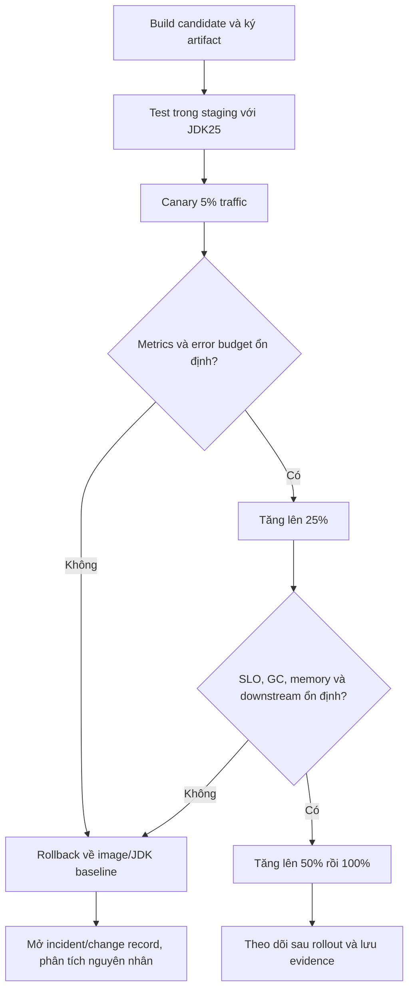

# Hoàn thành hồ sơ nâng cấp gồm bằng chứng tương thích, kết quả đo và tiêu chí triển khai

> **Chương:** Thực hành tổng hợp  
> **Học phần:** `JAVA_VERSION_JAVA25` — đánh giá các khả năng Java 25 còn áp dụng trong phát triển hiện đại, từ ngôn ngữ và API tới bảo mật, quan sát, AOT cache, build và triển khai.  
> **Mục tiêu:** Hoàn thành một hồ sơ nâng cấp có thể được reviewer, SRE và security team kiểm tra: xác định phạm vi, chứng minh tương thích, đo baseline và candidate, đánh giá rủi ro, đề xuất go/no-go, lập kế hoạch rollout và rollback.

> **Bối cảnh phiên bản:** Các mốc JDK, JEP và trạng thái API trong bài được đối chiếu tại ngày **27-11-2026**. Java 25 là LTS; ví dụ lấy JDK 25 làm target. Những API preview hoặc incubator được đánh dấu riêng và không mặc định coi là nền tảng ổn định cho production. Phiên bản patch/vendor thực tế phải được ghi vào hồ sơ của dự án.

## 1. Bài toán tích hợp: nâng một dịch vụ đang chạy lên Java 25

Bạn là người phụ trách kỹ thuật của **Commerce API**, một dịch vụ Spring Boot xử lý đơn hàng và thanh toán. Dịch vụ hiện chạy trên JDK 21, triển khai container trên Linux x86-64 và có các luồng chính:

- HTTP API tạo đơn hàng, truy vấn đơn hàng và tính giá.
- Gọi song song inventory, customer profile và shipping provider.
- Xử lý event đơn hàng trong background.
- Dùng JDBC, HTTP client, JSON serialization và một số annotation processor.
- Có một số tác vụ khởi động tốn thời gian do nạp class, tạo metadata và warm up JIT.
- Đang được giám sát bằng metrics, logs và Java Flight Recorder (JFR) khi điều tra sự cố.

Đội dự án muốn nâng lên Java 25 để nhận cập nhật nền tảng, sử dụng các API đã final và đánh giá lợi ích runtime. Nhóm cũng muốn kiểm tra AOT cache, JFR Method Timing & Tracing và Compact Object Headers.

Nhiệm vụ của bạn là hoàn thành một hồ sơ để trả lời năm câu hỏi:

1. Build, test, dependency, annotation processor và runtime có thực sự tương thích với JDK 25 không?
2. Tính năng Java 25 nào được phép đưa vào đợt nâng cấp, tính năng nào cần thử nghiệm riêng?
3. Candidate có cải thiện startup, warmup, throughput, latency hoặc memory trên cùng workload không?
4. Những rủi ro nào có thể ảnh hưởng bảo mật, vận hành, rollback hoặc khả năng tương thích?
5. Dựa trên bằng chứng nào để quyết định triển khai, hoãn hoặc từ chối một thay đổi?

Hồ sơ phải có bằng chứng có thể truy xuất, số liệu đo, tiêu chí chấp nhận và người chịu trách nhiệm. Một câu “đã chạy thử thấy ổn” không đủ để làm căn cứ triển khai.

### 1.1. Giới hạn phạm vi nâng cấp

Đợt nâng cấp này thay đổi JDK và các thành phần build/runtime cần thiết. Không đồng thời thay đổi database schema, giao thức API công khai hoặc kiến trúc dịch vụ, trừ khi có một thay đổi độc lập đã được duyệt.

Giữ phạm vi nhỏ giúp nhóm phân biệt nguyên nhân nếu xuất hiện regression. Ví dụ, nếu cùng một release vừa đổi JDK, đổi ORM, đổi connection pool và đổi cấu trúc dữ liệu, sẽ rất khó xác định thay đổi nào gây tăng p99 latency.

### 1.2. Giả định của bài thực hành

| Hạng mục | Giá trị giả định |
|---|---|
| Dịch vụ | Commerce API |
| Runtime baseline | JDK 21 LTS |
| Runtime candidate | JDK 25 LTS, đúng vendor/build đã chọn |
| Hệ điều hành | Linux x86-64 |
| Container | OCI image, chạy Kubernetes |
| Build | Maven hoặc Gradle Wrapper |
| Database | PostgreSQL |
| Kiểu tải | HTTP request, event consumer và scheduled jobs |
| Mục tiêu | Không phá API, bảo mật và SLO hiện tại; cải thiện startup/warmup hoặc hiệu quả tài nguyên nếu đo được |

Đây là kịch bản giả định để luyện tập. Các số liệu ví dụ ở phần sau được đánh dấu rõ là dữ liệu minh họa; khi làm hồ sơ thật, thay bằng kết quả từ môi trường dự án.

## 2. Đầu ra bắt buộc của hồ sơ nâng cấp

Hồ sơ được xem là hoàn thành khi có đủ các nhóm bằng chứng sau:

| Mã | Thành phần hồ sơ | Bằng chứng tối thiểu | Người rà soát |
|---|---|---|---|
| E01 | Scope và baseline | Phiên bản hiện tại, mục tiêu, kiến trúc, SLO và workload | Tech lead |
| E02 | Build compatibility | Build tool, JDK, compiler release, plugin và wrapper | Build owner |
| E03 | Dependency compatibility | Dependency tree, native libraries, agents và processor | Module owner |
| E04 | Functional verification | Unit, integration, contract, security và regression tests | QA |
| E05 | Runtime compatibility | Startup logs, flags, module/native checks, container smoke test | SRE |
| E06 | Performance baseline | JMH nếu phù hợp, load test và JFR recording | Performance owner |
| E07 | Candidate measurement | Cùng workload và điều kiện với baseline | Performance owner |
| E08 | AOT/GC/memory evaluation | Cache build, cache load, heap, RSS, GC và startup data | JVM owner |
| E09 | Security review | KDF usage, TLS/provider, dependency scan, secret handling | Security |
| E10 | Rollout and rollback | Canary, dashboard, alert, rollback trigger và artifact cũ | Release owner |
| E11 | Decision record | Go/no-go, ngoại lệ, rủi ro còn lại và chữ ký phê duyệt | Engineering lead |

Mỗi bằng chứng cần có thời gian tạo, commit SHA, JDK vendor/version/build, OS/CPU, cấu hình JVM, workload version và đường dẫn artifact. Không dùng ảnh chụp màn hình đơn lẻ làm bằng chứng duy nhất nếu có thể lưu log, báo cáo máy đọc được hoặc file recording.

### 2.1. Cấu trúc thư mục gợi ý

```text
upgrade-evidence/
├── 00-scope/
│   ├── upgrade-scope.md
│   └── baseline-architecture.md
├── 01-compatibility/
│   ├── java-runtime.txt
│   ├── build-tool-versions.txt
│   ├── dependency-tree.txt
│   ├── annotation-processors.md
│   └── native-agents.md
├── 02-tests/
│   ├── unit-test-report/
│   ├── integration-test-report/
│   ├── contract-test-report/
│   └── security-test-report/
├── 03-performance/
│   ├── baseline/
│   ├── java25/
│   ├── jfr/
│   ├── jmh/
│   └── comparison.md
├── 04-runtime/
│   ├── container-smoke-test.md
│   ├── startup-logs/
│   └── gc-logs/
├── 05-security/
│   ├── crypto-review.md
│   └── dependency-scan/
├── 06-release/
│   ├── rollout-plan.md
│   ├── rollback-plan.md
│   └── go-no-go.md
└── manifest.sha256
```

Không nhất thiết phải dùng đúng tên thư mục này. Điều quan trọng là mỗi kết luận trong hồ sơ trỏ tới một bằng chứng cụ thể và có thể kiểm tra lại.

## 3. Chốt baseline trước khi nâng cấp

Không thể đánh giá candidate nếu chưa biết baseline đang hoạt động ra sao. Trước khi đổi JDK, đóng băng một lần chạy đại diện và ghi lại cấu hình.

### 3.1. Baseline kỹ thuật

Thu thập:

- JDK vendor, version, build number và patch level.
- Build tool và Wrapper version.
- Compiler release, toolchain và test JVM.
- JVM options, GC, heap min/max, container memory/CPU limit.
- Dependency tree và version của agent/native library.
- Container base image và digest.
- Commit SHA, artifact checksum và cấu hình triển khai.
- OS, kernel, CPU model, architecture và power profile.

Lệnh kiểm tra cơ bản:

```bash
java -version
java -XshowSettings:properties -version
javac -version
```

Với Maven:

```bash
./mvnw --version
./mvnw help:effective-pom
./mvnw dependency:tree
```

Với Gradle:

```bash
./gradlew --version
./gradlew javaToolchains
./gradlew dependencies
```

Chạy các lệnh này trong cùng môi trường CI hoặc build container được dùng để tạo artifact. Kết quả từ laptop developer không thay thế bằng chứng của CI.

### 3.2. Baseline chức năng và vận hành

Chọn một khoảng thời gian có workload đại diện, sau đó lưu:

| Nhóm | Chỉ số |
|---|---|
| Request | Throughput, error rate, p50/p95/p99 latency |
| JVM | Startup time, time-to-ready, heap used/committed, allocation rate |
| GC | Số lần collection, pause p50/p95/max, concurrent cycle duration |
| Process | RSS, CPU usage, thread count, file descriptor count |
| Dependency | Database connection wait, HTTP connection pool, downstream latency |
| Reliability | Restart, OOMKill, timeout, retry và circuit-breaker count |
| Business | Đơn hàng xử lý thành công, payment failure, event lag |

Định nghĩa rõ mỗi metric. Ví dụ, startup time có thể đo từ lúc process bắt đầu tới khi ứng dụng báo ready; time-to-first-successful-request là metric khác. Không gộp chúng thành một con số “startup”.

### 3.3. Ghi lại SLO và giới hạn tài nguyên

Ví dụ tiêu chí của Commerce API:

| Chỉ tiêu | SLO hiện tại (minh họa) |
|---|---:|
| HTTP availability | ≥ 99,9% |
| p95 latency | ≤ 250 ms |
| p99 latency | ≤ 500 ms |
| Error rate | ≤ 0,1% |
| Pod memory | ≤ 1,5 GiB |
| Startup to ready | ≤ 25 giây |
| Event consumer lag | ≤ 10 giây |

Các ngưỡng này phải lấy từ SLO thật của dịch vụ. Không tự đặt mục tiêu dễ đạt để hợp thức hóa một đợt nâng cấp.

## 4. Phân loại tính năng Java 25 trước khi đưa vào production

Java 25 có nhiều tính năng khác nhau về mức ổn định. Hồ sơ phải phân loại rõ tính năng đã final, preview, incubator và product option. Không dùng một nhãn “Java 25 feature” cho tất cả.

### 4.1. Nhóm có thể đưa vào đánh giá production

| Tính năng | JEP | Trạng thái trong JDK 25 | Bài toán có thể giải quyết | Bằng chứng cần có |
|---|---:|---|---|---|
| Module Import Declarations | 511 | Final | Giảm import boilerplate trong source phù hợp | Compile, module readability và ambiguity tests |
| Compact Source Files and Instance Main Methods | 512 | Final | Script, công cụ nội bộ và ví dụ nhỏ | Build/launch test; không cần chuyển mọi application class |
| Flexible Constructor Bodies | 513 | Final | Validate/chuẩn bị dữ liệu an toàn trước `super(...)`/`this(...)` | Constructor tests, inheritance tests |
| Scoped Values | 506 | Final | Truyền immutable request context trong dynamic scope | Context isolation và concurrency tests |
| Key Derivation Function API | 510 | Final | Dẫn xuất khóa từ input key material theo thuật toán chuẩn | Crypto interoperability, key lifecycle và security review |
| Compact Object Headers | 519 | Product feature, mặc định tắt trong JDK 25 | Giảm object header footprint trên workload object-dense | A/B memory, GC, throughput và latency |
| AOT Command-Line Ergonomics | 514 | Final | Đơn giản hóa quá trình train và tạo AOT cache | Cache generation/load và startup/warmup comparison |
| AOT Method Profiling | 515 | Final | Tái sử dụng method profiles từ training run để cải thiện warmup | Training representativeness và warmup measurement |
| JFR Method Timing & Tracing | 520 | Final | Đo/truy vết method được chọn để tìm bottleneck | Recording, filter, overhead và method evidence |

Không phải mọi tính năng final đều cần được đưa vào codebase. Nếu một service không có nhu cầu tương ứng, ghi “not applicable” kèm lý do. Nâng JDK không phải lý do để thay đổi source một cách cơ học.

### 4.2. Nhóm phải ghi rõ preview hoặc incubator

| Tính năng | Trạng thái JDK 25 | Hướng xử lý trong hồ sơ |
|---|---|---|
| Structured Concurrency (JEP 505) | Preview lần thứ năm | Chỉ thử trong nhánh thử nghiệm nếu tổ chức chấp nhận preview; không bật preview toàn production mặc định |
| Stable Values (JEP 502) | Preview đầu tiên trong JDK 25 | Không lấy API `StableValue` cũ làm hướng mới; tính năng được đổi tên thành Lazy Constants từ JDK 26 và vẫn tiếp tục preview ở các JDK sau |
| Vector API (JEP 508) | Incubator lần thứ mười | Cô lập module `jdk.incubator.vector`, giữ scalar fallback và benchmark theo kiến trúc |
| Primitive Types in Patterns, `instanceof`, and `switch` (JEP 507) | Preview lần thứ ba | Chỉ dùng khi compile/test/runtime có `--enable-preview` đúng JDK 25 |

Tại ngày 27-11-2026, JDK 27 là bản GA mới nhất. Structured Concurrency ở JDK 27 là preview lần thứ bảy; JEP 543 đã hoàn tất API trong JDK 28 Early Access, nhưng JDK 28 chưa GA. Lazy Constants tiếp tục ở preview lần thứ tư qua JEP 547; Vector API JEP 548 mới ở trạng thái Proposed to Target cho incubator lần thứ mười ba, chưa được coi là API đã phát hành. Hãy xác minh release notes/JEP của đúng build trước khi quyết định.

### 4.3. Các lựa chọn feature cho Commerce API

Ví dụ nhóm có thể chọn:

- Dùng ScopedValue để truyền `requestId`, `tenantId` và trace context trong call chain cần thiết.
- Dùng KDF API nếu dịch vụ thực sự có nhu cầu dẫn xuất subkey từ key material; không thay password hashing hoặc key management bằng HKDF.
- Đánh giá AOT cache cho startup/warmup nếu pod thường xuyên restart hoặc scale-out.
- Đánh giá Compact Object Headers nếu heap histogram cho thấy số lượng object nhỏ chiếm tỷ trọng đáng kể.
- Dùng JFR Method Timing/Tracing trong giai đoạn profiling ngắn để điều tra method cụ thể.
- Giữ Structured Concurrency và Vector API ở phạm vi thử nghiệm cho đến khi chính sách preview/incubator và số đo đủ thuyết phục.

Kết luận feature phải là một trong các trạng thái: `ADOPT`, `EXPERIMENT`, `DEFER`, `NOT_APPLICABLE`. Mỗi lựa chọn cần lý do, owner và bằng chứng.

## 5. Ma trận tương thích build và runtime

Tạo một bảng tương thích thực tế thay vì chỉ ghi “Maven/Gradle hỗ trợ Java 25”.

### 5.1. Bốn môi trường cần kiểm tra riêng

| Môi trường | Phiên bản cần ghi | Kiểm tra |
|---|---|---|
| Build JVM | JDK chạy Maven/Gradle daemon | Build tool có chạy trên JDK đó không? |
| Compiler toolchain | JDK chạy `javac` | Có compile source 25 và dùng đúng API target không? |
| Test JVM | JDK chạy Surefire/Failsafe hoặc Gradle Test | Test engine, agent, processor và preview flag có phù hợp không? |
| Production runtime | JDK trong container phát hành | Có chạy được class file, module, native dependencies và JVM options không? |

Với Gradle, JDK daemon và Java toolchain có thể khác nhau. Với Maven, compiler có thể dùng JDK của Maven process hoặc Maven Toolchains. Luôn ghi lại JDK thực sự được compiler chọn.

### 5.2. Bảng tương thích minh họa

| Thành phần | Ví dụ phiên bản/mốc | Bằng chứng phải lưu |
|---|---|---|
| JDK target | JDK 25 LTS, vendor/build cụ thể | `java -version`, checksum và image digest |
| Maven | Dòng GA được duy trì, ví dụ 3.10.x | `./mvnw --version`, wrapper properties |
| Maven Compiler Plugin | 3.16.0 | Effective POM, `release=25` |
| Surefire/Failsafe | 3.6.1 | Test report và fork JVM command line |
| Gradle | 9.1+ cho JDK 25; 9.9.2 là mốc tài liệu hiện hành trong snapshot này | Wrapper, `./gradlew --version`, toolchain report |
| Lombok | 1.18.40 bổ sung hỗ trợ JDK 25; kiểm tra bản hiện hành của dự án | Changelog, annotation processing log |
| MapStruct | 1.6.3 trong ví dụ cấu hình | Processor path và generated source |
| Bytecode/coverage | ASM, JaCoCo, Byte Buddy và plugin tương ứng | Compatibility notes, test/coverage report |
| Native agents | Agent cụ thể theo OS/architecture | Smoke test trên image và architecture triển khai |

Trong snapshot ngày 27-11-2026, Oracle Consolidated JDK 25 Release Notes liệt kê bản JDK 25.0.5.1.1 với ngày phát hành 24-11-2026. Đây là mốc của Oracle JDK; các vendor khác có lịch PSU/CPU và cách đặt build number riêng. Hồ sơ phải pin bản patch mới nhất đã được tổ chức kiểm định cho đúng vendor, không suy version của vendor này sang vendor khác.

Đây là ví dụ về các mốc cần pin, không thay thế việc kiểm tra release mới nhất của từng thành phần khi làm hồ sơ thực tế. Không nâng một dependency chỉ vì có phiên bản mới; cần có lý do tương thích, bảo mật hoặc tính năng.

Với Maven, ưu tiên một bản GA thuộc dòng đang được duy trì; Maven 4.0.0-rc-7 vẫn là release candidate trong snapshot này, không phải mặc định production. Dùng Maven Wrapper/Gradle Wrapper đã commit trong repository để CI và developer không vô tình dùng build tool khác nhau.

### 5.3. Cấu hình compiler phải khóa release

Maven:

```xml
<properties>
    <maven.compiler.release>25</maven.compiler.release>
</properties>

<plugin>
    <groupId>org.apache.maven.plugins</groupId>
    <artifactId>maven-compiler-plugin</artifactId>
    <version>3.16.0</version>
    <configuration>
        <release>${maven.compiler.release}</release>
    </configuration>
</plugin>
```

Gradle Kotlin DSL:

```kotlin
java {
    toolchain {
        languageVersion.set(JavaLanguageVersion.of(25))
    }
}

tasks.withType<JavaCompile>().configureEach {
    options.release.set(25)
}
```

`--release 25` khóa language level, class file target và API nền tảng. Chỉ đặt `sourceCompatibility`/`targetCompatibility` không tạo cùng bảo đảm về API.

Class file do Java 25 tạo có major version **69**. Có thể kiểm tra artifact sau compile:

```bash
javap -verbose -classpath target/classes com.example.orders.OrderService
```

Trong output, xác nhận `major version: 69`. Nếu class file đến từ dependency hoặc generated source, kiểm tra chúng bằng cùng cách; một bytecode reader/coverage plugin cũ có thể thất bại dù `javac` compile source thành công.

### 5.4. Annotation processor cần được khai báo rõ

Từ JDK 23, không dựa vào việc `javac` tự quét classpath để chạy annotation processor. Khai báo `annotationProcessorPaths` trong Maven hoặc `annotationProcessor` trong Gradle; kiểm tra riêng Lombok, MapStruct, processor nội bộ và bytecode reader.

Ví dụ Gradle:

```kotlin
dependencies {
    compileOnly("org.projectlombok:lombok:1.18.48")
    annotationProcessor("org.projectlombok:lombok:1.18.48")

    implementation("org.mapstruct:mapstruct:1.6.3")
    annotationProcessor("org.mapstruct:mapstruct-processor:1.6.3")
}
```

Các version này chỉ minh họa cách tách processor khỏi runtime classpath. Khi lập hồ sơ, lưu phiên bản thật, changelog hỗ trợ JDK compiler và danh sách generated source. Không đưa processor vào runtime dependency nếu ứng dụng không cần nó lúc chạy.

### 5.5. Kiểm tra module, preview và incubator

- Tính năng Java 25 đã final không cần `--enable-preview`.
- Preview feature cần compiler và JVM runtime đúng release cùng `--enable-preview`.
- Vector API là incubator module, cần `--add-modules jdk.incubator.vector`; không nhầm với preview flag.
- `StructuredTaskScope` là preview trong JDK 25; không được dùng chỉ vì `ScopedValue` đã final.
- `LazyConstant` là API của các JDK sau Java 25; không dùng nó trong source target 25.

Chạy clean build bằng wrapper đã pin và lưu output làm bằng chứng:

```bash
./mvnw -B -ntp clean verify
./gradlew clean check
./gradlew javaToolchains
```

Chỉ chạy lệnh tương ứng build tool của project. Nếu project dùng Maven Toolchains hoặc Gradle daemon JVM criteria, lưu log để chứng minh JDK compiler/test thực tế đã được chọn.

Build xanh chỉ là một phần của E02. Cần thêm test chạy đúng JDK, generated source, module resolution, runtime image và native dependency.

## 6. Thiết kế phép đo candidate: cùng điều kiện, khác đúng biến cần đánh giá

Sau khi build và test pass, tạo candidate từ cùng source revision nhưng chạy trên JDK 25. Giữ nguyên cấu hình dịch vụ, workload, dataset, database, CPU quota, memory limit và topology.

Nếu muốn đánh giá riêng một feature như Compact Object Headers hoặc AOT cache, chỉ thay một biến giữa hai lượt chạy. Không đổi JDK, GC, heap, container base image và code cùng lúc rồi quy kết quả cho một flag.

### 6.1. Ma trận thí nghiệm

| Run | JDK | AOT cache | Compact headers | Mục đích |
|---|---|---|---|---|
| B0 | Baseline JDK 21 | Không | Không áp dụng | Đối chứng hiện tại |
| C0 | JDK 25 | Không | Mặc định tắt | Đánh giá riêng tác động nâng JDK |
| C1 | JDK 25 | Có | Mặc định tắt | Đo thêm tác động AOT cache |
| C2 | JDK 25 | Không | Bật | Đo riêng compact headers |
| C3 | JDK 25 | Có | Bật | Đo tổ hợp sau khi từng yếu tố đã được hiểu |

Không cần chạy mọi tổ hợp nếu tính năng không liên quan workload. Nhưng mọi so sánh phải có đối chứng phù hợp. Ví dụ, để đánh giá AOT, so C0 với C1 trên cùng JDK 25; để đánh giá compact headers, so C0 với C2.

### 6.2. Điều kiện đo

- Dùng cùng container CPU/memory limits và cùng loại máy.
- Khóa JDK vendor, patch build, GC, heap flags và application artifact.
- Warmup theo cùng quy trình; tách startup, warmup và steady-state.
- Chạy nhiều lần, luân phiên thứ tự baseline/candidate để giảm bias.
- Dùng cùng dữ liệu, request mix, concurrency và thời lượng.
- Đo error rate và downstream latency để tránh hiểu nhầm bottleneck bị chuyển sang database.
- Lưu raw output, recording, command line và environment manifest.
- Không chạy profiler nặng trên một biến thể nhưng không chạy trên biến thể còn lại.

Nếu workload production có nhiều giai đoạn (startup burst, steady traffic, batch window), đo riêng từng giai đoạn. Một bài load test duy nhất không nhất thiết đại diện cho tất cả tình huống.

### 6.3. Chọn chỉ số theo giả thuyết

| Giả thuyết | Chỉ số chính | Chỉ số kiểm tra chéo |
|---|---|---|
| JDK 25 giảm startup | Process start → ready, first successful request | Class loading, AOT cache load, CPU |
| AOT cache giảm warmup | Time-to-throughput target, JIT compilation activity | p95 trong 1–5 phút đầu |
| Compact headers giảm memory | Live heap, allocation bytes, heap occupancy | RSS, GC pause, throughput |
| JFR giúp tìm method chậm | Method timing/trace và stack context | CPU samples, lock, I/O wait |
| API concurrency cải thiện request fan-out | Request p95/p99, timeout rate | Thread count, cancellation, downstream saturation |
| KDF API thay thế code crypto tự viết | Interoperability, key correctness, security review | Latency, provider support, key lifecycle |

Đừng lấy CPU usage giảm làm bằng chứng duy nhất rằng ứng dụng tốt hơn. CPU thấp hơn có thể do request bị block hoặc throughput giảm. Mọi chỉ số phải được đọc cùng throughput và error rate.

## 7. Dùng JFR làm bằng chứng cho bottleneck và method-level behavior

JFR thu thập sự kiện JVM và ứng dụng với cấu hình có thể chạy liên tục hoặc trong một khoảng thời gian ngắn. Trong Java 25, JEP 520 bổ sung hai event `jdk.MethodTiming` và `jdk.MethodTrace` để đo thời gian hoặc trace invocation của các method được chọn.

JFR có thể hỗ trợ hồ sơ E06/E07 bằng cách trả lời:

- Method nào được gọi nhiều hoặc có thời gian thực thi đáng chú ý?
- Method nào thường xuất hiện trong đường đi của request chậm?
- Thời gian method có liên quan tới CPU, lock, I/O hay downstream wait?
- Thay đổi code hoặc JDK có làm thay đổi profile method không?

### 7.1. Bắt đầu recording ngắn với method filter

Ví dụ bật Method Timing cho một method nghiệp vụ:

```bash
java \
  -XX:StartFlightRecording:filename=order-methods.jfr,duration=60s,jdk.MethodTiming#filter=com.example.orders.OrderService::calculate \
  -jar commerce-api.jar
```

Để trace invocation cụ thể, dùng event `jdk.MethodTrace`:

```bash
java \
  -XX:StartFlightRecording:filename=order-trace.jfr,duration=30s,jdk.MethodTrace#filter=com.example.orders.OrderService::calculate \
  -jar commerce-api.jar
```

Filter có thể chỉ rõ class, class-method, method hoặc annotation. Hãy giới hạn phạm vi vào package/method cần điều tra; bật tracing rộng trên toàn ứng dụng có thể tạo lượng event lớn và overhead không phù hợp với production dài hạn.

### 7.2. Đọc recording

```bash
jfr summary order-methods.jfr
jfr view jdk.MethodTiming order-methods.jfr
jfr print --events jdk.MethodTiming order-methods.jfr
```

Với Method Trace:

```bash
jfr view jdk.MethodTrace order-trace.jfr
jfr print --events jdk.MethodTrace order-trace.jfr
```

JDK Mission Control (JMC) giúp lọc theo thread, thời gian và stack trace để liên kết event với request hoặc hoạt động JVM. Không đọc riêng một method timing rồi kết luận method đó là bottleneck; cần đối chiếu CPU samples, monitor contention, socket/file I/O và downstream spans.

### 7.3. So sánh recording có và không có instrumentation

JFR `default.jfc` được thiết kế cho recording liên tục với overhead thấp; `profile.jfc` thu thập nhiều dữ liệu hơn và phù hợp hơn với recording ngắn. Method Timing/Trace dùng instrumentation và filter cụ thể, vì vậy phải đo overhead trong workload của chính dịch vụ.

Thực hiện tối thiểu ba lượt:

1. Không bật JFR hoặc chỉ dùng recording baseline theo cấu hình vận hành.
2. Bật JFR `default.jfc`.
3. Bật event Method Timing/Trace có filter trong thời gian ngắn.

Ghi throughput, p95/p99, CPU và event volume của từng lượt. Nếu recording làm thay đổi đáng kể SLO, dùng nó trong staging hoặc canary có kiểm soát và rút ngắn thời lượng. Không lưu file `.jfr` có dữ liệu nhạy cảm vào artifact công khai; kiểm tra/scrub trước khi chia sẻ.

### 7.4. Đừng nhầm Method Timing với CPU profiling

Method Timing/Trace cung cấp thông tin invocation/timing của method được instrument. CPU sampling cho biết thread đang tiêu tốn CPU ở đâu theo các mẫu stack. Một method có elapsed time dài có thể chủ yếu chờ I/O; method có CPU sample cao mới gợi ý tiêu tốn CPU.

JFR CPU-Time Profiling của JDK 25 là experimental feature trên nền tảng được hỗ trợ; không lấy nó làm yêu cầu production bắt buộc. Dùng các event/recording ổn định và đối chiếu với metrics hệ thống.

## 8. Đánh giá AOT cache: training phải đại diện cho production

JDK 25 có JEP 514 giúp đơn giản hóa việc tạo AOT cache và JEP 515 bổ sung method execution profiles từ training run. Cache có thể cải thiện startup và warmup bằng cách tái sử dụng class/heap artifacts và profile đã thu thập trước.

AOT cache không biến ứng dụng thành native executable và không thay thế JIT. JVM vẫn có thể tiếp tục tối ưu theo hành vi runtime thực tế. Cache chỉ có giá trị nếu training run phản ánh workload production đủ tốt.

### 8.1. Training và tạo cache trong một lệnh

Với ứng dụng đóng gói thành JAR:

```bash
# Training run; sau khi ứng dụng kết thúc, JVM tạo AOT cache.
java -XX:AOTCacheOutput=commerce.aot -jar commerce-api.jar
```

Trong training run, phát các request đại diện: login, đọc catalog, tạo đơn, tính giá, truy vấn tồn kho và các luồng background quan trọng. Sau khi hoàn thành workload, dừng ứng dụng một cách graceful để JVM hoàn tất quá trình tạo cache.

JDK 25 tự động dùng quy trình training và assembly trong trường hợp phổ biến khi chỉ định `-XX:AOTCacheOutput`. Với cấu hình nâng cao, có thể dùng riêng `-XX:AOTConfiguration` và `-XX:AOTMode=record/create`; hãy theo tài liệu `java` command của đúng JDK build.

### 8.2. Dùng cache trong production-like run

```bash
java -XX:AOTCache=commerce.aot -jar commerce-api.jar
```

Ở chế độ `auto` mặc định, JVM sẽ dùng cache nếu cache tương thích và có thể nạp; nếu không, JVM có thể tiếp tục chạy mà không có cache. Khi điều tra lỗi cache, `-XX:AOTMode=on` hữu ích để fail fast nếu không thể nạp cache, nhưng không nên mặc định dùng chế độ fail-fast này cho production khi muốn giữ fallback.

### 8.3. Cache bị ràng buộc bởi application, JDK, OS và CPU

AOT cache gắn với:

- Ứng dụng như được xác định bởi classpath, `-jar` hoặc module path.
- JDK release tạo cache.
- Hệ điều hành.
- CPU architecture.

Khi đổi JDK release, application artifact/classpath, OS hoặc architecture, hãy tạo cache mới. Không build cache trên Linux x86-64 rồi copy sang Linux ARM64; không giữ cache cũ sau khi đổi artifact mà không kiểm tra tính tương thích.

Đối với pipeline nhiều kiến trúc, tạo cache riêng cho từng tổ hợp image/JDK/architecture. Cache phải được version hóa theo commit hoặc digest của artifact và xóa khỏi pipeline khi không còn tương thích.

### 8.4. Thiết kế phép đo AOT

So sánh:

| Biến thể | JVM option | Câu hỏi |
|---|---|---|
| Không cache | Không có AOT cache | Startup/warmup baseline trên JDK 25 |
| Có cache | `-XX:AOTCache=commerce.aot` | Cache cải thiện bao nhiêu? |
| Cache không tương thích | Cache cố ý được tạo từ tổ hợp khác trong staging | JVM fallback hay fail theo mode? Log có đủ chẩn đoán? |

Đo ít nhất:

- Process start → application ready.
- Time-to-first-successful-request.
- Throughput trong 1–5 phút đầu.
- JIT compilation activity và CPU trong giai đoạn warmup.
- Kích thước cache và thời gian training/assembly.
- Tác động lên thời gian build/release pipeline.

Không so startup có cache trên máy nóng với startup không cache trên máy vừa restart. Luân phiên nhiều lần chạy và báo median/p95. AOT cache là tối ưu hóa; nếu không cải thiện mục tiêu quan trọng hoặc chi phí training/deployment quá cao, có thể không triển khai.

## 9. Đánh giá Compact Object Headers bằng A/B test

Trong JDK 25, Compact Object Headers là product option qua JEP 519 nhưng mặc định tắt. Trên HotSpot 64-bit, layout compact giảm object header xuống 64 bit. Tác động đáng quan tâm nhất với workload giữ nhiều object nhỏ.

### 9.1. Hai biến thể trên cùng JDK 25

Baseline JDK 25:

```bash
java -Xms2g -Xmx2g -jar commerce-api.jar
```

Candidate bật compact headers:

```bash
java -Xms2g -Xmx2g \
     -XX:+UseCompactObjectHeaders \
     -jar commerce-api.jar
```

Không cần `-XX:+UnlockExperimentalVMOptions` cho JDK 25 vì đây là product option. Xác nhận flag hiệu lực bằng `-XX:+PrintFlagsFinal` hoặc `jcmd <pid> VM.flags -all`.

### 9.2. Dữ liệu cần đo

- Live heap sau GC.
- Allocation rate và object count.
- Heap occupancy và GC pause.
- RSS/container memory.
- Throughput, p95/p99 và CPU.
- Monitor contention nếu workload đồng bộ nhiều.
- Agent/native tooling có đọc object layout nội bộ hay không.

Không dùng con số tiết kiệm trung bình theo object làm dự báo trực tiếp cho RSS. Object alignment, field layout, arrays, direct buffers, metaspace và native memory đều ảnh hưởng kết quả.

### 9.3. Lưu ý khi chạy trên JDK mới hơn

JDK 27 bật Compact Object Headers mặc định qua JEP 534. Vì vậy, khi so sánh JDK 25 với JDK 27, phải ghi rõ trạng thái flag; nếu cần đối chứng layout truyền thống trên JDK 27, có thể dùng `-XX:-UseCompactObjectHeaders` trong thử nghiệm ngắn hạn theo tài liệu của release đó. Không mặc định giữ cấu hình tắt như một cam kết dài hạn vì flag có thể bị deprecate/loại bỏ trong tương lai.

## 10. Đánh giá các API Java 25 đã final trong bối cảnh dịch vụ

Hồ sơ không cần chuyển toàn bộ source sang cú pháp mới. Hãy chọn một use case, viết test, chứng minh hành vi và so sánh chi phí bảo trì.

### 10.1. ScopedValue cho request context

ScopedValue final trong Java 25, phù hợp để chia sẻ immutable context trong dynamic scope mà không phải truyền qua mọi method trung gian.

```java
import java.lang.ScopedValue;

record RequestContext(String requestId, String tenantId) {}

final class RequestContextHolder {
    static final ScopedValue<RequestContext> CURRENT =
            ScopedValue.newInstance();

    static void handle(RequestContext context, Runnable operation) {
        ScopedValue.where(CURRENT, context).run(operation);
    }

    static String currentTenant() {
        return CURRENT.get().tenantId();
    }
}
```

Test phải xác minh hai request đồng thời không đọc nhầm tenant/request ID của nhau, nested binding được khôi phục đúng và context không chứa mutable object dùng chung không được đồng bộ.

Không nhầm ScopedValue với propagation qua HTTP hoặc message broker. Distributed tracing vẫn cần trace context propagation qua protocol/framework. Không dùng `StructuredTaskScope` preview của JDK 25 như thể nó đã final chỉ vì ScopedValue đã final.

### 10.2. Key Derivation Function API

KDF API final trong JDK 25 qua JEP 510, có implementation HKDF. Ví dụ minh họa dẫn xuất khóa AES 256-bit từ input key material có entropy phù hợp:

```java
import java.security.spec.AlgorithmParameterSpec;
import javax.crypto.KDF;
import javax.crypto.SecretKey;
import javax.crypto.spec.HKDFParameterSpec;

byte[] ikm = loadSecretKeyMaterial();
byte[] salt = loadUniqueSalt();
byte[] info = "commerce/payment-encryption/v1"
        .getBytes(java.nio.charset.StandardCharsets.UTF_8);

KDF hkdf = KDF.getInstance("HKDF-SHA256");

AlgorithmParameterSpec params = HKDFParameterSpec.ofExtract()
        .addIKM(ikm)
        .addSalt(salt)
        .thenExpand(info, 32);

SecretKey derivedKey = hkdf.deriveKey("AES", params);
```

`info` dùng để domain-separate key theo mục đích. Salt không cần bí mật nhưng cần được quản lý đúng theo thuật toán và protocol. Trong ứng dụng thật, input key material đến từ KMS/HSM/secret manager phù hợp; không hard-code key, salt hoặc output key vào source/log.

HKDF dành cho key material có entropy phù hợp, không phải thuật toán password hashing. Với mật khẩu người dùng, dùng password hashing scheme chuyên dụng như Argon2 hoặc PBKDF2 theo chính sách bảo mật. Không tự thiết kế thuật toán dẫn xuất khóa; security reviewer cần xác nhận provider, algorithm availability, key length, rotation, storage và interoperability.

### 10.3. Module imports, compact source và flexible constructors

Các tính năng final này có thể giúp code mới rõ hơn, nhưng chỉ áp dụng nơi phù hợp:

- `import module ...` giảm import boilerplate; không tự thêm module dependency vào `module-info.java` và có thể gây ambiguity nếu nhiều module export cùng simple name.
- Compact source files/instance main methods hữu ích cho tool/script nhỏ; không phải lý do chuyển các application class lớn sang dạng implicit.
- Flexible constructor bodies cho phép validation/tính toán an toàn trước `super(...)` hoặc `this(...)`; phần prologue vẫn không được tham chiếu tới object đang được khởi tạo theo các giới hạn của ngôn ngữ.

Ghi rõ file/class nào được thay đổi, vì sao thay đổi có lợi và test nào chứng minh hành vi. Nếu chỉ làm code khó đọc hơn, giữ cách viết cũ cũng là một kết luận hợp lệ.

## 11. Tổng hợp kết quả: từ số đo tới nhận định có thể kiểm chứng

Sau khi chạy baseline và candidate, tổng hợp raw data vào một bảng. Không thay số liệu thực bằng số dự kiến hoặc số từ máy khác.

### 11.1. Bảng kết quả minh họa

Bảng dưới đây là **dữ liệu giả lập để minh họa cách đọc báo cáo**, không phải benchmark công bố của JDK 25 hoặc Commerce API:

| Chỉ số | JDK 21 baseline | JDK 25 không cache | JDK 25 + AOT | JDK 25 + AOT + compact headers |
|---|---:|---:|---:|---:|
| Startup tới ready (p50) | 18,6 s | 17,9 s | 13,8 s | 13,7 s |
| Time-to-90% throughput | 95 s | 91 s | 62 s | 61 s |
| Steady throughput | 10.100 req/s | 10.400 req/s | 10.400 req/s | 10.500 req/s |
| p95 latency | 210 ms | 205 ms | 205 ms | 204 ms |
| p99 latency | 420 ms | 416 ms | 415 ms | 414 ms |
| Live heap sau GC | 1,15 GiB | 1,11 GiB | 1,11 GiB | 1,02 GiB |
| RSS | 1,48 GiB | 1,45 GiB | 1,45 GiB | 1,36 GiB |
| GC pause p99 | 35 ms | 33 ms | 32 ms | 32 ms |
| Error rate | 0,04% | 0,04% | 0,04% | 0,04% |

Trong ví dụ này:

- JDK 25 không cache đã cải thiện nhẹ so với baseline, nhưng cần nhiều lần chạy để xác nhận đây không phải nhiễu.
- AOT cache cải thiện startup và time-to-warmup; steady throughput gần như không đổi.
- Compact headers giảm live heap/RSS trong workload object-dense; lợi ích cần được xác nhận bằng memory profile và test trên đúng container limit.
- p95/p99 và error rate không regression trong bảng minh họa; cần kiểm tra confidence và phân phối raw data trước khi kết luận.

Không kết luận rằng mọi ứng dụng sẽ có mức cải thiện tương tự. Kết quả phụ thuộc code, dependency, JIT, collector, CPU, memory bandwidth, startup path và workload.

### 11.2. Bảng chênh lệch và quyết định

| Thay đổi | Kết quả cần nhìn | Ví dụ kết luận |
|---|---|---|
| JDK 21 → JDK 25 | Functional correctness, security, latency, GC, memory | Có thể nâng nếu test pass và không vi phạm SLO |
| JDK 25 + AOT | Startup, warmup, cache build time, cache validity | Chỉ giữ nếu startup/warmup là mục tiêu và cache vận hành được |
| JDK 25 + compact headers | Live heap, RSS, GC, lock contention | Chỉ bật nếu memory saving đủ lớn và không có regression |
| JDK 25 + JFR method events | Chất lượng chẩn đoán so với overhead | Dùng như công cụ điều tra có filter và thời lượng giới hạn |
| KDF API | Đúng thuật toán, interoperability, key lifecycle | Dùng khi có use case dẫn xuất khóa và security review chấp thuận |
| Preview/incubator API | Giá trị thử nghiệm so với rủi ro migration | Giữ ngoài production nếu chưa có exception policy |

### 11.3. Không gộp kết quả thành một “performance score”

Một điểm tổng hợp có thể che giấu regression quan trọng. Ví dụ throughput tăng 3% không bù được p99 latency vượt SLO hoặc RSS chạm memory limit. Báo cáo nên giữ các metric riêng, chỉ định rõ metric nào là gate bắt buộc.

Nếu số liệu dao động mạnh, tăng số lần chạy, kiểm tra CPU throttling, GC noise, cache state và downstream variation. Ghi median, p95/p99 và khoảng phân tán phù hợp thay vì chỉ chọn lần chạy tốt nhất.

## 12. Kiểm thử chức năng, tương thích và bảo mật trước go/no-go

Performance pass không chứng minh correctness. Candidate phải vượt qua bộ kiểm thử phù hợp với thay đổi runtime và source.

### 12.1. Functional regression

- Unit test cho business rules, rounding, date/time, serialization và validation.
- Integration test với database, message broker, cache và HTTP dependencies.
- Contract test cho API và event schema.
- Regression test cho idempotency, retry, timeout và transaction boundary.
- Test dữ liệu lớn, Unicode, timezone, locale và edge cases.
- Test startup/shutdown, graceful termination và readiness/liveness probes.

So sánh output baseline/candidate trên cùng fixture. Với floating-point hoặc thuật toán thay đổi thứ tự tính toán, xác định tolerance theo nghiệp vụ thay vì đòi hỏi equality bit-for-bit không cần thiết.

### 12.2. Concurrency và lifecycle

Nếu dùng ScopedValue:

- Hai request đồng thời phải giữ context tách biệt.
- Nested binding phải khôi phục giá trị trước đó.
- Không giữ mutable context không đồng bộ.
- Không giả định executor hoặc HTTP call tự kế thừa context.
- Trace context xuyên process vẫn phải truyền qua protocol/framework.

Nếu thử Structured Concurrency preview, tạo test riêng cho cancellation, timeout, interruption và subtask failure. Không bật preview toàn bộ production chỉ để thử một nhánh.

### 12.3. Crypto/security

Với KDF API:

- Xác nhận thuật toán và provider có mặt trên runtime đích.
- Kiểm tra vector test/interoperability với hệ thống đối tác.
- Kiểm tra độ dài output, salt, info và phân tách mục đích key.
- Quản lý input key material bằng KMS/HSM/secret manager.
- Không log secret, raw key, derived key hoặc tham số nhạy cảm.
- Xác định key rotation, revocation và versioning.
- Không dùng HKDF thay password hashing.
- Có security reviewer chấp thuận trước production.

Nếu không có use case dẫn xuất khóa, đánh dấu KDF API là `NOT_APPLICABLE`; không thêm crypto code chỉ để chứng minh đã dùng một tính năng mới.

### 12.4. Dependency, agent và native code

Kiểm tra:

- Dependency vulnerability scan và license policy.
- Bytecode reader, coverage agent, profiler và APM agent.
- JNI/JNA, compression, database driver có native component.
- CPU architecture của container image.
- Certificate store, TLS provider, trust anchors và crypto provider.
- Reflection, serialization, module access và các JVM flags nội bộ.

Đừng khắc phục mọi lỗi bằng cách thêm hàng loạt `--add-opens` hoặc `--add-exports`. Xác định component nào phụ thuộc API nội bộ, sau đó nâng cấp hoặc thay thế nếu cần.

## 13. Rủi ro, biện pháp giảm thiểu và owner

Mỗi rủi ro phải có xác suất, tác động, owner và điều kiện đóng. Bảng dưới đây là mẫu để nhóm điền theo dự án.

| Rủi ro | Tác động | Biện pháp giảm thiểu | Owner |
|---|---|---|---|
| Annotation processor không chạy trên JDK 25 | Compile thiếu generated source | Khai báo processor path tường minh; nâng processor; clean build | Build owner |
| Agent/ASM không đọc class file 69 | Test/coverage/observability fail | Kiểm tra compatibility, nâng agent và bytecode reader | QA/SRE |
| Runtime container khác JDK build | `UnsupportedClassVersionError` hoặc thiếu API | Pin image digest, smoke test đúng image phát hành | Release owner |
| Preview API bị đổi giữa JDK | Build hoặc runtime break khi nâng tiếp | Cô lập preview, feature flag, không dùng trong public API | Tech lead |
| AOT cache không tương thích | Startup không dùng cache hoặc fail-fast | Cache riêng theo app/JDK/OS/CPU; production auto fallback; log load status | JVM owner |
| Training workload không đại diện | Warmup profile không phù hợp | Train bằng request mix production-like, định kỳ tái tạo | Performance owner |
| Compact headers ảnh hưởng tooling nội bộ | Agent/Unsafe offset đọc sai layout | Test flag bật, nâng agent, loại bỏ hard-coded object offsets | JVM owner |
| JFR method tracing overhead cao | Latency hoặc event volume tăng | Filter class/method, giới hạn thời gian, đo overhead | SRE |
| KDF dùng sai key lifecycle | Lộ khóa hoặc mất khả năng giải mã | Security design review, KMS, key versioning và test interoperability | Security |
| Canary không phản ánh peak traffic | Regression chỉ xuất hiện khi tải lớn | Test peak/burst, giữ capacity headroom và tăng dần rollout | SRE |

Không đánh dấu risk “closed” chỉ vì đã có tài liệu. Cần bằng chứng cho thấy biện pháp giảm thiểu đã được thực hiện và test pass.

## 14. Tiêu chí go/no-go và kế hoạch triển khai

Go/no-go cần dựa trên ngưỡng đã được thống nhất trước khi xem kết quả. Các ngưỡng ví dụ dưới đây phải được điều chỉnh theo SLO thật của dịch vụ.

### 14.1. Gate kỹ thuật

| Gate | Điều kiện minh họa để GO | Điều kiện NO-GO |
|---|---|---|
| Build | Clean build tái lập trên CI, toolchain đã pin | Build phụ thuộc JDK local hoặc processor không ổn định |
| Tests | Unit/integration/contract/security test pass | Có P0/P1 hoặc regression chức năng chưa giải thích |
| Runtime | Smoke test trên đúng image và architecture pass | Container thiếu module/native dependency hoặc startup fail |
| Security | Không còn critical/high finding chưa xử lý hoặc chưa có exception được duyệt | Crypto/key lifecycle không rõ hoặc vulnerability blocker |
| Latency | p95/p99 nằm trong SLO; regression so với baseline trong ngưỡng đã duyệt | Vượt SLO hoặc regression không giải thích |
| Throughput | Đạt nhu cầu tải peak với headroom | Không đạt capacity hoặc CPU throttling tăng |
| Memory | RSS/heap dưới limit, có headroom vận hành | OOMKill, GC pressure hoặc memory limit bị chạm |
| AOT | Cache hợp lệ, fallback hoạt động, startup benefit đo được nếu bật | Cache không tương thích hoặc không tạo lợi ích đáng kể |
| Rollback | Đã diễn tập rollback về artifact/JDK cũ | Không thể quay lại trong thời gian cho phép |

Ví dụ, tổ chức có thể đặt regression tối đa 5% cho p95/p99 nếu vẫn nằm trong SLO. Đây chỉ là ngưỡng minh họa; nếu SLO đang sát giới hạn, bất kỳ regression nào cũng có thể là NO-GO.

### 14.2. Rollout theo từng giai đoạn



Mỗi giai đoạn cần một khoảng quan sát đủ dài để thấy startup, steady-state, batch và peak window nếu các luồng đó tồn tại. Không tăng traffic chỉ vì canary chạy được vài phút.

### 14.3. Rollback phải có thể thực hiện

Rollback plan cần chỉ rõ:

- Image/JAR cũ, digest và JDK runtime cũ.
- Cấu hình JVM flags cũ.
- AOT cache nào cần bỏ hoặc tái tạo.
- Database/event schema có tương thích ngược không.
- Cách giảm traffic và khôi phục replica.
- Dashboard/alert dùng để kích hoạt rollback.
- Người có quyền ra quyết định và thời gian rollback tối đa.

Nếu thay đổi không đụng tới schema hoặc protocol, rollback thường đơn giản hơn. Nếu có migration dữ liệu, phải thiết kế expand/contract và tương thích ngược trước khi rollout JDK.

## 15. Mẫu báo cáo go/no-go cần hoàn thành

Dùng mẫu sau làm phần kết luận của hồ sơ. Không để placeholder khi gửi phê duyệt.

```text
UPGRADE DECISION RECORD

Service:
Owner:
Change ID:
Source commit:
Baseline JDK/vendor/build:
Candidate JDK/vendor/build:
Build tool + wrapper:
Target release:
Container image digest:
Target OS/CPU:

COMPATIBILITY
- Build:
- Compiler/toolchain:
- Annotation processors:
- Plugins/agents:
- Native dependencies:
- Runtime image:
- Preview/incubator APIs:

TEST RESULTS
- Unit:
- Integration:
- Contract:
- Security:
- Runtime smoke:
- Load/soak:
- Architecture matrix:

PERFORMANCE
- Startup p50/p95:
- Time-to-warmup:
- Throughput:
- p95/p99 latency:
- Error rate:
- Live heap/RSS:
- Allocation rate:
- GC pause:
- JFR findings:
- AOT cache result:
- Compact header result:

SECURITY
- KDF use case / N/A:
- Provider and algorithm:
- Key source and lifecycle:
- Vulnerability scan:
- Security reviewer:

ROLLOUT
- Canary percentage and duration:
- Alert/dashboard:
- Rollback artifact:
- Rollback command/runbook:
- Rollback owner:
- Known risks:

DECISION: GO / NO-GO / GO WITH CONDITIONS
Rationale:
Open issues:
Accepted exceptions:
Approvers:
Decision timestamp:
```

Đính kèm manifest checksum cho JAR, container image, AOT cache và file evidence quan trọng. Nếu chia sẻ JFR recording, kiểm tra dữ liệu nhạy cảm và scrub trước khi đưa vào hệ thống lưu trữ chung.

## 16. Bài tập thực hành tổng hợp

### Bài tập 1 — Lập baseline

Với Commerce API đang chạy JDK 21, tạo manifest gồm JDK, build tool, plugins, annotation processors, dependency tree, JVM flags, container digest, CPU/memory limits và SLO. Chỉ ra bằng chứng nào có thể lấy tự động từ CI.

### Bài tập 2 — Chứng minh tương thích

Nâng compiler/toolchain lên JDK 25 và đặt `--release 25`. Kiểm tra clean build, generated sources, test engine, coverage agent, native libraries và runtime container. Ghi lại mọi component cần nâng cấp.

### Bài tập 3 — Phân loại tính năng

Tạo bảng `ADOPT`, `EXPERIMENT`, `DEFER`, `NOT_APPLICABLE` cho:

- Module Import Declarations.
- Flexible Constructor Bodies.
- Scoped Values.
- KDF API.
- Compact Object Headers.
- AOT cache.
- JFR Method Timing & Tracing.
- Structured Concurrency.
- Vector API.
- Stable Values/Lazy Constants.

Giải thích trạng thái final, preview hoặc incubator và lý do lựa chọn.

### Bài tập 4 — Điều tra bằng JFR

Chọn một method nóng trong đường xử lý tạo đơn hàng. Ghi `jdk.MethodTiming` và `jdk.MethodTrace` với filter; mở recording trong JMC; đối chiếu kết quả với CPU, monitor contention, database wait và HTTP downstream latency. Đo overhead của recording.

### Bài tập 5 — Tạo AOT cache

Chạy training workload đại diện, tạo `commerce.aot`, sau đó chạy production-like workload với cache. So sánh startup, time-to-warmup, throughput đầu phiên và chi phí training. Tạo cache riêng cho từng JDK/OS/CPU target.

### Bài tập 6 — Compact Object Headers

Chạy hai candidate JDK 25 giống nhau, một bật `-XX:+UseCompactObjectHeaders`, một giữ mặc định. So sánh live heap, RSS, GC, throughput và p99. Kiểm tra agent/tooling và ghi quyết định bật hoặc giữ tắt.

### Bài tập 7 — KDF API

Nếu dịch vụ có use case dẫn xuất subkey, triển khai HKDF bằng `javax.crypto.KDF` với test vector và interoperability test. Hoàn thiện threat model, key source, salt/info, output key length, rotation và security review. Nếu không có use case, ghi rõ `NOT_APPLICABLE`.

### Bài tập 8 — Canary và rollback

Tạo release candidate, chạy canary 5%, xác định dashboard và rollback trigger. Diễn tập quay về image/JDK cũ và ghi thời gian thực hiện, người thao tác, dữ liệu bị ảnh hưởng và kết quả xác minh.

### Tiêu chí hoàn thành

Bạn hoàn thành bài học khi có thể:

1. Xác định rõ baseline, target và phạm vi thay đổi.
2. Tạo ma trận tương thích build JVM, compiler, test JVM, plugin, processor và runtime.
3. Phân biệt feature final, product option, preview và incubator trong JDK 25.
4. Chọn tính năng Java 25 dựa trên use case thay vì chạy theo danh sách feature.
5. Thiết kế phép đo có đối chứng, cùng workload và điều kiện phần cứng.
6. Dùng JFR Method Timing/Tracing để điều tra method và đo overhead.
7. Tạo, nạp và quản lý AOT cache đúng application/JDK/OS/CPU.
8. Đánh giá Compact Object Headers bằng số liệu heap, RSS, GC và latency.
9. Dùng KDF API đúng mục đích và có security review.
10. Đưa ra quyết định go/no-go có bằng chứng, owner, rollout gate và rollback plan.
11. Lưu artifact, log, recording, checksum và cấu hình để người khác tái lập được kết quả.

## 17. Tài liệu tham khảo

1. [Oracle — JDK 25 Release Notes](https://www.oracle.com/java/technologies/javase/25-relnote-issues.html): danh sách thay đổi, feature final, preview, incubator và runtime.
2. [Oracle — Consolidated JDK 25 Release Notes](https://www.oracle.com/java/technologies/javase/25all-relnotes.html): các bản cập nhật và patch release của JDK 25.
3. [JEP 506 — Scoped Values](https://openjdk.org/jeps/506): ScopedValue final trong JDK 25.
4. [JEP 505 — Structured Concurrency (Fifth Preview)](https://openjdk.org/jeps/505): trạng thái preview trong JDK 25.
5. [JEP 510 — Key Derivation Function API](https://openjdk.org/jeps/510): KDF API final trong JDK 25.
6. [Java SE 25 API — `javax.crypto.KDF`](https://docs.oracle.com/en/java/javase/25/docs/api/java.base/javax/crypto/KDF.html): `getInstance`, `deriveKey`, `deriveData` và HKDF.
7. [JEP 514 — Ahead-of-Time Command-Line Ergonomics](https://openjdk.org/jeps/514): workflow tạo AOT cache đơn giản hơn.
8. [JEP 515 — Ahead-of-Time Method Profiling](https://openjdk.org/jeps/515): method profiles từ training run và warmup.
9. [Oracle JDK 25 — `java` Command](https://docs.oracle.com/en/java/javase/25/docs/specs/man/java.html): AOT cache modes, `AOTCacheOutput`, `AOTCache`, tính tương thích cache.
10. [JEP 519 — Compact Object Headers](https://openjdk.org/jeps/519): product option trong JDK 25.
11. [JDK 27 Release Notes](https://www.oracle.com/java/technologies/javase/27all-relnotes.html): Compact Object Headers bật mặc định trong JDK 27.
12. [JEP 543 — Structured Concurrency](https://openjdk.org/jeps/543): API final đã tích hợp trong nhánh JDK 28 Early Access.
13. [JEP 547 — Lazy Constants (Fourth Preview)](https://openjdk.org/jeps/547): trạng thái preview tiếp theo của Stable Values/Lazy Constants.
14. [JEP 548 — Vector API (Thirteenth Incubator)](https://openjdk.org/jeps/548): đề xuất cho JDK 28; không coi là API đã phát hành khi mới ở Proposed to Target.
15. [JEP 520 — JFR Method Timing & Tracing](https://openjdk.org/jeps/520): method timing và invocation tracing.
16. [Oracle JDK 25 — JFR API package](https://docs.oracle.com/en/java/javase/25/docs/api/jdk.jfr/jdk/jfr/package-summary.html): event settings, threshold, filter và throttle.
17. [Oracle JDK 25 — `jfr` Command](https://docs.oracle.com/en/java/javase/25/docs/specs/man/jfr.html): summary, view, print, scrub và thao tác recording.
18. [Inside Java — Performance Improvements in JDK 25](https://inside.java/2025/10/20/jdk-25-performance-improvements/): bối cảnh AOT và runtime performance.
19. [Gradle Compatibility Matrix](https://docs.gradle.org/current/userguide/compatibility.html): JDK chạy Gradle và toolchain.
20. [Maven Compiler Plugin — `--release`](https://maven.apache.org/plugins/maven-compiler-plugin/examples/set-compiler-release.html): target language, bytecode và API.
21. [JDK 23 Release Notes](https://www.oracle.com/java/technologies/javase/23-relnote-issues.html): thay đổi annotation processing yêu cầu cấu hình tường minh.
22. [JDK 25 Migration Guide](https://docs.oracle.com/en/java/javase/25/migrate/): các thay đổi cần xem xét khi chuyển ứng dụng lên JDK 25.

> **Ghi chú hiện hành:** Java 25 là LTS và là target của bài thực hành. ScopedValue, KDF API, module imports, compact source/instance main, flexible constructors, AOT ergonomics/profiling và JFR Method Timing/Tracing đã được final trong JDK 25. Structured Concurrency và Stable Values là preview; Vector API là incubator. Stable Values của JDK 25 đã được đổi tên thành Lazy Constants từ JDK 26, vì vậy không dùng API StableValue cũ làm hướng phát triển mới. Compact Object Headers là product option tắt mặc định trong JDK 25 nhưng bật mặc định trong JDK 27. Mọi kết luận triển khai phải dựa trên số đo của đúng vendor/build, architecture, container và workload; hồ sơ hoàn thành không đồng nghĩa đã được phê duyệt phát hành.
