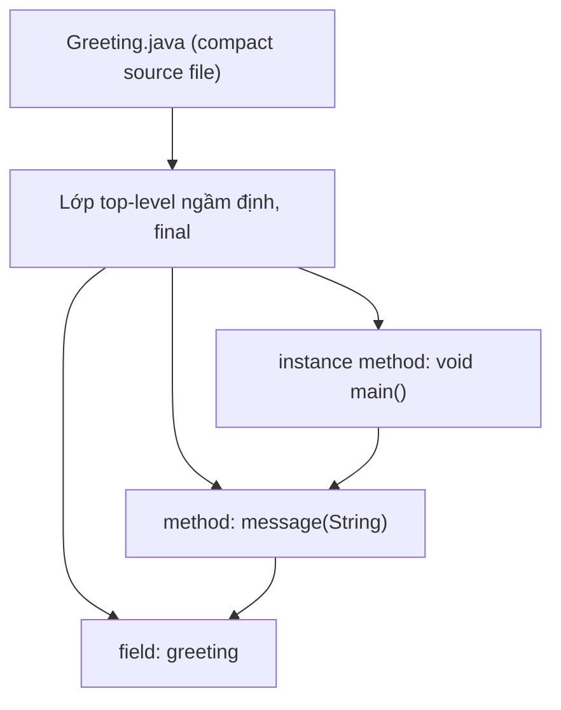

# Khai báo phương thức, trường và kiểu thành viên trong tệp nguồn gọn

**Compact source files** (tệp nguồn gọn) là một tính năng ngôn ngữ **chính thức của Java 25**, được hoàn thiện theo **JEP 512 – Compact Source Files and Instance Main Methods**. Nhờ đó, một chương trình nhỏ có thể khai báo **phương thức**, **trường dữ liệu** và **kiểu thành viên** ngay trong file `.java` mà không cần viết lớp bao ngoài bằng cú pháp `class Program { ... }`. Java vẫn biên dịch chương trình thành **một lớp ngầm định** (*implicitly declared class*): mã không trở thành script tách khỏi mô hình đối tượng của Java.

Bài học thuộc chương **Tệp nguồn gọn** của lộ trình **Java 25**. Mục tiêu là biết khai báo đúng các thành viên của lớp ngầm định, phân biệt thành viên instance và `static`, hiểu phạm vi truy cập, dùng được record/enum/interface/lớp thành viên và nhận biết lúc nào nên chuyển sang lớp có tên. Nội dung ưu tiên kiến thức **còn áp dụng được trong Java hiện đại**, không xây dựng ví dụ trên các bản preview cũ hoặc cơ chế đã lỗi thời.

## 1. Bản chất: các khai báo ở cấp file là thành viên của lớp ngầm định

Xét tệp `Greeting.java`:

```java
// Greeting.java — Java 25
String greeting = "Xin chào";

String message(String name) {
    return greeting + ", " + name + "!";
}

void main() {
    IO.println(message("Mai"));
}
```

Chạy bằng **JDK 25**:

```bash
java --version
java Greeting.java
```

Kết quả mong đợi:

```text
Xin chào, Mai!
```

Ta không viết `class Greeting` nhưng về ngữ nghĩa, `greeting`, `message(...)` và `main()` vẫn là **thành viên của một lớp** do trình biên dịch ngầm khai báo. Ở đây, cả ba là thành viên **instance** vì không có `static`. Java launcher tạo một instance của lớp ngầm định rồi gọi `main()` trên instance đó.

Sơ đồ tư duy:



**Không nên hiểu sơ đồ là một phép biến đổi source-to-source bắt buộc.** Tên và cách biểu diễn lớp ngầm định do công cụ triển khai quyết định; người viết mã **không thể gọi tên lớp này trực tiếp trong mã nguồn**.

### Các thuộc tính quan trọng của lớp ngầm định

Theo Java Language Specification của Java 25, một lớp được khai báo ngầm qua compact source file:

| Đặc điểm | Hệ quả thực tế |
| --- | --- |
| Là một lớp top-level, `final` | Không thể thiết kế lớp ngầm định làm base class để kế thừa |
| Thuộc **unnamed package** và **unnamed module** | Không có package name để import dùng như API của ứng dụng khác |
| Kế thừa `java.lang.Object`, không khai báo superinterface | Không dùng `extends`/`implements` cho lớp bao ngoài ngầm định |
| Có constructor mặc định không tham số | Launcher có thể tạo instance cho instance `main` |
| Không thể khai báo constructor tường minh | Không định nghĩa `Greeting(...) { ... }` như ở lớp có tên |
| Phải có ít nhất một phương thức `main` phù hợp giao thức chạy chương trình | Tệp chỉ chứa field hoặc kiểu phụ trợ mà không có `main` là không hợp lệ |
| Có thể khai báo fields, methods, member classes và member interfaces | Vẫn dùng mô hình thành viên quen thuộc của Java |

Điểm này phân biệt compact source file với **source file thông thường trong unnamed package**. Một file `class Hello { ... }` vẫn là khai báo lớp có tên, dù không có `package`; nó **không tự động trở thành compact source file**.

## 2. Cú pháp và những gì được phép đặt ở cấp file

Một compact source file có thể chứa các `import` ở đầu, sau đó là các **class member declarations**. Trong số đó phải có ít nhất một khai báo phương thức, và lớp ngầm định phải có `main` đủ điều kiện chạy.

| Khai báo bên ngoài dấu ngoặc lớp tường minh | Hợp lệ? | Ví dụ |
| --- | --- | --- |
| Phương thức instance | Có | `int doubleOf(int x) { return x * 2; }` |
| Phương thức `static` | Có | `static int triple(int x) { return x * 3; }` |
| Trường instance | Có | `private int total = 0;` |
| Trường `static` | Có | `private static final int LIMIT = 10;` |
| Lớp thành viên | Có | `class Counter { ... }` |
| Interface thành viên | Có | `interface Formatter { ... }` |
| Record/enum thành viên | Có | `record Item(String name) {}` |
| Import trước các khai báo | Có | `import java.time.LocalDate;` |
| `package com.example;` | **Không** | Lớp ngầm định thuộc unnamed package |
| Constructor của lớp ngầm định | **Không** | `Greeting() { ... }` |
| Initializer block độc lập | **Không** | `{ total++; }` hoặc `static { ... }` |

**Phân biệt initializer block với field initializer:** viết `int total = 5;` là hợp lệ; viết một block `{ total = 5; }` ở cấp file để làm initializer của lớp ngầm định thì không. Các lớp thành viên **có tên** ở bên trong file vẫn áp dụng những quy tắc constructor và initializer thông thường của chính chúng.

### Thứ tự khai báo

Fields, methods và member types có thể đặt ở các vị trí khác nhau trong phần khai báo thành viên (sau `import`). Ví dụ vẫn hợp lệ:

```java
// OrderIndependent.java
void main() {
    IO.println(buildMessage());
}

record Customer(String name) {}

String buildMessage() {
    return "Khách hàng: " + new Customer("Lan").name();
}
```

Tuy nhiên, **thứ tự khởi tạo field** và quy tắc *illegal forward reference* vẫn giống class Java thông thường. Việc được đặt phương thức trước trường **không** có nghĩa mọi biểu thức khởi tạo đều được tham chiếu tự do tới các trường khai báo sau.

## 3. Khai báo nhiều phương thức và tổ chức logic nhỏ

Một compact source file không giới hạn ở `void main()`. Có thể chia xử lý thành các phương thức giúp dễ kiểm thử, đọc và tái sử dụng nội bộ.

```java
// PriceTool.java
import java.math.BigDecimal;

BigDecimal subtotal(BigDecimal price, int quantity) {
    if (quantity < 0) {
        throw new IllegalArgumentException("Số lượng phải không âm");
    }
    return price.multiply(BigDecimal.valueOf(quantity));
}

BigDecimal applyDiscount(BigDecimal amount, int percent) {
    if (percent < 0 || percent > 100) {
        throw new IllegalArgumentException("Phần trăm không hợp lệ");
    }
    return amount.multiply(
        BigDecimal.valueOf(100 - percent)
                  .movePointLeft(2));
}

void printResult(BigDecimal amount) {
    IO.println("Thành tiền: " + amount.toPlainString());
}

void main() {
    var total = subtotal(new BigDecimal("125000"), 2);
    printResult(applyDiscount(total, 10));
}
```

Chạy:

```bash
java PriceTool.java
```

Kết quả dự kiến:

```text
Thành tiền: 225000.00
```

Những phương thức `subtotal`, `applyDiscount`, `printResult` là **instance methods** có thể gọi trực tiếp từ instance `main()`. Không cần thêm `static` hàng loạt chỉ để “gọi được từ main”.

Lưu ý về tổ chức mã:

- Nếu nghiệp vụ dùng `BigDecimal`, ưu tiên constructor từ **chuỗi** hoặc API được thiết kế rõ về độ chính xác; tránh chuyển từ `double` bất cẩn khi tính tiền.
- Việc tách helper methods trong cùng file giúp một chương trình nhỏ dễ đọc hơn, nhưng **không tự tạo API tái sử dụng** giữa các package.
- Khi logic cần nhiều nhóm trách nhiệm, test framework, quản lý dependency hoặc versioning API, chuyển sang các lớp/record có tên trong cấu trúc dự án bình thường.

### Phương thức nhận tham số dòng lệnh

Trong Java 25, instance `main` có thể nhận `String[]`:

```java
// Echo.java
String prefix = "Đối số";

void main(String[] args) {
    if (args.length == 0) {
        IO.println("Hãy truyền ít nhất một đối số.");
        return;
    }
    for (int i = 0; i < args.length; i++) {
        IO.println(prefix + " " + i + ": " + args[i]);
    }
}
```

```bash
java Echo.java alpha beta
```

**Không bắt buộc** khai báo `public static void main(String[] args)` cho chương trình chạy bằng Java 25. `void main()` và `void main(String[] args)` là hai dạng thường dùng; các dạng `static` vẫn hợp lệ. Một phương thức `private void main()` **không đủ điều kiện** làm điểm vào của chương trình.

Nếu có cả `main(String[])` và `main()` đều đủ điều kiện, launcher ưu tiên dạng **có tham số `String[]`**. Không nên cố ý định nghĩa nhiều `main` trong bài nhỏ nếu điều đó làm người đọc không rõ đường chạy thực sự.

## 4. Trường instance và `static`: tránh nhầm trạng thái

Một trường khai báo ở cấp file cũng là trường của lớp ngầm định. Không thêm `static` thì đó là **instance field**:

```java
// CounterDemo.java
private int count = 0;
private final String label = "Đã xử lý";

void increment() {
    count++;
}

void printCount() {
    IO.println(label + ": " + count);
}

void main() {
    increment();
    increment();
    printCount();
}
```

Kết quả:

```text
Đã xử lý: 2
```

Khi launcher tạo instance, các field được khởi tạo theo quy tắc thông thường trước khi instance `main()` chạy. Chúng **không phải biến toàn cục** và không tự lưu giá trị giữa hai lần chạy process khác nhau.

### Trường hằng số và helper `static`

```java
// Scale.java
private static final int FACTOR = 3;
private int base = 7;

static int scale(int value) {
    return value * FACTOR;
}

int result() {
    return scale(base);
}

void main() {
    IO.println(result()); // 21
}
```

Ở đây, `scale` là static method nên **không được truy cập trực tiếp** `base` (instance field) nếu không có một object. Ngược lại, instance method `result()` được phép gọi static method.

Ví dụ **sai**:

```java
// InvalidStaticAccess.java — cố ý sai để học, không chạy trực tiếp.
int number = 5;

static void main() {
    IO.println(number); // LỖI: static context không được tham chiếu instance field.
}
```

**Cách sửa** là đổi thành `void main()` hoặc thiết kế lại `number` thật sự là static state nếu cần. Không cố tạo `new InvalidStaticAccess()` trong compact source file: **tên của lớp ngầm định không thể được tham chiếu bằng source code**, ngay cả khi công cụ biên dịch sử dụng tên file trong bytecode.

### Trạng thái mutable có thật sự cần?

Với chương trình CLI xử lý danh sách, biến cục bộ trong `main` thường an toàn và dễ hiểu hơn trường mutable. Dùng field khi nhiều method thực sự cần chia sẻ **trạng thái của cùng một instance**. Đừng dùng `static` như một nơi cất dữ liệu tùy ý nếu điều đó gây khó kiểm thử hoặc tạo race khi về sau ứng dụng chạy đa luồng.

## 5. Khai báo kiểu thành viên: lớp, record, enum và interface

Một tính năng dễ bị bỏ sót của compact source files là ngoài field và method, ta còn có thể khai báo **member types**. Chúng là **kiểu lồng trong lớp ngầm định**, không phải các kiểu top-level độc lập chỉ vì nhìn thấy ở cấp file.

Ví dụ sau khai báo:

- `record Product`: dữ liệu bất biến của một mặt hàng.
- `enum StockStatus`: trạng thái tồn kho hữu hạn.
- `interface StockPolicy`: hợp đồng phân loại.
- `class ThresholdPolicy`: implementation của interface.

```java
// StockReport.java
record Product(String sku, int stock) {
    Product {
        if (sku == null || sku.isBlank() || stock < 0) {
            throw new IllegalArgumentException("Dữ liệu hàng không hợp lệ");
        }
    }
}

enum StockStatus {
    OUT_OF_STOCK,
    LOW,
    AVAILABLE
}

interface StockPolicy {
    StockStatus classify(Product product);
}

class ThresholdPolicy implements StockPolicy {
    @Override
    public StockStatus classify(Product product) {
        if (product.stock() == 0) {
            return StockStatus.OUT_OF_STOCK;
        }
        return product.stock() <= 5
            ? StockStatus.LOW : StockStatus.AVAILABLE;
    }
}

void main() {
    StockPolicy policy = new ThresholdPolicy();
    var products = List.of(
        new Product("A01", 0),
        new Product("B02", 3),
        new Product("C03", 18)
    );

    for (Product product : products) {
        IO.println(product.sku() + " => " + policy.classify(product));
    }
}
```

Kết quả dự kiến:

```text
A01 => OUT_OF_STOCK
B02 => LOW
C03 => AVAILABLE
```

**Vì sao các kiểu này hợp lệ?** Chúng là các khai báo *member class* hoặc *member interface* trong lớp bao ngầm định. Record và enum là những dạng class của Java, dùng được làm kiểu thành viên. Quy tắc `static`/instance của nested types **vẫn giống class Java thông thường**:

| Loại | Đặc điểm khi khai báo làm thành viên |
| --- | --- |
| `record Product(...)` | Record thành viên **ngầm `static`**, không giữ reference tới instance lớp bao |
| `enum StockStatus` | Enum thành viên **ngầm `static`** |
| `interface StockPolicy` | Member interface **ngầm `static`** |
| `class ThresholdPolicy` | Member class thông thường, mặc định là **inner class** nếu không ghi `static` |
| `static class Calculator` | Static nested class, không cần instance lớp bao |

Trong ví dụ, `new ThresholdPolicy()` hợp lệ bên trong instance `main()` vì có instance bao hiện hành. Một member class có thể đọc trường instance của lớp ngầm định nếu thiết kế yêu cầu:

```java
// InnerClassDemo.java
private int messagesSent = 0;

class Messenger {
    void send(String text) {
        messagesSent++;
        IO.println(text);
    }
}

void main() {
    var messenger = new Messenger();
    messenger.send("Lần 1");
    messenger.send("Lần 2");
    IO.println("Số thông điệp: " + messagesSent);
}
```

Nếu không cần truy cập state của lớp bao, có thể dùng `static class` hoặc record; thiết kế như vậy giảm coupling không cần thiết. **Tránh cố truy cập kiểu lồng bằng tên lớp ngầm định** (ví dụ `StockReport.Product` trong mã nguồn khác): lớp ngầm định không dùng làm namespace/API công khai được như một class có tên.

### Khai báo `private` cho kiểu thành viên có được không?

Có. Kiểu thành viên được áp dụng các modifier theo quy tắc nested types Java thông thường. Ví dụ sau hợp lệ trong compact source file:

```java
// InternalType.java
private record Reading(int value) {}

private Reading read() {
    return new Reading(42);
}

void main() {
    IO.println(read().value());
}
```

Tuy nhiên, dù một kiểu thành viên có modifier `public`, lớp bao ngầm định **không có tên tham chiếu được trong source code**. Vì vậy **không dùng compact source file để xuất bản API thư viện**. Khi các kiểu cần được import, tái sử dụng hoặc version độc lập, chuyển chúng sang lớp/record/interface top-level có tên và package phù hợp.

## 6. Phạm vi truy cập và giới hạn của lớp ngầm định

Một số quy tắc vẫn là quy tắc Java bình thường:

1. **Fields và methods** mặc định mang quyền truy cập package-private nếu không có modifier; có thể đặt `private`, `protected`, `public` theo quy tắc thành viên.
2. **Methods** mặc định là instance methods, trừ khi khai báo `static`.
3. **Fields** mặc định là instance fields; có thể khai báo `static final` cho hằng số.
4. **Member types** tuân thủ quy tắc nested types: inner class khác với static nested class, record, enum hoặc interface.
5. **`this`** có thể dùng trong instance method để chỉ instance của lớp ngầm định, nhưng **không thể viết tên lớp ngầm định** trong source.
6. **Import** phải được đặt trước các khai báo thành viên; không có cú pháp package declaration cho compact compilation unit.

Ví dụ dùng `this` và method reference:

```java
// Printer.java
private String decorate(String value) {
    return "[ " + value + " ]";
}

void main() {
    List.of("A", "B", "C")
        .stream()
        .map(this::decorate)
        .forEach(IO::println);
}
```

Đây là **method reference tới một instance method**, hoàn toàn hợp lệ. Ngược lại, `Printer::decorate` không phải cách hợp lệ để nói đến phương thức của lớp ngầm định trong source code.

### Không khai báo constructor hoặc initializer block của lớp bao

Ví dụ **cố ý sai**:

```java
// InvalidInitialization.java — không hợp lệ.
int count;

{                       // LỖI: instance initializer của lớp ngầm định.
    count = 10;
}

static {                // LỖI: static initializer của lớp ngầm định.
    IO.println("Start");
}

void main() {
    IO.println(count);
}
```

Sửa thành **field initializer** hoặc phương thức khởi tạo rõ nghĩa:

```java
// ValidInitialization.java
private int count = 10;

private int calculateStart() {
    return count * 2;
}

void main() {
    IO.println(calculateStart());
}
```

Nếu cần constructor tùy biến, quản lý nhiều kiểu object hoặc injection, đây là tín hiệu nên **dùng class có tên** thay vì kéo compact source file tới giới hạn khó hiểu.

## 7. Tự động import từ `java.base` và import tường minh

Trong compact source file, trình biên dịch tự động import-on-demand **các kiểu top-level public được export từ những package của module `java.base`**. Có thể dùng `List`, `Map`, `Stream`, `LocalDate`, `BigDecimal`... mà không phải khai báo import tương ứng, tương tự ý tưởng của `import module java.base;`.

```java
// DailySummary.java
record Summary(LocalDate day, List<Integer> numbers) {}

void main() {
    var data = new Summary(LocalDate.of(2026, 11, 27),
        List.of(3, 5, 8));
    int sum = data.numbers()
                  .stream()
                  .mapToInt(Integer::intValue)
                  .sum();
    IO.println(data.day() + " — tổng = " + sum);
}
```

**Tự import `java.base` không có nghĩa tự import toàn bộ Java SE.** Chẳng hạn, `javax.swing.JFrame` thuộc `java.desktop` chứ không thuộc `java.base`; cần import đúng module/package và cấu hình dependency phù hợp. Các thư viện bên ngoài Java SE vẫn phải có trên classpath/module-path.

Ngoài ra, **các static methods của `java.lang.IO` không được auto-static-import**. Viết `IO.println("...")` là đúng; viết `println("...")` chỉ hợp lệ khi đã có `import static java.lang.IO.println;` hoặc định nghĩa một method tên `println` thích hợp.

Nếu tự thêm nhiều module import hoặc các import-on-demand có **hai kiểu trùng simple name**, trình biên dịch có thể báo lỗi ambiguous type. Khi đó sử dụng explicit single-type import hoặc tên đầy đủ để làm rõ. Sự tiện lợi của compact source files **không loại bỏ** các quy tắc resolution và accessibility của Java.

## 8. Một ví dụ thực hành gộp: báo cáo tồn kho một file

Tạo `InventoryCli.java` với các thành phần:

- **Field instance** `private final List<Item> items` giữ dữ liệu của lần chạy.
- **Member record** `Item` để mô hình hóa thông tin.
- **Member enum** `Risk` để phân loại số lượng.
- **Instance methods** `add`, `risk`, `printReport` để tách nghiệp vụ.
- **Instance `main(String[] args)`** lấy dữ liệu dòng lệnh hoặc sử dụng dữ liệu ví dụ.

```java
// InventoryCli.java — Java 25, không cần --enable-preview
private final List<Item> items = new ArrayList<>();

private record Item(String name, int stock) {
    Item {
        if (name == null || name.isBlank() || stock < 0) {
            throw new IllegalArgumentException("Item không hợp lệ");
        }
    }
}

private enum Risk { EMPTY, LOW, OK }

private Risk risk(Item item) {
    if (item.stock() == 0) return Risk.EMPTY;
    return item.stock() <= 5 ? Risk.LOW : Risk.OK;
}

private void add(String name, int stock) {
    items.add(new Item(name, stock));
}

private void printReport() {
    IO.println("=== BÁO CÁO TỒN KHO ===");
    for (Item item : items) {
        IO.println(item.name() + ": " + item.stock()
            + " (" + risk(item) + ")");
    }
    int total = items.stream().mapToInt(Item::stock).sum();
    IO.println("Tổng tồn kho: " + total);
}

void main(String[] args) {
    if (args.length == 0) {
        add("Bút", 10);
        add("Vở", 4);
        add("Thước", 0);
    } else {
        for (String arg : args) {
            String[] parts = arg.split(":", 2);
            if (parts.length != 2) {
                IO.println("Cú pháp: ten:so-luong");
                return;
            }
            try {
                add(parts[0], Integer.parseInt(parts[1]));
            } catch (IllegalArgumentException ex) {
                IO.println("Dữ liệu không hợp lệ: " + arg);
                return;
            }
        }
    }
    printReport();
}
```

**Vì sao chỉ bắt một loại exception?** `NumberFormatException` kế thừa `IllegalArgumentException`, vì vậy `catch (NumberFormatException | IllegalArgumentException ex)` là một multi-catch **không hợp lệ**. Bắt `IllegalArgumentException` ở đây xử lý cả số nhập sai và validation trong `Item`. Với ứng dụng thật, có thể tách lỗi cú pháp và lỗi nghiệp vụ thành thông báo riêng để người dùng dễ sửa.

Chạy:

```bash
java InventoryCli.java
java InventoryCli.java "Táo:8" "Cam:2" "Ổi:0"
```

Ví dụ này minh họa khai báo đầy đủ **method + field + member types** trong một compact source file. Không cần `public class InventoryCli`, cũng không cần bật preview. Tuy nhiên, với chương trình lớn hơn, nên tách `Item`, nghiệp vụ báo cáo và lớp `main` thành các kiểu/tệp riêng theo package rõ ràng.

## 9. Đánh giá khi nào cần chuyển thành class có tên

Compact source files là một lựa chọn **đang áp dụng được** trong Java 25 cho chương trình nhỏ. Nhưng không phải mọi thành viên của ứng dụng đều phù hợp để đặt vào cùng một file ngầm định.

| Tình huống | Tiếp tục compact source file | Chuyển sang class/package thông thường |
| --- | --- | --- |
| Demo cơ chế Java hoặc tập hợp vài phép tính | Thường phù hợp | Không cần nếu không tăng phức tạp |
| CLI xử lý dữ liệu nhỏ, chạy độc lập | Phù hợp | Khi cần nhiều lệnh, config hoặc persistence |
| Dữ liệu có 1–2 record và enum nhỏ | Có thể hợp lý | Khi nhiều nơi cần import/tái sử dụng |
| Có nhiều service, dependency injection hoặc test unit | Thường không còn lợi thế | Nên chọn cấu trúc rõ trách nhiệm |
| API thư viện public | Không phù hợp | Dùng kiểu top-level có tên và package |
| Spring Boot hoặc ứng dụng mô-đun hóa lớn | Chỉ cân nhắc cho demo/utility | Dùng tổ chức chuẩn, build/test/versioning |

### Chuyển đổi từng bước

Mã nguồn gọn:

```java
// SimpleTool.java (compact)
private int doubleOf(int x) {
    return x * 2;
}

void main() {
    IO.println(doubleOf(21));
}
```

Chuyển sang class tường minh:

```java
// SimpleTool.java (ordinary source file)
public class SimpleTool {
    private int doubleOf(int x) {
        return x * 2;
    }

    void main() {
        IO.println(doubleOf(21));
    }
}
```

Ở **Java 25**, instance `main()` không chỉ dành cho compact source files: class có tên với một candidate `main` hợp lệ cũng có thể được launcher chạy. Khi chuyển sang project cần hỗ trợ JDK thấp hơn, hãy điều chỉnh entry point theo khả năng **của JDK đích**, không mặc định cú pháp Java 25 chạy trên Java 17/21.

Muốn các kiểu hỗ trợ được import từ package khác, tạo những **top-level classes/records/interfaces** riêng có package name, thay vì kỳ vọng member types của lớp ngầm định là một API exportable.

## 10. Lỗi biên dịch và hiểu nhầm thường gặp

| Hiện tượng | Nguyên nhân | Cách xử lý |
| --- | --- | --- |
| “Có `void main()` mà javac không hiểu” | Toolchain/JDK thấp hơn 25, hoặc biên dịch bằng `--release` cũ | Chọn toolchain Java 25, cấu hình `--release 25` nếu build cần |
| “Không tìm thấy `main`” | File không có candidate main hợp lệ | Thêm `void main()` hoặc `void main(String[] args)` |
| “Không nhận `List` dù không import” | File đã chuyển thành ordinary class, hoặc toolchain không phải JDK 25 | Thêm import rõ ràng hoặc sử dụng compact source file đúng ngữ pháp |
| “Không thể tham chiếu lớp theo tên file” | Lớp bao là lớp **ngầm định**, không có tên dùng được trong source | Dùng `this`/instance method; cần API thì chuyển sang class có tên |
| “Illegal static reference” | Static method truy cập instance field/method | Sửa thành instance method hoặc thiết kế static state hợp lý |
| “Illegal modifier/initializer” | Đặt constructor hoặc initializer block ở cấp file | Dùng field initializer/method hoặc class tường minh |
| “Ambiguous type” | Hai kiểu trùng simple name do import-on-demand | Dùng import tường minh hoặc fully qualified name |
| “Không import được helper record từ dự án khác” | Helper là **member** của lớp ngầm định | Tách thành top-level record trong package có tên |
| “Chạy file thì được, test/library không tái sử dụng được” | Compact source file không được thiết kế làm API của module/library | Chuyển sang project Java có class và package rõ ràng |

### Một file sai vì chỉ khai báo kiểu

```java
// JustTypes.java — không phải một compact program có main.
record Item(String code) {}
enum State { NEW, DONE }
```

Một file chỉ có các khai báo **top-level record/enum** được phân tích như ordinary compilation unit, không phải chương trình compact hợp lệ có thể tự chạy. Nếu muốn các kiểu ấy là **member types** của lớp ngầm định, hãy thêm một phương thức cấp file:

```java
// WithMain.java
record Item(String code) {}
enum State { NEW, DONE }

void main() {
    IO.println(new Item("A01") + " / " + State.NEW);
}
```

Khi có `void main()` ở cấp file, các kiểu là **member types của lớp ngầm định**, không còn là các lớp top-level độc lập.

### Một file sai do `package` trong compact compilation unit

```java
// InvalidPackage.java — sai theo cú pháp compact source files.
package com.example;

void main() {
    IO.println("Hello");
}
```

Nếu cần `package com.example;`, hãy khai báo một **class có tên** và đặt `main` bên trong, thay vì trộn `package declaration` với các thành viên cấp file của lớp ngầm định.

## 11. Bài thực hành tự kiểm tra

### Bài 1 — Phương thức instance và trường dữ liệu

Tạo `Wallet.java` chỉ với `private int balance = 0;`, phương thức `deposit(int)`, `withdraw(int)` và `void main()`. Chạy lần lượt các giao dịch hợp lệ và bất hợp lệ. Yêu cầu: validation rõ ràng, balance không âm và không dùng `static` chỉ để gọi helper.

**Câu hỏi cần trả lời:** Các lần gọi `deposit`/`withdraw` trong một `main()` có cùng instance state không? Điều gì xảy ra khi chạy lại `java Wallet.java` từ đầu?

### Bài 2 — Record và enum là thành viên

Tạo `GradeReport.java` với member record `Student(String name, int score)` và enum `Level { PASS, FAIL }`. Viết `Level classify(Student)`, duyệt một `List<Student>` và in kết quả. Sau đó thêm inner class đếm số học sinh đạt.

**Câu hỏi cần trả lời:** Vì sao record và enum thành viên không cần instance của lớp ngầm định để tham chiếu kiểu, còn inner class không `static` lại có quan hệ với instance bao?

### Bài 3 — Tách file khi phạm vi trách nhiệm tăng

Lấy `InventoryCli.java`, tách `Item` thành record top-level có package rõ ràng và chuyển phần báo cáo sang một service class. Giữ điểm vào Java 25 đơn giản, thêm một unit test cho validation và một test cho tổng tồn kho.

**Câu hỏi cần trả lời:** Ở thời điểm nào tệp nguồn gọn không còn làm chương trình **dễ hiểu hơn**? Những lợi ích của top-level named types, package/import và testability xuất hiện ở đâu?

### Checklist đánh giá

| Tiêu chí | Cách chứng minh |
| --- | --- |
| Chạy trên Java 25 mà không bật preview | `java --version` và chạy file trực tiếp |
| Phân biệt instance/static | Giải thích field và helper nào cần instance |
| Khai báo được member types | Ví dụ record, enum, interface hoặc inner class chạy đúng |
| Hiểu ràng buộc syntax | Không khai báo constructor/initializer block của lớp ngầm định |
| Hiểu giới hạn package/API | Không cố dùng implicit class name từ source khác |
| Xử lý dữ liệu đầu vào | Validation và thông báo lỗi có nghĩa |
| Biết chuyển sang class thường | Chuyển đổi không làm thay đổi ý nghĩa chương trình |

## 12. Tài liệu chuẩn để đối chiếu

Các tài liệu sau mô tả hành vi **chính thức của Java 25**:

- [JEP 512 — Compact Source Files and Instance Main Methods](https://openjdk.org/jeps/512): mục tiêu, giới hạn và tiến trình hoàn thiện.
- [Oracle Java 25 — Compact Source Files and Instance Main Methods](https://docs.oracle.com/en/java/javase/25/language/compact-source-files-instance-main-methods.html): hướng dẫn tạo/chạy compact source files, thành viên, auto-import và `IO`.
- [Java Language Specification SE 25 — §7.3 Compilation Units](https://docs.oracle.com/javase/specs/jls/se25/html/jls-7.html#jls-7.3): quy tắc compact compilation unit và vị trí member declarations.
- [Java Language Specification SE 25 — §8.1.8 Implicitly Declared Classes](https://docs.oracle.com/javase/specs/jls/se25/html/jls-8.html#jls-8.1.8): class ngầm định, member types, cấm constructor/initializer block.
- [Java Language Specification SE 25 — §12.1.4 Invoke the Main Method](https://docs.oracle.com/javase/specs/jls/se25/html/jls-12.html#jls-12.1.4): những dạng `main` đủ điều kiện và thứ tự ưu tiên.

**Kết luận:** Java 25 cho phép khai báo **phương thức, trường và kiểu thành viên** ngay trong một tệp nguồn gọn, nhưng các khai báo đó vẫn là **thành viên của một lớp ngầm định**, tuân thủ quy tắc `static`, instance, access modifier và nested types của Java. Tính năng này giúp ví dụ, công cụ nhỏ và CLI ít nghi thức hơn; khi cần API công khai, package rõ ràng hay dependency/test phức tạp, chuyển sang named classes và cấu trúc Java thông thường. Đó là cách sử dụng Java 25 hiện đại mà không nhầm sự gọn nhẹ với việc bỏ qua thiết kế phần mềm.
