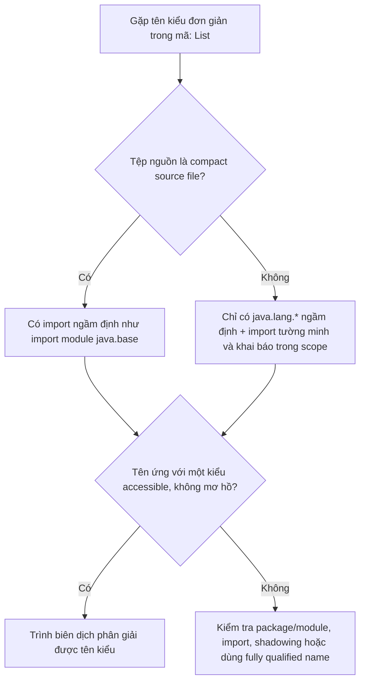

# Các import ngầm định và cách nhận biết tên kiểu đã có sẵn

## 1. Một chương trình không viết `import` vẫn dùng được `List`?

Hãy xem tệp **`QuickSummary.java`** viết cho **Java 25**:

```java
// QuickSummary.java — compact source file, JDK 25
void main() {
    List<String> names = List.of("Lan", "Minh", "An");
    var sorted = names.stream()
            .sorted(Comparator.naturalOrder())
            .toList();

    IO.println("Hôm nay: " + LocalDate.now());
    IO.println("Danh sách: " + sorted);
}
```

Lệnh chạy:

```bash
java --version
java QuickSummary.java
```

Tệp này không có khai báo `class` tường minh, cũng không có `import java.util.List;`, `import java.util.Comparator;` hay `import java.time.LocalDate;`. Nhưng trên **JDK 25**, ba tên kiểu đó vẫn dùng được vì nó là **compact source file**: Java tự nhập theo nhu cầu các **kiểu public cấp cao nhất** trong những package được module `java.base` export. `IO` là kiểu `java.lang.IO`, cũng sẵn có dưới tên đơn.

Bài học **“Các import ngầm định và cách nhận biết tên kiểu đã có sẵn”** thuộc chương **Tệp nguồn gọn** trong module `JAVA_VERSION_JAVA25`. Mục đích là học đúng ngữ nghĩa Java 25 hiện hành, giúp đọc tài liệu API, thử nghiệm tiện ích một tệp và đánh giá tác động khi nâng cấp JDK. Chúng ta **không dùng hành vi đã thay đổi từ những bản preview Java 21–24 làm quy tắc hiện nay**.

Sau bài này, bạn cần giải thích được:

1. **Import nào luôn có** trong mã Java, và **import nào chỉ có ở compact compilation unit** của Java 25.
2. Vì sao `List`, `Map`, `Path`, `Stream`, `LocalDate` dùng được không cần viết import ở tệp gọn, nhưng `HttpClient` hoặc một class thư viện bên ngoài không tự xuất hiện.
3. Vì sao có thể gọi `IO.println(...)` mà **không thể tự ý gọi `println(...)`** khi chưa import static.
4. Khác biệt giữa **public top-level type**, **member/nested type**, **phương thức static** và **tên module**.
5. Cách xử lý xung đột tên đơn giản khi import thêm module, cách kiểm tra package/module bằng tài liệu Java SE 25, cùng quy trình khắc phục `cannot find symbol`.

### 1.1. Luồng phân giải tên nhìn ở mức khái niệm



Đây là sơ đồ gợi ý chẩn đoán, **không thay thế thứ tự phân giải tên đầy đủ trong Java Language Specification**. Tên của kiểu có thể bị khai báo khác trong scope che khuất hoặc trở nên mơ hồ; việc có module import không có nghĩa tên đơn giản luôn phân giải được.

## 2. Quy tắc chính thức trong Java 25

### 2.1. Hai cơ chế cần phân biệt

**Cơ chế thứ nhất: `java.lang` dành cho mọi compilation unit.** Các kiểu public phổ biến như `String`, `Object`, `System`, `Math`, `Integer` và `IO` trong `java.lang` được dùng bằng tên đơn mà không cần viết `import java.lang.*;`. Điều này đúng cho cả class thông thường và compact source file.

**Cơ chế thứ hai: `java.base` dành riêng cho compact source file.** Ở Java 25, mỗi compact compilation unit được đối xử như có một khai báo:

```java
import module java.base;
```

Khai báo trên là **module import declaration** theo **JEP 511**, cũng đã chính thức trong Java 25. Nó cho phép sử dụng tên đơn của các **public top-level classes/interfaces** trong **mọi package mà module `java.base` export** (theo quyền truy cập ngôn ngữ), *on demand*. Với compact source file, bạn không phải tự viết dòng này. Quy tắc trên được chuẩn hóa cùng **JEP 512 — Compact Source Files and Instance Main Methods**.

| Quy tắc | Compact source file Java 25 | Source có `class` tường minh |
| --- | --- | --- |
| `java.lang` implicit import | Có | Có |
| Implicit module import `java.base` | **Có** | **Không** |
| `List` (`java.util.List`) không có import viết tay | Có | Thông thường không |
| `Path` (`java.nio.file.Path`) không có import viết tay | Có | Thông thường không |
| `IO` (`java.lang.IO`) không có import viết tay | Có | Có |
| `HttpClient` (`java.net.http.HttpClient`) không có import viết tay | Không tự có | Không tự có |
| Tự import các static method của `IO` | **Không** | **Không** |
| Hỗ trợ chủ động viết `import module java.base;` | Có, nhưng thừa khi không có mục đích khác | Có, khi muốn dùng module import |

**Chỉ khi là compact source file** thì cơ chế import module `java.base` mới xuất hiện mặc định. Việc một class nằm trong *unnamed package* hoặc có `void main()` dạng instance **không tự biến nó thành compact source file** nếu tệp vẫn khai báo class tường minh.

### 2.2. Những từ khóa “import on demand”, “public”, “top-level”, “exported” có nghĩa gì?

- **Import on demand:** khi trình biên dịch cần phân giải tên kiểu, nó xét những kiểu có thể truy cập từ các package mà module export. Import không tạo object, không nạp mọi class vào JVM ngay khi khởi động và không thêm bytecode từ mọi package vào chương trình.
- **Public top-level type:** kiểu `class`/`interface`/`enum`/`record` public được khai báo ở cấp cao nhất trong một package. Trong quy tắc import của Java, các enum/record public cũng là những dạng class, và annotation interface public là dạng interface.
- **Exported package:** một package được module cung cấp để các module có quyền đọc và truy cập. Không phải mọi package trong JDK đều được export. Một package `internal` không export không trở nên dùng được chỉ vì nằm bên trong `java.base`.
- **Accessible:** ngay cả khi tên kiểu có trong package được export, quyền truy cập và ngữ cảnh sử dụng vẫn phải hợp lệ.
- **Simple name:** `List` là tên đơn; `java.util.List` là **fully qualified name**. Import cho phép dùng tên đơn, nhưng không thay đổi nơi kiểu được định nghĩa.

Thành phần được import là **các kiểu**, không phải toàn bộ nội dung của module. Ví dụ `java.base` không tự làm `List.of(...)` trở thành `of(...)`: `of` là phương thức static của `List`, không phải kiểu được import.

### 2.3. Java 25 là phiên bản đã hoàn thiện, không cần preview

Compact source files (JEP 512) và module import declarations (JEP 511) đều trở thành tính năng **permanent** trong **Java SE 25**. Với đúng JDK 25, những ví dụ trong bài không cần `--enable-preview` chỉ để sử dụng hai khả năng này. Nếu biên dịch với `--release 21` hoặc Java toolchain cũ, đừng kỳ vọng quy tắc ngôn ngữ Java 25 có thể được áp dụng ngược.

Tránh dùng lời gọi `println("...")` không có import, hoặc `java.io.IO` từ các phiên bản preview cũ làm ví dụ Java 25 hiện hành. Với Java 25, kiểu console là **`java.lang.IO`**, còn việc import static methods không được thực hiện tự động.

## 3. Nhận diện những kiểu thuộc `java.base`

### 3.1. Các ví dụ thường gặp

| Tên đơn dùng được trong compact file | Tên đầy đủ của kiểu | Package | Tác dụng |
| --- | --- | --- | --- |
| `List`, `Map`, `Set`, `Comparator` | `java.util.List`, `java.util.Map`, `java.util.Set`, `java.util.Comparator` | `java.util` | Collections và so sánh |
| `Optional`, `UUID` | `java.util.Optional`, `java.util.UUID` | `java.util` | Dữ liệu tùy chọn, định danh |
| `Stream`, `Collectors` | `java.util.stream.Stream`, `java.util.stream.Collectors` | `java.util.stream` | Xử lý luồng |
| `Function`, `Predicate` | `java.util.function.Function`, `java.util.function.Predicate` | `java.util.function` | Functional interfaces |
| `LocalDate`, `Instant`, `Duration` | `java.time.LocalDate`, `java.time.Instant`, `java.time.Duration` | `java.time` | Thời gian |
| `Path`, `Files` | `java.nio.file.Path`, `java.nio.file.Files` | `java.nio.file` | Đường dẫn và tệp |
| `StandardCharsets` | `java.nio.charset.StandardCharsets` | `java.nio.charset` | Charset chuẩn |
| `BigDecimal`, `BigInteger` | `java.math.BigDecimal`, `java.math.BigInteger` | `java.math` | Số chính xác / số lớn |
| `Pattern`, `Matcher` | `java.util.regex.Pattern`, `java.util.regex.Matcher` | `java.util.regex` | Biểu thức chính quy |
| `AtomicInteger` | `java.util.concurrent.atomic.AtomicInteger` | `java.util.concurrent.atomic` | Biến nguyên tử |
| `URI`, `URL` | `java.net.URI`, `java.net.URL` | `java.net` | Định danh tài nguyên |
| `String`, `Math`, `System`, `IO` | `java.lang.String`, `java.lang.Math`, `java.lang.System`, `java.lang.IO` | `java.lang` | Kiểu nền tảng và console |

Bảng này là một **tập ví dụ**, không phải danh mục đầy đủ của module `java.base`. Cần nhìn **module chứa package** và **quyền export**, chứ không suy đoán từ việc kiểu bắt đầu bằng chuỗi `java.***. Chẳng hạn `java.net.http` thuộc module riêng `java.net.http`, không phải `java.base` dù tên package có tiền tố `java.net`.

### 3.2. Ví dụ sử dụng nhiều package mà không cần import

```java
// CollectionReport.java
void main() {
    List<String> raw = List.of("lan", "an", "minh", "lan");

    Map<String, Long> counts = raw.stream()
            .collect(Collectors.groupingBy(
                    Function.identity(),
                    Collectors.counting()));

    var ordered = counts.entrySet().stream()
            .sorted(Map.Entry.comparingByKey())
            .toList();

    IO.println("Thời điểm: " + Instant.now());
    IO.println("Số tên khác nhau: " + counts.size());
    for (var entry : ordered) {
        IO.println(entry.getKey() + ": " + entry.getValue());
    }
}
```

Các kiểu `List`, `Map`, `Collectors`, `Function` và `Instant` đến từ nhiều package khác nhau nhưng đều thuộc các package được `java.base` export. `Map.Entry` là một **member type**, được dùng qua tên bao ngoài `Map`; nó **không** có nghĩa `Entry` được tự nhập như một top-level type.

Chạy bằng JDK 25:

```bash
java CollectionReport.java
```

Chương trình vẫn dùng cú pháp Java có kiểm tra kiểu tĩnh; không cần một JVM “script engine” riêng.

### 3.3. `Path` và `Files` cũng sẵn có

```java
// CheckFile.java
void main(String[] args) {
    if (args.length != 1) {
        IO.println("Cách dùng: java CheckFile.java <duong-dan>");
        return;
    }

    Path path = Path.of(args[0]);
    IO.println("Đường dẫn: " + path.toAbsolutePath());
    IO.println("Tồn tại: " + Files.exists(path));
    IO.println("Là tệp thường: " + Files.isRegularFile(path));
}
```

Ở đây không viết `import java.nio.file.Path;` hoặc `import java.nio.file.Files;` mà mã vẫn phù hợp với Java 25. Ví dụ chỉ truy vấn thông tin tệp, không giả định `Files.exists` đảm bảo tệp sẽ tiếp tục tồn tại trong thời gian sau đó; với tác vụ đọc/ghi thực tế, vẫn cần xử lý lỗi I/O và quyền truy cập.

### 3.4. “Các kiểu đã có sẵn” không phải “mọi tên đều có sẵn”

Phân biệt:

- `int`, `boolean` và `void` là các **kiểu/keyword của ngôn ngữ**; không cần import vì chúng không được định nghĩa như các class trong package.
- `var` là từ khóa ngữ cảnh phục vụ **local variable type inference**, không phải tên một class `java.base`.
- `record`, `sealed` hoặc `switch` là thành phần cú pháp Java; việc dùng được chúng không liên quan tới import.
- `List` là **tên một interface** trong `java.util`, có thể cần import tùy loại compilation unit.
- `of` không phải một kiểu. Muốn gọi `List.of`, phải có cách tham chiếu tới `List`; chỉ import kiểu không mang các static methods ra phạm vi gọi trực tiếp.
- `Map.Entry` không được tự biến thành tên `Entry` trần; nested types có quy tắc tham chiếu/import riêng.

Đây là điểm khác biệt giữa **ngôn ngữ Java**, **Java API** và **cơ chế phân giải tên**. Biết ba khái niệm này giúp chẩn đoán chính xác khi một tên “có vẻ có sẵn” nhưng compiler vẫn báo lỗi.

## 4. Vì sao `IO.println` hợp lệ nhưng `println` không?

### 4.1. Import kiểu không phải import thành viên static

Java 25 có lớp console `java.lang.IO`. Vì `java.lang` nằm trong phạm vi tên kiểu được import ngầm, bạn có thể viết:

```java
// OutputDemo.java
void main() {
    IO.println("Java 25");
    IO.println(42);
}
```

Nhưng **không** được viết:

```java
// Không hợp lệ nếu không có explicit static import
void main() {
    println("Java 25"); // Cannot find symbol: println
}
```

Điểm khác biệt là `IO` là tên **kiểu**, còn `println` là phương thức **static** của kiểu đó. Module import và type import không tự đưa các static method vào scope theo tên đơn. Điều này cũng áp dụng với `Math.max`, `List.of` và `Collectors.toList`.

### 4.2. Hai cách hợp lệ ở Java 25

Cách 1 — tên lớp rõ ràng, thích hợp cho bài nhập môn:

```java
void main() {
    IO.println("Cách phổ biến và dễ đọc.");
}
```

Cách 2 — chủ động static import:

```java
import static java.lang.IO.println;

void main() {
    println("Cách viết ngắn, nhưng đã import static tường minh.");
}
```

Ngay cả một compact file cũng có thể viết import declarations ở đầu tệp, trước những khai báo phương thức và trường. JEP 512 **không** cấm import tường minh, chỉ cho phép bỏ một số import đã có sẵn.

### 4.3. Thí nghiệm tương đương với `Math`

```java
void main() {
    int maximum = Math.max(3, 7); // Math là kiểu trong java.lang
    IO.println(maximum);
}
```

Để gọi `max(3, 7)` không có tiền tố, cần khai báo:

```java
import static java.lang.Math.max;

void main() {
    IO.println(max(3, 7));
}
```

**Một quy tắc có thể nhớ:** thấy cú pháp `TypeName.staticMethod(...)` thì chỉ tên kiểu có thể được import ngầm; muốn bỏ `TypeName.`, phải có cơ chế đưa **method** vào phạm vi (chẳng hạn `import static`), không phải nhờ implicit `java.base`.

## 5. Đặt cùng đoạn mã trong class thông thường thì sao?

### 5.1. Đừng nhầm “unnamed package” với “compact source file”

Hai tệp sau đều có thể không khai báo `package`, nhưng **chỉ một tệp là compact**:

```java
// CompactList.java — compact source file
void main() {
    List<String> values = List.of("A", "B");
    IO.println(values);
}
```

```java
// ExplicitList.java — source có class tường minh
class ExplicitList {
    void main() {
        List<String> values = List.of("A", "B"); // Lỗi: thiếu import List
        IO.println(values);
    }
}
```

Trong Java 25, instance `main` của class tường minh có thể là entry point; **điều đó không khiến `java.base` được import ngầm theo quy tắc của compact source file**. `IO` vẫn có thể dùng vì nó thuộc `java.lang`, vốn sẵn có cho mọi source file.

### 5.2. Sửa bằng single-type import

```java
// ExplicitList.java
import java.util.List;

class ExplicitList {
    void main() {
        List<String> values = List.of("A", "B");
        IO.println(values);
    }
}
```

Khai báo `import java.util.List;` nằm trước khai báo class. Bạn có thể chạy nguồn trên bằng:

```bash
java ExplicitList.java
```

Đây là cách phổ biến và rõ ràng khi chỉ cần một vài kiểu cụ thể.

### 5.3. Hoặc chủ động import cả module trong Java 25

```java
// ExplicitReport.java
import module java.base;

class ExplicitReport {
    void main() {
        List<String> names = List.of("An", "Bình");
        LocalDate today = LocalDate.now();
        IO.println(today + ": " + names);
    }
}
```

Khai báo `import module java.base;` ở đây có **tác dụng thực** vì file chứa class tường minh, không có module import ngầm của compact source file. Module import là tính năng **chính thức của Java 25** (JEP 511), không phải preview.

Nó cũng hợp lệ trong một compact source file nhưng thường không cần lặp lại `java.base`. Khi codebase có nhiều kiểu tên giống nhau ở các package khác nhau, import tường minh từng kiểu thường giúp code review và tránh mơ hồ.

### 5.4. So sánh những thứ không thay đổi

Dù viết tệp gọn hay class tường minh, các điều sau vẫn đúng:

- Thư viện ngoài JDK phải có trong dependencies/classpath/module path thích hợp.
- Kiểu không `public` trong package khác không trở nên truy cập được chỉ nhờ import.
- Static methods và fields không xuất hiện trực tiếp chỉ nhờ type/module import.
- `private`, generic types, overload resolution và kiểm tra kiểu Java vẫn được áp dụng.
- Tên trùng nhau phải được phân giải đúng quy tắc JLS.
- Import là quy tắc **ở thời điểm biên dịch**, không phải cách xin quyền vượt qua module boundaries hoặc security policy.

## 6. Những kiểu thuộc module khác không được tự nhập

### 6.1. Đừng dùng tiền tố package để đoán module

Hệ thống Java Platform Module System (JPMS) chia các API JDK thành nhiều module. Một package mang tiền tố `java.*` có thể nằm ngoài `java.base`.

| Tên kiểu | Fully qualified name | Module sở hữu | Implicit trong compact file? |
| --- | --- | --- | --- |
| `List` | `java.util.List` | `java.base` | Có |
| `Path` | `java.nio.file.Path` | `java.base` | Có |
| `LocalDate` | `java.time.LocalDate` | `java.base` | Có |
| `HttpClient` | `java.net.http.HttpClient` | `java.net.http` | **Không** |
| `Connection` | `java.sql.Connection` | `java.sql` | **Không** |
| `Logger` (JUL) | `java.util.logging.Logger` | `java.logging` | **Không** |
| `JFrame` | `javax.swing.JFrame` | `java.desktop` | **Không** |
| `Document` (DOM) | `org.w3c.dom.Document` | `java.xml` | **Không** |
| `ObjectMapper` (Jackson) | `com.fasterxml.jackson.databind.ObjectMapper` | Dependency bên ngoài | **Không** |

Bảng này minh họa sự phân chia module trong **Java SE 25**, không nên suy ra mọi `java.*` thuộc `java.base`. Một số module có thể chưa được **resolved/read** trong từng cấu hình module path; import không tự động thay cho `requires` hoặc thiết lập build.

### 6.2. Cách đúng khi cần `HttpClient`

```java
// HttpClientInfo.java
import java.net.http.HttpClient;

void main() {
    HttpClient client = HttpClient.newHttpClient();
    IO.println("HTTP version mặc định: " + client.version());
}
```

Ví dụ chỉ **tạo đối tượng HTTP client**, không phát sinh request HTTP. Dòng `import java.net.http.HttpClient;` là import tường minh vì kiểu này nằm ngoài `java.base`. Java source file vẫn là **compact source file**: có import declaration phía trên nhưng không có class bao ngoài.

Khi dùng Java 25 và môi trường module resolution thông thường, ví dụ có thể chạy:

```bash
java HttpClientInfo.java
```

Trong một ứng dụng `module-info.java` có module tên, project cần thiết lập khả năng đọc `java.net.http` (ví dụ `requires java.net.http;`), thay vì cho rằng import sẽ tự thay thế các quy tắc JPMS. Bản thân compact source file thuộc unnamed module; không trở thành named module chỉ vì viết `import`.

### 6.3. Một module import khác là gì?

JEP 511 cho phép:

```java
import module java.net.http;
```

Khai báo này nhập các public top-level types từ các package mà module `java.net.http` export (và những export liên quan theo quy tắc readability của module import), thay vì chỉ nhập một kiểu. Tuy nhiên:

- Không giống `import java.net.http.*;` chỉ nhắm một package.
- Không tự đưa phương thức static của `HttpClient` ra tên đơn.
- Không thay thế `requires` hoặc cách build resolve các module cần thiết.
- Không tự biến thư viện bên ngoài thành dependency có sẵn.
- Có thể dẫn đến xung đột tên nếu nhập nhiều module cùng có kiểu tên đơn trùng nhau.

Nếu chỉ sử dụng một `HttpClient`, `import java.net.http.HttpClient;` thường rõ ràng hơn. Nếu đang viết chương trình nhỏ dùng nhiều kiểu từ một module đã được đọc, module import giúp giảm boilerplate.

### 6.4. Import ngầm không kéo dependency bên ngoài vào ứng dụng

Ví dụ một chương trình dùng Jackson:

```java
// Snippet minh họa: cần thêm Jackson dependency riêng
import com.fasterxml.jackson.databind.ObjectMapper;

void main() throws Exception {
    ObjectMapper mapper = new ObjectMapper();
    IO.println(mapper.writeValueAsString(Map.of("ready", true)));
}
```

`Map` thuộc `java.base` nên dùng tên đơn được, nhưng `ObjectMapper` là từ thư viện ngoài JDK. Muốn biên dịch và chạy, project phải cung cấp đúng dependency/classpath/module path. Nếu chỉ viết `import` mà không khai báo thư viện, vẫn gặp lỗi `package ... does not exist` hoặc `cannot find symbol`.

**Quy tắc thực hành:** Implicit import giúp giảm công viết tên API **đã có quyền truy cập**; nó không tải Maven artifacts, không kết nối mạng và không cung cấp API bị thiếu.

## 7. Xung đột tên và cách ưu tiên import

### 7.1. Khi thêm module, một tên đơn có thể mơ hồ

Ở Java 25, `java.base` có interface `java.util.List`, còn `java.desktop` có class `java.awt.List`. Compact file ngầm import `java.base`; khi bạn thêm `java.desktop`, hai kiểu này có thể cùng nằm trong tập tên được import on demand.

Ví dụ **cố ý không biên dịch được**:

```java
// AmbiguousList.java — minh họa lỗi ambiguous
import module java.desktop;

void main() {
    List<String> names = List.of("A", "B");
    IO.println(names);
}
```

Dòng `List<String>` trở nên **ambiguous** giữa `java.util.List` và `java.awt.List`. Lỗi nằm ở phân giải tên, không phải `java.util.List` đã bị xóa khỏi Java 25.

### 7.2. Sửa bằng single-type import rõ ràng

```java
// ResolvedList.java
import module java.desktop;
import java.util.List;

void main() {
    List<String> names = List.of("An", "Bình");
    IO.println(names);
}
```

Một `single-type-import declaration` như `import java.util.List;` có ưu tiên theo quy tắc shadowing so với các tên được module import *on demand*. Đây là cách khắc phục trực tiếp và dễ đọc cho tên trùng.

### 7.3. Hoặc dùng fully qualified name

```java
// QualifiedList.java
import module java.desktop;

void main() {
    java.util.List<String> names =
            java.util.List.of("An", "Bình");
    IO.println(names);
}
```

Việc viết `java.util.List` giải quyết mơ hồ ngay tại điểm dùng, phù hợp khi chỉ có một hoặc hai lần tham chiếu. Đây là cách phân biệt rõ tên kiểu mà không cần thêm import, nhưng nhiều tên đầy đủ lặp lại cũng khiến code dài hơn.

### 7.4. Không phải tất cả các dạng import đều có ưu tiên như nhau

| Khai báo/tình huống | Ý nghĩa với việc phân giải tên |
| --- | --- |
| `import java.util.List;` | Single-type import xác định chính xác `List` |
| `import java.util.*;` | Type-import-on-demand cho các kiểu accessible của **một package** |
| `import module java.base;` | Single-module import nhập on demand các kiểu public cấp cao nhất thuộc package được export |
| `import module java.desktop;` cùng implicit `java.base` | Có thể gây mơ hồ nếu cùng tên kiểu xuất hiện ở nhiều module |
| `java.util.List` | Dùng fully qualified name, tránh phụ thuộc vào tên đơn |
| `import static java.lang.Math.max;` | Nhập một **static member**, không phải module/type |
| Kiểu được khai báo trong scope hiện tại có cùng tên | Có thể che khuất tên đã import theo quy tắc scope/shadowing; kiểm tra JLS |

Oracle Java SE 25 hướng dẫn cả `single-type import` lẫn `type-import-on-demand` để giải quyết sự mơ hồ khi import module. Tuy vậy, để tài liệu học tập và code review dễ hiểu, **ưu tiên một single-type import tường minh hoặc fully qualified name** khi gặp tên trùng.

### 7.5. Nested type không phải public top-level type

`java.util.Map.Entry` là một interface thành viên của `java.util.Map`, không phải một **top-level interface** được module import tự động bằng tên `Entry`. Vì vậy cách rõ ràng là:

```java
void main() {
    Map.Entry<String, Integer> one = Map.entry("A", 1);
    IO.println(one.getKey() + " = " + one.getValue());
}
```

Nếu muốn gọi tên đơn `Entry`, hãy import kiểu thành viên một cách tường minh:

```java
import java.util.Map.Entry;

void main() {
    Entry<String, Integer> one = Map.entry("A", 1);
    IO.println(one);
}
```

Những ví dụ này cho thấy “kiểu thuộc `java.base`” chưa đủ để kết luận rằng **mọi nested class/interface của nó** cũng xuất hiện như tên đơn trong một compact file.

## 8. Quy trình xác định một tên có được tự import hay không

Không cần thử đoán hàng chục import. Hãy làm theo trình tự sau với **đúng tài liệu Java SE 25 và JDK đang dùng**.

### Bước 1 — Xác định thứ bạn đang gọi tên

Đây có phải là **tên kiểu** (`List`), **static method** (`of`), **nested type** (`Map.Entry`), hay **keyword** (`var`)? Module import nhắm đến **public top-level types**; trả lời sai câu này dễ khiến bạn tìm mãi một import không tồn tại.

Ví dụ `Math.max(3, 5)` cần `Math`, nhưng `max` không được tự động static import.

### Bước 2 — Tìm tên đầy đủ trong Java SE 25 API documentation

Mở trang **Java SE 25 API** và tìm kiểu. Trang API chỉ rõ **Module** và **Package**. Chẳng hạn:

| Tên tìm kiếm | Package trên Javadoc | Module |
| --- | --- | --- |
| `List` | `java.util` | `java.base` |
| `Files` | `java.nio.file` | `java.base` |
| `LocalDate` | `java.time` | `java.base` |
| `IO` | `java.lang` | `java.base` |
| `HttpClient` | `java.net.http` | `java.net.http` |
| `Connection` | `java.sql` | `java.sql` |

Nếu kết quả là kiểu của **bên thứ ba**, Java SE 25 API không có; tìm trong API docs của dependency và kiểm tra dependency đã được build resolve hay chưa.

### Bước 3 — Kiểm tra module có export package không

Trong terminal dùng JDK 25:

```bash
java --version
java --describe-module java.base
java --describe-module java.net.http
```

Đầu ra `--describe-module` cho biết những package module `exports`, cùng các thông tin module liên quan. **Nó không liệt kê toàn bộ public top-level types** của từng package; bạn vẫn cần Javadoc để biết tên kiểu cụ thể, quyền truy cập và hình thức khai báo.

Lệnh:

```bash
java --list-modules
```

cho biết những module JDK có sẵn ở runtime. Nhưng “module tồn tại” **không** đồng nghĩa “mọi kiểu của module đã import vào compact file”.

### Bước 4 — Hỏi: đây có thật là compact compilation unit?

Nếu file có `void main()` ở cấp file và không có khai báo class bao ngoài, quy tắc implicit `java.base` có thể áp dụng. Nếu bạn đã bọc mã trong `class App { ... }`, quy tắc ấy **không còn tự áp dụng**, dù class vẫn ở unnamed package.

Lưu ý: tên class ngầm định của compact source file do compiler định, không phải một class có thể tham chiếu qua tên trong mã nguồn. Tài liệu nhập môn chỉ cần biết nó chứa các phương thức và trường ở cấp file.

### Bước 5 — Thử bằng một ví dụ tối thiểu, đúng JDK 25

```java
// Probe.java
void main() {
    List<Integer> values = List.of(1, 2, 3);
    IO.println(values);
}
```

```bash
java Probe.java
```

Nếu chạy, tên `List` và `IO` đã được compiler nhận trong bối cảnh này. Nếu báo lỗi, kiểm tra `java --version`, cú pháp nguồn, package/module và các khai báo import khác trong file, thay vì lập tức cho rằng Java 25 đã bỏ `List`.

### Bước 6 — Nếu lỗi, thử tên đầy đủ và import tường minh

Ví dụ thay `List` bằng `java.util.List`. Nếu tên đầy đủ chạy được nhưng tên đơn bị ambiguous, bạn đang gặp **xung đột phân giải tên**. Nếu cả tên đầy đủ không có, cần kiểm tra phiên bản API, dependency, module visibility và lỗi chính tả.

Đối với một kiểu có nhiều phiên bản ở các package khác nhau, giữ import rõ ràng là lựa chọn bảo trì tốt hơn việc phụ thuộc vào một giả định của người đọc.

## 9. Bảng chẩn đoán lỗi import trong Java 25

| Triệu chứng | Nguyên nhân có thể | Cách kiểm tra và xử lý |
| --- | --- | --- |
| `List` không được nhận trong một `class` thông thường | `java.base` không được ngầm module-import ở tệp có class tường minh | `import java.util.List;` hoặc `import module java.base;` |
| `List` không được nhận trong compact file | Compiler không phải JDK 25, `--release` thấp, cấu trúc file không còn compact | `java --version`, `javac --version`, kiểm tra class declaration |
| `HttpClient` không được nhận trong compact file | Kiểu ở module `java.net.http` chứ không phải `java.base` | `import java.net.http.HttpClient;`, kiểm tra cấu hình module nếu có |
| `JFrame` không có sẵn | Kiểu thuộc module `java.desktop` | Import tường minh và bảo đảm module được resolve/read |
| `ObjectMapper` không tồn tại dù đã import | Jackson chưa có trên classpath/module path | Cấu hình dependency/build trước khi sửa Java source |
| `IO.println` bị báo không tìm thấy `IO` | Chạy/biên dịch với JDK cũ hoặc source target không có `java.lang.IO` | Chọn đúng JDK và target Java 25 |
| `println("...")` báo lỗi, còn `IO.println` chạy | Static methods không được ngầm static-import trong Java 25 | Dùng `IO.println` hoặc `import static java.lang.IO.println;` |
| `List` bị ambiguous sau khi thêm `import module java.desktop;` | Cùng tên giữa `java.util.List` và `java.awt.List` | `import java.util.List;` hoặc `java.util.List` |
| `Entry` không có sẵn nhưng `Map.Entry` chạy | `Entry` là nested type, không phải top-level type | Dùng `Map.Entry` hoặc `import java.util.Map.Entry;` |
| `max(2,3)` không tìm thấy, nhưng `Math.max(2,3)` chạy | Module/type import không mang static member vào tên đơn | Dùng `Math.max` hoặc `import static` |
| `package ... does not exist` | Module/package chưa sẵn có hoặc dependency/visibility không phù hợp | Tra Javadoc, module path, `requires` và dependencies |
| `import module java.base;` báo lỗi ở toolchain cũ | JEP 511 chỉ trở thành permanent trong Java 25 | Nâng compiler/language level/`--release` phù hợp |
| Ví dụ trên mạng dùng `java.io.IO` | Ví dụ từ preview cũ, không phù hợp Java 25 | Dùng `java.lang.IO` và syntax đã hoàn thiện |
| IDE báo lỗi nhưng `java File.java` chạy | Project SDK, language level hoặc toolchain IDE không đồng bộ | Đồng bộ cấu hình IDE, Gradle/Maven và JDK terminal |
| Java 25 code không biên dịch với `--release 17` | Source level đích không hỗ trợ cú pháp Java 25 | Xác định baseline JVM và giữ cú pháp theo target thực tế |

**Một lỗi có thể có nhiều nguyên nhân.** Thông báo `cannot find symbol` có thể bắt nguồn từ sai tên, thiếu import, thiếu dependency, xung đột scope hoặc JDK sai. Dựa vào *fully qualified name*, *module của kiểu*, *kiểu compilation unit* và *toolchain* để phân loại trước khi sửa.

### 9.1. Chú ý `java.lang` vẫn có mặt trong mã thông thường

```java
// WorksInBoth.java — class tường minh
class WorksInBoth {
    void main() {
        String message = "Java 25";
        IO.println(message.toUpperCase());
        IO.println(Math.max(4, 9));
    }
}
```

Trong ví dụ này không cần `import java.lang.String;`, `import java.lang.IO;` hay `import java.lang.Math;`. Nhưng nếu thêm `LocalDate.now()` mà không có import, **class tường minh** phải import `java.time.LocalDate` (hoặc `import module java.base;`).

### 9.2. Tên trùng do khai báo của chính bạn

Không chỉ module import mới gây rắc rối; chương trình có thể tự khai báo một kiểu thành viên cùng tên với kiểu API. Khi scope nội bộ che tên đã import, dùng tên đầy đủ của JDK sẽ làm ý định rõ ràng hơn:

```java
// LocalName.java
record List(int size) { }

void main() {
    List local = new List(2); // Thành viên List do tệp khai báo
    java.util.List<String> actual =
            java.util.List.of("A", "B"); // JDK List

    IO.println(local.size());
    IO.println(actual.size());
}
```

`record List` được khai báo như một **member type của implicit class**, không thay đổi hoặc xóa `java.util.List`. Dùng `java.util.List` ở chỗ cần collections giúp tránh hiểu nhầm.

Trong dự án lớn, việc đặt các kiểu tự tạo cùng tên với API thông dụng thường khiến code khó đọc; nên cân nhắc cách đặt tên chuyên biệt thay vì dựa quá nhiều vào FQN.

## 10. Thực hành tổng hợp: đọc và phân loại dữ liệu không cần import thừa

### 10.1. Bài toán

Viết một công cụ tên `TagReport.java` nhận một danh sách chuỗi, chuẩn hóa khoảng trắng, bỏ chuỗi rỗng, loại bỏ trùng lặp và in kết quả theo thứ tự alphabet. Dùng compact source file Java 25; mục tiêu là tận dụng những kiểu đã có sẵn **một cách hiểu biết**, không phải xóa mọi import bằng mọi giá.

```java
// TagReport.java — compact source file
void main(String[] args) {
    List<String> tags = args.length == 0
            ? List.of("java", "  jdk 25 ", "java", "", "modules")
            : List.of(args);

    var normalized = tags.stream()
            .map(String::trim)
            .filter(Predicate.not(String::isBlank))
            .distinct()
            .sorted()
            .toList();

    IO.println("Java runtime: " + Runtime.version());
    IO.println("Ngày tạo báo cáo: " + LocalDate.now());
    IO.println("Số tag hợp lệ: " + normalized.size());

    for (String tag : normalized) {
        IO.println("- " + tag);
    }
}
```

Để chạy:

```bash
java TagReport.java
java TagReport.java java modulith java observability
```

Chương trình sử dụng `List`, `Predicate` và `LocalDate` là những kiểu thuộc các package được `java.base` export; không cần import tường minh trong compact source file. `String`, `Runtime` và `IO` thuộc `java.lang`. `Stream` được tạo qua `tags.stream()`, nhưng không cần nhắc tên kiểu đó trực tiếp.

**Vì sao có `Predicate.not(String::isBlank)`?** `Predicate` là functional interface `java.util.function.Predicate` (thuộc `java.base`). Phương thức `not` là static method được gọi thông qua tên kiểu, không phải `not(...)` được tự static-import.

### 10.2. Đọc file UTF-8 theo đường dẫn

Mở rộng với một bài độc lập `LineReport.java`. Các API cần dùng gồm `Path`, `Files`, `StandardCharsets` và `Stream`, tất cả thuộc `java.base`.

```java
// LineReport.java
void main(String[] args) {
    if (args.length != 1) {
        IO.println("Cách dùng: java LineReport.java <tep.txt>");
        return;
    }

    Path file = Path.of(args[0]);

    if (!Files.isRegularFile(file)) {
        IO.println("Đây không phải tệp thường: " + file);
        return;
    }

    try (Stream<String> lines =
                 Files.lines(file, StandardCharsets.UTF_8)) {

        long nonBlankLines = lines
                .filter(Predicate.not(String::isBlank))
                .count();

        IO.println("Số dòng không rỗng: " + nonBlankLines);

    } catch (IOException e) {
        IO.println("Không thể đọc tệp: " + e.getClass().getSimpleName());
    }
}
```

`IOException` thuộc `java.io` (module `java.base`), nên tên của nó cũng đã được implicit module-import. Việc kiểm tra `Files.isRegularFile` trước `Files.lines` chỉ cải thiện thông báo; tệp vẫn có thể thay đổi hoặc bị từ chối truy cập sau khi kiểm tra, nên catch `IOException` là cần thiết.

**Không đưa đường dẫn/file data không tin cậy vào chương trình production** khi chưa thiết kế kiểm soát đường dẫn, quyền đọc và giới hạn tài nguyên. Bài này tập trung vào cách phân giải tên API của JDK.

### 10.3. So sánh với nguồn không compact

Bọc phần thân `LineReport` vào một `class LineReport` tường minh. Chú ý các kiểu chưa nhập sẽ bị compiler báo lỗi. Có hai cách phù hợp:

**Cách A — import những kiểu thực sự dùng:**

```java
import java.io.IOException;
import java.nio.charset.StandardCharsets;
import java.nio.file.Files;
import java.nio.file.Path;
import java.util.function.Predicate;
import java.util.stream.Stream;

class LineReport {
    void main(String[] args) {
        Path file = Path.of(args[0]);
        try (Stream<String> lines =
                    Files.lines(file, StandardCharsets.UTF_8)) {
            IO.println(lines.filter(
                    Predicate.not(String::isBlank)).count());
        } catch (IOException e) {
            IO.println("Không đọc được tệp.");
        }
    }
}
```

Đây là phần rút gọn để so sánh import, **không có phần kiểm tra args đầy đủ** như `LineReport.java` ở ví dụ trước. `IO` không cần import vì ở `java.lang`.

**Cách B — một module import duy nhất:**

```java
import module java.base;

class LineReportWithModuleImport {
    void main(String[] args) {
        Path path = Path.of(args[0]);
        IO.println(Files.exists(path));
    }
}
```

Nguồn class tường minh này dùng JEP 511 đã hoàn thiện trong Java 25. Khi API đa dạng và module names rõ, `import module java.base;` có thể hữu ích; tuy nhiên trong code cần import nhiều module dễ gặp tên mơ hồ, nên review các single-type imports cần thiết.

### 10.4. Một thí nghiệm với module ngoài `java.base`

Tạo `HttpClientInfo.java` theo phần 6, sau đó xóa dòng `import java.net.http.HttpClient;`. Compiler sẽ không tìm `HttpClient` trong compact source file chỉ nhờ implicit `java.base`. Thêm import trở lại hoặc dùng `java.net.http.HttpClient` đầy đủ để sửa.

**Kết quả mong đợi:** hiểu rằng tệp nguồn gọn không “biết tất cả JDK”, mà biết các kiểu từ **những package export của `java.base`** theo một quy tắc có phạm vi rõ.

## 11. Quy tắc áp dụng trong code review và nâng cấp JDK

Dù đây là khả năng hữu ích của Java 25, cần dùng đúng bối cảnh:

1. **Chốt toolchain.** Kiểm tra `java --version`, `javac --version`, Java language level của IDE và `--release` trong build. Không đưa nguồn Java 25 vào một module đang cam kết biên dịch cho Java 17.
2. **Chỉ dùng import ngầm khi source thực sự compact.** Trong nguồn chứa class tường minh, khai báo imports rõ ràng hoặc dùng module import chủ động.
3. **Giữ import tường minh khi giải quyết mơ hồ.** Single-type import và fully qualified name khiến ý định rõ ràng trong project dùng nhiều module.
4. **Không đánh đồng compile-time import với dependency.** API của thư viện ngoài vẫn cần khai báo dependency; mã JPMS vẫn phải tuân thủ readability/exports.
5. **Không đoán từ package prefix.** `java.util` nằm ở `java.base` nhưng `java.net.http` thuộc module riêng; dùng Java SE API docs.
6. **Không giả định static import.** `IO.println` mới là cách gọi dễ hiểu trong Java 25; gọi `println` trần chỉ sau `import static`.
7. **Không suy ra nested type import.** `Map.Entry` có thể dùng qua `Map`; tên đơn `Entry` cần import/nơi khai báo phù hợp.
8. **Không dùng ví dụ preview cũ làm chuẩn.** Java 25 đã hoàn thiện JEP 511 và JEP 512; `java.lang.IO` thay cho vị trí preview trước đây, không tự static-import các phương thức console.
9. **Không chuyển codebase lớn sang compact chỉ để ít import.** Mục đích chính là các chương trình nhỏ, bài tập và công cụ độc lập. Class/package/module thông thường vẫn là nền tảng cho các API Java có thể bảo trì dài hạn.

### 11.1. Câu hỏi tự đánh giá

1. Vì sao `List` dùng được không import trong compact file Java 25, nhưng thường không dùng được như vậy trong `class App`?
2. Cụm “public top-level types của các package được `java.base` export” khác gì so với “mọi class của JDK”?
3. `List` và `List.of` khác nhau ở đâu trong cơ chế type import/static method?
4. Tại sao `IO.println` dùng được nhưng `println` không tự dùng được?
5. `String` và `IO` có điểm gì giống nhau trong một class tường minh Java 25?
6. Có thể dùng tên đơn `HttpClient` ở compact file mà không import chỉ vì package của nó bắt đầu bằng `java.net` không?
7. `java.util.Map.Entry` có được tự nhập thành tên đơn `Entry` từ implicit module import không?
8. Khi import `java.desktop` và bị ambiguous ở `List`, hai cách giải quyết đơn giản là gì?
9. Sự khác biệt giữa `import module java.base;` và `import java.util.*;` là gì?
10. Lệnh `java --describe-module java.base` chứng minh được điều gì và **không** chứng minh được điều gì?
11. Nếu IDE báo không nhận `void main()` trong compact file nhưng JDK terminal chạy được, cần đồng bộ những cấu hình nào?
12. Vì sao việc thêm một dòng `import` không thay cho việc khai báo dependency Maven/Gradle hoặc `requires` ở module có tên?

### 11.2. Checklist tự xác minh trước khi nộp bài

- [ ] Tệp dùng cú pháp Java 25 chính thức, không gắn `--enable-preview` cho JEP 511/512.
- [ ] Có `main` hợp lệ, tất cả câu lệnh thực thi nằm trong phương thức, không rải ở cấp file.
- [ ] Nếu tệp compact, chỉ bỏ import của kiểu được phép từ `java.base`; không đoán mọi kiểu đều có sẵn.
- [ ] `IO.println` được gọi qua tên kiểu, hoặc `println` có explicit static import.
- [ ] Kiểu ngoài `java.base` được import đúng và module/dependency khả dụng.
- [ ] Mọi tên mơ hồ được giải quyết bằng single-type import hoặc fully qualified name.
- [ ] Đã thử đoạn mã với đúng JDK 25 và language level; với thư viện/dự án lớn, chọn tổ chức package/class phù hợp.
- [ ] Không đưa ví dụ preview cũ hoặc API đã chuyển package vào bài như cú pháp hiện hành.

## 12. Tài liệu chuẩn để đối chiếu

Các tài liệu chính thức sau giúp tự xác nhận phát biểu của bài và tránh lệ thuộc vào bài hướng dẫn cũ:

- [OpenJDK JEP 512 — Compact Source Files and Instance Main Methods](https://openjdk.org/jeps/512): trạng thái permanent ở Java 25, implicit `java.base` module import và `java.lang.IO`.
- [OpenJDK JEP 511 — Module Import Declarations](https://openjdk.org/jeps/511): ngữ nghĩa `import module M;`, tên kiểu trên các exported packages và xung đột tên.
- [Oracle Java SE 25 — Compact Source Files and Instance main Methods](https://docs.oracle.com/en/java/javase/25/language/compact-source-files-instance-main-methods.html): ví dụ nguồn gọn, import ngầm và cách chạy.
- [Oracle Java SE 25 — Module Import Declarations](https://docs.oracle.com/en/java/javase/25/language/module-import-declarations.html): minh họa `java.base`, `java.desktop`, tên `List` bị mơ hồ và cách giải quyết.
- [Java SE 25 API — java.base module](https://docs.oracle.com/en/java/javase/25/docs/api/java.base/module-summary.html): các package được export và kiểu API trong từng package.
- [Java SE 25 API — java.net.http module](https://docs.oracle.com/en/java/javase/25/docs/api/java.net.http/module-summary.html): phân biệt kiểu `HttpClient` bên ngoài `java.base`.
- [Java Language Specification SE 25, `7.3 Compilation Units và `7.5 Import Declarations](https://docs.oracle.com/javase/specs/jls/se25/html/jls-7.html): định nghĩa compact compilation unit và import.
- [Java Language Specification SE 25, `6.4.1 Shadowing](https://docs.oracle.com/javase/specs/jls/se25/html/jls-6.html#jls-6.4.1): quy tắc tên bị che khuất.
- [Oracle Java SE 25 — Java Language Changes by Release](https://docs.oracle.com/en/java/javase/25/language/java-language-changes-release.html): xác nhận thay đổi từ preview sang permanent.

**Kết luận:** Trong compact source file Java 25, ta có thể dùng tên đơn của nhiều kiểu JDK nhờ **implicit on-demand module import từ `java.base`**, nhưng vẫn phải phân biệt module sở hữu kiểu, tên top-level và nested, static member, phạm vi truy cập, xung đột tên và dependency thực sự. Sử dụng quy tắc này một cách có chủ đích giúp viết chương trình Java nhỏ rõ ràng, ngắn gọn mà không đánh đổi tính chính xác khi nâng cấp JDK hoặc chuyển sang các ứng dụng có cấu trúc lớn hơn.


