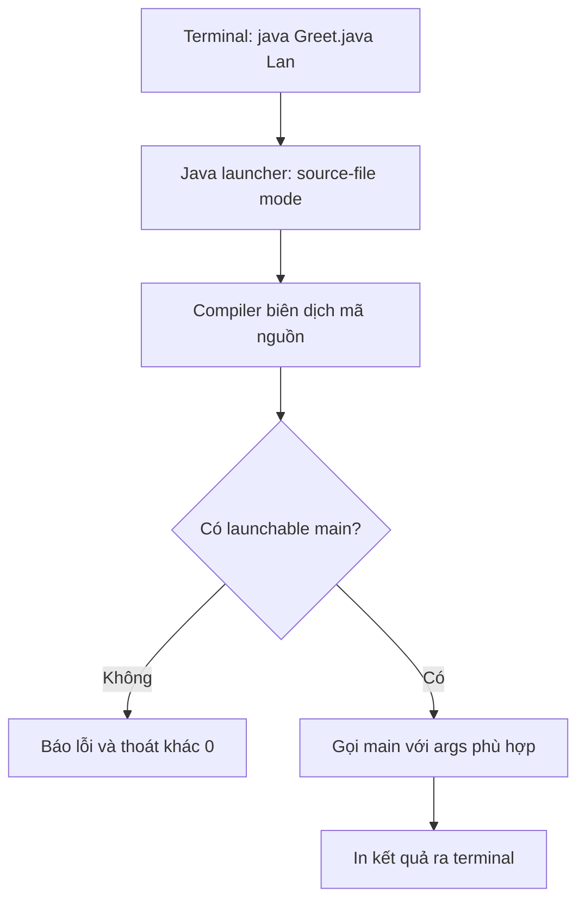

# Chạy trực tiếp tệp nguồn và truyền đối số từ dòng lệnh

> **Chương:** Tệp nguồn gọn  
> **Module:** `JAVA_VERSION_JAVA25` — học những khả năng của Java 25 còn hữu ích cho phát triển hiện đại, đặc biệt chương trình nguồn gọn, module import, flexible constructors, `ScopedValue` và các công cụ JDK.  
> **Chủ đề:** Dùng `java File.java` để chạy chương trình ngay từ mã nguồn và nhận các tham số sau tên tệp qua `main(String[] args)`.  
> **Phạm vi cập nhật:** Nội dung theo Java SE 25 và tài liệu launcher chính thức; chỉ sử dụng cú pháp **đã chính thức (final)**, không dùng dạng preview cũ. Ngày tham chiếu: **27/11/2026**.

Khi cần viết chương trình kiểm tra dữ liệu, chạy một phép tính nhỏ hay thử một ý tưởng Java, bạn có thể tạo tệp `.java` rồi chạy trực tiếp mà **không cần thực hiện riêng lệnh `javac`**. Java launcher sẽ xử lý việc biên dịch và khởi chạy. Với Java 25, cú pháp **compact source files and instance main methods** của JEP 512 đã final, giúp nội dung file ngắn gọn hơn.

Ví dụ chỉ cần một tệp `Greet.java`:

```java
void main(String[] args) {
    String name = args.length > 0 ? args[0] : "Java";
    IO.println("Xin chào, " + name + "!");
}
```

Mở terminal tại thư mục chứa file, chạy:

```bash
java Greet.java "Lan Anh"
```

Kết quả:

```text
Xin chào, Lan Anh!
```

Ở đây `"Lan Anh"` là **một đối số** vì shell giữ phần có khoảng trắng trong dấu nháy thành một argument. Java nhận nó tại `args[0]`. Ví dụ cũng chạy được khi không truyền đối số: `java Greet.java` sẽ in `Xin chào, Java!`.

## 1. Hai cơ chế liên quan nhưng không giống nhau

Có hai công nghệ gặp nhau trong lệnh `java Greet.java`:

| Cơ chế | Giải quyết việc gì? | Trạng thái trong JDK 25 |
|---|---|---|
| **Source-file mode của `java`** | Đọc một source-file program, biên dịch trước khi thực thi, tự tìm entry-point `main`, truyền các đối số ứng dụng | Khả năng launcher chính thức, đã có từ những JDK trước và **vẫn đang áp dụng** |
| **Compact source files + instance `main`, JEP 512** | Cho phép khai báo method/field mà không phải bao quanh bằng `class`; `main` không bắt buộc `public static`, có thể nhận hoặc không nhận `String[] args` | **Final từ Java 25**; không cần `--enable-preview` |

Vì vậy đừng nói rằng “Java 25 mới cho phép `java File.java`”. Điều Java 25 hoàn tất là **cú pháp nguồn gọn và protocol gọi `main` mở rộng**. Tệp Java có `public class App` và `public static void main(String[] args)` cũng vẫn có thể chạy bằng source-file mode, không cần đổi toàn bộ project sang compact source files.

Hình dung:



Launcher biên dịch chương trình nguồn vào **bộ nhớ phục vụ lần chạy này**. Bạn không phải quản lý file `.class` sinh ra bởi bước chạy trực tiếp. Điều này **không có nghĩa bỏ qua compilation**: file chứa lỗi cú pháp vẫn thất bại trước khi chạy.

## 2. Chuẩn bị đúng JDK 25

Trước khi làm bài, kiểm tra phiên bản của `java` và `javac` đang nằm trên `PATH`:

```bash
java -version
javac -version
```

Kết quả cần cho thấy JDK 25; nếu là JDK cũ (chẳng hạn 21 hoặc 24), không dùng nó để xác minh các ví dụ final của JEP 512. Dùng đúng runtime trong terminal, IDE, CI runner và môi trường container, vì các nơi có thể trỏ đến JDK khác nhau.

Một thư mục bài tập tối thiểu:

```text
java25-cli-lab/
    Greet.java
    ArgsAudit.java
    Invoice.java
```

Các file là **ba ví dụ độc lập** ở các phần sau, không yêu cầu một file phải import file kia. Bạn có thể tạo từng file theo thứ tự và thực thi ngay tại thư mục chứa file đó.

### Chạy source file và chạy class đã biên dịch

| Nhu cầu | Lệnh | Hành vi |
|---|---|---|
| Chạy trực tiếp từ mã nguồn | `java Greet.java` | Compile và chạy trong một thao tác launcher |
| Chạy và truyền hai đối số | `java Greet.java Alice Bob` | `args[0]="Alice"`, `args[1]="Bob"` nếu chương trình sử dụng chúng |
| Khóa phiên bản ngôn ngữ khi chạy source | `java --source 25 Greet.java Alice` | Biên dịch source trong phạm vi release 25 |
| Biên dịch tường minh | `javac --release 25 Greet.java` | Tạo output class để dùng ở bước chạy kế tiếp |
| Chạy class đã biên dịch | `java Greet` | Dùng class trên classpath, **không** thêm `.java` |

Các lệnh ở hai dòng cuối là **hai lần thực thi riêng** (có thể ghi trên hai dòng terminal), để so với cách chạy trực tiếp. `javac` và `java` là hai công cụ khác nhau. Với class được sinh từ compact source file, tài liệu Java 25 cho phép biên dịch bằng `javac Greet.java` rồi chạy `java Greet`; tên class được compiler chọn là một chi tiết triển khai, không nên dùng nó làm API giữa các component của ứng dụng lớn.

**Quan trọng:** `--source 25` điều chỉnh release source và API khả dụng khi launcher biên dịch; nó **không** tự cài JDK 25 hoặc cho phép JDK thấp hơn hiểu cú pháp Java 25. Compact source files đã final nên **không cần** `--enable-preview`.

## 3. Hai kiểu `main`: có và không có tham số

Trong compact source file Java 25, cả hai dạng dưới đây đều hợp lệ:

### 3.1. `void main()`: chương trình không cần đọc arguments

`Hello.java`:

```java
void main() {
    IO.println("Hello from Java 25");
}
```

Lệnh:

```bash
java Hello.java
```

Điều này thích hợp cho chương trình bắt đầu học Java, chạy self-check cố định, hoặc demo không cần tham số từ terminal.

**Giới hạn:** bản thân `main()` không có `String[] args`. Nếu công việc cần đọc đối số, hãy chuyển thành `main(String[] args)` thay vì cho rằng launcher tự tạo biến `args` bên trong method không tham số. Các token nằm sau tên source file không tự trở thành biến toàn cục.

### 3.2. `void main(String[] args)`: chương trình cần đọc arguments

`Who.java`:

```java
void main(String[] args) {
    if (args.length == 0) {
        IO.println("Chưa có tên; dùng: java Who.java <ten>");
        return;
    }

    IO.println("Xin chào, " + args[0]);
}
```

Lệnh:

```bash
java Who.java Mai
java Who.java "Mai Anh"
java Who.java
```

Lần đầu in `Xin chào, Mai`; lần hai in `Xin chào, Mai Anh`; lần ba hiển thị hướng dẫn thay vì ném `ArrayIndexOutOfBoundsException`.

**Quy tắc chọn entry-point trong Java 25:** nếu có một launchable `main(String[] args)`, launcher ưu tiên nó; nếu không, launcher tìm launchable `main()`. Một `main` có thể là **instance method**, không buộc `static` hay `public`, miễn thỏa quy tắc truy cập/signature. Nếu chọn instance method, launcher tạo instance lớp được khai báo ngầm rồi gọi method đó.

Ví dụ đối chiếu:

```java
void main() {
    IO.println("no-args main");
}

void main(String[] args) {
    IO.println("args main: " + args.length);
}
```

Lưu thành `ChooseMain.java` và chạy `java ChooseMain.java a b`. Kết quả là `args main: 2`, không phải lời gọi `main()`. Trong ứng dụng thực tế, hãy chỉ giữ **một entry-point rõ ràng** để người đọc không phải nhớ độ ưu tiên.

### 3.3. Cú pháp `IO.println(...)` là của Java 25 final

`IO` là lớp trong `java.lang`; trong Java 25 hãy gọi **`IO.println(...)`**, **`IO.print(...)`**, hoặc `System.out.println(...)`. **Không dùng** dạng `println("...")` không có qualifier từng xuất hiện trong tài liệu preview cũ: static methods của `IO` **không còn tự động được static-import** vào compact source file khi JEP 512 được final.

Ngoài ra, compact source files tự import các public type của package được `java.base` export, tương đương ý tưởng `import module java.base;`. Bạn có thể sử dụng `List`, `Map`, `Path` mà không cần nhiều import tường minh trong file gọn. Điều này **không** tạo thêm module dependency cho thư viện bên ngoài `java.base`, và không mở quyền truy cập những package không được export.

## 4. Đường ranh giới trên command line: launcher options và program args

Đây là quy tắc quyết định hầu hết lỗi CLI:

```text
java [JVM/launcher options] <source-file.java> [application arguments]
     |                     |                  |
     Java xử lý             tệp nguồn          main(String[] args) nhận
```

Vị trí **trước** tên file là nơi đặt Java/VM options như `-D`, `-Xmx`, `--class-path` và `--source`. Mọi token **sau** tên source file được chuyển cho chương trình; launcher không tự biến chúng thành JVM options.

Tạo `ArgsAudit.java`:

```java
void main(String[] args) {
    IO.println("app.mode (JVM property): "
            + System.getProperty("app.mode", "unset"));

    IO.println("So doi so: " + args.length);
    for (int i = 0; i < args.length; i++) {
        IO.println("args[" + i + "] = [" + args[i] + "]");
    }
}
```

Ví dụ đúng:

```bash
java -Dapp.mode=dev ArgsAudit.java --mode=fast "hello world"
```

Kết quả kỳ vọng:

```text
app.mode (JVM property): dev
So doi so: 2
args[0] = [--mode=fast]
args[1] = [hello world]
```

Thử đổi thứ tự:

```bash
java ArgsAudit.java -Dapp.mode=dev
```

Kết quả:

```text
app.mode (JVM property): unset
So doi so: 1
args[0] = [-Dapp.mode=dev]
```

Ở lệnh thứ hai, `-Dapp.mode=dev` **chỉ là chuỗi đối số của ứng dụng**, không phải system property. Chính vị trí token đã đổi ý nghĩa.

| Lệnh | `main` nhận gì? | Ý nghĩa |
|---|---|---|
| `java ArgsAudit.java alpha beta` | `["alpha", "beta"]` | Hai đối số độc lập |
| `java ArgsAudit.java "alpha beta"` | `["alpha beta"]` | Một đối số có khoảng trắng |
| `java ArgsAudit.java --verbose` | `["--verbose"]` | Flag do **ứng dụng tự diễn giải** |
| `java -Xmx256m ArgsAudit.java x` | `["x"]` | `-Xmx256m` là JVM option |
| `java ArgsAudit.java -Xmx256m` | `["-Xmx256m"]` | Chuỗi `-Xmx256m` chỉ là input ứng dụng |
| `java --source 25 ArgsAudit.java x` | `["x"]` | Chọn source version 25; không phải đối số ứng dụng |
| `java -Dapp.mode=test ArgsAudit.java x` | `["x"]` | Set property cho JVM; trong code đọc bằng `System.getProperty` |

`args[]` chứa **`String`**, không tự phân tích số, boolean, key=value hay ngày tháng. Một token `--verbose` không làm gì trừ khi code của bạn đọc và xử lý nó. Tương tự, `--` phía sau tên tệp không tự tạo bộ parser GNU-style: nó vẫn là token ứng dụng nếu bạn không tự định nghĩa quy tắc đó.

## 5. Dấu nháy, khoảng trắng và thứ tự arguments

Việc chia chuỗi lệnh thành token do **shell** thực hiện trước khi Java nhận `args`. Java nhận **mảng chuỗi đã được phân tách**, không nhận nguyên dòng người dùng gõ.

```bash
java ArgsAudit.java "Nguyen Van A" 2026 --debug
```

Trong code:

```text
args.length = 3
args[0] = Nguyen Van A
args[1] = 2026
args[2] = --debug
```

Lưu ý thực hành:

- Dùng dấu nháy quanh **giá trị có khoảng trắng**, chẳng hạn `"Du lieu mau"` hoặc đường dẫn `"C:\Users\Public\My Data\input.csv"` trên Windows.
- Với tham số Unicode, hãy lưu file mã nguồn UTF-8 và bảo đảm terminal/font hiển thị được tiếng Việt; ký tự trên terminal không phản ánh một lỗi `args` nếu code point vẫn đúng.
- Trong PowerShell, Bash và CMD, quy tắc escape/expansion không hoàn toàn giống nhau; khi truyền dấu nháy literal, dấu `$` hoặc ký tự đặc biệt, dùng cú pháp **của đúng shell** và kiểm tra bằng chương trình `ArgsAudit`.
- Đừng ghép các tham số từ user input thành một chuỗi lệnh rồi chạy qua shell nếu không cần thiết: rủi ro injection và sai quoting lớn hơn. Trong ứng dụng tự gọi chương trình khác, ưu tiên `ProcessBuilder` với danh sách token.
- Đối số là dữ liệu **không đáng tin cậy**. Kiểm tra độ dài, kiểu dữ liệu, phạm vi, đường dẫn, quyền truy cập và format trước khi sử dụng.

Nếu tên file nguồn cũng chứa khoảng trắng, nhớ đặt cả **đường dẫn file** trong dấu nháy:

```bash
java "examples/quick scripts/ArgsAudit.java" "hello world"
```

Điều kiện: file thật sự nằm tại đường dẫn đó tính từ **working directory hiện tại**. Cú pháp dùng `/` trong ví dụ mang tính đa nền tảng; trên Windows cũng có thể dùng `.\examples\quick scripts\ArgsAudit.java` với dấu nháy phù hợp.

## 6. Thực hành hoàn chỉnh: chương trình tính tiền từ arguments

Bài toán: người dùng nhập đơn giá và số lượng trên terminal, chương trình tính tổng tiền **không bị tràn âm thầm**. Có thể chọn đơn vị hiển thị `VND` hoặc `USD`; ví dụ **không thực hiện chuyển đổi tiền tệ**.

Tạo `Invoice.java`:

```java
void main(String[] args) {
    if (args.length < 2 || args.length > 3) {
        usage();
        System.exit(2);
    }

    try {
        long unitPrice = Long.parseLong(args[0]);
        int quantity = Integer.parseInt(args[1]);
        String currency = args.length == 3 ? args[2] : "VND";

        if (unitPrice < 0 || quantity <= 0) {
            throw new IllegalArgumentException(
                    "Don gia phai >= 0 va so luong phai > 0");
        }

        if (!currency.equals("VND") && !currency.equals("USD")) {
            throw new IllegalArgumentException(
                    "Don vi chi chap nhan VND hoac USD");
        }

        long total = Math.multiplyExact(unitPrice, (long) quantity);

        IO.println("Don gia : " + unitPrice + " " + currency);
        IO.println("So luong: " + quantity);
        IO.println("Tong    : " + total + " " + currency);

    } catch (IllegalArgumentException | ArithmeticException ex) {
        System.err.println("Loi: " + ex.getMessage());
        usage();
        System.exit(2);
    }
}

void usage() {
    System.err.println(
        "Cach dung: java Invoice.java <don-gia> <so-luong> [VND|USD]");
}
```

**Giải thích thiết kế:**

1. `args.length` phải là 2 hoặc 3; không lập tức truy cập `args[0]` nếu mảng trống.
2. `Long.parseLong` và `Integer.parseInt` chuyển `String` sang số; input không hợp lệ sẽ gây `NumberFormatException` (một dạng `IllegalArgumentException`).
3. Chỉ chấp nhận số lượng dương; không đơn giản coi mọi chuỗi nhận được là số hợp lệ.
4. `Math.multiplyExact` ném `ArithmeticException` khi phép nhân `long` vượt giới hạn, thay vì cho ra số sai do overflow.
5. `System.err` dùng cho hướng dẫn/lỗi; `IO.println` in kết quả ra đầu ra chuẩn. `System.exit(2)` là mã lỗi dành cho CLI; chương trình thành công thoát bình thường với mã 0.
6. `currency` chỉ là **nhãn đơn vị**. Chương trình không tự đổi tỷ giá. Nếu bài toán cần tiền thật, phải cân nhắc `BigDecimal`, quy tắc làm tròn và quy chuẩn miền nghiệp vụ thay vì dùng `long` tùy tiện.

Chạy các trường hợp sau:

```bash
java Invoice.java 25000 3
java Invoice.java 15 4 USD
java Invoice.java 25000 0
java Invoice.java abc 2
java Invoice.java
```

Kỳ vọng:

| Lệnh | Kết quả |
|---|---|
| `java Invoice.java 25000 3` | `Tong : 75000 VND` (phần hiển thị có khoảng căn lề) |
| `java Invoice.java 15 4 USD` | `Tong : 60 USD` |
| `java Invoice.java 25000 0` | Thông báo số lượng không hợp lệ, exit code 2 |
| `java Invoice.java abc 2` | Lỗi parse số và hướng dẫn, exit code 2 |
| `java Invoice.java` | Hướng dẫn cách dùng, exit code 2 |

Trong Bash kiểm tra mã thoát của lệnh vừa chạy bằng `echo $?`; trong PowerShell xem `$LASTEXITCODE`. Không kiểm tra mã thoát của một lệnh **khác** đã chạy xen giữa vì khi đó kết quả không còn thuộc phép thử `Invoice.java`.

### 6.1. Trường hợp overflow

```bash
java Invoice.java 9223372036854775807 2
```

`9223372036854775807` là `Long.MAX_VALUE`. Nhân với 2 vượt giới hạn `long`, vì vậy `Math.multiplyExact` ném `ArithmeticException` và chương trình trả lỗi. Bài tập này thể hiện một kỹ năng CLI rất thực tế: **kiểm tra input và fail có kiểm soát** thay vì tiếp tục với dữ liệu sai.

### 6.2. Tách lỗi người dùng khỏi lỗi hệ thống

Trong tool dùng lâu dài, nên tách mã thoát: ví dụ mã 2 cho cách gọi/input không hợp lệ; mã 1 cho lỗi thực thi/hạ tầng. Đây là **quy ước do công cụ lựa chọn**, không phải Java bắt buộc. Tránh bắt `Throwable` rồi luôn thoát 0 khiến automation/CI tưởng tác vụ thành công.

## 7. Chạy trên Windows, macOS và Linux

Cú pháp cơ bản giống nhau vì `java` là launcher của JDK:

| Môi trường | Lệnh mẫu | Điểm cần chú ý |
|---|---|---|
| Windows PowerShell | `java .\Invoice.java 25000 3` | Dấu `.\` chỉ file tương đối trong thư mục hiện tại |
| Windows CMD | `java Invoice.java 25000 3` | Cần JDK trên `PATH` |
| Bash trên macOS/Linux | `java ./Invoice.java 25000 3` | `./` trỏ file tại thư mục hiện tại |
| Mọi môi trường | `java --source 25 Invoice.java 25000 3` | Tường minh release của mã nguồn; cần runtime hiểu Java 25 |

**Không yêu cầu lệnh `chmod +x` chỉ để chạy `java Invoice.java ...`**. Bạn đang gọi `java`, không chạy tệp Java như executable của OS. Với shell script/shebang, có những quy tắc riêng về OS và launcher; chúng là chủ đề khác, không phải điều kiện cần của compact source files.

Nếu chạy lệnh ở sai thư mục, nhận lỗi không tìm thấy file. Sử dụng đường dẫn tương đối hoặc tuyệt đối của file, kiểm tra working directory:

```bash
pwd
```

Trong PowerShell có thể dùng `Get-Location`. Đừng giả định Java tự chuyển working directory về thư mục chứa source. Khi chương trình dùng `Path.of("data.txt")`, đường dẫn tương đối thường được tính từ **working directory của tiến trình**, không phải vị trí source file.

## 8. Source-file mode nâng cao: `--source`, classpath và nhiều tệp

### 8.1. `--source 25` dùng khi nào?

Đối với file `.java` chạy bằng JDK 25, thông thường chỉ cần:

```bash
java Invoice.java 25000 3
```

Có thể ghi rõ phiên bản cú pháp/API:

```bash
java --source 25 Invoice.java 25000 3
```

Với file **không có đuôi `.java`**, launcher chỉ nhận diện source-file mode nếu có `--source`. Chẳng hạn file văn bản đặt tên `quickcheck` chứa:

```java
void main(String[] args) {
    IO.println("So doi so: " + args.length);
}
```

thì chạy:

```bash
java --source 25 quickcheck abc def
```

Không dùng `java quickcheck abc def` khi `quickcheck` là source file không có đuôi `.java`: launcher có thể hiểu `quickcheck` là tên class cần chạy.

Trong source-file mode, `--source 25` được dùng như chỉ định release cho phần biên dịch trong launcher, giới hạn ngôn ngữ/API về release này. Nó không biến mã preview JDK 25 thành final và không giúp chạy source trên JDK thấp hơn 25.

### 8.2. Dependency bên ngoài JDK

Nếu code có phụ thuộc JAR đã được chuẩn bị, có thể truyền classpath **trước** source file:

```bash
java --class-path "lib/example.jar" Program.java arg1
```

`Program.java` phải thật sự import/dùng API tồn tại trong JAR; `example.jar` là đường dẫn minh họa. Classpath sau tên source file không được hiểu là launcher option. Với Java Platform Module System, cần cấu hình `--module-path`/`--add-modules` phù hợp từng thư viện.

Đối với dự án lớn có nhiều JAR, annotation processors, dependency locking, tests, packaging và release, **dùng Maven/Gradle với toolchain** rõ ràng thường dễ bảo trì hơn lệnh chạy source tạm thời. Source-file mode tự động biên dịch mà không chạy annotation processors như `javac` trong build được thiết lập để làm việc đó; cần đặc biệt chú ý khi thử Lombok hoặc code generation.

### 8.3. Không đồng nhất source-file mode với “chỉ được có một file Java”

Từ khả năng **launch multi-file source-code programs** (JEP 458), Java launcher có thể biên dịch thêm các file mã nguồn liên quan được tìm trong source tree khi chạy source-file mode. Vì vậy `java Main.java` không nhất thiết giới hạn toàn bộ ứng dụng trong một file, nhưng vẫn cần cấu trúc source root, package và dependency hợp lệ.

Compact source files là cách **giảm phần bao quanh của một tệp**; source-file launcher là cách **khởi chạy mã nguồn**. Chúng độc lập về mục đích. Khi tách ứng dụng thành nhiều package/module, hãy cân nhắc cấu trúc bình thường có tên lớp rõ ràng và build tool thay vì cố dùng implicit class cho mọi thành phần.

### 8.4. Khi nào cần biên dịch tường minh?

```bash
javac --release 25 Invoice.java
java Invoice 25000 3
```

Trong bài lab, đây là lựa chọn minh họa khi muốn xem output class, kiểm soát compilation riêng hoặc chuẩn bị đóng gói. Lệnh `java Invoice` lúc này chạy **class**, không dùng source-file mode. Nếu không muốn sinh class file thì dùng `java Invoice.java ...` là đủ.

Trên source-file mode, lỗi biên dịch được in ra stderr và Java launcher thoát với mã khác 0. Vì thế script CI có thể xử lý trạng thái thành công/thất bại, không cần parse tiếng Anh của error message.

## 9. Những lỗi hay gặp khi truyền đối số

| Triệu chứng | Nguyên nhân điển hình | Cách khắc phục |
|---|---|---|
| `ArrayIndexOutOfBoundsException` ở `args[0]` | Không truyền tham số | Kiểm tra `args.length`, có giá trị mặc định hoặc báo usage |
| `NumberFormatException` | Token không phải số hợp lệ | Dùng parse trong `try/catch` và giải thích định dạng đúng |
| Một tên có khoảng trắng thành nhiều đối số | Thiếu dấu nháy khi gọi shell | `java Who.java "Mai Anh"` |
| `-Dmode=test` không tạo JVM property | Đặt `-D` **sau** tên file | Chuyển trước `.java`: `java -Dmode=test App.java ...` |
| `--source` bị đưa vào `args` | Viết sau tên file | Đặt `--source 25` trước source file |
| `IO.println(...)` bị báo không tồn tại | JDK cũ hoặc IDE chưa dùng Java 25 | Xác minh `java -version` và toolchain |
| `println("...")` không compile | Sao chép cú pháp preview cũ, chưa gọi qua `IO` | Dùng `IO.println("...")` trong Java 25 final |
| `NoSuchFileException` khi đọc tệp đầu vào | Đường dẫn tương đối so với working directory không đúng | Kiểm tra `pwd`/`Get-Location` và path đã truyền |
| `Could not find or load main class` | Gõ `java File` khi chưa biên dịch hoặc gõ sai tên file | Với source dùng `java File.java`; với class dùng `java File` sau `javac` |
| File source không đuôi `.java` bị hiểu là class | Không chỉ định source-file mode | Dùng `java --source 25 ten-file ...` |
| Lệnh được chấp nhận nhưng thiếu trace của input | Đã dùng `void main()` nên không có `args` | Chọn `void main(String[] args)` |
| Build trên JDK cũ thất bại | Compact source files chưa final ở bản đó | Sử dụng JDK 25+ hoặc viết class/main theo cú pháp phiên bản đích |
| Tên class/tệp gây nhầm lẫn | Tạo file nguồn gọn rồi cố dùng implicit class như public API | Dùng explicit class/package khi code cần tái sử dụng, build thành thư viện |

Lưu ý: `java -version` nên chạy từ **cùng terminal** với các ví dụ, tránh trường hợp hệ điều hành có nhiều JDK và IDE/CI đang dùng bản khác.

## 10. Những hiểu lầm cần loại bỏ

### Hiểu lầm 1: “Chạy trực tiếp thì không biên dịch”

Sai. Java launcher biên dịch source code trước khi gọi entry-point, chỉ bỏ bước `javac` do người dùng chạy tường minh. Lỗi cú pháp sẽ không được bỏ qua.

### Hiểu lầm 2: “Không có `class` thì không phải Java chuẩn”

Sai. JEP 512 đã hoàn tất trong Java 25, đây là **compact source file** với một implicitly declared class. Cấu trúc này nhằm đơn giản hóa các chương trình nhỏ, không thay thế toàn bộ cơ chế class/package/module khi lập trình quy mô lớn.

### Hiểu lầm 3: “Cứ gõ `--help` sau tên file là Java tự hiện hướng dẫn”

Sai. Đó là **application argument**. Ví dụ `Invoice.java` không hỗ trợ `--help` thì sẽ báo lỗi input. Để có CLI `--help`, ứng dụng phải viết parser riêng hoặc dùng thư viện CLI phù hợp.

### Hiểu lầm 4: “Compact source file vẫn cần `--enable-preview`”

Sai trong **Java 25 trở lên**. JEP 512 final, `IO.println` và instance main của nó có thể chạy bình thường trên JDK phù hợp. Nếu đồng thời sử dụng **tính năng preview khác**, khi đó mới cần bật preview riêng cho tính năng ấy và theo đúng release.

### Hiểu lầm 5: “`void main()` tự có `args` nếu gọi kèm tham số”

Sai. Nếu muốn nhận arguments, khai báo `void main(String[] args)`. Method không có tham số không có biến `args` ngầm.

### Hiểu lầm 6: “Truyền mật khẩu bằng command line là an toàn vì chỉ một lần chạy”

Không nên. Argument dòng lệnh có thể lưu trong shell history, process listings, nhật ký job hoặc hệ thống quan sát. Với mật khẩu/token, ưu tiên cơ chế secret management hoặc input an toàn đúng môi trường; tuyệt đối không in secrets ra chương trình `ArgsAudit` rồi ghi log lên hệ thống chung.

## 11. Kiểm thử CLI không cần framework

Tạo file `ArgsAudit.java` ở phần 4 và `Invoice.java` ở phần 6, sau đó chạy các tình huống. Kiểm tra không chỉ output mà cả **mã thoát**.

| Thử nghiệm | Input | Kỳ vọng |
|---|---|---|
| Đối số trống | `java ArgsAudit.java` | `args.length=0` |
| Hai token | `java ArgsAudit.java a b` | Hai phần tử: `a` và `b` |
| Một token chứa khoảng trắng | `java ArgsAudit.java "a b"` | Một phần tử `a b` |
| JVM property trước source | `java -Dapp.mode=dev ArgsAudit.java x` | Property `dev`, mảng args chỉ có `x` |
| JVM-looking token sau source | `java ArgsAudit.java -Dapp.mode=dev` | Property `unset`, mảng args chứa `-Dapp.mode=dev` |
| Tính đúng | `java Invoice.java 25000 3` | `75000 VND`, exit code 0 |
| Thiếu tham số | `java Invoice.java` | Usage, exit code 2 |
| Sai định dạng | `java Invoice.java abc 2` | Error, exit code 2 |
| Overflow | `java Invoice.java 9223372036854775807 2` | Error, exit code 2 |
| Khóa source | `java --source 25 Invoice.java 10 2` | `20 VND` trên JDK 25 phù hợp |

Trên Bash có thể kiểm tra ngay:

```bash
java Invoice.java abc 2
echo $?
```

Trên PowerShell:

```powershell
java .\Invoice.java abc 2
$LASTEXITCODE
```

Khi dạy học hoặc review, hãy yêu cầu người học giải thích **mỗi phần tử của `args` đến từ token nào** trên câu lệnh terminal, và câu lệnh sẽ khác thế nào nếu chuyển một option từ trước sang sau `Invoice.java`.

## 12. Khi nào dùng compact source file, khi nào dùng project bình thường?

**Nên dùng** cho chương trình nhỏ: bài học, tool kiểm tra nhanh, xử lý CSV quy mô nhỏ, demo tính năng Java 25, các script bảo trì cục bộ không phụ thuộc vào framework lớn.

**Nên chuyển sang cấu trúc Java chuẩn** khi xuất hiện nhiều package, integration tests, thư viện bên ngoài, cơ chế config/secret phức tạp, dữ liệu quan trọng hoặc công cụ phải phát hành và bảo trì qua nhiều môi trường. Lúc đó hãy dùng explicit classes/packages, Maven/Gradle toolchains và phương thức phân phối (JAR, container) phù hợp.

Bạn vẫn có thể giữ `main(String[] args)` là entry-point trong ứng dụng lớn; **compact file không bắt buộc** để dùng program arguments. Điều thiết yếu là định nghĩa CLI rõ ràng, validate dữ liệu và lưu lại contract của từng flag/positional parameter.

### Checklist trước khi sử dụng cho công việc thật

- [ ] Dùng JDK 25+ khi viết compact source files với final syntax; kiểm tra toolchain mọi môi trường.
- [ ] Phân biệt source-file mode và cú pháp JEP 512.
- [ ] Nếu đọc đối số thì khai báo `main(String[] args)`, có kiểm tra `args.length`.
- [ ] Phân biệt JVM options **trước** tên file với arguments **sau** tên file.
- [ ] Kiểm tra số, enum, đường dẫn và xử lý exception có thông báo rõ.
- [ ] Tách stdout cho kết quả và stderr cho lỗi/usage; có exit code thích hợp.
- [ ] Không truyền hoặc log secret bằng arguments nếu có phương án an toàn hơn.
- [ ] Không dùng `--enable-preview` chỉ cho JEP 512 final; không dùng cú pháp `println` không qualifier của tài liệu cũ.
- [ ] Nếu dự án lớn, cân nhắc explicit package/class và build tool thay vì duy trì script tự phát.

## 13. Bài tập thực hành mở rộng

**Bài 1 — Bộ chào có lựa chọn ngôn ngữ.** Viết `GreetCli.java` nhận `<name> [vi|en]`. Nếu không có tên thì hiển thị usage và exit code khác 0. Nhập `java GreetCli.java "Mai Anh" vi` phải tạo lời chào tiếng Việt; `en` tạo lời chào tiếng Anh. Không sử dụng mã ngôn ngữ khác với danh sách được hỗ trợ.

**Bài 2 — Chương trình kiểm tra đường dẫn.** Viết `Exists.java` nhận đúng một path: `java Exists.java "data/my file.txt"`. Dùng `Path.of(args[0])` và `Files.exists(...)`, nêu rõ path tương đối dựa trên working directory. Không đọc hoặc ghi dữ liệu nhạy cảm.

**Bài 3 — So sánh JVM option và program argument.** Dùng `ArgsAudit.java`: chạy `java -Dapp.mode=prod ArgsAudit.java --dry-run` rồi đổi vị trí `-Dapp.mode=prod` sang sau `ArgsAudit.java`. Ghi lại `System.getProperty` và toàn bộ `args[]`, giải thích khác biệt.

**Bài 4 — Chuẩn hóa error handling.** Nâng `Invoice.java` để hỗ trợ `--help` và `--currency=USD` theo parser do ứng dụng tự viết. Thử thiếu dữ liệu, số âm, overflow và tham số lạ; chốt rõ mã thoát/đầu ra chuẩn.

**Bài 5 — Di chuyển sang explicit class.** Viết lại `Invoice.java` thành `public class Invoice` với `public static void main(String[] args)` trong một package bình thường. Giữ nguyên hành vi CLI và test. Bài này chứng minh compact source files là **cách diễn đạt ngắn** của Java, không phải một ngôn ngữ hay runtime riêng biệt.

**Tiêu chí hoàn thành:** người học chạy được source file trực tiếp, dự đoán đúng từng `args[i]`, xử lý lỗi và mã thoát, không nhầm với VM options; biết giới hạn phạm vi sử dụng của compact source files và hiểu JEP 512 đã final.

## 14. Tài liệu tham khảo chính thức

1. [Java SE 25 — Compact Source Files and Instance Main Methods](https://docs.oracle.com/en/java/javase/25/language/compact-source-files-instance-main-methods.html): cú pháp compact, `IO`, implicit imports và thứ tự chọn `main`.
2. [Java SE 25 — The `java` Command](https://docs.oracle.com/en/java/javase/25/docs/specs/man/java.html): source-file mode, thứ tự launcher options/source file/arguments, `--source`, classpath và compilation.
3. [JEP 512 — Compact Source Files and Instance Main Methods](https://openjdk.org/jeps/512): thiết kế ngôn ngữ đã **final** trong JDK 25.
4. [JEP 458 — Launch Multi-File Source-Code Programs](https://openjdk.org/jeps/458): mở rộng source-file launcher đến nhiều file nguồn liên quan.
5. [Java SE 25 — Module Import Declarations](https://docs.oracle.com/en/java/javase/25/language/module-import-declarations.html): `import module java.base` và cơ chế import ngầm trong compact source files.
6. [Java SE 25 — Java Language Changes by Release](https://docs.oracle.com/en/java/javase/25/language/java-language-changes-release.html): xác nhận JEP 512 final và khác biệt với bản preview Java 21–24.
7. [Java SE 25 — `java.lang.IO` API](https://docs.oracle.com/en/java/javase/25/docs/api/java.base/java/lang/IO.html): cách dùng `IO.println` và basic console I/O.

**Ghi nhớ:** `java File.java arg1 arg2` thực hiện compile-and-run source file; `arg1` và `arg2` là dữ liệu của `main(String[] args)`. Đặt JVM options **trước** tên file; đặt application arguments **sau** tên file. Với Java 25, `void main(String[] args)` trong compact source file là **tính năng chính thức**, đơn giản và vẫn hữu ích khi dùng đúng phạm vi.
