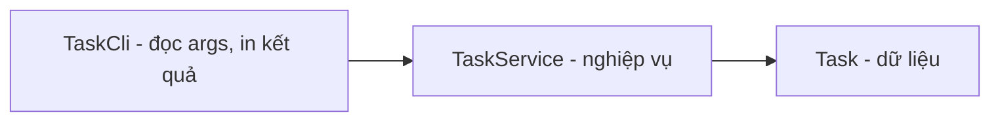
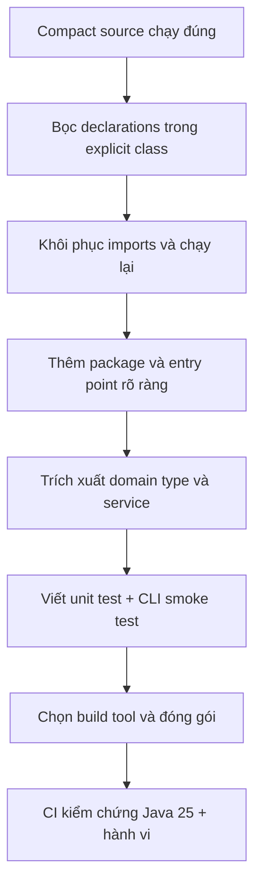

# Chuyển chương trình nguồn gọn sang lớp tường minh khi quy mô tăng

## 1. Từ một tệp thử nghiệm đến một chương trình có cấu trúc

**Compact source files and instance main methods (JEP 512)** là tính năng chính thức của **Java 25**. Một chương trình ngắn có thể bắt đầu chỉ bằng:

```java
void main() {
    IO.println("Hello, Java 25!");
}
```

Đây vẫn là Java thông thường: trình biên dịch hiểu các phương thức và trường đứng ngoài khai báo `class` là thành viên của một **lớp được khai báo ngầm**. Cách viết này phù hợp với bài tập, ví dụ nhỏ và công cụ chạy một tệp.

Khi chương trình phát triển, có nhiều thao tác nghiệp vụ, cấu hình, trạng thái, kiểm thử và thành viên cùng sửa mã, nhu cầu xuất hiện: tên lớp ổn định, package rõ ràng, constructor, API cho lớp khác sử dụng, quyền truy cập và bố cục nhiều tệp. Lúc đó, **chuyển từ compact source file sang lớp tường minh** giúp cấu trúc dự án dễ phát triển mà vẫn giữ logic cũ.

Bài **Chuyển chương trình nguồn gọn sang lớp tường minh khi quy mô tăng** thuộc chương **Tệp nguồn gọn** của học phần **JAVA_VERSION_JAVA25**. Học phần giới thiệu các khả năng Java 25 còn áp dụng trong phát triển hiện đại như module import, flexible constructor bodies, `ScopedValue`, API dẫn xuất khóa, AOT cache và JFR. Riêng bài này thực hành các quy tắc của **JEP 512** để mở rộng ứng dụng, đồng thời chỉ dùng cú pháp **đã hoàn thiện từ Java 25**, không dựa vào những preview cũ.

### Kết quả học tập

Sau bài học, bạn có thể:

1. Giải thích compact source file thực sự được biên dịch thành lớp như thế nào và những giới hạn của lớp ngầm.
2. Bọc các khai báo trong một `class` mà không làm thay đổi vòng đời của `main`.
3. Phân biệt instance `main` với `static main`; biết lúc nào cần đổi sang entry point truyền thống.
4. Chuyển từ unnamed package sang named package, khôi phục những `import` đã từng được compact source file cung cấp tự động.
5. Tách chương trình thành entry point, service và domain type; đưa dependency vào constructor thay vì để mọi thao tác trong `main`.
6. Biên dịch, chạy và kiểm thử bằng JDK 25; phát hiện lỗi chuyển đổi phổ biến.

> **Lựa chọn kiến trúc:** không có quy định phải chuyển mọi compact source file sang lớp tường minh. Chỉ chuyển khi yêu cầu cộng tác, kiểm thử, phân tách trách nhiệm hoặc đóng gói khiến cấu trúc mới có giá trị.

## 2. Những quy tắc Java 25 cần hiểu trước khi chuyển đổi

Một compact source file có thể chứa field, method và kiểu lồng nhau đứng ngoài khai báo `class`. Các khai báo ấy trở thành thành viên của lớp ngầm do trình biên dịch tạo ra.

| Thuộc tính | Compact source file Java 25 | Lớp khai báo tường minh |
|---|---|---|
| Tên lớp | Trình biên dịch/host chọn; mã nguồn không thể gọi lớp ngầm bằng tên | Lập trình viên chọn tên lớp |
| Package | Luôn là **unnamed package** | Có thể dùng `package dev.example.todo;` |
| Tính kế thừa | Lớp ngầm là `final`, extends `Object`, không implements interface | Chọn `final`, `extends` hoặc `implements` theo nhu cầu |
| Constructor | Có constructor mặc định không tham số; không khai báo constructor riêng được | Được khai báo constructor/overload, kiểm tra đầu vào |
| Thành viên | Field, method, nested type, cả instance/static members | Tương tự, cộng thêm constructor và initializer |
| Entry point | Bắt buộc có một launchable `main` | Có thể là thư viện không có `main`, hoặc class chạy độc lập có `main` |
| Import từ `java.base` | **Tự động** import-on-demand các public top-level types trong packages do `java.base` export | **Không tự động** import toàn bộ `java.base`; chỉ `java.lang` được import ngầm theo quy tắc thông thường |
| Hiển thị API cho mã khác | Không thể dùng tên lớp ngầm trực tiếp trong Java source | Có thể đặt `public`, tổ chức API và viết Javadoc |
| Cách chạy | `java MyScript.java` hoặc compile rồi run trên JDK 25 | Chạy dạng source file hoặc `java -cp ... package.ClassName` |

Một số điều dễ hiểu nhầm:

- **Lớp ngầm là lớp thực.** Field và method không nằm “tự do” ở runtime; chúng có ngữ nghĩa thành viên lớp.
- Trong compact source file, `void main()` là **instance method**. Java launcher tạo một instance trước khi gọi phương thức.
- **Instance main cũng hoạt động trong lớp tường minh ở Java 25**. Việc thêm `class` không bắt buộc đổi ngay thành `public static void main(String[] args)`.
- Lớp ngầm có tên do host quyết định. Với `javac` thông thường, tên class file thường dựa trên tên file, nhưng bạn **không nên coi tên ấy là API mà mã nguồn khác được phép tham chiếu**.
- Compact source file không có `package` declaration. Khi muốn module/package rõ ràng, chuyển sang ordinary compilation unit là bước cần thiết.

### 2.1. Các chữ ký `main` được Java 25 hỗ trợ

Java 25 cho phép launchable `main` trả về `void`, nhận một `String[]` hoặc không có tham số, là `static` hoặc instance. Trong ứng dụng thông thường, đây là những ví dụ dễ đọc:

```java
// Compact source file hoặc thành viên trong class:
void main() { }

// Trong class tường minh (vẫn chạy bằng launcher Java 25):
void main(String[] args) { }

// Kiểu truyền thống, hữu ích khi tích hợp với tooling quen thuộc:
public static void main(String[] args) { }
```

Ba khai báo trên mô tả **các lựa chọn ở những chương trình khác nhau**; không dán chúng cùng một file rồi chờ cả ba được gọi. Nếu một class có cả `main(String[])` và `main()` đủ điều kiện, launcher ưu tiên phiên bản nhận `String[]`. Khi chuyển đổi, hãy giữ nguyên một entry point cụ thể và xác minh với command-line arguments.

### 2.2. Tại sao không cần `--enable-preview`?

JEP 512 đã là tính năng **final** trong Java 25, sau nhiều vòng preview ở các JDK trước. Biên dịch với JDK 25 và `--release 25` hoặc chạy `java --source 25` là đủ cho ví dụ bài này.

Không sao chép cú pháp preview cũ như `println("...")` do import tĩnh `java.io.IO` ở giai đoạn trước. Trong Java 25, `IO` nằm ở `java.lang` và phương thức tĩnh **không được tự import**. Cách dùng đúng là `IO.println("...")` hoặc import static một cách tường minh.

## 3. Chương trình ban đầu: danh sách công việc trong một tệp

Giả sử có file `Todo.java` viết dưới dạng compact source file, chạy được trên Java 25:

```java
// Todo.java — compact source file, Java 25

List<String> tasks = List.of(
    "Đọc JEP 512",
    "Chạy ví dụ Java 25",
    "Viết kiểm thử"
);

void main(String[] args) {
    if (args.length == 1 && args[0].equals("count")) {
        IO.println("Tổng số: " + tasks.size());
        return;
    }

    if (args.length == 0 || (args.length == 1 && args[0].equals("list"))) {
        showTasks();
        return;
    }

    IO.println("Cách dùng: Todo [list|count]");
}

void showTasks() {
    for (int i = 0; i < tasks.size(); i++) {
        IO.println((i + 1) + ". " + tasks.get(i));
    }
}
```

Điểm cần quan sát:

- `tasks` là **instance field** của lớp ngầm, không phải một biến toàn cục.
- `main(String[] args)` gọi instance method `showTasks()` mà không cần `static`.
- `List` đến từ `java.util`; compact source file **tự import các types công khai của `java.base`**, nên không cần `import java.util.List;` ở đây.
- `IO` nằm trong `java.lang` và được import ngầm trong Java 25; **phải gọi `IO.println(...)`**.

Chạy mà không cần khai báo class:

```bash
java --source 25 Todo.java list
java --source 25 Todo.java count
```

Ví dụ đầu ra:

```text
1. Đọc JEP 512
2. Chạy ví dụ Java 25
3. Viết kiểm thử
```

Và:

```text
Tổng số: 3
```

Lệnh `java Todo.java list` cũng hoạt động khi launcher Java 25 có thể nhận biết tệp nguồn. Việc ghi `--source 25` làm rõ version mục tiêu trong bài học. Kiểm tra `java --version` và `javac --version` để bảo đảm bạn đang sử dụng JDK 25.

### 3.1. Khi nào chương trình này bắt đầu khó mở rộng?

Giả sử các yêu cầu mới xuất hiện: thêm/xóa công việc, kiểm tra ID, lưu vào file hoặc database, kiểm thử logic riêng, trả lỗi khi tham số không hợp lệ. Nếu tiếp tục gộp mọi thứ trong `Todo.java` thì:

- `main` vừa đọc tham số, vừa quyết định nghiệp vụ, vừa in kết quả.
- Danh sách công việc và quy tắc kiểm tra đầu vào không được tổ chức sau một API có tên rõ ràng.
- Test phải khởi động cả chương trình và có thể phải capture `System.out`.
- Mã ở package khác không có một loại `Todo` công khai, ổn định để tái sử dụng.

Đây là tín hiệu để chuyển dần sang explicit class và sau đó tách những trách nhiệm có lý do rõ ràng.

## 4. Bước 1 — Bọc các khai báo trong một lớp tường minh

Theo hướng dẫn **Growing a Program** của JEP 512, bước chuyển đổi tối thiểu là thêm khai báo `class` bao quanh **các field, method và nested type**, đặt `import` ở ngoài lớp.

Chuyển `Todo.java` thành:

```java
// Todo.java — ordinary source file, vẫn ở unnamed package.
import java.util.List;

class Todo {

    List<String> tasks = List.of(
        "Đọc JEP 512",
        "Chạy ví dụ Java 25",
        "Viết kiểm thử"
    );

    void main(String[] args) {
        if (args.length == 1 && args[0].equals("count")) {
            IO.println("Tổng số: " + tasks.size());
            return;
        }

        if (args.length == 0 || (args.length == 1 && args[0].equals("list"))) {
            showTasks();
            return;
        }

        IO.println("Cách dùng: Todo [list|count]");
    }

    void showTasks() {
        for (int i = 0; i < tasks.size(); i++) {
            IO.println((i + 1) + ". " + tasks.get(i));
        }
    }
}
```

**Những gì đã thay đổi:** có tên lớp `Todo` trong source; `List` được import tường minh. **Những gì giữ nguyên:** `main` vẫn là instance method, `tasks` và `showTasks` vẫn là instance members, logic và đầu ra không đổi.

Biên dịch/chạy trên Java 25:

```bash
javac --release 25 Todo.java
java -cp . Todo list
java -cp . Todo count
```

Trên Java 25, `java -cp . Todo list` vẫn tìm được instance `main(String[] args)`. Class `Todo` ở bước này không có `public`, vẫn launchable trong kịch bản Java 25; bước tiếp theo sẽ đặt tên API và package rõ ràng hơn.

### 4.1. Lỗi import hay gặp sau khi thêm `class`

Nếu bạn chỉ thêm:

```java
class Todo {
    List<String> tasks = List.of("A", "B");

    void main() {
        IO.println(tasks);
    }
}
```

mà bỏ `import java.util.List;`, compiler báo không tìm thấy `List`. Lý do là auto-import **toàn bộ `java.base` chỉ dành cho compact compilation unit**. Trong ordinary source file, `java.lang` vẫn được import ngầm, nhưng `java.util` không.

Hai lựa chọn đúng ở Java 25:

```java
import java.util.List;  // Rõ ràng, rất phù hợp với code nhiều tệp.
```

Hoặc:

```java
import module java.base;  // JEP 511, đã final trong Java 25.
```

`import module java.base;` import-on-demand các public top-level types của packages do module `java.base` export; nó **không phải** `module-info.java` và không biến dự án thành một named Java module. Trong code production lớn, import cụ thể thường giúp review các phụ thuộc dễ hơn; khi có hai loại trùng simple name, cần làm rõ tên để tránh nhập nhằng.

### 4.2. Giữ instance `main` là một lựa chọn hợp lệ

Không cần ép `main`, `showTasks` và `tasks` thành `static` chỉ vì xuất hiện `class`. Khi trạng thái thuộc về một instance, việc giữ các method dưới dạng instance là tự nhiên và dễ tách thành service sau này.

Chỉ đổi cách khởi động nếu công cụ đóng gói, framework hoặc môi trường mục tiêu có yêu cầu cụ thể. Ví dụ một bộ công cụ cũ kiểm tra bằng reflection rằng `main` phải là `public static void main(String[])` có thể không nhận ra chữ ký mới dù JDK 25 launcher hỗ trợ. Quyết định giữ instance `main` hay dùng entry point truyền thống phải căn cứ vào hệ thống triển khai.

## 5. Bước 2 — Thêm named package và tên lớp công khai

Khi dùng nhiều tệp hoặc chia sẻ API, chuyển từ unnamed package sang named package giúp xác định rõ namespace.

Gợi ý bố cục:

```text
todo-app/
  src/
    main/
      java/
        dev/
          example/
            todo/
              Todo.java
```

File `src/main/java/dev/example/todo/Todo.java`:

```java
package dev.example.todo;

import java.util.List;

public final class Todo {

    private final List<String> tasks = List.of(
        "Đọc JEP 512",
        "Chạy ví dụ Java 25",
        "Viết kiểm thử"
    );

    public static void main(String[] args) {
        new Todo().run(args);
    }

    private void run(String[] args) {
        if (args.length == 1 && args[0].equals("count")) {
            IO.println("Tổng số: " + tasks.size());
            return;
        }

        if (args.length == 0 || (args.length == 1 && args[0].equals("list"))) {
            showTasks();
            return;
        }

        IO.println("Cách dùng: Todo [list|count]");
    }

    private void showTasks() {
        for (int i = 0; i < tasks.size(); i++) {
            IO.println((i + 1) + ". " + tasks.get(i));
        }
    }
}
```

Ở đây chúng ta **chủ động** đổi entry point sang `public static void main(String[] args)` vì đây là dạng nhiều công cụ build và launcher bên ngoài quen thuộc. Phương thức `run()` và dữ liệu vẫn thuộc instance `Todo`. Đây là quyết định **tích hợp và thiết kế**, không phải ràng buộc cú pháp Java 25.

```bash
javac --release 25 -d out src/main/java/dev/example/todo/Todo.java
java -cp out dev.example.todo.Todo list
java -cp out dev.example.todo.Todo count
```

Trong Java, với `public class Todo`, tên file cần là `Todo.java`. Thêm `package dev.example.todo;` cũng làm tên class tại runtime trở thành `dev.example.todo.Todo`. Lệnh `java -cp out Todo` của phiên bản unnamed package sẽ không còn là lệnh khởi động đúng.

### 5.1. Vì sao không chỉ thêm `package` vào compact source file?

Compact source file Java 25 tương ứng **compact compilation unit**, trong đó không có `package` declaration. Để đặt nó trong named package, trước hết phải biến nó thành ordinary compilation unit với khai báo kiểu tường minh. Không dùng quy tắc “file nằm trong thư mục `dev/example/todo` thì tự động thuộc package đó”; package được xác định bởi declaration, không chỉ bởi cây thư mục.

### 5.2. Truy cập, trạng thái và vòng đời đối tượng

Khi chuyển sang class tường minh, bạn có thể:

- Đặt `private` cho những field/helper chỉ phục vụ nội bộ.
- Dùng `final` cho giá trị không thay đổi sau khi khởi tạo.
- Thêm constructor nhận dependency hoặc thông tin cấu hình.
- Tạo interface để tách contract khỏi implementation khi có nhu cầu thực.
- Tách code đọc/in console khỏi logic nghiệp vụ để kiểm thử không phụ thuộc I/O.

Không phải cứ chuyển sang explicit class là mọi member phải `public`. Mặc định nên giữ phạm vi truy cập hẹp nhất phù hợp.


## 6. Bước 3 — Tách entry point, domain model và nghiệp vụ

Khi ứng dụng có thêm quy tắc, không nên duy trì toàn bộ danh sách và xử lý lệnh trong một lớp `Todo`. Một cách tách đơn giản:



Bố cục đề xuất:

```text
todo-app/
  src/main/java/dev/example/todo/
    Task.java
    TaskService.java
    TaskCli.java
  src/test/java/dev/example/todo/
    TaskServiceTest.java
```

Đây là **ordinary Java project**. Cả ba source file có `package dev.example.todo;` và do đó có thể tham chiếu tên các type trong cùng package một cách bình thường.

### 6.1. Domain type — `Task.java`

```java
package dev.example.todo;

// Chưa cần public: mới chỉ được sử dụng bên trong package.
record Task(String id, String title) {
    Task {
        if (id == null || id.isBlank()) {
            throw new IllegalArgumentException("id phải có giá trị");
        }
        if (title == null || title.isBlank()) {
            throw new IllegalArgumentException("title phải có giá trị");
        }
    }
}
```

`record` phù hợp với đối tượng dữ liệu bất biến đơn giản, đã là tính năng Java ổn định từ trước Java 25; không phải preview. Phần body kiểm tra ở đây là **compact canonical constructor của record**, không nên nhầm với khái niệm **compact source file** hoặc “flexible constructor bodies” của JEP 513.

### 6.2. Lớp nghiệp vụ — `TaskService.java`

```java
package dev.example.todo;

import java.util.List;
import java.util.Objects;

final class TaskService {

    private final List<Task> tasks;

    TaskService(List<Task> tasks) {
        this.tasks = List.copyOf(Objects.requireNonNull(tasks));
    }

    List<Task> all() {
        return tasks;
    }

    int count() {
        return tasks.size();
    }
}
```

Các đặc điểm cần chú ý:

- `TaskService` được đặt tên tường minh, nên có thể tạo bằng `new TaskService(...)` trong cùng package.
- Constructor nhận dependency `List<Task>`; việc xây dựng test trở nên đơn giản.
- `List.copyOf` tạo một danh sách không thể thay đổi qua API và từ chối phần tử `null`, giúp tránh việc người gọi bất ngờ sửa dữ liệu bên trong.
- `count()` và `all()` không biết gì về `String[] args` hay cách in console; chúng dễ được tái sử dụng từ web endpoint, batch job hoặc test.
- Lớp và các method có **package access** vì đây mới là triển khai nội bộ. Chỉ nâng lên `public` khi thật sự cần API từ package khác.

Đây là service chỉ đọc để tập trung vào chuyển đổi mã nguồn. Khi bổ sung lưu trữ, cập nhật hoặc đồng bộ, bạn có thể thêm một repository abstraction có lý do rõ ràng; không cần phức tạp hóa bài ngay từ đầu.

### 6.3. Entry point — `TaskCli.java`

```java
package dev.example.todo;

import java.util.List;
import java.util.Objects;

public final class TaskCli {

    private final TaskService service;

    TaskCli(TaskService service) {
        this.service = Objects.requireNonNull(service);
    }

    public static void main(String[] args) {
        var service = new TaskService(List.of(
            new Task("T-1", "Đọc JEP 512"),
            new Task("T-2", "Chạy ví dụ Java 25"),
            new Task("T-3", "Viết kiểm thử")
        ));

        new TaskCli(service).run(args);
    }

    void run(String[] args) {
        if (args.length == 1 && "count".equals(args[0])) {
            IO.println("Tổng số: " + service.count());
            return;
        }

        if (args.length == 0
                || (args.length == 1 && "list".equals(args[0]))) {
            int index = 1;
            for (Task task : service.all()) {
                IO.println(index++ + ". " + task.title());
            }
            return;
        }

        IO.println("Cách dùng: TaskCli [list|count]");
    }
}
```

Lớp `TaskCli` chỉ làm các việc ở ranh giới chương trình: tạo đối tượng, đọc lệnh, trình bày kết quả. Dữ liệu và phép tính nằm ở các type riêng. `main` được giữ đơn giản và `static` để các công cụ build/đóng gói dễ nhận diện.

Vì `TaskService` là package-private, constructor `TaskCli(TaskService)` cũng để package-private. Nếu xây dựng API công khai cho code ngoài package, hãy thiết kế các kiểu tham số public phù hợp thay vì mở rộng access modifier một cách máy móc.

### 6.4. Biên dịch và chạy ba lớp mà không cần build tool

Từ thư mục `todo-app`, dùng JDK 25:

```bash
javac --release 25 -d out \
  src/main/java/dev/example/todo/Task.java \
  src/main/java/dev/example/todo/TaskService.java \
  src/main/java/dev/example/todo/TaskCli.java

java -cp out dev.example.todo.TaskCli list
java -cp out dev.example.todo.TaskCli count
```

Ví dụ đầu ra:

```text
1. Đọc JEP 512
2. Chạy ví dụ Java 25
3. Viết kiểm thử

Tổng số: 3
```

Dữ liệu minh họa ở đây được nối từ hai lệnh liên tiếp; mỗi lệnh thực tế in phần tương ứng.

Đối với PowerShell trên Windows, có thể viết lệnh `javac` trên một dòng và liệt kê rõ ba file, rồi gọi `java -cp out dev.example.todo.TaskCli count`. Không phụ thuộc việc shell tự mở rộng wildcard `*.java`.

### 6.5. Đóng gói entry point vào JAR

Sau khi biên dịch:

```bash
jar --create --file todo.jar \
  --main-class dev.example.todo.TaskCli \
  -C out .

java -jar todo.jar count
```

`--main-class` ghi tên lớp entry point vào manifest. Ở đây chọn `public static void main(String[] args)` để cấu hình đơn giản và tương thích với nhiều công cụ Java. Thư viện bên ngoài, khi phát triển thêm, phải được đóng gói/đưa vào classpath phù hợp; ví dụ đang chỉ dùng Java SE và không có dependency ngoài.

## 7. Kiểm thử từng phần sau khi chuyển đổi

Bản compact ban đầu thường được kiểm thử bằng cách chạy `java Todo.java` rồi nhìn console. Khi có service tách riêng, kiểm thử có thể gọi nghiệp vụ trực tiếp, không cần khởi chạy chương trình console.

### 7.1. Unit test cho `TaskService`

Ví dụ với JUnit Jupiter, đặt `TaskServiceTest.java` trong **cùng package**:

```java
package dev.example.todo;

import static org.junit.jupiter.api.Assertions.*;

import java.util.List;
import org.junit.jupiter.api.Test;

class TaskServiceTest {

    @Test
    void countsAndReturnsTasks() {
        var service = new TaskService(List.of(
            new Task("T-1", "Học Java 25"),
            new Task("T-2", "Viết test")
        ));

        assertEquals(2, service.count());
        assertEquals("Học Java 25", service.all().getFirst().title());
    }

    @Test
    void rejectsInvalidTask() {
        assertThrows(
            IllegalArgumentException.class,
            () -> new Task("", "Thiếu id")
        );
    }

    @Test
    void doesNotExposeMutableList() {
        var service = new TaskService(List.of(
            new Task("T-1", "Giữ bất biến")
        ));

        assertThrows(
            UnsupportedOperationException.class,
            () -> service.all().add(new Task("T-2", "Không được thêm"))
        );
    }
}
```

`List.getFirst()` là API có từ Java 21 và vẫn phù hợp với Java 25. Để chạy test cần JUnit Jupiter và runner thích hợp ở Gradle/Maven. `TaskServiceTest` kiểm tra hợp đồng nghiệp vụ mà không capture console, không gọi `main` và không yêu cầu hệ thống bên ngoài.

### 7.2. Kiểm thử hành vi CLI ở ranh giới

Bên cạnh unit test, giữ các lệnh smoke test của chương trình:

```bash
java -cp out dev.example.todo.TaskCli list
java -cp out dev.example.todo.TaskCli count
java -cp out dev.example.todo.TaskCli unknown
```

Đối chiếu với kết quả trước refactor:

| Lệnh | Trước chuyển đổi (`Todo.java`) | Sau chuyển đổi (`TaskCli`) |
|---|---|---|
| `list` | In ba công việc | In đúng ba công việc với thứ tự tương đương |
| `count` | `Tổng số: 3` | `Tổng số: 3` |
| `unknown` | In hướng dẫn dùng `Todo` | In hướng dẫn dùng `TaskCli`, tên lệnh thay theo quyết định |
| Không có args | In danh sách | In danh sách |

Tên chương trình trong câu hướng dẫn đã đổi theo class entry point; đây là thay đổi quan sát được có chủ đích. Nếu CLI là sản phẩm có người dùng thực, có thể giữ nguyên thông báo/alias để tương thích, thay vì mặc định đổi mọi chuỗi.

### 7.3. Kiểm thử tính tương đương trước/sau

Một số kiểm tra nên tự động hóa tùy mức rủi ro:

- Input giống nhau dẫn đến output/exit code giống nhau (ngoại trừ thay đổi đã phê duyệt).
- Thứ tự các item không đổi.
- Các trường hợp rỗng, null hoặc tham số không hợp lệ có hành vi rõ ràng.
- Lỗi parser không làm thay đổi dữ liệu nghiệp vụ.
- Nếu chương trình có ghi file/network, dùng test double hoặc dữ liệu thử nghiệm để tránh tác động ngoài ý muốn.

Không cần viết test chỉ để xác nhận cú pháp class tồn tại. Test nên bảo vệ hành vi có thể hỏng khi chuyển logic sang type khác.

## 8. Đưa chương trình vào Gradle hoặc Maven

Một tệp độc lập có thể chạy thẳng qua `java Todo.java`. Khi có nhiều class, tài nguyên và test, build tool giúp tiêu chuẩn hóa compiler, classpath, test runner và artifact.

### 8.1. Ví dụ Gradle Kotlin DSL trên JDK 25

```kotlin
plugins {
    application
}

java {
    toolchain {
        languageVersion.set(JavaLanguageVersion.of(25))
    }
}

tasks.withType<JavaCompile>().configureEach {
    options.release.set(25)
}

application {
    mainClass.set("dev.example.todo.TaskCli")
}

tasks.test {
    useJUnitPlatform()
}
```

Ví dụ giả định dự án bổ sung dependencies JUnit Jupiter phù hợp thông qua dependency management. Theo Gradle Compatibility Matrix, **Gradle 9.1+** hỗ trợ chạy và toolchain Java 25; sử dụng Wrapper với bản tương thích plugin của dự án.

```bash
./gradlew clean test
./gradlew run --args="count"
```

Việc đặt `options.release=25` cùng toolchain 25 giúp compiler không vô tình xuất bản class files cho phiên bản khác. Lớp entry point phải nằm tại `src/main/java/dev/example/todo/TaskCli.java`.

### 8.2. Ví dụ Maven

Trong POM, cấu hình tối thiểu về target compiler:

```xml
<properties>
    <maven.compiler.release>25</maven.compiler.release>
</properties>
```

Dùng Maven Compiler Plugin phiên bản tương thích Java 25, đặt Maven Toolchains để chọn JDK 25 nếu Maven được chạy bằng một JDK khác. Cần thêm test dependency/plugin tương ứng JUnit và cấu hình entry point khi đóng gói ứng dụng thực tế.

`mvn compile` tạo class files trong `target/classes`; để chạy trực tiếp chương trình không có dependency ngoài, sau khi compile thành công:

```bash
java -cp target/classes dev.example.todo.TaskCli count
```

Build tool giúp xây quy trình, nhưng **không thay thế việc quyết định tách class và contract của chúng**. Không cần đưa một file demo vài dòng vào kiến trúc nhiều module chỉ vì Java 25 hỗ trợ build tools.

## 9. Các điểm dễ sai khi chuyển compact source sang explicit class

| Triệu chứng | Nguyên nhân | Cách sửa |
|---|---|---|
| `cannot find symbol: class List` sau khi thêm `class` | Auto-import `java.base` của compact source không còn | Thêm `import java.util.List;` hoặc `import module java.base;` |
| `class X is public, should be declared in a file named X.java` | File name không khớp public class name | Đổi file hoặc đổi tên class |
| `Could not find or load main class Todo` | Đã chuyển sang package `dev.example.todo` nhưng vẫn gọi tên ngắn | Dùng `java -cp out dev.example.todo.Todo` |
| `non-static variable ... cannot be referenced from a static context` | Đổi `main` sang static rồi gọi field/instance helper trực tiếp | Tạo instance và gọi `run()` hoặc chuyển dữ liệu có chủ đích |
| Chỉ dùng `void main()` nhưng công cụ cũ không nhận | Công cụ kiểm tra entry point theo quy ước trước Java 25 | Giữ `public static void main(String[])` ở class launcher |
| Chạy `java Todo.java` sau khi đã tách nhiều file nhưng lỗi tìm `TaskService` | Cách source-file launch không giải quyết đúng classpath/sourcepath cho toàn project | Biên dịch nhiều file qua build tool hoặc `javac` và chạy với `-cp` |
| `package dev.example.todo;` trong compact source file | Compact compilation unit không cho phép package declaration | Bọc thành explicit class trước |
| Test phải gọi qua console để kiểm tra logic | Nghiệp vụ vẫn ở `main` thay vì service | Tách service với API độc lập I/O |
| Class mới có mutable global/static fields | Mọi trạng thái bị đưa thành `static` khi sửa lỗi instance | Đưa state vào instance/constructor, kiểm tra concurrency |
| `UnsupportedClassVersionError` khi chạy jar | Runtime JDK thấp hơn target bytecode | Chạy Java 25+ hoặc hạ release thực sự nếu dự án cần |
| Build tool không parse được compact source | Compiler/formatter/IDE plugin cũ hoặc source level sai | Kiểm tra hỗ trợ Java 25, cập nhật tooling hoặc dùng explicit class |
| Viết `println(...)` và báo symbol lỗi | Dùng cú pháp của một vòng preview cũ | Dùng `IO.println(...)` trong Java 25 |

### 9.1. Ba ngộ nhận cần tránh

**Ngộ nhận 1: “Compact source file không phải lớp Java.”** Sai. Nó khai báo một lớp ngầm, có instance và quy tắc thành viên lớp; việc bọc thành `class` chủ yếu làm tên và phạm vi hiển thị tường minh.

**Ngộ nhận 2: “Chuyển thành class thì phải đổi toàn bộ method thành static.”** Sai. Java 25 hỗ trợ instance `main` cả trong class tường minh; bạn có thể tiếp tục dùng state và helper methods dạng instance.

**Ngộ nhận 3: “Đưa source vào thư mục package là đủ.”** Sai. Cần `package` declaration trong ordinary source file, cập nhật imports, compile output path và lệnh chạy fully qualified class name.


## 10. Chiến lược refactor từng bước trong dự án thực tế

Không nên đổi mọi thứ trong một commit lớn chỉ để biến compact source thành cấu trúc nhiều lớp. Cách làm kiểm soát rủi ro hơn là giữ các bước nhỏ có thể kiểm chứng.



### 10.1. Giai đoạn 0: xác định hành vi đang được dùng

Trước khi sửa mã, ghi lại:

- Tên file nguồn và câu lệnh chạy; `java MyTool.java` có nằm trong script tài liệu hay CI không?
- Danh sách command-line arguments và cách phản hồi khi thiếu/sai.
- Các dòng output hoặc exit code mà script bên ngoài có thể đang parse.
- Cấu hình, file đọc/ghi, network calls, thông tin nhạy cảm.
- JVM target và dependencies của dự án.

Nếu một CLI đã được sử dụng trong CI, đổi tên class/command có thể phá workflow dù nội dung Java hợp lệ. Giữ một entry point/launcher tương thích nếu cần và thay đổi script theo cùng release.

### 10.2. Giai đoạn 1: bọc lớp và sửa import

Chỉ di chuyển các declarations vào `class`. Không đổi thuật toán, thứ tự dòng lệnh hoặc I/O. Nếu auto-import `java.base` trước đó đã giúp gọi `List`, `Map` hoặc `Path`, thêm imports cần thiết.

Chạy compile ngay và sửa lỗi `cannot find symbol` trước khi thêm package. Bước nhỏ này giúp phân biệt lỗi cú pháp chuyển đổi với lỗi layout dự án.

### 10.3. Giai đoạn 2: đặt package, public API và entry point

Khi đặt `package dev.example.todo;`, phải đổi lệnh chạy sang tên fully qualified. Nếu class cần được lớp khác dùng, chọn `public` và bảo đảm tên file khớp; nếu chỉ nội bộ, giữ package-private.

`main` có thể giữ dạng instance, nhưng class launcher thường thuận tiện với `public static void main(String[])` khi phải tương thích công cụ build bên ngoài. Nếu đổi `main` sang static, tạo một instance rồi ủy quyền cho `run()` để không biến tất cả các method nghiệp vụ thành static.

### 10.4. Giai đoạn 3: trích xuất trách nhiệm

Xem xét các dấu hiệu:

| Dấu hiệu phát triển | Thao tác hợp lý |
|---|---|
| `main` nhiều nhánh args, in kết quả xen kẽ tính toán | Tách parser/CLI entry point khỏi service |
| Dữ liệu công việc có nhiều field, quy tắc hợp lệ | Định nghĩa type như `record Task` |
| Có dependency lưu trữ hoặc HTTP client | Truyền dependency qua constructor của service |
| Nhiều chức năng dùng cùng logic | Tạo API service với quyền truy cập phù hợp |
| Khó tạo test vì phải capture console | Tách logic thuần khỏi I/O |
| Có nhiều công cụ/team cùng dùng | Đặt package, docs và build target ổn định |

Không bắt buộc tạo interface cho mọi class hay repository giả khi chưa có nhu cầu. Mục đích là giảm độ phức tạp có thật và tăng khả năng thử nghiệm/tái sử dụng, không phải làm số lượng file nhiều hơn.

### 10.5. Giai đoạn 4: tích hợp vào build và CI

Xác nhận source root, JVM chạy test và release target của JDK 25. Với ứng dụng đóng gói JAR, entry point được khai báo trong manifest hoặc build tool. Sau mỗi thay đổi, chạy test nghiệp vụ rồi smoke test chương trình với args trước đây.

Nếu mục tiêu vẫn là Java 25, đặt compiler/toolchain và `--release 25` tương ứng, rồi dùng `javap -verbose` để kiểm tra class-file major **69** khi cần bằng chứng binary. Java 25 compact source file và instance `main` là tính năng đã hoàn thiện; không cần tùy chọn preview.

## 11. Bài thực hành có hướng dẫn

### 11.1. Đề bài

Bạn được giao một chương trình `Todo.java` ở dạng compact source file có ba chức năng cơ bản: hiển thị danh sách, đếm phần tử, in hướng dẫn khi lệnh sai. Team dự định mở rộng thành ứng dụng quản lý công việc có ID, lưu trữ và test tự động.

**Yêu cầu:** refactor sang project có ít nhất ba lớp tường minh và một bộ test, đồng thời bảo toàn hành vi của hai lệnh `list` và `count`.

### 11.2. Các mốc thực hiện

**Mốc A — Chạy bản ban đầu**

- Lưu source từ mục 3 dưới tên `Todo.java`.
- Chạy `java --source 25 Todo.java list` và `java --source 25 Todo.java count`.
- Ghi output thật trong môi trường JDK 25.

**Mốc B — Bọc class**

- Thêm `class Todo { ... }` bao các khai báo.
- Thêm `import java.util.List;`.
- Giữ nguyên `void main(String[] args)`, compile bằng `javac --release 25` và chạy `java Todo count`.
- Xác nhận output giống mốc A.

**Mốc C — Named package và explicit launcher**

- Thêm `package dev.example.todo;` và chuyển file theo source root.
- Chuyển `main` sang `public static void main(String[] args)` rồi ủy quyền cho instance `run(args)`.
- Chạy `java -cp out dev.example.todo.Todo count`.
- Giải thích vì sao command `java -cp out Todo` không còn đúng.

**Mốc D — Chia thành nhiều class**

- Tạo `Task`, `TaskService` và `TaskCli` theo mục 6.
- Dùng constructor đưa `TaskService` vào `TaskCli`.
- Compile cả ba file và chạy `TaskCli list`/`count`.
- Chỉ công khai class và method thực sự phải là API.

**Mốc E — Test và package**

- Tạo `TaskServiceTest` với JUnit Jupiter.
- Kiểm tra số lượng, dữ liệu và kiểm tra đầu vào.
- Dùng Gradle/Maven hoặc `javac` tương thích JDK 25 để build.
- Đóng gói và thử `java -jar todo.jar count` nếu tạo runnable JAR.

### 11.3. Câu hỏi kiểm tra hiểu biết

1. Tại sao `List` dùng được trong compact source file mà lại báo lỗi khi chỉ thêm một `class` không có `import`?
2. Vì sao `IO.println` vẫn dùng được trong class tường minh Java 25?
3. Instance `void main()` có hợp lệ ở class tường minh Java 25 không? Khi nào bạn vẫn chọn static `main`?
4. Có thể thêm `package dev.example.todo;` trực tiếp vào compact source file không?
5. Vì sao lớp ngầm của compact source file không phù hợp làm API công khai được tham chiếu bằng tên từ package khác?
6. Nếu chương trình bắt đầu đọc database, nên giữ kết nối database trong `main` hay đưa qua dependency/service có vòng đời rõ?
7. Kiểm thử logic danh sách công việc bằng cách gọi `TaskService.count()` có lợi gì so với chỉ so output console?
8. Đổi class entry point có thể ảnh hưởng đến shell script, manifest JAR hoặc cấu hình CI như thế nào?

### 11.4. Kết quả nghiệm thu

| Hạng mục | Bằng chứng đạt |
|---|---|
| Baseline compact source | Bản `Todo.java` chạy bằng Java 25, output được ghi lại |
| Bọc explicit class | Source compile được và không cần `--enable-preview` |
| Khôi phục import | `List` được import tường minh hoặc `import module java.base;` hợp lệ |
| Đặt named package | Tên class đầy đủ, source path và classpath nhất quán |
| Thiết kế entry point | `main` nhỏ, ủy quyền cho instance hoặc service |
| Tách domain/service | Có `Task`, `TaskService` với trách nhiệm rõ ràng |
| Kiểm thử | Test kiểm tra count, input sai và bất biến dữ liệu |
| Build target | Compiler dùng Java 25, release 25 theo cấu hình |
| CLI regression | `list` và `count` trả kết quả mong đợi sau refactor |
| Artifact | Runnable JAR hoặc lớp đã compile chạy bằng Java 25 |
| Tài liệu | Người dùng biết command mới, những thay đổi có chủ đích được ghi rõ |

Bài hoàn thành khi chương trình được tổ chức thành nhiều type rõ ràng mà không làm sai chức năng đã có, đồng thời có thể kiểm tra nghiệp vụ mà không cần chạy toàn bộ CLI.

## 12. Khi nào nên giữ compact source file?

Một compact source file vẫn là lựa chọn có giá trị trong Java 25 cho:

- Ví dụ minh họa API nhỏ, bài giảng và katas.
- Script kiểm tra nhanh, chạy bằng `java Tool.java`.
- Công cụ nội bộ chỉ có một nhiệm vụ và ít trạng thái.
- Một entry point thử nghiệm ngắn không yêu cầu API chia sẻ.

Cân nhắc chuyển đổi khi xuất hiện các nhu cầu **đáng kể**, chẳng hạn:

- Nhiều người cùng sửa, có review/CI và test cần tổ chức theo class.
- Tách nghiệp vụ/adapter, thêm dữ liệu miền hoặc dependency injection.
- Cần package/API ổn định cho component khác sử dụng.
- Có lớp giao tiếp web/database/message broker hay nhiều entry points.
- Cần constructors, interface, khả năng reuse, Javadoc cho API công khai hoặc framework annotations trên type có tên rõ ràng.

**Không có “ngưỡng số dòng” bắt buộc.** Một script vài trăm dòng vẫn có thể phù hợp nếu đơn nhiệm vụ và dễ kiểm thử; ngược lại, một file 60 dòng đã nên chia khi chứa hai trách nhiệm khó thay đổi độc lập.

Không coi JEP 512 là tính năng “chỉ dành cho trẻ em” hoặc đã lỗi thời: nó được chuẩn hóa ở Java 25 và vẫn hữu dụng cho chương trình nhỏ. Chuyển đổi là cách mở rộng có chủ đích, không phải sửa một lỗi ngôn ngữ.

## 13. Tài liệu chính thức và lưu ý theo phiên bản

Những nguồn sau tập trung vào **Java 25 đã hoàn thiện**, tránh trộn quy tắc preview từ Java 21–24 với phiên bản hiện hành:

- [JEP 512 — Compact Source Files and Instance Main Methods](https://openjdk.org/jeps/512): động cơ thiết kế, cách khai báo lớp ngầm, launchable main và bước mở rộng chương trình.
- [Oracle Java 25 — Compact Source Files and Instance main Methods](https://docs.oracle.com/en/java/javase/25/language/compact-source-files-instance-main-methods.html): ví dụ `IO.println`, import tự động `java.base` và **Growing a Program**.
- [Java SE 25 JLS — `7.3 Compilation Units`](https://docs.oracle.com/javase/specs/jls/se25/html/jls-7.html#jls-7.3): compact compilation units khác ordinary compilation units và quy tắc `package`.
- [Java SE 25 JLS — `8.1.8 Implicitly Declared Classes`](https://docs.oracle.com/javase/specs/jls/se25/html/jls-8.html#jls-8.1.8): thuộc tính lớp ngầm, constructor và phạm vi truy cập.
- [Java SE 25 JLS — `12.1.4 Invoke main`](https://docs.oracle.com/javase/specs/jls/se25/html/jls-12.html#jls-12.1.4): quy tắc chọn và gọi `main`.
- [JEP 511 — Module Import Declarations](https://openjdk.org/jeps/511): cú pháp `import module java.base;` được hoàn thiện trong Java 25.
- [Oracle Java 25 — Language Changes by Release](https://docs.oracle.com/en/java/javase/25/language/java-language-changes-release.html): phân biệt tính năng Java 25 final với preview của JDK cũ.
- [Gradle — Compatibility Matrix](https://docs.gradle.org/current/userguide/compatibility.html): phiên bản Gradle và hỗ trợ JDK 25.

*Phạm vi kiến thức đối chiếu: 27/11/2026.* Khi dùng bản JDK mới hơn, vẫn cần kiểm tra release-specific JLS và compiler/tooling để giữ tính tương thích của chương trình. Bài này chỉ dùng chức năng Java đã ổn định trong Java 25; không khuyến nghị dựa vào cú pháp preview cũ hoặc lớp ngầm làm một API có tên công khai.
