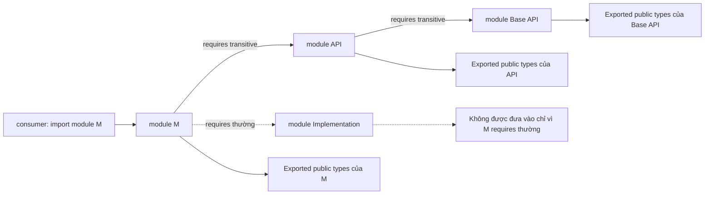

# Các package được export và tập kiểu có thể truy cập qua module import

Trong Java 25, câu lệnh `import module java.base;` cho phép dùng những kiểu như `List`, `Map`, `LocalDate` hoặc `BigDecimal` mà không phải viết nhiều import theo package. Tuy nhiên, **không phải mọi kiểu được chứa trong một JDK module hoặc JAR đều trở thành tên đơn có thể dùng**. Tập kiểu thực sự được đưa vào phạm vi tra cứu phụ thuộc vào **các package được module export**, quyền truy cập của kiểu, các quan hệ `requires transitive` và các quy tắc phân giải tên của Java.

Bài học thuộc chương **Module import** trong lộ trình **Java 25** (`JAVA_VERSION_JAVA25`). Trọng tâm là đề bài **“Các package được export và tập kiểu có thể truy cập qua module import”**, theo **JEP 511 – Module Import Declarations**, được hoàn thiện chính thức trong Java 25. Tất cả ví dụ chính sử dụng cú pháp Java 25 **không cần bật `--enable-preview`**. Nội dung tập trung vào kiến thức còn hữu ích khi phát triển Java hiện đại; không dùng các API preview, incubator hay kỹ thuật vượt cơ chế đóng gói của JPMS như giải pháp mặc định.

## 1. Module import là gì, và điều nó không làm

Một `module import declaration` có dạng:

```java
import module java.base;
```

Nó là **khai báo import-on-demand**: đưa những **tên kiểu có thể truy cập** thuộc các package được export của module vào quá trình phân giải tên đơn (*simple name*) trong compilation unit. Về mặt tiện lợi, thay vì viết:

```java
import java.math.BigDecimal;
import java.time.LocalDate;
import java.util.List;
import java.util.Map;
```

có thể viết:

```java
import module java.base;
```

Ví dụ chạy với Java 25:

```java
// ModuleImportDemo.java
import module java.base;

public class ModuleImportDemo {
    public static void main(String[] args) {
        Map<String, BigDecimal> prices = Map.of(
                "apple", new BigDecimal("12500"),
                "pear", new BigDecimal("18000"));
        List<String> names = List.copyOf(prices.keySet());
        LocalDate today = LocalDate.now();
        IO.println(today + ": " + names);
    }
}
```

```bash
javac --release 25 ModuleImportDemo.java
java ModuleImportDemo
```

Ngày và thứ tự các phần tử khi in không phải tiêu chí cố định của ví dụ; `Map.of(...)` không cam kết thứ tự duyệt. Điều cần kiểm chứng là chương trình biên dịch, không cần những import riêng cho `java.util`, `java.time` hay `java.math`.

**Ba điều cần phân biệt:**

| Cơ chế | Chức năng chính | Có thay thế cho cơ chế khác không? |
| --- | --- | --- |
| `import module M;` | Cho phép dùng tên kiểu ngắn từ các package được export và các module bắc cầu đủ điều kiện | Không thay `requires`, không tự tải thư viện thiếu |
| `requires M;` trong `module-info.java` | Khai báo module dependency/readability cho một **named module** | Không thay việc import tên kiểu khi viết mã |
| `exports p;` trong module cung cấp | Công khai package `p` tới những module được phép | Không tự biến kiểu package-private thành public |
| `opens p;` | Cho phép reflective access theo quy tắc JPMS | **Không** có nghĩa các kiểu trong `p` được import để gọi trực tiếp |
| `--module-path`, classpath, dependency của build tool | Cung cấp artifact và ảnh hưởng module resolution | Không tự đưa mọi kiểu vào source dưới simple name |

Tư duy chính xác: **module import là cú pháp chọn tên kiểu**, còn **JPMS định nghĩa module nào được đọc và package nào được truy cập**.

## 2. “Exported package” là điều kiện đầu tiên

JPMS phân chia thư viện thành các **named modules**, mỗi module có thể chứa nhiều package. File `module-info.java` của một module nêu rõ package nào là **API công khai ở ranh giới module**:

```java
// module-info.java của module com.acme.catalog
module com.acme.catalog {
    exports com.acme.catalog.api;
}
```

Giả sử module đó có:

```text
com.acme.catalog
├── module-info.java
└── com/acme/catalog
    ├── api
    │   ├── Product.java         (public record Product)
    │   ├── CatalogService.java  (public interface CatalogService)
    │   └── InternalMapping.java (class InternalMapping, package-private)
    └── internal
        └── JdbcCatalog.java     (public class JdbcCatalog)
```

Nhìn vào cấu trúc này:

- `com.acme.catalog.api` được **export không điều kiện** (*unqualified export*), có thể được module tiêu thụ đủ điều kiện truy cập.
- `com.acme.catalog.internal` **không được export**, dù bên trong có class khai báo `public`.
- `InternalMapping` có quyền truy cập **package-private**; export cả package không tự làm class này thành `public`.
- `Product` và `CatalogService` là các kiểu top-level public của package được export, nên là ứng viên cho `import module com.acme.catalog;`.

Đây là hai cổng kiểm tra độc lập:

1. **Package có được export tới compilation unit đang biên dịch không?**
2. **Kiểu top-level trong package đó có đủ quyền truy cập không?**

Chỉ khi cả hai điều kiện thỏa mãn, kiểu mới có thể được gọi bằng simple name thông qua module import, với điều kiện module cũng hiện diện và đọc được theo ngữ cảnh biên dịch.

### Export không lan sang subpackage

`exports com.acme.catalog.api;` không tự động export:

```text
com.acme.catalog.api.internal
com.acme.catalog.api.dto
```

Package của Java không có quan hệ kế thừa quyền truy cập theo dấu chấm. Nếu muốn export `com.acme.catalog.api.dto`, module phải khai báo `exports` riêng cho package đó. Tương tự, `import module com.acme.catalog;` không “import mọi package có prefix giống nhau”.

### Export khác mở cho reflection

Một framework có thể dùng reflection vào package được khai báo `opens`, nhưng code Java ở module khác **không vì vậy mà được trực tiếp import kiểu** từ package đó.

```java
module com.acme.catalog {
    exports com.acme.catalog.api;
    opens com.acme.catalog.persistence to com.fasterxml.jackson.databind;
}
```

Khối trên là **ví dụ về phân biệt hai directive**, không phải cấu hình cần thêm vào mọi dự án. Module `com.fasterxml.jackson.databind` phải thực sự tồn tại trên module path khi biên dịch/chạy cấu hình tương ứng. Quyền reflective access của `opens` không cấp source-level access như `exports`.

## 3. “Tập kiểu được import” không phải toàn bộ nội dung module

Định nghĩa thực dụng cho một compilation unit nằm trong module tiêu thụ `C`:

> Khi viết `import module M;`, compiler xem xét các **kiểu top-level public có thể truy cập** trong **các package được export phù hợp** của `M` và các module mà `M` đọc theo chuỗi **`requires transitive`**. Các kiểu đó trở thành ứng viên khi giải quyết tên đơn trong source.

Có thể mô tả khái niệm:

```text
Tập mô-đun xét đến:
  M
  + các module đạt được bằng chuỗi requires transitive từ M

Với mỗi module X được xét:
  package P phải được export tới mã đang biên dịch
  kiểu T phải là public top-level và accessible

Tập tên ứng viên = các T thỏa toàn bộ điều kiện trên
```

Đây là **mô hình tư duy**, không phải định nghĩa thay thế Java Language Specification: thực tế compiler còn phải áp dụng module resolution/readability, phạm vi import và luật ưu tiên/nhập nhằng tên kiểu.

| Loại khai báo ở module được import | Có tự được import bằng tên đơn không? | Lý do |
| --- | --- | --- |
| `public class Product` trong package đã export | Có, khi accessible | Public top-level class |
| `public interface CatalogService` trong package đã export | Có, khi accessible | Public top-level interface |
| `public record Product(...) ` trong package đã export | Có, khi accessible | Record là một dạng class |
| `public enum Status` trong package đã export | Có, khi accessible | Enum là một dạng class |
| `public @interface Marker` trong package đã export | Có, khi accessible | Annotation interface là một dạng interface |
| `class InternalMapping` package-private | Không | Không có quyền public top-level |
| `public class JdbcCatalog` ở package không export | Không | Class public không vượt qua ranh giới module |
| `public static class Nested` trong `ProductTypes` | **Không trực tiếp dưới tên `Nested`** | Module import nhắm vào kiểu top-level |
| `static final int MAX = 10` | Không | Module import không phải static import |
| Method `parse(...)` hoặc field `value` | Không | Đây không phải kiểu top-level |

Nếu `Map` được import từ `java.base`, có thể viết `Map.Entry` để tham chiếu public nested interface `Entry`. Nhưng chỉ `import module java.base;` **không** làm cho tên đơn `Entry` được tự import:

```java
// NestedTypes.java
import module java.base;

public class NestedTypes {
    public static void main(String[] args) {
        Map.Entry<String, Integer> entry = Map.entry("A", 1);
        IO.println(entry);
    }
}
```

Nếu muốn dùng trực tiếp `Entry`, cần explicit type import riêng như `import java.util.Map.Entry;`, khi hợp lệ và không xung đột. Tương tự, để gọi static method `emptyList()` bằng tên đơn, phải dùng `import static java.util.Collections.emptyList;`, không thể nhờ module import.

## 4. Quy tắc `requires transitive` mở rộng tập kiểu

Một khác biệt quan trọng giữa `import module` và `import p.*;` là **module import xét cả các module phụ thuộc bắc cầu được công khai qua `requires transitive`**.

Ví dụ module `java.sql` yêu cầu truy cập một số module API có quan hệ bắc cầu, trong đó có `java.xml`. Vì vậy:

```java
// SqlAndXmlTypes.java
import module java.sql;

public class SqlAndXmlTypes {
    // Connection thuộc java.sql.
    private Connection connection;

    // Document thuộc org.w3c.dom, được export từ java.xml;
    // java.xml nằm trong chuỗi requires transitive liên quan.
    private Document document;

    public static void main(String[] args) {
        IO.println("Kiểm tra tên kiểu, chưa kết nối cơ sở dữ liệu.");
    }
}
```

Chạy:

```bash
javac --release 25 SqlAndXmlTypes.java
java SqlAndXmlTypes
```

Ví dụ minh họa **độ phủ về tên kiểu**, không mở kết nối SQL, không phân tích XML và không yêu cầu database. `java.sql` cung cấp `Connection`, còn `Document` đến từ module `java.xml` theo quan hệ transitive. Tập module thực tế phải được xác minh với JDK 25 đang dùng nếu xây công cụ phân tích tự động.

### Vì sao chỉ xét `requires transitive`?

Trong JPMS, `requires transitive X;` thể hiện rằng API của module đang yêu cầu `X` như một **phụ thuộc cần lan truyền** tới các module đọc nó. Ngược lại, `requires X;` thường mô tả phụ thuộc trực tiếp mà module tiêu thụ không tự kế thừa toàn bộ ở cấp API.

Ví dụ mô hình:



Không suy diễn rằng toàn bộ các module trên `--module-path`, hoặc tất cả module mà `M` đọc bằng mọi loại `requires`, đều được tự import. Quy tắc này giúp tránh vô tình kéo vào source tên kiểu của những implementation dependency không nằm trong API mà nhà cung cấp muốn công bố.

### Khai báo `requires transitive` có giống `exports` không?

**Không.** Hai directive làm hai công việc khác nhau:

- `exports p;` công bố **package của chính module**.
- `requires transitive X;` diễn tả phụ thuộc API tới **module khác** và cho phép readability lan truyền theo JPMS.

Để một kiểu ở `X` có thể được tiêu thụ, package của nó **vẫn phải được export tới nơi truy cập**, và kiểu đó **vẫn phải public**. `requires transitive` không biến một package `internal` đang đóng thành API.

## 5. Export có điều kiện (qualified export)

JPMS cho phép một module chỉ export package tới **một số module được nêu tên**:

```java
module com.acme.catalog {
    exports com.acme.catalog.api;
    exports com.acme.catalog.spi to com.acme.checkout;
}
```

Khi đó:

- Với module `com.acme.checkout` có quyền đọc `com.acme.catalog`, các public top-level types ở `com.acme.catalog.api` **và** `com.acme.catalog.spi` có thể truy cập theo điều kiện.
- Với module `com.acme.reporting`, package `com.acme.catalog.spi` **không được export tới nó**, nên `import module com.acme.catalog;` không cho phép dùng các kiểu trong package đó.
- Với code trên classpath thuộc **unnamed module**, không thể tự nhận quyền export chỉ định cho `com.acme.checkout` bằng cách viết câu lệnh import.

Điều này giải thích tại sao **hai compilation units cùng viết `import module com.acme.catalog;` vẫn có thể nhìn thấy tập kiểu khác nhau**: quyền truy cập được quyết định ở ranh giới module, không chỉ ở tên dòng import.

Qualified exports có thể hữu ích với **SPI hoặc tích hợp giữa những module tin cậy đã định danh**, nhưng không nên lạm dụng chúng để mở lớp triển khai nội bộ. Nếu nhiều module đều cần cùng API, xem xét thiết kế một package API công khai ổn định hơn.

## 6. Import names và module readability là hai tầng riêng

Trong một **named module** muốn dùng API của `com.acme.catalog`, thường cần cả:

```java
// src/com.acme.checkout/module-info.java
module com.acme.checkout {
    requires com.acme.catalog;
}
```

và:

```java
// src/com.acme.checkout/com/acme/checkout/Main.java
package com.acme.checkout;

import module com.acme.catalog;

public class Main {
    public static void main(String[] args) {
        Product product = new Product("SKU-001", 8);
        System.out.println(product);
    }
}
```

Giả sử module nhà cung cấp có:

```java
// src/com.acme.catalog/module-info.java
module com.acme.catalog {
    exports com.acme.catalog.api;
}
```

```java
// src/com.acme.catalog/com/acme/catalog/api/Product.java
package com.acme.catalog.api;

public record Product(String sku, int stock) {
    public Product {
        if (sku == null || sku.isBlank() || stock < 0) {
            throw new IllegalArgumentException("Product không hợp lệ");
        }
    }
}
```

Với **multi-module source layout** như ví dụ:

```text
src/
  com.acme.catalog/
    module-info.java
    com/acme/catalog/api/Product.java
  com.acme.checkout/
    module-info.java
    com/acme/checkout/Main.java
```

có thể thực hành bằng JDK 25:

```bash
javac --release 25 --module-source-path src -d out \
    -m com.acme.catalog,com.acme.checkout
java --module-path out -m com.acme.checkout/com.acme.checkout.Main
```

Kết quả dự kiến:

```text
Product[sku=SKU-001, stock=8]
```

Ví dụ phân định rõ:

1. **`module-info.java` của catalog** quyết định package `api` được export.
2. **`module-info.java` của checkout** quyết định checkout đọc được catalog.
3. **`import module com.acme.catalog;`** đưa các kiểu top-level có thể truy cập (trong đó có `Product`) vào phạm vi tên đơn của `Main.java`.

Chỉ viết `import module com.acme.catalog;` mà **không có JAR/source module cần thiết** trên đường build là không đủ. Trong dự án JPMS có tên, khai báo `requires` phù hợp vẫn là cách quản lý module dependency; import syntax không phải cách vượt module encapsulation.

### Nếu dùng classpath thay vì named modules?

Code ở **unnamed module** (classpath) có quy tắc readability và module resolution khác code ở named module. Bạn vẫn có thể dùng module import cho các JDK modules đã được giải quyết và accessible. Nhưng đừng giả định import module sẽ tìm thấy mọi third-party module:

- Thư viện phải có mặt trong classpath hoặc module path theo build.
- Module được gọi tên phải **observable/resolved**, với các option `--add-modules` khi tình huống cụ thể cần.
- Một JAR trên classpath **không trở thành named module có tên tùy ý** để có thể viết `import module com.some.library;`.
- Automatic modules có tính chất export/package khác explicit named modules; đừng dựa vào tên tự suy ra của JAR như một API ổn định.

Trong ứng dụng Spring Boot không sử dụng JPMS named modules, import theo package thông thường vẫn là lựa chọn đơn giản, rõ ràng. `import module java.base;` có thể hữu ích trong utility hoặc test; không cần chuyển cả codebase thành JPMS chỉ để tận dụng cú pháp mới.

## 7. Hai kiểu cùng simple name: cách Java giải quyết

`import module` có tính chất **on-demand**. Nếu hai module cùng công bố các kiểu có tên đơn giống nhau, tham chiếu không đủ rõ có thể gây lỗi compile.

Ví dụ `java.util.List` (từ `java.base`) và `java.awt.List` (từ `java.desktop`):

```java
// AmbiguousList.java — cố ý sai.
import module java.base;
import module java.desktop;

public class AmbiguousList {
    List values; // LỖI: List có thể là java.util.List hoặc java.awt.List.
}
```

**Cách 1: thêm single-type import để chọn đúng kiểu.**

```java
// ResolvedList.java
import module java.base;
import module java.desktop;
import java.util.List;

public class ResolvedList {
    List<String> values = List.of("A", "B");
}
```

**Cách 2: dùng tên đầy đủ ở đúng vị trí.**

```java
import module java.base;
import module java.desktop;

public class ExplicitNames {
    java.util.List<String> names = java.util.List.of("A");
    java.awt.List uiList = new java.awt.List();
}
```

Code ví dụ thứ hai mang dependency tới module `java.desktop`, chỉ phù hợp trên một JDK/runtime image có module đó. Trong ứng dụng headless/minimal runtime, hãy tránh import `java.desktop` nếu không thực sự cần API UI.

### Độ ưu tiên không có nghĩa module import “ghi đè” các import cũ

Các nhóm tên được Java giải quyết theo quy tắc từ JLS, trong đó:

| Cách viết | Ý nghĩa khi giải tên |
| --- | --- |
| Kiểu khai báo trong cùng compilation unit hoặc phạm vi đang xét | Có thể che tên kiểu nhập từ nơi khác theo quy tắc scope |
| `import java.util.List;` | Single-type import chỉ định đúng kiểu |
| `import java.util.*;` | Package-on-demand, nhiều kiểu có thể cùng tên |
| `import module java.base;` | Module-on-demand, rộng hơn nhiều package |
| `java.util.List` | Fully qualified name rõ ràng tại chỗ dùng |

Nên ưu tiên explicit imports cho những kiểu quan trọng hoặc có nguy cơ nhập nhằng. **Không được dựa vào thứ tự hai dòng `import module` để quyết định kiểu nào “thắng”**; đổi thứ tự không giải quyết xung đột.

### Import không làm lộ dữ liệu hay biến trạng thái thành công khai

Module import đưa **tên kiểu** vào phạm vi dùng của compiler, không thay đổi:

- Access modifier của fields/methods và constructors bên trong kiểu đó;
- Điều kiện exported package/qualified export;
- Chính sách reflection hoặc security của runtime;
- Các yêu cầu linking/module resolution của ứng dụng.

Một kiểu `public` được import vẫn có thể có constructor `private` hoặc những API không accessible; khi đó gọi constructor/member ấy vẫn không hợp lệ.

## 8. Dùng module import với compact source file của Java 25

Java 25 cũng chính thức hóa **compact source files** theo JEP 512. Tệp nguồn gọn tự có import-on-demand cho các kiểu top-level public từ những package được export của `java.base`, nên thường **không cần** thêm `import module java.base;`.

```java
// BaseOnly.java (compact source file)
void main() {
    List<String> names = List.of("An", "Bình", "Chi");
    names.stream().forEach(IO::println);
}
```

```bash
java BaseOnly.java
```

Muốn dùng thêm API từ module `java.net.http`, viết explicit module import:

```java
// HttpRequestPreview.java — không gửi HTTP request thực tế.
import module java.net.http;

void main() {
    URI uri = URI.create("https://example.org/catalog");
    HttpRequest request = HttpRequest.newBuilder(uri)
            .GET()
            .build();
    IO.println(request.uri());
}
```

```bash
java HttpRequestPreview.java
```

Tên file trong ví dụ chỉ là tên tiện chọn, **không phải preview feature**: cả compact source files và module imports đều đã final trong JDK 25. Nếu thấy tên gây nhầm, có thể đặt là `HttpRequestDemo.java`. Ở đây `URI` thuộc `java.base`, `HttpRequest` thuộc `java.net.http`, còn `IO` thuộc `java.lang`; chương trình chỉ tạo `HttpRequest`, không truy cập mạng.

**Không nhầm với `import module java.base;` ở file Java thường.** Khi viết một ordinary compilation unit chứa `public class ...`, Java chỉ tự import `java.lang.*` theo cơ chế truyền thống. `List`/`LocalDate` không tự xuất hiện nếu bạn chưa khai báo import phù hợp.

## 9. Cách tự kiểm tra package export và module dependency

Để biết một module trong JDK 25 thực sự export gì, đừng dựa vào suy đoán từ tên JAR. Có thể dùng công cụ JDK:

```bash
java --version
java --list-modules
java --describe-module java.base
java --describe-module java.sql
java --describe-module java.net.http
```

Quan sát đầu ra:

- Những dòng `exports ...` chỉ ra các package công khai từ module đó.
- Những dòng `requires ... transitive` cho biết quan hệ phụ thuộc API có thể lan truyền.
- Các package chỉ nằm trong `contains ...` hoặc không có export tương ứng không tự trở thành public API để module khác import.
- Nếu module có qualified export, đối tượng được cấp quyền có thể xuất hiện cùng chỉ dẫn target module.

Với JAR thuộc JPMS:

```bash
jar --describe-module --file path/to/catalog.jar
```

Lệnh chỉ minh họa; `path/to/catalog.jar` cần thay bằng file thực tế. Các module explicit/automatic có đặc điểm khác nhau. Nếu ứng dụng ở dạng modular JAR có `module-info.class`, đây là cách hữu ích để đối chiếu thông tin **artifact thực sự đóng gói**, không chỉ source code.

### Checklist compiler-first

Khi chưa chắc một kiểu được import không, hãy hỏi theo thứ tự:

1. **Đang dùng JDK nào?** `javac --version` cần là JDK 25+ hỗ trợ tính năng final; `--release 21` không cho phép cú pháp Java 25.
2. **Module có observable/resolved không?** Xem module path, `requires`, launcher và các option cấu hình thích hợp.
3. **Package có `exports` không?** Nếu qualified, có export đến module hiện tại không?
4. **Kiểu có `public` và là top-level type không?** Nested type cần qualifier hoặc explicit import riêng.
5. **Có tên trùng không?** Xem các on-demand imports khác và kiểu trong phạm vi hiện tại.
6. **Lỗi ở type hay ở member?** Import được một class không cấp quyền gọi mọi constructor/method của class.

Giải quyết được sáu câu hỏi này thường xác định đúng nguyên nhân mà không cần dùng các option vượt encapsulation như `--add-exports` trong production.

## 10. Khi nào module import đáng dùng?

Module import là một **lựa chọn thiết kế về tính dễ đọc của source**, không phải bắt buộc dùng chỉ vì đang chạy Java 25.

| Bối cảnh | Cách dùng phù hợp | Lý do |
| --- | --- | --- |
| Ví dụ ngắn minh họa nhiều API trong `java.base` | `import module java.base;` | Giảm boilerplate, tập trung vào bài học |
| Compact source file Java 25 chỉ dùng `java.base` | Có thể không cần viết import | Đã có auto-import của compact compilation unit |
| CLI dùng JDBC và XML | `import module java.sql;` khi dễ đọc | Bao gồm exported types và các API dependency bắc cầu phù hợp |
| Dự án JPMS có module API rõ ràng | Kết hợp `requires` và `import module` nếu hữu ích | Không làm mờ ranh giới export/readability |
| Codebase lớn có nhiều kiểu trùng tên | Single-type imports/qualified names | Kiểm soát ambiguity, review chính xác |
| Thư viện public muốn hạn chế dependency surface | Chỉ import cần thiết, module-info explicit | Tập trung vào API contract và compatibility |
| Spring Boot app không modular hóa theo JPMS | Vẫn có thể dùng import package thông thường | Không cần triển khai JPMS để có code tốt |

Một import module rất rộng có thể làm người review khó biết kiểu đến từ package nào, nhất là khi API cùng tên tồn tại trong nhiều module. Quy ước đội nhóm nên cân bằng giữa **độ ngắn** và **khả năng tìm nguồn gốc kiểu**. IDE có thể đề xuất tự động thêm explicit import khi xung đột; xem xét diff thực tế thay vì đánh giá chỉ bằng số dòng.

### Kết hợp với công cụ build

Khi nâng cấp dự án lên Java 25:

- Chọn **toolchain JDK 25** và cấu hình compiler `--release 25` nếu dự án quyết định nâng source/bytecode target.
- Kiểm tra dependency libraries và plugins của Maven/Gradle có hỗ trợ Java 25.
- Với JPMS, giữ `module-info.java` và module path chính xác; không dùng dòng import mới thay thế manifest module.
- Kiểm tra static analysis, code formatter, IDE và annotation processors đọc được cú pháp `import module`.
- Chạy unit/integration tests sau thay đổi import, nhất là nơi có generated source hoặc các kiểu trùng simple name.

Tính năng này không tăng tốc ứng dụng chỉ nhờ rút gọn số dòng import: các import liên quan chủ yếu tới **phân giải source khi biên dịch**. Cần một phép đo cụ thể nếu có tuyên bố khác về tốc độ build.

## 11. Lỗi thường gặp và cách chẩn đoán

| Thông báo/hiện tượng | Nguyên nhân có thể | Bước kiểm tra |
| --- | --- | --- |
| Compiler không hiểu `import module ...;` | JDK/compiler target cũ, chưa hỗ trợ JEP 511 final | Dùng `javac --version`, cấu hình `--release 25` |
| `module not found` | Thiếu module/JAR, module path hoặc resolution chưa đúng | Kiểm tra `--module-path`, `--add-modules` nếu áp dụng |
| `package ... is not visible` | Package không export, qualified export sai target hoặc thiếu readability | Xem `module-info.java`/`java --describe-module` |
| `cannot find symbol` cho kiểu cụ thể | Không public, package chưa export, kiểu nested hoặc import sai module | Dùng tên đầy đủ, xem modifier và module chứa kiểu |
| `reference to List is ambiguous` | Có nhiều kiểu cùng simple name từ các import-on-demand | Thêm `import java.util.List;` |
| Import được kiểu nhưng constructor không gọi được | Constructor/member private, package-private hoặc protected không phù hợp | Xem access modifier của member |
| `opens` đã khai báo nhưng vẫn không compile import | Reflection khác compile-time accessibility | `exports` mới là directive cho source access |
| Chạy được trên JDK 25 nhưng lỗi ở JDK 21 | Module import mới chính thức ở 25 | Hạ source target hoặc không dùng cú pháp mới |
| Code ở unnamed module thấy ít API hơn dự kiến | Module chưa được resolved, khác với package/classpath thông thường | Kiểm tra module resolution và launcher |
| Kiểu ở dependency transitive không hiện | `requires` thường, export không hợp lệ hoặc API không public | Xem chuỗi `requires transitive` và các export |

**Không xử lý lỗi package không export bằng cách mở hàng loạt `--add-exports` hoặc `--add-opens` mà không xem xét thiết kế.** Các option đó có tình huống tương thích/migration cụ thể, nhưng một thư viện thiết kế đúng nên dùng exported public API, không dựa vào implementation packages nội bộ.

## 12. Bài thực hành: dự đoán chính xác tập kiểu được phép dùng

### Bài A — Kiểm tra exported types của `java.base`

Tạo file `BaseExports.java`:

```java
import module java.base;

public class BaseExports {
    public static void main(String[] args) {
        List<String> cities = List.of("Hà Nội", "Huế", "Đà Nẵng");
        LocalDate day = LocalDate.of(2026, 11, 27);
        IO.println(day + " -> " + cities.size());
    }
}
```

Chạy bằng JDK 25. Sau đó lần lượt thay `List` bằng `java.util.List`, xóa dòng module import, rồi thêm `import java.util.List;` và `import java.time.LocalDate;`. Ghi nhận tác động của từng bước tới biên dịch.

**Câu hỏi:** vì sao `String` vẫn được nhận diện khi xóa tất cả các import, còn `List` và `LocalDate` thì không?

### Bài B — Phân biệt export public, không export và package-private

Tạo hai named modules `com.acme.catalog` và `com.acme.checkout` như mục 6. Trong catalog, tạo:

```java
// com.acme.catalog.api.PublicItem.java
package com.acme.catalog.api;
public record PublicItem(String sku) {}
```

```java
// com.acme.catalog.api.HiddenItem.java
package com.acme.catalog.api;
record HiddenItem(String sku) {} // package-private
```

```java
// com.acme.catalog.internal.Secret.java
package com.acme.catalog.internal;
public record Secret(String value) {}
```

Với `exports com.acme.catalog.api;` và `import module com.acme.catalog;` trong checkout, dự đoán rồi kiểm tra:

- `PublicItem` được dùng bằng simple name.
- `HiddenItem` không thể dùng từ module khác vì không public.
- `Secret` không thể dùng vì package `internal` chưa export, dù record có `public`.

Thử thêm `exports com.acme.catalog.internal;` trong một nhánh thực hành để thấy sự khác biệt, sau đó **khôi phục đóng gói đúng**. Bài tập mô tả nguyên tắc, không khuyến nghị công khai `internal` cho sản phẩm thật.

### Bài C — Transitive imports và xung đột

1. Biên dịch ví dụ `SqlAndXmlTypes.java` từ mục 4; giải thích vì sao kiểu `Document` có thể được nhận diện khi import module `java.sql`.
2. Dùng `java --describe-module java.sql` để tìm quan hệ `requires transitive` liên quan.
3. Tạo ví dụ import `java.base` và `java.desktop`, cố ý tham chiếu `List` để thấy lỗi ambiguity.
4. Sửa bằng `import java.util.List;` và bằng tên đầy đủ. Giải thích vì sao **đổi thứ tự dòng import** không phải giải pháp.
5. So `import module java.sql;` với `import java.sql.*;`: chỉ ra một kiểu từ `java.xml` mà dạng package import không tự đưa vào.

### Mẫu ghi nhận kết quả

| Ca thử | Dự đoán trước khi chạy | Kết quả javac | Lý do |
| --- | --- | --- | --- |
| A1: `List` sau `import module java.base;` | Chưa điền | Chưa chạy | Chưa ghi |
| A2: `LocalDate` không có import | Chưa điền | Chưa chạy | Chưa ghi |
| B1: `PublicItem` export + public | Chưa điền | Chưa chạy | Chưa ghi |
| B2: `HiddenItem` export + package-private | Chưa điền | Chưa chạy | Chưa ghi |
| B3: `Secret` public nhưng package đóng | Chưa điền | Chưa chạy | Chưa ghi |
| C1: `Document` qua import `java.sql` | Chưa điền | Chưa chạy | Chưa ghi |
| C2: hai kiểu `List` bị trùng tên | Chưa điền | Chưa chạy | Chưa ghi |

**Tiêu chí hoàn thành:** Người học dự đoán được một kiểu có import được hay không dựa trên **module được xét → package export phù hợp → public top-level type → name resolution**, không chỉ nhìn vào package path hoặc keyword `public`. Người học cũng giải thích được khi nào cần `requires`, tại sao `requires transitive` ảnh hưởng tập kiểu, và cách sửa import ambiguity mà không vi phạm đóng gói JPMS.

## 13. Nguồn tham khảo chính thức

- [JEP 511 — Module Import Declarations](https://openjdk.org/jeps/511): thiết kế, semantics và trạng thái chính thức của Java 25.
- [Oracle Java 25 — Module Import Declarations](https://docs.oracle.com/en/java/javase/25/language/module-import-declarations.html): ví dụ và sự tương tác với module exports.
- [JLS Java SE 25 — §7.5 Import Declarations](https://docs.oracle.com/javase/specs/jls/se25/html/jls-7.html#jls-7.5): thứ tự ưu tiên, phạm vi và quy tắc import module.
- [JLS Java SE 25 — §7.7 Module Declarations](https://docs.oracle.com/javase/specs/jls/se25/html/jls-7.html#jls-7.7): `requires`, `exports` và qualified exports.
- [Java Platform Module System — JEP 261](https://openjdk.org/jeps/261): nền tảng module resolution, readability và encapsulation vẫn có hiệu lực trong Java 25.
- [JDK 25 Tool Documentation](https://docs.oracle.com/en/java/javase/25/docs/specs/man/java.html): `--describe-module`, module path và option vận hành.

**Kết luận:** `import module M;` trong Java 25 không có nghĩa “import tất cả thứ nằm trong module M”. Nó đưa vào phạm vi tên đơn **các kiểu top-level public có thể truy cập từ các package được export** của module được chọn và những module đủ điều kiện trên chuỗi `requires transitive`. Quy tắc `exports`, qualified exports, readability và name resolution vẫn quyết định điều gì thực sự dùng được. Hiểu đúng ranh giới này giúp code Java 25 ngắn hơn **mà vẫn giữ được đóng gói và hợp đồng API module**.
