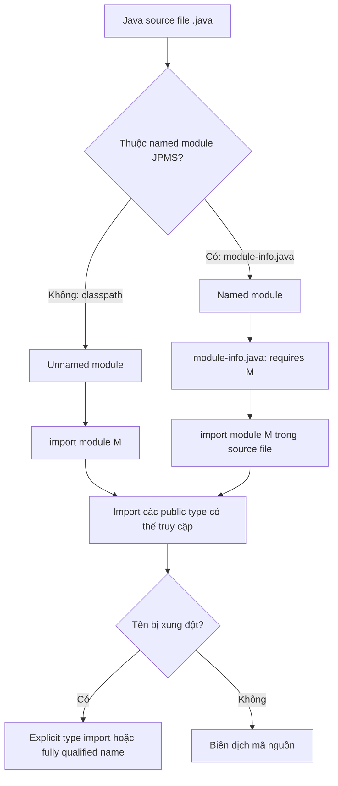

# Sử dụng module import trong mã thuộc unnamed module và named module

> **Chương:** Module import  
> **Module học:** `JAVA_VERSION_JAVA25` — khai thác những khả năng Java 25 vẫn có giá trị trong phát triển Java hiện đại, đặc biệt module import cùng các tính năng đã hoàn tất như compact source files, flexible constructor bodies và `ScopedValue`.  
> **Mục tiêu:** Dùng `import module M;` chính xác trong **unnamed module** (ứng dụng classpath/tiện ích nhỏ) và **named module** (project sử dụng Java Platform Module System — JPMS); hiểu rõ giới hạn `requires`, `exports`, module readability, transitive dependencies và name collision.
>
> **Quy tắc cập nhật:** `import module` theo **JEP 511 đã final từ JDK 25**, tiếp tục áp dụng trong các JDK hiện đại; bài này chỉ dùng cú pháp đã chính thức, **không dựa vào preview JDK 23/24**. Mốc tham khảo: **27/11/2026**.

Chỉ một dòng:

```java
import module java.base;
```

đã cho phép mã Java sử dụng tên đơn giản của nhiều kiểu công khai trong các package được `java.base` xuất ra, như `List`, `Map`, `Stream`, `Path` và `LocalDate`, thay vì viết hàng loạt `import java.util.*;`, `import java.time.*;`, `import java.nio.file.*;`. Nhưng hiệu ứng đó là **import tên tại thời điểm biên dịch**, không phải “nạp mọi JAR vào classpath”, không tự tạo quan hệ dependency giữa Java modules và không bỏ qua quy tắc đóng gói của JPMS.

Đặc biệt, hai phát biểu sau **không tương đương**:

- `import module java.sql;`: đưa tên các kiểu **có thể truy cập** từ `java.sql` và những module được đọc transitively vào phạm vi import-on-demand của **một compilation unit**.
- `requires java.sql;`: khai báo một **phụ thuộc ở mức module** trong `module-info.java`, để module hiện tại đọc được `java.sql`.

Bài học bắt đầu từ sự khác nhau đó, rồi thực hành cả hai cách tổ chức mã.

## 1. Ba tầng: package, Java module và compilation unit

Trước Java 9, nhiều dự án chỉ tổ chức các lớp vào package và JAR trên classpath. JPMS cho phép gom các package vào **named modules**, khai báo phụ thuộc và kiểm soát package nào được export.

| Khái niệm | Ví dụ | Quyết định điều gì? |
|---|---|---|
| **Package** | `java.util`, `java.sql`, `com.acme.reports` | Không gian tên của các class/interface |
| **Named module** | `java.base`, `java.sql`, `dev.report` | Các package nằm trong module; dependency qua `requires`; API qua `exports` |
| **Unnamed module** | Mã ứng dụng đặt trên **classpath** | Không có tên module hoặc file `module-info.java`; vẫn tuân thủ các giới hạn visibility của named module khác |
| **Compilation unit** | Một file `.java` | Nơi `package` và `import` có hiệu lực cho các kiểu khai báo trong file |

Một lớp có thể ở **named package** mà **vẫn thuộc unnamed module**. Ví dụ `com.acme.reports.Main` được biên dịch và chạy trên classpath, không có `module-info.java`, vẫn nằm trong unnamed module. Do đó **unnamed package** (không có dòng `package`) và **unnamed module** (không có descriptor JPMS) không phải cùng một khái niệm.



### Import không thay thế module resolution

`import module M;` **không có hiệu ứng “tải module M về”**. Module M phải tồn tại và nằm trong tập được **resolve/read** bởi compilation unit hiện tại:

- Với **named module**, `requires M;` hoặc một đường đọc module hợp lệ khác phải cung cấp readability.
- Với **unnamed module**, nó có thể đọc các named module đã được resolve; các module trên module path chưa được resolve có thể cần `--add-modules`.
- Dù đã readable, chỉ kiểu công khai trong các package **được export phù hợp** mới có thể được import. Package chỉ `opens` phục vụ reflection không tự trở thành API compile-time.

## 2. Cú pháp chính thức JEP 511 trong JDK 25

JEP 511 hoàn tất Module Import Declarations tại JDK 25. Cú pháp:

```java
import module M;
```

Trong đó `M` là **tên module**, chẳng hạn `java.base`, `java.sql`, `java.xml`, `java.net.http` hoặc tên named module do dự án cung cấp. Không viết `import module java.util;` vì `java.util` là **package**, không phải tên module.

Một import module thực hiện **on-demand import** của:

1. Mọi **public top-level class/interface** trong các package mà module `M` export cho module hiện tại.
2. Các public top-level types trong những package được export bởi các module mà module hiện tại **đọc do đọc M** (điển hình `M requires transitive T`).

“On demand” nghĩa là compiler chỉ tìm tên đơn giản khi mã tham chiếu, chứ không tạo một trường/method/instance hay tự load toàn bộ class.

### So sánh ba cách import

```java
// Cách 1: import từng kiểu
import java.util.List;
import java.util.Map;
import java.time.LocalDate;
```

```java
// Cách 2: import-on-demand theo từng package
import java.util.*;
import java.time.*;
```

```java
// Cách 3: import-on-demand theo module
import module java.base;
```

Khác biệt: `java.util.*` chỉ ảnh hưởng các kiểu công khai trực tiếp trong **package `java.util`**, không tự import `java.util.stream` hay `java.time`. `import module java.base;` có thể phủ các package export của **cùng module `java.base`**.

**Không phải static import.** `import module java.base;` không tự biến `max(1, 2)` thành tên có sẵn nếu phương thức nằm trong `Math`. Muốn gọi `max` không có qualifier thì dùng `import static java.lang.Math.max;` hoặc gọi `Math.max(...)`.

### Kiểm tra bản Java

```bash
java -version
javac -version
```

Cần dùng **JDK 25+** với tính năng final này. Nếu code còn `--enable-preview` chỉ vì `import module`, hãy bỏ cờ không cần thiết. JDK 23/24 từng thử nghiệm module import ở trạng thái preview; **không** dùng cách triển khai JDK 24 làm chuẩn cho bài mới.

## 3. Thực hành A: ordinary class thuộc unnamed module

Tạo một thư mục lab riêng, ví dụ `module-import-lab/unnamed`. File `BaseImports.java` **không có `module-info.java`**:

```java
import module java.base;

public class BaseImports {

    public static void main(String[] args) {
        List<String> names = List.of("Java", "Modulith", "JFR");
        Map<String, Integer> lengths = names.stream()
                .collect(Collectors.toMap(
                        Function.identity(),
                        String::length
                ));

        Path path = Path.of("reports", "summary.txt");
        LocalDate date = LocalDate.of(2026, 11, 27);

        System.out.println("date=" + date);
        System.out.println("path=" + path);
        System.out.println("lengths=" + lengths);
    }
}
```

Các tên đơn giản đến từ những package khác nhau nhưng cùng module `java.base`:

| Tên đơn giản | Package xuất phát | Phân phối qua module |
|---|---|---|
| `List`, `Map` | `java.util` | `java.base` |
| `Collectors` | `java.util.stream` | `java.base` |
| `Function` | `java.util.function` | `java.base` |
| `Path` | `java.nio.file` | `java.base` |
| `LocalDate` | `java.time` | `java.base` |

Chạy bằng source-file mode:

```bash
java BaseImports.java
```

Hoặc biên dịch và chạy riêng:

```bash
javac --release 25 BaseImports.java
java BaseImports
```

Không dùng `--enable-preview`. Thứ tự các entry trong `Map` từ collector **không được bảo đảm**; chỉ kiểm tra rằng ba cặp khóa/độ dài tồn tại, không dựa vào thứ tự in để làm assertion.

**Vì sao file này thuộc unnamed module?** Nó được chạy như một chương trình trên classpath/source-file mode và không có `module-info.java` khai báo named module. File vẫn là **ordinary compilation unit** vì có `public class BaseImports`; không có nghĩa đây là compact source file.

### Ví dụ tiếp theo: `java.sql` trong unnamed module

File `SqlQuick.java`:

```java
import module java.sql;

public class SqlQuick {

    public static void main(String[] args) {
        SQLException diagnostic = new SQLException("demo only");
        Logger logger = Logger.getLogger(SqlQuick.class.getName());

        logger.info("JDBC type is available");
        System.out.println(diagnostic.getClass().getSimpleName());
        System.out.println("Logger module: "
                + Logger.class.getModule().getName());
    }
}
```

Chạy:

```bash
java SqlQuick.java
```

`SQLException` đến từ package `java.sql`; `Logger` đến từ `java.util.logging` của module `java.logging`. Vì `java.sql` có `requires transitive java.logging`, import `java.sql` bao gồm các public types thuộc module `java.logging` đã được expose transitively. JDK 25 còn cho phép import các public types từ `java.xml` qua quan hệ transitively required của `java.sql`.

Mẫu trên **không kết nối database**, không cần JDBC driver: nó chỉ kiểm tra compiler có thể resolve type. Nếu đổi sang truy cập CSDL thật, vẫn cần driver, cấu hình kết nối, secret và xử lý lỗi phù hợp; `import module java.sql;` không cài driver.

### Có được dùng `import module` ở code trong named package trên classpath?

Có. Ví dụ file `src/com/acme/tool/Job.java`:

```java
package com.acme.tool;
import module java.base;

public class Job {
    public static void main(String[] args) {
        List<String> tasks = List.of("index", "report");
        System.out.println(tasks);
    }
}
```

Nếu compile trên classpath, file vẫn thuộc **unnamed module** dù khai báo `package com.acme.tool;`. Điều kiện thuộc named module không đến từ tên package, mà từ **cấu hình JPMS và module descriptor**.

## 4. Thực hành B: dùng module import trong named module

Một **named module** có `module-info.java` và thuộc module path khi được build/chạy theo JPMS. Trong named module, `import module M;` **không thay thế** `requires M;`.

Cấu trúc project `named`:

```text
named/
  src/
    dev.report/
      module-info.java
      com/
        example/
          report/
            ReportApp.java
```

### 4.1. Khai báo dependency ở cấp module

`src/dev.report/module-info.java`:

```java
module dev.report {
    requires java.sql;
}
```

`requires java.sql;` có nhiệm vụ thiết lập dependency để module `dev.report` **đọc được** `java.sql`. Đồng thời nhờ `java.sql` yêu cầu transitively `java.logging` và `java.xml`, `dev.report` cũng đọc được các module ấy.

**Không cần `requires java.base;`**: mọi named module ngoài `java.base` đều đọc `java.base` ngầm định.

### 4.2. Sử dụng import trong một compilation unit

`src/dev.report/com/example/report/ReportApp.java`:

```java
package com.example.report;

import module java.sql;

public class ReportApp {

    public static void main(String[] args) {
        SQLException example = new SQLException("connection unavailable");
        Logger log = Logger.getLogger(ReportApp.class.getName());

        log.info("Report module is running");
        System.out.println("module="
                + ReportApp.class.getModule().getName());
        System.out.println("exception="
                + example.getClass().getSimpleName());
    }
}
```

Kỳ vọng phần in ra có `module=dev.report` và `exception=SQLException`; dòng logging có thể xuất hiện ở stderr với format theo logging provider.

### 4.3. Biên dịch và chạy trên module path

Đứng trong thư mục `named`:

```bash
javac --release 25 --module-source-path src -d out -m dev.report
java --module-path out --module dev.report/com.example.report.ReportApp
```

Lệnh `javac` tìm named module `dev.report` theo cấu trúc dưới `src`, biên dịch descriptor lẫn source và ghi vào `out`. Lệnh `java --module-path out --module ...` chọn entry-point `ReportApp` thuộc named module đó.

Đây là **project JPMS**, khác với lệnh `java SqlQuick.java` của ví dụ unnamed. Không có cờ `--enable-preview` vì JEP 511 đã final.

Nếu dùng Maven/Gradle, build tool có thể cung cấp `module-path` và gọi compiler khác nhau. Cần kiểm tra build thực sự đang **chạy trên module path**, không chỉ có một file `module-info.java` nằm trong repo.

### 4.4. Thử lỗi có chủ đích: xóa `requires java.sql;`

Đổi descriptor thành:

```java
module dev.report {
}
```

Giữ nguyên `import module java.sql;` ở `ReportApp.java` và biên dịch lại. Compiler phải từ chối vì module `dev.report` **không đọc** module `java.sql`. Thông báo cụ thể có thể khác giữa compiler/JDK; trọng tâm là quy tắc readability.

Khôi phục `requires java.sql;` để chương trình biên dịch. **Đừng** thêm `--add-reads` tùy tiện chỉ để đi vòng qua descriptor; công tắc đó có thể hữu ích khi chẩn đoán/di trú, nhưng một module chính thức nên ghi đúng dependency lâu dài trong `module-info.java`.

## 5. Tách rõ `import module` và `requires`

| Câu hỏi | `import module java.sql;` | `requires java.sql;` |
|---|---|---|
| Viết ở đâu? | Trong Java compilation unit, ví dụ `ReportApp.java` | Trong `module-info.java` |
| Phạm vi | Các tên kiểu dễ sử dụng **trong compilation unit** | Readability của **toàn module** |
| Có đưa tên `SQLException` vào short name scope? | Có, nếu type được access | Không; vẫn cần import kiểu hoặc tên đầy đủ trong source |
| Có làm module hiện tại đọc `java.sql`? | **Không** | **Có** |
| Có giúp access package nội bộ không export? | Không | Không |
| Có chuyển classpath app thành named module? | Không | Descriptor là một phần cấu trúc named module |
| Có cần ở unnamed module? | Dùng được để giảm danh sách import | Không khai báo `requires` trong unnamed module |
| Có cần với `java.base`? | Tùy nhu cầu; hữu ích trong ordinary source | Không cần vì `java.base` được đọc ngầm định |

Ví dụ sau **không** tạo ra module dependency:

```java
// Đây là một ordinary .java file có import, không phải module-info.java
import module java.sql;

public class Example {
    public static void main(String[] args) {
        System.out.println(SQLException.class.getName());
    }
}
```

Trong unnamed module, ví dụ này có thể chạy vì `java.sql` thuộc những system modules có thể được resolve khi chạy trên classpath. Trong **named module**, cần descriptor/readability hợp lệ như mục 4.

## 6. `requires transitive` ảnh hưởng phạm vi module import như thế nào?

Đây là điểm hữu ích khi thiết kế thư viện có public API phụ thuộc kiểu từ module khác.

Giả sử có ba named modules:

```text
dev.client
    └── requires dev.api
            └── requires transitive java.sql
                    ├── requires transitive java.logging
                    └── requires transitive java.xml
```

Descriptor của `dev.api`:

```java
module dev.api {
    requires transitive java.sql;
    exports com.acme.api;
}
```

Descriptor của `dev.client`:

```java
module dev.client {
    requires dev.api;
}
```

Trong source code thuộc `dev.client`:

```java
package com.acme.client;

import module dev.api;

// Ví dụ một method bên trong class của dev.client:
void inspect(SQLException issue) {
    System.out.println(issue.getSQLState());
}
```

Đoạn method ở trên là **mảnh minh họa**, đặt trong một class khai báo bình thường, không phải một file Java độc lập chạy được. Vì `dev.api` đòi `java.sql` với `requires transitive`, module `dev.client` đọc được các module liên quan thông qua `dev.api`, và `import module dev.api;` cho phép các public types khả dụng xuất hiện dưới tên ngắn theo quy tắc JLS.

Đối chiếu:

- Nếu đổi `requires transitive java.sql;` thành `requires java.sql;` trong `dev.api`, module `dev.client` **không tự** đọc `java.sql` chỉ vì nó đọc `dev.api`.
- Nếu `dev.client` thực sự sử dụng API `java.sql` trực tiếp sau thay đổi trên, thêm `requires java.sql;` ở descriptor của client và import tương ứng trong source.
- Nếu module `dev.api` trả `SQLException`/`Connection` từ **public API**, `requires transitive java.sql;` là lựa chọn đáng xem xét để module tiêu thụ API cũng đọc được kiểu cần thiết.
- Đừng khai báo mọi dependency là `transitive` cho tiện. Chỉ public hóa những phụ thuộc thuộc **hợp đồng API**, tránh làm lan rộng coupling.

### Mô hình transitively exported types

Không phải mọi module mà `M` yêu cầu đều được import theo `import module M`. Chỉ những module mà compilation unit **đọc được do đọc M** theo cơ chế transitive mới được xét; tiếp đó vẫn áp dụng `exports` của module chứa kiểu. Dependency thông thường `requires T` trong `M` **không** tương đương `requires transitive T`.

JLS 25 đưa ví dụ `M1` export `p1` và `p2 to M0`, đồng thời `requires transitive M4` và `requires M5`. `import module M1` trong `M0` nhập các public types ở `p1`, `p2` và package export của `M4`, **không** tự nhập `p3` (chỉ export cho module khác) hoặc package thuộc `M5` không được đọc transitively.

## 7. `exports`, `opens` và qualified exports vẫn có hiệu lực

Giả sử module `dev.catalog`:

```java
module dev.catalog {
    exports com.acme.catalog.api;
    exports com.acme.catalog.partner to dev.partner;
    opens com.acme.catalog.internal to dev.framework;
}
```

Khi `dev.consumer` đọc `dev.catalog` và dùng:

```java
import module dev.catalog;
```

nó chỉ có thể tham chiếu theo tên ngắn đến những **public top-level types** trong các package được export cho `dev.consumer`, như `com.acme.catalog.api`.

- `com.acme.catalog.partner` chỉ export cho `dev.partner` nên **không** phải API công khai với `dev.consumer`.
- `com.acme.catalog.internal` chỉ `opens` cho `dev.framework` để xử lý phản chiếu phù hợp; **không** có nghĩa compiler của `dev.consumer` được dùng class nội bộ như public API.
- Kiểu package-private (không `public`) không trở nên accessible chỉ vì package được export hoặc vì có module import.
- Việc dùng reflection để truy cập non-public member có điều kiện khác với `import`. Đừng lấy `--add-opens` hoặc `--add-exports` làm giải pháp mặc định cho việc thiết kế module.

**Quy tắc:** module import thay đổi **cách gọi tên kiểu**, không mở rộng **quyền truy cập**.

## 8. Va chạm tên giữa nhiều module imports

Vì `import module M;` đưa nhiều tên vào cùng phạm vi, các lớp **trùng simple name** từ những package khác nhau có thể gây lỗi biên dịch.

Ví dụ minh họa (chỉ để kiểm tra name collision, không khuyến nghị dùng AWT cho ứng dụng nghiệp vụ mới):

```java
import module java.base;
import module java.desktop;

public class AmbiguousExample {
    public static void main(String[] args) {
        List<String> names = List.of("one", "two");
        System.out.println(names.size());
    }
}
```

Compiler có thể báo `List` **ambiguous** vì cả `java.util.List` (Java Collections) và `java.awt.List` (AWT) đều được import theo module. Hai lớp khác nhau có cùng tên đơn giản; dù code muốn phương thức `of` của `java.util.List`, compiler không giải quyết ambiguity dựa trên mong muốn của lập trình viên.

### Cách 1: import tường minh đúng kiểu

```java
import module java.base;
import module java.desktop;
import java.util.List;

public class ResolvedExample {
    public static void main(String[] args) {
        List<String> names = List.of("one", "two");
        System.out.println(names.size());
    }
}
```

`import java.util.List;` là **single-type import** nên thắng hai module imports-on-demand khi resolve tên `List`.

### Cách 2: dùng tên đầy đủ

```java
import module java.base;
import module java.desktop;

public class QualifiedExample {
    public static void main(String[] args) {
        java.util.List<String> names =
                java.util.List.of("one", "two");
        System.out.println(names.size());
    }
}
```

Khi nhiều imports làm phạm vi khó đọc, ưu tiên ghi tường minh `import java.util.List;` hoặc giảm số module imports.

### Quy tắc phân giải quan trọng

Trong JDK 25, quy tắc shadowing/ưu tiên giữa import styles cho phép `single-type import` làm rõ một type nhập bằng module-import-on-demand. Các `type-import-on-demand` như `import java.util.*;` cũng có thể shadow những type nhập bằng module import. Dù vậy, trong code được review nghiêm túc, **single-type import hoặc fully qualified name** thường thể hiện ý định rõ hơn.

Không nên phủ tất cả dự án bằng `import module java.se;` chỉ vì gọn: nhiều lớp có thể trùng tên (ví dụ `List`, `Label`) và khiến việc đọc, refactor hoặc code completion kém rõ ràng.

## 9. Module `java.se`: vì sao có thể cần `--add-modules`?

`java.se` là một **aggregator module** đại diện cho các standard Java SE modules. Nó **không export package riêng**, nhưng `requires transitive` các module liên quan, bao gồm `java.base`. Vì vậy:

```java
import module java.se;
```

có thể đưa nhiều standard Java API types vào phạm vi import, như `List` (base), `HttpClient` (java.net.http), `Connection` (java.sql) và các kiểu xuất qua module standard khác.

### Trong unnamed module

Theo hướng dẫn Java 25 của Oracle, `java.se` **không thuộc tập default root modules của unnamed module**. Khi thực hành dùng `import module java.se;`, hãy thêm `--add-modules java.se` để resolve aggregator module.

Ví dụ file `SeQuick.java`:

```java
import module java.se;

public class SeQuick {
    public static void main(String[] args) {
        List<String> values = List.of("a", "b");
        System.out.println("count=" + values.size());
        System.out.println("http-module="
                + HttpClient.class.getModule().getName());
    }
}
```

Chạy:

```bash
java --add-modules java.se SeQuick.java
```

Hoặc:

```bash
javac --release 25 --add-modules java.se SeQuick.java
java --add-modules java.se SeQuick
```

`HttpClient` đến từ `java.net.http`; tính năng module import không tự bật HTTP client hay thực hiện network request. Ví dụ chỉ truy vấn thông tin type và module.

**Với named module**, thay vì phụ thuộc vào `--add-modules` lúc deploy, nếu thực sự chọn aggregator `java.se` thì descriptor phải có `requires java.se;` hoặc thiết lập readability tương ứng. Tuy nhiên, **không nên mặc định requires java.se cho mọi project**, vì phụ thuộc quá rộng; thường tốt hơn khi khai báo `requires java.sql;` hoặc `requires java.net.http;` theo API thật sự được sử dụng.

## 10. Compact source files có cần `import module java.base` không?

Trong JDK 25, compact source file theo **JEP 512 (final)** tự động có hiệu ứng tương đương:

```java
import module java.base;
```

Ví dụ file `CompactDemo.java` (không có `class` tường minh):

```java
void main() {
    List<String> labels = List.of("Java25", "JPMS");
    Map<String, Integer> sizes = labels.stream()
            .collect(Collectors.toMap(
                    Function.identity(),
                    String::length
            ));

    IO.println(sizes);
}
```

Chạy:

```bash
java CompactDemo.java
```

Không cần viết `import module java.base;` vì JEP 512 đã tự cung cấp việc import này cho **compact compilation unit**; `IO.println` là API `java.lang.IO` final của Java 25 và cần gọi có qualifier `IO.` theo cú pháp chính thức.

Nhưng **ordinary Java class** thuộc unnamed module **không tự** nhận hiệu ứng module import toàn bộ `java.base` (nó chỉ có import ngầm truyền thống `java.lang.*`). Vì thế trong `BaseImports.java` ở phần 3 ta viết `import module java.base;` tường minh.

**Lưu ý:** compact source file thường đi cùng unnamed package và unnamed module cho chương trình nhỏ; nó không đồng nghĩa `import module` chỉ dùng được trong compact source file. Tính năng import module còn dùng được ở **ordinary class của named module** như phần 4.

## 11. Các trường hợp đặc biệt trong named module

### 11.1. `import module` cũng hợp lệ trong `module-info.java`

Theo Java Language Specification `7.5.5`, module import có thể xuất hiện trước module declaration để dùng **simple type names trong descriptor**, chẳng hạn tên service trong `uses` hoặc `provides`.

Ví dụ **mảnh cấu trúc minh họa**, giả sử có implementation JDBC driver hợp lệ:

```java
import module java.sql;

module dev.jdbc.provider {
    requires java.sql;
    provides Driver with com.acme.jdbc.CustomDriver;
}
```

`Driver` ở đây có thể được hiểu là `java.sql.Driver` do import-on-demand; `com.acme.jdbc.CustomDriver` phải thật sự implement driver contract và nằm trong module, cùng các ràng buộc JPMS hợp lệ. Đoạn này **không phải project JDBC driver hoàn chỉnh** và không khuyến nghị tự viết driver chỉ để học cú pháp.

Import ở đầu `module-info.java` vẫn **không thay thế** `requires java.sql;`.

### 11.2. Exported package và readable module luôn đi cùng nhau

Muốn code `dev.report` dùng `Connection` từ `java.sql`, phải thỏa đồng thời:

1. `dev.report` **đọc được** `java.sql` — bằng `requires java.sql;` hoặc quan hệ transitive phù hợp.
2. `java.sql` **export package `java.sql`** cho module gọi.
3. `Connection` là kiểu `public`.
4. `ReportApp.java` import nó qua `import module java.sql;`, `import java.sql.Connection;` hoặc dùng tên đầy đủ.

Điều kiện thứ tư chỉ liên quan **quy tắc đặt tên trong source**, không thay ba điều kiện đầu.

### 11.3. Khi module muốn xuất API chứa kiểu từ module khác

Nếu một public API của `dev.api` chứa kiểu `java.sql.Connection` trong chữ ký, `requires transitive java.sql;` giúp client đọc được các kiểu đó thông qua `dev.api`. Đây là quyết định **thiết kế module API**, không phải bắt buộc do `import module`. Không lạm dụng `transitive` cho dependency implementation-only.

## 12. Quy trình kiểm thử và chẩn đoán

Bài test tối thiểu nên chạy trong JDK 25:

| Trường hợp | Mẫu thay đổi | Kết quả dự kiến |
|---|---|---|
| Unnamed module, `java.base` | `java BaseImports.java` | Compile + chạy, các kiểu `List`/`Path`/`LocalDate` resolve |
| Unnamed module, `java.sql` | `java SqlQuick.java` | `SQLException` và `Logger` được nhận diện |
| Named module có `requires java.sql` | `javac ... -m dev.report` rồi `java -m dev.report/...` | Compile + chạy, module name = `dev.report` |
| Named module thiếu `requires java.sql` | Xóa dòng requires nhưng giữ `import module java.sql;` | Compile lỗi readability |
| Module import mơ hồ | Hai imports `java.base` và `java.desktop`, gọi `List` ngắn | Compile lỗi ambiguity |
| Sửa ambiguity | Thêm `import java.util.List;` | Compile + chạy |
| `java.se` unnamed chưa resolve | Bỏ `--add-modules java.se` trong `SeQuick` | Có thể lỗi vì `java.se` chưa nằm trong graph resolved |
| `java.se` với add-modules | `java --add-modules java.se SeQuick.java` | Compile + chạy |
| Compact source implicit import | `java CompactDemo.java` | Không cần explicit `import module java.base;` |

Nếu gặp lỗi, chẩn đoán theo thứ tự:

1. **JDK version:** `java -version` và `javac -version` có khớp JDK 25+ không?
2. **Tên module có đúng?** `java.base` và `java.sql` là module; `java.util` là package, không dùng sau `import module`.
3. **Tập module đã resolve?** Với `java.se` hoặc custom module path, kiểm tra `--module-path`, `--add-modules`, descriptor và module graph.
4. **Readability:** named module thiếu `requires M;` hoặc thiếu đường đọc transitively hợp lệ.
5. **Exports:** package có được module đích export cho module hiện tại không?
6. **Simple name collision:** có hai kiểu cùng tên từ những imports khác nhau không?
7. **Compile/run mode:** dự án thực sự đang chạy classpath hay module path, dùng đúng `java ...` launcher mode chưa?

Các lệnh chẩn đoán hữu ích:

```bash
java --list-modules
java --describe-module java.sql
java --describe-module java.se
jdeps --module-path out --list-deps out/dev.report
```

`jdeps` là công cụ phân tích dependencies. Cú pháp và đầu vào phù hợp tùy cấu trúc build; lệnh `jdeps` ở đây minh họa dự án lab đã build dưới `out`. `java --describe-module java.sql` giúp xem package exports và `requires transitive` của module.

Đừng chỉ sửa bằng cách thêm `--add-opens`, `--add-exports`, `--add-reads`, rồi bỏ qua nguyên nhân gốc. Các cờ này phù hợp một số kịch bản migration, không thay thế module API/descriptor tốt trong một project mới.

## 13. Khi nào chọn module import, khi nào chọn import truyền thống?

**Chọn `import module` khi:**

- Chương trình nguồn gọn/demo sử dụng nhiều kiểu từ các package khác nhau của một module đã export API rõ ràng.
- Code có mục tiêu học JPMS và cần biểu đạt “các kiểu thuộc API của module này” với ít dòng.
- Một thư viện có API gắn với một module riêng và mã client hiểu module boundary.
- Từng compilation unit được review và biết loại tên nào import on demand.

**Chọn single-type import khi:**

- File production cần dependency đơn giản, rõ ràng và ít tên mơ hồ.
- Nhiều module exports những kiểu trùng tên.
- Code style của team/IDE/checkstyle yêu cầu import tường minh.
- Bạn muốn diff thể hiện rõ từng class mới được tham chiếu.

| Tiêu chí | `import module M;` | `import p.Type;` |
|---|---|---|
| Số dòng khi dùng nhiều package | Thường ít | Có thể nhiều |
| Mức rõ ràng từng kiểu | Thấp hơn | Cao hơn |
| Rủi ro va chạm simple name | Có thể tăng | Thường dễ kiểm soát hơn |
| Có thay `module-info.java`? | Không | Không |
| Có tăng quyền access? | Không | Không |
| Có hợp lệ trong unnamed module? | Có, khi module được resolve/read | Có, khi type accessible |
| Có dùng trong named module? | Có, vẫn phải thỏa readability | Có, vẫn phải thỏa readability |

**Khuyến nghị áp dụng lâu dài:** không tự động chuyển mọi `import java...` sang `import module java.se;`. Tối ưu cho **đọc hiểu code và boundary của dự án** trước, giảm boilerplate sau.

## 14. Bài tập tổng hợp: ba mức quyền truy cập

Một đội có ba chương trình:

- `A` là tool trên classpath (unnamed module), muốn dùng `List` và `Path`.
- `B` là named module `dev.report`, muốn dùng JDBC `SQLException`.
- `C` là named module `dev.client`, dùng API `dev.api`; API public của `dev.api` chứa type từ `java.sql`.

**Yêu cầu:**

1. Viết import cho `A` bằng đúng **một** dòng và chạy bằng `java File.java`.
2. Viết `module-info.java` của `B` và file `ReportApp.java` để `import module java.sql;` hợp lệ.
3. Viết descriptor của `dev.api` sao cho `C` **đọc được** `java.sql` transitively qua `dev.api`.
4. Cố ý làm `B` fail bằng cách xóa `requires` và giải thích vì sao import module **không cứu được**.
5. Tạo va chạm tên với hai module imports, sau đó sửa bằng single-type import.
6. Thử `import module java.se;` trong unnamed module với và không có `--add-modules java.se`; giải thích tác dụng resolution.
7. Nêu lý do `opens com.acme.internal` không cho phép type ở đó trở thành API import thông thường.

**Đáp án trọng tâm:**

| Trường hợp | Thành phần thiết yếu |
|---|---|
| `A` | `import module java.base;`, không cần descriptor JPMS |
| `B` | `module dev.report { requires java.sql; }` và `import module java.sql;` trong source |
| `C` | `dev.api` dùng `requires transitive java.sql;`; `dev.client` dùng `requires dev.api;` |
| Va chạm `List` | Thêm `import java.util.List;` hoặc dùng `java.util.List` |
| Unnamed `java.se` | Bổ sung `--add-modules java.se` để resolve aggregator theo hướng dẫn JDK 25 |
| Package chỉ `opens` | Không là `exports`, không cấp quyền truy cập kiểu cho compiler |

**Điều kiện hoàn thành:** học viên phân biệt được **(a) import tên kiểu, (b) module dependency/readability, (c) package exports**, dự đoán đúng các lỗi compile và giải thích cách giải quyết mà không vô tình phá đóng gói JPMS.

## 15. Những lỗi học thuật cần tránh

| Phát biểu sai | Phát biểu đúng |
|---|---|
| “`import module java.sql;` tự thêm dependency JPMS.” | Import ảnh hưởng compilation unit; named module vẫn cần readability/`requires`. |
| “Chỉ named modules mới dùng được `import module`.” | `import module` dùng được trong **unnamed module** và **named module**. |
| “`java.util` là tên module để import.” | `java.util` là **package**; module tương ứng là `java.base`. |
| “`import module java.base;` cho phép gọi package private types.” | Chỉ các public top-level types trong exported packages, theo quyền access hiện hành. |
| “`opens` và `exports` giống nhau.” | `opens` phục vụ reflective access; `exports` phục vụ API access compile-time. |
| “`requires` đồng nghĩa `requires transitive`.” | `transitive` cho phép client đọc phụ thuộc theo public API; `requires` thường không truyền readability như vậy. |
| “Named package luôn là named module.” | Mã classpath có named package vẫn nằm trong **unnamed module**. |
| “Cứ import `java.se` là có mọi thứ.” | Module `java.se` cần được resolve, imports không thay thế runtime/plugin dependencies hoặc quyền truy cập. |
| “Module import từng là preview nên Java 25 phải bật preview.” | **JEP 511 đã final ở 25**; không cần `--enable-preview`. |
| “Module import có nghĩa import tất cả method static.” | Nó import public top-level types, **không tự static-import methods/fields**. |
| “Muốn sửa lỗi compiler cứ thêm `--add-exports`.” | Kiểm tra descriptor/readability/exports trước; không tùy tiện mở internal API. |

## 16. Nguồn chính thức và phương pháp giữ nội dung hiện thời

1. [Java SE 25 — Module Import Declarations](https://docs.oracle.com/en/java/javase/25/language/module-import-declarations.html): syntax `import module M;`, `java.base`, `java.sql`, ambiguous imports và `java.se`.
2. [Java SE 25 — Language Changes by Release](https://docs.oracle.com/en/java/javase/25/language/java-language-changes-release.html): xác nhận **JEP 511 final**, không còn preview trong Java 25.
3. [Java Language Specification 25 — `7.5.5 Single-Module-Import Declarations](https://docs.oracle.com/javase/specs/jls/se25/html/jls-7.html#jls-7.5.5): luật import, readability, transitive exports, qualified exports, áp dụng trong unnamed/named modules và `module-info.java`.
4. [JLS 25 — `7.7 Module Declarations](https://docs.oracle.com/javase/specs/jls/se25/html/jls-7.html#jls-7.7): `requires`, `requires transitive`, `exports`, `opens`, unnamed modules.
5. [Java SE 25 — `java.sql` module summary](https://docs.oracle.com/en/java/javase/25/docs/api/java.sql/module-summary.html): exports, transitive dependencies đến `java.logging` và `java.xml`.
6. [Java SE 25 — `java.se` module summary](https://docs.oracle.com/en/java/javase/25/docs/api/java.se/module-summary.html): aggregator module và transitive requirements.
7. [Java SE 25 — `java` launcher](https://docs.oracle.com/en/java/javase/25/docs/specs/man/java.html), [`javac` compiler](https://docs.oracle.com/en/java/javase/25/docs/specs/man/javac.html): classpath, module path, `--add-modules` và source-file mode.
8. [JEP 511 — Module Import Declarations](https://openjdk.org/jeps/511): mục tiêu thiết kế và quá trình hoàn tất ở JDK 25.
9. [Java SE 27 — Java Language Changes by Release](https://docs.oracle.com/en/java/javase/27/language/java-language-changes-release.html): kiểm tra module import vẫn là khả năng chính thức ở các bản JDK hiện đại sau 25.

**Nguyên tắc cập nhật:** không lấy thông tin “second preview” từ JDK 24 làm trạng thái cho Java 25, không dùng cờ preview cho `import module` và không nhầm chức năng import-on-demand với quyền đọc/export module. Khi nâng cấp dự án, xác minh JDK thật sự chạy, cấu trúc `module-info.java`, module resolution và các xung đột simple name bằng compiler của JDK đích.

**Kết luận:** `import module M;` làm source code gọn hơn trong **cả unnamed lẫn named module**. Ở unnamed module, hãy bảo đảm M được resolve; ở named module, hãy bảo đảm có quan hệ `requires`/readability hợp lệ. Trong cả hai, Java vẫn áp dụng `exports` và quy tắc phân giải tên — đó là điều giúp module import tiện lợi mà không phá tính đóng gói của JPMS.
