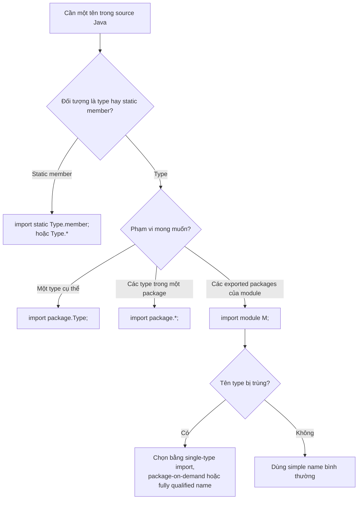
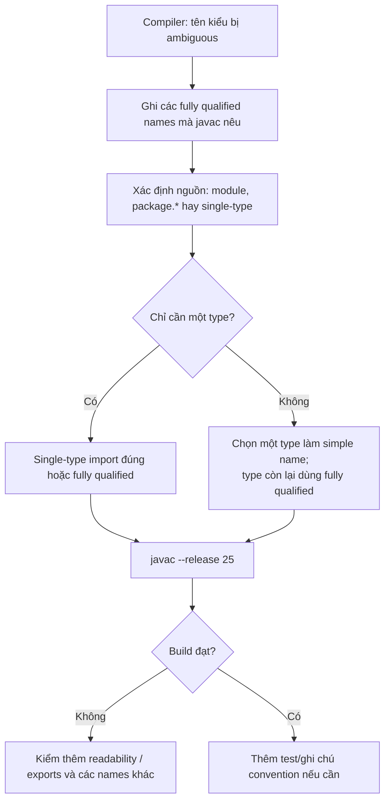

# Kết hợp module import với import kiểu đơn, import theo package và static import

Trong Java 25, một file nguồn có thể dùng `import module java.base;` để truy cập những kiểu công khai được export bởi nhiều package của module `java.base`. Nhưng khi cùng file còn có `import java.util.List;`, `import java.awt.*;` hoặc `import static java.util.Map.entry;`, tên `List` hoặc lời gọi `entry(…)` sẽ được Java compiler phân giải thế nào? Phần quan trọng nhất khi dùng **module import** trong dự án thực tế không chỉ là rút gọn các dòng import, mà là **phối hợp đúng các loại import và kiểm soát xung đột tên**.

Bài thuộc chương **Module import** của module **JAVA_VERSION_JAVA25**. Theo định hướng học Java 25 hiện đại, nội dung tập trung vào **JEP 511 — Module Import Declarations**, đã trở thành tính năng **chính thức (final/permanent)** của Java 25, cùng những cú pháp import vẫn được sử dụng trong Java hiện nay: import kiểu đơn, import theo package và static import. Chúng ta cũng phân biệt import ở cấp file với khai báo `requires` trong Java Platform Module System (JPMS), thực hành xử lý va chạm tên và xây dựng quy tắc chọn import có thể bảo trì.

> **Lưu ý tính hiện hành:** Tất cả các ví dụ sử dụng module import ở đây nhắm tới **Java 25 final**, không dùng cú pháp preview cũ hoặc tính năng đã lỗi thời. `import module M;` không cần `--enable-preview`. Nếu một dự án còn biên dịch với `--release 21`, tính năng này không khả dụng cho source level đó, cho dù runtime thực tế có thể là Java 25.

## 1. Mục tiêu học tập

Hoàn thành bài, bạn có thể:

1. Viết đúng cú pháp của **năm loại import declaration** trong Java 25.
2. Giải thích vì sao `import module java.base;` có thể cung cấp các kiểu từ `java.util`, `java.util.function` và `java.util.stream` cùng lúc.
3. Kết hợp module import với **single-type import** để chỉ định chính xác một kiểu khi có xung đột tên.
4. Dùng **type-import-on-demand** (`package.*`) để chọn nhóm kiểu từ một package thay vì dùng tên trùng do nhiều module mang vào.
5. Dùng **single-static import** và **static-import-on-demand** cho method, field, constant hoặc nested type tĩnh; hiểu rằng module import không tự import static methods.
6. Phân tích một chương trình lỗi vì `java.awt.List` và `java.util.List`, rồi sửa theo hai cách có chủ đích.
7. Phân biệt ***đặt một tên vào scope*** với ***đọc được module và truy cập được package***.
8. Chọn kiểu import dễ đọc cho mã nguồn lớn, test và công cụ một file; tránh mở rộng import không cần thiết.

## 2. Bảng đối chiếu năm loại import trong Java 25

Java Language Specification 25 phân biệt năm dạng khai báo import. Cả năm đều có thể xuất hiện trong **cùng một compilation unit** khi thích hợp.

| Loại | Cú pháp | Đối tượng được đưa vào phạm vi tra cứu | Tình huống |
|---|---|---|---|
| **Single-type** | `import java.util.List;` | Một class/interface với tên đầy đủ được chỉ định | Ưu tiên `java.util.List` khi có tên `List` khác |
| **Type-import-on-demand** | `import java.util.*;` | Các kiểu phù hợp được truy cập trong *package* `java.util` | Dùng nhiều kiểu từ một package |
| **Single-static** | `import static java.lang.Math.max;` | Static member có tên `max` từ `Math` | Gọi `max(…)` không cần `Math.` |
| **Static-import-on-demand** | `import static java.lang.Math.*;` | Các static members truy cập được của `Math` | Dùng nhiều constants/methods tĩnh liên quan |
| **Single-module** | `import module java.base;` | Các public top-level types trong package được export bởi module và những module được đọc qua quan hệ transitive phù hợp | Dùng API thuộc nhiều package của cùng module |

**Chú ý tên thuật ngữ:** từ khóa `module` nằm trong khai báo `import module ...;`. Nó khác với `import some.package.*;`, và khác nữa với `requires M;` đặt bên trong file `module-info.java`.

Một sơ đồ lựa chọn:



Không có một nguyên tắc “module import luôn tốt hơn import kiểu đơn”. Đó là các công cụ khác nhau, có thể phối hợp hoặc thay thế nhau tùy tính rõ ràng.

## 3. Môi trường chạy: JDK 25 chính thức

Trước khi thử các ví dụ, kiểm tra compiler và runtime:

```bash
java -version
javac -version
```

Cần dùng JDK 25 (hoặc phiên bản mới hơn còn hỗ trợ cú pháp này) và compiler source level phù hợp. Với bài này, hãy cố định **`--release 25`** để mọi kết quả đúng theo Java 25:

```bash
javac --release 25 CombinedImports.java
java CombinedImports
```

Một chương trình một file cũng có thể chạy qua Java source launcher:

```bash
java CombinedImports.java
```

**Không thêm `--enable-preview`** cho JEP 511 trong Java 25. Nếu IDE còn dùng language level cũ, nó có thể báo lỗi ở `import module` dù lệnh `java -version` ngoài terminal là Java 25. Cần chỉnh cả JDK được IDE/Gradle/Maven dùng và compiler target.

Các ví dụ có tên khác nhau được coi là **các file độc lập**. Không ghép toàn bộ các đoạn mã vào một file: có cả những ví dụ cố ý minh họa lỗi biên dịch để học cách phân giải xung đột.

## 4. Hiểu `import module java.base;` trước khi phối hợp

`java.base` export nhiều package lõi, trong đó có `java.lang`, `java.util`, `java.util.function`, `java.util.stream`, `java.time` và `java.io`. Thay vì nhập từng type:

```java
import java.util.List;
import java.util.Map;
import java.util.function.Function;
import java.util.stream.Collectors;

public class TraditionalImports {
    public static void main(String[] args) {
        List<String> colors = List.of("red", "blue");

        Map<String, Integer> lengths = colors.stream()
                .collect(Collectors.toMap(
                        Function.identity(), String::length));

        System.out.println(lengths);
    }
}
```

Có thể dùng một module import:

```java
// File: BaseImports.java
import module java.base;

public class BaseImports {
    public static void main(String[] args) {
        List<String> colors = List.of("red", "blue");

        Map<String, Integer> lengths = colors.stream()
                .collect(Collectors.toMap(
                        Function.identity(), String::length));

        System.out.println(lengths);
    }
}
```

Cả `List`, `Map`, `Function` và `Collectors` đều truy cập được do các package chứa chúng được `java.base` export. Kết quả là một map với hai phần tử, chẳng hạn `{red=3, blue=4}`; không nên dựa vào thứ tự trình bày của map nếu chương trình không quy định ordering.

### 4.1. Import không tạo đối tượng và không “nạp hết thư viện”

Module import **đặt các tên type vào phạm vi có thể tra cứu theo nhu cầu**. Nó không tự:

- Tạo instances cho tất cả public classes.
- Thực thi mọi static initializer của các class trong module.
- Đưa toàn bộ classes vào heap như các objects sống.
- Tự động gọi static methods, bật reflection hoặc mở package nội bộ.
- Thay thế việc khai báo dependency trong build system/JPMS.

Vì vậy, “module import chậm hơn vì nạp tất cả classes” **không phải kết luận chính xác chỉ từ cú pháp import**. Tuy nhiên, tập tên rộng hơn có thể làm tăng khả năng **va chạm simple names** và giảm tính tường minh của dependency ở từng source file.

### 4.2. `import module` không chỉ dành cho named modules

File `BaseImports.java` không khai báo `module-info.java` vẫn dùng được `import module java.base;`. Tính năng này phục vụ cả chương trình trên classpath/unnamed module lẫn chương trình JPMS, miễn module được import **được đọc (readable)** bởi module chứa compilation unit.

## 5. Kết hợp module import với single-type import

Single-type import cho phép cố định một tên riêng trong khi phần lớn API còn lại vẫn được tra cứu qua module import.

```java
// File: SingleTypeAndModule.java
import module java.base;
import java.time.LocalDate;
import java.util.List;

public class SingleTypeAndModule {
    public static void main(String[] args) {
        LocalDate date = LocalDate.of(2026, 11, 27);
        List<String> labels = List.of("A", "B");

        Map<String, Integer> lengths = Map.of(
                labels.get(0), 1,
                labels.get(1), 2);

        System.out.println(date);
        System.out.println(lengths);
    }
}
```

Ở đây:

- `LocalDate` được nhập **cụ thể** qua `import java.time.LocalDate;`.
- `List` được nhập **cụ thể** qua `import java.util.List;`.
- `Map` không có single-type import nhưng vẫn được nhận diện qua `import module java.base;`.
- Những import trùng ý nghĩa với module import vẫn hợp lệ; compiler không báo lỗi chỉ vì bạn nhập chính một type mà module cũng có thể đưa vào scope.

**Tình huống có giá trị hơn:** khi có nhiều module mang vào những type cùng simple name, single-type import giúp chỉ ra **ý định cụ thể** của người viết. Đây là cách giải quyết xung đột được khuyến nghị trong tài liệu Java 25.

## 6. Ca lỗi kinh điển: `java.util.List` và `java.awt.List`

`java.base` export `java.util.List` (interface của Collections API), còn `java.desktop` export `java.awt.List` (AWT UI component). Khi import cả hai module, compiler có thể không biết `List` nào được dùng.

**Ví dụ cố ý lỗi biên dịch:**

```java
// File: AmbiguousList.java — dự kiến FAIL khi javac.
import module java.base;
import module java.desktop;

public class AmbiguousList {
    List<String> names = List.of("Lan", "Minh");
}
```

`List` trong dòng khai báo có thể chỉ interface `java.util.List` hoặc class `java.awt.List`. Java compiler không tự suy từ generic argument hay initializer để quyết định “chắc chắn” là collection. Cần giải quyết tên **trước** khi type-check expression theo quy tắc ngôn ngữ.

### 6.1. Cách sửa thứ nhất — single-type import

```java
// File: ResolveListSingle.java
import module java.base;
import module java.desktop;
import java.util.List;

public class ResolveListSingle {
    public static void main(String[] args) {
        List<String> names = List.of("Lan", "Minh");
        System.out.println(names.size());
    }
}
```

`import java.util.List;` là single-type import, nên khi dùng simple name `List`, type đã được chỉ định rõ. Cách này đặc biệt thích hợp khi **chỉ một tên bị trùng** và phần còn lại vẫn muốn dùng module import.

### 6.2. Cách sửa thứ hai — viết fully qualified name

```java
// File: ResolveListQualified.java
import module java.base;
import module java.desktop;

public class ResolveListQualified {
    public static void main(String[] args) {
        java.util.List<String> names =
                java.util.List.of("Lan", "Minh");
        System.out.println(names.size());
    }
}
```

Tên đầy đủ không phụ thuộc vào việc import nào thắng khi simple name bị trùng. Dùng cách này nếu cần cả **hai** type tên `List` trong cùng file, hoặc chỉ một vị trí cần rõ ràng tuyệt đối. Tuy nhiên, lặp lại tên đầy đủ quá nhiều có thể làm code khó đọc.

### 6.3. Quy tắc không áp dụng

Không cố sửa bằng cách nhập thêm **hai single-type imports** cùng simple name:

```java
// SAI — hai single-type imports khác nhau cùng tên List.
import java.util.List;
import java.awt.List;
```

Đây là lỗi biên dịch ngay ở declarations: Java không chấp nhận hai single-type imports có cùng simple name trỏ tới hai types khác nhau. Việc cũng có `import module java.base;` ở file không làm lỗi này biến mất.

## 7. Kết hợp module import với `import package.*;`

Cú pháp `import java.util.*;` là **type-import-on-demand**: đưa các kiểu truy cập được của một package vào scope khi cần. Nó khác module import ở mức độ bao phủ:

| Import | Vùng type được tra cứu |
|---|---|
| `import java.util.*;` | Chỉ package `java.util`, không tự bao gồm `java.util.stream` |
| `import java.util.stream.*;` | Các type được truy cập trong package `java.util.stream` |
| `import module java.base;` | Các exported packages của `java.base` (bao gồm nhiều package khác nhau) |
| `import module java.desktop;` | Các exported packages của `java.desktop` và phạm vi exports bắc cầu được JLS cho phép |

Điểm quan trọng của Java 25: **type-import-on-demand của package có thể shadow tên do module import đưa vào**. Điều này cho phép chọn một package khi nhiều module chứa class trùng tên.

### 7.1. Chọn `java.util.List` bằng package import

```java
// File: ResolveListPackage.java
import module java.base;
import module java.desktop;
import java.util.*;

public class ResolveListPackage {
    public static void main(String[] args) {
        List<String> names = List.of("Java", "25");

        System.out.println(names);
    }
}
```

Dù hai module imports mang đến hai `List`, `import java.util.*;` đưa `java.util.List` vào phạm vi ưu tiên so với `List` chỉ được import qua module. Đây là một quy tắc **shadowing**, không phải Java compiler ngẫu nhiên chọn kiểu vì thấy `List<String>`.

### 7.2. Chọn `java.awt.List` bằng package import

Có thể làm điều ngược lại:

```java
// File: ResolveAwtList.java
import module java.base;
import module java.desktop;
import java.awt.*;

public class ResolveAwtList {
    List uiList; // java.awt.List

    java.util.List<String> model =
            java.util.List.of("Java", "25");
}
```

Ví dụ chỉ khai báo field `java.awt.List` để minh họa phân giải tên; **không khởi tạo giao diện AWT** trong môi trường headless. Nếu cần collections và AWT trong cùng file, cách làm rõ ràng thường là chỉ định `java.util.List` bằng single-type import hoặc fully qualified name khi thích hợp.

### 7.3. Không import hai package trùng tên một cách máy móc

Nếu viết:

```java
import module java.base;
import module java.desktop;
import java.util.*;
import java.awt.*;

// Dùng List có thể lại bị mơ hồ vì cả hai package imports.
```

Hai type-import-on-demand cùng mang vào tên `List` ở mức tương đương; chúng không thể tự quyết định một tên duy nhất. Lúc này hãy dùng single-type import hợp lệ hoặc fully qualified name.

**Bài học:** package wildcard giải quyết xung đột giữa **package import** và **module import**, nhưng nó không giải quyết xung đột giữa **hai package wildcard imports** cũng chứa tên đó.

## 8. Shadowing và thứ tự tra cứu tên: quy tắc thực hành

Khi có nhiều cách đưa một simple name vào file, có thể bắt đầu bằng bảng sau. Đây là cách diễn giải cho những tình huống điển hình trong bài, không thay toàn bộ quy tắc scope và shadowing của Java Language Specification.

| Tình huống | Kết quả |
|---|---|
| `import module java.base;` và chỉ dùng `java.util.List` | Dùng simple name `List` được |
| Hai module import có `List` trùng nhau | `List` mơ hồ nếu chưa làm rõ |
| Hai module import + `import java.util.List;` | `List` được chỉ định là `java.util.List` |
| Hai module import + `import java.util.*;` | `List` từ `java.util` shadow module-import candidates |
| Hai module import + `import java.util.*;` và `import java.awt.*;` | `List` có thể mơ hồ |
| Hai single-type imports khác nhau cùng simple name | Lỗi biên dịch ngay ở import |
| Type trong cùng package/scope hoặc nested type trùng tên | Áp dụng quy tắc shadowing riêng của declarations |
| Viết `java.util.List` đầy đủ | Không cần phân giải simple name `List` qua imports |

**Đừng suy theo thứ tự dòng import.** Việc đặt `import module java.desktop;` trước hay sau `import module java.base;` **không phải cơ chế ưu tiên**. Tính đúng phụ thuộc **loại import, scope, shadowing và khả năng truy cập** theo JLS.

### 8.1. Khi cùng một file chứa type tự định nghĩa

Một top-level hoặc nested type do chương trình khai báo có thể shadow những type đưa vào qua imports dạng on-demand theo quy tắc Java. Ví dụ:

```java
// File: LocalReport.java
import module java.base;

class Report {
    String title;
}

public class LocalReport {
    public static void main(String[] args) {
        Report report = new Report();
        report.title = "Quarterly";
        System.out.println(report.title);
    }
}
```

Dù module import mang vào nhiều tên, type `Report` do file định nghĩa vẫn là `Report` cục bộ. Import on-demand không cấm viết các class của riêng bạn. Nhưng nếu single-type import được chỉ định cùng simple name với một top-level type khác trong compilation unit, có thể phát sinh lỗi trùng tên ngay ở khâu biên dịch.

## 9. Kết hợp module import với single-static import

**Module import chỉ mang vào các public top-level classes/interfaces**, không tự mang các static methods hoặc constants vào scope như unqualified names.

Ví dụ `Math.max(…)`: dùng `import module java.base;` giúp simple name `Math` sẵn có (thực tế `java.lang.Math` còn thuộc import ngầm định `java.lang.*`), nhưng không tự cho phép gọi `max(1, 2)` trần. Muốn vậy cần single-static import:

```java
// File: ModulePlusStatic.java
import module java.base;

import static java.lang.Math.max;
import static java.util.Map.entry;

public class ModulePlusStatic {
    public static void main(String[] args) {
        int larger = max(19, 25);

        Map<String, Integer> scores = Map.ofEntries(
                entry("Lan", 19),
                entry("Minh", 25));

        System.out.println("Max=" + larger);
        System.out.println(scores);
    }
}
```

Giải thích:

- `Map` có thể viết simple name vì `java.util.Map` thuộc module `java.base`.
- `Map.ofEntries(…)` là static method **được gọi qua tên type**, không cần static import.
- `entry(…)` là static method của `Map`, được gọi **không có prefix** nhờ `import static java.util.Map.entry;`.
- `max(…)` là static method của `Math`, được nhập tường minh qua `import static java.lang.Math.max;`.
- Module import và static import hoạt động **bổ sung**, không xung đột chỉ vì cùng dùng `java.base`.

Chương trình in giá trị max là `25` và một map gồm hai entry. Thứ tự duyệt map không nên được dùng làm assertion nếu không thiết kế ordering.

### 9.1. Dạng không dùng static import

Mã này cũng hoàn toàn hợp lệ và thường rõ hơn khi method name ngắn/generic:

```java
// File: QualifiedCalls.java
import module java.base;

public class QualifiedCalls {
    public static void main(String[] args) {
        int larger = Math.max(19, 25);
        Map<String, Integer> scores = Map.ofEntries(
                Map.entry("Lan", 19),
                Map.entry("Minh", 25));

        System.out.println(larger);
        System.out.println(scores);
    }
}
```

Với API lớn, gọi `Math.max(…)` hoặc `Map.entry(…)` có thể dễ đọc hơn `max(…)` hoặc `entry(…)` trần. Vì vậy, **static import là lựa chọn về khả năng đọc**, không phải thứ phải thêm sau mọi module import.

## 10. Kết hợp module import với static-import-on-demand

Cú pháp `import static java.lang.Math.*;` nhập các **static members truy cập được** của `Math` khi cần.

```java
// File: StaticWildcardDemo.java
import module java.base;
import static java.lang.Math.*;

public class StaticWildcardDemo {
    public static void main(String[] args) {
        double radius = 2.0;

        double area = PI * pow(radius, 2);
        double rounded = round(area * 100.0) / 100.0;

        List<String> labels = List.of("Circle", "Area");

        System.out.println(labels);
        System.out.println(rounded);
    }
}
```

Trong ví dụ:

- `PI`, `pow(…)` và `round(…)` đến từ **static wildcard import**, không phải module import.
- `List` đến từ module import của `java.base`.
- Việc cùng dùng hai dòng import không làm JVM tự chạy static initializer của mọi class.
- `Math.*` chỉ nhập static members của `Math`; **không** nhập tất cả các classes thuộc `java.lang`.

### 10.1. So sánh static wildcard với static import cụ thể

| Lựa chọn | Ưu điểm | Rủi ro |
|---|---|---|
| `import static Math.PI;` | Rõ constant được dùng | Cần thêm import khi dùng constant mới |
| `import static Math.pow;` | Rõ method được dùng | Có thể che bớt nguồn gọi nếu method name quá chung |
| `import static Math.*;` | Gọn cho công thức nhiều functions | Có thể tăng xung đột method/field names |
| Dùng `Math.PI`, `Math.pow(…)` | Không phụ thuộc static import, dễ tra nguồn | Code dài hơn đôi chút |
| `import module java.base;` | Giúp tra nhiều types | **Không thay** bất kỳ lựa chọn static import trên |

Đối với phần lớn codebase dài hạn, chỉ static-import những constants/methods thật sự giúp biểu thức rõ hơn; tránh kéo quá nhiều static members có tên trùng trong cùng file.

### 10.2. Static imports còn có thể liên quan nested types

Theo Java Language Specification, static imports có thể nhập cả **static member types** truy cập được, không chỉ constants và methods. Ví dụ `Map.Entry` là member interface tĩnh của `Map`.

```java
// File: StaticNestedType.java
import module java.base;
import static java.util.Map.Entry;

public class StaticNestedType {
    public static void main(String[] args) {
        Entry<String, Integer> value = Map.entry("a", 1);
        System.out.println(value.getKey());
    }
}
```

Điểm phân biệt: `import module java.base;` mang vào top-level type `Map`; `import static java.util.Map.Entry;` làm tên member type `Entry` trở nên dùng được trực tiếp. Không nên lẫn `Entry` là top-level type được module import đưa vào.

## 11. Kết hợp cả bốn loại import trong một file

Một file có thể phối hợp **module**, **single-type**, **package wildcard** và **static import**. Ví dụ sau xây báo cáo số liệu nhỏ:

```java
// File: CombinedImports.java
import module java.base;             // Nhiều public types từ java.base
import java.time.LocalDate;          // Một type được chỉ định tường minh
import java.util.concurrent.*;       // Các types trong một package
import static java.lang.Math.max;    // Một static method
import static java.util.Comparator.reverseOrder; // Một static method

public class CombinedImports {
    public static void main(String[] args) {
        List<Integer> numbers = List.of(4, 9, 2, 7);

        List<Integer> descending = numbers.stream()
                .sorted(reverseOrder())
                .toList();

        CompletableFuture<Integer> answer =
                CompletableFuture.completedFuture(
                        max(numbers.get(0), numbers.get(1)));

        System.out.println("Date: " + LocalDate.of(2026, 11, 27));
        System.out.println("Sorted: " + descending);
        System.out.println("Max of first pair: " + answer.join());
    }
}
```

**Nguồn của từng simple name:**

| Tên trong mã | Nguồn |
|---|---|
| `List` | `import module java.base;`, từ `java.util` |
| `LocalDate` | Single-type import `java.time.LocalDate` |
| `CompletableFuture` | Type-import-on-demand `java.util.concurrent.*` |
| `reverseOrder(…)` | Single-static import `Comparator.reverseOrder` |
| `max(…)` | Single-static import `Math.max` |
| `String`, `System` | Import ngầm định `java.lang.*` trong Java thông thường; `java.base` cũng export `java.lang` |

Chạy:

```bash
javac --release 25 CombinedImports.java
java CombinedImports
```

Kết quả minh họa:

```text
Date: 2026-11-27
Sorted: [9, 7, 4, 2]
Max of first pair: 9
```

Nếu muốn tập trung đúng bốn khái niệm mà không phụ thuộc `CompletableFuture`, có thể thay nó bằng một phép tính đồng bộ. Ví dụ dùng `CompletableFuture.completedFuture(…)` **không tạo tác vụ bất đồng bộ thực sự**; đây chỉ là demonstration của type import theo package.

## 12. Sự khác nhau giữa module import và `requires` của JPMS

Đây là một trong những lỗi hiểu nhầm quan trọng nhất. Có hai câu hỏi độc lập:

1. **Module chứa source đọc được module nào?** Đó là quan hệ **readability/dependency** của JPMS, được xác định qua module resolution và các khai báo `requires` (với named modules).
2. **Trong file source, muốn dùng simple name nào thay vì fully qualified name?** Đó là việc của `import ...;`.

`import module M;` **không tạo quan hệ readability mới**. Theo JLS 25, nếu module `M` không được module hiện tại đọc, việc import `M` là lỗi biên dịch. Trong một named module, thường cần `requires M;` hoặc một đường readability phù hợp.

### 12.1. Ví dụ named module với `java.sql`

Cấu trúc:

```text
src/
└── com.example.reports/
    ├── module-info.java
    └── com/example/reports/ReportApp.java
```

File `module-info.java`:

```java
module com.example.reports {
    requires java.sql;
}
```

File nguồn:

```java
// File: src/com.example.reports/com/example/reports/ReportApp.java
package com.example.reports;

import module java.sql;
import module java.base;
import java.util.List;

public class ReportApp {
    public static void main(String[] args) {
        Connection connection = null; // Type từ java.sql
        List<String> columns = List.of("id", "name");

        System.out.println(columns);
        System.out.println(connection == null);
    }
}
```

Với `requires java.sql;`, module `com.example.reports` đọc được `java.sql`. Còn `import module java.sql;` giúp `Connection` được viết bằng simple name thay vì `java.sql.Connection`. `java.base` luôn là module nền tảng mà named modules đọc được theo quy tắc Java SE.

Nếu xóa `requires java.sql;` nhưng giữ `import module java.sql;` trong named module, sẽ xuất hiện lỗi về readability: compiler không thể cho phép nhập module không được đọc. Thêm nhiều import declarations **không sửa** một JPMS dependency bị thiếu.

### 12.2. Exports và requires transitive

Một module import cho phép truy cập những public top-level types trong:

- Các package mà module được import **export tới module đang biên dịch**.
- Các package được export từ những module khác mà module hiện tại đọc được **do đọc module được import**, chẳng hạn quan hệ `requires transitive`.

Điều đó **không** có nghĩa module import nhìn thấy mọi package `internal`, mọi `opens`, hoặc mọi module đang có trên module path.

Ví dụ:

```text
module inventory.api {
    exports com.acme.inventory.api;
    requires transitive java.logging;
}

module inventory.client {
    requires inventory.api;
}
```

Trong source của `inventory.client`, `import module inventory.api;` có thể đưa các public types từ `com.acme.inventory.api` và những exported packages của `java.logging` vào scope theo đường đọc bắc cầu. Nếu `inventory.api` chỉ `requires java.logging;` không có `transitive`, thì `inventory.client` không tự đọc `java.logging` qua `inventory.api` theo cách này.

**Tài liệu API:** chỉ vì một class là `public` chưa đủ để import từ bên ngoài named module. Package chứa nó phải được export phù hợp, và module đọc phải có quyền truy cập.

## 13. Module import không thay wildcard import cho static members

Một bảng so sánh có thể dùng khi code review:

| Code | Kết quả |
|---|---|
| `import module java.base;` rồi viết `List.of("a")` | Hợp lệ: `List` là type được nhập, method `of` gọi qua type |
| `import module java.base;` rồi viết `of("a")` | Không hợp lệ nếu không có static import hoặc method cùng tên |
| `import static java.util.List.of;` rồi viết `of("a")` | Hợp lệ: static method `of` được nhập |
| `import java.util.*;` rồi viết `Collections.emptyList()` | Hợp lệ: `Collections` là type từ package |
| `import java.util.*;` rồi viết `emptyList()` | Không hợp lệ nếu không có static import hoặc method cùng tên |
| `import static java.util.Collections.emptyList;` rồi viết `emptyList()` | Hợp lệ: member tĩnh được nhập |
| `import module java.base;` rồi viết `Math.max(1,2)` | Hợp lệ: gọi static qua tên class |
| `import module java.base;` rồi viết `max(1,2)` | Không hợp lệ nếu không có static import hoặc method cùng tên |

Ví dụ minh họa hai kiểu gọi side by side:

```java
// File: StaticCalls.java
import module java.base;
import static java.util.List.of;

public class StaticCalls {
    public static void main(String[] args) {
        List<String> left = List.of("A", "B");
        List<String> right = of("C", "D");

        System.out.println(left);
        System.out.println(right);
    }
}
```

Kết quả:

```text
[A, B]
[C, D]
```

**Đừng nhầm:** `import static java.util.List.of;` không import mọi type từ `java.util`. Nếu bỏ module import và không có `import java.util.List;`, tên `List` sẽ không tự nhận diện chỉ vì bạn static-import method `of` của nó. Static imports và type imports có phạm vi khác nhau.

## 14. Compact source files trong Java 25 tự import `java.base`

Ngoài JEP 511, Java 25 đã hoàn thiện **JEP 512 — Compact Source Files and Instance Main Methods**. Một compact source file có tác dụng như thể đầu file đã có:

```java
import module java.base;
```

Do đó tệp ngắn sau không cần khai báo module import tường minh:

```java
// File: QuickReport.java
void main() {
    List<String> users = List.of("An", "Binh", "Chi");

    Map<String, Integer> lengths = users.stream()
            .collect(Collectors.toMap(
                    Function.identity(), String::length));

    IO.println(lengths);
}
```

Chạy:

```bash
java QuickReport.java
```

**Phân biệt với ordinary compilation unit:**

- Compact source file có implicitly declared class và tự được import-on-demand exported packages từ `java.base`.
- Named class thông thường, kể cả có instance `main()`, **không** tự nhập toàn bộ `java.base`. Nó vẫn có import ngầm `java.lang.*` như trước; với `List` hoặc `Collectors` bạn cần import cụ thể, package wildcard hoặc module import.
- `IO.println(…)` dùng class `java.lang.IO` trong Java 25. Các method `println`/`readln` không tự static-import ở bản final Java 25; muốn viết `println("...")` trần phải có static import hoặc method do bạn khai báo.

Ví dụ compact source kết hợp static import:

```java
// File: CompactAndStatic.java
import static java.lang.Math.max;

void main() {
    List<Integer> numbers = List.of(7, 25, 11);
    int largest = numbers.stream()
            .reduce(Integer.MIN_VALUE, (a, b) -> max(a, b));

    IO.println(largest);
}
```

Nó dùng `List` từ import `java.base` ngầm định của compact source và `max(…)` từ static import tường minh. Không cần `--enable-preview` trong JDK 25.

## 15. Va chạm với `java.lang` và các type hiện đại

Java luôn import `java.lang.*` theo cơ chế ngầm định đối với ordinary compilation units. Với Java 25, `java.base` có nhiều exported packages khác, trong đó có `java.lang.classfile` chứa `Label`. Nếu cũng import `java.desktop`, package `java.awt` có type cùng tên `Label`.

```java
// File: AmbiguousLabel.java — cố ý lỗi khi javac.
import module java.base;
import module java.desktop;

class AmbiguousLabel {
    Label label;
}
```

Khi compiler gặp `Label`, nó có thể thấy hai type:

- `java.lang.classfile.Label`.
- `java.awt.Label`.

Đây là **xung đột simple name** hợp lệ cần giải quyết, không phải bug của compiler. Có thể chọn:

```java
// File: ResolveLabel.java
import module java.base;
import module java.desktop;
import java.awt.Label;

class ResolveLabel {
    Label label; // Chỉ rõ java.awt.Label
}
```

Hoặc dùng tên đầy đủ `java.lang.classfile.Label` nếu đó là type thực sự cần trong code phân tích class files.

**Không đánh đồng hai `Label`**: một type thuộc Class-File API, một type thuộc AWT. Khi dùng module imports trên source lớn, nên áp dụng single-type imports cho những tên quan trọng và kiểm thử compile để tránh ambiguity khi API mới được thêm trong các JDK về sau.

## 16. Import và readability khi dùng Java SE aggregating module

Java 25 còn có module `java.se`, đóng vai trò gom các module của nền tảng Java SE thông qua dependency bắc cầu. Có thể viết:

```java
import module java.se;
```

Nhưng với ứng dụng không khai báo JPMS module và chạy trên classpath, **`java.se` không nhất thiết thuộc tập root modules mặc định**, nên ví dụ cần được cấu hình để module được resolve. Với JDK 25, Oracle hướng dẫn thêm option:

```bash
javac --release 25 --add-modules java.se SeAggregateDemo.java
java --add-modules java.se SeAggregateDemo
```

Ví dụ:

```java
// File: SeAggregateDemo.java
import module java.se;

public class SeAggregateDemo {
    public static void main(String[] args) {
        List<String> data = List.of("a", "b");
        System.out.println(data);
    }
}
```

Đối với một chương trình chỉ cần collection hoặc stream, **không cần** mở rộng tới toàn bộ Java SE platform; `import module java.base;` thường rõ phạm vi hơn. Đối với named module, readability của `java.se` phải được thiết lập qua `requires java.se;` hoặc một quan hệ phù hợp.

### 16.1. Vì sao không dùng `--add-exports` để sửa lỗi import?

Nếu một type nằm trong package **không được module export**, module import không biến nó thành API công khai. `--add-exports` là một cơ chế can thiệp access dành cho trường hợp tương thích/chẩn đoán có giới hạn, không phải chiến lược thiết kế module import mới. Hãy ưu tiên public supported APIs, không biến internal JDK packages thành dependencies của production code.

## 17. Chiến lược import có thể bảo trì trong dự án thực tế

Khi thiết kế coding convention cho một codebase Java 25, có thể dùng những nguyên tắc sau:

1. **Ưu tiên khả năng đọc.** Nếu file chỉ cần 2–3 types, single-type imports thường diễn đạt dependency rõ ràng. Nếu file chủ yếu dùng API từ nhiều exported packages của một module, cân nhắc module import.
2. **Dùng package wildcard có chủ đích.** Khi có xung đột giữa các module imports, package import có thể giải quyết theo quy tắc shadowing, nhưng nó mở ra khả năng xung đột với wildcard khác.
3. **Đặt tên type trùng nhau thật tường minh.** Ví dụ `java.util.List` và `java.awt.List`: single-type import hoặc fully qualified name ở chỗ phù hợp; không đoán theo thứ tự imports.
4. **Static import khi có lợi cho biểu thức.** `Math.max(…)` dễ tìm nguồn; `max(…)` có thể gọn hơn trong thuật toán số học. Không cần static-import tất cả.
5. **Giữ JPMS explicit.** Trong named module, `requires` vẫn thuộc `module-info.java`. Đừng nhầm `import module` với dependency declaration.
6. **Tôn trọng source compatibility.** Nếu thư viện phải biên dịch target 17/21, đừng đưa `import module` vào source set đó. Runtime mới không làm compiler target cũ chấp nhận cú pháp mới.
7. **Kiểm lỗi bằng javac và CI.** IDE có thể rút gọn imports hoặc cấu hình auto-import khác nhau; nguồn sự thật cuối cùng là build được trên toolchain đã quy định.
8. **Đánh giá thay đổi khi nâng JDK.** Một module mới export thêm class cùng simple name có thể tạo ambiguity với module import đang dùng; nên kiểm compile trên JDK đích.

### 17.1. Khi không nên chọn module import

- Source chỉ dùng vài types rõ ràng, trong khi module export rất nhiều packages.
- Có nhiều modules chứa type trùng tên mà source thường xuyên cần cả hai.
- Thư viện xuất mã nguồn phải compile bằng `--release` cũ.
- Quy ước dự án yêu cầu liệt kê imports cụ thể phục vụ static analysis hoặc review API.
- Có sự phụ thuộc vào JDK internal packages; module import không làm các packages đó hợp lệ.

Đây là quyết định về **khả năng bảo trì mã**, không phải phân loại module import là legacy. JEP 511 đã final trong Java 25 và hoàn toàn có thể sử dụng trong mã production khi mục tiêu tương thích cho phép.

## 18. Troubleshooting: lỗi thường gặp khi phối hợp imports

| Triệu chứng | Nguyên nhân | Cách khắc phục |
|---|---|---|
| `javac` báo `module` không hợp lệ tại import | Compiler hoặc source level cũ | Dùng JDK 25, `--release 25` |
| `List` ambiguous với `java.desktop` | `java.awt.List` và `java.util.List` | `import java.util.List;` hoặc fully qualified |
| `Label` ambiguous | `java.awt.Label` và `java.lang.classfile.Label` | Single-type import phù hợp |
| Sau khi thêm `java.util.*`, `List` trỏ tới type không mong muốn | Package wildcard shadow module import | Dùng single-type import hoặc tên đầy đủ |
| Hai imports kiểu đơn cùng tên báo lỗi ngay | Duplicate simple name chỉ hai type khác | Giữ một import, dùng tên đầy đủ cho type còn lại |
| Gọi `max(…)` không được | Module import không static-import method | Dùng `Math.max(…)` hoặc `import static Math.max;` |
| Gọi `of(…)` không được | `List` có mặt nhưng `List.of` chưa static-import | Gọi `List.of(…)` hoặc static import cụ thể |
| `Collectors` không có với `java.util.*` | `java.util.stream` là package khác | Thêm import stream hoặc module import |
| `module not read` trong named module | Thiếu `requires` hoặc readability | Sửa `module-info.java` |
| `package is not visible` | Package không được export hoặc module không đọc | Dùng supported public API, sửa dependency đúng cách |
| `java.se` import không tìm được trên classpath | Module chưa được resolve trong roots | Dùng `--add-modules java.se` khi phù hợp |
| Compact source chạy, chuyển sang named class lại lỗi List | Named class không có auto module import | Thêm imports tường minh |
| Dùng `--enable-preview` vô ích cho JEP 511 | Nhầm tài liệu JDK 23/24 preview | Dùng Java 25 final, bỏ flag preview |

### 18.1. Quy trình điều tra khi compiler báo ambiguous

Thay vì thử ngẫu nhiên nhiều dòng import, đi theo quy trình:



Luôn đọc **toàn bộ lỗi của compiler**: có thể cùng một file chứa hai xung đột (chẳng hạn `List` và `Label`). Sửa một tên chưa chắc làm compilation thành công.

## 19. Bài thực hành theo tình huống

### Bài 1 — Rút gọn bốn single-type imports

Cho đoạn code:

```java
import java.util.Map;
import java.util.function.Function;
import java.util.stream.Stream;
import java.util.stream.Collectors;
```

Hãy thay bằng đúng một module import của Java 25, rồi dùng `Stream.of("aa","bbb")` kết hợp `Collectors.toMap(…)` để tạo `Map<String,Integer>`. Giải thích vì sao `import java.util.*;` đơn lẻ không đủ cho `Collectors`.

### Bài 2 — Phân giải va chạm `List`

Tạo `AmbiguousList.java` từ mục 6. Dự đoán lỗi, chạy compiler, rồi sửa bằng:

- Một **single-type import** cho `java.util.List`.
- Một **package-on-demand import** cho `java.util.*`.

Giải thích vì sao cách sửa thứ hai có tác dụng ngay cả khi cả hai module imports vẫn còn trong file.

### Bài 3 — Khi hai package wildcard cùng có `List`

Thêm `import java.awt.*;` vào ví dụ đã dùng `import java.util.*;`. Compiler có còn chọn được `List` không? Hãy giữ một type qua single-type import và tham chiếu type còn lại bằng tên đầy đủ.

### Bài 4 — Phân biệt import type và static member

Tạo một chương trình chỉ có `import module java.base;` rồi thử gọi `max(1, 2)` trần. Sau đó sửa lần lượt bằng `Math.max(1, 2)` và `import static java.lang.Math.max;`. Chỉ ra phần thay đổi của **scope**.

### Bài 5 — Viết một chương trình kết hợp đầy đủ

Dùng đồng thời:

```java
import module java.base;
import java.time.LocalDate;
import java.util.concurrent.*;
import static java.lang.Math.max;
```

Viết main tạo một `CompletableFuture<Integer>` đã hoàn tất, in ngày hiện tại và so sánh hai số. Chú ý bài dùng `LocalDate.now()` sẽ có kết quả khác nhau theo đồng hồ chạy, nên assertion cần không phụ thuộc ngày cố định.

### Bài 6 — Dùng `import static java.util.Map.Entry;`

Viết chương trình dùng `Entry<String,Integer>` làm biến, gán bằng `Map.entry("a", 1)`. Sau đó xóa static import và sửa type thành `Map.Entry<String,Integer>`. So sánh độ rõ ràng.

### Bài 7 — Named module và lỗi thiếu `requires`

Tạo một named module với source `import module java.sql;`. Khi chưa khai báo `requires java.sql;`, hãy đọc lỗi compiler. Thêm dependency trong `module-info.java` và kiểm lại. Trả lời vì sao `import module java.sql;` không đủ để thiết lập readability.

### Bài 8 — Compact source và static import

Viết một compact source file `void main()` dùng `List.of(…)` mà không import `java.base`. Sau đó gọi `max(…)` và thêm `import static java.lang.Math.max;`. Giải thích tại sao chỉ một trong hai thao tác cần khai báo import tường minh.

### Bài 9 — Review mã nguồn

Một đồng nghiệp đề xuất thay **mọi imports** của một thư viện cần hỗ trợ Java 21 bằng `import module java.base;`. Hãy đưa ra review ngắn về source compatibility, CI, cách phân giải tên và lúc nào việc rút gọn này mới hợp lý.

## 20. Checklist khi hoàn thành

- [ ] Nhận diện đúng năm loại import trong Java 25.
- [ ] Viết được `import module java.base;` mà không dùng preview flag.
- [ ] Hiểu module import cho public top-level types thuộc exported packages, không tự static-import methods/fields.
- [ ] Biết `import java.util.*;` khác `import module java.base;` về phạm vi bao phủ.
- [ ] Giải quyết va chạm `java.util.List`/`java.awt.List` bằng single-type, package wildcard hoặc fully qualified name.
- [ ] Không dùng hai single-type imports khác nhau cùng simple name.
- [ ] Biết `import static Math.max;` và `import static Math.*;` có phạm vi khác module import.
- [ ] Biết static import còn áp dụng cho static nested types khi hợp lệ.
- [ ] Không suy thứ tự dòng import quyết định tên được chọn.
- [ ] Biết compact source file tự có tác dụng import `java.base` trong Java 25.
- [ ] Không nhầm `import module M;` với `requires M;` trong JPMS.
- [ ] Không cố import internal/non-exported packages bằng module import.
- [ ] Kiểm compiler JDK/source target và dependency readability.
- [ ] Chạy thử các ví dụ thành công và xác nhận lỗi dự kiến của ví dụ cố ý lỗi.
- [ ] Có quy ước import đủ rõ để review và bảo trì khi nâng JDK.

## Tài liệu tham khảo chính thức

Bài ưu tiên **đặc tả Java 25 chính thức** và nội dung final của JEP 511, không dùng các bản preview trước như nguồn định nghĩa:

- [JEP 511 — Module Import Declarations](https://openjdk.org/jeps/511): mục đích và phạm vi tính năng chính thức trong Java 25.
- [Java SE 25 — Module Import Declarations](https://docs.oracle.com/en/java/javase/25/language/module-import-declarations.html): ví dụ kết hợp module/package/single-type import và cách xử lý tên mơ hồ.
- [Java SE 25 — Java Language Specification §7.5](https://docs.oracle.com/javase/specs/jls/se25/html/jls-7.html#jls-7.5): năm loại import, tính hợp lệ và phạm vi.
- [Java SE 25 — JLS §6.4.1 (Shadowing)](https://docs.oracle.com/javase/specs/jls/se25/html/jls-6.html#jls-6.4.1): quy tắc shadowing giữa declarations.
- [Java SE 25 — Language Changes](https://docs.oracle.com/en/java/javase/25/language/java-language-changes-release.html): trạng thái final của module imports trong Java 25.
- [Java SE 25 — Modules and readability](https://docs.oracle.com/en/java/javase/25/docs/api/java.base/java/lang/module/package-summary.html): cách JPMS tính readability và exports.
- [JEP 512 — Compact Source Files and Instance Main Methods](https://openjdk.org/jeps/512): liên hệ với import `java.base` ngầm định của compact source.

## Kết luận

**Module import là một cách viết Java 25 chính thức để nhập nhiều kiểu từ các exported packages của một module.** Nó phối hợp được với import kiểu đơn, package-on-demand và static imports, nhưng **không thay thế bất kỳ loại nào một cách tuyệt đối**. Khi các module đưa vào những simple names trùng nhau, chọn type bằng single-type import, package wildcard có chủ đích hoặc fully qualified name. Khi muốn gọi unqualified static methods hoặc constants, dùng `import static` thích hợp; module import chỉ giúp truy cập type, không tự kéo members tĩnh.

Trong mã hiện đại, cách chọn import tốt nhất là cách **dễ đọc, đúng phạm vi, kiểm soát được xung đột và phù hợp compiler target**. Hãy dùng `javac --release 25` để xác nhận các ví dụ, giữ `module-info.java` nhất quán với JPMS readability và tránh lấy import declarations làm cách giải quyết sai cho dependencies bị thiếu. Đó là nền tảng để áp dụng JEP 511 lâu dài mà không làm giảm tính rõ ràng của codebase.
