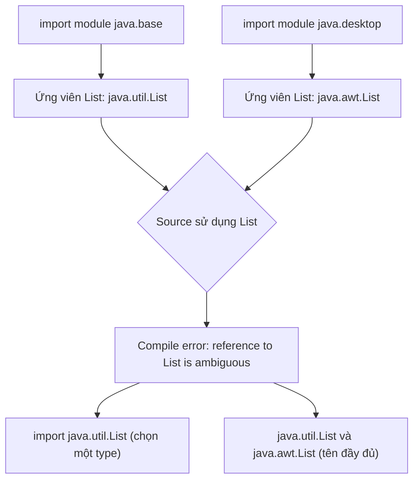
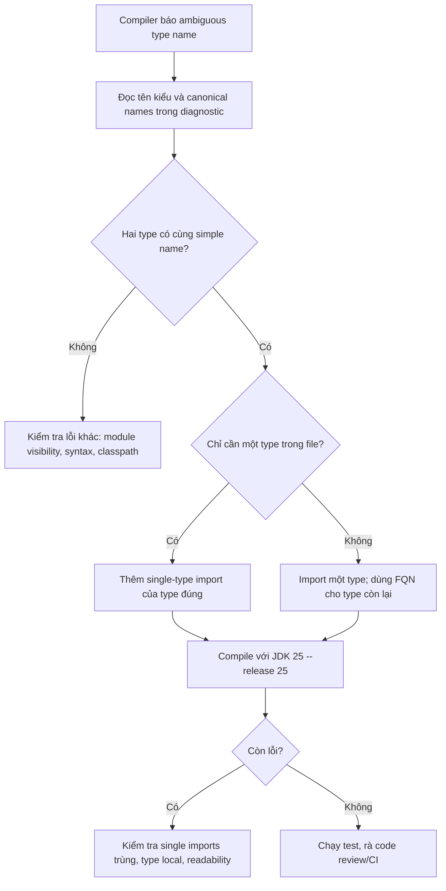

# Phát hiện tên kiểu trùng nhau và lựa chọn import tường minh để giải quyết

## 1. Mục tiêu: giảm import nhưng không đánh đổi tính rõ nghĩa

**Module Import Declarations (JEP 511)** trở thành tính năng **chính thức trong Java 25**. Một dòng:

```java
import module java.base;
```

cho phép sử dụng bằng tên ngắn những kiểu `public` ở các package được module `java.base` xuất ra, chẳng hạn `List` (`java.util`), `Map` (`java.util`), `Stream` (`java.util.stream`) và `Path` (`java.nio.file`). Đây là cách tiết kiệm các lệnh import cho ví dụ nhiều API Java SE hoặc những module cung cấp một nhóm API thống nhất.

Nhưng khi thêm các module khác, một tên ngắn có thể trỏ đến **nhiều kiểu khác nhau**. Ví dụ `java.base` xuất `java.util.List`, còn `java.desktop` xuất `java.awt.List`. Nếu mã chỉ viết `List`, trình biên dịch không thể đoán bạn muốn kiểu nào.

Bài **Phát hiện tên kiểu trùng nhau và lựa chọn import tường minh để giải quyết** thuộc chương **Module import** của học phần **JAVA_VERSION_JAVA25**. Học phần giới thiệu các tính năng Java 25 vẫn hữu ích hiện nay: compact source files, module imports, flexible constructor bodies, `ScopedValue`, KDF API, AOT cache, JFR và việc nâng cấp JDK. Bài này tập trung **hoàn toàn vào cách phát hiện và giải quyết name ambiguity theo đặc tả Java 25**, không dạy các mẹo preview đã lỗi thời.

Sau bài học, người học có thể:

1. Giải thích `import module M;` làm gì và **không** làm gì.
2. Phân biệt **hai import cùng tồn tại hợp lệ** với **tên kiểu mơ hồ tại vị trí sử dụng**.
3. Tái hiện lỗi của `List` từ `java.util` và `java.awt`; nhận diện thêm va chạm `Label` và `Element`.
4. Giải quyết bằng **single-type import** (`import java.util.List;`), **tên kiểu đầy đủ** (`java.awt.List`) hoặc import thu hẹp có chủ đích.
5. Phân biệt trường hợp xung đột giữa hai `single-type import` (lỗi ngay ở khai báo) với xung đột giữa hai `module import` (thường chỉ lỗi khi dùng tên ngắn mơ hồ).
6. Viết ca kiểm thử compile-positive/compile-negative bằng JDK 25 để bảo vệ quyết định import.

> **Giới hạn bài học:** `java.awt` được dùng làm *ví dụ compiler* vì nó có kiểu tên trùng với `java.util` và `java.lang.classfile` trong JDK 25. Điều này **không đồng nghĩa khuyên dùng AWT List cho giao diện mới**. Ứng dụng nghiệp vụ mới thường nên chọn collection `java.util.List`; các kiểu AWT chỉ xuất hiện ở đây để minh họa quy tắc phân giải tên vẫn còn hiệu lực.

## 2. Đúng ngữ nghĩa của `import module` ở Java 25

### 2.1. Cú pháp và phạm vi áp dụng

```java
import module java.base;
import module java.sql;
```

Cú pháp chính thức là `import module TênModule;`. Nó là một **import-on-demand**: tên ngắn của các public top-level classes/interfaces thuộc các package được module chỉ định export đến module hiện tại có thể được sử dụng, **khi cần**.

Theo JLS Java 25 `7.5.5, import còn bao gồm các public top-level types thuộc các package được export bởi các module mà module hiện tại đọc **nhờ quan hệ `requires transitive` xuất phát từ module được import**. Ví dụ, import `java.sql` cũng có thể kéo các kiểu từ phần API mà `java.sql` yêu cầu transitive, như `java.xml` và `java.logging`.

Những gì `import module` **không làm**:

- Không biến project thành một **named module**; project không có `module-info.java` vẫn có thể dùng module import.
- Không tự thêm `requires M;` vào `module-info.java`. Khi source thuộc named module, module hiện tại **phải đọc được** module M theo graph đã resolve; nếu không, biên dịch lỗi.
- Không cấp quyền vào các package **không được export** hoặc các type package-private của module khác.
- Không import các `static` method/field một cách trực tiếp như `import static`. Ví dụ `import module java.base;` không khiến `emptyList()` trở thành tên method có thể gọi tự do; vẫn dùng `Collections.emptyList()` hoặc static import cụ thể.
- Không nhập tất cả class của mọi module trên module path; chỉ những module chỉ định và phần transitive có thể đọc/được export theo ngữ nghĩa của JLS.
- Không áp dụng cho mọi file trong project: mỗi compilation unit có bộ import của **riêng mình**.

Một module import không phải một lệnh tải mọi class vào RAM, cũng không buộc JVM khởi tạo mọi class của module. Nó thay đổi **phạm vi tên** tại thời điểm biên dịch.

### 2.2. Ví dụ hoạt động khi không có trùng tên

Tạo `FruitStats.java` trên JDK 25:

```java
import module java.base;

public class FruitStats {
    public static void main(String[] args) {
        List<String> fruits = List.of("apple", "banana", "orange");
        Map<Integer, Long> counts = fruits.stream()
            .collect(Collectors.groupingBy(String::length, Collectors.counting()));

        System.out.println(counts);
    }
}
```

**Lưu ý:** `Collectors` là `java.util.stream.Collectors`, còn `List`/`Map` là `java.util`. `java.base` export các package đó nên ví dụ không cần `import java.util.List;`, `import java.util.Map;` hay `import java.util.stream.Collectors;` riêng lẻ.

```bash
javac --release 25 FruitStats.java
java FruitStats
```

Dự kiến đầu ra biểu diễn một map nhóm theo độ dài, ví dụ `{5=1, 6=2}`. Đừng dựa vào thứ tự in các key của `HashMap` khi viết kiểm thử; ở đây chỉ cần thấy biên dịch và chạy thành công.

Đối chiếu cách viết tường minh truyền thống cũng **đúng và hiện hành**:

```java
import java.util.List;
import java.util.Map;
import java.util.stream.Collectors;
```

**Module import là lựa chọn**, không phải quy định phải thay toàn bộ import cụ thể. Trong mã production nhiều contributor, single-type imports thường hỗ trợ code review và đọc dependencies tốt hơn.

### 2.3. Đừng nhầm với `module-info.java`

| Thành phần | Ví dụ | Vai trò |
|---|---|---|
| Import module | `import module java.desktop;` trong source | Đưa tên các type export vào phạm vi có thể dùng dạng tên ngắn |
| Module dependence | `requires java.desktop;` trong `module-info.java` | Cho named module quyền **đọc** module java.desktop |
| Export | `exports dev.example.api;` | Công bố public types của package ra ngoài module |
| Ordinary type import | `import java.util.List;` | Chọn **một** type theo canonical name để dùng dạng `List` |
| Fully qualified name | `java.awt.List` | Chỉ rõ type ngay tại vị trí sử dụng |

Trong **unnamed module** của demo classpath, Java SE modules thông dụng có thể đã được resolve/read. Trong **named module**, nếu source import `java.desktop` nhưng `module-info.java` không có quan hệ đọc tới nó, cần xem `requires` và module graph. Sửa mỗi dòng `import module` không giải quyết vấn đề readability.

## 3. Name ambiguity là gì và bao giờ trở thành lỗi?

Các Java package độc lập được phép chứa kiểu **cùng simple name**:

- `java.util.List` — collection interface.
- `java.awt.List` — UI component class trong module `java.desktop`.
- `java.lang.classfile.Label` — kiểu của Class-File API thuộc `java.base`.
- `java.awt.Label` — UI component class trong `java.desktop`.

Các kiểu trên khác nhau về canonical name và semantics; không “đè” nhau ở JVM. Xung đột chỉ nảy sinh khi source dùng một **simple name** như `List` mà các import-on-demand đưa vào nhiều ứng viên khả dụng ngang nhau.



### 3.1. Hai module import không mặc nhiên gây lỗi

Đoạn sau **hợp lệ** dù có các type trùng tên:

```java
import module java.base;
import module java.desktop;

public class NoAmbiguousUse {
    public static void main(String[] args) {
        System.out.println("Chưa dùng List hoặc Label");
    }
}
```

Lý do: khai báo on-demand không ép compiler chọn `List` nếu mã không nhắc đến tên ấy. Theo JLS, **dùng tên ngắn mơ hồ** mới gây lỗi ở vị trí đó.

### 3.2. So với hai single-type imports

Trái lại, đây là **lỗi compile ngay tại phần import**:

```java
// KHÔNG HỢP LỆ — hai single-type imports trùng simple name.
import java.util.List;
import java.awt.List;

class InvalidImports {}
```

JLS `7.5.1 quy định hai single-type imports cho hai type khác nhau cùng simple name trong một compilation unit là lỗi. **Thứ tự các dòng import không quyết định ai thắng.** Chuyển `import java.awt.List;` xuống dưới hoặc lên trước cũng không sửa được.

Tóm tắt:

| Cấu hình | Khi nào lỗi? | Cách sửa |
|---|---|---|
| Hai `import module` cung cấp `List` khác nhau | Khi dùng `List` mà không có quy tắc chọn rõ | Single-type import của một loại hoặc FQN |
| Hai `import foo.List;` và `import bar.List;` | Ngay ở phần import (hai type khác nhau) | Chỉ import một, dùng FQN cho loại còn lại |
| Import module nhưng không dùng tên trùng | Không lỗi chỉ vì tồn tại import | Không cần sửa |
| Có single-type import `java.util.List` cùng hai module imports | `List` được hiểu là `java.util.List` | Dùng FQN khi cần `java.awt.List` |
| Dùng hai kiểu qua FQN | Không phụ thuộc đơn giản hóa tên | Rõ ràng nhất khi cả hai cùng có mặt |

## 4. Thực nghiệm 1 — Tái hiện lỗi `List` giữa `java.base` và `java.desktop`

### 4.1. Mã cố ý biên dịch lỗi

Tạo file `AmbiguousList.java`:

```java
// KHÔNG HỢP LỆ — bài thực nghiệm cố ý gây ambiguity.
import module java.base;
import module java.desktop;

public class AmbiguousList {
    List<String> names = List.of("Java", "25");
}
```

Ở đây có hai ứng viên: `java.util.List` và `java.awt.List`. Thêm generic `<String>` không biến tên `List` thành lựa chọn tự động của compiler; dù `java.awt.List` không có type parameter, bước phân giải tên vẫn bị mơ hồ. Không trông chờ compiler đoán dựa trên initializer `List.of(...)`.

```bash
javac --release 25 AmbiguousList.java
```

Lệnh **phải thất bại**. Thông điệp có thể giống:

```text
error: reference to List is ambiguous
  both interface java.util.List in java.util
  and class java.awt.List in java.awt match
```

Cách xuống dòng/vị trí dấu `^` tùy bản vá compiler. Mục tiêu là phát hiện từ khóa `ambiguous` và hai canonical names, không kiểm tra nguyên văn toàn bộ thông báo.

### 4.2. Tại sao `import module java.base` đã là đủ để có `java.util.List`?

`java.base` có `java.util` và cung cấp `java.util.List`. `java.desktop` export `java.awt` và cung cấp `java.awt.List`. Một import cho từng module đưa các type vào cùng phạm vi **on demand**.

Quan trọng: **không phải module này đang “thay thế” module kia**. Nếu bạn chọn sử dụng `java.util.List` trong code, module desktop vẫn có thể được import cho `Frame`, `Graphics2D` hoặc các API khác. Mục tiêu là giải quyết **đúng tên trùng**, không tắt cả module khi chương trình cần nó.

### 4.3. Rà soát lỗi bằng một quy trình có thể lặp lại

1. Chạy `javac --release 25` bằng đúng JDK 25.
2. Ghi lại simple name báo lỗi (`List`), các canonical names được compiler liệt kê.
3. Xem mỗi type thuộc package/module nào và vai trò tại vị trí đang dùng.
4. Chọn type theo **ngữ nghĩa nghiệp vụ** (collection hay UI component).
5. Dùng single-type import/FQN hoặc thu hẹp import, compile lại.
6. Thêm ca test/CI giữ nguyên quyết định để lần refactor sau không tái phát.

Ví dụ trên dùng AWT để tạo va chạm dễ kiểm chứng; không khuyến khích xây giao diện mới dựa trên `java.awt.List`.


## 5. Ba cách giải quyết lỗi import một cách có chủ đích

### 5.1. Cách khuyến nghị: single-type import để chọn `java.util.List`

Khi công việc thực tế là lưu collection, hãy nói rõ type mình dùng:

```java
// ResolvedList.java — HỢP LỆ trên Java 25.
import module java.base;
import module java.desktop;

// Chọn chính xác kiểu collection; single-type import được ưu tiên
// trước các ứng viên cùng tên do module imports đưa vào on-demand.
import java.util.List;

public class ResolvedList {
    private final List<String> names = List.of("Java", "25");

    public static void main(String[] args) {
        var demo = new ResolvedList();
        System.out.println(demo.names);

        // Nếu thật sự cần kiểu AWT, viết canonical name:
        java.awt.List legacyUiComponentReference = null;
        System.out.println(legacyUiComponentReference);
    }
}
```

Ở đây:

- `List` không còn mơ hồ: `import java.util.List;` là **single-type import**.
- `import module java.desktop;` vẫn giữ cho các type khác được sử dụng khi cần.
- `java.awt.List` vẫn có thể được gọi bằng tên đầy đủ nếu thực sự cần; ví dụ không tạo UI component trên môi trường headless.
- Type import không làm thay đổi classpath/module graph, không “remove” module khác khỏi JVM.

Chạy:

```bash
javac --release 25 ResolvedList.java
java ResolvedList
```

Một IDE Java hiện đại nên cho bạn xem canonical name của `List` khi dùng Go to Declaration. **Xác minh bằng compiler** vẫn là bước chốt, vì IDE có thể đang chọn language level khác build script.

### 5.2. Cách rõ nhất khi cần cả hai: viết tên kiểu đầy đủ

```java
// BothLists.java — HỢP LỆ.
import module java.base;
import module java.desktop;

public class BothLists {
    java.util.List<String> applicationNames =
        java.util.List.of("Java", "25");

    // Không tạo UI object ở đây; chỉ chứng minh hai kiểu khác nhau.
    java.awt.List awtWidget;
}
```

Tùy nhu cầu, có thể import một type và viết tên đầy đủ cho type còn lại. Khi đoạn code thực sự dùng **hai kiểu cùng tên** trong một method, cách viết `java.util.List`/`java.awt.List` ngay tại chỗ là dễ review nhất.

Ưu tiên FQN khi:

- Hai kiểu xuất hiện sát nhau và dễ nhầm lẫn.
- Đang viết adapter giữa hai thư viện có tên trùng.
- Phạm vi dùng loại thứ hai rất nhỏ (một hai dòng).
- Cần khẳng định một đoạn mã đang dùng API nào, đặc biệt với type có cùng tên nhưng ý nghĩa khác nhau.

Không có cơ chế đặt alias import dạng `import ... as ...` trong Java 25. Đừng sao chép cú pháp alias của Kotlin hoặc Python vào Java source.

### 5.3. Cách khác: import-on-demand theo package có thể chọn một phía

Tài liệu Java 25 cho phép `type-import-on-demand` theo package ưu tiên so với các tên đến từ `module import`. Ví dụ:

```java
// PackageOnDemand.java — HỢP LỆ.
import module java.base;
import module java.desktop;

// Ưu tiên các type trong package java.util cho tên bị trùng
// với kiểu được đưa vào bởi module imports.
import java.util.*;

public class PackageOnDemand {
    List<String> names = List.of("one", "two");
}
```

Cách này **có thể giải quyết xung đột**, nhưng `import java.util.*;` vẫn là on-demand và không bảo đảm mọi name clash trong tương lai đều dễ đọc. Khi chỉ có một simple name trùng, `import java.util.List;` rõ hơn. Nếu đồng thời import `java.util.*` và `java.awt.*`, chính hai package imports lại có thể đưa cùng tên `List` trở về tình trạng mơ hồ.

**Quy tắc chọn thực tế:** dùng `import module` để giảm boilerplate khi API của module thống nhất; gặp một tên trùng thì dùng **single-type import** hoặc **FQN** tại điểm cần xác định. Đừng dùng wildcard hàng loạt để che một ambiguity mà không hiểu nó đến từ đâu.

### 5.4. Cách không đúng: import rõ cả hai loại cùng tên

```java
// VẪN KHÔNG HỢP LỆ dù đã "import tường minh".
import module java.base;
import module java.desktop;
import java.util.List;
import java.awt.List;

class StillInvalid {}
```

Hai `single-type imports` khác type nhưng cùng simple name không được phép cùng tồn tại. Để dùng cả hai, hãy import một và viết FQN cho loại kia, hoặc dùng FQN ở cả hai.

### 5.5. Tùy chọn tốt hơn ở codebase dài hạn: giảm phạm vi import

Khi một file cần API rộng của `java.base` nhưng chỉ 1–2 type từ `java.desktop`, thường không có lợi khi import cả `java.desktop`:

```java
import module java.base;
import java.awt.Frame;
import java.awt.event.WindowAdapter;

class WindowIntegration {
    Frame frame;  // Các type dùng trong file được nêu rõ.
    List<String> data = List.of();
}
```

Trong các file có nhiều người sửa, dạng này giúp **hạn chế không gian tên** có thể tạo va chạm. Giữ module import nếu sự đơn giản hóa thực sự làm mã dễ đọc; không dùng nó như một chỉ tiêu buộc mọi file phải theo.

## 6. Thực nghiệm 2 — Kiểu `Label`: API hiện đại cũng có thể trùng tên

Không chỉ `java.awt.List` với `java.util.List`: trong Java 25, `java.base` cung cấp **Class-File API** có interface `java.lang.classfile.Label` (API chính thức từ Java 24), còn `java.desktop` có class `java.awt.Label`.

### 6.1. Mã cố ý gây lỗi

```java
// AmbiguousLabel.java — KHÔNG HỢP LỆ.
import module java.base;
import module java.desktop;

public class AmbiguousLabel {
    Label label;
}
```

Vì `Label` có ít nhất hai type ứng viên với canonical names khác nhau, compiler báo `reference to Label is ambiguous`. Ngay cả khi bạn định gán một giá trị cụ thể, quy tắc phân giải tên không tự đoán ý đồ chỉ từ miền nghiệp vụ.

### 6.2. Khi đang dùng Class-File API

Hãy chọn chính xác `java.lang.classfile.Label`:

```java
// ClassFileLabel.java — HỢP LỆ.
import module java.base;
import module java.desktop;
import java.lang.classfile.Label;

public class ClassFileLabel {
    Label instructionLabel;
    java.awt.Label desktopLabel;
}
```

Ở đây trường `desktopLabel` chỉ minh họa FQN, không tạo thành phần giao diện AWT. Type `Label` trong Class-File API có vai trò đánh dấu vị trí trong bytecode; **không liên quan** đến nhãn văn bản trên màn hình.

### 6.3. Nếu cần UI label thay vì Class-File API

Đảo lựa chọn import:

```java
import module java.base;
import module java.desktop;
import java.awt.Label;

class DesktopLabel {
    Label titleLabel;  // java.awt.Label
    java.lang.classfile.Label bytecodePosition;
}
```

Lựa chọn này chỉ phù hợp khi bạn đã có mã AWT cần duy trì; không phải gợi ý chọn AWT cho giao diện mới. Bài tập compiler chủ yếu cho thấy **cùng tên kiểu không cho biết cùng mục đích sử dụng**.

## 7. Thực nghiệm 3 — Chỉ một `import module` cũng có thể tạo ambiguity

Nhiều người tưởng name clash chỉ xảy ra khi import **hai** module. JLS Java 25 `7.5.5 có một ví dụ ngay **trong cùng module `java.desktop`**:

- `javax.swing.text.Element` — interface cho cấu trúc tài liệu text.
- `javax.swing.text.html.parser.Element` — class trong HTML parser.

Cả hai đều là public types có simple name `Element`, trong các package được export bởi `java.desktop`.

### 7.1. Mã lỗi

```java
// AmbiguousElement.java — KHÔNG HỢP LỆ.
import module java.desktop;

public class AmbiguousElement {
    Element element;
}
```

Lỗi vẫn xảy ra ở nơi dùng `Element` dù chỉ có một module import.

### 7.2. Chọn chính xác một kiểu

```java
// ResolvedElement.java — HỢP LỆ.
import module java.desktop;
import javax.swing.text.Element;

public class ResolvedElement {
    Element swingDocumentElement;
    javax.swing.text.html.parser.Element parserElement;
}
```

Nếu đang xử lý **DOM XML** ở hệ thống mới, type bạn cần thường là `org.w3c.dom.Element`, không phải hai type của Swing. Lúc đó, hãy khai báo API được dùng một cách có chủ đích:

```java
// XmlElement.java — HỢP LỆ trên JDK 25.
import module java.xml;
import module java.desktop;
import org.w3c.dom.Element;

public class XmlElement {
    Element xmlNode;                         // org.w3c.dom.Element
    javax.swing.text.Element swingTextNode; // Chỉ khi tích hợp Swing.
}
```

Ví dụ giải thích nguyên tắc **import để phản ánh loại dữ liệu**, không chọn dựa trên tên class ngắn. API `org.w3c.dom.Element` vẫn là chuẩn dùng cho DOM XML trong JDK hiện đại; không cần thêm thư viện DOM riêng để biên dịch ví dụ này.

### 7.3. Bảng đối chiếu ba va chạm

| Simple name | Các type khác nhau | Ngữ cảnh lựa chọn |
|---|---|---|
| `List` | `java.util.List` / `java.awt.List` | Collection nghiệp vụ / UI AWT (minh họa) |
| `Label` | `java.lang.classfile.Label` / `java.awt.Label` | Java Class-File API / UI AWT |
| `Element` | `javax.swing.text.Element` / `javax.swing.text.html.parser.Element` / `org.w3c.dom.Element` | Swing text / HTML parser / XML DOM |

Tất cả những type này có thể hiện diện trong Java 25. **Tình huống minh họa tên trùng vẫn hợp lệ và còn áp dụng**, nhưng lựa chọn thư viện cho code mới phải dựa vào yêu cầu nghiệp vụ và kiến trúc, không dựa vào việc compiler ngẫu nhiên cho phép dùng tên ngắn.

## 8. Phân giải tên: hiểu mức ưu tiên, không học mẹo “đổi thứ tự”

### 8.1. Những nguồn tên có thể cùng xuất hiện

Tên kiểu ngắn trong một source file có thể đến từ:

1. Type hoặc nested type được khai báo ngay trong phạm vi đó.
2. Type thuộc package hiện tại.
3. Single-type imports (ví dụ `import java.util.List;`).
4. Type-import-on-demand (ví dụ `import java.util.*;`).
5. Single-module imports (ví dụ `import module java.base;`).
6. Các import ngầm do JLS quy định, như `java.lang.*`.

Các quy tắc cụ thể là **scope, shadowing và obscuring** của JLS chứ không phải một thứ tự tuyến tính áp dụng bất chấp ngữ cảnh. Ví dụ local type và một single-type import trùng tên trong cùng compilation unit còn có thể gây **lỗi ngay ở khai báo**, không phải luôn tự chọn type local. Vì vậy, đừng dùng danh sách này như thuật toán quyết định mọi trường hợp.

### 8.2. Các quy tắc đáng nhớ nhất

| Quy tắc | Đúng/sai | Giải thích |
|---|---|---|
| “Hai `import module` cùng có `List` thì luôn lỗi ngay” | Sai | Chỉ lỗi khi dùng tên `List` mơ hồ, nếu không có cách phân giải |
| “`import java.util.List;` giải quyết `List` của hai module imports” | Đúng | Single-type import cụ thể shadow các ứng viên module-import-on-demand |
| “`import java.util.*;` có thể giải quyết tên trùng với module import” | Đúng, có điều kiện | Type-import-on-demand có thể shadow module import, nhưng nhiều wildcard packages vẫn có thể mơ hồ |
| “Thêm `import java.awt.List;` bên cạnh `import java.util.List;` sẽ sửa” | Sai | Hai single-type imports cùng tên đơn giản nhưng khác type gây compile-time error |
| “Đảo thứ tự hai import để chọn cái viết sau cùng” | Sai | Java không có quy tắc ‘last import wins’ |
| “FQN `java.util.List` luôn rõ kiểu nào được dùng” | Đúng, nếu module/package accessible | FQN chỉ rõ canonical name; vẫn cần module readability và export hợp lệ |
| “Compiler nhìn generic argument rồi chọn `java.util.List`” | Sai | Không dựa vào heuristic chọn type theo ý đồ |
| “Một module import không bao giờ tạo ambiguity” | Sai | `java.desktop` có cả hai `Element` |

### 8.3. Khi có type khai báo trong chính package

Giả sử project tự định nghĩa `dev.example.List`. Khi class trong cùng package dùng `List`, có thể đang tham chiếu tới type nội bộ chứ không phải `java.util.List` được module import đưa vào. Đây là lý do nên tránh đặt tên class domain quá rộng như `List`, `Date`, `Element` hoặc `Logger` nếu không có nghĩa rõ ràng.

Ví dụ:

```java
// package dev.example; — minh họa, không phải cùng file
package dev.example;
import module java.base;

class List {} // Tên nội bộ che một type import-on-demand cùng simple name.
class Example {
    List internalList;               // dev.example.List
    java.util.List<String> names;   // Chỉ rõ collection Java
}
```

Đây là trường hợp shadowing khác với hai single-type imports. Không tự thêm `import java.util.List;` vào một source đã khai báo top-level `List` cùng tên nếu điều đó tạo xung đột khai báo; khi cần collection Java, dùng `java.util.List` hoặc đổi tên type nội bộ.

### 8.4. Không dùng `import static` để giải quyết va chạm kiểu

`import static java.util.Collections.emptyList;` giúp gọi method `emptyList()`; nó **không chọn** interface `List`. Nếu lỗi là `reference to List is ambiguous`, cần kiểm tra các type imports/FQN chứ không thêm static imports ngẫu nhiên.

Các member type được static import có quy tắc riêng trong JLS, nhưng đó là tình huống nâng cao. Với bài này, mục tiêu là xác định dứt khoát **top-level type** đang được tham chiếu.


## 9. Module readability, module path và lỗi không phải ambiguity

Module import còn liên quan đến **module readability**. Không phải lỗi nào xuất hiện gần `import module` cũng do trùng simple name.

### 9.1. Trường hợp classpath/unnamed module

Một file Java thông thường không có `module-info.java` có thể chạy các ví dụ từ `java.base` và `java.desktop` bằng JDK 25:

```bash
javac --release 25 ResolvedList.java
java ResolvedList
```

Các ví dụ dùng module Java SE thông dụng và các package public được export. Nếu lỗi báo không tìm thấy module `M`, hãy kiểm tra JDK/toolchain, cách module được đặt trên module path và khả năng module đó đã được resolve trước khi kết luận do name clash.

### 9.2. Named module cần `requires` theo graph

Trong named module, `import module java.desktop;` **không** thay cho `requires java.desktop;`.

Bố cục ví dụ:

```text
src/
  dev.example.importlab/
    module-info.java
    dev/example/importlab/ImportsDemo.java
```

`module-info.java`:

```java
module dev.example.importlab {
    requires java.desktop;
}
```

`ImportsDemo.java`:

```java
package dev.example.importlab;

import module java.base;
import module java.desktop;
import java.util.List;

public class ImportsDemo {
    public static void main(String[] args) {
        List<String> values = List.of("ready", "jdk-25");
        System.out.println(values);

        // Không cần khởi tạo UI trong môi trường headless.
        java.awt.List uiList = null;
        System.out.println(uiList);
    }
}
```

`java.base` được **implicitly required** bởi mọi named module không phải chính `java.base`; bạn không cần khai báo `requires java.base;` thủ công. `java.desktop` thì cần được đọc bằng `requires java.desktop;` nếu dùng trong named module ví dụ.

Một cách biên dịch đơn giản cho project module-source-path:

```bash
javac --release 25 \
  --module-source-path src \
  -d out \
  src/dev.example.importlab/module-info.java \
  src/dev.example.importlab/dev/example/importlab/ImportsDemo.java

java --module-path out \
  --module dev.example.importlab/dev.example.importlab.ImportsDemo
```

Với Gradle/Maven, tổ chức source theo convention của plugin và dùng các task biên dịch JPMS của project; không cần ép mọi nhóm dùng command dài ở trên. Trên Windows PowerShell, có thể viết các tham số `javac` trên một dòng thay vì dùng backslash nối dòng của Bash.

**Điểm cần nhớ:** `import module` chỉ chọn cách dùng tên kiểu; `requires` kiểm soát khả năng đọc module khác. Sửa va chạm tên bằng `import java.util.List;` không cấp quyền truy cập tới `java.desktop` nếu dependency chưa tồn tại.

### 9.3. Các lỗi dễ lẫn với tên kiểu mơ hồ

| Thông báo/triệu chứng | Bản chất | Hướng kiểm tra |
|---|---|---|
| `reference to List is ambiguous` | Hai type có cùng simple name | Chọn single-type import hoặc FQN |
| `package ... is not visible` | Package không được export hoặc module hiện tại không đọc module đích | `module-info.java`, `exports`, `requires` |
| `module not found: M` | Module chưa được cung cấp/resolve đúng | Module path, JDK, dependency và tên module |
| `package ... does not exist` | Thiếu thư viện hoặc sai package/type | JDK API/docs, classpath/module path |
| `cannot find symbol: List` | Không có type hợp lệ trong phạm vi tìm kiếm | Import type phù hợp, package, module exports |
| `a type with the same simple name is already defined by the single-type-import of ...` | Hai single-type imports hoặc khai báo type xung đột | Không import hai type khác nhau cùng simple name |
| `invalid flag: --release 25` hoặc `release version 25 not supported` | Toolchain/`javac` không hỗ trợ target 25 | Dùng JDK 25/compiler hỗ trợ Java 25 |
| IDE báo lỗi nhưng `javac` 25 pass | IDE project language level/plugin index chưa đồng bộ | Đồng bộ IDE với build, JDK và project model |

Không khuyến nghị thêm `--add-exports` hoặc `--add-opens` chỉ để sửa `reference to ... is ambiguous`. Các tùy chọn đó giải quyết vấn đề encapsulation/reflection/module access khác, không chọn kiểu trùng tên; mở API nội bộ JDK bừa bãi còn tạo rủi ro bảo trì.

### 9.4. Trường hợp `import module java.se;`

`java.se` là một **aggregator module**: nó không trực tiếp export các package, nhưng có `requires transitive` tới nhiều Java SE modules. Import `java.se` có thể khiến một file thấy rất nhiều public types và tăng nguy cơ trùng simple name.

Trong ứng dụng classpath/unnamed module, Oracle Java 25 hướng dẫn bổ sung `--add-modules java.se` khi dùng `import module java.se;`, vì `java.se` không thuộc tập root modules mặc định của unnamed module:

```java
// WideImport.java — ví dụ dùng phạm vi rất rộng, không khuyến nghị mặc định.
import module java.se;
import java.util.List;

class WideImport {
    List<String> names = List.of("Java 25");
}
```

```bash
javac --release 25 --add-modules java.se WideImport.java
```

Trong named module, cần `requires java.se;` nếu thiết kế module thật sự phụ thuộc aggregator module. **Không chọn `java.se` chỉ để tránh viết vài dòng import**: import càng rộng, khả năng va chạm càng cao. Chỉ sử dụng khi đó là contract dependency có chủ ý.

## 10. Chọn kiểu import theo độ phức tạp thực tế

Không có một style rule tốt cho mọi source file. Hãy cân nhắc số API dùng, mật độ tên trùng, khả năng thay đổi và yêu cầu module boundaries.

| Tình huống | Lựa chọn ưu tiên | Vì sao |
|---|---|---|
| Ví dụ giáo dục dùng nhiều loại từ `java.base` | `import module java.base;` | Gọn, phù hợp JEP 511 |
| File production dùng 2–4 type từ một package | Single-type imports | Rõ dependency, dễ review và tự động hóa |
| Một module import tạo một clash đơn lẻ | Thêm `import canonical.Type;` | Can thiệp tối thiểu |
| Cùng file cần hai type có simple name giống nhau | Import một, viết FQN cho loại còn lại; hoặc FQN cả hai | Không mơ hồ khi bảo trì |
| Thư viện mới có nhiều package exported và API thống nhất | Cân nhắc module import, xem `requires`/exports | Dùng module boundary làm nhóm API |
| Named module cần module khác | `requires M;` cùng import hợp lý | Import không thay module readability |
| Nhiều wildcard gây lỗi sau nâng version | Thu hẹp xuống imports cụ thể | Giảm không gian tên và tác động khi thêm API |
| Package/type nội bộ quá chung tên (`List`, `Label`) | Đổi tên domain type nếu có quyền thay API | Tránh che khuất type Java thường dùng |

### 10.1. Đối với file quan trọng của team

Một convention có thể là:

1. Ưu tiên `single-type import` cho API/domain type cần được xác định rõ.
2. Cho phép `module import` ở lớp integration/demo dùng nhiều type trong cùng public API.
3. Khi IDE phát hiện `ambiguous reference`, chọn type theo **nguồn dữ liệu thực tế**; sửa bằng import rõ ràng, không chèn FQN bừa bãi cho mọi type.
4. Không dùng wildcard hoặc module imports quá rộng chỉ để giảm số dòng của source.
5. Khi nâng JDK hoặc phiên bản thư viện, chạy compile/test để phát hiện public type mới có thể trùng simple name trước đây.
6. Đồng bộ formatter, auto-import IDE và build script để tránh một lần “Optimize Imports” vô tình tái tạo ambiguity.

Việc dùng module import là cú pháp **ổn định ở Java 25**, không phải đặc điểm preview. Nhưng code phải được biên dịch với `--release 25` hoặc language level phù hợp. Nếu dự án vẫn target Java 21, không thể đưa `import module` vào main source chỉ vì máy developer chạy JDK 25.

## 11. Tích hợp Gradle/Maven và kiểm chứng tự động

### 11.1. Dùng JDK 25 và release 25

Ví dụ Gradle Kotlin DSL:

```kotlin
plugins {
    java
}

java {
    toolchain {
        languageVersion.set(JavaLanguageVersion.of(25))
    }
}

tasks.withType<JavaCompile>().configureEach {
    options.release.set(25)
}
```

Với JDK 25, Gradle **9.1+** hỗ trợ Java 25 toolchains; cần dùng Gradle Wrapper và plugin tương thích. Nếu mã có `module-info.java`, hãy kiểm tra project thực sự compile trên module path phù hợp.

Một Maven project tương tự có thể dùng property:

```xml
<properties>
    <maven.compiler.release>25</maven.compiler.release>
</properties>
```

kèm Maven Compiler Plugin và Maven Toolchains Plugin tương thích để chọn compiler JDK 25; `mvn -version` chỉ cho biết JDK chạy Maven, không nhất thiết là JDK compiler đã được toolchains chọn.

**Không bật `--enable-preview`** cho JEP 511 ở Java 25: module import declarations đã final. Nếu một dự án không thể nâng language level lên 25, dùng lại `import foo.Bar;` truyền thống là cách hoàn toàn hợp lệ và ổn định.

### 11.2. Kiểm thử compile-negative và compile-positive

Tạo thư mục lab *ngoài dự án production* gồm những file độc lập:

```text
module-import-lab/
  negative/
    AmbiguousList.java
    AmbiguousLabel.java
    AmbiguousElement.java
  positive/
    ResolvedList.java
    ClassFileLabel.java
    ResolvedElement.java
    BothLists.java
```

Dùng `javac --release 25` cho từng file. **Không compile chung tất cả file trong một lệnh** nếu có class trùng tên hoặc case lỗi cố ý.

Ví dụ trên Bash:

```bash
# Ca dương: phải compile thành công.
mkdir -p out
javac --release 25 -d out positive/ResolvedList.java
javac --release 25 -d out positive/ClassFileLabel.java
javac --release 25 -d out positive/ResolvedElement.java

# Ca âm: thất bại là kết quả mong đợi.
if javac --release 25 -d out negative/AmbiguousList.java; then
  echo "FAIL: AmbiguousList bất ngờ biên dịch được"
  exit 1
else
  echo "PASS: AmbiguousList bị từ chối như dự kiến"
fi
```

Ca âm chỉ kiểm tra exit code **chưa đủ** để biết lỗi do tên mơ hồ; hãy kiểm tra diagnostic có `ambiguous` và canonical names phù hợp, nếu không test có thể “pass nhầm” vì file thiếu module hoặc thiếu JDK.

Ví dụ kết quả kỳ vọng:

| File | Trạng thái compile | Lý do |
|---|---|---|
| `AmbiguousList.java` | FAIL (có chủ đích) | `java.util.List` / `java.awt.List` |
| `AmbiguousLabel.java` | FAIL (có chủ đích) | `java.lang.classfile.Label` / `java.awt.Label` |
| `AmbiguousElement.java` | FAIL (có chủ đích) | Hai `Element` từ `java.desktop` |
| `ResolvedList.java` | PASS | `import java.util.List;` |
| `BothLists.java` | PASS | Hai type đều dùng tên đầy đủ |
| `ClassFileLabel.java` | PASS | `import java.lang.classfile.Label;` |
| `ResolvedElement.java` | PASS | `import javax.swing.text.Element;` |

Trong CI của dự án thực, có thể giữ một test chuyên biệt kiểm tra compiler diagnostics hoặc chỉ giữ positive tests, còn negative examples làm tài liệu học tập. Không đưa source cố ý không biên dịch vào `src/main/java` của ứng dụng.

### 11.3. Kiểm tra thông qua IDE

IntelliJ IDEA, Eclipse hay VS Code Java support phiên bản Java 25 có thể cung cấp quick-fix “Import class”. Trước khi bấm, kiểm tra **fully qualified type** và module sở hữu: cùng tên `List` nhưng một lựa chọn là collection, một lựa chọn là AWT widget.

Khi IDE tự chọn sai, một số biểu hiện:

- `List<String>` bị báo lỗi vì IDE chọn `java.awt.List`.
- `Label` có method không như mong đợi vì class khác với `java.lang.classfile.Label`.
- Auto-import hai type khác nhau cùng tên tạo lỗi single-type-import trùng.

Hãy dùng **Go to Definition** rồi xác nhận bằng `javac`/Gradle/Maven. Auto-import của IDE là một công cụ gợi ý, không phải nguồn xác thực cuối cùng.

## 12. Quy trình chẩn đoán nhanh khi compiler báo `ambiguous`



Bốn câu hỏi nên tự hỏi theo thứ tự:

1. **Tên nào mơ hồ?** `List`, `Label`, `Element` hay một tên domain type khác?
2. **Nó thực sự phải là kiểu nào?** Xác định theo API, không theo import order.
3. **Có thể chọn bằng một single-type import không?** Nếu vẫn dùng type thứ hai, FQN cho type đó.
4. **Lỗi đang ở name resolution hay module accessibility?** Nếu `module not read` hoặc `package not visible`, sửa cấu hình module và dependency chứ không chỉ imports.

## 13. Bài tập thực hành và tiêu chí nghiệm thu

### Bài tập A — Va chạm `List`

1. Tạo `AmbiguousList.java` với hai `import module` như mục 4.
2. Chạy `javac --release 25`, ghi lại thông báo lỗi và hai canonical names.
3. Thêm `import java.util.List;`, compile lại.
4. Thay field thành `java.util.List<String>` và thêm field `java.awt.List`, compile lại.
5. Giải thích vì sao hai module import vẫn được giữ, dù `List` giờ đã hết mơ hồ.

### Bài tập B — Phân biệt `Label` của Class-File API

1. Dùng `import module java.base;` và `import module java.desktop;` rồi khai báo `Label mark;`.
2. Xác nhận compile error.
3. Chọn `import java.lang.classfile.Label;`, giữ `java.awt.Label` với FQN ở một field khác.
4. Viết một câu giải thích ý nghĩa hai kiểu hoàn toàn khác nhau.

### Bài tập C — Một module import vẫn đủ tạo lỗi

1. Chỉ dùng `import module java.desktop;`.
2. Khai báo `Element element;` và quan sát lỗi.
3. Sửa bằng `import javax.swing.text.Element;`, compile.
4. Khi nhu cầu thực là DOM XML, đổi sang `import org.w3c.dom.Element;` và khai báo `import module java.xml;`/dependency module phù hợp.

### Bài tập D — Ứng dụng có `module-info.java`

1. Tạo named module `dev.example.importlab` với `requires java.desktop;`.
2. Biên dịch demo `ImportsDemo` trên module path bằng JDK 25.
3. Thử bỏ `requires java.desktop;` trong một bản sao để quan sát lỗi module readability.
4. Khôi phục `requires` và xác minh `import java.util.List;` sửa được ambiguity của `List`.
5. Nêu rõ **lỗi readability** khác **lỗi simple name** thế nào.

### Bài tập E — Chọn import phù hợp cho code production

Đối với một file có `List`, `Map`, `Stream` và `Path`, đưa ra hai phương án:

- `import module java.base;` nếu file dùng nhiều package của `java.base`.
- `import java.util.List;`, `import java.util.Map;`, `import java.util.stream.Stream;` và `import java.nio.file.Path;` để nêu API rõ ràng.

Chọn một phương án theo convention dự án, không khẳng định một hình thức luôn tốt hơn mọi tình huống. Sau đó cố ý thêm `java.desktop` và giải thích cách bạn ngăn ambiguity xuất hiện.

### Checklist đạt

| Tiêu chí | Bằng chứng |
|---|---|
| Đúng Java 25 | `java --version` và `javac --version` hoặc toolchain/release 25 |
| Hiểu JEP 511 | Giải thích `import module` import-on-demand và phạm vi của nó |
| Tái hiện lỗi | Compiler chỉ ra `List` hoặc `Label` có hai canonical names |
| Chọn single-type import | `import java.util.List;` khiến simple name rõ nghĩa |
| Dùng FQN khi cần cả hai | Cả `java.util.List` lẫn `java.awt.List` xuất hiện không lỗi |
| Nhận diện clash trong một module | `Element` từ `java.desktop` được giải thích đúng |
| Phân biệt JPMS dependency | `requires` không bị nhầm với `import module` |
| Test negative/positive | Ca lỗi thật sự lỗi vì ambiguity; ca sửa compile pass |
| Không lạm dụng preview | JEP 511 trên Java 25 không cần `--enable-preview` |
| Kiến thức có thể bảo trì | Quy ước import không che mục đích API được chọn |

## 14. Tài liệu chính thức và phạm vi áp dụng

Bài tập dựa trên quy tắc đã **final trong Java 25**, có thể áp dụng cho codebase Java hiện đại. Không sử dụng cách bật preview của những JDK thử nghiệm trước đó cho JEP 511.

- [JEP 511 — Module Import Declarations](https://openjdk.org/jeps/511): mục tiêu, thiết kế và tình trạng hoàn thiện ở Java 25.
- [Oracle Java 25 — Module Import Declarations](https://docs.oracle.com/en/java/javase/25/language/module-import-declarations.html): ví dụ về `java.awt.List`/`java.util.List`, `Label`, import theo package và cách sửa ambiguity.
- [Java Language Specification SE 25 — `7.5.1 Single-Type-Import Declarations](https://docs.oracle.com/javase/specs/jls/se25/html/jls-7.html#jls-7.5.1): lỗi khi hai single-type imports có cùng simple name mà khác type.
- [Java Language Specification SE 25 — `7.5.2 Type-Import-on-Demand Declarations](https://docs.oracle.com/javase/specs/jls/se25/html/jls-7.html#jls-7.5.2): quy tắc package wildcard imports.
- [Java Language Specification SE 25 — `7.5.5 Single-Module-Import Declarations](https://docs.oracle.com/javase/specs/jls/se25/html/jls-7.html#jls-7.5.5): ngữ nghĩa module import, requires transitive, lỗi `List` và `Element`.
- [Java Language Specification SE 25 — `7.7 Module Declarations](https://docs.oracle.com/javase/specs/jls/se25/html/jls-7.html#jls-7.7): `requires`, `exports` và module readability.
- [Oracle Java 25 — `javac`](https://docs.oracle.com/en/java/javase/25/docs/specs/man/javac.html): `--release 25` và các tùy chọn module path.
- [Gradle — Compatibility Matrix](https://docs.gradle.org/current/userguide/compatibility.html): Java 25 toolchains và Gradle Wrapper tương thích.
- [Oracle Java 25 — Language Changes by Release](https://docs.oracle.com/en/java/javase/25/language/java-language-changes-release.html): kiểm chứng trạng thái final của JEP 511 so với các feature preview.

*Thời điểm đối chiếu: 27/11/2026.* Khi dự án nâng JDK hoặc thêm module/dependency mới, hãy compile lại và rà những simple names có thể được bổ sung vào API. Import tường minh và FQN vẫn là phương án ổn định để giải quyết va chạm kiểu, dù `import module` đã trở thành tính năng ngôn ngữ chính thức của Java 25.
