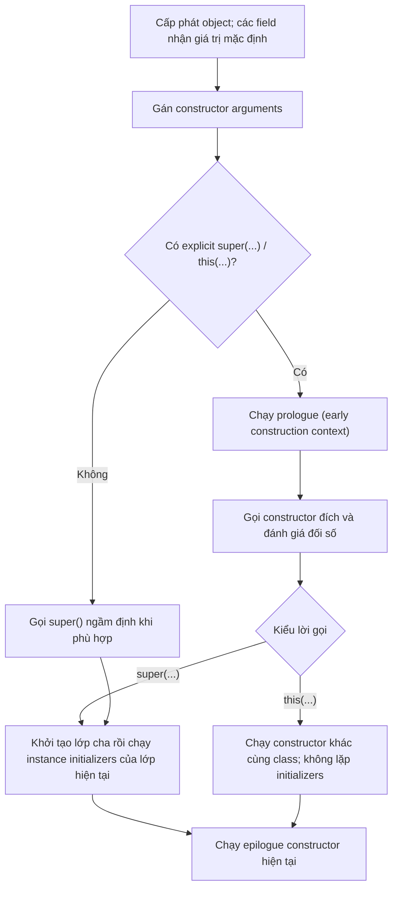

# Mục đích và trạng thái chính thức của flexible constructor bodies trong Java 25

## 1. Vấn đề được giải quyết: tại sao muốn làm việc trước `super(...)`?

Trong Java, một đối tượng của lớp con gồm trạng thái của các lớp cha và chính lớp con. Khi tạo đối tượng, **constructor của lớp cha phải được thực thi trong quá trình khởi tạo**, nhưng quy tắc về thứ tự phát biểu đã làm việc kiểm tra tham số, tính toán dữ liệu hoặc chuẩn bị trạng thái ban đầu đôi khi trở nên khó đọc.

Trước khi **flexible constructor bodies** được hoàn thiện, lời gọi tường minh `super(...)` hoặc `this(...)` phải đứng đầu thân constructor. Ví dụ ý định sau là hợp lý nhưng **không hợp lệ ở source level Java cũ**:

```java
// Minh họa hạn chế lịch sử, không phải cách viết cho JDK cũ.
class DocumentBase {
    DocumentBase(String name) {
        System.out.println("Đã nhận tên: " + name);
    }
}

class NamedDocument extends DocumentBase {
    NamedDocument(String rawName) {
        if (rawName == null || rawName.isBlank()) {
            throw new IllegalArgumentException("name must not be blank");
        }
        String normalized = rawName.strip();
        super(normalized); // Chỉ hợp lệ với flexible constructor bodies
    }
}
```

Các cách làm cũ thường phải đưa nhiều điều kiện và tính toán vào đối số của `super(...)`, viết thêm phương thức `static` trợ giúp, hoặc chuyển một phần kiểm tra xuống constructor lớp cha. Điều đó dễ gây trùng code, làm thông báo lỗi khó hiểu và cản trở việc tách rõ **xác thực đầu vào** khỏi **ủy quyền khởi tạo**.

Trong **Java 25**, JEP 513 cho phép một nhóm phát biểu xuất hiện **trước** lời gọi constructor tường minh mà vẫn giữ các quy tắc an toàn của quá trình khởi tạo. Vì vậy ví dụ trên trở thành một cách viết hợp lệ nếu tuân thủ các hạn chế về đối tượng chưa được khởi tạo xong.

Bài này thuộc chương **Hàm khởi tạo linh hoạt** của module **JAVA_VERSION_JAVA25**. Nội dung tập trung vào ý nghĩa, trạng thái chính thức, ngữ nghĩa khởi tạo và phạm vi áp dụng thực tế của tính năng. Các khả năng khác trong Java 25 như compact source files, module imports, ScopedValue, API dẫn xuất khóa, AOT cache hay JFR là những chủ đề liên quan của toàn module, **không phải điều kiện để dùng flexible constructors**.

**Mục tiêu học tập:**

1. Phân biệt **prologue**, lời gọi `super(...)`/`this(...)` và **epilogue**.
2. Biết Java 25 đã chuẩn hóa tính năng nào, không nhầm với preview lịch sử.
3. Xác định những thao tác hợp lệ trong **early construction context** và các trường hợp bị cấm.
4. Giải thích vì sao Java 25 cho phép gán một số trường trước constructor lớp cha, nhưng không cho phép đọc/gọi instance member tùy ý.
5. Thiết kế kiểm thử để xác nhận thứ tự khởi tạo và lỗi đầu vào; chọn lúc nào nên hoặc không nên sử dụng cách viết này.

## 2. Trạng thái ngôn ngữ chính thức tại Java 25

**JEP 513 — Flexible Constructor Bodies** trở thành tính năng **chính thức (permanent)** trong **Java SE 25**. Nó không còn là preview khi biên dịch bằng toolchain Java 25 với source level Java 25. Tính năng đã có các vòng thử nghiệm ở Java 22, 23 và 24, nhưng khi học Java 25 cần đối chiếu **JEP 513 và Java Language Specification (JLS) SE 25**, thay vì lấy những giới hạn/cú pháp bản preview đầu tiên làm quy tắc hiện hành.

| Câu hỏi | Trả lời đối với Java 25 |
| --- | --- |
| Được viết phát biểu trước `super(...)`? | **Có**, với giới hạn của early construction context. |
| Được viết phát biểu trước `this(...)`? | **Có**, với những giới hạn tương ứng. |
| Có bắt buộc dùng `--enable-preview` cho JEP 513? | **Không** trên Java 25. |
| Constructor vẫn chỉ được có tối đa một lời gọi constructor tường minh? | **Có**. |
| Có thể bỏ `super()` tường minh khi thích hợp? | **Có**; cơ chế `super()` ngầm định vẫn tồn tại nếu không viết explicit constructor invocation. |
| Được đọc bất kỳ instance field nào trước `super`? | **Không**. |
| Được khởi tạo trước một số field của chính class? | **Có**, theo quy tắc gán được phép, đặc biệt các trường chưa có initializer. |
| Có thể gọi instance method của chính đối tượng trước `super`? | **Không**. |
| Constructor có thể `return;` trực tiếp? | **Có ở epilogue**, nhưng **không được ở prologue**; `return` kèm giá trị luôn bị cấm trong constructor. |
| JDK cũ biên dịch được cú pháp này nếu thêm import? | **Không**; phải dùng source level hỗ trợ. |

Lưu ý rằng **“chính thức ở Java 25” không có nghĩa mọi module đang chạy Java 17/21 đều biên dịch được**. Một thư viện cần giữ tương thích với `--release 17` hoặc `--release 21` phải giữ cú pháp nguồn tương ứng, dù máy CI có cài JDK 25.

### 2.1. Các nguồn chuẩn

- [OpenJDK JEP 513 — Flexible Constructor Bodies](https://openjdk.org/jeps/513): động cơ, phạm vi và trạng thái hoàn thiện.
- [Oracle Java SE 25 — Flexible Constructor Bodies](https://docs.oracle.com/en/java/javase/25/language/flexible-constructor-bodies.html): ví dụ, early construction context và trường hợp gán field.
- [Oracle Java SE 25 — Java Language Changes by Release](https://docs.oracle.com/en/java/javase/25/language/java-language-changes-release.html): xác nhận tính năng đã permanent ở Java 25.
- [JLS SE 25 §8.8.7 — Constructor Body và §8.8.7.1 — Constructor Invocations](https://docs.oracle.com/javase/specs/jls/se25/html/jls-8.html#jls-8.8.7): cấu trúc prologue/epilogue và các giới hạn.
- [JLS SE 25 §12.5 — Creation of New Class Instances](https://docs.oracle.com/javase/specs/jls/se25/html/jls-12.html#jls-12.5): thứ tự chạy khi tạo đối tượng.
- [JLS SE 25 §14.17 — The return Statement](https://docs.oracle.com/javase/specs/jls/se25/html/jls-14.html#jls-14.17): phân biệt `return;` bị cấm trong prologue với `return;` hợp lệ trong epilogue; `return` có giá trị bị cấm trong constructor.

Trong các ví dụ bên dưới, `java` và `javac` được giả định là **JDK 25**. Chúng ta không dùng các kỹ thuật đã trở nên lỗi thời chỉ để né quy tắc cũ, và không dùng API bị loại bỏ khỏi Java 25.

## 3. Cấu trúc constructor: prologue và epilogue

Với constructor có lời gọi tường minh tới constructor khác, Java 25 có thể diễn đạt thân constructor như sau:

```java
class Child extends Parent {
    Child(int raw) {
        // 1. Prologue: tính toán, kiểm tra, gán sớm trong phạm vi cho phép
        int normalized = Math.max(raw, 0);

        // 2. Explicit constructor invocation
        super(normalized);

        // 3. Epilogue: sau khi constructor cha và các initializers thích hợp
        //    đã được thực hiện, có thể làm việc với instance như thông thường
        System.out.println("Child đã khởi tạo");
    }
}
```

`Parent` là một class có constructor nhận `int` được giả định trong sơ đồ. Đây là **khung cú pháp minh họa**, không phải tệp độc lập hoàn chỉnh. Để biên dịch, hãy định nghĩa `Parent` và các class cần thiết như ở các ví dụ đầy đủ sau.

- **Prologue:** các `BlockStatements` đứng trước lời gọi constructor tường minh; có thể rỗng.
- **Explicit constructor invocation:** `super(...)` gọi constructor của lớp cha trực tiếp, còn `this(...)` chuyển sang constructor khác của cùng lớp.
- **Epilogue:** các phát biểu sau lời gọi trên; đối với constructor không có explicit invocation thì phần code trong thân được coi là epilogue, với `super()` ngầm định ở trước (trừ trường hợp đặc biệt của `Object`).



Sơ đồ trên tóm lược luồng thực thi của **một constructor được gọi**; chuỗi `this(...)` có thể chứa nhiều bước đệ quy và chỉ constructor đi tới `super(...)` mới làm quá trình khởi tạo cha cùng initializer của lớp hiện tại. Để suy luận trường hợp phức tạp, dựa vào thuật toán trong JLS §12.5.

### 3.1. Điểm khác quan trọng nhất với quy tắc cũ

Trước đây, code được viết trước `super(...)` chủ yếu chỉ xuất hiện **bên trong biểu thức đối số** của lời gọi constructor, chẳng hạn `super(validate(raw))`. Giờ đây, code có thể là **nhiều phát biểu** gồm khai báo biến cục bộ, rẽ nhánh, tính toán và ném exception, miễn là hợp lệ trong early construction context.

Ví dụ đầy đủ:

```java
// ValidatedAccount.java
class Account {
    final String owner;

    Account(String owner) {
        this.owner = owner;
    }
}

public class ValidatedAccount extends Account {
    public ValidatedAccount(String rawOwner) {
        if (rawOwner == null) {
            throw new IllegalArgumentException("owner cannot be null");
        }

        String owner = rawOwner.strip();

        if (owner.isEmpty()) {
            throw new IllegalArgumentException("owner cannot be empty");
        }

        super(owner);
    }

    public static void main(String[] args) {
        ValidatedAccount account = new ValidatedAccount("  Lan  ");
        System.out.println(account.owner);
    }
}
```

Biên dịch và chạy:

```bash
javac ValidatedAccount.java
java ValidatedAccount
```

Kết quả:

```text
Lan
```

Trong prologue, code chỉ thao tác trên **constructor parameter** `rawOwner`, biến cục bộ `owner` và những phương thức có receiver là object *khác* đang tồn tại (`rawOwner.strip()`). Nó không đọc hoặc gọi method trên **đối tượng `ValidatedAccount` chưa hoàn tất khởi tạo**.

### 3.2. Validation fail-fast có lợi ích gì?

Nếu `rawOwner` là chuỗi rỗng, constructor dừng ngay ở prologue, **không gọi `Account(String)`**. Điều này giúp tránh việc superclass constructor thực hiện các tác dụng phụ hoặc ném lỗi khó hiểu trước khi lớp con có thể kiểm tra điều kiện của mình.

Tuy vậy, **prologue không tự làm việc khởi tạo trở nên giao dịch hoặc không có side effects**. Nếu prologue ghi file, cập nhật database hay đăng ký callback rồi sau đó ném exception, tác dụng phụ vẫn có thể xảy ra. Trong production, ưu tiên kiểm tra và chuẩn hóa dữ liệu bằng code thuần, không gọi mạng hoặc tài nguyên bên ngoài ở giai đoạn khởi tạo.

## 4. Early construction context: có thể làm gì, không thể làm gì?

**Early construction context** là vùng bao gồm prologue và các biểu thức trong lời gọi constructor tường minh. Vùng này chạy trước khi đối tượng hiện tại có thể được sử dụng như một instance đã hoàn tất việc khởi tạo phần superclass. Java 25 cho phép tính toán có ích, nhưng **không cho phép truy cập tùy ý vào đối tượng đang tạo**.

| Thao tác trong prologue | Hợp lệ? | Lý do |
| --- | --- | --- |
| Kiểm tra parameter, `if`, `throw` | **Có** | Không cần trạng thái instance |
| Khai báo local variable, chuyển đổi `String`, chuẩn hóa dữ liệu | **Có** | Làm việc với dữ liệu đầu vào/đối tượng khác |
| Gọi `static` method hoặc dùng static constant hợp lệ | **Có** | Không phụ thuộc receiver `this` chưa hoàn chỉnh |
| Đọc trường instance của đối tượng hiện tại | **Không** | Chưa được phép quan sát trạng thái của object đang xây |
| Gọi method instance của object hiện tại, kể cả method kế thừa | **Không** | Có thể chạm trạng thái chưa khởi tạo |
| Truyền `this` như một giá trị hoặc đăng ký listener bằng `this` | **Không** | Làm thoát tham chiếu tới object đang xây |
| Đọc/gọi thành viên thông qua `super` | **Không** | Phần superclass chưa được khởi tạo theo thứ tự yêu cầu |
| Gán đơn giản (`=`) vào trường instance của class hiện tại, đủ điều kiện | **Có**, đặc biệt blank field chưa có initializer | Quy tắc gán sớm có ngoại lệ có chủ đích |
| Đọc field qua `field++`/`field += 1` | **Không** | Phép toán cần đọc giá trị hiện tại |
| Tạo inner class cần `this` của chính object đang tạo | **Không** | Inner instance sẽ giữ enclosing instance chưa hoàn thành |
| Dùng `return;` trong prologue | **Không** | `return;` không được đứng trước explicit constructor invocation; `return;` không có giá trị vẫn có thể hợp lệ trong epilogue |

Bảng nhấn mạnh “**current instance**”: gọi `rawInput.strip()` trên một `String` tham số là hợp lệ; gọi `this.normalize()` hoặc `normalize()` nếu đó là phương thức instance của đối tượng đang khởi tạo thì không hợp lệ. Một lời gọi `static` method của class hiện tại có thể dùng được, miễn không bí mật truy cập object chưa khởi tạo thông qua code được thực thi.

### 4.1. Được đọc local variable, không được đọc current instance field

Ví dụ dưới đây cố ý có lỗi biên dịch:

```java
// ExampleInvalid.java — KHÔNG biên dịch được ở Java 25
class Parent {
    Parent(int value) { }
}

class Child extends Parent {
    int amount;

    Child(int raw) {
        int local = raw * 2;      // Hợp lệ
        System.out.println(local); // Gọi static println, hợp lệ

        int unsafe = amount;     // Lỗi: đọc instance field hiện tại
        super(local);
    }
}
```

Lỗi xảy ra do `amount` là trạng thái của `Child`. Lỗi **không phải do `System.out.println` đứng trước `super(...)`**: có thể in biến cục bộ, nhưng khi thiết kế production không nên để logging/side effect chi phối constructor.

Sửa:

```java
class Parent {
    Parent(int value) { }
}

class Child extends Parent {
    int amount;

    Child(int raw) {
        int local = raw * 2;
        super(local);
        amount = local; // Ở epilogue có thể làm việc với instance
    }
}
```

Đoạn sửa này cho thấy nếu không cần khởi tạo field sớm, **gán sau `super(...)` vẫn là cách đơn giản và dễ hiểu**.

### 4.2. Không thể gọi instance method hoặc dùng `this` tự do

```java
// InvalidMethodCall.java — ví dụ lỗi, không biên dịch
class Base {
    Base(String label) { }
}

class Derived extends Base {
    String normalize(String text) {
        return text.strip();
    }

    Derived(String raw) {
        String value = normalize(raw); // Lỗi: gọi method instance
        super(value);
    }
}
```

Các phương án phù hợp:

- Chuyển hàm không sử dụng trạng thái đối tượng thành `static`, ví dụ `static String normalize(String text)`.
- Giữ logic chuẩn hóa trực tiếp trong prologue khi đơn giản.
- Khi phép tính đòi hỏi instance đã được khởi tạo, thực hiện **trong epilogue**, hoặc thiết kế lại constructor để không buộc phải có kết quả trước `super(...)`.

Ví dụ với static helper:

```java
class Base {
    Base(String value) {
        System.out.println(value);
    }
}

class Derived extends Base {
    private static String normalize(String raw) {
        if (raw == null || raw.isBlank()) {
            throw new IllegalArgumentException("raw must not be blank");
        }
        return raw.strip();
    }

    Derived(String raw) {
        String value = normalize(raw);
        super(value);
    }
}
```

Nếu mục tiêu chỉ là giữ code ngắn, `super(normalize(raw))` vốn đã hợp lệ ở JDK cũ; Java 25 cho phép **nhiều bước xử lý rõ ràng**, không bắt ép phải chọn prologue cho mọi tình huống.

### 4.3. Quy tắc với `super` và các constructor calls

`super(...)` và `this(...)` được đặt trong thân constructor như **những câu lệnh constructor invocation đặc biệt**. Chúng không phải những lời gọi method thường và không thể đưa tùy tiện vào `if`, vòng lặp hoặc lambda.

```java
// InvalidConditional.java — không hợp lệ
class Parent {
    Parent(int value) { }
    Parent(String value) { }
}

class Child extends Parent {
    Child(boolean flag) {
        if (flag) {
            super(1);            // Lỗi: không đặt trong nhánh if
        } else {
            super("alternative"); // Lỗi: không đặt trong nhánh else
        }
    }
}
```

Cách làm đúng: tính đối số trong prologue rồi **một** lời gọi tới constructor đích, hoặc sử dụng overloaded constructors có hình thức phù hợp.

```java
class Parent {
    Parent(String description) {
        System.out.println(description);
    }
}

class Child extends Parent {
    Child(boolean flag) {
        String value = flag ? "enabled" : "disabled";
        super(value);
    }
}
```

Ở đây cả hai trường hợp đi qua **một** lời gọi `super(value)`. Những giới hạn cố hữu của Java vẫn áp dụng: không đặt cả `this(...)` và `super(...)` trong cùng một constructor, không tạo vòng đệ quy `this(...)`.

## 5. Điểm mới sâu hơn: gán field trước `super(...)`

Ngoài validation và tính toán, Java 25 còn cho phép **khởi tạo sớm các trường đủ điều kiện của chính object đang tạo** bằng phép gán trực tiếp. Điều này đặc biệt hữu ích khi superclass constructor **gọi một method có thể bị override**, khiến phần implementation ở subclass có thể nhìn thấy field chưa được gán.

### 5.1. Rủi ro của dynamic dispatch trong constructor

Giả sử superclass gọi một hook có thể override:

```java
// UnsafeOrder.java
class Parent {
    Parent() {
        report();
    }

    void report() {
        System.out.println("Parent initialized");
    }
}

class UnsafeOrder extends Parent {
    final int number;

    UnsafeOrder(int value) {
        // super() được chèn ngầm định TRƯỚC thân constructor.
        number = value;
    }

    @Override
    void report() {
        System.out.println(number);
    }

    public static void main(String[] args) {
        new UnsafeOrder(42);
    }
}
```

Giá trị in ra ở lần gọi `report()` từ superclass constructor là:

```text
0
```

Lý do:

1. Bộ nhớ cho cả object được cấp phát; `int` fields có giá trị mặc định `0`.
2. Constructor `UnsafeOrder` gọi `super()` **ngầm định**.
3. `Parent()` gọi `report()`. Do **dynamic dispatch**, bản override của `UnsafeOrder` được gọi.
4. `number` chưa được gán `value`, do đó in ra `0`.
5. Sau khi `super()` trở về, thân constructor gán `number = 42`, nhưng lần đọc đầu tiên đã xảy ra.

Đây là một hành vi Java có từ lâu; **Java 25 không thay đổi dynamic dispatch**. Flexible constructors cung cấp thêm một giải pháp giảm nguy cơ trong những class có thiết kế như vậy.

### 5.2. Gán blank field trong prologue

Ví dụ được sửa với cú pháp Java 25:

```java
// SafeOrder.java
class Parent {
    Parent() {
        report();
    }

    void report() {
        System.out.println("Parent initialized");
    }
}

public class SafeOrder extends Parent {
    final int number; // Blank final field: chưa có initializer

    public SafeOrder(int value) {
        if (value <= 0) {
            throw new IllegalArgumentException("value must be positive");
        }

        number = value; // Gán sớm vào field của chính SafeOrder
        super();        // Java 25: được đứng sau phép gán
    }

    @Override
    void report() {
        System.out.println(number);
    }

    public static void main(String[] args) {
        SafeOrder order = new SafeOrder(42);
        order.report();
    }
}
```

Kết quả:

```text
42
42
```

**Cần hiểu chính xác:** việc gán `number = value` trước `super()` là **ngoại lệ cho thao tác ghi vào instance field**, không phải giấy phép để đọc mọi thành viên của `this`. Field này được khai báo **không có initializer**, nên giá trị gán sớm không bị field initializer ghi đè khi superclass constructor kết thúc.

Thay vì `number = value`, bạn cũng có thể gặp `this.number = value` ở vị trí bên trái phép gán đơn giản trong ví dụ chính thức; nhưng `this` không được dùng như một **giá trị tự do** ở early construction context. Nếu cần một quy tắc dễ kiểm tra, hãy dùng **simple assignment duy nhất vào field chưa có initializer** và không tham chiếu object theo cách khác trước `super(...)`.

### 5.3. Phép gán nào không được hiểu nhầm là “khởi tạo sớm”?

**Đọc field trước khi cha được khởi tạo không hợp lệ**, kể cả khi bạn vừa gán field trong prologue:

```java
class Parent { Parent() { } }

class InvalidRead extends Parent {
    int number;

    InvalidRead(int value) {
        number = value;               // Gán hợp lệ nếu field đủ điều kiện
        System.out.println(number);   // Lỗi: đọc field trong early context
        super();
    }
}
```

Một phép tăng hoặc cộng dồn cũng yêu cầu đọc:

```java
class Parent { Parent() { } }

class InvalidIncrement extends Parent {
    int number;

    InvalidIncrement(int value) {
        number += value; // Lỗi: đọc number rồi ghi
        super();
    }
}
```

Không gán sớm vào field có **field initializer** tại khai báo:

```java
class Parent { Parent() { } }

class InvalidInitializedField extends Parent {
    int number = 10;

    InvalidInitializedField(int value) {
        number = value; // Lỗi: field có initializer, không gán sớm
        super();
    }
}
```

Sở dĩ cần giới hạn này là vì **field initializers và instance initializer blocks của subclass được chạy sau lời gọi constructor superclass**. Nếu field vừa có initializer tại khai báo vừa gán trong prologue, thứ tự sẽ dễ làm giá trị gán sớm bị ghi đè và gây ngữ nghĩa khó hiểu; Java 25 áp dụng quy tắc compile-time để ngăn những trường hợp không an toàn.

### 5.4. Khi nào nên dùng gán sớm?

- Class có một **blank final field** (hoặc field chưa được khởi tạo) mà subclass override có thể cần đọc trong callback được superclass gọi.
- Có thể xác định giá trị an toàn **chỉ từ constructor arguments và static helpers**, không cần trạng thái instance.
- Bạn kiểm soát được contract của superclass hoặc phải tương tác với framework/legacy hierarchy vốn gọi overridable method khi đang xây object.
- Giá trị đã qua validation và sẽ không bị initializer khác ghi đè.

**Không xem gán sớm là cách sửa thiết kế inheritance không an toàn trong mọi trường hợp.** Thiết kế tốt hơn thường là superclass constructor **không gọi method overridable**, hoặc dùng factory/builder/callback sau khởi tạo. Gán sớm chỉ khắc phục được các field có thể khởi tạo trước constructor cha, không đảm bảo mọi invariant của subclass đã sẵn sàng.

## 6. Flexible bodies cũng hoạt động với `this(...)`

`this(...)` là **alternate constructor invocation**: constructor này ủy quyền tới một constructor khác trong **cùng class**. Java 25 cho phép tính toán hoặc kiểm tra dữ liệu ở prologue **trước lời gọi `this(...)`**.

### 6.1. Chuẩn hóa rồi ủy quyền

```java
// PortRange.java
public final class PortRange {
    private final int start;
    private final int end;

    public PortRange(String text) {
        if (text == null || !text.matches("\\d+-\\d+")) {
            throw new IllegalArgumentException(
                    "Expected format: start-end");
        }

        String[] parts = text.split("-", 2);
        int parsedStart = Integer.parseInt(parts[0]);
        int parsedEnd = Integer.parseInt(parts[1]);

        if (parsedStart > parsedEnd) {
            throw new IllegalArgumentException(
                    "start must not exceed end");
        }

        this(parsedStart, parsedEnd); // Ủy quyền sau validation
    }

    public PortRange(int start, int end) {
        if (start < 0 || end > 65535 || start > end) {
            throw new IllegalArgumentException("invalid port range");
        }

        this.start = start;
        this.end = end;
    }

    @Override
    public String toString() {
        return start + "-" + end;
    }

    public static void main(String[] args) {
        System.out.println(new PortRange("8000-8080"));
    }
}
```

Kết quả:

```text
8000-8080
```

Prologue của `PortRange(String)` chỉ làm việc với `text` và local variables, nên hợp lệ. `this(parsedStart, parsedEnd)` gọi constructor còn lại để kiểm tra giới hạn cổng và gán các `final` fields. Không gọi `super()` trong constructor chuyển tiếp: constructor đích sẽ thực hiện chuỗi khởi tạo đến superclass theo quy tắc bình thường.

**Một lưu ý về robust validation:** ví dụ regex `\\d+-\\d+` giúp minh họa thứ tự; các số quá lớn vẫn có thể làm `Integer.parseInt` ném `NumberFormatException`. Với thư viện công khai, cần nêu rõ loại lỗi của API, thiết kế thông báo lỗi và bộ test phù hợp. Ví dụ cũng dùng định dạng không có dấu cách; thêm `strip()` nếu hợp đồng cho phép khoảng trắng.

### 6.2. Thứ tự gọi khi có nhiều constructor

Với lớp `PortRange`:

1. Người dùng gọi `new PortRange("8000-8080")`.
2. Prologue của constructor nhận `String` kiểm tra và parse dữ liệu.
3. `this(parsedStart, parsedEnd)` chuyển sang constructor nhận hai số.
4. Constructor nhận hai số kiểm tra giới hạn và thực hiện `super()` ngầm định trước phần body của nó.
5. Phần body của constructor nhận hai số gán các trường.
6. Trở về constructor nhận `String`; nếu có epilogue, nó chạy sau lời gọi `this(...)`.

**Không được** tạo vòng `this(...)` trực tiếp hoặc gián tiếp. Ví dụ `A() { this(1); }` và `A(int) { this(); }` là lỗi compile-time; prologue mới không bỏ hạn chế đó.

### 6.3. Gán field trước `this(...)` có nên làm không?

Trong constructor ủy quyền, hãy **ưu tiên kiểm tra và chuẩn hóa local variables trong prologue**, để constructor đích chịu trách nhiệm nhất quán về gán fields. Gán trường ở prologue của constructor chuyển tiếp có thể xung đột với chuỗi gán `final` và definite assignment trong constructor đích. Trình biên dịch vẫn áp dụng quy tắc **blank final definite assignment/unassignment**; không vì Java 25 cho gán sớm mà được gán `final` field hai lần.

Điều này cũng giúp các overloads tạo ra cùng một invariant thay vì mỗi overload khởi tạo một mảnh của object ở thời điểm khác nhau.

## 7. Record constructor: những gì áp dụng, những gì không

**Record class** cũng có constructors, nhưng không đồng nhất với class thông thường: các **record component fields** được khởi tạo bởi canonical constructor theo quy tắc của record. Chúng ta không được tùy ý gán lại component field trong compact canonical constructor.

Java 25 cho phép **non-canonical record constructor** có prologue rồi `this(...)` đến một canonical constructor hoặc constructor hợp lệ trong chuỗi dẫn đến canonical constructor.

Ví dụ:

```java
// GridSize.java
public record GridSize(int width, int height) {
    public GridSize {
        if (width <= 0 || height <= 0) {
            throw new IllegalArgumentException(
                    "Dimensions must be positive");
        }
    }

    public GridSize(String text) {
        if (text == null || !text.matches("\\d+x\\d+")) {
            throw new IllegalArgumentException(
                    "Expected <width>x<height>");
        }

        String[] parts = text.split("x", 2);
        int width = Integer.parseInt(parts[0]);
        int height = Integer.parseInt(parts[1]);

        this(width, height); // Java 25: sau nhiều statements
    }

    public static void main(String[] args) {
        System.out.println(new GridSize("1920x1080"));
    }
}
```

Kết quả:

```text
GridSize[width=1920, height=1080]
```

- `GridSize(String)` là **non-canonical constructor** nên phải ủy quyền bằng `this(...)`, nhưng được phép tính toán trước.
- `public GridSize { ... }` là **compact canonical constructor của record**; body không có lời gọi explicit `this(...)` hay `super(...)` và không được tự gán record component fields theo cách của một class thường.
- Record tự có cơ chế khởi tạo components sau khi canonical constructor hoàn tất kiểm tra theo ngữ nghĩa record.
- Các giá trị 0 hoặc âm được kiểm tra bởi canonical constructor; dữ liệu có định dạng sai bị chặn ở prologue của non-canonical constructor.

Cần phân biệt **“compact source file”**, **“compact canonical record constructor”** và **“flexible constructor body”**: đây là ba khái niệm khác nhau. Bài này chỉ bàn về việc chèn statements trước lời gọi `this(...)`/`super(...)`, không nói rằng record phải dùng `super()`.

## 8. Thứ tự khởi tạo thực tế: điều gì chạy lúc nào?

Dựa vào JLS §12.5, một luồng tạo object có thể hiểu qua các giai đoạn:

1. JVM cấp phát vùng nhớ cho object và các instance fields (bao gồm fields trong superclass), đặt **giá trị mặc định** như `0`, `false`, `null`.
2. Gán giá trị tham số cho constructor hiện tại.
3. Nếu constructor có **explicit constructor invocation**, thực thi prologue của nó. Nếu prologue ném exception, quá trình tạo object dừng; lời gọi constructor đích chưa diễn ra.
4. Đánh giá các đối số của `super(...)` hoặc `this(...)` rồi thực hiện constructor đích. Với `super(...)`, phần superclass được khởi tạo. Với `this(...)`, constructor khác cùng class được thực thi đệ quy.
5. Đối với nhánh đi qua **superclass invocation**, sau khi superclass constructor hoàn tất, chạy **instance initializers** và **instance variable initializers** của class hiện tại theo thứ tự trong source. Không chạy các initializers của cùng class một lần nữa khi quay về epilogue của constructor ủy quyền `this(...)`.
6. Chạy epilogue của constructor hiện tại; khi chuỗi constructor hoàn tất, `new` trả về tham chiếu object.

Chính tại bước **3**, Java 25 cho phép các phát biểu mới và phép gán sớm hợp lệ. Nhưng điều đó không có nghĩa mọi initializer của lớp con chạy trước `super`: **initializer khai báo ở field hoặc instance block vẫn chạy ở bước 5**.

### 8.1. Minh họa thứ tự với `System.out.println`

```java
// InitOrder.java
class Base {
    Base() {
        System.out.println("B. base constructor");
    }
}

public class InitOrder extends Base {
    int count = traceInitializer();

    static int traceInitializer() {
        System.out.println("C. child field initializer");
        return 7;
    }

    InitOrder(String input) {
        System.out.println("A. child prologue");
        if (input == null) {
            throw new IllegalArgumentException("input is null");
        }

        super();
        System.out.println("D. child epilogue: count=" + count);
    }

    public static void main(String[] args) {
        new InitOrder("ok");
    }
}
```

Kết quả khi chạy:

```text
A. child prologue
B. base constructor
C. child field initializer
D. child epilogue: count=7
```

Ở ví dụ này, `traceInitializer()` là method `static` của subclass được gọi trong initializer; sự kiện khởi tạo class ở JVM có thể tạo log khác nếu thêm static initializer. Với mã đang trình bày, không có static initializer in thêm nên thứ tự trên minh họa rõ prologue → superclass → subclass initializer → epilogue.

### 8.2. Tránh nhầm cấu trúc với gọi `super()` ngầm định

Nếu constructor không viết `super(...)`/`this(...)`:

```java
class Example {
    Example(int value) {
        System.out.println(value);
    }
}
```

Java vẫn có một `super()` ngầm định được thực hiện trước phần thân constructor (nếu superclass thích hợp có constructor không tham số). Do đó, **không có “prologue tự động” chỉ vì `System.out.println` là phát biểu đầu tiên**. Muốn code thực sự chạy trước superclass constructor, cần đặt nó trước **explicit** `super(...)`/`this(...)` và tuân thủ early construction context.

## 9. Khi nào flexible constructor bodies phù hợp?

| Bài toán | Cách sử dụng hợp lý | Không nên suy diễn |
| --- | --- | --- |
| Kiểm tra tham số trước khi gọi lớp cha | `if`/`throw` trong prologue rồi `super(validated)` | Không được dùng instance method để validate trước `super` |
| Chuẩn hóa nhiều tham số | Tạo local variables, chuẩn hóa rồi `super(...)` | Không tự động bảo vệ khỏi side effects khi validate |
| Chuyển một dạng đầu vào sang overload khác | Parse/validate rồi `this(...)` | Không được tạo vòng `this` hoặc gán final field hai lần |
| Superclass constructor gọi method bị override | Gán sớm **blank fields** cần cho callback rồi `super()` | Không làm mọi overridable callback an toàn |
| Record có non-canonical constructor | Kiểm tra/parse rồi `this(...)` | Không có ý nghĩa là record được phép gọi `super(...)` |
| Class đơn giản không inheritance | Có thể dùng nhưng lợi ích ít | Không nên thêm explicit `super()` chỉ để dùng cú pháp mới |
| Build target Java 17/21 | Tiếp tục dùng cách viết compatible cũ | Không thể dùng prologue mới với `--release` cũ |

### 9.1. Lợi ích về thiết kế API

Trong thư viện có nhiều subclasses, bước validate đầu vào rõ ràng trước khi khởi tạo superclass có thể:

- Báo lỗi gần với nơi xác định invariant và trước các hoạt động của superclass.
- Tránh helper `static` bị bẻ thành nhiều tầng chỉ để làm `super(validate(x))`.
- Cải thiện khả năng đọc của constructors có nhiều tham số và rẽ nhánh validation.
- Chuẩn bị trạng thái đơn giản trước khi superclass có callback ảo vào subclass.

Nhưng **không nên lạm dụng constructor cho nhiều công việc**. I/O chậm, network call, cache update và tương tác tài nguyên bên ngoài thường phù hợp ở factory/service rõ ràng hơn. Constructor nên đơn giản, có invariant kiểm chứng được và ít side effects.

### 9.2. Không thay thế các quy tắc Java khác

JEP 513 **không**:

- Cho phép subclass vượt qua `final`, `sealed` hay visibility của constructor.
- Biến `super(...)` thành một lời gọi method tùy ý.
- Cho phép bỏ qua ràng buộc `final` definite assignment.
- Thay đổi hợp đồng của `record`, `enum` hoặc các class loader.
- Loại bỏ nguy cơ `this` escape, superclass constructor gọi method overridable hoặc bắt đầu thread trước khi object hoàn thành.
- Bảo đảm thread-safety hoặc tính bất biến chỉ nhờ gán sớm.
- Bắt các dự án Maven/Gradle tự thay đổi `--release`/language level khi JDK runtime được nâng cấp.

Những điểm này giúp tránh chuyển một tính năng ngôn ngữ hữu ích thành lời hứa không đúng về kiến trúc hoặc độ an toàn của mọi ứng dụng Java.

## 10. Lỗi thường gặp khi biên dịch và nâng cấp JDK

| Triệu chứng hoặc đoạn mã | Nguyên nhân thực tế | Hướng xử lý |
| --- | --- | --- |
| `javac` phàn nàn về phát biểu trước `super(...)` | Toolchain/source level còn ở Java cũ | Chọn JDK 25 và `--release 25` cho bài thực hành |
| Đã cài JDK 25 nhưng IDE báo lỗi | IDE language level hoặc compiler dùng JDK cũ | Đồng bộ Project SDK, Gradle/Maven toolchain và compiler settings |
| `this.hashCode()` trước `super` bị cấm | Dùng current instance trong early construction context | Chuyển logic sang epilogue |
| `hashCode()` trước `super` vẫn lỗi | Receiver ngầm định là current instance | Dùng static helper không cần object hoặc chuyển epilogue |
| `System.out.println(this)` trước `super` lỗi | Truyền object chưa khởi tạo như một giá trị | Không làm `this` escape; chỉ log tham số/local values |
| `int x = field;` trước `super` lỗi | Đọc instance field | Đọc dữ liệu đầu vào hoặc chờ epilogue |
| `field++` hoặc `field += n` lỗi | Các phép toán đọc trước khi ghi | Nếu cần khởi tạo sớm, gán đơn giản vào blank field đủ điều kiện |
| `field = n` trước `super` lỗi khi khai báo `int field = 1;` | Field đã có initializer | Bỏ initializer nếu thiết kế cần gán sớm và kiểm tra invariants, hoặc gán trong epilogue |
| Gọi `super.method()` trước `super(...)` lỗi | Truy cập superclass instance quá sớm | Chuyển logic xuống epilogue |
| `super(...)` ở hai nhánh `if/else` không hợp lệ | Constructor body chỉ có tối đa một explicit invocation theo grammar | Tính đối số bằng `if` trước rồi một `super(...)` |
| `this(...)` gọi lại chính constructor gián tiếp | Constructor recursion bị cấm | Thiết kế một constructor đích không delegating vòng |
| `final` field bị compiler báo gán hai lần | Không thỏa definite assignment/unassignment | Dồn khởi tạo vào một constructor hoặc một vị trí duy nhất |
| Parent callback vẫn thấy trạng thái mặc định | Field chưa được gán hoặc field có initializer chạy sau parent | Tránh callback sớm hoặc gán blank field trong prologue |
| Record constructor không nhận `super(...)` | Record không cho superclass invocation tường minh | Dùng non-canonical constructor ủy quyền qua `this(...)` |
| Syntax Java 25 lỗi khi build target 17/21 | JDK runtime và source compatibility không giống nhau | Giữ target tương thích hoặc nâng baseline sau khi đánh giá |

**Quy trình tìm lỗi tối thiểu:**

```bash
java --version
javac --version

# Nếu các lệnh chỉ đến JDK 25, thử biên dịch ví dụ độc lập:
javac --release 25 ValidatedAccount.java
java ValidatedAccount
```

Các lệnh trên kiểm tra compiler và chương trình đơn lẻ. Không cần `--enable-preview` cho JEP 513 đã được chính thức hóa trong Java 25. Nếu môi trường build có nhiều JDK, kiểm tra cả cấu hình IDE, CI và runtime container; một `java --version` đúng chưa chứng minh Gradle/Maven đang dùng compiler đúng.

### 10.1. Phân biệt nguyên nhân về ngôn ngữ và nguyên nhân về thiết kế

Một đoạn code **được compiler cho phép** chưa chắc là một constructor tốt. Ví dụ, prologue có thể làm phép tính tốn kém, gọi static method gây I/O hoặc ném exception sau khi đã có side effects. Java chỉ kiểm tra một phần ngữ nghĩa và các giới hạn truy cập current instance; nó không xác minh yêu cầu nghiệp vụ, timeout hay tính nhất quán của dữ liệu.

Tương tự, việc gán một field sớm để superclass callback đọc đúng giá trị không chứng minh subclass đã hoàn tất invariant. Nếu superclass callback có thể chạm nhiều fields, cần xem xét thiết kế cha/con và trì hoãn callback thay vì cố khởi tạo từng field trước `super()`.

## 11. Kiểm thử hành vi constructor trên Java 25

### 11.1. Unit tests cho validation và chuẩn hóa

Với class `ValidatedAccount` ở phần 3 và `PortRange` ở phần 6, một test JUnit 5 có thể kiểm tra:

```java
import org.junit.jupiter.api.Test;

import static org.junit.jupiter.api.Assertions.*;

class FlexibleConstructorTest {

    @Test
    void rejectsInvalidInputBeforeDelegation() {
        assertThrows(IllegalArgumentException.class,
                () -> new ValidatedAccount(null));
        assertThrows(IllegalArgumentException.class,
                () -> new ValidatedAccount("   "));
    }

    @Test
    void normalizesArgumentsPassedToSuperclass() {
        var account = new ValidatedAccount("  Lan  ");
        assertEquals("Lan", account.owner);
    }

    @Test
    void computesArgumentsBeforeThisDelegation() {
        var range = new PortRange("8000-8080");
        assertEquals("8000-8080", range.toString());

        assertThrows(IllegalArgumentException.class,
                () -> new PortRange("9000-8000"));
        assertThrows(IllegalArgumentException.class,
                () -> new PortRange("abc"));
    }
}
```

Test này giả định các class ví dụ được đặt trong **cùng package/source set thích hợp**, và JUnit 5 được cấu hình đúng. Đoạn code không cần dependency mới của Java 25; chỉ cú pháp constructor ở các class được test yêu cầu source level Java 25.

### 11.2. Test cho giá trị quan sát trong superclass callback

Dùng một phiên bản nhỏ để assert trạng thái ở thời điểm superclass đang chạy:

```java
// PreparedChild.java
class HookParent {
    HookParent() {
        onConstructing();
    }

    void onConstructing() { }
}

public class PreparedChild extends HookParent {
    final int number;
    int observedByParent;

    public PreparedChild(int value) {
        if (value < 0) {
            throw new IllegalArgumentException("negative value");
        }

        number = value; // Trạng thái có trước super()
        super();
    }

    @Override
    void onConstructing() {
        observedByParent = number;
    }
}
```

```java
import org.junit.jupiter.api.Test;

import static org.junit.jupiter.api.Assertions.assertEquals;
import static org.junit.jupiter.api.Assertions.assertThrows;

class PreparedChildTest {
    @Test
    void parentCallbackObservesEarlyValue() {
        var child = new PreparedChild(42);
        assertEquals(42, child.observedByParent);
        assertEquals(42, child.number);
    }

    @Test
    void rejectsInputWithoutConstructingParent() {
        assertThrows(IllegalArgumentException.class,
                () -> new PreparedChild(-1));
    }
}
```

Kiểm thử này tập trung vào **ngữ nghĩa gán sớm**. Nếu trong production bạn thêm `int observedByParent = -1;`, field initializer ấy sẽ chạy **sau** superclass constructor và có thể ghi đè kết quả của callback; cần kiểm tra lại giả định về thứ tự và tránh initializer mâu thuẫn. Test cũng không chứng minh inheritance hierarchy nói chung đã an toàn: trong một project có superclass gọi method overridable, nên review thiết kế để tránh đọc object ở trạng thái chưa hoàn chỉnh.

### 11.3. Compile-negative tests

Một bộ học liệu hoặc toolchain kiểm thử Java 25 nên giữ vài ví dụ **cố ý không hợp lệ** để xác minh compiler còn từ chối các trường hợp không an toàn:

- Đọc `this.number` trước `super()`.
- Gọi `someInstanceMethod()` trước `super()`.
- Dùng `super.method()` trước lời gọi constructor cha.
- Gán vào field có initializer trong prologue.
- Đặt `super(...)` trong nhánh `if` hoặc gọi cả `this(...)` và `super(...)`.
- Tạo vòng các alternate constructors.

Chạy từng ví dụ lỗi **riêng biệt**, đối chiếu rằng `javac` trả exit code khác 0; không chèn chúng vào cùng project build thành công. Thông báo compiler có thể khác theo JDK vendor hoặc patch release, nên assert **loại lỗi/nguyên nhân** thay vì một chuỗi chẩn đoán được copy nguyên văn.

## 12. Bài tập thực hành và cách đánh giá

### Bài tập 1 — Validation trước superclass

Xây dựng `PositiveValue extends NumericBase` trong đó `NumericBase` nhận `long` ở constructor. Viết prologue chặn giá trị ≤ 0, tính `long normalized` rồi gọi `super(normalized)`. Viết test chứng minh đầu vào không hợp lệ bị chặn trước superclass constructor.

**Tiêu chí:** chỉ sử dụng parameters/locals/static helper trước `super`; `new PositiveValue(8)` thành công, còn `new PositiveValue(0)` ném `IllegalArgumentException`.

### Bài tập 2 — Parse dữ liệu trước `this(...)`

Viết `Coordinate(String input)` nhận chuỗi dạng `"10,20"` và ủy quyền tới `Coordinate(int x, int y)`. Kiểm tra null, thiếu dấu phẩy, thừa phần tử và định dạng số. Không gán final fields hai lần và không tạo vòng constructor.

**Tiêu chí:** validation nằm trước `this(...)`, constructor hai số quản lý invariant, tests kiểm tra cả dữ liệu đúng và sai.

### Bài tập 3 — Cảnh báo dynamic dispatch

Tạo superclass gọi method overridable trong constructor, subclass có một blank `final` field được method ấy đọc. So sánh output của hai phiên bản: gán field **sau** `super()` và gán field **trước** `super()`.

**Tiêu chí:** giải thích được vì sao bản đầu đọc giá trị mặc định và bản sau đọc giá trị mới; đồng thời nêu lý do tốt hơn nên tránh gọi method overridable trong superclass constructor.

### Bài tập 4 — Non-canonical record constructor

Tạo record `Dimension(int width, int height)` với canonical constructor kiểm tra kích thước dương và non-canonical constructor nhận chuỗi `"12x8"`, parse/validate trong prologue rồi gọi `this(width, height)`. Không gán component fields trực tiếp trong compact canonical constructor.

**Tiêu chí:** chạy trên Java 25 không cần `--enable-preview`, lỗi format và lỗi giá trị được phân biệt.

### Bài tập 5 — Kiểm tra baseline nâng cấp

Giữ một source file có constructor dùng prologue trước `super`, thử biên dịch với `--release 25`. Sau đó (chỉ trong môi trường thử nghiệm) thử target trước Java 25; giải thích vì sao một dự án vẫn cần chạy Java 17/21 không thể đưa cú pháp mới vào production chỉ vì đã nâng JDK dùng trong IDE.

**Tiêu chí:** phân biệt JDK runtime, Java source level và compatibility target; ghi rõ quyết định nâng baseline của dự án.

### Câu hỏi tự đánh giá

1. Tên và số hiệu JEP hoàn thiện flexible constructor bodies trong Java 25 là gì?
2. JEP 513 còn yêu cầu `--enable-preview` khi dùng `javac --release 25` không?
3. Prologue và epilogue nằm ở đâu so với `super(...)`/`this(...)`?
4. `raw.strip()` hợp lệ trong prologue còn `this.strip()` (instance method của object đang xây) vì sao không hợp lệ?
5. Tại sao `field = value` có thể hợp lệ trước `super()` nhưng `field++` không?
6. Vì sao field có initializer `int x = 7;` không nên và không được gán sớm bằng prologue theo quy tắc Java 25?
7. Khi superclass constructor gọi method overridable, vì sao bản override của subclass có thể quan sát giá trị mặc định?
8. Tại sao gán sớm blank `final` field có thể giảm rủi ro, nhưng không thay thế việc thiết kế superclass tránh callback sớm?
9. Được đặt `this(...)` trong `if` hay viết cả `this(...)` và `super(...)` trong một constructor không?
10. Với non-canonical record constructor nhận chuỗi, bước validation nên đặt trước hay sau `this(...)` và vì sao?
11. Khi source không có explicit constructor invocation, phát biểu đầu tiên có tự trở thành prologue không?
12. Vì sao thử chạy mã với JDK 25 chưa đủ để bảo đảm một thư viện đặt `--release 17` sẽ biên dịch được?

## 13. Checklist áp dụng Java 25 hiện hành

- [ ] Dựa trên **JEP 513 và JLS SE 25**, không dựa vào giới hạn của bản preview Java 22 đầu tiên.
- [ ] Xác nhận cả `javac`, IDE và build toolchain dùng source level Java 25 khi thực hành.
- [ ] Không thêm `--enable-preview` chỉ vì dùng flexible constructor bodies.
- [ ] Trong prologue, chỉ dùng dữ liệu/operations hợp lệ; không đọc hoặc gọi instance member của object đang tạo.
- [ ] Nếu gán field trước `super`, bảo đảm đó là **simple assignment** vào field đủ điều kiện, không có initializer bị ghi đè và không vi phạm definite assignment.
- [ ] Chỉ có một explicit `super(...)` hoặc `this(...)` ở vị trí constructor invocation hợp lệ.
- [ ] Với `this(...)`, constructor đích chịu trách nhiệm thống nhất về invariants và `final` fields.
- [ ] Không nhầm non-canonical record constructor và compact canonical record constructor.
- [ ] Test validation fail-fast, thứ tự initialization, subclass callback và các trường hợp lỗi.
- [ ] Không dùng constructor cho I/O/network tác dụng phụ nếu có thể tránh; cân nhắc factory khi nghiệp vụ phức tạp.
- [ ] Không thay thế class/package/module architecture của ứng dụng bằng kỹ thuật constructor; đây là cải tiến **cú pháp và mô hình khởi tạo** của Java.
- [ ] Với dự án còn target JVM trước 25, giữ cú pháp compatible hoặc lập kế hoạch nâng cấp chính thức.

**Kết luận:** Flexible constructor bodies là tính năng đã chính thức của Java 25, cho phép kiểm tra dữ liệu, tính toán và một số phép gán field **trước khi ủy quyền tới `super(...)` hoặc `this(...)`**. Tính linh hoạt đi cùng các ràng buộc chặt chẽ về early construction context: không được đọc hay dùng tự do object chưa khởi tạo, vẫn phải tuân thủ quy tắc `final`, instance initializers và constructor chaining. Dùng đúng phạm vi, JEP 513 giúp code khởi tạo rõ ràng và có thể giảm rủi ro khi superclass callback sớm; dùng sai, nó có thể che giấu những vấn đề thiết kế vốn cần được giải quyết ở chính class hierarchy.


