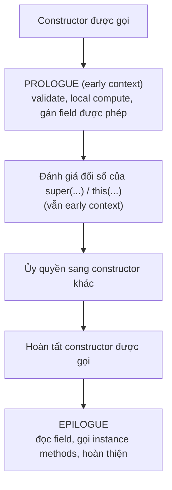
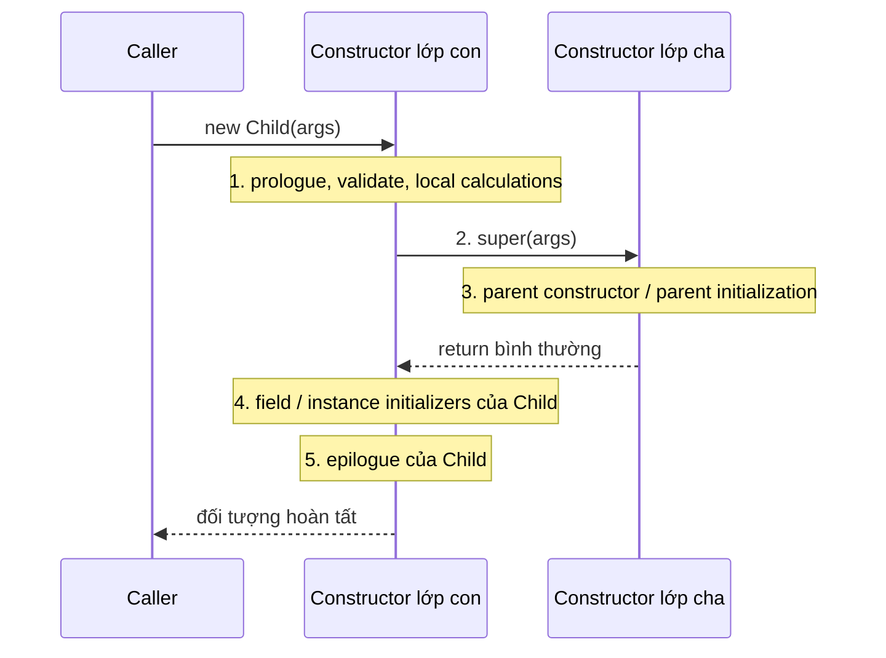

# Cấu trúc phần trước và sau lời gọi super hoặc this trong hàm khởi tạo

## 1. Mục tiêu và bối cảnh Java 25

Trong module **JAVA_VERSION_JAVA25**, người học khám phá các tính năng Java 25 còn hữu ích trong phát triển hiện đại như compact source files, module import declarations, flexible constructor bodies, `ScopedValue`, API dẫn xuất khóa, AOT cache và JFR. Bài này đi sâu vào **Flexible Constructor Bodies**: cách tổ chức các câu lệnh **trước** và **sau** lời gọi constructor `super(...)` hoặc `this(...)` để khởi tạo đối tượng rõ ràng, an toàn hơn.

**Phạm vi phiên bản:** JEP 513 — *Flexible Constructor Bodies* đã là tính năng **chính thức (final)** của Java 25, không yêu cầu `--enable-preview`. Nội dung sử dụng cú pháp, thuật ngữ và quy tắc của Java 25; các bản preview trước đó chỉ có ý nghĩa lịch sử và không phải cơ sở để thiết kế code mới.

Sau bài học, bạn cần:

- Phân biệt **prologue**, **constructor invocation** và **epilogue** trong một constructor.
- Biết ý nghĩa khác nhau của `super(...)` và `this(...)`, kể cả khi không có invocation tường minh.
- Xác định chính xác lệnh nào được phép trong **early construction context**.
- Hiểu thứ tự chạy constructor của lớp cha, field initializers, instance initializers và phần hậu xử lý của lớp con.
- Ứng dụng kiểm tra tham số trước khi gọi lớp cha, chuẩn hóa dữ liệu và xử lý trường hợp superclass gọi overridable method.
- Tránh ngộ nhận rằng mọi cách dùng `this` đều bị cấm: Java 25 **cho phép một số phép gán trực tiếp vào field của chính lớp đang xây dựng**, nhưng không cho đọc đối tượng đang khởi tạo.

## 2. Cấu trúc ba phần theo đặc tả

Theo **Java Language Specification (JLS) Java SE 25, mục 8.8.7**, body của constructor có thể có hình thức:

```text
{
    [BlockStatements]          // Prologue: có thể rỗng
    super(...) hoặc this(...); // Constructor invocation: tối đa một
    [BlockStatements]          // Epilogue: có thể rỗng
}
```

Hoặc không có constructor invocation tường minh:

```text
{
    [BlockStatements]          // Toàn bộ là epilogue
}
```

**Thuật ngữ:**

| Phần | Vị trí | Chức năng | Ràng buộc quan trọng |
|---|---|---|---|
| **Prologue** | Trước lời gọi `super(...)` hoặc `this(...)` tường minh | Kiểm tra đầu vào, chuẩn hóa đối số, tính dữ liệu cục bộ, gán field hợp lệ trước khi ủy quyền | Thuộc **early construction context**; không được đọc/dùng đối tượng chưa hoàn tất khởi tạo |
| **Constructor invocation** | Chính lời gọi `super(...)` hoặc `this(...)` | Gọi constructor lớp cha hoặc một constructor khác cùng lớp | Chỉ **một** lời gọi trực tiếp ở cấp body; không đặt trong `if`/`try`/vòng lặp |
| **Epilogue** | Sau lời gọi tường minh hoặc toàn bộ body khi không viết lời gọi | Hoàn thiện trạng thái, kiểm tra hậu điều kiện, công việc cần truy cập instance | Được phép sử dụng instance với các ràng buộc Java thông thường |

Cả **các biểu thức đối số** của `super(...)`/`this(...)` cũng thuộc early construction context, không chỉ những dòng đứng trước chúng.

Trong một constructor cụ thể, không thể đồng thời gọi `super(...)` và `this(...)` ở hai dòng độc lập. Lệnh `this(...)` ủy quyền cho constructor khác cùng lớp; constructor cuối cùng của chuỗi sẽ gọi `super(...)`, tường minh hoặc ngầm định.

### Ví dụ cơ bản

```java
class BaseTask {
    BaseTask(String id) {
        System.out.println("BaseTask: " + id);
    }
}

class ScheduledTask extends BaseTask {
    private final String id;

    ScheduledTask(String rawId) {
        // 1. Prologue: chưa gọi constructor lớp cha.
        String normalized = java.util.Objects.requireNonNull(rawId).strip();
        if (normalized.isBlank()) {
            throw new IllegalArgumentException("id must not be blank");
        }
        this.id = normalized;  // Phép gán field trực tiếp được Java 25 cho phép.

        // 2. Lời gọi constructor lớp cha.
        super(normalized);

        // 3. Epilogue: giờ có thể đọc field và gọi instance method.
        System.out.println("ScheduledTask: " + id);
    }

    String id() {
        return id;
    }
}
```

Khi chạy `new ScheduledTask("  A-17  ")`, thứ tự thông báo là:

```text
BaseTask: A-17
ScheduledTask: A-17
```

Nếu `rawId` là `null` hoặc toàn khoảng trắng, lỗi được ném **trước khi chạy constructor `BaseTask`**. Không cần đưa toàn bộ logic vào một static helper chỉ để làm đối số của `super(...)` như các cách viết vòng tránh hạn chế cũ.

## 3. Tại sao gọi là early construction context?

**Early construction context** là vùng gồm **prologue** và **biểu thức nằm trong constructor invocation** của lớp hiện tại. Khi chạy vùng này, đối tượng đã được cấp phát và các field đã nhận giá trị mặc định, nhưng chuỗi khởi tạo constructor/instance initializer vẫn chưa hoàn thành.

Trước Java 25, những câu lệnh thông thường phải nằm sau `super(...)`/`this(...)`. Trong Java 25, bạn có thể chạy một số câu lệnh *an toàn với đối tượng chưa xây xong* trước lời gọi đó. Tuy nhiên compiler vẫn chặn các thao tác đọc trạng thái hay gọi method của chính instance đang khởi tạo.



Điểm quan trọng không phải “trước `super` thì đối tượng chưa tồn tại”, mà là **đối tượng chưa hoàn tất quá trình khởi tạo**. Vì vậy:

- Có thể sử dụng **constructor parameters**, local variables, hằng số hoặc static methods thích hợp.
- Có thể gọi method của **một đối tượng khác đã có sẵn**, chẳng hạn `rawId.strip()`, miễn là không gián tiếp dựa vào `this` của lớp đang khởi tạo.
- Không được đọc instance field của đối tượng hiện tại, dù field đã được gán trước đó trong prologue.
- Không được gọi instance method của đối tượng hiện tại hoặc truyền `this` ra ngoài.
- Ngoại lệ quan trọng: một **phép gán đơn `=` vào field instance được phép của lớp hiện tại**, không phải đọc field.

## 4. Prologue có thể làm những gì?

Bảng sau phân loại những thao tác điển hình trong Java 25:

| Câu lệnh trước `super(...)` hoặc `this(...)` | Hợp lệ? | Lý do |
|---|---|---|
| `String clean = input.strip();` | **Có** | Thao tác trên đối số `input`, không sử dụng current instance |
| `if (clean.isEmpty()) throw new IllegalArgumentException();` | **Có** | Validate và fail-fast |
| `int n = Math.addExact(a, b);` | **Có** | Gọi static method, xử lý local variables |
| `System.out.println("creating");` | **Có về cú pháp** | Không cần current instance; nhưng tránh side effects không cần thiết |
| `this.code = clean;` với field của chính lớp, không có initializer | **Có** | Phép gán đơn được đặc tả cho phép |
| `code = clean;` với field tương tự | **Có** | Cũng là phép gán đơn vào field của lớp hiện tại |
| `String old = this.code;` | **Không** | Đọc current instance |
| `this.code++;` | **Không** | Phép tăng vừa đọc vừa ghi |
| `this.code = this.code + clean;` | **Không** | Vế phải đọc current instance |
| `this.validate();` hoặc `validate();` nếu là instance method | **Không** | Gọi method trên current instance |
| `super.someMethod();` | **Không** | Tham chiếu instance phần superclass trước invocation |
| `this.code = clean;` nếu field đã có initializer tại khai báo | **Không** | Java 25 chặn gán sớm vào field có initializer |
| `new NonStaticInner()` của chính lớp | **Không** | Cần enclosing instance đang khởi tạo |
| `return;` trong prologue | **Không** | Không thể bỏ qua constructor invocation |
| `throw new IllegalArgumentException();` | **Có** | Được phép kết thúc bất thường trước constructor invocation |

Một ngoại lệ cần ghi nhớ: từ “`this`” xuất hiện trong `this.code = clean` **không có nghĩa bạn được đọc hoặc truyền đối tượng `this` đi nơi khác**. Quy tắc đặc biệt chỉ áp dụng cho cách khởi tạo field hợp lệ; không áp dụng với mọi biểu thức `this`.

### Ví dụ: tiền xử lý phức tạp nhưng tường minh

```java
class HttpEndpoint {
    HttpEndpoint(java.net.URI uri) {
        System.out.println("Ready for " + uri);
    }
}

class SecureEndpoint extends HttpEndpoint {
    private final String host;

    SecureEndpoint(String rawUrl) {
        var uri = java.net.URI.create(
                java.util.Objects.requireNonNull(rawUrl).strip());

        if (!"https".equalsIgnoreCase(uri.getScheme())) {
            throw new IllegalArgumentException("HTTPS is required");
        }

        String hostValue = uri.getHost();
        if (hostValue == null || hostValue.isBlank()) {
            throw new IllegalArgumentException("Host is required");
        }

        this.host = hostValue.toLowerCase(java.util.Locale.ROOT);
        super(uri);
        System.out.println("Host: " + host);
    }
}
```

Khi ứng dụng cần validate URI/đối số trước khi xây parent, prologue là nơi phù hợp. Ví dụ trên chỉ kiểm tra scheme/host cho mục đích minh họa constructor; **không phải** trình kiểm tra SSRF, URL allowlist, DNS hay TLS hoàn chỉnh.

## 5. Thứ tự thực thi khi gọi `super(...)`

Thứ tự khởi tạo được định nghĩa bởi **JLS Java SE 25, mục 12.5 — Creation of New Class Instances**. Với lớp con có constructor gọi `super(...)` tường minh:

1. JVM cấp phát đối tượng; **toàn bộ instance fields** trong chuỗi kế thừa nhận giá trị mặc định (`0`, `false`, `null`...).
2. Tham số của constructor lớp con được gán giá trị.
3. **Prologue của constructor lớp con** được chạy.
4. Các đối số `super(...)` được đánh giá, rồi constructor lớp cha chạy; nếu lớp cha cũng có prologue/constructor delegation thì tiếp tục theo quy tắc tương ứng.
5. Khi `super(...)` hoàn tất bình thường, **field initializers và instance initializer blocks của lớp con** được chạy theo thứ tự xuất hiện trong source.
6. **Epilogue của constructor lớp con** được chạy.



### Chương trình quan sát thứ tự rõ ràng

Tệp `ConstructorOrder.java`:

```java
class Parent {
    Parent(String name) {
        System.out.println("2 - parent constructor: " + name);
    }
}

class Child extends Parent {
    private final String name;
    private int count = initCount();

    private static int initCount() {
        System.out.println("3 - child field initializer");
        return 5;
    }

    Child(String input) {
        String normalized = input.strip();
        System.out.println("1 - child prologue");
        this.name = normalized;
        super(normalized);
        System.out.println("4 - child epilogue: " + name + ", " + count);
    }
}

public class ConstructorOrder {
    public static void main(String[] args) {
        new Child(" alpha ");
    }
}
```

Kỳ vọng:

```text
1 - child prologue
2 - parent constructor: alpha
3 - child field initializer
4 - child epilogue: alpha, 5
```

Với field `name`, không có initializer tại khai báo; prologue gán một lần và epilogue được phép đọc. Field `count` có initializer nên **không** được gán sớm trong prologue.

### Nếu constructor không viết `super()` hay `this()`

```java
class Plain {
    int number = 10;

    Plain() {
        System.out.println(number);
    }
}
```

Theo JLS, Java **ngầm chèn `super()` trước toàn bộ câu lệnh constructor** (trừ trường hợp đặc biệt `Object`). Vì thế toàn bộ body tường minh ở ví dụ này được xem là **epilogue**, **không phải prologue**. Nếu muốn validate trước khi chạy constructor lớp cha, phải viết invocation tường minh tại vị trí phù hợp.

## 6. Tác dụng của gán field trước `super()`

Trường hợp nổi bật của JEP 513 là superclass constructor gọi một **overridable method**. Java sử dụng **dynamic dispatch** ngay trong constructor; method override của lớp con có thể được gọi khi các field của lớp con còn ở giá trị mặc định.

### Cách cũ: superclass nhìn thấy trạng thái chưa sẵn sàng

```java
class BaseView {
    BaseView() {
        render(); // Thiết kế có rủi ro: gọi overridable method từ constructor.
    }

    void render() { }
}

class OldView extends BaseView {
    private final String label;

    OldView(String label) {
        super();
        this.label = label;
    }

    @Override
    void render() {
        System.out.println("Old: " + label);
    }
}
```

`new OldView("Ready")` có thể in `Old: null`: superclass gọi `render()` trước khi epilogue của lớp con gán `label`.

### Java 25: gán field hợp lệ trong prologue

```java
class NewView extends BaseView {
    private final String label;

    NewView(String input) {
        String normalized = java.util.Objects.requireNonNull(input).strip();
        if (normalized.isBlank()) {
            throw new IllegalArgumentException("label is blank");
        }

        this.label = normalized; // Field của chính lớp, không có initializer.
        super();
    }

    @Override
    void render() {
        System.out.println("New: " + label);
    }
}
```

`new NewView("Ready")` in `New: Ready` khi `BaseView()` gọi method override.

**Cảnh báo kiến trúc:** gọi overridable method trong superclass constructor **vẫn là một mẫu thiết kế có rủi ro** vì method có thể truy cập **những field khác của lớp con** chưa được gán hoặc chưa chạy initializer. JEP 513 cho phép xử lý tốt hơn một số tình huống tương thích với thư viện/framework hiện có; **không** biến việc gọi overridable methods trong constructor thành best practice. Nếu kiểm soát được thiết kế superclass, ưu tiên tránh gọi method có thể override trước khi đối tượng hoàn tất.

### Field có initializer tại khai báo: một giới hạn dễ quên

```java
class Invalid extends BaseView {
    private String label = "fallback";

    Invalid(String input) {
        // KHÔNG biên dịch trên Java 25:
        this.label = input;
        super();
    }
}
```

`label` đã có initializer `= "fallback"`; JLS chặn phép gán sớm để tránh tình huống field initializer sau `super()` ghi đè trạng thái. Muốn gán trước `super()` trong bài toán này, cân nhắc **bỏ initializer ở khai báo và khởi tạo đúng một nơi**, đồng thời rà soát tất cả constructor và nhánh khởi tạo.

## 7. `this(...)`: prologue, constructor ủy quyền và epilogue

`this(...)` **không gọi superclass trực tiếp tại điểm viết**, mà ủy quyền cho một constructor khác **trong cùng lớp**. Java 25 cũng cho phép viết prologue trước lời gọi đó.

```java
final class UserAccount {
    private final String name;
    private final int quota;

    UserAccount(String name) {
        // Prologue của constructor một tham số.
        String normalized = java.util.Objects.requireNonNull(name).strip();
        if (normalized.isBlank()) {
            throw new IllegalArgumentException("name is blank");
        }

        // Constructor invocation tới constructor cùng lớp.
        this(normalized, 100);

        // Epilogue sau khi constructor đích hoàn tất.
        System.out.println("Created account: " + this.name);
    }

    UserAccount(String name, int quota) {
        // Constructor đích không có invocation tường minh: super() ngầm định.
        if (quota <= 0) {
            throw new IllegalArgumentException("quota must be positive");
        }
        this.name = name;
        this.quota = quota;
    }

    String name() { return name; }
    int quota() { return quota; }
}
```

**Phân tích thứ tự:**

1. Prologue của `UserAccount(String)` chuẩn hóa và kiểm tra đầu vào.
2. `this(normalized, 100)` đánh giá đối số rồi chạy toàn bộ constructor `UserAccount(String, int)`.
3. Constructor đích gọi `super()` ngầm định trước những câu lệnh trong body của nó, khởi tạo `name` và `quota`.
4. Khi constructor đích trở về, epilogue của constructor ban đầu chạy và có thể đọc `this.name`.

Không có việc `super()` được chạy lần thứ hai chỉ vì constructor ngoài có epilogue. Một chain constructor chỉ khởi tạo các field/initializer của lớp theo ngữ nghĩa chuẩn, không lặp lại mỗi khi quay ra từ một `this(...)`.

### Điều kiện của constructor chaining

- Một constructor không được **gọi chính nó**, trực tiếp hoặc gián tiếp qua các lời gọi `this(...)` (compile-time error).
- Đặt constructor invocation ở cấp body, **không** đặt trong `if`, `try` hay lambda.
- Prologue của `this(...)` cũng thuộc early construction context: hãy chủ yếu dùng local variables và kiểm tra đối số. Đừng viết code phụ thuộc vào trạng thái `this` chưa hình thành đầy đủ.
- Với blank `final` field, các nhánh gán phải thỏa **definite assignment** và không được gây gán trùng qua chuỗi constructors. Tốt nhất tập trung việc gán các field bắt buộc tại constructor đích, thay vì gán lại ở constructor ủy quyền.

## 8. Điều gì được phép trong epilogue?

Sau khi lời gọi `super(...)` hoặc `this(...)` hoàn thành, epilogue có thể:

- Đọc `this.field` và các field kế thừa hợp lệ.
- Gọi instance methods (cần cân nhắc tác dụng phụ và tính an toàn của constructor).
- Gán các field chưa được gán, trong phạm vi quy tắc `final`/definite assignment.
- Kiểm tra hậu điều kiện hoặc chuẩn bị trạng thái cuối cùng.
- Ghi log, tạo đối tượng phụ trợ hoặc thiết lập một số resource có lifecycle rõ ràng.
- Sử dụng `return;` để kết thúc constructor sớm **trong epilogue**, nếu không vi phạm các quy tắc khởi tạo; không dùng `return <expression>;`.

Ví dụ:

```java
class ResourceSettings {
    private final int timeoutMillis;

    ResourceSettings(int timeoutMillis) {
        super();
        this.timeoutMillis = timeoutMillis;

        if (timeoutMillis == 0) {
            return; // Hợp lệ trong epilogue (đối tượng vẫn được khởi tạo).
        }
        System.out.println("Timeout: " + this.timeoutMillis);
    }
}
```

Không dùng `return;` trong prologue để bỏ qua `super(...)`. Nếu đầu vào không hợp lệ, chọn **`throw`**; constructor không thành công, caller không nhận một instance hoàn chỉnh.

## 9. Ví dụ lỗi biên dịch trong prologue

Các ví dụ sau **cố ý sai** để học viên xác định ranh giới JLS. Chúng không được đặt chung trong mã production.

### 9.1. Đọc field hoặc gọi instance method trước `super()`

```java
class InvalidRead {
    private int total;

    InvalidRead(int value) {
        this.total = value;       // Gán đơn vào field chưa có initializer: hợp lệ.
        int x = this.total;       // Sai: đọc field của current instance.
        this.printTotal();        // Sai: gọi instance method.
        super();
    }

    void printTotal() {
        System.out.println(total);
    }
}
```

Lưu ý: **ngay cả khi mới gán `total` ở dòng trước**, đọc lại nó trước `super()` vẫn bị cấm.

### 9.2. Toán tử vừa đọc vừa ghi

```java
class InvalidCompound {
    int attempts;

    InvalidCompound() {
        attempts++;         // Sai: cần đọc giá trị cũ.
        // attempts += 1;    // Cũng sai vì cần đọc giá trị cũ.
        super();
    }
}
```

Chỉ gán đơn `attempts = 1;` là dạng được cho phép nếu field không có initializer.

### 9.3. Gọi thành viên superclass

```java
class Root {
    protected int id;
}

class InvalidSuper extends Root {
    InvalidSuper() {
        // int old = super.id;  // Sai: đọc instance superclass.
        // int old2 = id;      // Sai: đọc inherited field.
        // super.toString();   // Sai: gọi instance method.
        super();               // Invocation hợp lệ.
    }
}
```

### 9.4. Đặt `super()` trong `if`

```java
class InvalidBranch {
    InvalidBranch(boolean enabled) {
        if (enabled) {
            // super(); // Sai về vị trí cú pháp của constructor invocation.
        }
        super(); // Cần đặt đúng ở cấp constructor body.
    }
}
```

Không được chọn hai superclass constructors bằng cách nhét `super(...)` vào hai nhánh `if`. Thay vào đó, tính đối số trong prologue rồi gọi `super(value)` **một lần**.

### 9.5. Dùng `return` trong prologue

```java
class InvalidReturn {
    InvalidReturn(boolean skip) {
        if (skip) {
            return; // Sai: không thể bỏ qua constructor invocation.
        }
        super();
    }
}
```

Với Java 25, `return;` **không bị cấm tuyệt đối trong mọi constructor**: nó chỉ bị cấm nếu xuất hiện ở prologue; ở epilogue vẫn tuân theo quy tắc `return` không có giá trị.

## 10. Bài toán validation và side effects

Một lợi ích thực tế là **kiểm tra đầu vào trước khi chạy constructor lớp cha**. Ví dụ superclass có side effect:

```java
class RegisteredCommand {
    private static int registrations;

    RegisteredCommand(String code) {
        registrations++;
        System.out.println("Registered " + code);
    }

    static int registrations() {
        return registrations;
    }
}

class ValidatedCommand extends RegisteredCommand {
    ValidatedCommand(String rawCode) {
        String code = java.util.Objects.requireNonNull(rawCode).strip();

        if (code.length() < 3) {
            throw new IllegalArgumentException("code too short");
        }

        super(code);
    }
}
```

Với `new ValidatedCommand(" x ")`, exception được ném **trước khi gọi `RegisteredCommand(String)`**, vì vậy `registrations` không tăng bởi lần tạo thất bại đó.

Tuy nhiên **prologue cũng không được vô tình sinh side effects**: ví dụ ghi database, phát message, giữ lock, đăng ký resource... trước khi constructor delegation thành công. Nếu `super(...)` sau đó ném exception, những side effects đã xảy ra không tự rollback. Hãy giữ prologue tập trung vào validate, chuẩn hóa đầu vào và gán trạng thái an toàn; xử lý transaction/resource lifecycle ở tầng phù hợp hơn.

## 11. Record constructors và prologue trước `this(...)`

Java records có quy tắc constructor riêng:

- **Canonical constructor** của record không được tự gọi `super(...)`/`this(...)` như cách lớp thường làm.
- **Non-canonical constructor** phải ủy quyền tới constructor khác của cùng record bằng `this(...)`; Java 25 cho phép có **prologue** trước lời gọi đó.
- Đừng nhầm **compact canonical constructor của record** (`record R(...) { R { ... } }`) với **compact source file** hoặc với cơ chế prologue trong một constructor có `this(...)`.

Ví dụ chạy trên Java 25:

```java
record Range(int start, int end) {
    Range(int end) {
        if (end < 0) {
            throw new IllegalArgumentException("end must be nonnegative");
        }
        this(0, end);
    }

    Range {
        if (start > end) {
            throw new IllegalArgumentException("start exceeds end");
        }
    }
}
```

Ở đây:

- `Range(int end)` có prologue validate `end`, sau đó `this(0, end)`.
- `Range { ... }` là **compact canonical constructor** của record, thực hiện kiểm tra toàn vẹn record theo cơ chế riêng. Trong ví dụ, record components được gán bởi canonical constructor theo quy tắc record.
- Không cố viết `super()` trong record canonical constructor.

## 12. Chẩn đoán theo compiler và phiên bản Java

Tất cả code hợp lệ trong bài sử dụng Java 25, có thể đặt mỗi ví dụ độc lập vào tệp `.java` đúng tên class `public` nếu có. Với công cụ build:

```bash
java -version
javac -version

# Kiểm tra đúng source/target Java 25.
javac --release 25 ConstructorOrder.java
java ConstructorOrder
```

`--release 25` giúp giới hạn language/API target. Tính năng JEP 513 là **final trong Java 25**, vì thế không cần `--enable-preview`.

Với Gradle:

```groovy
java {
    toolchain {
        languageVersion = JavaLanguageVersion.of(25)
    }
}

tasks.withType(JavaCompile).configureEach {
    options.release = 25
}
```

Với Maven:

```xml
<properties>
  <maven.compiler.release>25</maven.compiler.release>
</properties>
```

Các cấu hình này **không bảo đảm môi trường production đang chạy JDK 25**; kiểm tra runtime/container image riêng khi triển khai.

**Lưu ý tính tương thích:** mã nguồn có prologue trước `super(...)`/`this(...)` không biên dịch như tính năng **final** khi target Java thấp hơn 25. Đừng hạ `--release` trong CI rồi kỳ vọng syntax này tiếp tục hoạt động. Trong dự án nhiều module, xác minh Java toolchain thực tế của IDE, compiler, annotation processors và test runner để tránh chênh lệch build.

## 13. Thiết kế lớp cha/lớp con theo hướng dễ duy trì

Flexible constructor bodies giải quyết một số vấn đề kỹ thuật, nhưng thiết kế vẫn cần rõ ràng:

1. **Ưu tiên invariant:** validate các ràng buộc dữ liệu trước khi gọi `super(...)` nếu parent phải nhận dữ liệu hợp lệ.
2. **Tránh gọi overridable methods từ constructor của superclass:** pre-initialize blank field chỉ giảm một nhóm rủi ro, không bảo đảm mọi trạng thái lớp con đã sẵn sàng.
3. **Giảm side effect trong constructor:** một lỗi ở `super(...)` hoặc field initializer có thể để lại resource bên ngoài chưa được dọn.
4. **Đừng nhân đôi initialization:** nếu blank `final` được gán trong prologue, không gán lại trong epilogue, initializer hoặc constructor delegation chain.
5. **Constructor chaining có mục đích:** gom kiểm tra và khởi tạo trường vào constructor phù hợp; dùng `this(...)` để reuse logic khi đó là lựa chọn tốt, không tạo chuỗi ủy quyền khó theo dõi.
6. **Dùng static factory khi cần:** nếu cách validate, tạo resource hoặc chọn subtype quá phức tạp, static factory method có thể dễ test và dễ biểu đạt lỗi hơn constructor dài.
7. **Không thay đổi code chỉ vì tính năng mới:** nếu constructor hiện tại đơn giản, không cần prologue chỉ để áp dụng Java 25; giữ code dễ đọc là ưu tiên.

### Chỉ dấu cần review khi refactor

| Dấu hiệu | Rủi ro | Cách review |
|---|---|---|
| Prologue gọi API mạng, DB hoặc phát event | Side effect dù constructor cuối cùng thất bại | Dời ra service/factory/transaction hợp lý |
| Prologue đọc current instance | Lỗi compile và/hoặc hiểu sai lifecycle | Chuyển sang epilogue, dùng locals |
| Field có initializer nhưng được gán trước `super` | Lỗi compile Java 25 | Bỏ initializer hoặc chuyển assignment |
| Superclass gọi overridable method | Thấy trạng thái lớp con chưa đủ | Tránh virtual call hoặc rà soát tất cả field được sử dụng |
| Nhiều overload gọi `this(...)` chéo nhau | Vòng lặp constructor và khó quản lý `final` | Rút gọn chain, test các đường khởi tạo |
| Chỉ test đường tạo thành công | Bỏ sót validation/fail-fast | Test cả null, blank, giới hạn và lỗi parent |

## 14. Thực hành tổng hợp và câu hỏi kiểm tra

### Bài 1 — Nhận diện ba phần

Với `ScheduledTask` ở mục 2, hãy đánh dấu câu lệnh nào là **prologue**, câu lệnh nào là **constructor invocation**, câu lệnh nào là **epilogue**. Nếu thêm một lệnh `System.out.println(id)` ngay trước `super(normalized)` thì có biên dịch không? Giải thích vì sao.

**Đáp án kỳ vọng:** không, vì đó là **đọc instance field** trong early construction context.

### Bài 2 — Kiểm tra thứ tự bằng output

Chạy `ConstructorOrder` ở mục 5; đối chiếu bốn dòng output dự kiến. Sau đó thêm một instance initializer block trong `Child` và ghi vị trí của nó so với field initializer cùng lớp theo thứ tự xuất hiện trong source.

### Bài 3 — Tạo lỗi có chủ đích

Tạo các bản sao riêng của code để thử:

- Đọc `this.total` trong prologue.
- Gọi `this.printTotal()` trong prologue.
- Dùng `total++` trong prologue.
- Gán vào field `count = 0` đã có initializer ở khai báo.
- Dùng `return;` trước `super()`.
- Đặt `super()` trong `if`.

Giải thích quy tắc JLS tương ứng, không chỉ chép thông báo lỗi của compiler.

### Bài 4 — Fail-fast trước superclass

Thay `ValidatedCommand` bằng bản không validate trước `super()`, quan sát tác động lên bộ đếm `registrations` khi nhận input không hợp lệ. Sau đó khôi phục prologue validate. Nhận xét vì sao vị trí kiểm tra đầu vào thay đổi side effect của superclass.

### Bài 5 — Chuyển logic qua `this(...)`

Thiết kế lớp `RetryPolicy` có hai constructors:

- `RetryPolicy(int maxAttempts)`: trong prologue kiểm tra `maxAttempts > 0` rồi gọi `this(maxAttempts, 100L)`.
- `RetryPolicy(int maxAttempts, long backoffMillis)`: kiểm tra cả hai điều kiện và gán vào blank `final` fields.

Giải thích vì sao các câu lệnh sau `this(...)` là epilogue và khi nào có thể đọc fields.

### Tiêu chí hoàn thành

| Yêu cầu | Kết quả mong đợi |
|---|---|
| Dùng JDK Java 25 | Biên dịch code hợp lệ không cần preview |
| Cấu trúc constructor | Xác định được prologue/invocation/epilogue |
| Early context | Phân biệt phép gán field hợp lệ với phép đọc/gọi instance method không hợp lệ |
| Initialization order | Dự đoán được thứ tự parent constructor, child initializers và epilogue |
| `this(...)` chaining | Không tạo recursion; không gán trùng `final` |
| Xử lý lỗi | Validate và ném exception trước khi superclass chạy nếu cần |
| Review thiết kế | Phân biệt tính năng ngôn ngữ với best practice tránh gọi overridable method từ constructor |

## 15. Checklist ghi nhớ

- [ ] Đang biên dịch với **Java 25 hoặc cao hơn** hỗ trợ JEP 513 đã final; không yêu cầu `--enable-preview`.
- [ ] Prologue nằm trước invocation **tường minh**; nếu không có invocation, Java thêm `super()` ngầm định trước body nên body là epilogue.
- [ ] Các đối số của `super(...)` và `this(...)` cũng nằm trong early construction context.
- [ ] Mỗi constructor có tối đa một lời gọi constructor tường minh ở cấp body; không giấu invocation trong nhánh điều kiện.
- [ ] Prologue chỉ làm công việc an toàn: validate parameters, local calculations, static helpers và gán field đơn được phép.
- [ ] Không đọc field, tăng/giảm field, gọi instance method hoặc truyền current `this` ra ngoài trước khi constructor invocation.
- [ ] Gán sớm chỉ áp dụng cho field của chính lớp đang xây dựng không có initializer; không gán sớm inherited field hoặc field có initializer.
- [ ] Không dùng `return;` trong prologue; `throw` có thể dùng để fail-fast.
- [ ] Khi gọi `super(...)`: prologue con → constructor cha → field/instance initializers con → epilogue con.
- [ ] Khi gọi `this(...)`: prologue ngoài → constructor đích → epilogue ngoài; không chạy lại field initialization.
- [ ] Không gán trùng blank `final` qua constructor chain.
- [ ] Không xem việc gọi overridable method từ superclass constructor là an toàn tuyệt đối chỉ vì đã gán một số field sớm.
- [ ] Kiểm thử cả đường thành công và input lỗi; xem lại side effects, runtime JDK và cấu hình build.

### Tài liệu tham khảo chính thức

1. [JEP 513 — Flexible Constructor Bodies (Final in JDK 25)](https://openjdk.org/jeps/513)
2. [Oracle Java 25 Language Guide — Flexible Constructor Bodies](https://docs.oracle.com/en/java/javase/25/language/flexible-constructor-bodies.html)
3. [Java Language Specification SE 25 — mục 8.8.7 Constructor Body và 8.8.7.1 Constructor Invocations](https://docs.oracle.com/javase/specs/jls/se25/html/jls-8.html#jls-8.8.7)
4. [Java Language Specification SE 25 — mục 12.5 Creation of New Class Instances](https://docs.oracle.com/javase/specs/jls/se25/html/jls-12.html#jls-12.5)
5. [Java Language Specification SE 25 — mục 14.17 The return Statement](https://docs.oracle.com/javase/specs/jls/se25/html/jls-14.html#jls-14.17)
6. [Oracle Java 25 Language Changes by Release](https://docs.oracle.com/en/java/javase/25/language/java-language-changes-release.html)
7. [Oracle Java 25 Migration Guide — Significant Changes](https://docs.oracle.com/en/java/javase/25/migrate/significant-changes-jdk-25.html)
